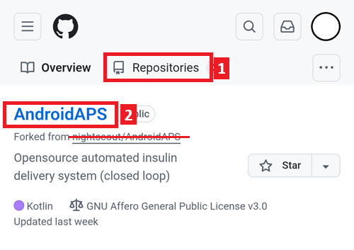
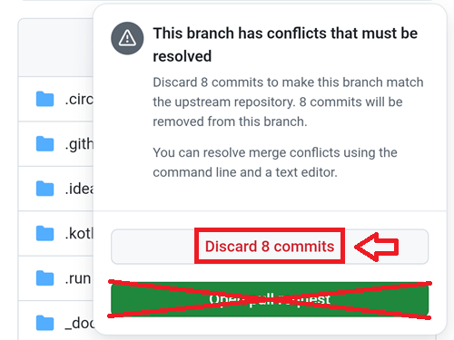

# Update with a browser (fork)

```{tip}
You built AAPS with **AAPS Builder**? You don't need this page: see [Updating AAPS with AAPS Builder](#aaps-builder-updates).
```

## Build yourself instead of download

**AAPS** is not available to download, due to regulations concerning medical devices. It is legal to build the app for your own use, but you must not give a copy to others! See [FAQ page](../UsefulLinks/FAQ.md) for details.

```{note}
Se vuoi aggiornare **AAPS** con il browser per la prima volta: copia il file di backup del tuo keystore sul tuo Google Drive. Then follow the [Browser Build **AAPS** procedure](../SettingUpAaps/BrowserBuild.md) instead of this guide. Invece di creare un nuovo keystore, devi selezionare quello che hai copiato dal tuo computer.
This operation will be mandatory only the first time, then for successive upgrades you will be able to follow this guide.
```

```{tip}
**Switching to AAPS Builder?** [AAPS Builder](../SettingUpAaps/BrowserBuildAapsBuilder.md) is the simpler browser build: no fork to sync, and you download the app directly from GitHub. You don't have to switch: this guide keeps working. If you switch, first get a copy of your keystore from your fork, as explained in [Coming from the previous browser build](#aaps-builder-from-fork). Otherwise the new build cannot update the AAPS on your phone.
```

## Panoramica dell'aggiornamento a una nuova versione di AAPS con il browser

```{contents} Steps for updating to a new version of AAPS
:depth: 1
:local: true
```

In case you experience problems, see separate page for [browser build troubleshooting](../GettingHelp/BrowserBuildTroubleshooting.md).

### Export your settings

Export your settings from the existing **AAPS** version on your phone. You might not need it, but better be safe than sorry.

See the [Export & import settings](ExportImportSettings.md) page if you don't remember how to do this.

(Update-to-new-version-update-your-repo)=
### Aggiorna il tuo repository GitHub

[Accedi a GitHub](https://github.com/login).

1. Seleziona Repositories.
2. Scroll down and select your own AndroidAPS repository.



3. Controlla di usare la tua copia di AndroidAPS (Forked from nightscout/AndroidAPS)
4. Tap Sync Fork to update it (the number of commits behind might differ from the picture)


5. Tap Update Branch


Note: if you have modified your copy of AndroidAPS by mistake, you will see this screen. Discard all changes (commits) to return to the released version.



Ora hai sincronizzato (aggiornato) la tua copia con l'ultima release di **AAPS**. Ottimo lavoro.


### Run the Workflow to Build the Signed APK

1. In your GitHub copy of AndroidAPS, select Actions.
2. Espandi All Workflows.
3. Seleziona AAPS-CI


4. Scroll down and tap Run Workflow.


5. Keep the branch set to master. In **Select AAPS Version**, check that **4.0.0**, the newest version at the top of the list, is selected. If your fork is not up to date, the preselected version is an older one: if you run the workflow with the form as it opens, you rebuild that older version and your app is not updated. Choose the [variant](#browserbuild-variant) (fullRelease), and then tap Run workflow.

   ```{note}
   The list of versions is part of the workflow in your fork. If **4.0.0** is missing, your fork is not synchronized yet: go back to [Update your GitHub repository](#Update-to-new-version-update-your-repo).
   ```


6. Vedrai il messaggio Workflow run was successfully requested. Aggiorna la pagina del browser e potrai seguire l'avanzamento della build. When the action completes, the AAPS CI action will show a green tick mark. Hai fatto con successo la build della versione aggiornata di **AAPS**. This means that the Master and Wear apk is now directly saved into your Google Drive (as per below). L'apk di AAPSClient si può scaricare da Github > nightscout > AndroidAPS [qui](https://github.com/nightscout/AndroidAPS/releases)


### Installa l'APK di AAPS

1. Apri il tuo Google Drive
2. Browse into AAPS, select the new version folder and you will find both the phone and Android Wear versions.


```{note}
From September 2026, Google's [Android developer verification](#android-developer-verification) may block installing the APK by tapping the file, depending on your country. Le soluzioni gratuite sono spiegate in quella pagina.
```

Continua [qui](#Update-to-new-version-check-aaps-version-on-phone)

(update-browser-build-troubleshooting)=

## Troubleshooting

Se qualcosa va storto, niente panico.

Take a breath!

Then check if your problem is already documented: see [AAPS Builder troubleshooting](#aaps-builder-troubleshooting) if you build with **AAPS Builder**, or [Browser build troubleshooting](#aaps-ci-troubleshooting) otherwise.

If you need further help, please reach out to other **AAPS** users on [Facebook](https://www.facebook.com/groups/AndroidAPSUsers) or [Discord](https://discord.gg/4fQUWHZ4Mw).
