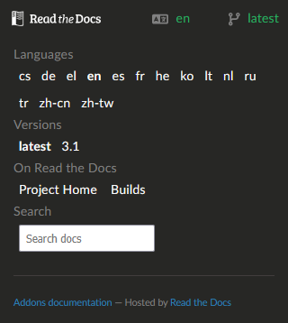

# Cambiare lingua e versione

The documentation you are currently reading is available in several languages and is specific to a given version of **AAPS**. Puoi cambiare sia la lingua sia la versione dal menu in basso a destra dello schermo.

```{note}
Click on the bar at the bottom right of the screen to open the language and version selection menu.
```



## Cambiare lingua

In the menu, select the language you want to read the documentation in.

Feel welcome to join [Crowdin](https://crowdin.com/project/androidapsdocs) translators and proofreaders to help translate the documentation into your language.

## Cambiare versione

La versione attuale è mostrata in basso a destra dello schermo. To switch to a different version, click on the current version and select the version you need.

```{warning}
When changing language and/or version, you might get a 404 - Page not found, if the language or version page doesn't exist. This will frequently happen when switching version but should not happen when changing language: the page will show in English if not translated yet.
```
