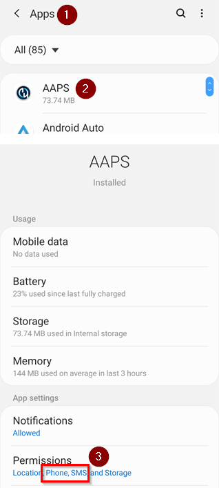
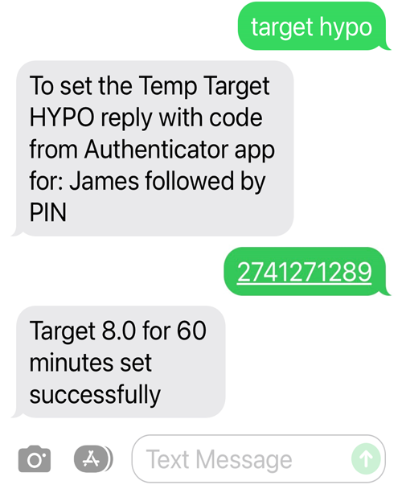

# Comandi SMS

```{contents} Table of contents
:depth: 2
```

Most remote adjustments (temp targets, carbs, profile switches and, once the client is paired, boluses) can be made with the [**AAPSClient** app](../RemoteFeatures/RemoteMonitoring.md) on an Android phone with an internet connection, see [Master ↔ Client control](#client-master-control) (an iPhone version of **AAPSClient** is in development, see [AAPSClient](AapsClient.md)). SMS commands remain an alternative that works without internet, and the only remote option if you use an iPhone as a follower and do not have **AAPSClient** yet.

**I comandi SMS sono molto utili:**
1. For routine remote control

2. If you want to remotely bolus insulin without a paired **AAPSClient**

3. In a region of poor internet reception, where text messages are able to get through, but data/internet phone reception is limited. È molto utile quando vai in zone isolate (per esempio in campeggio o a sciare).

4. If your other method of remote control (**AAPSClient**) is temporarily not working

## Safety First

If you enable **SMS Communicator** in **AAPS**, consider that the phone which is set up to give remote commands could be stolen, and/or used by someone else. Always lock your phone handset with at least a PIN. A strong password and/ or biometric lock are highly recommended, and ensure this is different from your APK Master password (the password which is required to export **AAPS** settings).

Inoltre, è consigliato consentire un [secondo numero di telefono](#SMSCommands-authorized-phone-numbers) per i comandi SMS. This way, you can use the second number to [disable](#SMSCommands-other) SMS communicator in case your main remote phone gets compromised.

Il tempo minimo predefinito tra due comandi di bolo è di 15 minuti, contati dal momento in cui il micro accetta un bolo. For safety reasons, you have to add at least two authorised phone numbers to change this to a shorter time delay. If you try to remotely bolus again within 15 minutes of the previous bolus, you will receive the response “Remote bolus not available. Riprova più tardi”

AAPS will also inform you by text message if your remote commands, such as a bolus or a profile change, have been carried out. It is advisable to set this up so that confirmation texts are sent to at least two different phone numbers in case one of the receiving phones is stolen.

**If you bolus through SMS Commands, you must enter carbs separately (second SMS, AAPSClient...)!** If you fail to do so, the IOB would be correct with too low COB, potentially leading to not performed correction bolus as **AAPS** assumes that you have too much active insulin.

For the sensitive commands, an authenticator app with a time-based one-time password must be used to increase safety.

If you want to remove the ability of a caregiver phone to send SMS commands, use the emergency button “[Reset Authenticators](#sms-commands-authenticator-setup)” in **AAPS** or send the SMS command “[SMS stop](#SMSCommands-other)”. By resetting authenticators you make ALL the caregivers' phones invalid. Dovrai configurarli di nuovo.

## Setup SMS commands

```{contents} The overall process is as follows
:depth: 1
:local: true
```

(sms-commands-authenticator-setup)=
### Configurazione autenticatore

L'autenticazione a due fattori serve a migliorare la sicurezza.

On the caregiver phone, download (from the App store or Google play) and install an Authenticator app. Popular free apps are:
  - [Authy](https://authy.com/download/)
  - Google Authenticator - [Android](https://play.google.com/store/apps/details?id=com.google.android.apps.authenticator2) / [iOS](https://apps.apple.com/de/app/google-authenticator/id388497605)
  - [LastPass Authenticator](https://lastpass.com/auth/)
  - [FreeOTP Authenticator](https://freeotp.github.io/)

These Authenticator apps produce a time-limited, one-time 6-digit password, similar to mobile banking or shopping. You can use an alternative Authenticator app, as long as it supports RFC 6238 TOTP tokens. Microsoft Authenticator non funziona.

### Check phone settings

On your phone, go to **Apps > AAPS > Permissions**. Assicurati che **SMS** e **Telefono** siano consentiti.



```{admonition} "App was denied access to SMS"
:class: tip
Android può bloccare l'autorizzazione **SMS** per le app che non sono state installate da uno store, come **AAPS**. If you see this message when you grant the **SMS** permission, open the phone's **Settings > Apps > AAPS**, tap the **⋮** menu (top right) and select **Allow restricted settings**. Poi concedi di nuovo l'autorizzazione **SMS**.
```


### Date and time syncing

The time on both phones must be synchronized. Best practice is set automatically from network. Time differences might lead to authentication problems.

On both the **AAPS** phone and the caregiver phone, check the date and time are synched. Exactly how you do this depends on your specific device, you may need to try out different settings.

Esempio (per Samsung S23): **Impostazioni > Gestione generale > Data e ora**: assicurati che **Data e ora automatiche** sia attivo.

Some options may be greyed out, due to needing admin via a family account if the phone has been set up as a child account. This date and time setting is called “set automatically” on a caregiver/parent iPhone. If you are not sure if you have synched the handsets, don’t worry, you can set up the SMS commands and troubleshoot afterward if it seems to be causing problems (ask for help if needed).

### Impostazioni di AAPS

Ora che hai controllato le impostazioni del telefono, nell'app **AAPS** vai in [**Configurazione** → **Comunicazione**](../SettingUpAaps/ConfigBuilder.md) e abilita il plugin **Comunicazioni SMS**.

Apri le impostazioni di **Comunicazioni SMS**.

Abilita **Consenti comandi remoti tramite SMS**. The **Additional mandatory PIN at token end** and **Authenticator setup** options only appear once this is enabled:


(SMSCommands-authorized-phone-numbers)=
#### Numeri di telefono consentiti

Enter the caregiver phone number(s). Include the country code and exclude the first “0” of the phone number, as shown in these examples:
* UK phone number: +447976304596
* US phone number: +11234567890
* FR phone number:  +33612344567
* _ecc._

Note that the “+” in front of the number may or may not be required based on your location. To determine this, send a sample text which will show the received format on the **SMS Communicator** plugin screen (**Configuration** → **Communication** → **SMS Communicator** → **Open plugin**).

If you have more than one phone number to add, separate them by semicolons, with **NO space between numbers** (this is critical!). Seleziona **OK**:


#### Distanza min bolo remoto

- You can define the minimum delay (in minutes) between two boluses issued via SMS.
- For safety reasons you have to add at least two authorized phone numbers to edit this value.

#### PIN obbligatorio aggiuntivo a fine token

For safety reasons, the reply code must be followed by a PIN. Choose a PIN which you (and any other caregivers) are going to use at the end of the authenticator code when the SMS command is sent.

Requisiti del PIN:

* almeno 6 cifre
* solo cifre

For a safer PIN, do not use the same digit many times (_e.g._ 111111) or a sequence (_e.g._ 123456).


#### Configurazione autenticatore

* Tocca **Configurazione autenticatore** e segui le istruzioni passo passo sullo schermo.
* Open your installed authenticator app on the _caregiver’s phone_, set up a new connection and
* Use the caregiver phone to scan the QR code shown under **Scan code to setup AAPS OTP codes**.


* Under **Test One-Time-Password**, enter the one-time passcode from the authenticator app on the caregiver phone followed by your PIN in **Code to check**:

Esempio:
* The token from the authenticator app is 457051
* Il tuo PIN obbligatorio è 2401
* Code to check: 4570512401

If the entry is correct, the red text “WRONG PIN” will change automatically to a green “OK”. **There is no button you can press!** The process is now complete, there is no “OK” button you need to press after entering the code:


Ora i comandi SMS dovrebbero essere configurati.

Usa il pulsante **Resetta autenticatori** in fondo alla schermata **Configurazione autenticatore** se vuoi rimuovere gli autenticatori configurati. (By resetting authenticator you make ALL already provisioned authenticators invalid. Dovrai configurarli di nuovo.)

## SMS commands usage

### Primi passi con i comandi SMS

1)  To check you have set everything up correctly, test the connection by typing “bg” as an SMS message from the caregiver phone to the **AAPS** phone. Dovresti ricevere una risposta simile a questa:


If you don't receive any response, check the [Troubleshooting](#SMSCommands-troubleshooting) section below.

2)  Now try an SMS command that requires the authenticator, _e.g._ “target hypo”. The caregiver’s phone will receive a text back, prompting you to enter the **six-digit authenticator password** from the authenticator app, followed by the additional secret **PIN** known only by caregivers/followers (a string of twelve digits in total, assuming your PIN has 6 digits).

When you try sending an SMS command for the first time, try it in the presence of the **AAPS** phone, to see how it works:


The caregiver’s phone will receive an SMS in reply from **AAPS** to confirm if the remote SMS command has been carried out successfully.

Se il comando riesce, ricevi una risposta che lo conferma. Se c'è un problema, ricevi un messaggio di errore. See [Troubleshooting](#SMSCommands-troubleshooting) below for common errors.

**Hint**: It can be useful to have unlimited SMS on your phone plan (for each phone used) if a lot of SMS will be sent.

### Delivering mealtime boluses through SMS commands

Remote bolusing of insulin can be done via **SMS Commands** or through a paired **AAPSClient** (see [Master ↔ Client control](#client-master-control)); it cannot be done through the Nightscout website. Carbs can be announced through SMS or **AAPSClient** as well. With SMS, it is not possible to send both carbs and insulin commands in one single SMS message. These commands must be sent separately as follows:

1)  Send the insulin bolus (_e.g._“bolus 2” will command a bolus of 2 units) through SMS commands is equivalent to **Treatments** → **Insulin** in **AAPS**. 2)  Send the carbs (_e.g._ “carbs 20” will announce 20g of carbs). This is equivalent to **Treatments** → **Carbs** in **AAPS**.

To avoid hypos, it is a good idea to start conservatively, by bolusing **less insulin** than would be needed according to your carb ratio, because you are not taking into account the current glucose level or glucose trend.

**L'ordine in cui invii questi comandi è importante**. If you announce a large amount of carbs by any route, and have SMBs enabled, **AAPS** may immediately respond by giving a partial bolus of insulin. So, if you then try to send an insulin bolus _after_ announcing the carbs, you may have a frustrating delay and a “bolus in progress” message, and you then need to check what has been given as an SMB. Or, if you do not realise an SMB is being delivered, and your own subsequent bolus is also successful, too much insulin may be delivered for the meal overall. Therefore, if bolusing for meals remotely, always send the insulin bolus _before_ the carb announcement. If you prefer, you can combine **AAPSClient** with SMS commands: carbs entered on a paired **AAPSClient** need no authentication code and are therefore quicker than SMS commands. Carbs or other treatments entered on the Nightscout website are **not** applied while client control is on; **AAPS** is then in [hardened mode](#client-master-control-hardened-mode).

(SMSCommands-commands)=
## Comandi

```{contents} List of command groups
:depth: 1
:local: true
```

Commands must be sent in English, the response will be in your local language if the response string is already [translated](#translations-translate-strings-for-AAPS-app). The commands are not case-sensitive, you can use lower or upper case.


The **SMS Commands Tables** below show all the possible SMS commands. _Example values_ are given, to aid understanding. The commands have the same range of possible values (targets, percent profile etc.) which are allowable in the **AAPS** app itself.

(authentication-or-not)=
### Autenticazione o no?

Some SMS commands give an immediate response, and some SMS commands require strong **authentication** through the Authenticator app. A simple enquiry like “**BG**” (which requests an update on current glucose) is quick to type, doesn't need authenticating, and returns the **AAPS** status information shown below:


Commands which need more security require a code to be entered, for example:



The *Auth* column in the tables below, indicates whether such a strong authentication is required for each command.

### Dati CGM

| Comando    | Auth | Function & *Response*                                                                                                                                                                                                                                |
| ---------- | ---- | ---------------------------------------------------------------------------------------------------------------------------------------------------------------------------------------------------------------------------------------------------- |
| BG         | No   | Returns: last BG, delta, IOB (bolus and basal), COB<br/>*Last BG: 5.6 4min ago, Delta: -0,2 mmol, IOB: 0.20U (Bolus: 0.10U Basal: 0.10U)*                                                                                                      |
| CAL 5.6/90 | Sì   | Calibra il CGM con un valore di 5,6/90<br/>(usa il valore adatto alle tue unità di glicemia)<br/>Funziona solo se configurato correttamente in **AAPS**.<br/>*Calibrazione inviata. La ricezione deve essere abilitata in xDrip+.* |

### Micro

| Comando              | Auth | Function & *Response*                                                                                  |
| -------------------- | ---- | ------------------------------------------------------------------------------------------------------ |
| MICRO                | No   | Ultima conn: 1 min fa<br/>Temp: 0.00U/h @11:38 5/30min<br/>IOB: 0.5U Reserv: 34U Batt: 100 |
| PUMP DISCONNECT *30* | Sì   | Per disconnettere il micro per *30* minuti                                                             |
| PUMP CONNECT         | Sì   | Micro riconnesso                                                                                       |

### Basale

| Comando           | Auth | Function & *Response*            |
| ----------------- | ---- | -------------------------------- |
| BASAL 0.3         | Sì   | To start basal 0.3U/h for 30 min |
| BASAL 0.3 20      | Sì   | To start basal 0.3U/h for 20 min |
| BASAL 30%         | Sì   | To start basal 30% for 30 min    |
| BASAL 30% 50      | Sì   | To start basal 30% for 50 min    |
| BASAL STOP/CANCEL | Sì   | Per fermare la basale temporanea |

Alcuni micro accettano una basale temporanea solo in percentuale, altri solo in U/h. If you use the other form, **AAPS** answers *"This pump takes a temp basal only in percent, not in U/h."* (or the reverse) and sets nothing. La durata deve essere un multiplo del passo di durata della basale temporanea del tuo micro.


### Loop

| Comando           | Auth | Function & *Response*                                                                                                                                                                                                                                                                          |
| ----------------- | ---- | ---------------------------------------------------------------------------------------------------------------------------------------------------------------------------------------------------------------------------------------------------------------------------------------------- |
| LOOP STATUS       | No   | La risposta dipende dallo stato attuale:<br/> - *Il loop è disabilitato* se il loop è disabilitato<br/> - *Il loop è abilitato* se il loop è chiuso, aperto o in LGS<br/> - *Micro disconnesso* se il micro è disconnesso<br/> - *Sospeso (10 m)* se il loop è sospeso |
| LOOP STOP/DISABLE | Sì   | The pump will revert to the pre-programmed basal rate.<br/>*Loop has been disabled*                                                                                                                                                                                                      |
| LOOP SUSPEND 20   | Sì   | *Loop sospeso*                                                                                                                                                                                                                                                                                 |
| LOOP RESUME       | Sì   | *Loop ripreso*                                                                                                                                                                                                                                                                                 |
| LOOP CLOSED       | Sì   | *Modalità di esecuzione corrente: Loop chiuso*                                                                                                                                                                                                                                                 |
| LOOP LGS          | Sì   | *Modalità di esecuzione corrente: Sospensione a glicemia bassa (LGS)*                                                                                                                                                                                                                          |

### Bolo

Remote bolus is not allowed within 15 min (this value is editable only if 2 phone numbers added) after last bolus command or remote commands! In questo caso la risposta sarà *Bolo remoto non disponibile. Try again later.* This response is also sent when the pump is currently delivering a bolus.

| Comando              | Auth | Function & *Response*                                                                                                                                             |
| -------------------- | ---- | ----------------------------------------------------------------------------------------------------------------------------------------------------------------- |
| BOLUS 1.2            | Sì   |                                                                                                                                                                   |
| BOLUS 0.60 MEAL      | Sì   | Delivers the specified 0.60U bolus<br/>**and** sets the [Eating Soon TempTarget](#TempTargets-eating-soon-temp-target)                                      |
| CARBS 5              | Sì   | Per inserire 5 g, senza bolo                                                                                                                                      |
| CARBS 5 17:35/5:35PM | Sì   | Per inserire 5 g alle 17:35.<br/>Il formato dell'ora accettato dipende<br/> dall'impostazione dell'ora (12h/24h) del telefono.                        |
| EXTENDED 2 120       | Sì   | To start extended bolus 2U for 120 min.<br/>Only for [compatible pumps](#Extended-Carbs-extended-bolus-and-switch-to-open-loop-dana-and-insight-pump-only). |
| EXTENDED STOP/CANCEL | Sì   | Per fermare il bolo esteso                                                                                                                                        |

### Profilo

| Comando        | Auth | Function & *Response*                                                                                                                             |
| -------------- | ---- | ------------------------------------------------------------------------------------------------------------------------------------------------- |
| PROFILE STATUS | No   | Current profile and percentage                                                                                                                    |
| PROFILE LIST   | No   | The current list of profiles in **AAPS**, e.g.:<br/>1. Profile1<br/> 2. Profile2                                                      |
| PROFILE 1      | Sì   | Per passare al profilo 1 dell'elenco.<br/>Usa i numeri restituiti da **PROFILE LIST**,<br/>non i nomi dei profili come li hai salvati |
| PROFILE 2 30   | Sì   | To switch profile to Profile2 30%                                                                                                                 |

La percentuale deve essere tra 30 e 250 %, come nell'app. Un valore fuori da questo intervallo viene rifiutato prima che ti venga chiesto il codice di autenticazione.

### Temporary Targets

| Comando                   | Auth | Function & *Response*                     |
| ------------------------- | ---- | ----------------------------------------- |
| TARGET MEAL/ACTIVITY/HYPO | Sì   | To set the Temp Target MEAL/ACTIVITY/HYPO |
| TARGET STOP/CANCEL        | Sì   | To cancel Temp Target                     |


(SMSCommands-other)=
### Other

| Comando          | Auth | Function & *Response*                                                                                                                                                                                                                                                  |
| ---------------- | ---- | ---------------------------------------------------------------------------------------------------------------------------------------------------------------------------------------------------------------------------------------------------------------------- |
| RESTART          | Sì   | Riavvia AAPS. Utile se hai problemi che di solito si risolvono con un riavvio.                                                                                                                                                                                         |
| SMS DISABLE/STOP | Sì   | To disable the SMS Remote Service, reply with the code.<br/>Keep in mind that you'll be able to reactivate it directly<br/>from the **AAPS** master smartphone only.                                                                                       |
| HELP             | No   | Returns all functions available for interrogation:<br/>BG, LOOP, PUMP, BASAL, BOLUS, EXTENDED, CAL, PROFILE, TARGET, SMS, CARBS, HELP, RESTART<br/>Send further ***HELP ***FUNCTION****** command to list<br/>all options available in this section. |
| HELP BOLUS       |      | *BOLUS 1.2<br/>BOLUS 1.2 MEAL*                                                                                                                                                                                                                                   |

(SMSCommands-troubleshooting)=
## Troubleshooting and FAQ

```{contents} List of questions and issues
:depth: 1
:local: true
```

### What _can’t_ we do with SMS commands?

1)  **You cannot set a _temporary_ profile switch** (so for example, setting "profile exercise" for 60 minutes), although you can permanently switch to “profile exercise”. I cambi profilo temporanei si possono invece impostare con **AAPSClient**.

2)  **You cannot cancel automations** or **set user-defined targets** but there are approximate solutions: As an example, imagine the normal profile target is 5.5. You have set an automation in AAPS, to always set a high target of 7.0 between 2.30pm and 3.30pm because of a sports class in school, and a condition of the automation is that “no temp target exists”. This week, you have been told at short notice that the sports class is cancelled, and is being replaced by a pizza-eating session, but your kid is already at school with the **AAPS** phone. If the high temporary target of 7.0 is started by the automation, and you cancel it (on the **AAPS** phone, or remotely) the conditions for the automation are still met and **AAPS** will simply set the high target again, a minute later.

**If you did have access to the AAPS phone**, you could uncheck/modify the automation, or, if you don’t want to do that, you could simply set a new temp target of 5.6 for 60 min by pressing on the target on the main screen, or via **Manage** → **Temp Target**. This would prevent the automation from setting the high target of 7.0.

**If you don’t have access to the AAPS phone** SMS commands can be used for an approximate fix: for example, by using the command “target meal” to set a target of 5.0 for 45 mins (other default targets are 8.0 for activity or hypo, see Table). Però con i comandi SMS non puoi indicare un valore di target _specifico_ (per esempio 5,6 per 60 minuti): per farlo devi usare **AAPSClient**.

### Cosa succede se cambio idea su un comando che ho appena inviato?

**AAPS** will only deliver on the most recent command. Quindi, se scrivi “bolus 1.5” e poi, senza autenticarti, invii un nuovo comando “bolus 1”, il comando precedente da 1,5 viene ignorato. **AAPS** will always send the caregiver's phone a response to confirm what the SMS command is before you are prompted to enter the authentication code, as well as a response following the action.

### Why didn't I get a response to an SMS command?

It could be for one of these reasons:

1)  Il messaggio non è arrivato al telefono (problemi di rete). 2)  **AAPS** is still in the process of processing the request (_e.g._ a bolus, which can take some time to deliver depending on your bolus rate). 3)  The **AAPS** phone does not have a good Bluetooth connection to the pump when the command is received, and the command has failed (this usually creates an alarm on the **AAPS** phone).

### Nessuna risposta ai comandi SMS

On the caregiver phone and/or **AAPS** phone, try disabling the following options :
* **Send as chat message** 
* If using Android Messages App or Google Messages App, disable RCS messaging:
  - open the specific SMS conversation in Messages
  - Select the options ellipsis in the top right corner
  - seleziona "Dettagli"
  - Activate "Only send SMS and MMS messages" 

### Errors carrying out commands

There are several possible reasons the command may not be successful:

* SMS commands setup isn’t complete/correct
* Hai inviato un comando con un formato sbagliato (per esempio “disconnect pump 45” invece di “pump disconnect 45”)
* You used an incorrect, or expired authenticator code (it is usually good to wait a few seconds for a fresh code, if the current one is about to expire)
* The code+PIN was OK, but there was a delay in the SMS leaving/arriving, which led **AAPS** to calculate that the authenticator code had expired
* The **AAPS** phone is out of range/contact with the pump
* Il sistema sta già erogando un bolo

Common errors are shown in the examples below:


### How can I stop a command once it has been authenticated?

Non puoi. However, you can cancel a bolus sent by SMS on the **AAPS** phone itself, by simply cancelling it on the bolusing popup, if you are quick. Many SMS commands (apart from bolusing and carb announcements) can be easily reversed, or actions taken to mitigate unintended effects if a mistake is made.

For errors in bolusing and carb announcements, you can still take action. For example, if you have announced 20g carbs but your child only eats 10g and you (or an onhand caregiver) is unable to delete the treatment in the **AAPS** phone directly, you could set a high temporary target, or set a reduced profile, to encourage **AAPS** to be less aggressive.

### SMS multipli

If you receive the same message repeatedly (_e.g._ a profile switch) you may have accidentally set up a looping condition with other apps. Per esempio potrebbe essere xDrip. If so, please ensure that xDrip (or any other app) does not upload treatments to NightScout.

If the other app is installed on multiple phones make sure to deactivate upload on all of them.

(sms-commands-too-many-messages)=
### I am getting far too many text messages from SMS Commands. Can I reduce the frequency, or make them stop?

Using SMS commands may generate a lot of automated messages from the **AAPS** phone to the caregiver’s phone. You will also receive messages, for example “basal profile in pump updated” if you have automations set up in **AAPS**. It can be useful to have unlimited SMS allowance on your **AAPS** phone plan (and for each caregiver phone used) if a lot of SMS will be sent, and to deactivate SMS notifications, alarms or vibrations on all phones. Non è possibile usare i comandi SMS senza ricevere questi aggiornamenti. Because of this, you may want an alternative way to communicate directly with your child (if they are old enough), instead of SMS. Le app di comunicazione alternative più usate dai caregiver di **AAPS** sono WhatsApp, LINE, Telegram e Facebook Messenger.

È possibile disattivare l'SMS "Profilo basale aggiornato nel micro", quando il cambio profilo arriva da Nightscout. Per farlo, crea un file che si chiama **esattamente** `do_not_send_sms_on_profile_change` nella cartella `extra` della tua cartella AAPS.
