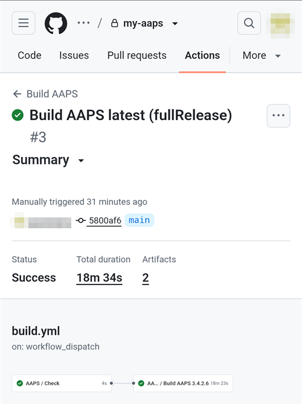

(aaps-builder)=

# Browser build with AAPS Builder

```{note}
This is the recommended way to build AAPS from an **Android phone**. It also works from any computer browser. For the other ways to build from a computer or an iPhone, see the [Browser build](BrowserBuild.md) overview.
```

```{contents} In this page
:backlinks: entry
:depth: 2
```

**AAPS Builder** builds the AAPS app for you in GitHub, the free code-hosting website. There is nothing to install on your phone, and no preparation file to open.

Una pagina di configurazione ti guida passo per passo. It takes about 10 minutes the first time:

1. Create your own **private copy** of AAPS Builder in your GitHub account: the setup page opens GitHub with everything filled in, you only confirm. The build workflow, the file that tells GitHub how to build AAPS, is already in it.
2. Crea o carica la tua **chiave di firma** (il keystore).
3. Give the key to your repository as a GitHub **secret**.
4. Fai la **build** dell'app. One build takes 15 to 30 minutes.
5. **Scarica e installa** l'app sul telefono.

You do **not** need to fork AndroidAPS: the AAPS source code is downloaded from the official AndroidAPS repository at every build. You also do **not** need Google Drive: you download the app directly from GitHub.

```{admonition} Where the code comes from
:class: note

The build workflow is maintained by the AAPS developers in the [nightscout/aaps-builder](https://github.com/nightscout/aaps-builder) repository, and your repository is a copy of it. The [workflow](https://github.com/nightscout/aaps-builder/blob/main/.github/workflows/build.yml) in your copy is short: it runs the [build steps](https://github.com/nightscout/aaps-builder/blob/main/.github/workflows/aaps-builder.yml) kept in that repository, so improvements reach you without any change to your repository. Puoi leggere entrambi i file. Durante la build, il workflow scarica solo il codice sorgente ufficiale di AAPS e gli strumenti di build di GitHub. Your keystore never leaves your browser and your private repository.
```

(aaps-builder-before-you-start)=

## Prima di iniziare

You will need:

- Un **account GitHub** (gratuito). If you don't have one, create it on [github.com](https://github.com/signup) first.
- A **web browser**: Chrome on your phone, or any browser on a computer. Log in to github.com in that browser before you start.
- **GitHub app on your phone?** You can keep it. Some buttons of the setup page then open the app instead of Chrome. La build funziona nell'app, ma l'app **non può scaricare** l'AAPS finito: il [passo 5](#aaps-builder-step5) spiega come passare a Chrome per il download.
- Your **existing keystore** (`.jks` file), its password and its alias, if you built AAPS before and want to update it without reinstalling.

```{warning}
**Your build repository must stay private.** Everything a build produces is visible to anyone who can see the repository. La pagina di configurazione crea per te un repository privato. Never change it to public, and don't **fork** AAPS Builder instead: a fork is always public.

Un repository privato ha 2000 minuti gratuiti di GitHub Actions al mese, abbastanza per diverse build.
```

```{warning}
**New key or existing key: this decides whether you can update AAPS.**

- **You already have AAPS on your phone, built with a keystore you still have**: choose **I already have a keystore** on the setup page and upload it. Your next build will update AAPS in place. Built AAPS with the previous browser build (your own fork)? Il tuo keystore è nel tuo fork: [prima fanne una copia](#aaps-builder-from-fork).
- **You build AAPS for the first time, or you lost your keystore or its password**: choose **Create a new key**. An app signed with a new key **cannot update** an AAPS signed with another key. You must export your settings, copy the file off your phone, uninstall the old AAPS, install the new one, then import your settings: see [Reinstalling AAPS with a new keystore](#reinstall-aaps).

Da quel momento usa sempre la stessa chiave. When you create a new key, download the backup the page offers and store it with its password and its alias (`key0`) somewhere safe, off your phone.
```

(aaps-builder-from-fork)=

## Coming from the previous browser build (fork)

Skip this section if you never built AAPS with the previous browser build method (your own copy, or fork, of AndroidAPS in GitHub, with the preparation file and Google Drive).

Il tuo keystore è salvato come secret nel tuo fork. GitHub non mostra mai più un secret, quindi non puoi copiarlo nel tuo nuovo repository. Get a copy of your keystore first, then use it in [step 2](#aaps-builder-step2) with **I already have a keystore**.

```{warning}
Don't choose **Create a new key**. AAPS built with a new key cannot update the AAPS on your phone.
```

Qual è il tuo caso?

- **You used Option 2** (you uploaded your own keystore from Android Studio), and you still have the `.jks` file, its passwords and its alias: nothing to do here. Usa quel file nel passo 2.
- **You used Option 1** (the preparation file created your key), or you no longer have your keystore file: export it from your fork as below.

Per esportare il keystore dal tuo fork:

1. In your fork, open **Settings** → **Secrets and variables** → **Actions** and add a secret named `ZIP_PASSWORD`. Scegli una password con solo lettere inglesi e numeri. Protegge il file che stai per creare.
2. Apri la scheda **Actions** del tuo fork, tocca **CI Keystore Export**, poi **Run workflow**. More details: [Export your keystore](#ci-keystore-export).
3. When the run has a green check, open your Google Drive: the file `keystore.zip` is in the folder **AAPS** → **KeyStore**. If the run fails at the Google Drive step, your fork's Google Drive access has expired: see [Google refresh token expired](#aaps-ci-google-token-expired).
4. Download `keystore.zip` and open it with your `ZIP_PASSWORD`: on a computer, or on your phone with a file manager app that can open password-protected ZIP files. Contiene:
   - `keystore.jks`: il tuo keystore,
   - `keyStoreInfo.txt`: your `KEYSTORE_PASSWORD`, `KEY_PASSWORD` and `ALIAS` (usually `key0`).
5. Copia `keystore.jks` sul telefono (o su Google Drive, così puoi sceglierlo da lì).

Nel [passo 2](#aaps-builder-step2) della pagina di configurazione:

1. Tap **I already have a keystore**.
2. In **Keystore file**, choose `keystore.jks`.
3. In **Keystore password**, type the `KEYSTORE_PASSWORD` from `keyStoreInfo.txt`.
4. In **Key alias**, pick or type the `ALIAS` from `keyStoreInfo.txt`.
5. If `KEY_PASSWORD` is different from `KEYSTORE_PASSWORD`, untick **Key password is the same as the keystore password** and type the `KEY_PASSWORD`.

Conserva `keystore.zip` e la sua `ZIP_PASSWORD` in un posto sicuro, fuori dal telefono: è il backup della tua chiave.

To also save the builds of AAPS Builder in Google Drive, do [step 6](#aaps-builder-google-drive): the setup page gets a new `GDRIVE_OAUTH2` for you. You can keep your fork until AAPS built with AAPS Builder is installed on your phone.

## Apri la pagina di configurazione

**→ [Apri la pagina di configurazione di AAPS Builder](#aaps-builder-setup)**

La pagina di configurazione fa parte di questa documentazione, nella tua lingua. Keep this page open in another tab as well: the sections below explain each step of the setup page in more detail, with screenshots.

La pagina di configurazione apre ogni pagina di GitHub in una nuova scheda di Chrome. Per tornare alla pagina di configurazione, tocca il pulsante delle schede accanto alla barra degli indirizzi di Chrome (il quadrato con un numero) e scegli la pagina di configurazione di AAPS Builder.

The setup page runs entirely in your browser: your key and passwords are never sent anywhere, except into the GitHub secret you paste them into yourself. A GitHub viene inviato solo il tuo nome utente GitHub, per controllare che esista. It remembers your GitHub username and repository name, so you can come back to it at any time to reopen your secrets page or your builds.


(aaps-builder-step1)=

## Passo 1 – Crea il tuo repository di build privato

This step creates your own private copy of AAPS Builder in your GitHub account, with the build workflow already in it. Only you can see it and the apps it builds.

1. Make sure you are logged in to github.com in this browser.

2. In **Your GitHub username**, type your GitHub username, not your e-mail. The page checks it with GitHub: **✓ GitHub user found** means it is right.

3. In **Name of your repository**, keep the suggestion `my-aaps`. If you already created your repository with another name, type that exact name.

   ```{note}
   **Hai già un repository AAPS Builder** (creato con una versione precedente della pagina di configurazione)? Don't create a new one: type its exact name, skip **Create my private repository**, and update its workflow once as explained in [Updating AAPS](#aaps-builder-updates). I tuoi secret restano come sono. Se vuoi comunque un nuovo repository, scegli un nome che non hai ancora, per esempio `my-aaps-2`, e usa lo stesso keystore nel passo 2.

   Non scrivere il nome del tuo fork di AndroidAPS: un fork è pubblico e fa già la build con il suo workflow **AAPS CI**.
   ```

   

4. Check the line **Your repository:** it shows `github.com/<your username>/my-aaps`. The setup page remembers the name from your last visit: check it every time before you use its buttons.

5. Tap **Create my private repository**.

   

6. GitHub apre **Create a new repository** (crea un nuovo repository) in una nuova scheda. Everything is already filled in: under **Start with a template**, the template `nightscout/aaps-builder` with **Include all branches** off, and under **General**, your account as **Owner** and the name you chose.

   

   Don't change anything.

7. Scroll down: under **Configuration**, **Choose visibility** is already **Private**. Tap the green **Create repository** button.

   

   GitHub mostra il tuo nuovo repository: contiene una cartella `.github` (con il workflow di build) e un file `README.md`. **Torna alla scheda della pagina di configurazione** per il passo 2: tocca il pulsante delle schede accanto alla barra degli indirizzi di Chrome e scegli la pagina di configurazione.

```{warning}
**Il tuo nuovo repository è vuoto**, senza file? It was not created from the template, and it cannot build. Delete it (**Settings** → bottom of the page → **Delete this repository**), then tap **Create my private repository** on the setup page again.
```

(aaps-builder-step2)=

## Passo 2 – La tua chiave di firma

The app must be signed with your own key. Scegli una delle due schede. Read the [new key or existing key warning](#aaps-builder-before-you-start) first.


### I already have a keystore

1. Tap **I already have a keystore**.
2. In **Keystore file**, choose your `.jks` file (or `.keystore`, `.p12`, `.pfx`). On a phone, copy the file to your phone or to Google Drive first.
3. In **Keystore password**, type the keystore password.
4. In **Key alias**, pick your alias from the list, or type it if there is no list. Per i keystore creati con Android Studio di solito è `key0`.
5. If your key password is different from the keystore password, untick **Key password is the same as the keystore password** and type the key password.
6. Tap **Check and continue**.

La pagina controlla la password e l'alias sul tuo dispositivo. **Keystore OK! Continue with step 3.** means everything is right. If it says the password will be checked when you build, continue anyway: the build tells you if something is wrong.

### Create a new key

1. Tap **Create a new key**.

2. Scegli una password e scrivila due volte. Regole: almeno 8 caratteri, solo le lettere a–z e A–Z, le cifre 0–9 e simboli come `! ? #`. No spaces, no accented letters, and not the `|` character.

3. Tap **Create key**. It takes a few seconds before **Key created** appears.

   

4. Tap **Download backup (aaps-keystore.jks)**. Se Chrome chiede **Scaricare di nuovo il file?**, sul telefono c'è già un backup più vecchio con lo stesso nome: tocca **Scarica di nuovo**. Chrome then saves the new key as `aaps-keystore (1).jks`: that is the file that goes with this key, keep it and don't mix it up with the older one.

   Keep these three together, somewhere safe off your phone (for example your own cloud storage):

   - il file `aaps-keystore.jks`,
   - la tua password,
   - l'alias della chiave: **`key0`**.

   You need all three if you ever build AAPS another way, for example with Android Studio. Le chiavi create con una versione precedente della pagina di configurazione hanno l'alias `aaps`.

   

(aaps-builder-step3)=

## Step 3 – Give the key to your repository

Il passo 3 si sblocca quando il passo 2 è fatto. Your key, its passwords and its alias are packed into one value, the `KEYSTORE_SET` secret.

1. Tap **Open the secrets page**.


2. GitHub apre la pagina **New secret** (nuovo secret) del tuo repository. On a phone, it is below the settings menu: scroll down.


3. Switch to the setup page tab and tap **Copy name**. Switch back to the GitHub tab and paste it into the small **Name** field. Il nome è `KEYSTORE_SET`.

4. Switch to the setup page tab and tap **Copy secret**. Switch back to the GitHub tab and paste it into the big **Secret** box (long press on a phone). The secret is a very long code, thousands of characters: the setup page shows its first characters next to the button. Don't paste the word `KEYSTORE_SET` there.

5. Tocca **Add secret** (aggiungi secret). `KEYSTORE_SET` now shows under **Repository secrets**.


You only need to do this once.

```{tip}
GitHub shows **Page not found** (404)? First check that you are logged in to github.com in this browser: GitHub shows 404 for private repositories when you are not logged in. Otherwise the username or repository name in step 1 doesn't match your repository. Controlla il nome su github.com, correggilo nel passo 1 e tocca di nuovo il pulsante.
```

(aaps-builder-step4)=

## Passo 4 – Fai la build dell'app

1. On the setup page, tap **Open the build page**. GitHub apre la pagina **Build AAPS** del tuo repository.

   

   If the **GitHub app** opens instead: tap **RUN WORKFLOW**, check the version and the variant, and tap **RUN WORKFLOW** again. The app may still show **Nothing to see here**: pull the list down to refresh it and see your build. Poi continua con il passo 4 qui sotto.

2. If GitHub asks, tap the green button to enable workflows.

   The list of workflows shows two entries: use **Build AAPS**. Ignora **AAPS Builder**: contiene i passi di build e non ha il pulsante **Run workflow**.

3. Tap **Run workflow**. Si apre un piccolo modulo:
   - **Version**: keep `latest` to build the newest AAPS release, or type a release number such as `4.0.0`.
   - **Variant**: keep `fullRelease` for normal use with a pump. Le altre varianti sono spiegate in [varianti di build](#browserbuild-variant). `aapsclient3Release` crea **AAPSClient3**, disponibile dalla versione 4.0 di **AAPS** (vedi [Informazioni su AAPSClient, AAPSClient2 e AAPSClient3](#remotecontrol-aapsclient-versions)).
   - Tocca il pulsante verde **Run workflow**.

   

4. La build parte e mostra **In progress** (in corso), con due parti: **AAPS / Check**, poi **AAPS / Build AAPS**.

   

5. Aspetta da 15 a 30 minuti. A green check means the build is done. A red cross means it failed: open the build to read the message, then see [troubleshooting](#aaps-builder-troubleshooting).

   

   ```{tip}
   **E-mail when a build is done:** GitHub only e-mails you when a build fails. To also get an e-mail when it succeeds: on github.com, open your profile picture → **Settings** → **Notifications** → **System** → **Actions**, and untick **Only notify for failed workflows**.
   ```

Se non c'è il pulsante **Build AAPS** o **Run workflow**:

- Apri il tuo repository e controlla che abbia una cartella `.github` con il file `workflows/build.yml`. If the repository is empty, it was not created from the template: delete it (**Settings** → bottom of the page → **Delete this repository**) and do [step 1](#aaps-builder-step1) again with the button.
- Apri la scheda **Actions**. If it says workflows are disabled, tap the green button to enable them, then tap **Build AAPS** in the list.

(aaps-builder-step5)=

## Passo 5 – Installa l'app sul telefono

```{warning}
**Before every update**, [export your settings](#ExportImportSettings-Automating-Settings-Export) in AAPS and copy the file **off the phone** (Google Drive, Dropbox…). Keep several older exports and the APK files there too, so you can always go back.
```

1. On your phone, open the setup page in **Chrome**. Log in to github.com if asked.
2. Tap **Open my builds**, then the newest build with a green check.

   ```{admonition} The GitHub app opened instead of Chrome?
   :class: note

   L'app GitHub non può scaricare le build. In the app, open the newest build, then tap **Artifacts ↗**, or tap the share icon at the top and choose **Chrome** (or **Copy link**, then paste the link in Chrome's address bar). La build si apre in Chrome: continua lì con il passo successivo.

   To stop GitHub links opening in the app: Android **Settings** → **Apps** → **GitHub** → **Open by default** → turn off **Open supported links**.
   ```

   

3. Scroll down to the build summary and tap the **Download AAPS** link.

   

   ```{tip}
   Scroll with your finger on the text, not on the diagram of the build steps: the diagram moves instead of the page.
   ```

   You can also scroll further down to **Artifacts** and tap the download icon next to `aaps-….apk`.

   

4. Quando il download è finito, apri il menu di Chrome **⋮** → **Download**, tocca `aaps-….apk` e scegli **Installa**. If asked, allow installing apps from this source.

   

`aaps-wear-….apk` è l'app per lo smartwatch. Skip it if you don't use one.

L'app resta nella pagina della build per **14 giorni**. Non compare sotto **Code** nel tuo repository. Copiala in un posto sicuro, fuori dal telefono, insieme alle esportazioni delle impostazioni.

For more ways to install the app, see [Transferring and Installing AAPS](TransferringAndInstallingAaps.md).

```{note}
From September 2026, Google's [Android developer verification](#android-developer-verification) may block installing the APK by tapping the file, depending on your country. Le soluzioni gratuite sono spiegate in quella pagina.
```

(aaps-builder-google-drive)=

## Passo 6 (facoltativo) – Salva l'app anche in Google Drive

You can also have each build saved to your Google Drive, in the folder `AAPS/<version>`. È facoltativo: l'app è sempre disponibile nella pagina della build.

Serve un altro secret, `GDRIVE_OAUTH2`. Step 6 of the setup page gets it from Google for you, on a phone or a computer. **AAPS** can then only see and change the files it creates in your Google Drive, nothing else.

1. On the setup page, tap **Connect Google Drive**. Google si apre in una nuova scheda.
2. Scegli il tuo account Google e consenti l'accesso. If Google says the app is not verified, tap **Advanced**, then **Go to …**.
3. The new tab then shows an error such as **This site can't be reached** or **127.0.0.1 refused to connect**. **È normale:** la risposta di Google è nell'indirizzo di quella scheda. Tocca la barra degli indirizzi, seleziona tutto l'indirizzo (inizia con `http://127.0.0.1:47913/`) e copialo.
4. Go back to the setup page tab within a few minutes: Google's answer is only valid for a short time, and only once. Paste the address into **Paste the copied address here** and tap **Get GDRIVE_OAUTH2**. The page shows **GDRIVE_OAUTH2 is ready**.
5. Tap **Open the secrets page**. Tap **Copy name**, then paste it into the small **Name** field (the name is `GDRIVE_OAUTH2`). Tap **Copy secret**, paste it into the big **Secret** box and tap **Add secret**.

From the next build, the APKs are also saved in Google Drive.

Already have a `GDRIVE_OAUTH2` value from the preparation file of the other browser build methods? Funziona anche quello: aggiungilo come secret `GDRIVE_OAUTH2`.

Google blocca l'accesso se non fai build per 6 mesi o se cambi la password di Google. The build then tells you so: redo these steps. See [Google refresh token expired](#aaps-ci-google-token-expired).

(aaps-builder-updates)=

## Aggiornare AAPS

Your repository never builds anything by itself: you decide when to build, which version and which variant. Quando esce una nuova versione di AAPS:

1. [Back up your settings](#aaps-builder-step5) as explained in step 5.
2. Fai la build della nuova versione come nel [passo 4](#aaps-builder-step4). Lascia `latest`, oppure scrivi il numero della versione.
3. Scaricala e installala come nel [passo 5](#aaps-builder-step5).

**Updates of the build steps** reach you by themselves: at every build, your repository runs the build steps released by the AAPS developers in nightscout/aaps-builder. Nothing changes in your repository, and there is no automatic build.

**Updates of your workflow file** are rare: only when the **Run workflow** form changes, for example for a new build variant, or once if your repository was made with an earlier version of the setup page (an empty repository with a short workflow file) or from the old template. The [Docs updates & changes](../Maintenance/DocumentationUpdate.md) page says so. Your `KEYSTORE_SET` secret stays as it is. On the setup page, open **Updating your copy** at the end of step 1:

1. Tap **Open the newest workflow**. On a computer, click the **copy icon** ("Copy raw file") at the top right of the file. On a phone, open the **plain-text version** instead, press and hold the text, then **Select all** and **Copy**.
2. Tap **Open my workflow file**.
3. Replace the whole text with the copied workflow (long press on a phone: **Select all**, then **Paste**).
4. Tap **Commit changes…**, then **Commit changes**.

La prima riga del file mostra la sua versione.

(aaps-builder-troubleshooting)=

## Troubleshooting

To see why a build failed, [read the build log](#aaps-ci-read-the-logs): the step names are different, but you find the error the same way. You can also [update a secret](#aaps-ci-update-secret) and [run the build again](#aaps-ci-rerun) the same way.

- **No "Build AAPS" or "Run workflow" button, or the repository is empty**: the repository was not created from the template. Delete it (**Settings** → bottom of the page → **Delete this repository**) and do [step 1](#aaps-builder-step1) again with the **Create my private repository** button.
- **The build stops with "This repository is PUBLIC"**: in your repository, open **Settings** → **General** → **Danger Zone** → **Change visibility** → **Private**, then build again.
- **"Secret KEYSTORE_SET is missing"**: do step 3 of the setup page.
- **"The secret is too short"**, **"The secret is not a valid code"** or **"The secret does not contain a keystore"**: the wrong text was pasted into the secret, often the word `KEYSTORE_SET` itself, or only part of the code. In your repository, open **Settings** → **Secrets and variables** → **Actions**, edit `KEYSTORE_SET` and paste the long code from **Copy secret** again (redo step 2 of the setup page first if you closed it).
- **"Keystore, password or alias is wrong"**: check your keystore's password and alias, then redo steps 2 and 3 of the setup page.
- **"Version … does not exist"**: the version you typed is not an AAPS release. Usa `latest`, oppure controlla il numero della versione.
- **"Variant … is not supported"**: your workflow file is an older version. Sostituiscilo come spiegato in [Aggiornare AAPS](#aaps-builder-updates).
- **"Page not found" (404) quando la pagina di configurazione apre GitHub**: accedi a github.com nello stesso browser (GitHub mostra 404 per i repository privati quando non hai fatto l'accesso). Se hai fatto l'accesso, il nome utente o il nome del repository nel passo 1 della pagina di configurazione non corrisponde al tuo repository. Scrivi i nomi esatti.
- **"No GitHub user with this name"** in step 1: type your GitHub username, as shown in your GitHub profile, not your e-mail.
- **Nessun link Download, oppure si è aperta l'app GitHub**: l'app GitHub non può scaricare le build. Apri la build in Chrome come spiegato nel [passo 5](#aaps-builder-step5). To stop GitHub links opening in the app: Android **Settings** → **Apps** → **GitHub** → **Open by default** → turn off **Open supported links**.
- **"Google Drive access has expired or was revoked"**: redo [step 6](#aaps-builder-google-drive) and update the `GDRIVE_OAUTH2` secret.

For other GitHub and Google Drive issues, see [Browser build troubleshooting](../GettingHelp/BrowserBuildTroubleshooting.md).

```{toctree}
:hidden:

Pagina di configurazione di AAPS Builder <BrowserBuildAapsBuilderSetup.md>
```
