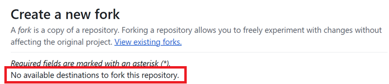

(github-fork)=

# Browser build – Step 1: Create your GitHub fork

```{note}
This is **Step 1** of the [Browser build](BrowserBuild.md).
```

Dovrai salvare in GitHub, come secret, la tua chiave Java Android personale e i dati di Google Drive (più avanti ti spieghiamo come).

Since this cannot be done inside the public repository of AndroidAPS, you need to make your personal copy of the source code (called a fork).

## Account GitHub

You need to [create a GitHub account](https://github.com/signup) if you don't have one yet.  
You can sign up with your email, or you can sign up with Google. Follow the registration and verification process.

Quando hai un account, [accedi a GitHub](https://github.com/login).

## Fai il fork di AndroidAPS

Apri il repository ufficiale di AndroidAPS con [questo link](https://github.com/nightscout/AndroidAPS).

Tocca l'icona del fork. This will create a copy inside your own account.


Scroll down the next screen and tap **Create Fork**.


*Nota: puoi **togliere la spunta** da "Copy the master branch only" (copia solo il branch master) se vuoi fare la build di versioni per sviluppatori o di versioni personalizzate.*


```{note}
Non riesci a fare il fork e vedi questo?<br/><br/>
**`No available destinations to fork this repository.`**<br/><br/>
<br/><br/>
Significa che hai già un fork di AndroidAPS.<br/>
Controlla che sia aggiornato e continua con i passi di preparazione.
```

```{warning}
**Never delete your fork without having done a backup of your secrets!**
```

Ora GitHub mostra la tua copia personale di AndroidAPS. Lascia aperta questa scheda del browser.


----

**Avanti: [Passo 2 – Crea il tuo keystore di firma](BrowserBuildKeystore.md) →**
