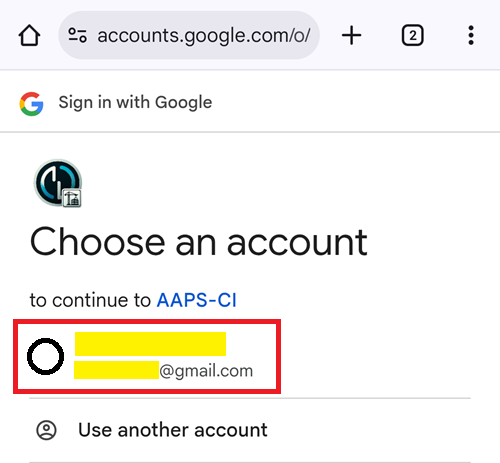
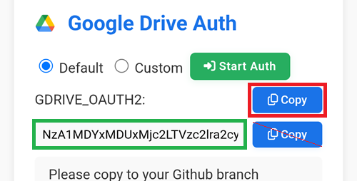

(aaps-ci-google-drive-auth)=

# Browser build – Step 3: Authorize Google Drive

```{note}
This is **Step 3** of the [Browser build](BrowserBuild.md). Prima completa il [Passo 2 – Crea il tuo keystore di firma](BrowserBuildKeystore.md).
```

```{warning}
No matter which of the prior sets of instructions you followed (Option 1 or Option 2), you MUST add the Google Drive authorization to successfully use the Browser Build.
```

Note: If you already followed this part in the video, you can now skip to [Step 4 – Build the APK](BrowserBuildAPK.md).

```{warning}
If the Google authorization does not start or the preparation page fails, close the preparation page, open `aaps-ci-preparation.html` again the same way as in Step 2, and start this step again. See [troubleshooting](#aaps-ci-preparation-web).
```

Torna alla scheda della pagina di preparazione.

Scroll down to the Google Drive Auth section and tap Start Auth.


Seleziona il tuo account Google.



Scorri in basso e accetta l'accesso. La pagina web ne ha bisogno per ottenere la chiave di autenticazione di Google Drive.

Tap Continue.


The `GDRIVE_OAUTH2` field will populate, tap the top Copy button.



Torna alla scheda di GitHub.

Scroll down to Repository secrets and tap New repository secret.

If you followed Option 1 you should see this:


If you followed Option 2 there will be more keys:


In the Name field, paste the text you just copied. Use a long touch on the text box to show the paste menu.


Passa alla scheda della pagina di preparazione.

Tocca il secondo pulsante Copy.


Torna alla scheda di GitHub.

1. Nel campo Secret incolla il testo che hai appena copiato. Use a long touch on the text box to show the paste menu.

2. Tap Add secret.


You should have either two (option 1) or five (option 2) secrets entries now.


GitHub will now be able to store the AAPS apk file in your Google Drive, once built.

----

**Next: [Step 4 – Build the APK](BrowserBuildAPK.md) →**
