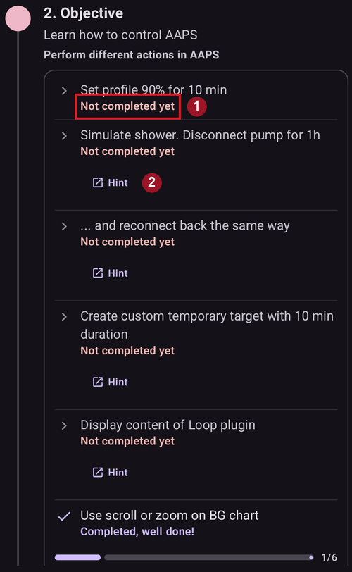
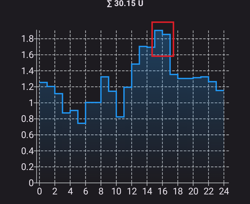

# Completing the Objectives

**AAPS** has a series of **Objectives** required to be completed to help the user progress from basic open looping to hybrid closed looping and full **AAPS** functionality. Completing the **Objectives** aims to ensure you have:

* Configured everything correctly in your **AAPS** setup;
* Learned about the essential features of **AAPS**; and
* A basic understanding of what your system can do, in order to help instill confidence when using **AAPS**.

Quando installi **AAPS** per la prima volta, devi completare ogni obiettivo prima di passare al successivo. New features will gradually be unlocked as progress is made through each **Objective**.

**Objectives 1 to 8** will guide you from configuring **AAPS** on your smartphone to “basic” hybrid closed looping. Ci vorranno circa 6 settimane per completarlo. You can proceed up to **Objective 5** using a virtual pump (and using some other method of insulin delivery in the meantime). **Objectives 9 and 10** are designed to test more advanced **AAPS** features with the aim of better control of your diabetes, and will take up to 3 months to complete, possibly longer. Further details on an estimated breakdown of time can be obtained here: [How long will it take?](#preparing-how-long-will-it-take)

Oltre ad avanzare negli **Obiettivi**, se necessario puoi anche annullare i tuoi progressi e [tornare a un obiettivo precedente](#CompletingTheObjectives-go-back-in-objectives).

## Fai il backup delle impostazioni

```{admonition} Note
:class: note

Dopo aver completato ogni **Obiettivo** è consigliato esportare le impostazioni di **AAPS**!
```

It is strongly recommended that you [export your settings](../Maintenance/ExportImportSettings.md) after completing each objective to avoid losing any progress made in **AAPS**. This exporting process creates a **settings file** (.json) which should be backed-up in one or more safe places (e.g. Google Drive, hard disk, email attachment _etc._). This ensures that any progress made in **AAPS** is saved. Se perdi il telefono o cancelli per errore i tuoi progressi, puoi ricaricare il file json in **AAPS** importando un file delle impostazioni recente. Having a backup **settings file** is also required if a new **AAPS** smartphone is required for any reason (upgrading/lost/broken phone _etc._)

Il file delle **impostazioni** salva non solo i tuoi progressi negli **Obiettivi**, ma anche tutte le impostazioni di **AAPS**, come il **bolo massimo** _ecc._

Se non hai un backup delle impostazioni e succede qualcosa al tuo smartphone con **AAPS**, dovrai ricominciare gli **Obiettivi** dall'inizio. Progressing through the **Objectives** takes time, and having to re-complete them again because for example you lost your smartphone, is a situation to be best avoided.

(objectives-objective1)=
## Obiettivo 1: Impostazione della visualizzazione e del monitoraggio, analisi di basali e rapporti

**Objective 1** requires the user to set up their basic technical setup in **AAPS**. Non puoi andare avanti finché questo passo non è completato.

- Select the correct CGM/FGM in [Configuration → BG Source](#Config-Builder-bg-source). See [BG Source](../Getting-Started/CompatiblesCgms.md) for more information.
- Select the correct Pump in [Configuration → Pump](#Config-Builder-pump) to ensure your pump can communicate with **AAPS**. Select **virtual pump** if you are using a pump model with no **AAPS** driver for looping, or if you want to work through the early **Objectives** while using another system for insulin delivery. See [insulin pump](../Getting-Started/CompatiblePumps.md) for more information.
- Se usi Nightscout:
  - Follow instructions in [Nightscout](../SettingUpAaps/Nightscout.md) page to ensure **Nightscout** can receive and display **AAPS** data.
  - Note that the URL in **NSClientV3** must be **_without_ "/api/v1/"** at the end - see [Settings → NSClientV3](#Preferences-nsclient).
- Se usi Tidepool:
  - Follow instructions in [Tidepool](../SettingUpAaps/Tidepool.md) page to ensure **Tidepool** can receive and display **AAPS** data.

Nota: *Può essere necessario aspettare la prossima lettura della glicemia del sensore prima che **AAPS** la riconosca.*

(objectives-objective2)=
## Obiettivo 2: Impara a controllare AAPS

**Objective 2** requires several ‘tasks’ to be actioned as shown in the screenshot below. Each task shows its status (**1**): the orange "**Not completed yet**" turns into "**Completed, well done!**" as soon as **AAPS** has registered the action. Tap **Hint** (**2**) underneath a task to open the related documentation, in case you are not familiar with a specific action yet.



Tasks to complete **Objective 2** are:
- Set your **Profile** to 90% for a duration of 10 min.
  - _Hint_: Tap your Profile name on the main screen to open the **Profile** screen, then use the **Activate** (▶) button and set percentage and duration. More information in [Profile switch & Profile Percentage](../DailyLifeWithAaps/ProfileSwitch-ProfilePercentage.md).
  - _Note_: **AAPS** does not accept basal rates below 0.05U/hr. Se il tuo **Profilo** contiene velocità di 0,05 U/h o meno, prima di svolgere questo compito devi creare un **Profilo** temporaneo con velocità basali più alte. Switch back to your normal **Profile** after completing this task.
- Simulate "taking a shower" by [disconnecting your pump](#AapsScreens-loop-status) in **AAPS** for a duration of 1h.
  - _Suggerimento_: premi l'icona del loop nella schermata principale per aprire la finestra del Loop, poi scegli una durata sotto **Disconnetti micro**.
- Termina la "doccia" riconnettendo il micro.
  - _Hint_: press the "disconnected"-icon to open the loop dialog again and choose **Reconnect Pump**.
- Set a custom [**Temporary Target**](../DailyLifeWithAaps/TempTargets.md) with a duration of 10 min.
  - _Suggerimento_: premi l'intervallo target nella schermata principale per aprire la schermata del target temporaneo.
- Mostra il contenuto del plugin **Loop**.
  - _Suggerimento_: apri **Configurazione → Loop** e tocca "**Apri plugin**".
- Scorri o ingrandisci il grafico della glicemia per vedere intervalli di tempo più lunghi o più brevi.


(objectives-objective3)=
## Objective 3: Prove your knowledge

**Objective 3** requires the user to pass a multiple-choice exam which is designed to test your **AAPS** knowledge.

Per alcuni utenti l'**Obiettivo 3** è il più difficile da completare. Leggi la documentazione di **AAPS** insieme alle domande. If you are genuinely stuck after researching the **AAPS** documents, please search the [Facebook](https://www.facebook.com/groups/AndroidAPSUsers) or [Discord](https://discord.gg/4fQUWHZ4Mw) group for "Objective 3" (because it is likely that your question has been asked before - and answered by the group). These groups can provide friendly hints, or redirect you to the relevant part of the **AAPS** documents.

Nel frattempo:
- To reduce the number of notifications / decisions you are asked to make (temporary basal rates) while in Open Loop, set a wide target range in your **Profile** _e.g._ 90 - 150 mg/dL or 5.0 - 8.5 mmol/L.
- Di notte potresti impostare un limite superiore più largo, o anche disattivare il loop aperto.

To proceed with **Objective 3**, tap a question row to open it. Leggi con attenzione ogni domanda e seleziona la tua risposta (o le tue risposte).

Per ogni domanda, le risposte corrette possono essere più di una! Se scegli una risposta sbagliata, la domanda viene bloccata per 1 ora prima che tu possa tornare a rispondere di nuovo. Fai attenzione: la volta successiva l'ordine delle risposte può essere cambiato. Serve a farti leggere con attenzione e capire davvero se ogni risposta è giusta o no.

```{admonition} __What happens if new question(s) are added to an Objective when I update to a newer version of AAPS?__
:class: note
From time to time, new features are added to **AAPS** which may require a new question to be added to the **Objectives**, particularly **Objective 3**. As a result, any new question added to **Objective 3** will be marked as “incomplete” because **AAPS** will require you to action this. Do not worry, as each **Objective** is independent, you will **not lose the existing functionality of AAPS**, providing the other **Objectives** remain completed.
```

## Obiettivo 4: Avvio in un loop aperto

The purpose of **Objective 4** is to recognize how often **AAPS** will evaluate the user's basal rate against glucose levels, and recommend temporary basal rate adjustments. As part of this **Objective**, you will activate open looping for the first time, and will accept 20 proposed temporary basal rate changes, and if required, apply these manually on your pump. You will also observe the impact of [**Temporary Targets**](../DailyLifeWithAaps/TempTargets.md). If you are not familiar with setting a temporary basal rate change in **AAPS** yet, see the pump actions in the **Manage** sheet ([Where did the Actions tab go?](#screens-action-tab)).

The minimal time to complete this objective: **7 days**. È un tempo di attesa obbligatorio. It is not possible to proceed to the next **Objective**, even if all basal rate changes were enacted already.

- Select Open Loop by pressing the [Loop icon](#AapsScreens-loop-status) on the main screen and choosing **Open Loop** as running mode.
- Esegui manualmente almeno 20 suggerimenti di basale temporanea nell'arco di 7 giorni: inseriscili nel tuo micro (fisico) e conferma in AAPS di averli accettati. Controlla che queste modifiche della basale compaiano in **AAPS** e in **Nightscout**.
- Use [**Temp Targets**](../DailyLifeWithAaps/TempTargets.md) when necessary. Dopo aver trattato un'ipoglicemia, usa il target temporaneo predefinito "Ipoglicemia" per evitare che il sistema corregga troppo durante la risalita.
- If you are still in [Simple Mode](#preferences-simple-mode) at this point, now is probably a good time to switch it off.

Per ridurre il numero di modifiche della basale proposte in loop aperto, puoi sempre usare i consigli descritti nell'[**Obiettivo 3**](#objectives-objective3). Additionally, you can change the minimum percentage for recommended basal rate changes with the "**Open mode minimum change**" setting in **Settings → Loop**. Più alto è il valore, meno notifiche di cambio riceverai.


```{admonition} Note
:class: note

Non devi eseguire ogni singola raccomandazione del sistema!
```
(objectives-objective5)=
## Obiettivo 5: Comprensione del tuo loop aperto, incluse le relative raccomandazioni sulle basali temporanee

As part of **Objective 5** you will start to understand how temporary basal recommendations are derived. This includes the [determination of basal logic](#aaps-screens-how-predictions-become-a-dosing-decision), analyzing the impact by observing [prediction lines in **AAPS Overview**](#aaps-screens-prediction-lines) (or Nightscout) and looking at the detailed calculations shown on the **OpenAPS SMB** plugin screen (**Configuration → APS → Open plugin**).

Tempo stimato per completare questo obiettivo: **7 giorni**.

This **Objective** requires you to determine and set your “Maximum basal rate” (max-basal) value as described in [OpenAPS-features](#Open-APS-features-max-u-h-a-temp-basal-can-be-set-to). Puoi impostare questo valore in [Impostazioni → OpenAPS SMB](#Preferences-openaps-smb-settings). In [simple mode](#preferences-simple-mode), **AAPS** sets this value automatically and you don't need to change it. If you are still using a virtual pump, make sure this safety setting is set in both **AAPS** and your insulin pump.

You might wish to set your [**Profile** BG target](#profile-glucose-targets) higher than usual until you are comfortable with **AAPS**' calculations and settings. You may wish to experiment with adjusting your **BG target** in your **Profile** being in a tighter range (say, 1 or less mmol/L [20 mg/dL or less] wide) and observe the resulting behavior.


```{admonition} If you have been using a virtual pump, change to a real insulin pump now!
:class: note

Se sei in loop aperto con un micro virtuale, **fermati qui**. Only tap **Verify** at the end of this **Objective** once you have changed to using a "real" pump which delivers insulin.

```


(objectives-objective6)=
## Obiettivo 6: Avvio della chiusura del loop con sospensione a glicemia bassa


```{admonition} Closed loop will not correct high **BG** values in **Objective 6** as it is limited to **Low Glucose Suspend** only!
:class: note
You will still need to correct high BG values by yourself (manually with corrections by pump or pen)!
```

As part of **Objective 6** you will close the loop and activate its **Low Glucose Suspend** (LGS) mode while [max IOB](#Open-APS-features-maximum-total-iob-openaps-cant-go-over) is set to zero. You have to remain in LGS mode for 5 days to complete this **objective**. You should use this time to check if your **Profile** settings are accurate and LGS events are not triggered too often.

Tempo minimo per completare questo obiettivo: **5 giorni**. È un tempo di attesa obbligatorio. You cannot proceed to the next **Objective** before this time is up.

It is crucial that your current **Profile** (basal, ISF, IC) have been well tested before you close your loop in **LGS** mode. Incorrect **Profile** settings might force you into hypo situations which have to be treated manually. An accurate **Profile** will help reduce the need for low glucose treatments during the 5 days period.

**If you still observe frequent or severe low glucose episodes consider refining your [insulin type's DIA](#Config-Builder-insulin-dia), basal, ISF and carb ratios.** Please refer to the [Facebook](https://www.facebook.com/groups/AndroidAPSUsers) or [Discord](https://discord.gg/4fQUWHZ4Mw) group which has much discussion on this.


During **Objective 6**, **AAPS** will override the maxIOB setting to zero. **This override will end when moving to Objective 7.**

This means that when you are on **Objective 6**, if sensor glucose levels are dropping, **AAPS** will reduce your basal insulin delivery for you. But, if sensor glucose levels are rising, **AAPS** will increase the basal rate above your **Profile** value only if **basal IOB** is negative as a result of a previous **LGS**. Otherwise, **AAPS** will not increase basal above your current profile value, even if glucose levels are rising. This caution is to avoid hypos as you are learning to use **AAPS**.

**As a consequence, you have to handle high glucose values with manual insulin bolus corrections.**

- If your IOB is negative (see screenshot below) a temporary basal rate (TBR) > 100% can be triggered in **Objective 6**.


- Imposta l'intervallo target un po' più alto di quello che useresti di solito, per sicurezza e per avere un margine.
- Enable 'Low Glucose Suspend' mode by pressing the Loop icon on the main screen and choosing **Low Glucose Suspend** as running mode.
- Osserva le basali temporanee attive guardando il testo turchese della basale nella schermata principale (OVERVIEW) o la basale turchese disegnata nel grafico della schermata principale.
- Per un certo periodo potresti avere picchi dopo aver trattato un'ipoglicemia, senza che il sistema possa aumentare la basale durante la risalita.

(objectives-objective7)=
## Obiettivo 7: Regolazione del loop chiuso, aumento di maxIOB sopra 0 e abbassamento graduale dei target glicemici

To complete **Objective 7** you have to close your loop and raise your [maxIOB](#Open-APS-features-maximum-total-iob-openaps-cant-go-over). **maxIOB** was zeroed out automatically in **Objective 6**, due to the Low Glucose Suspend mode. Ora non è più così. **AAPS** will start to use your defined maxIOB value to correct high glucose values. In [simple mode](#preferences-simple-mode), **AAPS** sets maxIOB automatically and you don't need to change it.

Tempo minimo per completare questo obiettivo: **1 giorno**. È un tempo di attesa obbligatorio. It is not possible to proceed to the next **Objective** until this period of time has expired.

- Seleziona **Loop chiuso** premendo l'[icona del Loop](#AapsScreens-loop-status) nella schermata principale e scegliendo **Loop chiuso** come modalità di esecuzione. Stay in **Closed Loop** over a period of 1 day.

- Alza piano il tuo 'IOB massimo per SMB' (in OpenAPS si chiama 'max-iob') sopra 0, finché trovi le impostazioni più adatte a te.

The default recommendation for this setting is “**average meal bolus + 3x max daily basal**”, where “max daily basal” is the maximum hourly value in any time segment of the day.



Questa raccomandazione va vista come un punto di partenza. Se usi questa regola ma vedi che AAPS eroga troppa insulina quando la glicemia sale, potresti dover:
* abbassa il valore "IOB massimo per SMB";
* review your **Profile** settings, only making one adjustment at a time.

Alternatively, if you are very insulin resistant, raise the **maxIOB** value very cautiously.

Once confident on how much **maxIOB** suits your looping patterns, lower your **BG targets** to your desired level.

(objectives-objective8)=
## Obiettivo 8: Adatta basali e rapporti se necessario, quindi attiva Autosens

As part of this **objective**, you will revisit your **Profile**'s performance and will use [Autosens](#Open-APS-features-autosens) functionality as an indicator for wrong settings.

Tempo minimo per completare questo obiettivo: **7 giorni**. È un tempo di attesa obbligatorio. It is not possible to proceed to the next **Objective** until this period of time has expired.

Enable [Autosens](../DailyLifeWithAaps/KeyAapsFeatures.md) over a period of 7 days (in [simple mode](#preferences-simple-mode) it is enabled by default) and watch [**Overview**'s graph white line](#AapsScreens-section-g-additional-graphs) showing your insulin sensitivity rising or falling due to exercise or hormones etc. Keep an eye on the **OpenAPS SMB** plugin screen (**Configuration → APS → Open plugin**) which shows **AAPS** adjusting the sensitivity, basals and targets accordingly.

This is a good time to review your settings for [Sensitivity Detection](#Config-Builder-sensitivity-detection). You can view your sensitivity on the main screen in an [additional graph](#AapsScreens-section-g-additional-graphs).

Additionally, you can use [Autotune](#autotune-how-autotune-calculates-adjustments) as a one off to check your basals remain accurate or do a traditional basal test.

(objectives-objective9)=
## Obiettivo 9: Abilitazione di funzioni oref1 aggiuntive per l'uso diurno, come il super micro bolo (SMB)

In **Objective 9**, you will tackle and use **"Super Micro Bolus (SMB)"** as one core functionality. Dopo le letture obbligatorie avrai capito bene cosa sono gli SMB, come funzionano e perché, dopo un SMB, la basale viene messa temporaneamente a zero (zero-temping).

Tempo minimo per completare questo obiettivo: **28 giorni**. È un tempo di attesa obbligatorio. Non puoi passare all'Obiettivo successivo prima che sia passato questo tempo.

- The [SMB section in this documentation](#Open-APS-features-super-micro-bolus-smb) and [oref1 coverage in the openAPS docs](https://openaps.readthedocs.io/en/latest/docs/Customize-Iterate/oref1.html) are must-reads to understand **SMB** and the concept of **zero-temping**.
- Once done, you can [raise maxIOB](#Open-APS-features-maximum-total-iob-openaps-cant-go-over) to get **SMBs** working more effectively. maxIOB now includes all **IOB**, not just accumulated basal. This threshold pauses **SMBs** until IOB drops below this value (_e.g._ **maxIOB** is set to 7U and a bolus of 8U is given to cover a meal: SMBs will be paused and not given unless **IOB** drops below 7U). A good start is setting **maxIOB** = **average meal bolus + 3x max daily basal** where "max daily basal" is the maximum hourly value in any time segment of the day. Vedi l'[obiettivo 7](#objectives-objective7) come riferimento.
- Evaluate your carb absorption rate and consider changing the “min_5m_carbimpact”-parameter in [Settings → Absorption settings → min_5m_carbimpact](#Preferences-min_5m_carbimpact) if you find it too slow or too fast.

(objectives-objective10)=
## Obiettivo 10: Automazione

Le **Automazioni** diventano disponibili quando inizi l'**Obiettivo 10**.

Tempo minimo per completare questo obiettivo: **28 giorni**. È un tempo di attesa obbligatorio. Non puoi passare all'Obiettivo successivo prima che sia passato questo tempo.

Read the documentation page [Automation](../DailyLifeWithAaps/Automations.md) first.

Set up the most basic automation rule; for example trigger an Android notification in a few minutes:
- Apri **Gestisci → Automazione** e tocca il pulsante **+** (**Aggiungi regola**).
- Inserisci un **Nome task**, per esempio "La mia prima notifica di automazione".
- Sotto **Condizione**, tocca "**MODIFICA**".
  - Tocca "**Aggiungi trigger**" e seleziona "**Ora**". **AAPS** crea una voce per oggi all'ora attuale.
  - Change the time so that it triggers in a few minutes.
  - Tocca l'icona **Salva** (in alto a destra) per tornare alla regola.
- Sotto **Azione**, tocca "**AGGIUNGI**" e seleziona "**Notifica**".
  - Enter a message in the action card, for example "My first automation".
- Tap the **Save** icon (top right) and make sure the rule is **Enabled**.
- Aspetta che l'orario faccia partire la notifica (a seconda del telefono può arrivare con qualche minuto di ritardo)

Poi puoi provare a creare un'**Automazione** più utile. The documentation page gives a few examples, and you can search for "Automation" screenshots on the [Facebook](https://www.facebook.com/groups/AndroidAPSUsers) group. There is also a dedicated channel in the [Discord](https://discord.gg/4fQUWHZ4Mw) community.

For example, if you eat the same thing for breakfast at the same time every morning before school/work, you can create an **Automation** such as "before-breakfast-target" to set a slightly lower **Temporary Target** 30 minutes before having breakfast. In questo caso la tua condizione conterrà probabilmente un "Tempo ricorrente", cioè la scelta di alcuni giorni della settimana (lunedì, martedì, mercoledì, giovedì, venerdì) e di un orario preciso (06:30). L'azione sarà "Avvia target temporaneo" con un valore target più basso del solito e una durata di 30 minuti.

## Quando tutti gli obiettivi sono completati

Once you have accomplished all the **Objectives**, the list shows each of them with a tick and the date it was accomplished. The **Objectives** item disappears from the bottom navigation; you can still open the list with **Configuration → Constraints → Objectives → Open plugin**.


Press "**More**" under an objective to see its tasks again:


(CompletingTheObjectives-go-back-in-objectives)=
## Tornare indietro negli obiettivi

If you wish to go back in the **Objectives** for whatever reason, open the finished **Objective** with "**More**" and tap "**Reset finished state**":


In the same way, the **Objective** you are currently working on can be restarted with "**Reset started state**".
