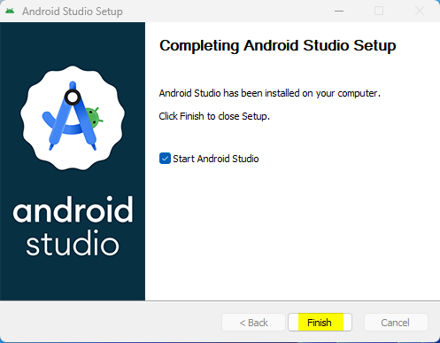
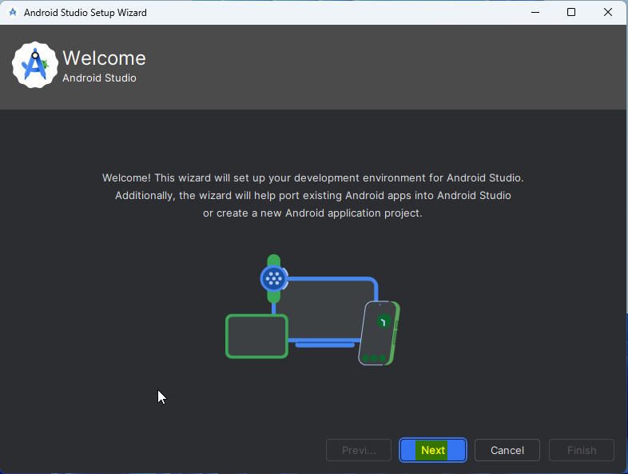
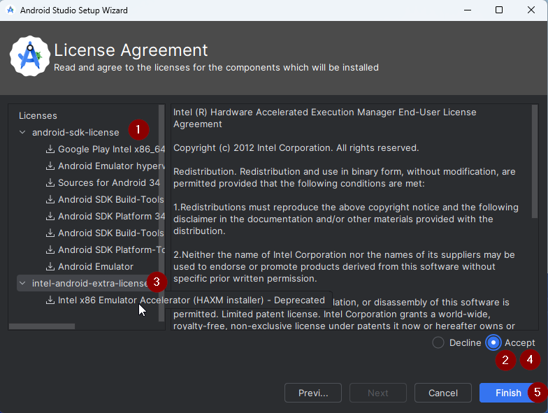
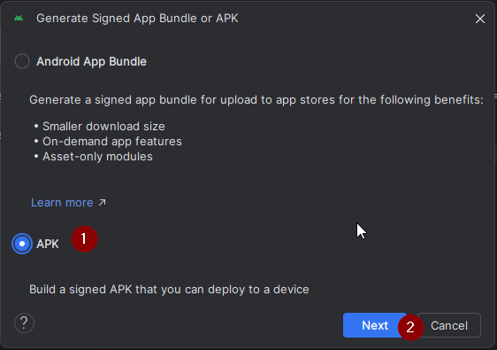
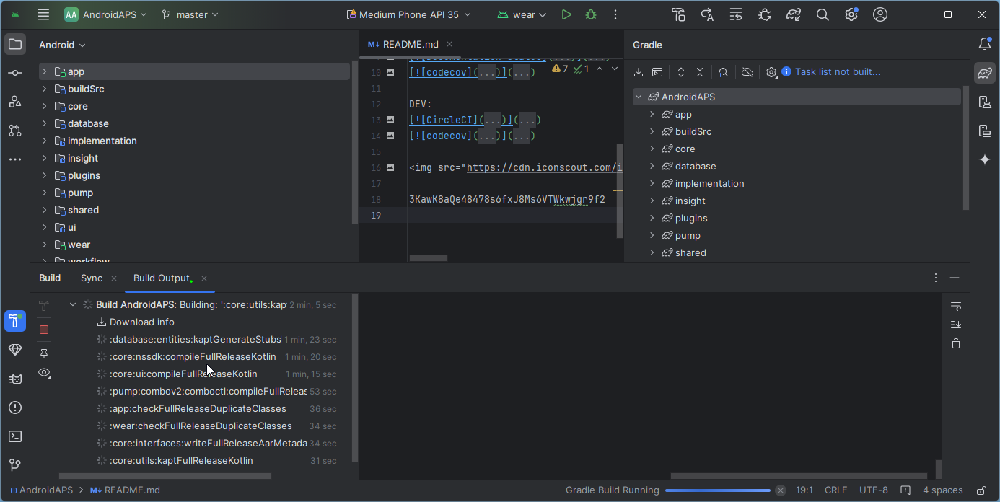

<!-- Android Studio Build, FKA Computer Build. Preserve filenames to avoid breaking URLs. -->

# Build con Android Studio

This is the traditional method to build your AAPS app.

You can build the app without a computer using the [Browser Build](./BrowserBuild.md) method.

## Build yourself instead of download

**The AAPS app (an apk file) is not available for download, due to regulations around medical devices. It is legal to build the app for your own use, but you must not give a copy to others!**

See [FAQ page](../UsefulLinks/FAQ.md) for details.

---

(Building-APK-recommended-specification-of-computer-for-building-apk-file)=
## Requisiti del computer e del software per fare la build di AAPS

* A specific **[Android Studio](https://developer.android.com/studio/)** version may be required to build the apk. Vedi la tabella qui sotto:

| AAPS Version            | Preferred<br/>Android Studio<br/>Version | Alternative<br/>Android Studio<br/>Version | Gradle | JVM |
| ----------------------- | ---------------------------------------------------- | ------------------------------------------------------ | ------ |:--- |
| 2.6.2                   | 3.6.1                                                |                                                        | 5.6.4  | 11  |
| 2.8.2.1                 | 4.1.1                                                |                                                        | 6.1.1  | 13  |
| [3.1.0.3](#version3100) | 2020.3.1                                             | testato fino a Quail 4                                 | 7.3.3  | 17  |
| [3.2.0.4](#version3204) | Hedgehog (2023.1.1)                                  | testato fino a Quail 4                                 | 8.2    | 17  |
| [3.3.1.3](#version3300) | Ladybug Feature Drop (2024.2.2)                      | testato fino a Quail 4                                 | 8.10   | 21  |
| [3.3.2](#version3300)   | Meerkat (2024.3.1)                                   | testato fino a Quail 4                                 | 8.11.1 | 21  |
| [3.3.2.1](#version3321) | Narwhal (2025.1.2)                                   | testato fino a Quail 4                                 | 8.13   | 21  |
| [3.4.2.6](#version3426) | Panda 2 (2025.3.2)                                   | testato fino a Quail 4                                 | 9      | 21  |
| [4.0.0](#version400)    | Rabbit 2 (2026.2.2)                                  | Latest                                                 | 9.8    | 21  |

The "preferred version" is packaged with the appropriate JVM version. The preferred version is also the minimal version you can use to build **AAPS**. You will **NOT** be able to build on a version older than the "preferred" one. If using a different version, you may encounter issues related to JVM version. See the [Troubleshooting Android Studio](#troubleshooting_androidstudio-uncommitted-changes) page to help solve these issues. If your current Android Studio version is not listed in the table, you must update it first.

The Gradle version is linked to the source code, you will always get the correct Gradle version when downloading / updating the source code. It is mentioned here for reference only, you don't have to take action on it.

* I [sistemi Windows a 32 bit](#troubleshooting_androidstudio-unable-to-start-daemon-process) non sono supportati da Android Studio. Please keep in mind that both **64 bit CPU and 64 bit OS are mandatory condition.** If your system DOES NOT meet this condition, you have to change affected hardware or software or the whole system.

<table class="tg">
<tbody>
  <tr>
    <th class="tg-baqh">Sistema operativo (solo 64 bit)</th>
    <td class="tg-baqh">Windows 10 or higher</td>
    <td class="tg-baqh">macOS 12 or higher</td>
    <td class="tg-baqh">Any Linux distribution that supports Gnome, KDE, or Unity DE;&nbsp;&nbsp;GNU C Library (glibc) 2.31 or later</td>
  </tr>
  <tr>
    <th class="tg-baqh"><p align="center">CPU (solo 64 bit)</th>
    <td class="tg-baqh">x86_64 CPU from 2017 or newer (Intel 8th generation Core i5, AMD Ryzen, or newer) with <a href="https://developer.android.com/studio/install" target="_blank" rel="noopener noreferrer">virtualization support</a> (Intel VT-x or AMD-V) enabled in the BIOS</td>
    <td class="tg-baqh">Apple Silicon (M1 or newer), or 6th generation Intel Core or newer (support for Intel Macs is being phased out)</td>
    <td class="tg-baqh">x86_64 CPU from 2017 or newer (Intel 8th generation Core i5, AMD Ryzen, or newer) with virtualization support (Intel VT-x or AMD-V) enabled in the BIOS</td>
  </tr>
  <tr>
    <th class="tg-baqh"><p align="center">RAM</th>
    <td class="tg-baqh" colspan="3"><p align="center">16GB or more (8GB is the strict minimum for Android Studio alone, 32GB is recommended)</td>
  </tr>
  <tr>
    <th class="tg-baqh"><p align="center">Disco</th>
    <td class="tg-baqh" colspan="3"><p align="center">At least 32GB free space. È consigliato un SSD.</td>
  </tr>
  <tr>
    <th class="tg-baqh"><p align="center">Risoluzione</th>
    <td class="tg-baqh" colspan="3"><p align="center">1280 x 800 minimum (1920 x 1080 recommended)<br></td>
  </tr>
  <tr>
    <th class="tg-baqh"><p align="center">Internet</th>
    <td class="tg-baqh" colspan="3"><p align="center">Banda larga</td>
  </tr>
</tbody>
</table>

**It is strongly recommended (not mandatory) to use SSD (Solid State Disk) instead of HDD (Hard Disk Drive) because it will take less time when you are building the AAPS apk file.**  You can still use a HDD when you are building the **AAPS** apk file. Se lo fai, la build può richiedere molto tempo, ma una volta avviata puoi lasciarla andare senza controllarla.

## Aiuto e supporto durante la build

If you run into difficulties in the process of building the **AAPS** app, there is a dedicated [**troubleshooting Android Studio**](../GettingHelp/TroubleshootingAndroidStudio.md) section, please consult that first.

If you think something in the building instructions is wrong, missing or confusing, or you are still struggling, please reach out to other **AAPS** users group on [Facebook](https://www.facebook.com/groups/AndroidAPSUsers) or [Discord](https://discord.gg/4fQUWHZ4Mw). Se vuoi cambiare qualcosa tu stesso (aggiornare gli screenshot _ecc._), invia una [pull request (PR)](../SupportingAaps/HowToEditTheDocs.md).

## Guida passo passo per fare la build dell'app AAPS

```{admonition} WARNING
:class: warning
If you have built AAPS before, you don't need to take all the following steps again.
Vai direttamente alla [guida all'aggiornamento](../Maintenance/UpdateToNewVersion.md)!
```

```{contents} The overall steps for building the **AAPS** apk file
:depth: 1
:local: true
```

In this guide you will find _example_ screenshots of building of **AAPS** apk file. Because  **Android Studio** - the software which we use to build the **AAPS** apk - is regularly updated, these screenshots may not be identical to your installation, but they should still be possible to follow.

Since **Android Studio** runs on Windows, Mac OS X and Linux platforms, there might also be minor differences in the steps for the different  platforms.

(install-git-if-you-dont-have-it)=
### Install Git

```{admonition} Why Git? 
:class: dropdown

Git is known as a “_Versioning Control System_” (VCS).\
Git is a program that allows you to track changes in code and to collaborate with others. Userai Git per copiare il codice sorgente di **AAPS** dal sito GitHub al tuo computer. Then, you will use Android Studio on your computer to build the **AAPS** application (apk). 
```

(BuildingAaps-steps-for-installing-git)=
#### Passi per installare Git

1.  Controlla di non avere già installato **Git**. Puoi farlo scrivendo “git” nella barra di ricerca di Windows: se vedi **“Git bash”** o un'altra voce di Git, è già installato e puoi passare direttamente a [installare Android Studio](#Building-APK-install-android-studio):


2. Se Git non è installato, scarica e installa l'ultima versione per il tuo sistema dalla sezione "Download" [**qui**](https://git-scm.com/downloads). Va bene qualsiasi versione recente di Git: scegli la versione giusta per il tuo sistema, Mac, Windows o Linux.

**Note for Mac users:** the Git webpage will also guide you to install an additional program called "homebrew" to aid the installation. Se installi Git con homebrew, non serve cambiare nessuna preferenza.

(Make_a_note_of_Git_path)=

* During the installation, when you are asked to "select destination location" make a note of _where_ Git is being installed (the "**installation path**") you will need to check it in the next step. Sarà qualcosa di simile a "C:\Program Files\Git\cmd\git.exe"

*  Durante i vari passi dell'installazione di Git, accetta semplicemente tutte le opzioni predefinite.

*  Se dopo l'installazione hai dimenticato di annotare dove è stato installato Git, puoi trovarlo così: scrivi "git" nella barra di ricerca del PC, fai clic con il tasto destro su "Git bash", seleziona "Apri percorso file" e passa con il mouse sopra l'icona "Git bash": vedrai dove è installato.

* Riavvia il computer prima del passo successivo.

(Building-APK-install-android-studio)=
### Installare Android Studio

- **You have to be online all of the time during the following steps, as Android Studio downloads several updates**

```{admonition} What is Android Studio?
:class: dropdown
Android Studio è un programma che gira sul tuo computer. It allows you to download source code from the internet (using Git) and build smartphone (and smartwatch) apps. You cannot "break" a current, looping version of **AAPS** which you might have running on a smartphone by building a new or updated app on your PC with Android Studio, these are totally separate processes. 
```

One of the most important things when installing Android Studio is **be patient!** During installation and setup, Android Studio is downloading a lot of stuff which will take time.

```{admonition} Different UI
:class: warning
Important note: Android Studio changed its UI during the last releases. Questa guida mostra i passi con la *nuova interfaccia*. The screenshots were taken with "Ladybug", so newer versions may look slightly different. If you still use the older UI, you might want to change Android Studio to the new UI first following [these instructions](#computerbuild-NewUI).
```

La versione di Android Studio è molto importante. Vedi le [istruzioni qui sopra](#Building-APK-recommended-specification-of-computer-for-building-apk-file) per scegliere la versione giusta di Android Studio.

Download the [current version of Android Studio](https://developer.android.com/studio) or an older version from the [**Archives**](https://developer.android.com/studio/archive) and accept the download agreements.


Quando il download è finito, avvia l'applicazione scaricata per installarla sul computer. Potresti dover accettare/confermare alcuni avvisi di Windows sulle app scaricate!

Installa Android Studio facendo clic su "Next" (avanti), come mostrato nelle schermate seguenti. **Non** devi cambiare nessuna impostazione!


If you want to save hard disk space, you can uncheck Android Virtual Device: it is not used for building **AAPS**.


Ora fai clic su "Install" (installa):


Quando ha finito, premi "Next" (avanti)


Nell'ultimo passaggio, clicca su "Finish" (fine) per avviare Android Studio per la prima volta.



Ti verrà chiesto se vuoi aiutare a migliorare Android Studio. Scegli l'opzione che preferisci: non cambia nulla per i passi successivi.


La schermata di benvenuto ti accoglie nell'installazione di Android Studio. Premi "Next" (avanti).



Seleziona "Standard" come tipo di installazione.


Controlla le impostazioni facendo di nuovo clic su "Next" (avanti).


Ora devi accettare i contratti di licenza. A sinistra ci sono due sezioni (1 + 3): selezionale una dopo l'altra e per ognuna seleziona "Accept" (accetta) (2 + 4) a destra.

Poi puoi fare clic sul pulsante "Finish" (fine) (5).



Ora verranno scaricati e installati alcuni pacchetti Android. Abbi pazienza e aspetta.

Quando ha finito, vedrai la schermata seguente, dove puoi selezionare di nuovo "Finish" (fine).


Ora vedrai la schermata di benvenuto di Android Studio.


(Building-APK-download-AAPS-code)=
### Scaricare il codice di AAPS

```{admonition} Why can it take a long time to download the AAPS code?
:class: dropdown

The first time **AAPS** is downloaded, Android Studio will connect over the internet to the Github website to download the source code for **AAPS**. This should take about 1 minute. 

Android Studio will then use **Gradle** (a development tool for Android apps) to identify other components needed to build these items on your computer. 
```

On the Android Studio Welcome screen, check that "**Projects**" (1) is highlighted on the left.

Then click "**Clone Repository**" (2) on the right:


Ora diciamo ad Android Studio da dove prendere il codice:


* A sinistra deve essere selezionato (di default) "Repository URL" (1).
* Come controllo di versione deve essere selezionato (di default) "Git" (2).
* Ora copia questo URL:
    ```
    https://github.com/nightscout/AndroidAPS.git
    ```
    e incollalo nella casella di testo URL (3).

* Check the (default) directory for saving the cloned code does not already exist on your computer (4). Puoi cambiarla con un'altra cartella, ma ricordati dove l'hai salvato!
* Ora fai clic sul pulsante "Clone" (clona) (5).

```{admonition} INFORMATION
:class: note
Annota la cartella. It is where your sourcecode is stored!
```

Ora vedrai una schermata che ti dice che il repository viene clonato:


A un certo punto Android Studio si chiude e si riavvia. Potrebbe esserti chiesto se vuoi fidarti del progetto. Fai clic su "Trust project" (fidati del progetto):

  


Solo per gli utenti Windows: se il firewall chiede l'autorizzazione, consenti l'accesso:

 

Quando il repository è stato clonato, Android Studio apre il progetto clonato.

(computerbuild-NewUI)=
```{admonition} New UI
:class: note
Android Studio ha cambiato da poco la sua interfaccia. New installations of Android Studio use the new UI by default!

Only if your Android Studio looks different, you might need to switch to the new UI:
Click on the hamburger menu on the top left, then select **Settings** (or **Preferences** on Apple computers).
In **Appearance & Behavior**, go to **New UI** and tick **Enable new UI**. Poi riavvia Android Studio per iniziare a usarla.

Se non trovi l'opzione **New UI**, non preoccuparti: la stai già usando!
```


When Android Studio opened, wait patiently (this may take a few minutes), and particularly, **do not** update the project as suggested in the pop-up.

Android Studio avvia da solo una "Gradle project sync" (sincronizzazione del progetto Gradle), che richiede un paio di minuti. Puoi vederla (ancora) in corso:


```{admonition} NEVER UPDATE GRADLE!
:class: warning

Android Studio potrebbe consigliarti di aggiornare il sistema gradle. **Never update gradle!** This will lead to difficulties.
```

Only on windows computers: You might get a notification about windows defender running: Click on **Automatically** and confirm, it will make the build run faster!


Puoi lasciare la sincronizzazione Gradle in corso e seguire già i passi successivi.

(Building-APK-set-git-path-in-preferences)=
### Impostare il percorso di Git nelle preferenze di Android Studio

Now we will tell Android studio where to find Git, which you installed [earlier](#install-git-if-you-dont-have-it).

* Windows users only: Make sure you have restarted your computer after [installing Git](#install-git-if-you-dont-have-it). Se non l'hai fatto, riavvia ora e apri di nuovo Android Studio

In the top left corner of **Android Studio**, open the hamburger menu and navigate to **File** > **Settings** (on Windows) or **Android Studio** > **Preferences** (on Mac). This opens the following window, click to expand the dropdown called **Version Control** (1) and select **Git** (2)


Controlla se **Android Studio** riesce a trovare da solo il **Path to Git executable** (percorso dell'eseguibile di Git) corretto, cliccando il pulsante "Test" (1):


If the automatic setting is successful, your current version of **Git** will be displayed next to the path.

   


If you find that **git.exe** is not found automatically, or that clicking "Test" results in an error, you can either
* manually enter the path which you saved [earlier](#BuildingAaps-steps-for-installing-git), or
* click on the folder icon (1) and manually navigate to the directory where **git.exe** was installed [earlier](#BuildingAaps-steps-for-installing-git)
* Verify your settings with the **Test** button!

  

(Building-APK-generate-signed-apk)=
### Fare la build dell'APK "firmato" di AAPS

```{admonition} Why does the AAPS app need to be "signed"?
:class: dropdown

Android requires each app to be _signed_, to ensure that it can only be updated later from the same trusted source that released the original app. Per maggiori informazioni su questo argomento, segui [questo link](https://developer.android.com/studio/publish/app-signing.html#generate-key). 

For our purposes, this just means that we generate a signing or "keystore" file and use it when we build the **AAPS** app.
```


**Important: Make sure the gradle sync is finished successfully before proceeding!**


Fai clic sul menu ad hamburger in alto a sinistra per aprire la barra dei menu. Select **Build** (1), then select **Generate Signed App Bundle / APK** (2)


Select "APK" (1) instead of "Android App Bundle" and click "Next" (2):



In the next screen, make sure that "Module" is set to "AndroidAPS.app" (1). La parte prima di ".app" è il nome della cartella in cui hai clonato il codice.

(Building-APK-wearapk)=
```{admonition} INFORMATION!
:class: note
Se vuoi creare l'apk per il tuo orologio, ora devi selezionare AndroidAPS.wear!
```


Fai clic su "Create new..." (crea nuovo) (2) per iniziare a creare il tuo keystore.

```{admonition} INFORMATION!
:class: note
Devi creare il keystore una sola volta.
If you have built AAPS before, do NOT create a new keystore but select your existing one and enter its passwords!
```

**_Nota:_** il keystore è un file in cui sono salvate le informazioni per firmare l'app. È cifrato e le informazioni sono protette da password.


* Fai clic sul simbolo della "cartella" (1) per scegliere sul computer un percorso per il tuo keystore.

  Do **not** use the directory where you stored your sourcecode but some directory that you would also transfer to a new computer.

```{admonition} WARNING!
:class: warning
Make sure to note down for yourself where your keystore is stored. Ti servirà quando farai la build del prossimo aggiornamento di AAPS!
```

* Ora scegli una password semplice (e annotala), inseriscila nel campo della password (2) e confermala (2).

  Le password del keystore e della chiave non devono essere complicate. Se in futuro perdi la password, vedi [Reinstallare AAPS con un nuovo keystore](#reinstall-aaps).

```{warning}
**Avoid special characters in your passwords.** Use only letters and digits for the keystore and key passwords. In particular, do not use `$`, a backtick, `"` or `\`. If you later switch to the [Browser build](#aaps-ci-option2) and reuse this keystore, these characters can make the signing step fail, see [Browser build troubleshooting](#aaps-ci-password-special-characters).
```

* L'alias predefinito (3) della chiave è "key0": lascialo così.

* Ora ti serve una password per la chiave. Per semplicità, se vuoi, puoi usare la stessa password che hai usato sopra per il keystore. Inserisci una password (4) e confermala.

```{admonition} WARNING!
:class: warning
Annota queste password! Ti serviranno quando farai la build del prossimo aggiornamento di AAPS!
```

* La validità è di 25 anni di default: lasciala così.

* Inserisci nome e cognome (5). Non serve aggiungere altre informazioni, ma puoi farlo se vuoi (6-7).

* Fai clic su "OK" (8) per continuare:


Nella pagina **Generate signed App Bundle or APK** ora viene mostrato il percorso del tuo keystore. Ora inserisci di nuovo Key Store password (password del keystore) (1) e Key password (password della chiave) (2) e spunta la casella (3) per ricordare le password, così non dovrai inserirle di nuovo la prossima volta che fai la build dell'apk (cioè quando aggiorni a una nuova versione di AAPS). Fai clic su "Next" (avanti) (4):


On the next screen, select build variant "fullRelease" (1) and click "Create" (3). You should remember the destination folder displayed at (2), as later you will find your built apk file there!

   

Ora Android Studio fa la build dell'apk di **AAPS**. In basso a destra comparirà "Gradle Build running" (2). The process takes some time, depending on your computer and internet connection, so **be patient!** If you want to watch the progress of the build, click on the small hammer "build" (1) at the bottom of Android Studio:


Ora puoi seguire l'avanzamento della build:



Quando la build è finita, Android Studio mostra il messaggio "BUILD SUCCESSFUL". Potresti vedere una notifica a comparsa: puoi fare clic su di essa e selezionare "locate" (trova). If you miss this, click on the notification icon (1) to bring up the Notifications, and then on **locate** (2):


**_If the build was not successful, refer to the [Android Studio Troubleshooting section](../GettingHelp/TroubleshootingAndroidStudio.md)._**

Nel riquadro Notifications (notifiche) fai clic sul link blu "locate" (trova):

 Your file manager will open and show you the build apk file that you have just built.

   

Congratulazioni! Now you have built the **AAPS** apk file, you will be transferring this file to your smartphone in the next section of the docs.

```{tip}
If you think you might want to use an Android Wear smartwatch in the future, this is the best time to build the AAPS Wear apk to be sure it will be synchronized with your AAPS apk.
```

Move to the next stage of [Transferring and Installing **AAPS**](../SettingUpAaps/TransferringAndInstallingAaps.md).


