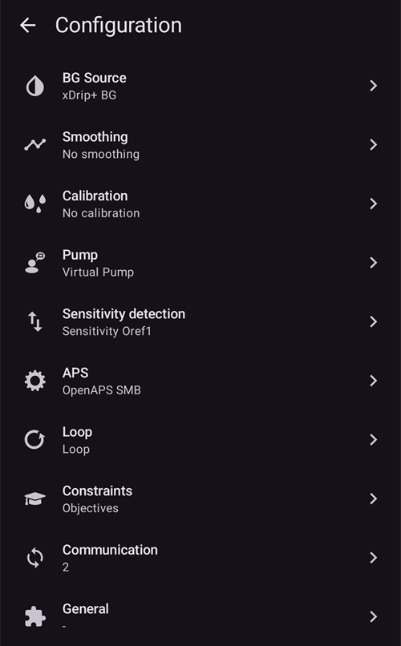
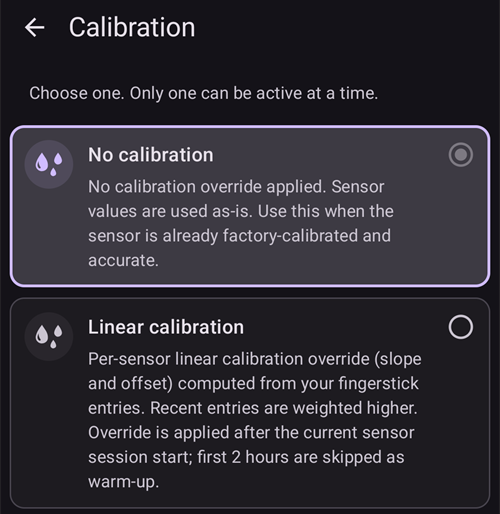
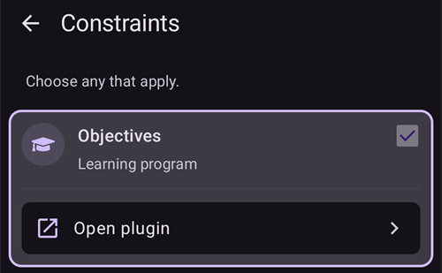
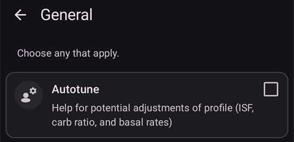
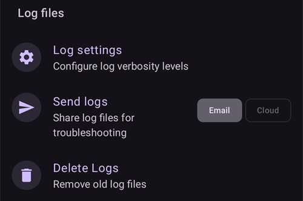

# Configurazione (Config Builder)

```{admonition} Vieni da AAPS v3? :class: note Il **Config Builder** ora si chiama **Configurazione** e si trova nel **menu** (☰). Vedi [Cosa è cambiato in AAPS v4](#v4-changes).

    <br />In **Configurazione** scegli quali plugin sono attivi (CGM, micro, algoritmo APS, sensibilità, sincronizzazione, …) e apri ogni plugin e le sue impostazioni. The [walkthrough](#configuration-v4) is below; the rest of this page describes each section in detail.
    
    (configuration-v4)=
    ## Configuration in AAPS v4
    
    In **AAPS** v4, tap the **menu** (☰) in the **top-left** corner of the main screen and choose **Configuration** (*“Set up your configuration (CGM, pump, …) and enable features”*).
    
    
    
    I plugin sono raggruppati per **categoria**, per esempio *Smoothing*, *Calibrazione*, *Rilevamento sensibilità*, *APS*, *Comunicazione* e *Generale*. Each row shows the category name and the **currently active** plugin (e.g. *APS → OpenAPS SMB*). Tocca una riga per aprire una categoria.
    
    
    
    Inside a category you see the plugins available for it. For single-choice categories you pick the active one; some categories are multi-select (*“Choose any that apply”*). Each plugin offers two actions:
    
    - **Open plugin** — opens the plugin's own screen.
    - **Settings** — opens the plugin's preferences (settings may be grouped into expandable sections).
    
    
    
    (configuration_sync_icon)=
    ### The mobile icon — “synced from the master”
    
    A small **mobile (phone) icon** next to a category or setting means that item is **synchronized from the master** — its value/selection is delivered to this device over the NSClientV3 (Nightscout) channel.
    
    On a **client** (**AAPSClient**) these items are **kept in sync with the master**. The icon is only shown on a client, so it does not appear in the screenshot above, which was taken on the main **AAPS** app. On a client it typically appears on *Smoothing*, *Calibration*, *Sensitivity detection* and *APS*. Exactly how the master and clients stay aligned — and which settings you can change from either side — is covered under [Master ↔ Client control](#client-master-config-prefs).
    
    The same icon also appears **inside the settings**, next to the individual preferences that are synced. In the example below *Absorption cutoff* carries the icon; settings without the icon are configured per device:
    
    
    
    Items **without** the icon are configured **per device**. The most important example is the **NSClientV3 (Communication)** connection itself — the **Nightscout URL**, **access token** and **websockets** are set on each phone individually, so they do **not** show the mobile icon.
    
    ---
    
    (Config-Builder-tab-or-hamburger-menu)=
    ## Opening a plugin screen
    
    Each plugin screen is opened in one of these ways (the tabs and the eye checkbox of **AAPS** v3 are gone, see [What changed in AAPS v4](#v4-changes)):
    
    - **Configuration** → the plugin's category → **Open plugin**,
    - the **Manage** sheet of the bottom navigation, for the screens you use most (Profile, Insulin settings, Pump, Automation, Food...),
    - a [QuickLaunch](../DailyLifeWithAaps/QuickLaunch.md) button that you add yourself,
    - the **search bar** on the main screen.
    
    ```{contents}
    :backlinks: entry
    :depth: 2
    

(ConfigBuilder_Profile)=

## Profilo

This module cannot be disabled as it is a core part of **AAPS**.

See [Your AAPS Profile](../SettingUpAaps/YourAapsProfile.md) for a basic understanding of what goes inside your **Profile**.

(insulin)= (Config-Builder-insulin)=

## Insulin


In **AAPS** 4 l'insulina non è più un plugin da selezionare in **Configurazione**. Open **Manage → Insulin settings** to set up the insulin you are using.

L'editor dell'insulina ti permette di:

* dare all'insulina un **Soprannome dell'insulina**, così è facile da riconoscere,
* impostare il **Picco** (tempo fino alla massima attività dell'insulina, in minuti) e il **DIA** (durata d'azione dell'insulina, in ore), scrivendo il valore o usando i pulsanti **–** / **+**,
* tap a **Load peak from** preset button — **Novorapid** (75 min), **Fiasp** (55 min) or **Lyumjev** (45 min) — to fill in the standard peak time for that insulin in one step.

Gli intervalli consentiti sono gli stessi per qualsiasi insulina:

* **DIA**: 5 to 9 hours (5 to 10 hours if the patient type is set to **Pregnant**). See [Duration of insulin action (DIA) and peak](#Config-Builder-insulin-dia) to choose a value.
* **Picco**: da 35 a 120 minuti.

The **IOB** (insulin on board) and **Activity** curves shown at the bottom of the editor update as you change the values, so you can see straight away how your settings shape the insulin action.

More information to understand the Insulin Profile as shown in **AAPS** [here](#AapsScreens-insulin-profile).

(Config-Builder-insulin-change-active)=

### Cambiare l'insulina in uso (DIA o picco)

L'insulina segnata come **ATTIVO** è quella usata dal tuo profilo in esecuzione. Its fields are greyed out: you cannot edit or delete it. This way, the insulin name shown in your running profile always matches the settings actually in use.

Per cambiare il DIA o il picco che usi:

1. Apri **Gestisci → Impostazioni insulina**. If the screen opens read-only (a **✏️ pencil** in the top bar), tap the pencil and unlock your settings.
2. Tocca **+** (*Aggiungi nuova insulina*). **AAPS** crea una copia dell'insulina mostrata sullo schermo.
3. Set the new **Peak** and/or **DIA**, then tap the save icon (top right).
4. Tocca **▶** (*Attiva insulina*) e conferma. The new insulin becomes **ACTIVE**.

```{admonition} The name includes peak and DIA :class: note **AAPS** adds the peak, DIA and concentration to the insulin name automatically (for example *Fiasp 55m 8h U100*), so you can tell your configurations apart at a glance.

    <br />You can delete the old insulin once it is no longer active.
    
    ### The "Load peak from" presets
    
    In **AAPS** 4 there is no list of insulin types to choose from. Every insulin uses the same exponential activity curve; only its **Peak** and **DIA** differ. The **Load peak from** presets in the insulin editor fill in the recommended peak for the most common insulins in one tap (the small ⓘ next to **Load peak from** lists them with their peak values). You can still adjust the **Peak** and **DIA** afterwards.
    
    Only change the peak away from its recommended value if you understand the effect of doing so. Il [grafico della curva dell'insulina](#AapsScreens-insulin-profile) ti aiuta a capire le curve.
    
    #### Novorapid
    
    
    
    * recommended for Humalog, Novolog and Novorapid (called *Rapid-Acting Oref* in **AAPS** v3)
    * Peak = 75 minutes after injection
    
    #### Fiasp
    
    
    
    * recommended for Fiasp (called *Ultra-Rapid Oref* in **AAPS** v3)
    * Peak = 55 minutes after injection
    
    (Config-Builder-lyumjev)=
    #### Lyumjev
    
    
    
    * recommended for Lyumjev
    * Peak = 45 minutes after injection
    
    #### Custom peak
    
    * There is no separate "Free-Peak Oref" insulin type in **AAPS** 4: enter any **Peak** (35 to 120 minutes) directly in the [insulin editor](#Config-Builder-insulin), without using a preset.
    * Un picco personalizzato è utile se usi un'insulina che non è nell'elenco, o una miscela di insuline diverse.
    
    (Config-Builder-insulin-dia)=
    ### Duration of insulin action (DIA) and peak
    
    ```{warning}
    In looping, decreasing DIA or peak will always increase administered insulin. DIA works differently in AAPS than in commercial AID systems, and careless changes to these settings can change insulin dosing in a way which is much larger or smaller than expected.
    

AAPS models the timeline of insulin action with a mathematical formula, configured using **DIA** and the closely related **peak** settings. Il DIA è la durata teorica fino a quando l'IOB arriva a zero, e il picco è il momento in cui l'effetto dell'insulina è più forte. This yields an IOB curve and an activity curve, which is simply the **rate** of IOB decay.

Consider that when AAPS is looping, it's normal to have periods of [zero-temping](#Open-APS-features-super-micro-bolus-smb). This missing basal insulin is fully subtracted from the IOB, explaining why IOB will in practice reach zero many hours earlier than the configured DIA. You can inspect [bolus IOB and basal IOB](#aaps-screens-iob-cob-basal-sens) separately from the main screen.

To configure DIA and peak, tap **Manage** in the main screen, and then tap **Insulin settings**. AAPS displays the active insulin configuration like this:


In this example, the peak setting is 55 minutes, DIA is 8 hours and [insulin concentration](#Insulin-Concentration) is the standard 100 IU/mL.

Due to the influence of zero-temping explained above and the formula used for IOB decay in AAPS, most users set a clearly higher DIA than in commercial systems. In general, many people find that a **DIA** of 9h works well for them. After you have more experience with AAPS and have a well-tuned profile, you can try to find personalized DIA and peak settings with the information below.

````{admonition} Dettagli sull'effetto della configurazione di DIA e picco :class: dropdown

Since the basal rate has an indirect influence on IOB decay in AAPS, it follows that too high basal rates can mask too high DIA, and vice versa. It makes sense to first carefully tune basal rates before adjusting DIA and peak. Additionally, consider that the DIA and peak settings interact, in the sense that the effect of DIA depends on peak, and vice versa.

These charts show the exact impact of DIA and peak on the IOB curves, across the range of allowed values.

Adjusting DIA:

```{image} ../images/iob_remaining_static_peak.png :width: 400px

    <br />Adjusting peak:
    
    ```{image} ../images/iob_remaining_static_dia.png
    :width: 400px
    

Finally, a comparison adjusting DIA and peak in parallel. The logic here is that both values are adjusted in the same relative amounts, so that `49/35 ~ 7/5`. Or similarly, `120/93 ~ 9/7`. The intervals will be consistent regardless of the baseline DIA or peak, as long as the relative change is the same for both.

```{image} ../images/iob_remaining_uniform.png :width: 400px

    <br />Note that when DIA and peak are adjusted in this fashion, every point in the curve will shift by the same relative amount.
    
    ````
    
    #### Further reading on DIA and peak configuration
    
    * [Technical details and historical background from the AAPS predecessor, OpenAPS](https://openaps.readthedocs.io/en/latest/docs/While%20You%20Wait%20For%20Gear/understanding-insulin-on-board-calculations.html#understanding-the-new-iob-curves-based-on-exponential-activity-curves).
    * [Why we are regularly wrong in the duration of insulin action (DIA) times we use, and why it matters…](https://www.diabettech.com/insulin/why-we-are-regularly-wrong-in-the-duration-of-insulin-action-dia-times-we-use-and-why-it-matters/) su Diabettech.
    * [Exponential Insulin Curves + Fiasp](https://web.archive.org/web/20220630154425/http://seemycgm.com/2017/10/21/exponential-insulin-curves-fiasp/) su See My CGM (archivio).
    * [Revised Humalog model in a closed loop](https://bionicwookiee.com/2022/04/13/revised-humalog-model-in-a-closed-loop/) and other articles on Bionic Wookie, recommending a DIA of 9h for Lyumjev, Fiasp, NovoRapid, Humalog.
    
    (Config-Builder-bg-source)=
    ## BG Source
    Select the blood glucose source you are using. See [BG Source](../Getting-Started/CompatiblesCgms.md) page for more setup information.
    
    
    
    Scroll down to see the other sources:
    
    
    
    
    
    * [xDrip+ BG](../CompatibleCgms/xDrip.md) - also for compatible apps such as [Juggluco](../CompatibleCgms/Juggluco.md)
    * [NSClient BG](../CompatibleCgms/CgmNightscoutUpload.md) - only if you know what you are doing, see [BG Source](../Getting-Started/CompatiblesCgms.md).
    * [MM640g](../CompatibleCgms/MM640g.md)
    * Glimp - only version 4.15.57 and newer are supported
    * [BYODA (Build Your Own Dexcom App)](#DexcomG6-if-using-g6-with-build-your-own-dexcom-app).
    * MicroTech CGM App - for the Aidex / LinX CGM
    * [Poctech](../CompatibleCgms/PocTech.md)
    * Tomato (MiaoMiao) - Tomato App for MiaoMiao device
    * [Glunovo](https://infinovo.com/) - Glunovo App for Glunovo CGM system
    * Intelligo - Intelligo App
    * Syai/Ottai - for the Syai and Ottai apps (see [Syai Tag](../CompatibleCgms/SyaiTagX1.md) and [Ottai](../CompatibleCgms/OttaiM8.md))
    * SI App - patched SI App or Sibionics App for Sibionics CGM
    * Sino App - patched app for Sinocare CGM
    * Notification Reader - reads glucose values from the notifications shown by official CGM apps (Dexcom, Medtronic, Eversense, etc.)
    * Instara - Instara App
    * Random BG - generates random BG data for testing. It can only be enabled in an engineering (developer) build with the **Virtual Pump**, so in a normal **AAPS** installation it cannot be used.
    
    ## Smoothing
    
    
    
    Vedi [Smoothing dei dati glicemici](../CompatibleCgms/SmoothingBloodGlucoseData.md).
    
    ## Calibration
    
    Choose how **AAPS** treats the values it receives from your sensor:
    
    - **No calibration**: the sensor values are used as they are. Usala quando il sensore è già calibrato in fabbrica e preciso. This is the default.
    - **Linear calibration**: **AAPS** corrects the sensor values with a slope and an offset that it computes from your fingerstick entries.
    
    Come usare **Calibrazione lineare**:
    
    1. Seleziona **Calibrazione lineare** nella categoria **Calibrazione**.
    2. When you insert a new sensor, log the sensor change: use **Log sensor change** on the calibration screen, or enter a CGM sensor insert in the Careportal. Così **AAPS** sa quando è iniziata la sessione del sensore. Se **AAPS** nota un'interruzione di più di 30 minuti nelle letture, può chiederti di segnare un cambio sensore; questa richiesta appare solo sul master, non su un client.
    3. Apri il plugin e premi **Aggiungi calibrazione**. Inserisci il tuo valore capillare. **AAPS** lo abbina al valore del sensore degli ultimi 10 minuti.
    
    Una calibrazione viene accettata solo quando:
    
    - è registrato un cambio sensore e da allora sono passate almeno **2 ore** (riscaldamento),
    - la tua glicemia è stabile. Se cambia troppo velocemente, la finestra te lo dice e mostra il limite,
    - c'è una lettura CGM degli ultimi 10 minuti,
    - è per il momento attuale. Non puoi inserire valori capillari più vecchi.
    
    Come funziona la correzione:
    
    - **AAPS** traccia una linea retta attraverso le coppie del sensore attuale: `corrected value = slope × sensor value + offset`.
    - Le coppie più recenti contano più di quelle vecchie: una coppia di 2 giorni conta circa il 37 %, una coppia di 4 giorni circa il 14 %. Così la linea segue il tuo sensore quando i suoi valori si spostano nel tempo.
    - Servono almeno **2 coppie**.
    - Se le coppie sono vicine tra loro (meno di 54 mg/dL / 3 mmol/L di distanza), i valori vengono solo spostati (scostamento, senza pendenza).
    - La pendenza viene mantenuta tra 0,55 e 1,6. Una pendenza fuori da questo intervallo viene limitata al valore più vicino.
    - Limite di sicurezza: se la correzione a 100 mg/dL (5,5 mmol/L) fosse più di ±30 mg/dL (1,7 mmol/L), non viene applicata nessuna correzione. Questo ti protegge da un inserimento sbagliato.
    
    Cosa cambia:
    
    - Il valore corretto viene usato ovunque: la glicemia nella schermata principale, il grafico e il loop. Le letture del sensore in sé non vengono modificate. La correzione viene applicata sopra, anche alle letture precedenti del sensore attuale.
    - Un nuovo cambio sensore riparte da zero. Le coppie dei sensori precedenti non contano più.
    - Nel grafico, una calibrazione appare come un segno all'altezza del valore capillare.
    - Le calibrazioni vengono sincronizzate tramite Nightscout, così i tuoi client mostrano gli stessi valori corretti.
    
    Controllare e rimuovere le voci:
    
    - **Apri plugin** mostra lo stato (per esempio *Pendenza 0,85, correzione a metà intervallo -0,4*), un grafico delle tue coppie con la linea e l'elenco delle voci.
    - Se una voce è sbagliata (per esempio avevi dello zucchero sul dito), premi l'icona del cestino accanto alla voce. La linea viene ricalcolata subito.
    
    ```{admonition} Usi xDrip+ come sorgente glicemia?
    :class: note
    xDrip+ ha una sua calibrazione. Calibra in un solo posto, così i valori del sensore non vengono corretti due volte.
    

    {admonition} Calibra con attenzione
    :class: warning
    Un valore capillare sbagliato porta a valori di glicemia sbagliati e quindi a un dosaggio dell'insulina sbagliato. Wash your hands before measuring, and do not calibrate while your glucose is changing fast.



(Config-Builder-pump)=

## Micro

Seleziona il micro che usi. See [Compatible pumps](../Getting-Started/CompatiblePumps.md) page for more setup information.


Scroll down to see all the pump drivers:


Quando selezioni un altro micro, **AAPS** ti chiede di confermare il cambio:


* [Dana R](../CompatiblePumps/DanaR-Insulin-Pump.md)
* Dana R Korean (for domestic DanaR pump)
* Dana Rv2 (DanaR pump with unofficial firmware upgrade)
* [Dana-i/RS](../CompatiblePumps/DanaRS-Insulin-Pump.md)
* [Accu Chek Insight](../CompatiblePumps/Accu-Chek-Insight-Pump.md)
* [Accu Chek Combo](../CompatiblePumps/Accu-Chek-Combo-Pump-v2.md)
* Omnipod per [Omnipod Eros](../CompatiblePumps/OmnipodEros.md)
* Dash per [Omnipod DASH](../CompatiblePumps/OmnipodDASH.md)
* [Medtronic](../CompatiblePumps/MedtronicPump.md)
* [Diaconn G8](../CompatiblePumps/DiaconnG8.md)
* [EOPatch2](../CompatiblePumps/EOPatch2.md)
* [Medtrum](../CompatiblePumps/MedtrumNano.md)
* [Equil 5.3](../CompatiblePumps/Equil5.3.md)
* [Carelevo](../CompatiblePumps/CareLevo.md)
* Micro virtuale: loop aperto - solo suggerimenti di **AAPS** 
  * quando fai i primi passi con **AAPS**, durante i primi [obiettivi](../SettingUpAaps/CompletingTheObjectives.md)
  * for pump which doesn't have any driver yet

(config-builder-wrong-pump-data)=

### Message: "Data is coming from different pump"

**AAPS** ricorda il micro a cui è connesso (tipo di micro e numero di serie). If it receives data from another pump, for example after your pump was replaced by a new one of the same model, it shows this message and ignores the data from that pump:


Per usare il nuovo micro, cambia il driver del micro: seleziona **Micro virtuale**, conferma, poi seleziona di nuovo il tuo micro. **AAPS** then registers the pump it is connected to now.

(Config-Builder-sensitivity-detection)=

## Rilevamento sensibilità


Seleziona il tipo di rilevamento della sensibilità. For more details of different designs please [read on here](../DailyLifeWithAaps/SensitivityDetectionAndCob.md). This will analyze historical data on the go and make adjustments if it recognizes that you are reacting more sensitively (or conversely, more resistant) to insulin than usual. More details about how the sensitivity ratio itself is calculated can be found in [Key AAPS Features > Autosens](#Open-APS-features-autosens).

Puoi vedere la tua sensibilità nella schermata principale in un [grafico aggiuntivo](#AapsScreens-section-g-additional-graphs), selezionando SENS% e guardando la linea bianca. Note, you need to be in [Objective 8](#objectives-objective8) in order to let Sensitivity Detection/[Autosens](#Open-APS-features-autosens) automatically adjust the amount of insulin delivered. Before reaching that objective, the Autosens percentage / the line in your graph is displayed for information only.

### Impostazioni assorbimento

If you use Oref1 with **SMB** you must change **min_5m_carbimpact** to 8. The value is only used during gaps in **CGM** readings or when physical activity "uses up" all the blood glucose rise that would otherwise cause **AAPS** to decay COB. At times when [carb absorption](../DailyLifeWithAaps/CobCalculation.md) can't be dynamically worked out based on your blood's reactions it inserts a default decay to your carbs. Basically, it is a failsafe.

(Config-Builder-aps)=

## APS


Select the desired APS algorithm for therapy adjustments. You can view the active detail of the chosen algorithm with **Open plugin**.

* OpenAPS AMA 
  * Advanced Meal Assist: older algorithm not recommended anymore.
  * In simple terms, the benefits are after you give yourself a meal bolus, the system can high-temp more quickly IF you enter carbs reliably.
* [OpenAPS SMB](#Open-APS-features-super-micro-bolus-smb) 
  * Super Micro Bolus: most recent algorithm recommended for all users.
  * In contrast to AMA, SMB does not use temporary basal rates to control glucose levels, but mainly small **Super Micro Boluses**.
  * Note : It is recommended to use this algorithm from the beginning, even though you will not actually get SMBs delivered until [Objective 9](#objectives-objective9).
* [Auto ISF](#Open-APS-features-auto-isf) 
  * Algoritmo sperimentale per utenti esperti. It is only listed once the objectives are completed.

If switching from AMA to SMB algorithm, *min_5m_carbimpact* must be changed manually to **8** (default value for SMB) in [Settings → Absorption settings](#Preferences-min_5m_carbimpact).

## Loop

This module cannot be disabled as it is a core part of **AAPS**.


## Vincoli



### Obiettivi

**AAPS** ha un programma di apprendimento (una serie di obiettivi) che devi completare passo dopo passo. This should guide you safely through setting up a closed loop system.

See [Objectives](../SettingUpAaps/CompletingTheObjectives.md) page for more information.

## Comunicazione

In this category (called **Synchronization** in **AAPS** v3), you choose if/where you want **AAPS** to send your data to.


Scroll down to see the rest of the list:


### NSClientV3

Può essere usato come [server di report](../SettingUpAaps/SettingUpTheReportingServer.md) e/o per il [monitoraggio remoto](../RemoteFeatures/RemoteMonitoring.md) e il [controllo remoto](../RemoteFeatures/RemoteControl.md).

See [Synchronization with the reporting server](#SetupWizard-synchronization-with-the-reporting-server-and-more) to set up NSClientV3 synchronization.

### Tidepool

Può essere usato come [server di report](../SettingUpAaps/SettingUpTheReportingServer.md).

Vedi [Tidepool](../SettingUpAaps/Tidepool.md).

### xDrip

Used to **send** data such as glucose values and treatments to xDrip+ on the same phone. Its settings also hold **Send status to xDrip+**, a status line with IOB and COB that xDrip+ and some watch companion apps display.

### Open Humans

Vedi [Open Humans](../SupportingAaps/OpenHumans.md).

(Config-Builder-wear)=

### Smartwatch

Monitor and control **AAPS** from a Wear OS watch. Setting up the watch is explained on [Wear OS smartwatch](../WearOS/WearOsSmartwatch.md). Dopo aver attivato il plugin, scegli le sue opzioni in [Impostazioni > Smartwatch](#preferences-wear). Using the watch is explained on [Operation of AAPS via your Wear OS smartwatch](../RemoteFeatures/RemoteControlWearOS.md).

(external-companion-apps)=

### App companion esterne

Broadcasts **AAPS** status data on the phone so that other apps installed on it can display it — for example watch or widget companion apps. The broadcast includes glucose and trend, IOB, COB, basal and temp basal, profile name, loop status, phone and pump battery, reservoir level and bolus progress. Enable it only if a companion app you use asks for this data.

Apps known to read this broadcast are [WatchDrip+](https://bigdigital.home.blog/) (Xiaomi and Amazfit watches), [GlucoDataHandler](https://github.com/pachi81/GlucoDataHandler) (Wear OS complications and widgets, and Android Auto through GlucoDataAuto) and the G-Watch app. Their setup is described on [Smartwatches and AAPS](#watches-external-companion-apps). Some of them also use **Send status to xDrip+** from the **xDrip** plugin above for a status line with IOB and COB.

In earlier versions this plugin was called **Samsung Tizen**, after the [G-Watch app for Samsung Tizen watches](#Watchfaces-tizen) it was first made for.

### Garmin

Connessione a un dispositivo Garmin (Fenix, Edge...)

## Treatments

Apri il **menu** (☰) e seleziona [Cronologia trattamenti](#aaps-screens-treatments) per vedere i trattamenti registrati. Should you wish to edit or delete an entry (e.g. you ate less carbs than you expected) then select 'Remove' and enter the new value (change the time if necessary) through **Treatments → Carbs** in the bottom navigation (see [Carbs](#screens-bolus-carbs)).

## Generale

In **AAPS** 4 the **General** category of **Configuration** only lists **Autotune**. The other features described below are always available and no longer need to be enabled here; each paragraph says where to find them.



### Overview

The [main screen](#AapsScreens-the-homescreen) of **AAPS** is not a plugin any more and has no settings of its own in **Configuration**. The options that used to be here are in **Settings** (gear icon): [Show notes in dialogs](#Preferences-show-notes-field-in-treatments-dialogs), [Status lights](#Preferences-status-lights) and the [Bolus percentage](#Preferences-deliver-this-part-of-bolus-wizard-result) used by the bolus wizard. L'opzione super bolo di **AAPS** 3.x [non è disponibile come impostazione](#Preferences-advanced-settings-overview) in **AAPS** 4.

(Config-Builder-actions)=

### Actions

La scheda Azioni di **AAPS** 3.x non esiste più. Its buttons are now in the **Manage** sheet — see [Where did the Actions tab go?](#screens-action-tab).

### Automation

**Gestisci → Automazione** ti permette di gestire le tue [Automazioni](../DailyLifeWithAaps/Automations.md), a partire dall'[Obiettivo 10](#objectives-objective10).

(Config-Builder-sms-communicator)=

### SMS Communicator

Allows remote caregivers to control some **AAPS** features via SMS, see [SMS Commands](../RemoteFeatures/SMSCommands.md) for more setup information.

### Cibo

**Manage → Food** displays the food presets defined in the Nightscout food database, see [Nightscout Readme](https://github.com/nightscout/cgm-remote-monitor#food-custom-foods) for more setup information.

Nota: le voci non possono essere usate nel calcolatore di **AAPS**. (Solo visualizzazione)

(Config-Builder-autotune)=

### Autotune

Puoi attivare Autotune, vedi [qui](../AdvancedOptions/Autotune.md).

### Manutenzione

Apri il **menu** (☰) e seleziona **Manutenzione** per esportare / importare le impostazioni e gestire i file di log.




### Configurazione (Config Builder)

Now called **Configuration**: this current page.