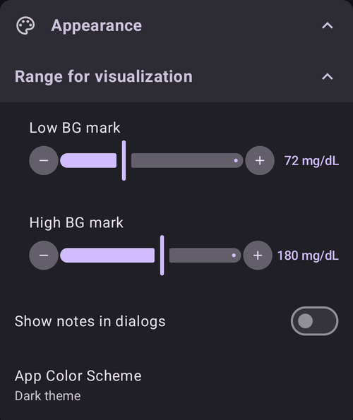
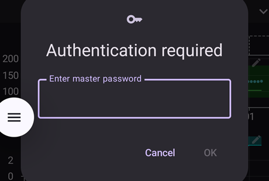
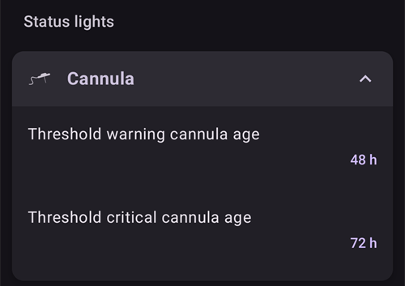
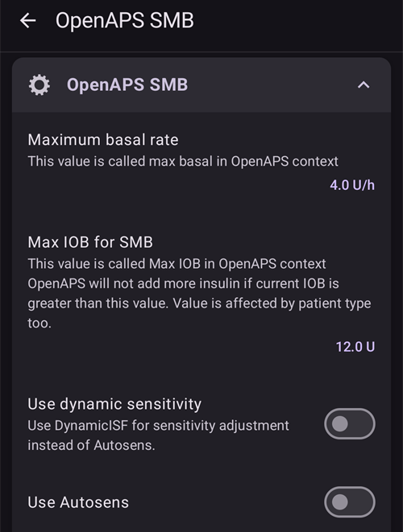
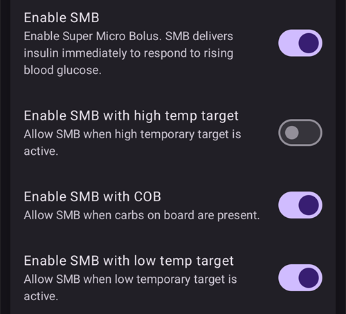
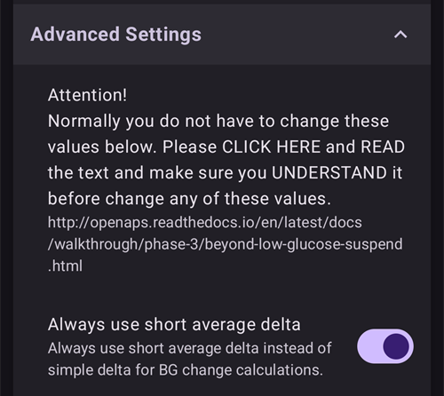
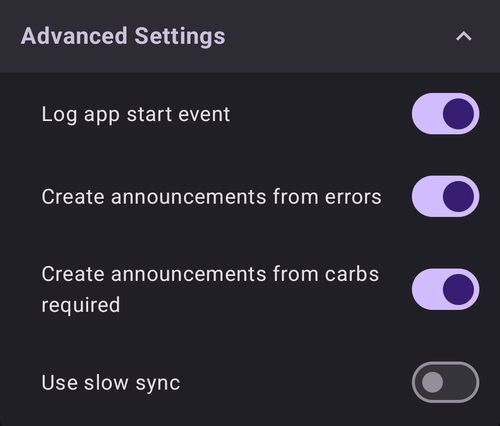
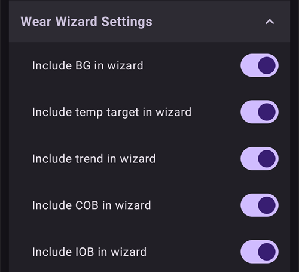
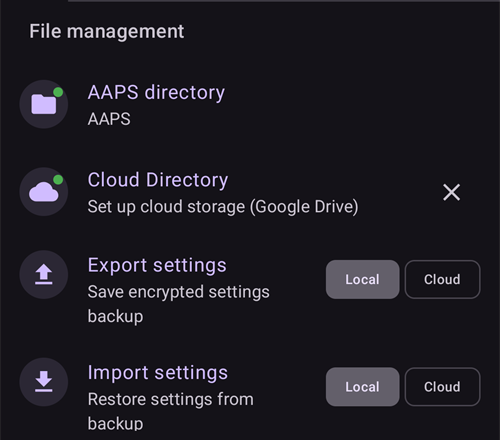
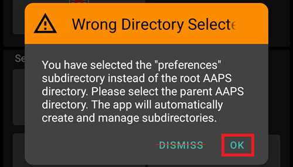

# Settings

In **AAPS** v4 le preferenze si trovano nella schermata **Impostazioni**. There are three routes to reach them — see [Making changes to your AAPS' configuration](../SettingUpAaps/ChangeAapsConfiguration.md) for details:

1. Tocca l'icona **Impostazioni** (ingranaggio) in alto a destra nella schermata principale: tutte le impostazioni, raggruppate in sezioni espandibili.
2. In **Configurazione**, tocca "**Impostazioni**" sotto un plugin attivo: solo le impostazioni di quel plugin.
3. Usa la **barra di ricerca** in alto nella schermata principale: inizia a scrivere una parte del testo che cerchi. This finds individual settings (even those not visible in the Settings screen), dialogs and documentation.


- Le **sezioni** si aprono e si chiudono toccandole. The sections you see depend on the plugins you have enabled and on [Simple mode](#preferences-simple-mode).


```{contents}
:backlinks: entry
:depth: 2
```

(Preferences-general)=
## Generale


**Unità**

- Set units to mmol/L or mg/dL depending on your preferences.

**Lingua**

- By default **AAPS** follows the language of the phone (recommended).

- Se vuoi **AAPS** in una lingua diversa da quella del telefono, sceglila qui. On Android 13 and newer, **AAPS** registers it as its own app language in Android, so all its screens, the main screen, the widgets and the way numbers are written follow it.

- Quando cambi la lingua, i testi di **AAPS** passano subito alla nuova lingua. If some texts still show the old language, restart **AAPS**.
- On Android 12 this setting is not shown: **AAPS** always uses the language of the phone.
- Impostazione nascosta in [modalità semplice](#preferences-simple-mode).

(preferences-simple-mode)= **Modalità semplice**

The **simple mode** is activated by default when you first install **AAPS**. In **simple mode**, a significant amount of settings is hidden and preferences are replaced by predefined values. You should switch off Simple mode once you become familiar with **AAPS** user interface and settings.

**Supporto della concentrazione di insulina**

- Attiva il supporto per diverse concentrazioni di insulina (U50, U200, ...). Only enable this if you really use a concentration other than U100, and read the warnings carefully.
- Impostazione nascosta in [modalità semplice](#preferences-simple-mode).

**Mantieni lo schermo acceso**

- Forces Android to keep the screen on at all times. This is useful for presentations etc. But it consumes a lot of battery power. Therefore, it is recommended to connect the smartphone to a charger cable.

**Nome istanza**

- Il nome della persona che usa questo telefono. It tells this **AAPS** instance apart in reports and synchronization, for example if two children with type 1 diabetes in your family use **AAPS**.
- Viene usato nei nomi dei file delle impostazioni esportate.
- Displayed in the [Dual Watchface](../WearOS/WearOsSmartwatch.md).

(Preferences-skin)=
### Skin

The skin selection from **AAPS** 3.x (Original, Low resolution, Large display...) no longer exists in **AAPS** 4. The new interface adapts to your screen automatically, and the color scheme can be changed in [Appearance](#preferences-appearance).

(preferences-appearance)=
## Aspetto



(Preferences-range-for-visualization)=
### Intervallo di visualizzazione

Scegli i limiti alto e basso del grafico della glicemia nella schermata principale di **AAPS** e sullo smartwatch. È solo la visualizzazione, non l'intervallo target della tua glicemia. Example: 70 - 180 mg/dL or 3.9 - 10 mmol/L

(Preferences-show-notes-field-in-treatments-dialogs)=
### Mostra le note nelle finestre di dialogo

Gives you the option to add short text notes to your treatments (bolus wizard, carbs, insulin...)

Impostazione nascosta in [modalità semplice](#preferences-simple-mode).

### Schema colori app

Choose between the light theme, the dark theme, or following the phone's system setting.

(Preferences-protection)=
## Protezione


(Preferences-master-password)=
### Password Master

Mandatory to be able to [export settings](../Maintenance/ExportImportSettings.md) as they are encrypted from version 2.7.

**La protezione biometrica potrebbe non funzionare sui telefoni OnePlus. È un problema noto di OnePlus su alcuni telefoni.**


(Preferences-settings-protection)=
### Protezione impostazioni

- Protect your settings with a password or phone's biometric authentication (i.e. [child is using **AAPS**](../RemoteFeatures/RemoteMonitoring.md)). If you enable this feature, you will be prompted for authentication each time you want to access any Settings related view.

- Le schermate di gestione (**Profilo**, **Impostazioni insulina**, **Target Temporaneo**, **Assistente Rapido**) si aprono allora in **sola lettura**. You can still activate or use an entry, but adding, editing, cloning and deleting are hidden until you unlock your settings. See [Settings protection now also locks the management screens](#v4changes-read-only-management).

- Custom password should be used if you want to use master password just for securing [exported settings](../Maintenance/ExportImportSettings.md), and use a different one for editing the settings.

- Se usi una password personalizzata, tocca la riga "Password impostazioni" per impostare la password come descritto [sopra](#Preferences-master-password).

### Protezione applicazione

If the app is protected, you must enter the password or use the phone's biometric authentication to open **AAPS**, and again when you come back to it after the [protection timeout](#Preferences-password-and-pin-retention).

**AAPS** will shut down immediately if a wrong password is entered - but will still run in background if it was previously opened successfully.

### Protezione bolo

- Bolus protection might be useful if **AAPS** is used by a small child and you [bolus via SMS](../RemoteFeatures/SMSCommands.md).

- **Bolus protection** can only be selected once **Settings protection** (Level 2) is set.

- In the example below, bolus protection uses the **Master password**: **AAPS** asks for it before opening a treatment dialog such as **Insulin**. With **Biometric**, if biometric authentication does not work, you can enter the master password instead.



(Preferences-password-and-pin-retention)=
### Password and PIN retention

**Protection timeout** defines how long (in seconds) the settings or bolus functionalities remain unlocked after you successfully enter the password.

## Treatment safety


(preferences-patient-type)=
### Età del paziente

- Safety limits are set based on the age you select in this setting.
- If you start hitting these hard limits (like max bolus) it's time to move one step up.
- È una cattiva idea scegliere un'età più alta di quella reale, perché può portare a un sovradosaggio se inserisci un valore sbagliato nella finestra insulina (ad esempio se salti il separatore decimale).
- If you want to know the actual numbers for these hard-coded safety limits, scroll to the algorithm feature you are using on [this page](../DailyLifeWithAaps/KeyAapsFeatures.md).

(Preferences-maximum-bolus)=
### Bolo massimo

- Defines the maximum amount of bolus insulin, in insulin units, that **AAPS** is allowed to deliver at once.
- This setting exists as a safety limit to prevent the delivery of a massive bolus due to accidental input or user error.
- It is recommended to set this to a sensible amount that corresponds roughly to the maximum amount of bolus insulin that you are ever likely to need for a meal or correction dose.
- This restriction is also applied to the results of the bolus calculator.

### Carboidrati massimi consentiti

- Defines the maximum amount of carbs, in grams, that **AAPS** bolus calculator is allowed to dose for.
- This setting exists as a safety limit to prevent the delivery of a massive bolus due to accidental input or user error.
- It is recommended to set this to a sensible amount that corresponds roughly to the maximum amount of carbs that you are ever likely to need for a meal.

## BG source

The settings of your selected [BG source](#Config-Builder-bg-source) appear as their own section. Ad esempio con **BG xDrip+**:


- **Upload BG data to NS**: let **AAPS** upload the received BG values to Nightscout. Only enable this if the CGM app itself is not already uploading them.
- **Log sensor change**: create a sensor change therapy event automatically when the sensor is inserted.

## La schermata principale

In **AAPS** 3.x queste impostazioni erano raggruppate in una sezione "Panoramica". In **AAPS** 4 si configurano direttamente dagli elementi della schermata principale a cui appartengono.

(Preferences-buttons)=
### QuickLaunch buttons

Define which action buttons are visible on the main screen: tap the small **gear** at the bottom center of the main screen ("Configure QuickLaunch") and **Add** the actions you want quick access to (treatments, CGM actions, careportal entries...).


(Preferences-quick-wizard)=
### Assistente Rapido

Create customized buttons for certain standard meals or snacks which will be displayed on the main screen. Utile per i pasti standard che mangi spesso.

For each button, you define the carbs and calculation method for the bolus. Then, you define during which time period the button will be visible on your main screen - just one button per period. The button will not be visible if outside the specified time range or if you have enough IOB to cover the carbs defined in the QuickWizard button. If different times are specified for the different meals you will always have the appropriate standard meal button on the main screen, depending on the time of day.

To manage your Quick Wizard presets, type "QuickWizard" in the main screen search bar and open **QuickWizard - Manage quick wizard presets**.

If you click the quick wizard button **AAPS** will calculate and propose a bolus for those carbs based on your current ratios (considering blood glucose value or insulin on board if set up).

The proposal has to be confirmed before insulin is delivered.

(Preferences-default-temp-targets)=
### Target temporanei predefiniti

[Temporary targets (TT)](../DailyLifeWithAaps/TempTargets.md) allow you to change your blood glucose target for a certain time period. When setting a default TT, you can easily change your target for activity, eating soon etc.

Tocca l'**intervallo target** nella schermata principale per aprire la schermata **Target Temporaneo**. Swipe through the preset cards (Eating Soon, Activity, Hypo) and change the target and the duration of each preset under **Preset Settings**. Preset values are:

* Pasto a breve: target 90 mg/dL / 5,0 mmol/L, durata 45 min
* Activity: target 140 mg/dL / 7.8 mmol/L, duration 90 min
* Ipoglicemia: target 160 mg/dL / 8,9 mmol/L, durata 60 min


Learn how to [activate Temp Targets here](#TempTargets-where-can-i-select-a-temp-target).

### Fill/Prime standard insulin amounts

If you want to fill the tube or prime the cannula through **AAPS** you can do this with the **Prime/Fill** buttons in the expanded status panel of the main screen.

The default amounts of the three fill buttons can be defined in the **Prime/Fill** settings, depending on the length of your catheter. Scrivi "riempi" nella barra di ricerca della schermata principale per aprirle.


(Preferences-status-lights)=
### Indicatori di stato

Gli indicatori di stato danno un avviso visivo per:

- Età del sensore
- Insulin age (days reservoir is used)
- Livello serbatoio (unità)
- Età della cannula
- Età della batteria del micro
- Livello della batteria del micro (%)

If the warning threshold is exceeded, values will be shown in yellow. If the critical threshold is exceeded, values will be shown in red.

Per cambiare le soglie, espandi il pannello di stato nella schermata principale (freccia a destra della riga di stato) e tocca la piccola icona **Impostazioni** accanto a "Stato":


Tap an item (**Cannula**, **Insulin**, **Sensor** or **Pump battery**) to open its warning and critical thresholds:



L'ultima opzione ti permette di importare queste impostazioni da Nightscout, se sono definite lì. See [Nightscout documentation](https://nightscout.github.io/nightscout/setup_variables/#age-pills) for more information.

(Preferences-deliver-this-part-of-bolus-wizard-result)=
### Bolus wizard settings

Scrivi "bolo" nella barra di ricerca della schermata principale per aprire le impostazioni del **Calcolatore**:


**Bolus percentage** sets the [default percentage](#AapsScreens-section-j) of the bolus calculated when using the bolus wizard.

Il valore predefinito è 100%: nessuna correzione. Even when setting a different value here, you can still change each time you use the bolus wizard. If this setting is 75 % and you had to bolus 10U, the bolus wizard will propose a meal bolus of only 7.5 units.

When using [SMB](#objectives-objective9), many people do not meal-bolus 100% of needed insulin, but only a part of it (e.g. 75 %) and let the SMB with UAM (Unattended Meal Detection) do the rest. Using a value lower than 100% here can be useful:
* for people with slow digestion: sending all the bolus upfront can cause hypo because the insulin action is faster than the digestion.
* to leave more room to **AAPS** to deal by itself with **BG rise**. In both cases, **AAPS** will compensate for the missing part of the bolus with SMBs, if/when deemed adequate.

**Abilita consiglio bolo**

When enabled, if you use the bolus wizard while you are in hyperglycemia, you will get a warning, prompting you if you wish to pre-bolus and eat later, when your **BG** gets back in range.

(Preferences-advanced-settings-overview)=
### Superbolo

L'opzione Superbolo di **AAPS** 3.x non è disponibile come impostazione in **AAPS** 4.

## Loop

See [AAPS screens > The main screen > Loop status](#AapsScreens-loop-status) to change loop mode now.

(Preferences-minimal-request-change)=
### Cambio minimo modalità aperta

When using **Open loop**, you will receive notifications every time **AAPS** recommends adjusting the basal rate. To reduce the number of notifications you can either use a [wider bg target range](#profile-glucose-targets) or increase the percentage of the "**Open mode minimum change**" setting. This defines the relative change required to trigger a notification.


## Advanced Meal Assist (AMA) or Super Micro Bolus (SMB)

In base alle tue impostazioni in [Configurazione > APS](../SettingUpAaps/ConfigBuilder.md) puoi scegliere tra due algoritmi:

- [Advanced meal assist (OpenAPS AMA)](#Open-APS-features-advanced-meal-assist-ama) - lo stato dell'algoritmo nel 2017
- [Super Micro Bolus (OpenAPS SMB)](#Open-APS-features-super-micro-bolus-smb) - most recent algorithm recommended for beginners

Dalla [versione 3.3 di **AAPS**](#version3300), la funzione [ISF Dinamico](../DailyLifeWithAaps/DynamicISF.md) è stata spostata dentro OpenAPS SMB.

### OpenAPS AMA

Tutte le impostazioni di OpenAPS AMA sono descritte nella sezione dedicata in [Funzioni principali di AAPS > Advanced Meal Assist (AMA)](#Open-APS-features-advanced-meal-assist-ama).

(Preferences-openaps-smb-settings)=
### OpenAPS SMB

All the settings for OpenAPS SMB are described in the dedicated section in [Key AAPS Features > Super Micro Bolus (SMB)](#Open-APS-features-super-micro-bolus-smb).

L'elenco delle impostazioni che vedi dipende dai tuoi progressi negli [Obiettivi](../SettingUpAaps/CompletingTheObjectives.md) e dalla [modalità semplice](#preferences-simple-mode). In una nuova installazione viene mostrato solo **Usa sensibilità dinamica**. Once the objectives are completed, the section looks like this:






Le **Impostazioni avanzate** in fondo alla sezione contengono valori che di solito non devi cambiare:




## Impostazioni assorbimento


(Preferences-min_5m_carbimpact)=
### SMB impatto min CHO in 5m (min_5m_carbimpact)

Impostazione nascosta in [modalità semplice](#preferences-simple-mode).

The algorithm uses BGI (blood glucose impact) to determine when [carbs are absorbed](../DailyLifeWithAaps/CobCalculation.md).

At times when carb absorption can’t be dynamically worked out based on your blood's reactions, **AAPS** inserts a default decay to your carbs. Basically, it is a failsafe. This value is only used during gaps in **CGM** readings or when physical activity “uses up” all the blood glucose rise that would otherwise cause **AAPS** to decay COB.

To put it simply: The algorithm "knows" how your BGs *should* behave when affected by the current dose of insulin etc. Whenever there is a positive deviation from the expected behavior, some carbs are absorbed/decayed. Big change=many carbs etc.

The min_5m_carbimpact does define the default carb absorption impact per 5 minutes. For the full parameter reference see [OpenAPS's preferences and safety settings documentation](https://openaps.readthedocs.io/en/latest/docs/While%20You%20Wait%20For%20Gear/preferences-and-safety-settings.html?highlight=carbimpact#min-5m-carbimpact).

Il valore standard per AMA è 3, per SMB è 8.

The COB graph on the main screen indicates when min_5m_carbimpact is being used by putting orange dots along the top of the COB curve.


### Taglio di assorbimento

Time at which any meal is considered absorbed; remaining carbs will be cut off. If you often eat high fat or protein meals you will need to increase your meal absorption time.

### Impostazioni avanzate - rapporto autosens


- Define min. and max. [autosens](#Open-APS-features-autosens) ratio.
- Di solito i valori standard (max. 1,2 e min. 0,7) non vanno cambiati.

## Micro


### BT Watchdog

Activate BT watchdog if necessary (e.g. for Dana pumps). It switches off Bluetooth for one second if no connection to the pump is possible. This may help on some phones where the Bluetooth stack freezes.

## Pump settings

The options here will vary depending on which pump driver you have selected in [Configuration > Pump](#Config-Builder-pump). Pair and set up your pump according to the [pump-related instructions](../Getting-Started/CompatiblePumps.md).

For example with the **Virtual Pump**, the section is called **Virtual pump settings**. Scegli il **Tipo micro** che il micro virtuale imita, e se il suo stato viene caricato su Nightscout:


## Tidepool

More information on the dedicated [Tidepool](../SettingUpAaps/Tidepool.md) page.

(Preferences-nsclient)=
## NSClientV3


Il plugin NSClient (mostrato come **NSClientV3** nel menu di configurazione) sincronizza i tuoi dati con Nightscout. Usa l'API v3 di Nightscout.

```{admonition} Data uploaders
:class: warning

Quando usi NSClientV3, tutti gli uploader devono usare l'API v3 di Nightscout. If another uploader (for example your CGM app) is not API v3 compliant, **let AAPS upload all data** (BG, treatments, ...) to Nightscout and disable that uploader.
```

- Set your *Nightscout URL* (i.e. <https://yoursitename.yourplatform.dom>).
- **Make sure that the URL is WITHOUT /api/v1/ at the end.**
- In Nightscout, create an *[Admin token](https://nightscout.github.io/nightscout/security/#create-a-token)* (requires [Nightscout 15](https://nightscout.github.io/update/update/) to use the V3 API) and enter it in the **Nightscout access token** (not your API Secret!). On **AAPSClient** you can scan the main phone's QR code instead, which sets up a token of the client's own. A client paired with the PIN gets its own token from the main phone after pairing. See [The client's own Nightscout token](#client-master-control-own-token).
- This enables data to be read and written between both the Nightscout website and **AAPS**.
- Double check for typos here if you are stuck in Objective 1.
- Lascia attivo "Usa websockets" (consigliato).

(Preferences-nsclient-synchronization)=
### Sincronizzazione


Synchronization choices will depend on the way you will want to use **AAPS**.

Puoi scegliere quali dati [caricare su Nightscout e scaricare da Nightscout](#Nightscout-aaps-settings).

While client control is on (always in Simple Mode), these settings are hidden: **AAPS** is then in [hardened mode](#client-master-control-hardened-mode), takes no changes made directly in Nightscout and uploads all its data.

### Opzioni allarme


- Alarm options allows you to select which Nightscout alarms to use through the app. **AAPS** suona un allarme quando scatta un allarme di Nightscout.
- For the alarms to sound you need to set the Urgent High, High, Low and Urgent Low alarm values in your [Nightscout variables](https://nightscout.github.io/nightscout/setup_variables/#alarms).
- They will only work while you have a connection to Nightscout and are intended for parent/caregivers.
- If you have the **CGM** source on your phone (i.e. xDrip or BYODA) then use those alarms instead of Nightscout Alarms.
- NS announcements will echo Nightscout [announcements](https://nightscout.github.io/nightscout/discover/#announcement) in the **AAPS** notifications.
- You can change stale data and urgent stale data alarms threshold when no data is received from Nightscout after a certain time.

### Controllo remoto

The switch "**Allow client control**" is no longer in these settings: it is at the top of **Manage → Authorized clients**, where the paired clients are managed. Vedi la pagina dedicata [Controllo Master ↔ Client](../RemoteFeatures/ClientMasterControl.md), compresa la [modalità protetta](#client-master-control-hardened-mode), che questo interruttore attiva.

### Impostazioni connessione


- Connection settings define when Nightscout connection will be enabled.
- Restrict Nightscout upload to Wi-Fi only or even to certain Wi-Fi SSIDs.
- If you want to use only a specific Wi-Fi network you can enter its Wi-Fi SSID.
- Multiple SSIDs can be separated by semicolon.
- Per cancellare tutti gli SSID, inserisci uno spazio vuoto nel campo.

(Preferences-advanced-settings-nsclient)=
### Impostazioni avanzate (NSClientV3)



Options in advanced settings are self-explanatory.

## SMS Communicator

More information on the dedicated [SMS Commands](../RemoteFeatures/SMSCommands.md) page.

(preferences-wear)=
## Smartwatch

This section is shown when the **Wear** plugin is enabled in [Configuration > Communication](#Config-Builder-wear). More information on the dedicated [Wear OS smartwatch](../WearOS/WearOsSmartwatch.md) and [Operation of AAPS via your Wear OS smartwatch](../RemoteFeatures/RemoteControlWearOS.md) pages.


- **Controllo dello smartwatch**: permette di inviare trattamenti e altre azioni dall'orologio. Without it, the watch only displays data: the phone refuses any command from the watch, and tapping a complication that would open a control screen opens the **AAPS** menu on the watch instead.

**Wear Wizard Settings** defines which calculations are included in the result of the bolus wizard on the watch. On the watch you only enter the carbs; these switches replace the choices you would make in the bolus wizard on the phone:

- **Includi la glicemia nel Calcolatore**: aggiunge una correzione per la differenza tra la tua glicemia attuale e il tuo target.
- **Include temp target in wizard**: use the running temp target instead of the profile target for this correction.
- **Includi la tendenza nel Calcolatore**: tiene conto della tendenza attuale della glicemia.
- **Includi COB nel Calcolatore**: aggiunge insulina per i carboidrati ancora attivi.
- **Includi IOB nel Calcolatore**: sottrae l'insulina ancora attiva.



**Impostazioni watchface personalizzata** contiene **Autorizza watchface personalizzate**. A custom watchface file can include values for some watch settings. When this switch is on, loading such a watchface is allowed to change those settings on the watch; when it is off, the watchface is loaded but the settings stay as they are:


**Impostazioni generali** contiene **Notifica su SMB**, per ricevere una notifica sull'orologio ogni volta che viene erogato un SMB:


## Autotune

This section is shown when the **Autotune** plugin is enabled in [Configuration > General](#Config-Builder-autotune). Le impostazioni sono descritte nella pagina dedicata [Autotune](../AdvancedOptions/Autotune.md).


## Automation


Select which location service shall be used:

- Use passive location: **AAPS** only takes locations if other apps are requesting it
- Usa localizzazione di rete: posizione del tuo Wi-Fi
- Usa localizzazione GPS (Attenzione! May cause excessive battery drain!)

## Avvisi locali


Le impostazioni dovrebbero essere chiare da sole.

**Override Do Not Disturb mode** (on by default): the **AAPS** alarms ring even when the phone is silent or in Do Not Disturb. Turn it off if **AAPS** should respect those modes: the alarms do not ring then, and in Do Not Disturb they only vibrate, on the phone and on the watch. Loop suggestions that arrive during Do Not Disturb are shown without a sound.

When an alarm rings, the alarm screen offers **Silence alarm** (the screen stays open, so you can read the message) and **Silence and close**. Swiping the alarm notification away in the notification tray mutes the alarm. When you open **AAPS** later, an alarm you did not answer is shown again.

(preferences-maintenance-settings)=
## Impostazioni di manutenzione


**Destinatario email**: il destinatario standard dei log è <logs@aaps.app>.

**Numero di log da inviare**: quanti dei file di log più recenti vengono allegati quando invii i log.

**Scelta dei dati**


You can help develop **AAPS** further by sending crash reports to the developers.

**Unattended Settings Export**<br/> By enabling this feature, you allow **AAPS** to execute settings exports without user intervention. Per questo la password master viene salvata in modo sicuro sul tuo telefono (solo lì) alla prossima esportazione manuale. The stored password will be used for up to 4 weeks. Dopo 4 settimane ricevi una notifica che la password sta per scadere. During a grace period of 1 week, the password can then be refreshed by manually exporting settings from the maintenance menu.

After the grace period of 1 week has passed the stored password expires and any automated settings export will abort while notifying the user, asking to reenter the password. [(**Automated settings exports**)](../DailyLifeWithAaps/Automations.md#automating-preference-settings-export) will be logged to the **AAPS** 'Careportal' and 'User entry' lists under Treatments.

After enabling this option, make sure to perform a manual settings export, where you will be requested for your password, so that **AAPS** can store it.

### File di log

AAPS salva i log per la risoluzione dei problemi.

Non disattivare questa funzione: aiuta a capire le cause se qualcosa va storto.

If you need to send the logs to the developers, make sure you accurately describe the issue in the email. It is preferable to send logs only after being requested to do so, following an [issue report in GitHub](https://github.com/nightscout/AndroidAPS/issues).

Trovi i log di AAPS nella memoria del telefono -> Android -> data -> info.nightscout.androidaps -> files.

Log handling (log settings, sending and deleting logs) and file management are found on the **Maintenance** screen, opened from the **menu** (☰) in the top-left corner of the main screen:



(preferences-maintenance-logdirectory)=

### Setting the local AAPS directory

The **Maintenance** screen also includes the **AAPS directory**. This setting allows the user to choose a directory on their phone where **AAPS** will store preferences, logs, and other files. Once a directory is chosen, its path (for example `Documents/AAPS`) is shown below **AAPS directory**, so you can always see where your files are saved.

It is strongly recommended to use a directory directly in the main entry of your phone memory. Il valore predefinito è AAPS.


If you select a subdirectory of AAPS, you will see an error message. Tap "OK" and retry, selecting the correct directory (one above). Do not select "DISMISS" unless you clearly know what you are doing.



Android can silently take the directory permission away, for example after you reinstall **AAPS** or clear its storage. When that happens, **AAPS** shows a persistent **Access to the AAPS directory was lost** notification and local settings export stops working until you come back here and select the directory again. Do this promptly, otherwise your backups on the phone are no longer refreshed.

(preferences-maintenance-cloud)=

### Setting a cloud directory

Puoi esportare impostazioni, log e dati CSV su un servizio cloud.

1. Open the **menu** (☰), select **Maintenance** and tap **Cloud Directory** (under **File management**).

   

2. In **Select Storage Type**, select **Google Drive**.

   

3. A Google sign-in page opens. Scegli l'account Google che conterrà i tuoi backup (puoi usare un [account Google dedicato](../UsefulLinks/DedicatedGoogleAccountForAaps.md)).

   

4. Check that the account is the right one and tap **Continue** to give **AAPS** access. If you set up the cloud directory before, the page says that **AAPS** already has some access.

   

5. Back in **AAPS**, the message **Cloud storage authentication successful** appears at the bottom of the main screen:

   

   In the **Maintenance** menu, **Cloud Directory** now has a green dot, and the **Cloud** buttons next to **Send logs**, **Export settings**, **Import settings** and **Export User Entries to Excel (csv)** are available.

   

To stop exporting to the cloud, tap the **✕** (**Clear Settings**) icon at the end of the **Cloud Directory** row in the **Maintenance** menu (it is shown once a cloud service is set up) and confirm **Clear Cloud Settings**. This switches back to local storage and clears the authorization.

## Open Humans

Puoi aiutare la community donando i tuoi dati a progetti di ricerca! Details are described on the [Open Humans page](../SupportingAaps/OpenHumans.md).

In **Impostazioni → Open Humans** puoi definire quando caricare i dati
- solo se connesso al Wi-Fi
- only if charging
