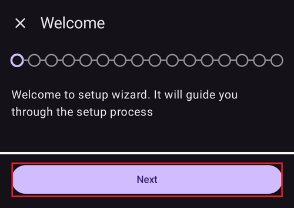
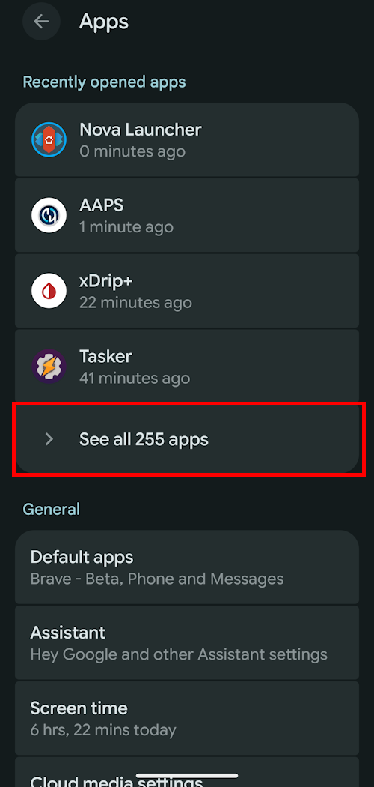
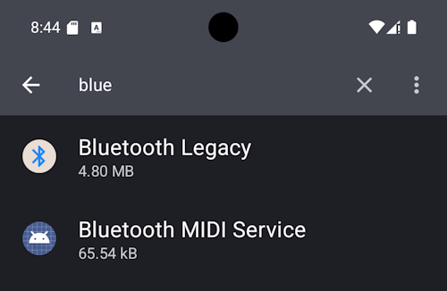
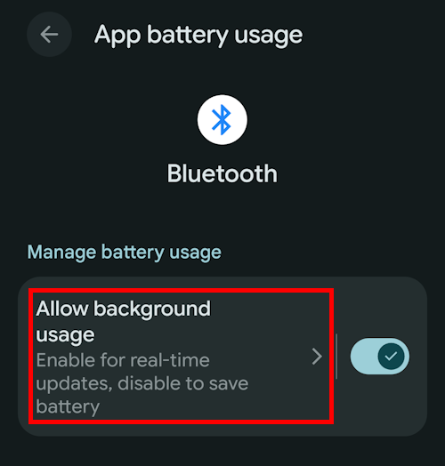
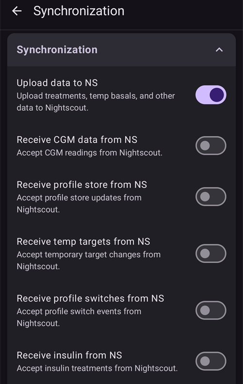
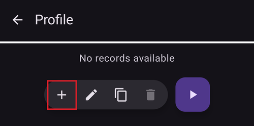

# Configurazione guidata di AAPS

```{contents} In this page
:backlinks: entry
:depth: 2
```

When you first start **AAPS** you are guided by the "**Setup Wizard**", to quickly setup all the basic configurations of your app in one go. **Setup Wizard** guides you, in order to avoid forgetting something crucial. For example, the **permission settings** are fundamental for setting up **AAPS** correctly.

However, it's not mandatory to get everything completely configured in the first run of using the **Setup Wizard** and you can easily exit the Wizard and come back to it later. There are three routes available after the **Setup Wizard** to further optimize/change the configuration. These will be explained in the next section. Quindi non è un problema se salti alcuni punti della Configurazione guidata: puoi configurarli facilmente più tardi.

During, and directly after using the **Setup Wizard** you may not notice any significant observable changes in **AAPS**. To enable your **AAPS** loop, you have to follow the **Objectives** to enable feature after feature. Inizierai l'**Obiettivo 1** alla fine della Configurazione guidata. You are the master of **AAPS**, not the other way around.

```{admonition} Preview Objectives
:class: note
If you are keen to know the structure of the objectives, please read [Completing the objectives](../SettingUpAaps/CompletingTheObjectives.md) but then come back here to run the Setup Wizard first.

```

From previous experience, we are aware that new starters often put themselves under pressure to setup **AAPS** as fast as possible, which can lead to frustration as it is a big learning curve.

So, please take your time in configuring your loop, the benefits of a well-running **AAPS** loop are huge.

```{admonition} Ask for Help
:class: note
If there is an error in the documentation or you have a better idea for how something can be explained, you can ask for help from the community as explained at [Connect with other users](../GettingHelp/WhereCanIGetHelp.md).
```
## Messaggio di benvenuto

When the Setup Wizard opens, it greets you with a short welcome message and immediately shows a "**Permissions Required**" panel at the bottom of the screen (see next section).

Once you have granted the permissions, the panel closes and the welcome screen shows a "**Next**" button. Premi "**AVANTI**" per continuare:



## Permessi richiesti

**AAPS** ha bisogno di alcuni permessi per funzionare correttamente. The Wizard groups them on a single "**Permissions Required**" panel, each with its own "**Grant**" button. Grant them one by one — the icon next to each item turns into a tick once it is done.


### Ottimizzazione della batteria

Battery consumption on smartphones is a consideration, as the performance of batteries is still quite limited. Therefore, the Android operating system on your smartphone is restrictive about allowing applications to run and consume CPU time, and therefore battery power.

However, **AAPS** needs to run regularly, _e.g._ to receive the glucose readings every few minutes and then apply the algorithm to decide how to deal with your glucose levels, based on your specifications. Therefore it must be excluded from battery optimization.

Press "**Grant**" next to "**Battery Optimization**", then select "**Allow**" on the "Let app always run in background?" dialog:


(SetupWizard-StoragePermission)=

### Directory AAPS

**AAPS** needs to store its settings and log information on the permanent storage of your smartphone. Memoria permanente significa che i dati restano disponibili anche dopo il riavvio dello smartphone. Le altre informazioni vanno semplicemente perse, perché non sono salvate nella memoria permanente.

Premi "**Concedi**" accanto a "**Directory AAPS**". Si apre il file system del telefono e puoi scegliere dove **AAPS** salva le sue informazioni.

```{tip}
Choosing the default AAPS directory is recommended.</br>
Do **not** select a subdirectory of AAPS.
```

La directory predefinita è **AAPS**, ma puoi usare qualsiasi directory dedicata che preferisci. Create the directory if necessary, enter it and choose "**USE THIS FOLDER**":


Conferma con "**CONSENTI**" che vuoi dare ad **AAPS** l'accesso alla directory selezionata:


### Notifiche

Android chiede un permesso speciale per le app che vogliono inviarti notifiche.

While it is a good feature to disable notifications _e.g._ from social media apps, it is essential that you allow **AAPS** to send you notifications.

Press "**Grant**" next to "**Notifications**" and select "**Allow**" at the system prompt:


### Sveglie e promemoria

On **Android 14 and newer**, **AAPS** needs the "**Alarms and reminders**" permission so that alarms can wake the screen while **AAPS** is in the background, and so that reminders (for example from an **Automation**) ring on time.

Questa voce compare solo quando serve. Once **AAPS** is excluded from battery optimization (see above), Android grants exact alarms automatically and the item disappears. If it is still listed, press "**Grant**" next to "**Alarms and reminders**". Si apre una schermata delle impostazioni di sistema per **AAPS**: attiva l'interruttore e torna in **AAPS**. On Android 13 and older this item does not appear and no action is needed.

Once all the permissions show a tick (three, or four on Android 14 and newer), the "**Permissions Required**" panel closes by itself and you can press "**NEXT**" on the welcome screen to continue.

(setup-wizard-bluetooth-battery-optimisation)=
### Ottimizzazione della batteria per il Bluetooth

```{admonition} Extra Android setting, not part of the Wizard
:class: note
The following is additional Android configuration done outside of the Setup Wizard. It is not one of the "Grant" buttons above, but it is important for a reliable pump connection.
```

Newer versions of Android have added battery optimization to the system Bluetooth application too.

As well as disabling battery optimization for **AAPS**, you will likely need to also disable this for the Bluetooth system app. Failure to do this may lead to pump connection dropouts and issues.

***NOTA: la documentazione di xDrip spiega come farlo qui: [documentazione di xDrip](https://navid200.github.io/xDrip/docs/BluetoothBatteryOpt.html)***

Follow these steps on Android 16; other versions will vary slightly from the provided screenshots:

1. Open Android settings and search for **Apps**, and open the Apps settings.

   

2. You will see the App settings, however we need to expand to see all apps, click on **See all apps** to expand.

   

3. As the Bluetooth app is a system app, it's hidden by default, so we need to show system apps. Tocca i **tre puntini** (⋮) in alto a destra (1). Then click on **Show system** (2).

   

4. Search for the `Bluetooth` app and click on `Bluetooth` and/or `Legacy Bluetooth` if both are present ensure the procedure is followed for both.

   ***NOTE: It's safe to ignore the `Bluetooth MIDI Service` this is not used by AAPS***

           

   1. Su Android 12 tocca `Batteria`, su Android 13+ tocca `Utilizzo batteria app`.

      

5. On Android 12+ select the `Unrestricted` option, on Android 15+ you need to expand the `Allow background usage` setting, click on the section highlighted in red to do this then follow step 6 to complete.

       

6. On Android 16 Select `Unrestricted`

   

## Contratto di licenza

Il contratto di licenza per l'utente finale contiene informazioni importanti sugli aspetti legali dell'uso di **AAPS**. Leggilo con attenzione.

If you don't understand, or can't agree to the end user license agreement please don't use **AAPS** at all!

If you understand and agree, please press the "**I UNDERSTAND AND AGREE**" button and follow the Setup Wizard:


A "**Next**" button appears once you have agreed. Premi "**AVANTI**".

The next screen, "**Permissions**", lists the permissions again. They should all show a tick, as you granted them at the start. If one is missing, press "**Grant**" next to it. Premi "**AVANTI**" per continuare:


## Password Master

As the configuration of **AAPS** contains some sensitive data (_e.g._ the access token for your Nightscout server) it is encrypted by a password you set here.

La Configurazione guidata mostra "**Password non impostata**". Premi "**Imposta**":


Si apre la schermata "**Protezione**". Press "**Master password**" (shown as "Password not set"):


Enter the same password in both fields and press "**OK**":


Torna indietro con la freccia in alto a sinistra. The Wizard now shows "**Password set!**":


```{admonition} Do not lose your Master Password
:class: danger
Please **DO NOT LOSE YOUR MASTER PASSWORD**. Annotala, _ad es._ su Google Drive: è un buon posto, perché Google ne fa il backup per te. Il tuo smartphone o il tuo PC possono rompersi e potresti non avere una copia aggiornata. Se dimentichi la Password Master, più tardi potrebbe essere difficile recuperare la configurazione del profilo e i progressi negli **Obiettivi**.
```

When you are done, press "**NEXT**" to go to the next screen.

(setup-wizard-import-settings)=
## Import settings

Questa schermata compare solo quando **AAPS** trova nella directory **AAPS** impostazioni esportate in precedenza ("Trovate impostazioni memorizzate"), per esempio quando reinstalli l'app o passi a un nuovo telefono.

- To restore your previous configuration, press "**Import settings**" — see [Export & import settings](../Maintenance/ExportImportSettings.md).
- Per iniziare con una nuova configurazione, premi "**AVANTI**" e continua con la Configurazione guidata.


## Unità (mg/dL <-> mmol/L)

Please select if your glucose values are in mg/dL or mmol/L, then press the "**NEXT**" button:


## Impostazioni di visualizzazione

Qui imposti il "**Limite BASSO**" e il "**Limite ALTO**" per la visualizzazione della glicemia del sensore. Glucose values between these two marks are shown as "in range". Per ora puoi lasciare i valori predefiniti (72 e 180 mg/dL) e modificarli più tardi.

I valori che scegli cambiano solo la visualizzazione del grafico, e nient'altro.

Your glucose target _e.g._ is configured separately in your profile.

L'intervallo per analizzare il TIR (tempo nell'intervallo) si imposta a parte nel tuo server di report.

Se serve, regola i limiti con i pulsanti "−" / "+", poi premi il pulsante "**AVANTI**":


(SetupWizard-synchronization-with-the-reporting-server-and-more)=
## Comunicazione

The "**Communication**" screen lists the plugins used to upload, synchronize and broadcast your data:

- **SMS Communicator** – remote control of **AAPS** using SMS commands
- **NSClientV3** – sincronizza i tuoi dati con Nightscout usando l'API v3
- **Tidepool** – carica i dati su Tidepool
- **xDrip** – invia i dati a xDrip
- **Open Humans** – carica e dona i tuoi dati sul diabete a progetti scientifici
- **Wear** – monitor and control **AAPS** from a WearOS watch
- **App companion esterne** – trasmissione dei dati a varie app esterne
- **Garmin** – connessione a un dispositivo Garmin


Scroll down to see the rest of the list:


You could configure several of these now, but for the first run we will just focus on the reporting server. If you are not able to set it up at the moment, skip it for now — you can configure it later.

In questo esempio usiamo Nightscout come server di report. Tick the box on the right of "**NSClientV3**" to enable it. Per Tidepool è ancora più semplice, perché ti servono solo i tuoi dati di accesso personali.

Once enabled, press "**Settings**" below NSClientV3 to configure it:


Qui configuri il server di report Nightscout. The NSClientV3 settings are shown as one scrollable page:


Press "**Nightscout URL**" and enter your personal Nightscout server address (the URL you set up yourself, or were given by your service provider). Conferma con "**OK**".

Premi "**Token di accesso Nightscout**" e inserisci il token di accesso del tuo server Nightscout. Senza questo token l'accesso non funziona. If you don't have it yet, please check the documentation for setting up the reporting server.

Leave "**Use websockets**" enabled for real-time communication with Nightscout.

The remaining sections can be left at their defaults for now. They are described here so you know where to find them later:

**Alarm options** — Nightscout alarms, announcements and stale-data thresholds. Leave the switches off for now; we only open them so you are aware of the options.

**Impostazioni connessione** — scegli come vengono trasferiti i dati. Caregivers must enable "**Use cellular data**", otherwise the phone of the person they care for (_e.g._ a child) cannot upload outside Wi-Fi range, _e.g._ on the way to school. Other users can disable cellular transfer to save data or battery. If in doubt, leave everything enabled.


**Advanced Settings** — enable "**Log app start event**" if you want to see in Nightscout when the app restarts (useful for caregivers). Keep "**Create announcements from errors**" and "**Create announcements from carbs required**" enabled. Leave "**Use slow sync**" off; you would only use it if the Nightscout server is slow to process a large amount of data.


Go back to the list of plugins and press "**NEXT**" to go to the next screen.

## Controllo client

From **AAPS** version 4, client devices running **AAPSClient** can be **paired** with this phone (the **master**) and control it with signed commands sent over Nightscout. This is the new recommended way to control **AAPS** remotely — see [Master ↔ Client control](../RemoteFeatures/ClientMasterControl.md) for the full explanation and setup.

There is nothing you have to configure on this screen now; you can pair clients at any time later from **Manage → Authorized clients**. There you add a client with a **QR code** (it sets up Nightscout on the client too) or with a **PIN**, and give it a **role**.

- "**Authorized clients**" — manage the paired client devices allowed to control this master.
- "**Nightscout data acceptance**" — accepting treatments and data entered directly in Nightscout (the old, less secure way) is now turned off by default. Only open these settings if you still need it, _e.g._ to enter data through Nightscout or third-party apps.

When client control is already on — always in [Simple Mode](#preferences-simple-mode) — this phone is in [hardened mode](#client-master-control-hardened-mode): it takes changes only from paired clients, so the screen explains hardened mode instead of offering the "**Nightscout data acceptance**" settings.


"**Nightscout data acceptance**" opens the "**Synchronization**" settings, where each kind of data received from Nightscout has its own switch:



Press "**NEXT**" to go to the next screen.

(setup-wizard-instance-name)=
## Chi sta usando questo telefono?

Qui inserisci il nome della persona che usa questo telefono. It tells this **AAPS** instance apart from others in reports and when synchronizing, for example if two children in your family use **AAPS**. It is also used in the names of exported settings files and shown on the watch.

Può essere qualsiasi cosa. Puoi cambiarlo più tardi in **Impostazioni → Generale → Nome istanza**.

Press "**NEXT**" to go to the next screen.


## Tipo paziente

Here you select your "Patient type" which is important, as the **AAPS** software has different limits, depending on the age of the patient. È importante per motivi di sicurezza.

Qui imposti anche il **bolo massimo consentito** per un pasto. Cioè il bolo più grande che ti serve per coprire i tuoi pasti tipici. È una funzione di sicurezza che aiuta a evitare un sovradosaggio accidentale quando fai il bolo per un pasto.

Il secondo limite è simile, ma riguarda la quantità massima di carboidrati che pensi di mangiare.

After setting these values, press "**NEXT**" to go to the next screen:


## Insulin

Qui configuri l'insulina usata nel tuo micro. New insulin profiles require a **DIA of at least 5 h**.

Premi il pulsante "**Insulina**" per aprire l'editor dell'insulina:


In the editor you can give the insulin a **nickname** and set its **Peak** (in minutes) and **DIA** (in hours). The quickest way is to load a preset with "**Load peak from**" — choose **Novorapid**, **Fiasp** or **Lyumjev** — and the peak is filled in for you. The graph at the bottom previews the resulting insulin activity curve.


Pick the preset that matches your insulin, for example **Fiasp**:


```{admonition} Use your insulin brand's preset peak
:class: danger
Please don't change the peak unless you are an expert — usually the preset values work well for each branded insulin.
```

If you are a new **AAPS** user, set **DIA** to 9 hours — see [Duration of insulin action (DIA) and peak](#Config-Builder-insulin-dia) to understand why.

```{admonition} "Insulin configuration changed" dialog
:class: note
If a paired client (_e.g._ another phone) has changed the insulin configuration, a dialog appears. Press **OK** to load their changes, or **Cancel** to keep editing (your next save will overwrite theirs).
```


Press the save icon (top right), then press "**NEXT**" to go to the next screen.

## Sorgente glicemia

Here you select where **AAPS** gets its glucose data from. Leggi la documentazione della tua [sorgente glicemia](../Getting-Started/CompatiblesCgms.md).

Many sources are available — scroll through the list and select the one you use:


Once you select a source, its card expands and shows two buttons: "**Settings**" to adjust how the data is received, and "**Open plugin**" to open the source's own screen. Nell'esempio qui sotto è selezionato **BYODA**. Some sources have nothing to configure at this stage, so you can usually go straight to the next screen:


After making your selection, press "**NEXT**" to go to the next screen.

(setup-wizard-profile)=
## Profilo

Ora entriamo in una parte molto importante della Configurazione guidata.

Please read the documentation about [profiles](../SettingUpAaps/YourAapsProfile.md) before you try to enter your profile details on the following screen.

```{admonition} Working profile required - no exceptions here !
:class: danger
An accurate profile is necessary to control the safe action of **AAPS**.

It's required that you have determined and discussed your profile with your doctor, and that it has been proven to work by successful basal rate, ISF and IC testing!

If a robot has an incorrect input it will fail - consistently. **AAPS** può lavorare solo con le informazioni che riceve. If your profile is too strong, you risk hypoglycemia, and if it is too weak, you risk hyperglycemia. 
```

Premi il pulsante "**Profilo**" per aprire l'editor del profilo:


L'editor si apre vuoto ("Nessun record disponibile"). Premi il pulsante "**+**" in basso per creare un nuovo profilo:



Col tempo, se serve, puoi avere più profili. Qui ne creiamo solo uno.

```{admonition} Profile only for tutorial - not for your usage
:class: note
Il profilo di esempio qui serve solo a mostrarti come inserire i dati.

It is not intended to be an accurate profile or something very well optimized, because each person's needs are so different.

Non usarlo per il loop vero e proprio!
```

Il nuovo profilo (per esempio "**LocalProfile1**") ha quattro schede: **IC**, **ISF**, **BAS** e **TARG**. Premi la matita accanto al nome del profilo per rinominarlo. Fill in every tab — a tab stays red and shows an error message until it contains valid values:


Press "**IC**" and enter your [IC](#your-aaps-profile-insulin-to-carbs-ratio) values. Usa il pulsante "**+**" per aggiungere altri blocchi orari:


Press "**ISF**" and enter your [ISF values](#your-aaps-profile-insulin-sensitivity-factor):


Press "**BAS**" and enter your [basal values](#your-aaps-profile-basal-rates):


Press "**TARG**" and enter your blood sugar target values.

For open looping this target can be a wider range, as otherwise **AAPS** notifies you permanently to change the temporary basal rate or another setting, which can be exhausting.

Più avanti, con il loop chiuso, di solito avrai un solo valore per il limite superiore e inferiore. That makes it easier for **AAPS** to hit the target and give you better overall diabetes control.


Quando tutte e quattro le schede sono valide, l'**icona di salvataggio** (in alto a destra) diventa attiva. Premila per salvare il profilo:


Chiudi l'editor con la "**X**" in alto a sinistra. The profile summary then shows its name, its total daily basal (∑), the units and the IC and ISF values with their graphs:


```{admonition} Several defined but only one active profile
:class: note
You can have several profiles defined, but only one activated profile running at any given time.
```

Premi il pulsante "**▶**" (attiva) in basso a destra. Si apre la schermata "**Attiva**". As no insulin is in use yet, it first asks you to select the insulin you are using, so that the profile switch can record it. Il pulsante "**Attiva**" resta grigio finché non lo fai:


Premi "**Seleziona Insulina**" e scegli l'insulina che hai configurato prima. Lascia la percentuale al 100 % e premi "**Attiva**":


Compare una finestra di cambio profilo. In this case let it stay as preset and confirm with "**OK**":

```{admonition} Profile switch dialog
:class: note
You will learn later how to use this general dialog to handle situations like illness or sport, where you need to change your profile to suit the circumstances.
```


Ora il tuo profilo è attivo. Press "**NEXT**" to go to the next screen.

## Insulin pump

Now you select your insulin pump. Please read the documentation for your [insulin pump](../Getting-Started/CompatiblePumps.md).

Scorri l'elenco e seleziona il tuo micro. In this example we use the "**Virtual Pump**", which is useful while you are still learning and have not connected a real pump yet:


Many pumps are supported — scroll down to find yours:


When you select a real pump, **AAPS** asks for a confirmation, because it will copy the basal rates of your profile to the pump and overwrite the basal rates stored there. Press "**OK**" only if the basal rates in your **AAPS** profile are correct; otherwise press "**Cancel**" and switch to the pump later:


Se il micro che selezioni comunica tramite Bluetooth, **AAPS** chiede il permesso di connettersi ai dispositivi vicini quando finisci la Configurazione guidata (vedi [Permesso Bluetooth](#setup-wizard-bluetooth-permission)).

If you have already set up your profile and know how to connect your pump, feel free to connect it now. Otherwise leave it on **Virtual Pump** for the moment — you can change it anytime, or leave the Setup Wizard using the arrow in the top left corner and let **AAPS** first show you some blood glucose values.

Press "**NEXT**" to go to the next screen.

## Algoritmo APS

Usa l'algoritmo OpenAPS SMB come algoritmo APS. Despite the name, the SMB feature of the algorithm is disabled until you are familiar with AAPS and have worked through the first objectives. OpenAPS SMB is newer and generally better than OpenAPS AMA anyway.

SMB is disabled at the start because the SMB feature reacts faster to a blood sugar increase, using a Super Micro Bolus instead of increasing the basal rate percentage. Because your profile is generally not as good in the beginning as it is after some experience, the feature is disabled at first.

```{admonition} Only use the older algorithm **OpenAPS AMA** if you know what you are doing
:class: note
OpenAPS AMA is the most basic algorithm which does not support micro boluses to correct high values. There might be circumstances where it is better to use this algorithm but it is not the recommendation.
```

Seleziona "**OpenAPS SMB**", poi premi "**Impostazioni**" per vedere i dettagli:


L'unica opzione qui è "**Usa sensibilità dinamica**". Leave it off and change nothing for now — just read the text.

Due to the limitations which are imposed by the **Objectives** you can't use either "closed loop" or "SMB features" at the moment anyway.

Go back and press "**NEXT**" to go to the next screen:


## Sensitivity detection

Lascia selezionato "**Sensibilità Oref1**" come plugin di sensibilità standard:


If you press "**Settings**" you can review the absorption settings; the defaults (_e.g._ a 6 h absorption cutoff) are fine for now.


Press "**NEXT**" to go to the next screen.

## Avviare l'Obiettivo 1

You are now entering the Objectives — the qualification for access to further **AAPS** features.

Press "**Open Objectives**":


Qui avviamo l'Obiettivo 1, anche se per ora la nostra configurazione non è ancora pronta per completarlo. Ma questo è l'inizio.

Premi il pulsante "**Avvia**" dell'**Obiettivo 1**:


L'obiettivo si espande e mostra i singoli controlli. You can see that you already made some progress, while other items are still to be done:


Torna indietro, poi premi "**FINE**" per completare la Configurazione guidata:


Dopo aver premuto "**FINE**" arrivi alla schermata principale di **AAPS**. A "**Notification**" panel may open with information messages, for example about the profile switch you just made — press "**Dismiss**" below each message to clear it.

If you accidentally leave the Setup Wizard at any point, you can either simply re-start the Wizard, or change the [configuration of the AAPS loop](../SettingUpAaps/ChangeAapsConfiguration.md) manually.

(setup-wizard-bluetooth-permission)=
## Bluetooth permission

If you select a pump that connects over Bluetooth (for example **Omnipod Dash**), a banner reminds you that **AAPS** needs Bluetooth permission. You can press "**Dismiss**" for now — the permission is granted after you finish the Wizard:


Quando la Configurazione guidata è finita, la schermata principale di **AAPS** mostra un pannello "**Permessi richiesti**". Gli altri permessi sono già concessi; premi "**Concedi**" accanto a "**Bluetooth**":


Seleziona "**Consenti**" così **AAPS** può trovare il tuo micro e connettersi:


If your **AAPS** loop is now fully setup, please move on to the next section ["Completing the objectives"](../SettingUpAaps/CompletingTheObjectives.md).
