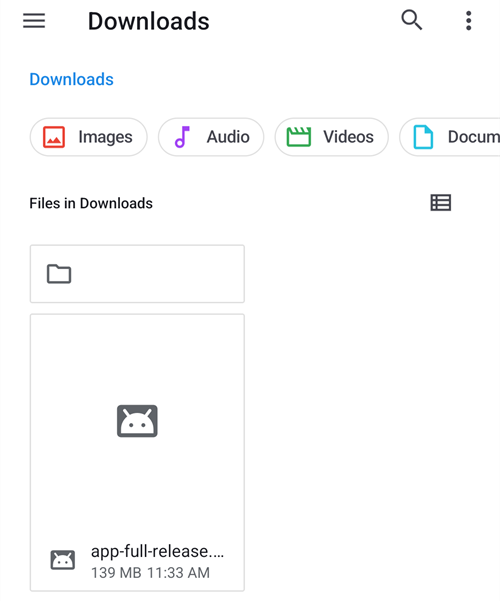
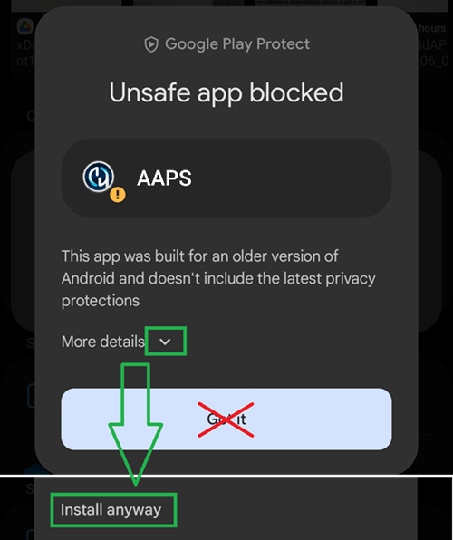

# Trasferire e installare AAPS sullo smartphone

In the previous section, [building **AAPS**](../SettingUpAaps/BuildingAaps.md), you built the **AAPS** app (which is an .apk file) on a computer.

The next steps are to **transfer** the **AAPS** APK file (as well as other apps you may need, like BYODA, xDrip or another CGM receiver app) to your Android smartphone, and then **install** the app(s). Following installation of **AAPS** on the smartphone, you will then be able to move onto [**configuring the AAPS loop**](../SettingUpAaps/SetupWizard.md).

This page also explains [Android developer verification](#android-developer-verification), a change Google is rolling out from September 2026 that affects installing self-built apps, and the [free installation methods](#android-developer-verification-free-methods) that keep working after the change.

```{contents} Table of contents
:depth: 1
:local: true
```

## Installare AAPS toccando il file APK

Today, you install **AAPS** by transferring the APK file to your phone and opening ("tapping") it. Ci sono diversi modi per trasferire il file APK di **AAPS** dal computer allo smartphone. Qui spieghiamo due modi diversi:

* Opzione 1 -  Usare il tuo Google Drive (Gdrive)
* Opzione 2 -  Usare un cavo USB

Nota che il trasferimento via email può dare problemi ed è sconsigliato.

```{admonition} Android developer verification
:class: warning
Google is rolling out [Android developer verification](#android-developer-verification) from September 2026 (starting in Brazil, Indonesia, Singapore and Thailand; worldwide in 2027). Where it is enforced, installing an APK by tapping the file — as described in both options below — is blocked. In that case, use one of the [free installation methods](#android-developer-verification-free-methods) further down this page.
```

### Opzione 1. Usare Google Drive per trasferire i file

Apri [Google.com](https://www.google.com/) nel browser e accedi al tuo account Google.

In alto a destra seleziona l'app Drive nel menu Google.


Click **New** at the top left (or right-click an empty area below your files and folders) and select **File upload**.


Ora il file apk dovrebbe essere caricato su Google Drive.

#### Usa l'app Google Drive per aprire il file apk e installarlo

Passa al telefono e avvia l'app Google Drive. È un'app preinstallata: la trovi dove si trovano le altre app Google, oppure cercandone il nome.


Avvia l'installazione dell'apk toccando il nome del file nell'app Google Drive sul telefono.


In case you get a security notice that you are not allowed to install apps from Google Drive at the moment, tap "Settings" and allow it for that short moment, then disallow it afterwards, as it is a security risk to leave it enabled all the time.


After the installation finishes, you are done with this step.

Dovresti vedere l'icona di **AAPS** e poter aprire l'app.

```{warning}
**IMPORTANT SAFETY NOTICE**
Did you remember to disallow the installation from Google Drive?
```

Please go on with [configuring the AAPS loop](../SettingUpAaps/SetupWizard.md).

### Opzione 2. Usare un cavo USB per trasferire i file

Il secondo modo per trasferire il file apk di AAPS è con un [cavo USB](https://support.google.com/android/answer/9064445?hl=en).

Trasferisci il file dalla sua posizione sul computer alla cartella "Download" del telefono.

Sul telefono dovrai consentire l'installazione da origini sconosciute. Explanations of how to do this can be found on the internet (_e.g._ [here](https://www.expressvpn.com/de/support/vpn-setup/enable-apk-installs-android/) or [here](https://www.androidcentral.com/unknown-sources)).

Dopo aver trasferito il file trascinandolo, apri la cartella "Download" sul telefono e premi il file apk di AAPS:



The first time, Android tells you that the phone is not allowed to install unknown apps from this source. Premi "**Impostazioni**":


Attiva "**Consenti da questa fonte**", poi torna indietro:


Premi di nuovo il file apk e seleziona "**Installa**":


When the installation is finished, press "**Open**" to start **AAPS**, or "**Done**" to open it later:


```{warning}
**IMPORTANT SAFETY NOTICE**
Remember to disable "Allow from this source" again after the installation, as it is a security risk to leave it enabled all the time.
```

Please go on with [configuring the AAPS loop](../SettingUpAaps/SetupWizard.md).

(transferring-installing-play-protect-warning)=
## Avviso di Google Play Protect

When you install **AAPS**, Google Play Protect may warn you that the app is unsafe, was built for an older version of Android and doesn't include the latest privacy protections.



This is expected for an app you built yourself. Tocca **Altri dettagli**, poi **Installa comunque**.

If the installation is **blocked** with a message about an unverified developer (not just a warning), see [Android developer verification](#android-developer-verification) below.

(android-developer-verification)=

## Verifica degli sviluppatori Android

Google is introducing **Android developer verification**: on most Android phones, apps will only install if they were registered with Google by a verified developer. This also applies to apps installed from an APK file ("sideloading") — which is how you install the **AAPS** app you built yourself.

### Cosa cambia

When you install **AAPS** on a phone with Google services (a "certified" Android device — virtually every phone sold with the Play Store), Android will check whether the app comes from a developer registered with Google. If not, the normal installation by tapping the APK file is blocked.

**Il controllo avviene quando un'app viene installata o aggiornata.** Non rimuove le app già installate e in funzione.

Google is rolling this out gradually:

| Quando            | Cosa succede                                                                                                                                      |
| ----------------- | ------------------------------------------------------------------------------------------------------------------------------------------------- |
| Agosto 2026       | Gli account sviluppatore gratuiti a "distribuzione limitata" sono aperti in tutto il mondo e il "flusso avanzato" inizia ad arrivare sui telefoni |
| 30 settembre 2026 | Verification is enforced in **Brazil, Indonesia, Singapore and Thailand**, for apps installed from Google Play and a few other app stores         |
| 2027              | L'obbligo si estende al **resto del mondo** e a **tutte le installazioni**, compresi i file APK                                                   |

Details are published by Google on the [Android developer verification](https://developer.android.com/developer-verification) pages, including a [FAQ](https://developer.android.com/developer-verification/guides/faq). Google may still adjust dates and details; this page will be updated as the rollout progresses.

### Does this affect me?

- **Building AAPS is not affected at all.** The [browser build](#browser-build), the [Android Studio build](ComputerBuild.md) and the [CLI build](CLIBuild.md) work exactly as before, and your keystore does not change.
- **Il tuo AAPS attuale continua a funzionare.** La verifica viene controllata solo quando installi o aggiorni un'app.
- **Se vivi in Brasile, Indonesia, Singapore o Thailandia:** dal 30 settembre 2026 la verifica è obbligatoria per le app installate da Google Play e da alcuni altri app store. Google states that installing an APK file directly is not covered by this first step, so **AAPS** should still install as usual. Nevertheless, prepare one of the [free installation methods](#android-developer-verification-free-methods) below now, so that you are not caught out if this changes.
- **If you live anywhere else:** nothing changes for you before 2027, and doing nothing for now is a legitimate choice. Ma configura uno dei [metodi di installazione gratuiti](#android-developer-verification-free-methods) qui sotto finché tutto funziona: scoprire il blocco il giorno in cui un aggiornamento viene rifiutato, con davanti l'attesa di 24 ore del [flusso avanzato](#android-developer-verification-advanced-flow), è il momento sbagliato.
- **Old phones:** verification applies to phones running Android 7 or higher, which means every phone able to run **AAPS**.

(android-developer-verification-free-methods)=

## Modi gratuiti per installare AAPS

You do **not** need to pay Google anything to keep using **AAPS**. There are several free methods; pick the one that matches your situation.

```{admonition} Which method should I use?
:class: tip
- You have a **computer** (whichever way you built **AAPS**): use [ADB](#android-developer-verification-adb) or, if you prefer to avoid the command line, the [web installer](#android-developer-verification-web). Both are exempt from verification, have no limits, and need no Google account.
- You have **no computer at all**: use the [advanced flow](#android-developer-verification-advanced-flow) on your phone.
- Preferisci registrarti presso Google, così la normale installazione "tocca l'APK" continua a funzionare: esiste un [account gratuito a distribuzione limitata](#android-developer-verification-limited-account), ma non è stato provato con **AAPS**.
```

(android-developer-verification-adb)=

### Opzione 1: installare con ADB (serve un computer)

ADB (Android Debug Bridge) è lo strumento ufficiale di Google per installare app da un computer su un telefono con un cavo USB. Google ha confermato che **le app installate con ADB non richiedono la verifica**: nessun periodo di attesa, nessun limite di dispositivi e nessuna registrazione.

One-time preparation:

1. On your phone, enable the hidden developer options: go to **Settings** > **About phone** (on some phones **Software information**) and tap **Build number** seven times, until the phone confirms you are a developer.
1. Go back to the main **Settings**, open the new **Developer options** entry and enable **USB debugging**.
1. On your computer, make sure ADB is available:
   - If you use **Android Studio**, ADB is already installed with it.
   - Otherwise, download Google's free [SDK Platform Tools](https://developer.android.com/tools/releases/platform-tools) and unzip the folder. No installation is needed; ADB is the `adb` program inside that folder.

Installare (e poi aggiornare) **AAPS**:

1. Collega il telefono al computer con un cavo USB. Non serve trasferire prima il file APK sul telefono: ADB lo invia direttamente dal computer.
1. On the phone, accept the **Allow USB debugging?** prompt (the first time only).
1. On the computer, open a terminal (command prompt) in the folder containing ADB and the **AAPS** APK file, and run:

   ```
   adb install -r app-full-release.apk
   ```

   Sostituisci `app-full-release.apk` con il nome reale del tuo file APK. The `-r` option updates an already installed **AAPS** while keeping all its data and settings.

1. Wait for `Success` to be displayed. **AAPS** is now installed on your phone.

Lo stesso comando si usa per ogni aggiornamento futuro. The [Wear OS pages](../WearOS/WearOsSmartwatch.md) already use ADB in the same way to install the watch app.

If you would rather not use a cable: on Android 11 and later, **wireless debugging** (also under **Developer options**) can do the same over Wi-Fi, after a one-time pairing with a code shown on the phone.

(android-developer-verification-web)=

### Opzione 2: installare da una pagina web (computer, senza riga di comando)

Se la riga di comando non fa per te, una pagina web può fare esattamente quello che fa ADB, direttamente dal browser. Because it talks to the phone through the same mechanism as ADB, it carries the **same exemption from verification** — but there is nothing to download, no folder to unzip and no command to type.

This is the easiest route if you used the [browser build](#browser-build) and have never opened a command line.

1. Enable **USB debugging** on the phone (steps 1 and 2 of the [ADB method](#android-developer-verification-adb) above — one-time setup).
1. Open the **[AAPS web installer](#web-installer)** in your browser.
1. Connect the phone with a USB cable and follow the instructions on the page: connect, choose your APK file, and install.

Tre cose da sapere:

- It only works in **Chrome, Edge or Opera**. Firefox e Safari non possono comunicare con i dispositivi USB.
- Only one program can use the phone's ADB connection at a time, so **close Android Studio** (or anything else that uses ADB) before connecting.
- A web page connected this way gets full control of your phone. **Use only the address above**, from the **AAPS** documentation — never an installer page found through a search engine. The **AAPS** web installer runs entirely in your browser: your APK file is not uploaded anywhere.

```{admonition} No computer? A second phone works too
:class: tip
The web installer also works from **Chrome on another Android phone** with a USB-C to USB-C cable — so a parent can install **AAPS** onto a child's phone with no computer in the house.
```

(android-developer-verification-advanced-flow)=

### Option 3: The "advanced flow" on your phone (no computer needed)

Google provides an escape hatch for experienced users who understand the risks of installing unverified apps, called the **advanced flow**. Google started rolling it out to phones in August 2026, ahead of enforcement, so you can set it up now. It is a one-time setup on the phone itself, which **takes 24 hours** to complete:

1. Enable the hidden developer options (see step 1 of the ADB method above), then open **Settings** > **Developer options** > **Apps from unverified developers**.
1. Attiva **Consenti app di sviluppatori non verificati**. The phone asks for your screen lock to confirm it is you.
1. The phone asks whether someone is asking you to turn on this setting, and explains that banks, government agencies or police would never ask you to do so. Read the warning and confirm that nobody is pressuring or guiding you (this is a protection against scammers).
1. **Restart your phone.** This starts a one-time **24-hour waiting period**.
1. After 24 hours, go back to **Settings** > **Developer options** > **Apps from unverified developers** to finish the setup.
1. Scegli se consentire le app non verificate per **7 giorni** o **a tempo indeterminato**. For **AAPS**, choose **indefinitely**, otherwise your next update will be blocked once the 7 days have passed.

After this setup, installing or updating the **AAPS** APK works as it does today, with one extra warning that the app is from an unverified developer — tap **Install anyway**.

Good to know:

- Dopo puoi disattivare di nuovo le **Opzioni sviluppatore**: il flusso avanzato resta attivo. Google also does not give apps (such as banking apps) any way to detect that the advanced flow is enabled.
- If you turn the advanced flow off, installing **or updating** **AAPS** is blocked again (your installed **AAPS** keeps running). You have a 10-minute window to turn it back on; after that, the 24-hour waiting period starts again.
- Changing the phone's clock does not shorten the waiting period, and ADB cannot skip it.
- Google states that your choice follows your Google account to your other devices, so a new phone should not mean another 24-hour wait.
- If you cannot find **Apps from unverified developers** in the developer options, your phone has not received the feature yet. It is delivered by a system component called **Android Developer Verifier**, which Google is rolling out gradually through the Play Store. You can help it along by opening **Android Developer Verifier** in the Play Store.

```{note}
Google describes this as a first version and may still change the screens and steps; this section will be updated with screenshots once the final version is available.
```

(android-developer-verification-limited-account)=

### Opzione 4: registrarsi presso Google (account gratuito a distribuzione limitata)

Google offre un tipo di account sviluppatore **gratuito** per hobbisti e uso personale, chiamato **account a distribuzione limitata**, aperto a tutti da agosto 2026:

- **Nessun documento d'identità** e **nessun costo** (a differenza dell'account sviluppatore a pagamento, che non serve per l'uso personale di **AAPS**). You do need a Google account with 2-step verification, a Google payments profile holding your legal name and address, and a contact email address.
- You register your app's package name in Google's Android Developer Console, and authorize the phones it may be installed on, up to **20 devices**, through a handshake with a QR code or link between the phone and the console.
- Dopo la registrazione, la normale installazione (toccando il file APK) funziona di nuovo sui telefoni autorizzati, senza ADB e senza il flusso avanzato.
- A limited distribution account can later be upgraded to a full account, but not the other way round.

```{warning}
Google has not explained how registration works when many people build the same open-source app: every self-built **AAPS** uses the same package name (`info.nightscout.androidaps`) with a different signing key, and Google's FAQ states that a package name already in use by others cannot be claimed outright and requires an additional review. The outcome of such a review is unknown, and the paid developer account ($25 and a government ID) does not help here: paying only removes the 20-device cap, not the package name review.

For this reason, step-by-step instructions cannot be written yet. Questa sezione sarà completata quando la registrazione sarà stata provata con **AAPS**. In the meantime, ADB, the web installer and the advanced flow above are reliable alternatives.
```

## Cosa non cambia

- Building **AAPS** yourself, with any of the three [build methods](BuildingAaps.md).
- Il tuo account GitHub, il tuo repository di build (AAPS Builder) o fork, e il tuo keystore.
- La tua app **AAPS** installata, le tue impostazioni e i tuoi [obiettivi](CompletingTheObjectives.md).
- Phones without Google services, and [ADB installations](#android-developer-verification-adb) in general.

## Dove trovare aiuto

1. **Read** Google's [developer verification FAQ](https://developer.android.com/developer-verification/guides/faq) for questions about the verification itself.
2. **Ask** on the *#AAPS* channel on [Discord](https://discord.gg/4fQUWHZ4Mw), or in one of the other [community channels](../GettingHelp/WhereCanIGetHelp.md), if an installation is blocked.
3. When asking for help, include your phone make and model, Android version, your country, and the exact message displayed when the installation fails.

```{toctree}
:hidden:

AAPS web installer <WebInstaller.md>
```
