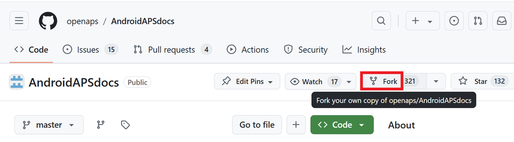
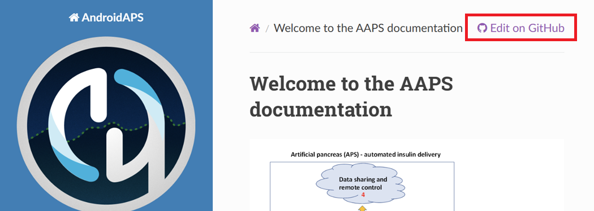
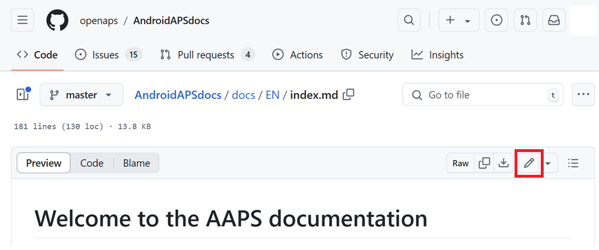
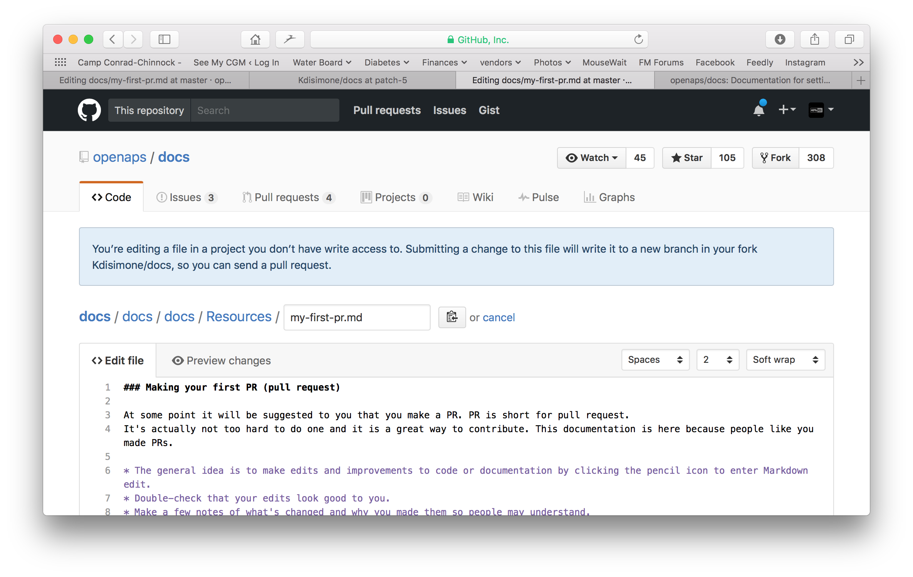
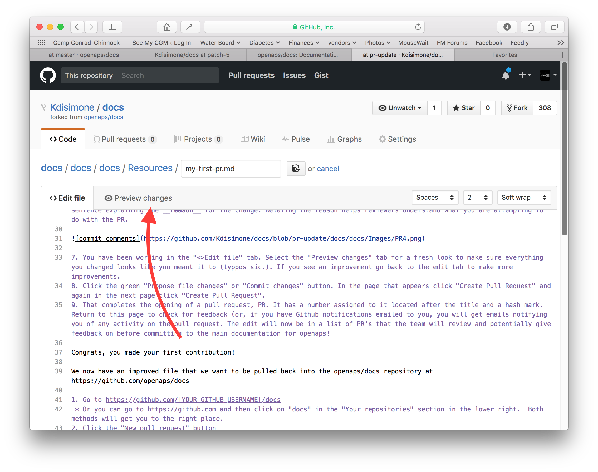
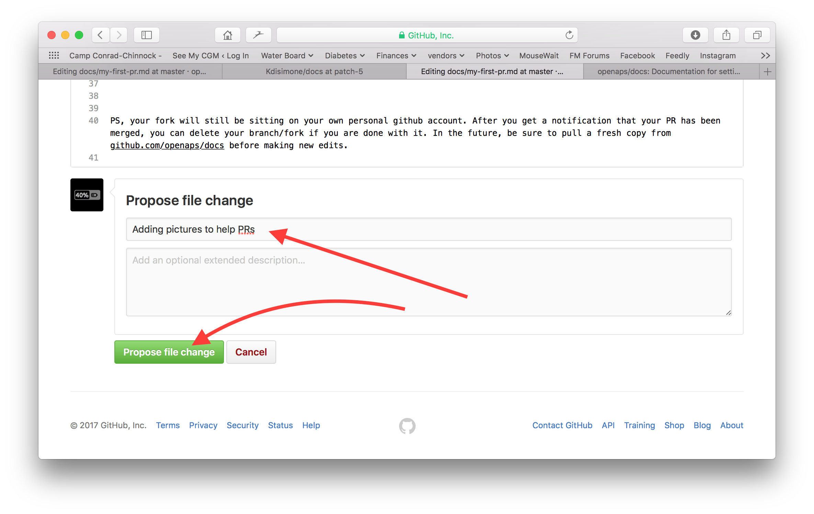
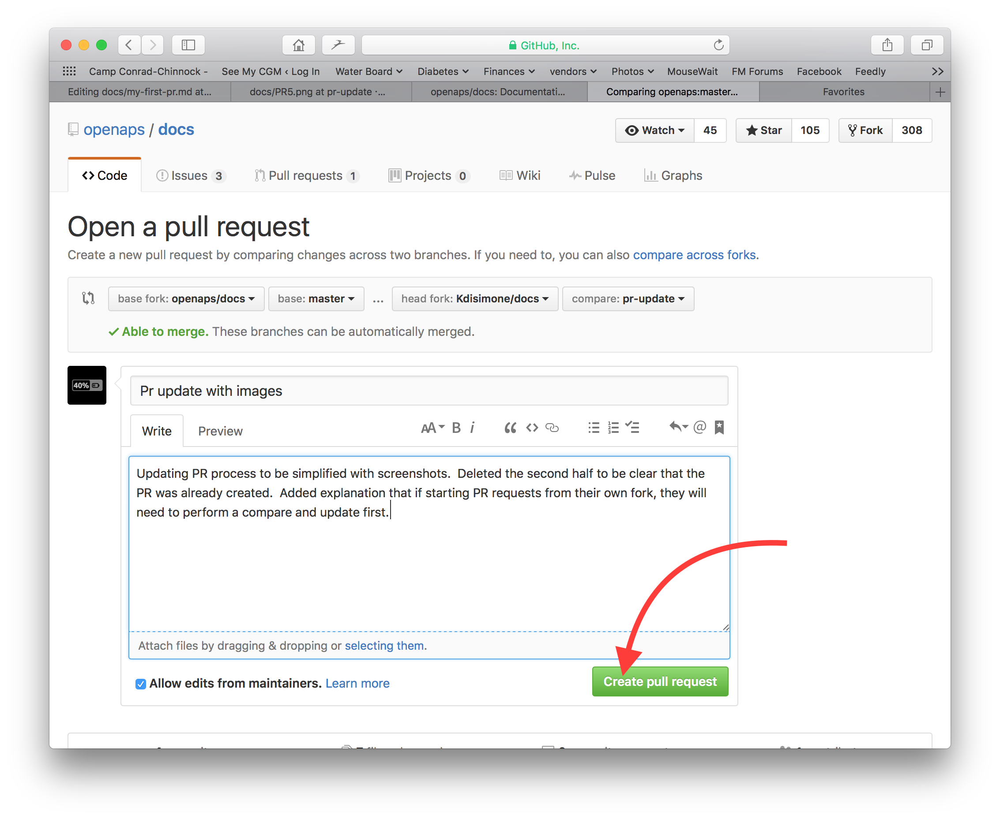
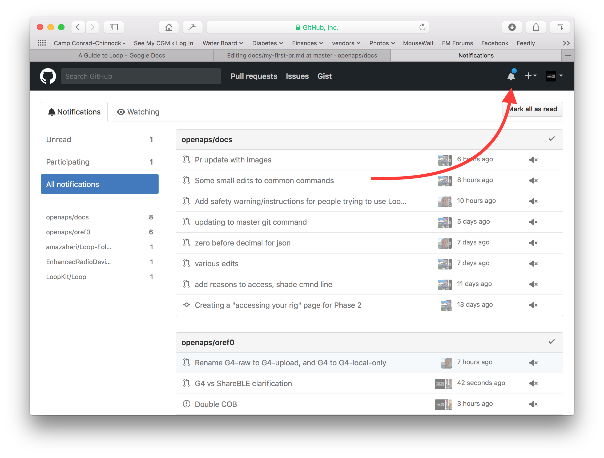
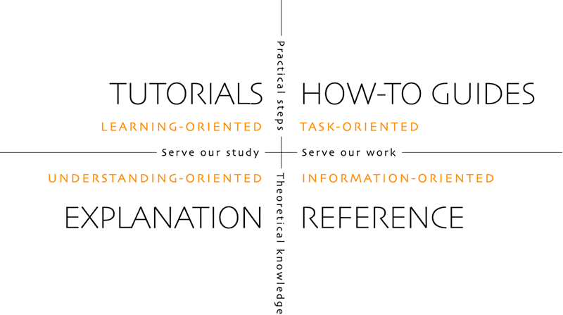

# Come modificare la documentazione

**This description is just for editing the English documentation. All new information must be added in English first. If you want to translate to other languages (thank you), please use [crowdin](https://crowdin.com/project/androidapsdocs).**

Per suggerimenti su come formattare il testo (titoli, grassetto...) e inserire link, vedi la sezione ["Sintassi del codice"](#edit-the-docs-code-syntax) di questa pagina.

## Generale

Per domande, commenti o nuove idee puoi contattare il team della documentazione su [Discord](https://discord.gg/4fQUWHZ4Mw).

At some point it will be suggested that you make a pull request (PR), which is how your changes in the documentation are actually put onto the AAPS webpages, which are stored in GitHub. It's actually not too hard to do a PR and it is a great way to contribute. Stai leggendo questa documentazione proprio perché persone come te hanno fatto delle PR. Non preoccuparti di fare un errore o di modificare per sbaglio i documenti sbagliati. Your changes are reviewed before they are merged into the "formal" AAPS documentation repository. You can't mess up the originals through any accidents in the process. La procedura generale è:

- Make edits and improvements to code or documentation by editing the existing content.
- Ricontrolla che le tue modifiche ti sembrino corrette.
- Make a few notes of what's changed so people may understand the edits.
- Create a pull request, which asks the administrators to use your changes.
- They will do a review and either (1)merge your changes, (2)comment back to you about your changes, or (3)start a new document with your changes.

(Side note: If you are a visual learner, there is a YouTube video [here](https://youtu.be/4b6tsL0_kzg) showing the PR workflow.)

For our example we are going to make an edit to AndroidAPSdocs. This can be done on any Windows PC, Mac, etc. (qualsiasi computer con accesso a Internet).

1. Go to <https://github.com/openaps/AndroidAPSdocs> and hit Fork in the upper right to make your own copy of the repository.



2. Go to any page and navigate to the page you want to edit. You can click on the "Edit in GitHub" link in the upper right corner. Questo è possibile solo per le pagine in inglese. 



Oppure clicca sull'icona della matita che compare nella barra in alto del contenuto della pagina da modificare. You will need to be already logged into your Github account to do this (if you don't have one, they are straightforward to set up).



3. One or the other of the options in Step 2 will create a new branch in YOUR repository where your edits will be saved. Fai le tue modifiche al file.

We are using markdown for the docs pages. The files have the suffix ".md". The Markdown specification is not fixed and we use at the moment the myst_parser for our markdown files. Fai attenzione a usare la sintassi corretta, come [descritto sotto](#edit-the-docs-code-syntax).



4. You have been working in the "<>Edit file" tab. Seleziona la scheda "Preview changes" (anteprima delle modifiche) per guardare il testo con occhi nuovi e controllare che tutto quello che hai cambiato sia come volevi (controlla i refusi). If you see a needed improvement, go back to the edit tab to make more improvements. 



5. Quando hai finito le modifiche, scorri fino in fondo alla pagina. In the box at the bottom, provide your comments in the text field that reads, "Add an optional extended description...". Il titolo predefinito contiene il nome del file. Try to include a sentence explaining the **reason** for the change. Relating the reason helps reviewers understand what you are attempting to do with the PR.



6. Click the green "Propose file changes" or "Commit changes" button. In the page that appears click "Create Pull Request" and again in the next page click "Create Pull Request".



7. That completes the opening of a pull request, PR. GitHub assigns the PR a number, located after the title and a hash mark. Return to this page to check for feedback (or, if you have GitHub notifications emailed to you, you will get emails notifying you of any activity on the PR). The edit will now be in a list of PR's that the team will review and potentially give feedback on before committing to the main documentation for AAPS! If you want to check on the progress of the PR, you can click on the bell logo in the upper right corner of your GitHub account and see all your PRs.



PS: Your fork and branch will still be sitting on your own personal GitHub account. Quando ricevi la notifica che la tua PR è stata unita (merge), puoi eliminare il tuo branch se non ti serve più (l'area delle notifiche del passo 7 ti darà un link per eliminare il branch quando sarà chiuso o unito). For future edits, if you follow this procedure the edits will always start with an updated version of the AndroidAPSdocs repositories. Se scegli un altro metodo per iniziare una PR (per esempio partendo dal branch master del tuo repository forkato), devi prima assicurarti che il tuo repository sia aggiornato: esegui un "compare" (confronto) e unisci tutti gli aggiornamenti arrivati dall'ultima volta che hai aggiornato il tuo fork. Since people tend to forget to update their repos, we recommend using the PR process outlined above until you get familiar with performing "compares".

(edit-the-docs-code-syntax)=

## Code syntax

We are using markdown for the documentation pages. The files have got the suffix ".md".

Markdown is a very simple text formatting language which separates text content from text formatting.

The writer only e.g. marks a headline as level 1 headline and the markdown processor generates the necessary HTML code during processing to render the heading in HTML.

L'idea alla base è che

- chi scrive deve pensare prima al testo e non alla formattazione,
- il testo markdown si può scambiare tra diversi strumenti markdown, invece di usare per esempio strumenti proprietari come Microsoft Word e
- you can generate several output formats from one markdown file.

Markdown is not a 100% fixed standard and we try to stay as near as possible to the standard, to

- stay flexible to change markdown tools as needed or forced in the further innovation of markdown tools and markdown SaaS services and
- enable us to use translation services to translate the English language in a target language like French or German. They can work on markdown but not complex formatting codes, because they can't separate content from layout, which might be fatal.

### Titoli

- Titolo 1: `# headline`
- Titolo 2: `## headline`
- Titolo 3: `### headline`
- Titolo 4: `#### headline`

We try to avoid further levels of headlines.

### Formato del testo

- **grassetto**: `**text**`
- *corsivo*: `*text*`
- ***grassetto corsivo***: `***text***`

### Elenco numerato

    1. primo
    1. secondo
    1. terzo
    

1. primo
2. secondo
3. terzo

### Unordered list

    - one element
    - another element
    - and another element
    

- un elemento
- un altro elemento
- and another element

### Elenco a più livelli

You can insert lists in lists by indenting the next level with 4 more spaces to the right than the one before.

    1. primo
    1. secondo
    1. terzo
      1. un elemento
      1. un altro elemento
      1. and another element
    1. quarto
    1. quinto
    1. sesto
    

1. primo
2. secondo
3. terzo 
    1. un elemento
    2. un altro elemento
    3. and another element
4. quarto
5. quinto
6. sesto

### Immagini

To include images you use this markdown syntax.

- immagini: ``

Il tipo di immagine deve essere PNG o JPEG.

Image names should conform to one of the following naming rules. In the example I use png as suffix. In case you use JPEG please use jpeg as a suffix instead.

- `filename-image-xx.png` where xx is a unique double digit number for the images in this file.
- `filename-image-xx.png` where xx is a meaningful name chosen by the author of the md file.

Images are located in the images folder for the english language and propagated to the other languages automatically by Crowdin. You have nothing to do for this!

We are not translating images at the moment: images should contain the **minimum possible text** to allow accessibility to non-English readers.

(make-a-PR-image-size)= Usa una dimensione ragionevole per le immagini, che devono essere leggibili su PC, tablet e telefoni.

- Gli screenshot di pagine web devono essere larghi al massimo **1050 pixel**.
- I diagrammi dei flussi di processo devono essere larghi al massimo **1050 pixel**.
- Gli screenshot dell'app devono essere larghi al massimo **500 pixel**. Do not place them side to side if not necessary.
- Screenshots from the watch (**Wear OS**) should be up to **360 pixels wide**. Non ingrandire mai uno screenshot più piccolo.

### Link

#### Link esterni

I link esterni sono link a siti web esterni.

- link esterno: `[alt text](www.url.tld)`

#### Link interni all'inizio di un file md

Internal links to pages are links to the start of a md file which is hosted on our own server.

- link interno a una pagina .md: `[alt text](../folder/file.md)`

#### Link interni a riferimenti con nome nel testo

Internal links to named inline references are links to any point in a md file which is hosted on our own server and where a reference was set to link to.

Aggiungi un riferimento con nome nel punto del file md di destinazione a cui vuoi saltare.

`(name-of-my-md-file-this-is-my-fancy-named-reference)=`

The named reference must be unique in the whole AndroidAPSDocs md files and not only the own md file it resides in!

Therefore it is a good practice to start with the filename and then the reference name you select.

Use only lowercase letters and hyphenate words.

Poi collega questo riferimento nel testo che stai scrivendo con questo tipo di link.

- Link interni a riferimenti con nome nel testo: `[alt text](name-of-my-md-file-this-is-my-fancy-named-reference)`

### Notes, Warnings, Collapsing Notes

You can add notes and warning boxes to documentation.

Furthermore you can add collapsing notes for detailed information, so that users who are not interested in the details are not put off reading the text. Usali con attenzione, perché la documentazione deve essere il più facile possibile da leggere.

#### Note

    ```{admonition} Titolo della nota
    :class: note
    Questa è una nota.
    ```
    

```{admonition} Titolo della nota :class: note Questa è una nota.

    <br />#### Avvisi
    
    ````
    ```{admonition} Avviso
    :class: warning
    Questo è un avviso.
    

    ```{admonition} Titolo dell'avviso
    :class: warning
    Questo è un avviso.
    ```
    
    #### Collapsing Notes
    
    

    {admonition} further detailed readings for interested readers
    :class: dropdown
    
    This admonition has been collapsed,
    meaning you can add longer form content here,
    without it taking up too much space on the page.
    

````

```{admonition} further detailed readings for interested readers :class: dropdown This admonition has been collapsed, meaning you can add longer form content here, without it taking up too much space on the page.

```

## Tabelle

Evita le tabelle con testi lunghi: il contenuto è difficile da impostare in Markdown, di solito non entrano nella larghezza dello schermo di un telefono e probabilmente dopo la traduzione non si vedranno allo stesso modo.

## Guida di stile

### Contenuti

1. Consigli per scrivere in inglese

2. Note di scrittura specifiche per AAPS

3. Riferimenti utili

###  1\. Consigli per scrivere in inglese

#### Usa un linguaggio adatto a chi legge

Use plain English wherever possible. This helps non-native readers and also aids translation of AAPS documents into other languages. Write in a conversational way with the user, imagine you are sitting across the desk from the person you are writing for. Remember - most AAPS users do not have programming backgrounds. Diabetes itself also has a lot of jargon and abbreviations. Bear in mind that some people may be recently diagnosed, may not be as experienced as you with diabetes, or may have been given different diabetes training. If you use shorthand or an abbreviation, write it out in full the first time you use it, giving the abbreviation directly after it in brackets, like “super micro bolus (SMB)”. Also, link to the glossary. Technical terms which might not be familiar to the reader can be also be added in brackets.

Invece di: *“What causes high postprandial BG peaks in closed loop?”* (Cosa causa picchi glicemici postprandiali alti nel loop chiuso?)

Usa: *“What causes a high BG peak **after lunch** (postprandial) in closed loop?”* (Cosa causa un picco glicemico alto dopo pranzo (postprandiale) nel loop chiuso?)

##### Use plain words that everyone can understand

Find an A-Z of alternative words to make your writing easier to understand here:

<https://www.plainenglish.co.uk/the-a-z-of-alternative-words.html>

#### Privacy e licenze:

Particularly if you record video or screenshots, make sure not to disclose your private details (API key, passwords). Make sure YouTube content is not openly listed, and needs a link from the documentation to view. Avoid drawing attention to infringed copyrighted materials (BYODA etc).

#### Keep sentences short, get to the point

- Clear writing should have an average sentence length of 15 to 20 words.

- This does not mean making every sentence the same length. Sii incisivo. Vary your writing by mixing short sentences (like the last one) with longer ones (like this one).

- Stick to one main idea in a sentence, plus perhaps one other related point.

- You may still find yourself writing the odd long sentence, especially when trying to explain a complicated point. But most long sentences can be broken up in some way.

- Remove weak words: “you can”, “there is/are/were”, “in order to”.

- Place keywords near the beginning of titles, sentences and paragraphs.

- Be visual! Wherever possible provide a brief diagram, screenshot or video.

#### Don't be afraid to give instructions

Commands are the fastest way to give instructions, but writers sometimes fear giving commands, writing “you should do this” instead of just “do this”. Forse si teme che i comandi suonino troppo duri. You can often solve this by putting the word 'please' in front. However, if something must be done, it is best not to say ‘please’ as it gives the reader the option to refuse.

Invece di: *“You should just think of it as a complete statement.”* (Dovresti semplicemente considerarla un'affermazione completa.)

Usa: *“Think of it as a complete statement.”* (Considerala un'affermazione completa.)

#### Mostly use active verbs, rather than passive verbs

Example of an **active verb**:

- *“The pump (subject) delivers (verb) the insulin (object).” (Il micro (soggetto) eroga (verbo) l'insulina (oggetto).)*

“delivers” is an active verb here. The sentence says what is doing the delivering before it says what is being delivered.

Example of a **passive verb**:

- *“The insulin (subject) is delivered (verb) by the pump (object).”*

*“delivered”* is a passive verb here. The subject and object are switched around, compared to the active verb sentence. Abbiamo dovuto allungare la frase aggiungendo “is” e “by the”. Also consider starting with the active verb.

Instead of: *“You can connect your pump with the phone through the AAPS pump menu, and there are a number of pumps available for you to connect with.”*

Use: *“Connect your desired pump to the phone through the AAPS pump menu.”*

Passive verbs can cause problems:

- They can be confusing.

- They often make writing more long-winded.

- They make writing less lively.

##### Good uses of passives

There are times when it might be appropriate to use a passive.

- To make something less hostile - 'this bill has not been paid' (passive) is softer than 'you have not paid this bill' (active).

- To avoid taking the blame - 'a mistake was made' (passive) rather than 'You made a mistake' (active).

- When you don't know who or what the doer is - 'the England team has been picked'.

- Se semplicemente suona meglio.

#### Evita le nominalizzazioni

Una nominalizzazione è il nome di qualcosa che non è un oggetto fisico, come un processo, una tecnica o un'emozione. Nominalizations are formed from verbs.

Per esempio:

| Verbo                  | Nominalizzazione            |
| ---------------------- | --------------------------- |
| complete (completare)  | completion (completamento)  |
| introduce (introdurre) | introduction (introduzione) |
| provide (fornire)      | provision (fornitura)       |
| fail (fallire)         | failure (fallimento)        |

They are often used **instead** of the verbs they come from, but they can sound as if nothing is actually happening. Too many of them can make writing very dull and heavy-going.

Invece di: *“The implementation of the method has been done by a team.”* (L'implementazione del metodo è stata fatta da un team.)

Usa: *“A team has implemented the method.”* (Un team ha implementato il metodo.)

#### Usa gli elenchi quando serve

Lists are excellent for splitting information up. Ci sono due tipi principali di elenco:

- A continuous sentence with several listed points picked out at the beginning, middle or end.

- Separate bullet points with an introductory statement.

In the bulleted list above, each point is a complete sentence so they each start with a capital letter and end with a full stop. Use bullet points rather than numbers or letters, as they draw your attention to each point without giving you extra information to take in.

#### Mythbusting

- You can start a sentence with **and, but, because, so or however**.

- You can split infinitives. So you can say **“to boldly go”**.

- You can end a sentence with a preposition. In fact, it is something **we should stand up for**.

- And **you** can use the same **word** twice in a sentence if **you** can't find a better **word**.

#### Ottimizzare lo stile di scrittura in base allo scopo

To keep the documentation clear and short, we write different sections of the documentation in different styles.

An “explanation” style is used for the introduction, background and knowledge development sections.

A “How-to-guide” style (with minimal explanation) is used for building, configuring AAPS, and some of the troubleshooting sections.

A tutorial helps the pupil acquire basic competence. L'utente **impara facendo**.



#####  Tutorials (e.g. teaching a kid to beat egg whites)

- narrator directly talks to the reader: In this tutorial **you** will (we) could be used to convey “we are in this together” frame-of-thought in some rare cases

- Tempo futuro -> per mostrare l'obiettivo finale

- Imperative Tense -> to do the tasks -> Concrete steps - avoid abstract concepts

- Past Tense -> to show accomplished tasks -> Quick and immediate visible results

- Minimum Explanations -> strict necessary to complete the task - **what and why**

- Ignora opzioni/alternative/…. Nessuna ambiguità

- Step Transitions: finish a step with a sentence leading to the next step as a logical progression flow. Example: *You have now installed the Let’s Encrypt client, but before obtaining certificates, you need to make sure that all required ports are open. To do this, you will update your firewall settings in the next step.*

- **Tutorial** Title (Level 1 heading)

- Introduction (no heading)

- Prerequisites (Level 2 heading)

- Passi:

- Step 1 — Doing the First Thing (Level 2 heading)

- Step 2 — Doing the Next Thing (Level 2 heading)

- Step n — Doing the Last Thing (Level 2 heading)

- Conclusion (Level 2 heading)
    
    - **Il linguaggio dei tutorial**
        
        *In this tutorial, you will…*
        
        Describe what the learner will accomplish (note - not: “you will learn…”).
        
        *First, do x. Now, do y. Now that you have done y, do z.*
        
        Nessuno spazio per ambiguità o dubbi.
        
        *We must always do x before we do y because… (see Explanation for more details).*
        
        Provide minimal explanation of actions in the most basic language possible. Link to more detailed explanation.
        
        *The output should look something like this…*
        
        Dai a chi impara aspettative chiare.
        
        *Notice that… Remember that…*
        
        Dai a chi impara molti indizi per confermare che è sulla strada giusta e per orientarsi.
        
        *You have built a secure, three-layer hylomorphic stasis engine…*
        
        Describe (and admire, in a mild way) what your learner has accomplished (note - not: “you have learned…”)

#####  How-To Guides (e.g. a recipe)

A how-to guide’s purpose is to help the already-competent user perform a particular task correctly.

- HOW-to

- chi scrive parla direttamente a chi legge: In this guide **you** will (in questa guida tu…)

- Tempo futuro -> per mostrare l'obiettivo finale

- Conditional Imperative Tense -> to get X do y -> Concrete steps - avoid abstract concepts

- Minimum Explanations -> strict necessary to complete the task -> **what and why**

- Ignora opzioni/alternative/…. No ambiguity, but you can link to the reference entry or explanation entry

- **How-to**: Title (Level 1 heading)

- Introduction paragraph

- Optional Prerequisites (paragraph or Level 2 heading if more than 1)

- Passi:

- Step 1 — Doing the First Thing (Level 2 heading)

- Step 2 — Doing the Next Thing (Level 2 heading)

- Step n — Doing the Last Thing (Level 2 heading)

- Conclusion paragraph
    
    - **Il linguaggio delle guide pratiche**
        
        *This guide shows you how to…*
        
        Describe clearly the problem or task that the guide shows the user how to solve.
        
        *If you want x, do y. To achieve w, do z.*
        
        Use conditional imperatives.
        
        *Refer to the x reference guide for a full list of options.*
        
        Don’t pollute your practical how-to guide with every possible thing the user might do related to x.

#####  Explanation (e.g. Science behind why egg whites stiffen when you beat them)

An explanation clarifies, deepens and broadens the reader’s understanding of a subject.

- WHY

- Start with **About**

- Provide context, link ALL relevant references

- Discuti opzioni/alternative

- Don’t instruct or provide reference (link to them)

- State the unknown/moving targets etc…

- **About** Title (Level 1 heading)

- Introduction (no heading)

- Optional Prerequisites (Level 2 heading)

- Subtopic 1 (level 2 heading)

- Conclusion (Level 2 heading)
    
    - **The Language of Explanation**
    
    *The reason for x is because historically, y…*
    
    Spiega.
    
    *W is better than z, because…*
    
    Offer judgements and even opinions where appropriate.
    
    *An x in system y is analogous to a w in system z. However…*
    
    Provide context that helps the reader.
    
    *Some users prefer w (because z). This can be a good approach, but…*
    
    Valuta le alternative.
    
    *An x interacts with a y as follows:…*
    
    Unfold the machinery’s internal secrets, to help understand why something does what it does.

### 2\. AAPS-specific writing/updating notes

#### Author & Editor

For writing/updating the AAPS documentation, consider the process as consisting of two stages. These can be carried out by the same person at different points, or more than one person.

An **author (e.g. you!)** writes/edits a section of the documentation in a concise conversational tone, then passes it to the editor.

The **editor (e.g. a fellow AAPS user, or the person who receives the pull request)** reviews adherence to the style guide, edits the section for clarity and accessibility, removing as many words as possible (especially for tutorial/how-to sections). Reading the text out loud may help.

#### Punti generali su AAPS

- For glucose values, state both mg/dL and mmol/L in each occurrence (also consider this for screenshots, if possible).

- For consistency, use “AAPS” rather than “Android APS”.

- Clearly state the version of Android Studio/AAPS you are writing for, or that the screenshots are taken from.

### 3\. Riferimenti utili

<https://dev.readthedocs.io/en/latest/style-guide.html>

[Diátaxis (diataxis.fr)](https://diataxis.fr/)

[Technical Writer Style Guide Examples | Technical Writer HQ](https://technicalwriterhq.com/writing/technical-writing/technical-writer-style-guide/)

[DigitalOcean's Technical Writing Guidelines | DigitalOcean](https://www.digitalocean.com/community/tutorials/digitalocean-s-technical-writing-guidelines)

[Top 10 tips for Microsoft style and voice - Microsoft Style Guide | Microsoft Learn](https://learn.microsoft.com/en-us/style-guide/top-10-tips-style-voice?source=recommendations)

<https://www.plainenglish.co.uk/how-to-write-in-plain-english.html>

<https://developers.google.com/style>

<https://www.mongodb.com/docs/meta/style-guide/screenshots/screenshot-guidelines/>