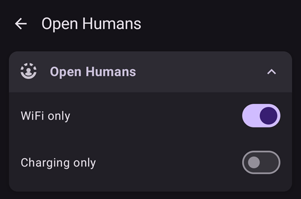
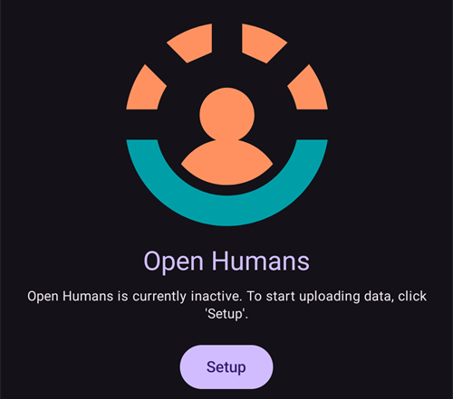
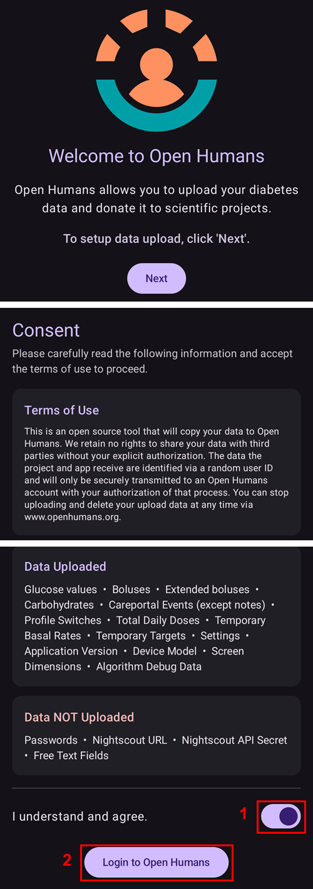

# Open Humans Uploader

## Dona i tuoi dati alla scienza

Puoi aiutare la community donando i tuoi dati a progetti di ricerca! Questo aiuta gli scienziati a restituire il favore, a sviluppare nuove idee scientifiche e a far conoscere meglio i sistemi open source a loop chiuso. AAPS is ready to synchronize your data with [Open Humans](https://www.openhumans.org), a platform allowing you to upload, connect, and store your personal data – such as genetics, activity and health data.

You retain full control about what happens to your data and what projects you want to support by giving them access to your data. Depending on the project you have joined, data is evaluated and used by them in different ways and extent.

The following data will be uploaded to your Open Humans account:

- Valori glicemia
- Careportal events (except notes)
- Boli estesi
- Cambi profilo
- Dosi giornaliere totali
- Basali temporanee
- Temp targets
- Preferences
- Application version
- Device model
- Screen dimensions

Secret or private information such as your Nightscout URL or API secret will not be uploaded.

## Configurazione

1. Crea il tuo account su [Open Humans](https://www.openhumans.org), se non l'hai già fatto. You can reuse your existing Google or Facebook accounts if you wish to.
2. Enable the **Open Humans** plugin in [**Configuration** > **Communication**](../SettingUpAaps/ConfigBuilder.md).


3. Tocca **Impostazioni** sulla scheda **Open Humans**. You can restrict uploads to times when the phone uses Wi-Fi (**WiFi only**) and/or is charging (**Charging only**).



4. Tocca **Apri plugin** sulla scheda **Open Humans**, poi tocca **Configurazione**.



5. Nella schermata **Benvenuto in Open Humans** tocca **Avanti**. Leggi con attenzione la schermata **Consenso**: mostra i termini d'uso e quali dati vengono caricati e quali no.
6. Attiva **Comprendo e accetto.** (1) e tocca **Accedi a Open Humans** (2).



7. Si aprirà il sito web di Open Humans. Accedi con le tue credenziali.
8. Decide whether you want to hide your AAPS Uploader membership in your public Open Humans profile (1).
9. Click **Authorize project** (2).


```{admonition} Older screenshot
:class: note
The screenshots above show an earlier version of the Open Humans website and still use the old project name **AndroidAPS Uploader**. The steps are the same.
```

10. Back in **AAPS**, the **Final touches** screen asks whether you want to proceed. Tocca **Continua**.
11. Wait until **We're done!** appears, then tap **Close**. From now on, your phone uploads data in the background from time to time.
12. La schermata del plugin **Open Humans** ora mostra il tuo **Project Member ID**. Tocca **Carica adesso** se vuoi avviare subito un caricamento.
13. Tocca **Esci** se vuoi smettere di caricare dati su Open Humans.
14. Android notification will inform you about running upload.


```{admonition} Older screenshot
:class: note
The screenshot above is from an earlier **AAPS** version. In **AAPS** 4 le schermate di conferma sono **Tocchi finali** e **Abbiamo finito!**, non c'è la dimensione della coda e i pulsanti sono **Carica adesso** e **Esci**.
```

15. Puoi gestire i tuoi dati accedendo al [sito web di Open Humans](https://www.openhumans.org).


## Sharing Opportunities

### [Il progetto 'OPEN'](https://www.open-diabetes.eu/)

The 'OPEN' project brings together an international and intersectoral consortium of patient innovators, clinicians, social scientists, computer scientists and patient advocacy organizations in order to investigate various aspects of Do-it-Yourself Artificial Pancreas Systems (DIY APS) that are used by an increasing number of people with diabetes. Per maggiori dettagli vedi il loro [sito web](https://www.open-diabetes.eu/).

A settembre 2020 il progetto 'OPEN' ha lanciato un [sondaggio](https://survey.open-diabetes.eu/) che include la possibilità di donare i dati che hai caricato su Open Humans. A [tutorial](https://open-diabetes.eu/en/open-survey/survey-tutorials/) how to donate your data to the 'OPEN' project is available on their site and within the survey itself.

### [OpenAPS Data Commons](https://www.openhumans.org/activity/openaps-data-commons/)

The OpenAPS Data Commons was created to enable a simple way to share data sets from the DIYAPS community for research. The data is shared both with traditional researchers who will create traditional research studies, and with groups or individuals from the community who want to review data as part of their own research projects. The OpenAPS Data Commons uses the 'Open Humans' platform to enable people to easily upload and share their data from DIYAPS including AAPS, Loop, and OpenAPS.

You can get your data into Open Humans via one of three ways:

1. usa l'opzione di caricamento di AAPS per portare i tuoi dati su Open Humans
2. use the Nightscout Data Transfer to get your data into Open Humans
3. carica a mano i file di dati su Open Humans.

Once you've created an account and gotten your data flowing into Open Humans, make sure to also join the OpenAPS Data Commons in order to donate your data for research if you choose.

## Termini d'uso

This is an open source tool that will copy your data to [Open Humans](https://www.openhumans.org). We retain no rights to share your data with third parties without your explicit authorization. The data the project and app receive are identified via a random user ID and will only be securely transmitted to an Open Humans account with your authorization of that process. You can stop uploading and delete your upload data at any time via [www.openhumans.org](https://www.openhumans.org). Beware that some projects that receive data may not support this.

Vedi anche i [Termini d'uso di Open Humans](https://www.openhumans.org/terms/).

## Privacy dei dati

Open Humans protegge la tua privacy assegnandoti un ID numerico per ogni progetto. This allows projects to recognize but not identify you. The Application ID uploaded by AAPS is similar and only helps administrate the data. More information can be found here:

- [Open Humans Data Use Policy](https://www.openhumans.org/data-use/)
- [Open Humans GDPR](https://www.openhumans.org/gdpr/)
