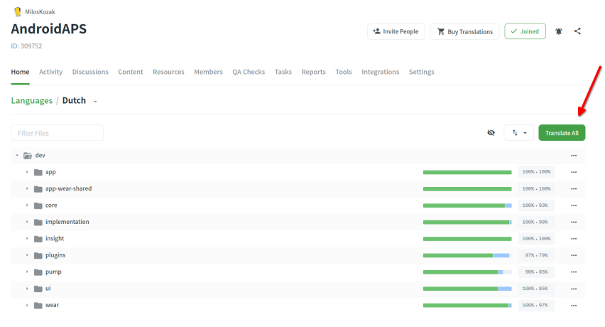
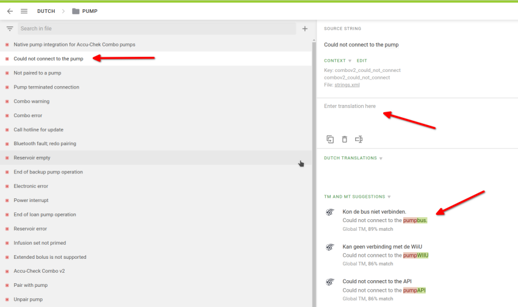
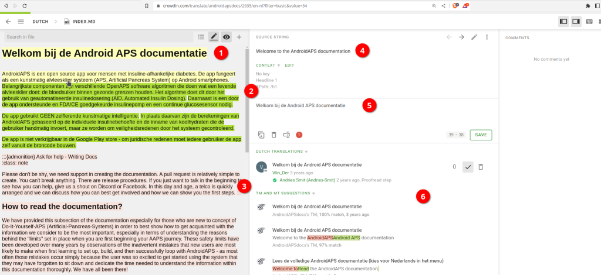

# Come tradurre le stringhe dell'app AAPS o della documentazione

* Per le stringhe usate nell'app vai su <https://crowdin.com/project/androidaps> e accedi con il tuo account GitHub
* Per la documentazione vai su <https://crowdin.com/project/androidapsdocs> e accedi con il tuo account GitHub

* Invia una richiesta di adesione al team della documentazione. To do so click on the flag of the desired language and then the button "Join" on the top right corner of the next page. Please specify language, give some information about you and your AAPS experience and if you want to be a translator or proofreader (only people skilled in translating + advanced AAPS users).

```{admonition} Tempo per l'approvazione :class: note

The approval is a manual step. As non profit organization we don't provide SLAs but in general the approval will be done in < 1 day. Se non arriva, contatta il team della documentazione su Facebook o Discord.

    <br />* When we approve you, click the flag
       
    
    ## Translation of the app
    
    (translations-translate-strings-for-AAPS-app)=
    ### Translate strings for AAPS app
    
    * If you have no preference for strings you translate just select the "Translate All" button to start. It will show you the strings which need translation.
    
       
    
    * If you want to translate an individual file please search for the file via search dialog or tree structure and click on the filename to start the translation work on strings in that file.
    
       
    
    * Translate sentences on left side by adding new translated text or use & edit suggestion 
    
       
    
    
    ### Proofread strings for AAPS app
    
    * Proofreaders start by selecting "Proofread" when starting from the language home screen.
    
        
    
    
      and approve translated texts 
    
       
    
    When a proofreader approves a translation it will be added to the next version of AAPS.
    
    (translations-translation-of-the-documentation)=
    ## Translation of the documentation
    
    * Click the name of the docs page you want to translate
    
    
    
    
    * Translate sentences by sentence
    
        1. The yellow text is the text you are working at the moment.
    
        1. Il testo verde è già tradotto. You don't need to do this again.
    
        1. The red text is the remaining text which have to be translated.
    
        1. This is the source text you are working on at the moment
    
        1. Questa è la traduzione che stai preparando. Puoi copiare il testo da sopra oppure scegliere uno dei suggerimenti qui sotto.
    
        1. Questi sono i suggerimenti per una traduzione. Especially you can see how much Crowdin rates this as a fit, or whether it was already translated in the past and only came back because the text was moved, not changed.
        1. Press the "save" button to save a proposal for the translation. It will then be passed to a proofreader for final check.
    
    
    
    * A translated page will not be published in docs before 
    
        1. the translation is proofread
    
        1. la sincronizzazione tra Crowdin e GitHub è terminata (una volta all'ora) e ha creato una PR su GitHub.
    
        1. la PR su GitHub è stata approvata.
    
    In general this needs 1 - 3 days but might during holiday take a little bit longer.
    
    ### Tradurre i link
    
    ```{admonition} I link non si traducono più
    :class: note
    
    I link non si traducono più. In passato qui c'era una sezione su questo, ma non serve più: con il passaggio a Markdown e a myst_parser creiamo in modo esplicito delle etichette nel testo inglese, e queste etichette passano automaticamente alle altre lingue.
    
    

You are translating the text which represents the link. Fai attenzione a **non** rimuovere il link, che è rappresentato da una coppia di tag `<0></0>` (o con altri numeri, se in un paragrafo ci sono più link).

It's the proofreaders job to have a special look on this!

### Revisione

* Proofreaders have to switch to Proofreading mode
    
    
    
    e approvare i testi tradotti
    
    

* When a proofreader approves a translation it will be added to the next docs build which happens in no fixed schedule on demand but around once a week except during holidays. To speed up the process you can inform docs team about new translations.