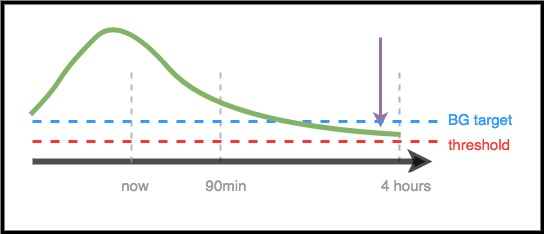

# For Clinicians – A General Introduction and Guide to AAPS

```{note}
This page is a high-level introduction for clinicians. È stata rivista l'ultima volta a giugno 2026. AAPS develops continuously, so for the most accurate and up-to-date detail always refer to the [main AAPS documentation](../index.md).
```

This page is intended for clinicians who have expressed interest in open source artificial pancreas technology such as AAPS, or for patients who want to share such information with their clinicians.

This guide has some high-level information about DIY closed looping and specifically how AAPS works. Per maggiori dettagli su tutti questi argomenti, consulta la [documentazione completa di AAPS online](../index.md). Se hai domande, chiedi più dettagli al tuo paziente, oppure contatta pure la community con le tue domande. (If you’re not on social media (e.g. [Twitter](https://twitter.com/kozakmilos) or Facebook), feel free to email developers@aaps.app). [Qui puoi trovare anche alcuni degli studi e dei dati sui risultati più recenti](https://openaps.org/outcomes/).

## The steps for building a DIY Closed Loop:

To start using AAPS, the following steps should be taken:

* Find a [compatible pump](../Getting-Started/CompatiblePumps.md), a [compatible Android device](../Getting-Started/Phones.md), and a [compatible CGM source](../Getting-Started/CompatiblesCgms.md).
* [Download the AAPS source code and build the software](../SettingUpAaps/BuildingAaps.md).
* [Configure the software to talk to their diabetes devices and specify settings and safety preferences](../SettingUpAaps/SetupWizard.md).

## How A DIY Closed Loop Works

Senza un sistema a loop chiuso, una persona con diabete raccoglie i dati dal micro e dal CGM, decide cosa fare e agisce.

Con l'erogazione automatica di insulina il sistema fa la stessa cosa: raccoglie i dati dal micro, dal CGM e da ogni altro posto in cui sono registrate informazioni (per esempio Nightscout), usa queste informazioni per fare i calcoli e decidere quanta insulina in più o in meno serve (sopra o sotto la velocità basale di fondo), e usa basali temporanee per fare le correzioni necessarie per mantenere la glicemia nell'intervallo target o per riportarla lì.

Se il dispositivo su cui gira AAPS si rompe o va fuori dalla portata del micro, quando finisce l'ultima basale temporanea il micro torna a funzionare come un micro normale, con le velocità basali preprogrammate.

## Come vengono raccolti i dati:

With AAPS, an Android device runs a special app to do the math, the device communicates using Bluetooth with a supported pump. AAPS can communicate with other devices and to the cloud via Wi-Fi or mobile data to gather additional information, and to report to the patient, caregivers, and loved ones about what it’s doing and why.

Il dispositivo Android deve:

* comunicare con il micro e leggerne lo storico: quanta insulina è stata erogata
* comunicare con il CGM (direttamente o tramite il cloud): per vedere come si sta muovendo e come si è mossa la glicemia

Quando il dispositivo ha raccolto questi dati, l'algoritmo viene eseguito e prende le decisioni in base alle impostazioni (ISF, rapporto CHO, DIA, target, ecc.). Se serve, invia poi comandi al micro per cambiare la velocità di erogazione dell'insulina.

Raccoglie anche tutte le informazioni su boli, carboidrati assunti e target temporanei dal micro o da Nightscout, per usarle nel calcolo della velocità di erogazione dell'insulina.

## Come fa a sapere cosa fare?

Il software open source è progettato per permettere al dispositivo di fare facilmente il lavoro che prima le persone facevano a mano (in modalità manuale) per calcolare come regolare l'erogazione dell'insulina. Prima raccoglie i dati da tutti i dispositivi di supporto e dal cloud, prepara i dati ed esegue i calcoli, fa previsioni sull'andamento atteso della glicemia nelle ore successive in diversi scenari, e calcola le correzioni necessarie per mantenere la glicemia nell'intervallo target o per riportarla lì. Poi invia al micro le correzioni necessarie. Quindi rilegge i dati, e ripete tutto continuamente.

Dato che il parametro di ingresso più importante è il valore della glicemia che arriva dal CGM, è importante avere dati CGM di alta qualità.

AAPS is designed to transparently track all input data it gathers, the resulting recommendation, and any action taken. Per questo in ogni momento è facile rispondere alla domanda “perché sta facendo X?” guardando i log.

## Examples of AAPS algorithm decision making:

AAPS usa lo stesso algoritmo di base e lo stesso insieme di funzioni di OpenAPS. L'algoritmo fa più previsioni (in base alle impostazioni e alla situazione), che rappresentano diversi scenari di quello che potrebbe succedere in futuro. In Nightscout queste sono mostrate come “linee viola”. AAPS usa colori diversi per distinguere queste [linee di previsione](#aaps-screens-prediction-lines). Nei log è indicato quale di queste previsioni e quale intervallo di tempo determinano le azioni necessarie.

### Here are examples of the purple prediction lines, and how they might differ:


(clinicianguide-dosing-scenarios)=

### Here are examples of different time frames that influence the needed adjustments to insulin delivery:

### Scenario 1 - Zero Temp for safety

In questo esempio la glicemia sta salendo a breve termine; però si prevede che sarà bassa su un intervallo di tempo più lungo. Infatti si prevede che scenda sotto il target *e* sotto la soglia di sicurezza. For safety to prevent the low, AAPS will issue a zero temp (temporary basal rate at 0%), until the eventualBG (in any time frame) is above threshold.


### Scenario 2 - Zero temp for safety

In questo esempio si prevede che la glicemia scenda a breve termine, ma che alla fine sia sopra il target. However, because the near-term low is actually below the safety threshold, AAPS will issue a zero temp, until there is no longer any point of the prediction line that is below threshold.


### Scenario 3 - Serve più insulina

In questo esempio una previsione a breve termine mostra un calo sotto il target. Però non si prevede che scenda sotto la soglia di sicurezza. La glicemia finale prevista (eventual BG) è sopra il target. Per questo AAPS eviterà di aggiungere insulina che contribuirebbe a un'ipoglicemia a breve termine (cioè insulina che farebbe scendere la previsione sotto la soglia). Valuterà poi se aggiungere insulina per portare al target il valore più basso della glicemia finale prevista, quando sarà sicuro farlo. *(A seconda delle impostazioni e della quantità e dei tempi dell'insulina necessaria, questa insulina può essere erogata con basali temporanee o con SMB (super micro boli)).*


### Scenario 4 - Basale temporanea bassa per sicurezza

In this example, AAPS sees that BG is spiking well above target. Però, a causa dei tempi d'azione dell'insulina, nel corpo c'è già abbastanza insulina per riportare alla fine la glicemia nell'intervallo target. Infatti si prevede che alla fine la glicemia sia sotto il target. Therefore, AAPS will not provide extra insulin so it will not contribute to a longer-timeframe low. Anche se la glicemia è alta o in salita, qui è probabile una basale temporanea bassa.



## Ottimizzare le impostazioni e fare modifiche

As a clinician who may not have experience with AAPS or DIY closed loops, you may find it challenging to help your patient optimize their settings or make changes to improve their outcomes. We have multiple tools and [guides](https://openaps.readthedocs.io/en/latest/docs/Customize-Iterate/optimize-your-settings.html) in the community that help patients make small, tested adjustments to improve their settings.

La cosa più importante per i pazienti è fare una sola modifica alla volta e osservarne l'effetto per 2-3 giorni prima di decidere di cambiare un'altra impostazione (a meno che non sia chiaramente una modifica sbagliata che peggiora le cose: in quel caso devono tornare subito all'impostazione precedente). La tendenza umana è girare tutte le manopole e cambiare tutto insieme; ma chi lo fa rischia di arrivare a impostazioni ancora meno adatte in futuro, e di avere difficoltà a tornare a uno stato noto e buono.

Uno degli strumenti più utili per modificare le impostazioni è uno strumento di calcolo automatico per velocità basali, ISF e rapporto CHO. This is called “[Autotune](#autotune-how-autotune-calculates-adjustments)”. È progettato per lasciare che siano i dati a guidare te o il tuo paziente nel fare piccole modifiche graduali alle impostazioni. Nella community è buona pratica eseguire (o rivedere) prima i report di Autotune, prima di provare a modificare le impostazioni a mano. Autotune è integrato in AAPS come plugin (**Configurazione** → **Generale** → **Autotune**); vedi [Autotune](../AdvancedOptions/Autotune.md). It can be run on demand or automatically. As these parameters are a prerequisite both for standard pump insulin delivery and for closed loop insulin delivery, discussion of the autotune results and adjustment of these parameters would be the natural link to the clinician.

Inoltre il comportamento umano (imparato con la gestione manuale del diabete) spesso influenza i risultati, anche con un loop chiuso fai da te. Per esempio, se si prevede che la glicemia scenda e AAPS riduce l'insulina durante la discesa, può bastare una piccola quantità di carboidrati (per esempio 3-4 g) per far risalire la glicemia da 70 mg/dL (3,9 mmol/L). Però in molti casi una persona può scegliere di trattare l'ipoglicemia con molti più carboidrati (per esempio seguendo la regola del 15), e questo causa un picco più rapido, sia per il glucosio in più sia perché l'insulina era stata ridotta nel periodo prima dell'ipoglicemia.

## OpenAPS

**Questa guida è stata adattata da [The clinician's guide to OpenAPS](https://openaps.readthedocs.io/en/latest/docs/Resources/clinician-guide-to-OpenAPS.html).** OpenAPS è un sistema sviluppato per funzionare su un piccolo computer portatile (di solito chiamato "rig"). AAPS usa molte delle tecniche implementate in OpenAPS e ne condivide gran parte della logica e degli algoritmi: per questo questa guida è molto simile alla guida originale. Much of the information about OpenAPS can be easily adapted to AAPS, with the main difference being the hardware platform where each piece of software is run.

## Riepilogo

This is meant to be a high-level overview of how AAPS works. For more details, ask your patient, reach out to the community, or read the full AAPS documentation available online.

Altre letture consigliate:

* La [documentazione completa di AAPS](../index.md)
* L'[OpenAPS Reference Design](https://OpenAPS.org/reference-design/), che spiega come OpenAPS è progettato per la sicurezza: https://openaps.org/reference-design/
* La [documentazione completa di OpenAPS](https://openaps.readthedocs.io/en/latest/index.html) 
  * See [how AAPS turns predictions into a dosing decision](#aaps-screens-how-predictions-become-a-dosing-decision) in this documentation, or [OpenAPS's determine-basal documentation](https://openaps.readthedocs.io/en/latest/docs/While%20You%20Wait%20For%20Gear/Understand-determine-basal.html#understanding-the-determine-basal-logic) for the underlying algorithm in full technical detail