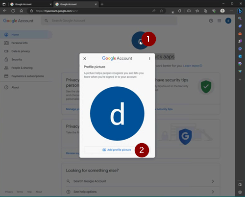

# Un account Google dedicato ad AAPS (facoltativo)

Alcuni utenti di **AAPS** preferiscono usare il loro account email principale anche per **AAPS**. Alternatively, some **AAPS** users (or their caregivers) set-up a dedicated **AAPS** email account - this is optional, we give an example of how to do it below.

If you don't want to set up an **AAPS**-dedicated Gmail account, you can just go straight to the next section, [building AAPS](../SettingUpAaps/BuildingAaps.md).

```{admonition} Advantages of a dedicated Google account for AAPS
:class: dropdown

- Con uno spazio Google Drive dedicato non rischi di riempire il limite del tuo Google Drive personale con **Esporta impostazioni**.
- Each version of **AAPS** (and supporting apps like xDrip, BYODA, etc) will be stored in one single place which is independent of your computer hardware. If your PC or phone is stolen/lost/broken you will still have access.
- By harmonizing the setup, it will make online support simpler across users with similar folder structure.
- Depending on the setup (see below), you will have a separate identity as an alias to communicate within the community which can protect your privacy. 
- Children with T1D can preserve their own “everyday” email account as minors while using **AAPS** and associated features which require an adult account.
- Gmail allows you to register up to 4 accounts under the same phone number.
```

## Come creare un account Google dedicato ad AAPS

(⌛Circa 10 minuti)


Requisiti:

* You have a Windows’ PC (Windows 10 or newer) and an Android phone (Android 12 or newer) which will host the **AAPS** app. Entrambi hanno tutti gli ultimi aggiornamenti di sicurezza, accesso a Internet e privilegi di amministratore, perché alcuni passi richiedono di scaricare e installare programmi.
* The Android phone is already set-up with your personal ”everyday” email address, such as a Gmail account.

```{admonition} Things to consider when setting up your new account
:class: dropdown
- You could use a name different to your own, which has relevance to the account (like t1dsuperstar) for privacy reasons. You can then use it in **AAPS** public forums while keeping your own identity private. Since Google requires a recovery email and phone number, it is still traceable.
- The new **AAPS** account will use the same phone number for verification as your “_everyday_” one. It will use the “everyday” email address for verification;
- We will setup email forwarding such that any email sent to the new dedicated AAPS account will be forwarded to the primary one (so there is no need to check two different mailboxes);
- Use separate passwords for your _everyday_ Gmail account and the AAPS-dedicated Gmail account
- If you use google “2-step verification” (aka multifactor) authentication for one Gmail account, you might as well do it for both Gmail accounts.
- If you plan to use Google “Passkeys”, make sure you register multiple devices. This is so you don’t lock yourself out. Fallo solo su dispositivi a cui nessun altro può accedere (_cioè_ non su un PC con un account condiviso che altre persone possono sbloccare).
```


```{admonition} Video Walkthrough!
:class: note
Click [here](<https://drive.google.com/file/d/1dMZTIolO-kd2eB0soP7boEVtHeCDEQBF/view?usp=drive_link>) for a video walkthrough of how to set up a dedicated Google account.
```

 Questi sono i passi mostrati nel video:

In questo esempio: 
- Il tuo account Google “_di tutti i giorni_” esistente è <donald.muck42@gmail.com>; 
- Your new “_AAPS_” Gmail account will be: <donald.muck42.aaps@gmail.com>; 


### Vai su <https://myaccount.google.com> 

 If you are already logged into Google, this will direct you to your “Everyday” **My Account** page. (1) Fai clic in alto a destra nella pagina sulla tua immagine del profilo (in questo caso, un semplice ) (2) seleziona “_add another account_” (aggiungi un altro account).


### Inserisci i dati del tuo NUOVO account dedicato: 

- Inserisci il nuovo account: 
- Crea account
- for my personal use. 


### Inserisci i dati della persona:
 - Inserisci il nome
 - cognome
 - data di nascita (deve essere di una persona maggiorenne)

### Scegli il tuo NUOVO indirizzo email e la password

This example appends “.AAPS” to Donald Muck’s existing one…\
Set a password

### Enter a phone number which can receive the SMS verification

Ora Gmail ti invierà un codice unico da inserire per la verifica.

### Inserisci l'indirizzo email di recupero

In this case it will be your existing “_everyday_” email…

### Completa la configurazione dell'account

Gmail mostrerà il nome dell'account. Ti chiederà di accettare i termini e le condizioni di Gmail e di confermare le impostazioni di personalizzazione.

### Personalizza la visualizzazione del nuovo profilo

At this point you should be on Gmail’s MyAccount page showing your new **AAPS**-dedicated email account. Di default l'immagine del profilo sarà la prima lettera del tuo nome. Cambiala con qualcosa di unico per evitare confusione… in questo esempio, Donald.Muck.AAPS ha sostituito  con .

\


### Apri il sito di Gmail in entrambe le finestre per configurare il nuovo account

So that you don’t need to monitor a separate email account, forward all the emails from the new **AAPS**-dedicated account to your everyday account\
This part can be a bit confusing, since you will have to switch back and forth between both accounts. Per semplificare, apri 2 finestre del browser separate, una sopra l'altra:

1. Move your existing browser to the top of your screen and resize it such that it only takes about half of the top of the screen…
2. Right click on your Browser logo in your taskbar
3. From the menu select “New Window”... and adjust it so it only takes the bottom half of the screen.

Apri <https://gmail.com> in ogni finestra del browser. Make sure your personal account is on top and the new dedicated **AAPS** account is on the bottom, and is easily identifiable by the profile picture in the top right corner. Se serve, puoi sempre cambiare account facendo clic sull'immagine del profilo e scegliendo quello giusto.


Your Gmail homepages screen should look like this:\


 ### Nel nuovo account Gmail (finestra in basso), apri le impostazioni di Gmail…

- Click on the gear on the left of the profile picture
- then select “**See all Settings**”


### Configura l'inoltro…

- Fai clic sulla scheda delle impostazioni “Inoltro e POP/IMAP”
- Fai clic su “Aggiungi un indirizzo di inoltro”
- Aggiungi il tuo indirizzo email “di tutti i giorni”
- Gmail will send a verification code to your “everyday” email address.
- Torna al tuo profilo di tutti i giorni e fai clic sul link per confermare che accetti l'inoltro (oppure prendi il codice dall'email di verifica di Gmail nella finestra Gmail “di tutti i giorni” e copialo e incollalo nella finestra Gmail del “nuovo account dedicato ad AAPS”).

Bisogna passare più volte da una finestra all'altra, ma così, quando controlli le email del tuo account “di tutti i giorni”, vedrai anche le email inoltrate dal tuo account dedicato ad AAPS, come gli avvisi di Gmail.


### Verifica l'indirizzo email di inoltro

- In the “Everyday” gmail (top window), you will get the “Gmail forwarding Confirmation” email.
- Aprila e “fai clic sul link per confermare la richiesta”

### Archivia le email inoltrate nel nuovo account Gmail dedicato (finestra in basso)

<!---->

1. Aggiorna la finestra in basso
2. Spunta “Inoltra una copia della posta in arrivo”
3. E “archivia la copia di Gmail” (per mantenere pulita la tua nuova casella dedicata)
4. Scroll all the way to the bottom to save your changes\
   


Congratulazioni! Ora hai creato un account Google dedicato ad AAPS. The next step is to [build the AAPS app](../SettingUpAaps/BuildingAaps.md).