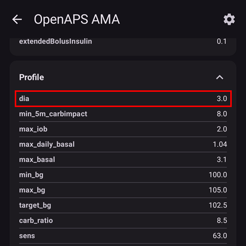

# Domande frequenti (FAQ)

Come aggiungere domande alle FAQ: segui queste [istruzioni](../SupportingAaps/HowToEditTheDocs.md)

## Generale

### Posso semplicemente scaricare il file di installazione di AAPS?

No. Non esiste un file apk di AAPS da scaricare. You have to [build](../SettingUpAaps/BuildingAaps.md) it yourself. E per questo c'è un motivo:

AAPS is used to control your pump and give insulin. Under current regulations in Europe, all systems classed as IIa or IIb are medical devices that require regulatory approval (a CE mark) which needs various studies and sign offs. Distribuire un dispositivo non regolamentato è illegale. Esistono norme analoghe in altre parti del mondo.

This regulation is not restricted just to sales (in the meaning of getting money for something) but applies to any distribution (even giving away for free). Costruire un dispositivo medico per te stesso è l'unico modo per usare l'app nel rispetto di queste norme.

Ecco perché i file apk non sono disponibili.

(FAQ-how-to-begin)=

### Come iniziare?

Start with [Preparing to start with AAPS](../Getting-Started/PreparingForAaps.md): it walks you through everything below in more detail.

First of all, you have to **get loopable hardware components**:

* A [supported insulin pump](../Getting-Started/CompatiblePumps.md), 
* an [Android smartphone](../Getting-Started/Phones.md) (Apple iOS is not supported by AAPS - you can check [iOS Loop](https://loopkit.github.io/loopdocs/)) and
* a [continuous glucose monitoring system](../Getting-Started/CompatiblesCgms.md). 

Secondly, you have to **setup your software components**: [AAPS](../SettingUpAaps/BuildingAaps.md), [CGM/FGM source](../Getting-Started/CompatiblesCgms.md) and a [reporting server](../SettingUpAaps/SettingUpTheReportingServer.md).

Thirdly, you have to learn and **understand the OpenAPS reference design to check your treatment factors**. The founding principle of closed looping is that your [basal rate and carb ratio](../SettingUpAaps/YourAapsProfile.md) are accurate. All recommendations assume that your basal needs are met and any peaks or troughs you're seeing are a result of other factors which therefore require some one-off adjustments (exercise, stress etc.). The adjustments the closed loop can make for safety have been limited (see maximum allowed temporary basal rate in [OpenAPS Reference Design](https://openaps.org/reference-design/)), which means that you don't want to waste the allowed dosing on correcting a wrong underlying basal. If for example you are frequently low temping on the approach of a meal then it is likely your basal needs adjusting. You can use [Autotune](#autotune-how-autotune-calculates-adjustments) to consider a large pool of data to suggest whether and how basals and/or ISF need to be adjusted, and also whether carb ratio needs to be changed. Or you can test and set your basal the [old-fashioned way](https://integrateddiabetes.com/basal-testing/).

### What practicalities of looping do I have?

#### Protezione con password

If you don't want your settings to be easily changed, you can protect them with a password, a PIN or your phone's biometric authentication (fingerprint, face). Apri **Impostazioni** > **Protezione** > **Protezione impostazioni** e scegli il tipo di protezione. You can also protect the whole app or only boluses in the same place. Vedi [Protezione impostazioni](#Preferences-settings-protection) per i dettagli.

#### Smartwatch Android Wear

If you use the AAPS watch app to bolus or change settings, every request has to be confirmed on the watch: after you send it, the watch shows a summary with a **CONFIRM** button. See [Remote control from a Wear OS watch](../RemoteFeatures/RemoteControlWearOS.md).

(FAQ-disconnect-pump)=

#### Disconnect pump

If you take your pump off for showering, bathing, swimming, sports or other activities you must let AAPS know that no insulin is delivered to keep IOB correct.

The pump can be disconnected using the [loop icon](#AapsScreens-loop-status) on the AAPS main screen: press it and select **Disconnect pump** with the duration you need. Se l'attività dura più del previsto, premi di nuovo l'icona e scegli una nuova durata: non serve riconnettere prima. See [Disconnecting the pump for showering or activity](#pumps-cannulas-disconnecting) for how to avoid a lack of insulin during long disconnections.

#### Recommendations not only based on one single CGM reading

For safety, recommendations made are based on not one CGM reading but the average delta. Therefore, if you miss some readings it may take a while after getting data back before AAPS kicks in looping again.

#### Further readings

Ci sono diversi blog con buoni consigli per capire gli aspetti pratici del loop. Some of them are no longer online: the links below marked "archived copy" open a saved copy on the Internet Archive.

    * [Fine-tuning Settings](https://web.archive.org/web/20171029031305/http://seemycgm.com/2017/10/29/fine-tuning-settings/) See my CGM (copia archiviata)
    * [Why DIA matters](https://web.archive.org/web/20231130035027/http://seemycgm.com/2017/08/09/why-dia-matters/) See my CGM (copia archiviata)
    * [Limiting meal spikes](https://diyps.org/2016/07/11/picture-this-how-to-do-eating-soon-mode/) #DIYPS
    * [Hormones and autosens](https://web.archive.org/web/20170902081839/http://seemycgm.com/2017/06/06/hormones-2/) See my CGM (copia archiviata)
    

(what-emergency-equipment-is-recommended-to-take-with-me)= (FAQ-emergency-equipment)=

### What emergency equipment is recommended to take with me?

You have to have the same emergency equipment with you like every other T1D with insulin pump therapy. When looping with AAPS it is strongly recommended to have the following additional equipment with or near to you:

* Battery pack and cables to charge your smartphone, watch and (if needed) BT reader or Link device
* Batterie del micro
* Access to your backups, both on the phone and in the cloud (e.g. Google Drive, Dropbox), so that you can set up AAPS again on another phone (see [Creating and restoring back-ups](../Maintenance/ExportImportSettings.md)): 
  * the current [apk](../SettingUpAaps/BuildingAaps.md) of AAPS and of any other apps you use (e.g. xDrip, Juggluco, BYODA).
  * your keystore file (from building the apk) and its password,
  * your latest settings export files from AAPS and your other apps,
  * your **AAPS** master password: you cannot import the settings file without it. If you forgot it, see [How to reset the master password?](#FAQ-reset-master-password)

(FAQ-organize-backups)=

#### Come organizzare i miei backup?

Export settings very regularly: after each pod or reservoir change, after modifying your profile, when you have validated an objective, if you change your pump… Even if nothing changes, export once a month. Keep several old export files.

**AAPS** can do this for you: it can export your settings automatically (for example with an [Automation](#ExportImportSettings-Automating-Settings-Export) after each pod change) and save the export directly to a cloud folder (Google Drive). Vedi [Creare e ripristinare i backup](../Maintenance/ExportImportSettings.md).

### How can I safely and securely attach the CGM/FGM?

You can tape it. There are several pre-perforated 'overpatches' for common CGM systems available (search Google, eBay or Amazon). Some loopers use the cheaper standard kinesiology tape or rocktape.

You can fix it. You can also purchase upper arm bracelets that fix the CGM/FGM with a band (search Google, eBay or Amazon).

## Algoritmo APS

### Why does OpenAPS AMA show "dia: 3" even though I have a different DIA in my profile?

Con **OpenAPS AMA** selezionato in **Configurazione** > **APS**, **Apri plugin** mostra i dati inviati all'algoritmo. Nella sezione **Profilo**, `dia` è sempre 3.0 o meno:

In AMA, DIA actually doesn't mean the 'duration of insulin acting'. It is a parameter, which used to be connected to the DIA. Now, it means, 'in which time should the correction be finished'. It has nothing to do with the calculation of the IOB. In OpenAPS SMB, there is no need for this parameter any longer.

## Altre impostazioni

### Impostazioni di Nightscout

(FAQ-nsclient-blocked)=

#### AAPSClient (or AAPS) does not upload data: "Blocked by…". Cosa posso fare?

Lo stato di NSClient mostra perché non vengono inviati dati:

* **Blocked by connectivity options**: the connection settings do not allow the current connection. For example, you are on cellular data but only Wi-Fi is allowed, or you are not on one of the allowed Wi-Fi networks (SSIDs).
* **Blocked by charging options**: the connection settings only allow syncing while the phone is charging (or only on battery), and this is not the case right now.
* **Connettività assente**: il telefono non ha una connessione a internet.

Controlla le [impostazioni di connessione di NSClient](#Preferences-nsclient): **Usa dati mobili**, **Usa roaming**, **Usa WiFi**, **WiFi SSID**, **Sincronizza quando si è a batteria** e **Sincronizza durante la ricarica**.

### Impostazioni del CGM

(FAQ-advanced-filtering)=

#### Why does AAPS say 'SMB always and after carbs disabled because active BG source doesn't support advanced filtering'?

**Enable SMB always** and **Enable SMB after carbs** can only be used with a [trusted BG data source](#GettingStarted-TrustedBGSource): a sensor and CGM app that can tell **AAPS** which sensor the readings come from. Con qualsiasi altra sorgente glicemia, **AAPS** disattiva queste due opzioni e mostra questo messaggio. Check the list of trusted sources and, if your sensor is listed, make sure you use one of the CGM apps shown for it. Vedi anche [Smoothing dei dati glicemici](../CompatibleCgms/SmoothingBloodGlucoseData.md).

### Micro

#### Batterie

Looping can reduce the pump battery faster than normal use because the system interacts through Bluetooth far more than a manual user does. È meglio cambiare la batteria al 25%, perché dopo la comunicazione diventa difficile. You can set warning alarms for pump battery by using the PUMP_WARN_BATT_P variable in your Nightscout site. Alcuni trucchi per far durare di più la batteria:

* reduce the length of time the LCD stays on (within pump settings menu)
* riduci il tempo in cui la retroilluminazione resta accesa (nel menu delle impostazioni del micro)
* imposta le notifiche su un segnale acustico invece della vibrazione (nel menu delle impostazioni del micro)
* only press the buttons on the pump to reload, use AAPS to view all history, battery level and reservoir volume.
* Su alcuni telefoni l'app AAPS può essere chiusa spesso per risparmiare energia o liberare RAM. When AAPS is reinitialized at each startup it establishes a Bluetooth connection to the pump, and re-reads the current basal rate and bolus history. Questo consuma batteria. To see if this is happening, enable **Log app start event** in the NSClient **Advanced settings**: Nightscout will receive an event at every restart of AAPS, which makes it easy to track the issue. To reduce this happening, turn off battery optimization for AAPS so that the phone stops closing it down: see [battery savings](#FAQ-battery-savings) below.
* clean battery terminals with alcohol wipe to ensure no manufacturing wax/grease remains.
* for [Dana R/RS pumps](../CompatiblePumps/DanaRS-Insulin-Pump.md) the startup procedure draws a high current across the battery to purposefully break the passivation film (prevents loss of energy while in storage) but it doesn't always work to break it 100%. Either remove and reinsert battery 2-3 times until it does show 100% on screen, or use battery key to briefly short circuit battery before insertion by applying to both terminals for a split second.
* see also more tips for [particular types of battery](#Accu-Chek-Combo-Tips-for-Basic-usage-battery-type-and-causes-of-short-battery-life)

#### Changing reservoirs and cannulas

Il serbatoio va cambiato direttamente sul micro, poi il cambio viene registrato in **AAPS**. Follow the step-by-step [guide for changing the pump reservoir and cannula](#pumps-cannulas-changing-reservoir-and-cannula).

### Sfondo

You can find the AAPS wallpaper for your phone on the [phones page](#Phones-phone-wallpaper).

### Uso quotidiano

Many of the situations below can be prepared once as a [scene](#scenes): a preset that switches profile, temp target and other settings with one tap. **AAPS** offers ready-made templates, for example *Exercise*, *Sleep*, *Alcohol* or *Bathing*.

#### Igiene

(what-to-do-when-taking-a-shower-or-bath)=

##### What to do when taking a shower or bath?

Puoi togliere il micro mentre fai la doccia o il bagno. For this short period of time you may not need it, but you should tell AAPS that you've disconnected so that the IOB calculations are correct. See [description above](#FAQ-disconnect-pump). Il modello di [scena](#scenes) *Fare il bagno* lo fa per te.

#### Lavoro

A seconda del tuo lavoro, puoi scegliere di usare fattori di trattamento diversi nei giorni lavorativi. As a looper you should consider a [profile switch](../DailyLifeWithAaps/ProfileSwitch-ProfilePercentage.md) for your typical working day. For example, you may switch to a profile higher than 100% if you have a less demanding job (e.g. sitting at a desk), or less than 100% if you are active and on your feet all day. You could also consider a high or low temporary target or a [time shift of your profile](#ProfileSwitch-ProfilePercentage-time-shift-of-the-circadian-percentage-profile) when working much earlier or later than regular, or if you work different shifts. You can also create a second profile (e.g. 'home' and 'workday') and do a daily profile switch to the profile you actually need, or save your workday settings as a [scene](#scenes).

### Tempo libero

(FAQ-sports)=

#### Sport

Devi rivedere le tue vecchie abitudini sportive di prima del loop. Se mangi semplicemente uno o più carboidrati per lo sport come prima, il sistema a loop chiuso li riconosce e li corregge di conseguenza.

So, you would have more carbohydrates on board, but at the same time the loop would counteract and release insulin.

When looping you should try these steps:

* Fai un [cambio profilo](#ProfileSwitch-change-percentage) sotto il 100%: tocca il nome del profilo nella schermata principale, tocca il pulsante rotondo **▶**, poi imposta **Percentuale** e **Durata**.
* Set an [activity temp target](#TempTargets-activity-temp-target) above your standard target. With a percentage below 100 % and a duration, the same **Activate** screen offers a **Temporary target / Activity** switch that starts both at once.
* If you are using SMB make sure ["Enable SMB with high temp targets"](#Open-APS-features-enable-smb-with-high-temp-targets) and ["Enable SMB always"](#Open-APS-features-enable-smb-always) are disabled.

Pre- and post-processing of these settings is important. Make the changes in time before sport and consider the effect of muscle filling.

The *Exercise* and *Post-exercise Night* [scene](#scenes) templates bundle these settings, so you can start them with one tap. If you do sports regularly at the same time (i.e. sports class in your gym) you can consider using [automation](../DailyLifeWithAaps/Automations.md) to start the profile switch and TT, or the scene. Location based automation might also be an idea but makes preprocessing more difficult.

The percentage of the profile switch, the value for your activity temp target and best time for the changes are individual. Start on the safe side if you are looking for the right value for you (start with lower percentage and higher TT).

#### Sesso

You can remove the pump to be 'free', but you should tell AAPS so that the IOB calculations are correct. See [description above](#FAQ-disconnect-pump).

#### Drinking alcohol

Drinking alcohol is risky in closed loop mode as the algorithm cannot predict the alcohol influenced BG correctly. You have to check out your own method for treating this using the following functions in AAPS:

* Deactivating closed loop mode and treating the diabetes manually or
* impostare target temporanei alti e disattivare l'UAM, per evitare che il loop aumenti l'IOB a causa di un pasto non annunciato oppure
* do a [profile switch](#ProfileSwitch-change-percentage) to noticeably less than 100% 

Il modello di [scena](#scenes) *Alcool* è un punto di partenza che puoi adattare al tuo metodo.

When drinking alcohol, you always have to have an eye on your CGM to manually avoid a hypoglycemia by eating carbs.

#### Dormire

##### How can I loop during the night without mobile and Wi-Fi radiation?

Molti utenti mettono il telefono in modalità aereo di notte. If you want the loop to support you when you are sleeping, proceed as follows (this will only work if your CGM app runs on the same phone as AAPS, such as xDrip, Juggluco or BYODA; it will NOT work if you get the BG-readings via Nightscout):

1. Attiva la modalità aereo sul telefono.
2. Aspetta che la modalità aereo sia attiva.
3. Attiva il Bluetooth.

You are not receiving calls now, nor are you connected to the internet. Ma il loop continua a funzionare.

Some people have discovered problems with local broadcast (AAPS not receiving BG values from xDrip) when phone is in airplane mode. In xDrip, vai su Settings > Inter-app settings > Identify receiver e inserisci `info.nightscout.androidaps`.

If you want different settings at night (for example a higher target), the *Sleep* [scene](#scenes) template is a good starting point.

#### Traveling

##### Come gestire i cambi di fuso orario?

With Dana R and Dana R Korean you don't have to do anything. Per gli altri micro vedi la pagina [Cambio di fuso orario e ora legale](../DailyLifeWithAaps/TimezoneTraveling-DaylightSavingTime.md) per maggiori dettagli.

### Argomenti medici

#### Ricovero in ospedale

If you want to share some information about AAPS and DIY looping with your clinicians, you can print out the [guide to AAPS for clinicians](../UsefulLinks/ClinicianGuideToAaps.md).

#### Visita medica con il tuo endocrinologo

##### Report

You can either show your Nightscout reports (https://YOUR-NS-SITE.com/report) or check [Nightscout Reporter](https://nightscout-reporter.zreptil.de/).

## Frequent questions on Discord and their answers...

### My problem is not listed here.

Vedi [Dove posso trovare aiuto?](../GettingHelp/WhereCanIGetHelp.md). Se hai trovato la soluzione da solo, **ricordaci di aggiungerla a questo elenco!**

### Building and installing

(FAQ-build-errors)=

#### I have problems, errors building the app.

Please check the troubleshooting page for the way you build **AAPS** (see [Building AAPS](../SettingUpAaps/BuildingAaps.md)):

* building with a browser: [Browser build: troubleshooting](#aaps-ci-troubleshooting),
* building with Android Studio: [Troubleshooting Android Studio](../GettingHelp/TroubleshootingAndroidStudio.md).

(FAQ-build-error-file-name-too-long)=

#### Build error: file name too long

This error can happen when building with Android Studio: the build stops with an error stating the file name is too long. Possible solutions: Move your sources to a directory closer to the root directory of your drive (e.g. "C:\src\AndroidAPS").

From Android Studio: Make sure "Gradle" is done syncing and indexing after opening the project and pulling from GitHub. Execute a Build->Clean Project before doing a Rebuild Project. Execute File->Invalidate Caches and Restart Android Studio.

(FAQ-running-dev-version)=

#### Alert: Running dev version. Closed loop is disabled

**AAPS** shows this message when you run a development (dev) version without engineering mode: in a dev version, closed loop only works in engineering mode.

The dev version is meant for testing, not for actual looping: read [Development branch](../AdvancedOptions/DevBranch.md) before going further.

To turn on engineering mode:

1. Place a file named `engineering_mode` in the `extra` subfolder of your AAPS directory (the folder you chose in the setup wizard, usually `AAPS/extra`). Va bene qualsiasi file, purché abbia il nome giusto.
2. Restart **AAPS** so that it finds the file.

Hint: Make a copy of an existing logfile and rename it to "engineering_mode" (note: no file extension!).

### Obiettivi

#### I'm stuck on an objective and need help.

First read [Completing the Objectives](../SettingUpAaps/CompletingTheObjectives.md). If you are still stuck, screen capture the question and answers and post them on the Discord AAPS channel. Don't forget to tell which options you choose (or not) and why. Riceverai suggerimenti e aiuto, ma le risposte dovrai trovarle tu.

### Impostazioni, password e backup

(FAQ-reset-master-password)=

#### How to reset the master password?

Se hai dimenticato la password master, puoi reimpostarla sul numero di serie del tuo micro:

1. Crea un file vuoto chiamato `PasswordReset` (senza estensione) nella sottocartella `extra` della tua directory AAPS (di solito `AAPS/extra`).
2. Riavvia **AAPS**. Il micro deve essere connesso: **AAPS** mostra "In attesa del micro…" e deve leggere il numero di serie del micro entro 30 secondi.
  
  To restart, quit **AAPS** with **menu** (☰) > **Exit**, then open it again. **AAPS** only looks for the file when it starts from scratch. Closing the screen or swiping the app away is not enough, because **AAPS** keeps running in the background. If "Waiting for pump…" does not appear, use **Force stop** in the Android **App info** of **AAPS**, or restart your phone. Installing your current **AAPS** apk again over the installed app also works: it keeps your settings.

3. **AAPS** mostra "Password impostata!": ora la tua password master è il **numero di serie del micro**. The `PasswordReset` file is deleted automatically.

4. Apri **Impostazioni** > **Protezione** > **Password Master** e imposta una nuova password.

If the pump is not reached in time, nothing changes: check the pump connection and try again.

This only resets the master password. A settings, application or bolus password or PIN is not reset, but you can always use the master password instead of them.

    {admonition} Vecchi file delle impostazioni
    :class: warning
    I file delle impostazioni esportati con la vecchia password master si possono importare solo con quella vecchia password.

(FAQ-where-are-settings-files)=

#### Dove trovo i file delle impostazioni?

Settings files are stored in the `preferences` subfolder of the AAPS directory you chose in the [setup wizard](#SetupWizard-StoragePermission) (for example `/internal storage/AAPS/preferences`). If you set up a cloud folder (Google Drive), your exports can also be saved there. Vedi [Creare e ripristinare i backup](../Maintenance/ExportImportSettings.md).

WARNING: Make sure not to lose your password as without it you will not be able to import an encrypted settings file!

(FAQ-import-settings-earlier-versions)=

#### How do I import settings from earlier versions of AAPS into AAPS v3 or v4 ?

In AAPS v3 o v4 puoi importare solo impostazioni esportate con AAPS v2.8x o successivo. If you were using a version of AAPS older than v2.8x or you need to use setting exports older than v2.8x, then you need to install AAPS v2.8 first. Import the older settings of v2.x in v2.8. After checking that all is OK, you can export settings from v2.8. Install the current AAPS version and import v2.8 settings in it.

If you use the same key to build the old and the new version, you won't even have to import settings. You can install the new version over the old one.

Sono stati aggiunti alcuni nuovi obiettivi. You'll need to validate them.

(FAQ-delete-treatments)=

#### Where can I delete treatments?

Apri il **menu** (☰) e seleziona **Cronologia trattamenti**. Tieni premuta una voce per selezionarla, tocca altre voci se serve, poi tocca l'icona del **cestino** e conferma. Vedi [Cronologia trattamenti](#aaps-screens-treatments).

### Problemi con il telefono e la connessione

(FAQ-aaps-stops)=

#### AAPS si ferma ogni giorno più o meno alla stessa ora.

* Su alcuni telefoni Google Play Protect può chiudere **AAPS** ogni mattina. Se succede, vai nelle opzioni di Google Play e disattiva **Google Play Protect**.
* Check for "cleaning" apps (ie CCleaner etc) and uninstall them.
* Turn off all battery optimizations for **AAPS** (see [battery savings](#FAQ-battery-savings) below).

(FAQ-battery-savings)=

#### How to configure battery savings?

Your phone may suspend **AAPS** and related apps (CGM app, Bluetooth) when you are not using it. **AAPS** then cannot do its work, and Bluetooth connections to the sensor and pump (or RileyLink) may be shut down, causing "pump unreachable" alerts and communication errors.

Turn off battery optimization for **AAPS**, your CGM app (e.g. xDrip) and the Bluetooth system app. The way to do this depends on the phone's brand, model and Android version:

* vedi [Ottimizzazione della batteria](#generaltroubleshooting-android-related-issues) per i telefoni Pixel, Samsung e Huawei,
* in **AAPS**, open the **menu** (☰) > **About** and tap **Don't kill my app?**, or visit [Don't kill my app](https://dontkillmyapp.com/) for other brands.

If you are not sure that battery savings cause your problem, you can temporarily turn off all battery savings on the phone: your battery will drain faster, but you will quickly see if the problem goes away.

(FAQ-pump-unreachable-alerts)=

#### Avvisi di micro irraggiungibile più volte al giorno o di notte.

Your phone may be suspending **AAPS** or even Bluetooth, causing it to lose the connection to the pump or RileyLink (see [battery savings](#FAQ-battery-savings) above).

You can also change when the alert is raised: press the **Settings** (gear) icon on the top right of the main screen, then select **Local alerts** > **Pump unreachable threshold** (30 to 300 minutes). Check your pump's page: some recommend a value, e.g. 120 minutes for [Omnipod DASH](../CompatiblePumps/OmnipodDASH.md).

(FAQ-link-unresponsive)=

#### Il mio link/micro/pod non risponde (RL/OL/EmaLink…)

Con alcuni telefoni ci sono disconnessioni Bluetooth dai Link (RL/OL/EmaLink).

Alcuni hanno anche Link che non rispondono (AAPS dice che sono connessi, ma i Link non riescono a raggiungere o comandare il micro).

First try the **Reset RileyLink** button on the pump screen (see your pump's page: [Medtronic](#MedtronicPump-what-to-do-if-i-loose-connection-to-rileylink-and-or-pump), [Omnipod Eros](#OmnipodEros-reset-rileylink-config-notes)). Se non basta, il modo più semplice per far funzionare di nuovo insieme tutte queste parti è:

1. Spegni il Link.
2. Chiudi **AAPS** (**menu** (☰) > **Esci**).
3. Long press the **AAPS** icon, open the Android **App info**, tap **Force stop**, then **Storage** > **Clear cache** (do NOT clear storage/data!).
4. Rarely some phones may need a reboot here. You can try without reboot.
5. Accendi il Link.
6. Avvia **AAPS**.
7. On the pump screen, tap **Pair RileyLink** and select your Link again.

### Controllo remoto

(FAQ-aapsclient)=

#### Configurare e usare l'app remota AAPSClient

**AAPSClient** is a separate app that lets a caregiver follow and control **AAPS** remotely. Since **AAPS** v4, controlling **AAPS** from AAPSClient needs a one-time pairing between the two apps. Vedi:

* [The AAPSClient app](#aapsclient-app): installing, first start and pairing,
* [Master ↔ Client control](#client-master-control): what can be controlled and how pairing works,
* [AAPSClient on a smartwatch](#remotecontrol-smartwatches).

(FAQ-hardened-mode)=

#### Treatments I enter on the Nightscout website are not applied

È la [modalità protetta](#client-master-control-hardened-mode). While client control is on — always in Simple Mode — **AAPS** takes changes only from paired clients, not from the Nightscout website or other apps. Enter them on a paired **AAPSClient** instead.

### Alerts and warnings

#### I have a red warning badge (red triangle) / AAPS won't enable closed loop / Loop stays in LGS / I had a yellow triangle

The red warning badge on the BG source shortcut is a security feature in AAPS. See [BG warning sign](#aaps-screens-bg-warning-sign) for the full explanation.

A red warning badge on the BG source shortcut in the bottom bar (the red triangle of older versions) means that you have duplicate BGs and AAPS can't calculate precisely the deltas. A closed loop is switched to **Low Glucose Suspend** mode: it still reduces or suspends your basal to protect you against lows, but it gives no correction insulin. You need to delete one BG of each duplicated value in order to clear the warning. Tap the shortcut to open your [BG source screen](#aaps-screens-bg-source): the duplicate is highlighted in red. Long press one line you want to delete, check one of each lines that are doubled and tap the trash icon. You may need to reset the AAPS databases if there are too many double BGs. In this case, you'll also lose stats, IOB, COB, selected profile.

Once the warning is gone, AAPS does not go back to **Closed Loop** by itself. Premi l'icona del loop nella schermata principale e seleziona di nuovo **Loop chiuso**.

Possible origin of the problem: xDrip and/or NS backfilling BGs.

The yellow triangle of older versions meant unstable delay between each BG reading (BGs not received every 5 min regularly, or missing BGs), which often happens with Libre or after a G6 transmitter change. **AAPS** 4 non lo mostra più: ricalcola i valori in background e il loop funziona correttamente.

### Omnipod DASH

(FAQ-move-dash-pod)=

#### Posso spostare un Pod DASH attivo su un altro telefono?

The Pod state is included in the exported settings, so an active Pod can be moved to another phone by exporting the settings right before the move and importing them on the other phone. This is not officially supported and there is a risk of losing the Pod: if possible, try it when your Pod is about to expire.

Leggi prima queste sezioni:

* [Export and import settings](#omnipod-dash-export-import) on the Omnipod DASH page, and [Tubeless pumps](#ExportImportSettings-tubeless-pumps): on the new phone, tick **Also replace pump settings** and use a file exported while wearing your current Pod,
* [Discarding a pod](#omnipod-dash-discard-pod), to remove the Pod from the old phone afterwards. Tieni il vecchio telefono in modalità aereo finché il Pod non è stato scartato, così i due telefoni non parlano mai con il Pod nello stesso momento.