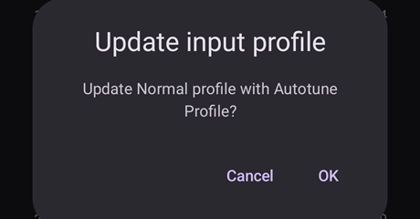
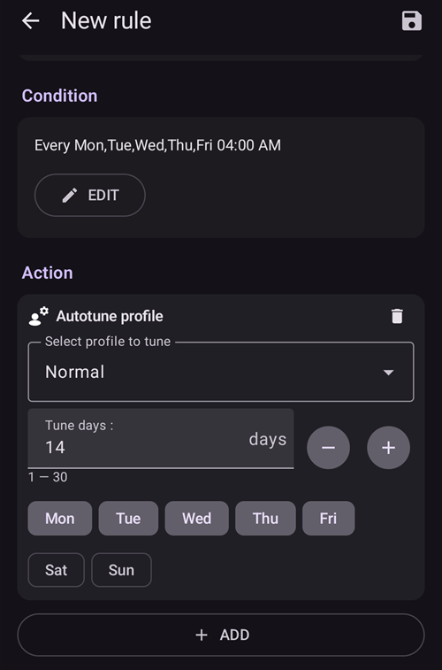

# Autotune 플러그인 사용 방법

Autotune 플러그인은 OpenAPS autotune 알고리즘을 AAPS 안에 구현한 것입니다. 최근 AAPS 이력을 분석해서 기저 주입량, ISF, 탄수화물 비율(IC)의 조정을 제안합니다.

Autotune 플러그인은 AAPS [3.4](#version3400) 버전부터 있지만 기본적으로 숨겨져 있습니다.

(autotune-how-autotune-calculates-adjustments)=
## Autotune이 조정을 계산하는 방법

Autotune은 최근 AAPS 이력(CGM 측정값, 볼러스, 탄수화물, 임시 기저)을 되돌아보고, **프로파일**(기저 주입량, ISF, 탄수화물 비율)이 실제 혈당 변화와 잘 맞지 않는 곳을 찾습니다.

5분마다의 각 데이터 지점에서 **실제 혈당 변화**를 프로파일이 예측한 변화와 비교하고, 그 차이(편차)를 세 그룹 중 하나로 나눕니다:

* 활성 탄수화물이 없고 인슐린 활동도 없을 때 생긴 편차(시간별 **기저 주입량** 조정에 사용),
* 탄수화물 없이 볼러스/교정 후에 생긴 편차(**ISF** 조정에 사용), 또는
* 탄수화물이 흡수되는 동안 생긴 편차(**탄수화물 비율** 조정에 사용).

그런 다음 각 그룹에서 편차의 패턴을 살펴보고(단순 평균이 아니라 백분위를 사용하므로 잡음이 있는 몇몇 데이터 지점이 결과를 왜곡하지 않습니다) 해당 시간/매개변수에 대한 새 값을 제안합니다.

한 번의 실행이 과도하게 교정하지 않도록, Autotune은 실행할 때마다 데이터가 제안하는 값 쪽으로 일부만 이동합니다: ISF와 탄수화물 비율은 최대 10%, 각 기저 구간은 최대 20%입니다. 전체 변화는 **Autosens 최대** / **Autosens 최소** 설정으로 다시 한 번 제한됩니다(아래 [기타 설정](#autotune-other-settings) 참조). 이것은 Autosens를 제한하는 것과 같은 한계입니다. 그래서 Autotune은 한 번 실행한 결과를 믿기보다 반복해서(매일 또는 매일 밤) 실행하도록 만들어졌습니다: 결과는 점차 수렴해야 하며, 한 번의 실행에서 크게 바뀌면 그대로 믿지 말고 데이터(입력하지 않은 탄수화물, 센서가 나빴던 날 _등_)를 다시 확인하라는 신호입니다.

Autotune은 세 가지 방법으로 실행할 수 있습니다: 플러그인 안에서 한 번 수동으로(아래 설명), [자동화 규칙](#autotune-run-autotune-with-an-automation-rule)으로 매일 밤 자동으로, 또는 AAPS와 완전히 별개로 내보낸 데이터에 대해 독립 명령줄 도구로 실행할 수 있습니다. 일부 커뮤니티 가이드는 마지막 방법으로 AAPS를 실행하는 휴대폰 없이 사용하는 방법을 설명합니다.

*oref0 알고리즘의 자세한 수학적 내용은 [OpenAPS의 Autotune 문서](https://openaps.readthedocs.io/en/latest/docs/Customize-Iterate/autotune.html)를 참조하십시오.*

## Autotune 플러그인 표시

휴대폰 [AAPS 디렉터리](#preferences-maintenance-settings)의 `extra` 하위 폴더에 `enable_autotune`이라는 빈 파일을 만드십시오.

***참고: AAPS 설정에서 AAPS 디렉터리가 어디인지 확인하고, 파일을 올바른 디렉터리에 넣었는지 확인하십시오. 여러 사용자가 파일을 잘못된 폴더에 넣었습니다.***


**AAPS**를 다시 시작하십시오. 그런 다음 **메뉴**(☰)를 열고 **구성**을 선택한 뒤, **일반** 범주에서 **Autotune**을 체크하십시오. 그러면 카드에 **설정**과 **플러그인 열기**가 표시됩니다:


## Autotune 사용자 인터페이스

**Autotune** 카드에서 **플러그인 열기**를 눌러 Autotune 화면을 엽니다:


- 프로파일 드롭다운 메뉴에서 조정할 입력 프로파일을 선택할 수 있습니다(기본으로 현재 활성 프로파일이 선택되어 있습니다)
  - 참고: 새 프로파일을 선택할 때마다 이전 결과가 지워지고 **데이터 일수**가 기본값으로 설정됩니다
- 다음으로 **데이터 일수**(이전 버전에서는 **조정 일수**)에서 프로파일 조정 계산에 사용할 일수를 선택합니다. 최솟값은 1일, 최댓값은 30일입니다. 반복 계산으로 올바르고 매끄러운 결과를 얻으려면 이 숫자가 너무 작으면 안 됩니다(계산마다 7일 이상)
  - 참고: **데이터 일수**를 바꿀 때마다 이전 결과가 지워집니다
- 마지막 실행은 마지막으로 성공한 계산을 불러오는 링크입니다. 당일에 Autotune을 실행하지 않았거나, 위에서 계산 매개변수를 바꿔서 이전 결과가 지워졌다면, 마지막으로 성공한 실행의 매개변수와 결과를 불러올 수 있습니다.
- 경고에는 예를 들어 선택한 프로파일에 대한 정보가 표시됩니다(IC 값이나 ISF 값이 여러 개인 경우)
  - 참고: Autotune 계산은 IC 값 하나와 ISF 값 하나로만 작동합니다. 현재 하루 주기 IC나 하루 주기 ISF를 조정하는 Autotune 알고리즘은 없습니다. 입력 프로파일에 값이 여러 개 있으면, 경고 부분에서 프로파일 조정에 사용되는 평균값을 볼 수 있습니다.
- "입력 프로파일 확인하기" 버튼은 프로파일 보기를 열어 프로파일(단위, IC, ISF, 기저, 목표)을 빠르게 확인할 수 있게 합니다
  - 참고: Autotune은 IC(값 하나), ISF(값 하나), 기저(하루 주기 변화 포함)만 조정합니다. 단위와 목표는 출력 프로파일에서 바뀌지 않습니다.

- "Autotune 실행하기" 버튼은 선택한 프로파일과 선택한 데이터 일수로 Autotune 계산을 시작합니다
  - 참고: Autotune 계산은 시간이 오래 걸릴 수 있습니다. 계산이 시작되면 다른 화면(홈 등)으로 이동했다가 나중에 Autotune 플러그인으로 돌아와서 결과를 볼 수 있습니다

  

- 실행하는 동안 아래에 중간 결과가 표시됩니다

  - 참고: 실행하는 동안에는 설정이 잠기므로, 선택한 입력 프로파일이나 일수를 더 이상 바꿀 수 없습니다. 다른 매개변수로 다시 실행하려면 현재 계산이 끝날 때까지 기다려야 합니다.

  

- Autotune 계산이 끝나면 결과(조정된 프로파일)와 그 아래에 버튼 네 개가 표시됩니다.

  

- 입력 프로파일("프로파일" 열), 출력 프로파일("조정된" 열), 각 값의 변화 백분율("%" 열)을 항상 비교하는 것이 중요합니다.

- 기저 주입량에는 "누락된 일수"도 표시됩니다. 어떤 시간대의 기저 주입량을 조정하기에 "기저"로 분류된 데이터가 충분하지 않으면 누락된 일수가 생깁니다(예: 탄수화물이 흡수되는 식사 후마다). 특히 기저가 중요한 시간대(예: 밤이나 늦은 오후)에는 이 숫자가 가능한 한 낮아야 합니다

- "프로파일 비교하기" 버튼은 프로파일 비교 화면을 엽니다. 입력 프로파일은 파란색, 출력 프로파일("조정된")은 빨간색입니다.

  - 참고: 아래 예에서 입력 프로파일은 IC와 ISF에 하루 주기 변화가 있지만, 계산된 출력 프로파일은 값이 하나입니다. 하루 주기 출력 프로파일이 중요하다면 아래의 [하루 주기 IC 또는 ISF 프로파일](#autotune-circadian-ic-or-isf-profile)을 참조하십시오.

  

- 결과를 신뢰한다면(입력 프로파일과 출력 프로파일 사이의 변화 백분율이 낮은 경우) "프로파일 활성화" 버튼을 누른 다음 확인을 눌러 승인할 수 있습니다.

  - "프로파일 활성화"를 누르면 프로파일 목록(**관리 → 프로파일**)에 "조정된"이라는 새 프로파일이 자동으로 만들어집니다.
  - **관리 → 프로파일**에 이미 "조정된"이라는 프로파일이 있으면, 활성화 전에 이 프로파일이 계산된 Autotune 프로파일로 업데이트됩니다

  

- 조정된 프로파일을 수정해야 한다고 생각되면(예: 일부 변화가 너무 크다고 생각될 때) "로컬 프로파일로 복사하기" 버튼을 누를 수 있습니다

  - **관리 → 프로파일**에 "조정된" 접두어와 실행 날짜 및 시간이 붙은 새 프로파일이 만들어집니다

  

- 그런 다음 조정된 프로파일을 편집할 수 있습니다: **관리** > **프로파일**을 열고, 실행 날짜와 시간이 붙은 "조정된" 카드로 밀어서 이동한 뒤, **편집**(연필) 버튼을 누르십시오

  - 프로파일의 값은 사용자 인터페이스에서 펌프 성능에 맞게 반올림됩니다

  

- 입력 프로파일을 Autotune 결과로 바꾸려면 "입력 프로파일 업데이트" 버튼을 누르고 팝업에서 확인을 눌러 승인하십시오

  - 참고: "입력 프로파일 업데이트" 다음에 "프로파일 활성화"을 누르면, 기본 "조정된" 프로파일이 아니라 업데이트된 프로파일이 활성화됩니다.

  

- 입력 프로파일을 업데이트했다면 "입력 프로파일 업데이트" 버튼이 "입력 프로파일 되돌리기" 버튼으로 바뀝니다(아래 스크린샷 참조). 이렇게 하면 **관리 → 프로파일**의 현재 입력 프로파일에 마지막 실행 결과가 이미 들어 있는지 바로 볼 수 있습니다. 이 버튼으로 Autotune 결과가 없는 입력 프로파일을 되돌릴 수도 있습니다

  


## Autotune settings

(autotune-plugin-settings)=

### Autotune 플러그인 설정

  

```{admonition} Only DEV
:class: note
**프로파일 자동 전환** 기능은 Dev/엔지니어링 모드에서만 사용할 수 있습니다.
```

- **프로파일 자동 전환**(기본값 끔): 아래 [자동화 규칙으로 Autotune 실행하기](#autotune-run-autotune-with-an-automation-rule)를 참조하십시오. 이 설정을 켜면 입력 프로파일이 조정된 프로파일로 자동 업데이트되고 활성화됩니다.
  - **주의하십시오. 조정된 프로파일을 수정 없이 업데이트하고 활성화한 뒤에는, 그것이 루프를 개선하는지 이후 며칠 동안 확인하고 신뢰할 수 있어야 합니다**

- **UAM을 기저로 분류**(기본값 끔): 이 설정은 탄수화물을 전혀 입력하지 않고 AAPS를 사용하는 사용자(Full UAM)를 위한 것입니다. 이 설정이 꺼져 있으면 UAM을 기저로 분류하지 않습니다.
  - 참고: 하루 중 탄수화물 흡수가 감지된 시간이 1시간 이상 있으면, 이 설정(켬 또는 끔)과 관계없이 "UAM"으로 분류된 모든 데이터가 기저로 분류됩니다
- **기본 조정 일수**(기본값 5): 이 설정으로 기본값을 정할 수 있습니다. Autotune 플러그인에서 새 프로파일을 선택할 때마다 **데이터 일수**가 이 기본값으로 바뀝니다
- **하루 주기 IC/ISF 사용**(기본값 끔): 아래 [하루 주기 IC 또는 ISF 프로파일](#autotune-circadian-ic-or-isf-profile)을 참조하십시오.

(autotune-other-settings)=
### Other settings

- Autotune은 변화를 제한하기 위해 Autosens 최대와 Autosens 최소도 사용합니다. 이 값은 [**설정** > **흡수 설정** > **고급 설정**](../SettingUpAaps/Preferences.md)(**Autosens 최대** 및 **Autosens 최소**)에서 보고 조정할 수 있습니다.

  


## 고급 기능

(autotune-circadian-ic-or-isf-profile)=

### 하루 주기 IC 또는 ISF 프로파일

- 프로파일의 IC 및/또는 ISF 변화가 크고, 하루 주기 시간과 변화를 완전히 신뢰한다면 **하루 주기 IC/ISF 사용**(이전 버전에서는 "Apply average result in circadian IC/ISF")을 활성화할 수 있습니다

  - Autotune 계산은 항상 값 하나로 이루어지며, 하루 주기 변화는 Autotune이 조정하지 않는다는 점에 유의하십시오. 이 설정은 IC 및/또는 ISF에 대해 계산된 평균 변화를 하루 주기 값에 적용하기만 합니다

- 아래 스크린샷에서 평균 변화 적용을 끈 경우(왼쪽)와 켠 경우(오른쪽)의 조정된 프로파일을 보십시오

  


### 특정 요일 조정

- **데이터 일수** 필드 오른쪽의 **눈** 아이콘을 누르면 요일 선택이 표시됩니다. Autotune 계산에 포함할 요일을 지정할 수 있습니다(아래 스크린샷에서 토요일과 일요일을 Autotune 계산에서 뺀 "평일"의 예를 볼 수 있습니다)
  - Autotune 계산에 포함되는 일수가 **데이터 일수**보다 적으면, 요일 선택기 오른쪽에 포함될 일수가 표시됩니다(아래 예에서는 10일)
  - 이 설정은 남은 일수가 너무 적지 않을 때만 좋은 결과를 줍니다(예: 토요일과 일요일만 선택해서 주말용 프로파일을 조정한다면, Autotune 계산에 6일이나 8일이 포함되도록 **데이터 일수**를 최소 21일 또는 28일로 설정해야 합니다)

  

- Autotune 계산 중에는 계산 진행 상황을 볼 수 있습니다(아래 예에서는 토요일과 일요일을 빼고 "부분 결과 날짜 1 / 4 조정됨")

  


(autotune-run-autotune-with-an-automation-rule)=

## 자동화 규칙으로 Autotune 실행하기

```{admonition} Only DEV
:class: note
**프로파일 자동 전환** 기능은 Dev/엔지니어링 모드에서만 사용할 수 있습니다.
```

첫 단계는 Autotune 자동화 규칙에 맞는 트리거를 정하는 것입니다:

참고: 자동화 규칙을 설정하는 방법에 대한 자세한 정보는 [여기](../DailyLifeWithAaps/Automations.md)를 참조하십시오.

- 반복 시간 트리거를 선택해야 합니다: Autotune은 하루에 한 번만 실행하십시오. Autotune은 매일 실행하도록 설계되었습니다(새로 실행할 때마다 하루씩 뒤로 이동하므로 프로파일 변경은 금방 아주 작아져야 합니다)

  

- 처음에는 결과를 확인할 수 있도록 낮에 Autotune을 실행하는 것이 좋습니다. 밤에 Autotune을 실행하려면, 다음 Autotune 계산에 당일을 포함하도록 트리거에서 오전 4시 이후를 선택해야 합니다.

  

- 그런 다음 **Autotune 실행하기** 동작(**루프 & 인슐린** 그룹)을 선택할 수 있습니다

  

- 그런 다음 실행에 맞게 동작의 매개변수를 조정할 수 있습니다. 새 동작에서 **조정할 프로파일 선택하기**에는 로컬 프로파일 목록의 첫 번째 프로파일이 표시되고, **조정 일수** 필드는 비어 있으며 모든 요일이 선택되어 있습니다. 조정할 프로파일을 고르고 **조정 일수**(1~30)를 입력하십시오.

  

- 며칠 뒤 Autotune 결과를 완전히 신뢰하고 변경 백분율이 낮다면, [Autotune 설정](#autotune-plugin-settings)의 "**프로파일 자동 전환**"을 활성화해서 계산 후 조정된 프로파일을 자동으로 업데이트하고 활성화할 수 있습니다.

참고: 특정 요일에 대한 프로파일을 자동으로 조정하려면(예: "주말" 프로파일과 "평일" 프로파일), 프로파일마다 규칙을 하나씩 만들고, 트리거와 Autotune 동작에서 같은 요일을 선택하십시오. 조정 일수는 최소 6~8일로 조정되도록 충분히 커야 하며, 트리거에서 오전 4시 이후 시간을 선택하는 것을 잊지 마십시오...

- 아래는 매주 평일(월요일~금요일) 04:00에 실행되어 "Normal" 프로파일을 **조정 일수** 14일, 평일만으로 조정하는 규칙의 예입니다(그래서 Autotune 계산에는 10일만 포함됩니다).

  


## 팁과 요령

Autotune은 데이터베이스에 있는 정보로 작동합니다. 그래서 새 휴대폰에 AAPS를 막 설치했다면, 의미 있는 결과를 얻을 만큼의 일수로 Autotune을 실행할 수 있을 때까지 며칠을 기다려야 합니다.

Autotune은 도움을 주는 도구일 뿐입니다. 계산된 프로파일에 동의하는지 정기적으로 확인하는 것이 중요합니다. 의심이 들면 Autotune 설정(예: 일수)을 바꾸거나, 결과를 로컬 프로파일에 복사하고 프로파일을 조정한 뒤에 사용하십시오.

결과를 적용하기 전에 항상 며칠 동안 Autotune을 수동으로 사용해서 결과를 확인하십시오. Autotune 결과를 완전히 신뢰하고, 이전 프로파일과 계산된 프로파일 사이의 변화가 아주 작아졌을 때에만 자동화를 사용하기 시작하십시오(그 전에는 절대 안 됩니다)

- Autotune은 어떤 사용자에게는 아주 잘 맞고 다른 사용자에게는 맞지 않을 수 있습니다. 그러므로 **Autotune 결과를 신뢰할 수 없으면 사용하지 마십시오**

Autotune이 왜 이런 변경을 제안하는지 이해하기 위해(또는 이해하려고 노력하기 위해) Autotune 결과를 분석하는 것도 중요합니다

- 프로파일의 강도가 전체적으로 올라가거나 내려갈 수 있습니다(예: 총 기저 증가와 함께 ISF 및 IC 값 감소). 이것은 이후 며칠 동안 autosens 보정이 100% 이상(더 공격적인 조절 필요)이거나 100% 이하(더 민감함)인 것과 관련이 있을 수 있습니다
- 때때로 Autotune은 기저 주입량과 IC/ISF 사이의 다른 균형을 제안합니다(예: 더 낮은 기저와 더 공격적인 IC/ISF)

다음 경우에는 Autotune을 사용하지 않는 것이 좋습니다:

- 탄수화물을 모두 입력하지 않는 경우
  - 저혈당 교정용 탄수화물을 입력하지 않으면, Autotune은 예상하지 못한 혈당 상승을 보고 4시간 전의 기저 주입량을 높입니다. 이것은 저혈당을 피하는 데 필요한 것과 반대일 수 있으며, 특히 한밤중에 그렇습니다. 그래서 모든 탄수화물, 특히 저혈당 교정용 탄수화물을 입력하는 것이 중요합니다.
- 하루 중 UAM이 감지된 구간이 많은 경우.
  - 탄수화물을 모두 입력했고, 탄수화물 양을 올바르게 추정했습니까?
  - 모든 UAM 구간(하루 동안 탄수화물을 전혀 입력하지 않았고 UAM을 기저로 분류하는 설정이 꺼져 있는 경우는 제외)이 기저로 분류되어, 기저가 크게 늘어날 수 있습니다(필요한 것보다 훨씬 많이)

- 탄수화물 흡수가 매우 느린 경우: 탄수화물 흡수의 대부분이 min_5m_carbimpact 매개변수로 계산되면(COB 곡선 위쪽의 작은 주황색 점으로 이 구간을 볼 수 있습니다) COB 계산이 틀릴 수 있고 잘못된 결과로 이어집니다.
  - 운동을 하면 보통 더 민감해지고 혈당이 많이 오르지 않습니다. 그래서 운동 중이나 운동 후에는 느린 탄수화물 구간이 보이는 것이 흔합니다. 하지만 예상하지 못한 느린 탄수화물 흡수가 너무 자주 있다면, 프로파일 조정(더 높은 IC 값)이 필요하거나 min_5m_carbimpact가 조금 너무 높을 수 있습니다.
- "아주 나쁜 날"이 있는 경우: 예를 들어 범위 안으로 내려오려고 아주 많은 인슐린을 썼는데도 몇 시간 동안 고혈당에 머물렀거나, 센서 교체 후 잘못된 혈당 값이 오랫동안 나온 경우. 지난 몇 주 동안 "나쁜 날"이 하루나 이틀뿐이라면, 그날들을 Autotune 계산에서 수동으로 비활성화해서 계산에서 뺄 수 있습니다. 그리고 다시 한 번 **결과를 신뢰할 수 있는지 주의 깊게 확인하십시오**
- 변경 백분율이 너무 큰 경우
  - 일수를 늘려서 더 매끄러운 결과를 얻어 볼 수 있습니다
