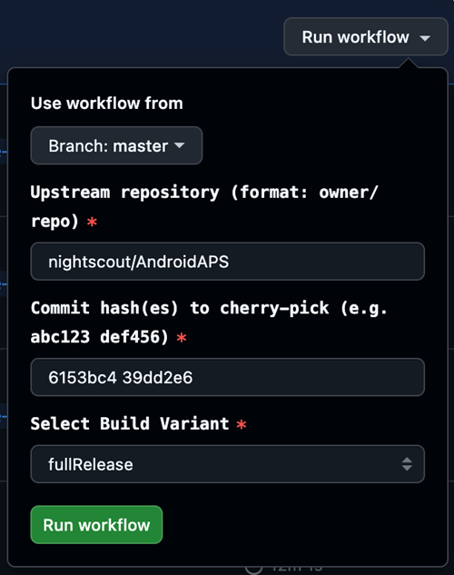

(github-cherry-pick)=

# 브라우저 빌드: 커밋 cherry-pick 하기

```{note}
이것은 선택 사항이며 고급 작업입니다. **fork**로 빌드하는 경우에만 작동합니다([브라우저 빌드 1–4단계](../SettingUpAaps/BrowserBuild.md)). **AAPS Builder** 저장소에는 이 워크플로가 없습니다.
```

개발자가 출시 버전에 아직 들어가지 않은 특정 변경 사항을 테스트해 달라고 요청할 때만 사용하십시오(개발자가 커밋 해시를 하나 이상 알려 줍니다).

## 시작하기 전에

- [fork를 동기화하십시오](#Update-to-new-version-update-your-repo): 이 워크플로는 목록에서 고른 버전이 아니라 브랜치의 현재 상태를 빌드합니다.
- Google Drive가 허가되어 있어야 합니다([3단계](../SettingUpAaps/BrowserBuildGoogleDrive.md)): 일반 빌드와 같이 빌드된 앱이 그곳에 저장됩니다.

## 워크플로 실행

1. AndroidAPS의 GitHub fork에서 **Actions**를 엽니다.
2. **All workflows**를 펼치고 **Cherry Pick CI (Pre-release Feature Backport)**를 선택합니다.
3. **Run workflow**를 누르고 다음을 입력합니다:

   

   - **Use workflow from**: 커밋을 추가할 브랜치입니다. 보통 `master`입니다.
   - **Upstream repository**: 커밋을 가져올 저장소입니다. 개발자가 다르게 말하지 않았다면 `nightscout/AndroidAPS`를 그대로 두십시오.
   - **Commit hash(es) to cherry-pick**: 받은 해시를 공백으로 구분해서 입력합니다.
   - **Select Build Variant**: [빌드 변형](#browserbuild-variant)을 참조하십시오(보통 `fullRelease`).
4. **Run workflow**(워크플로 실행)를 누르십시오. 작업이 끝나면 [일반 빌드](../SettingUpAaps/BrowserBuildAPK.md) 후와 같이 앱이 Google Drive에 있습니다.
