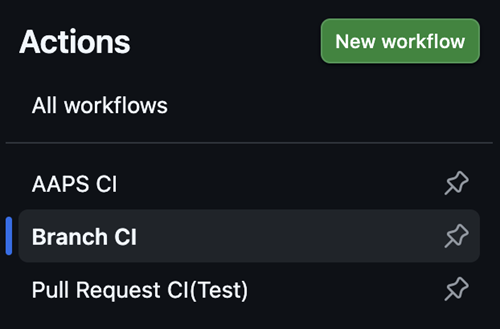
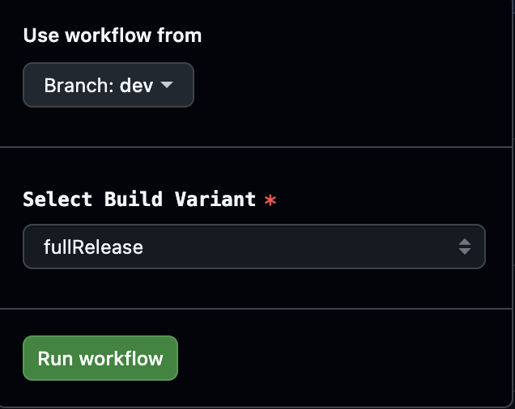
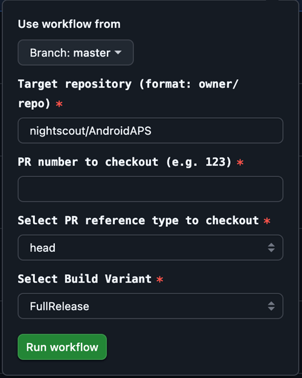

# 개발 브랜치

```{warning}
Dev 브랜치는 AAPS의 추가 개발만을 위한 것입니다. 테스트용 별도 휴대폰에서 사용해야 하며 <font color="#FF0000">**실제 루프에는 사용하지 마십시오!**</font>
```

가장 안정적인 AAPS 버전은 [Master 브랜치](https://github.com/nightscout/AndroidAPS/tree/master)에 있는 버전입니다. 실제 루프에는 Master 브랜치를 계속 사용하는 것이 좋습니다.

AAPS의 dev 버전은 스택 트레이스를 다루고, 로그 파일을 살펴보고, 필요하면 디버거를 실행해서 개발자에게 도움이 되는 버그 보고서를 만들 수 있는 개발자와 테스터만을 위한 것입니다(짧게 말하면: 도움 없이도 자신이 무엇을 하는지 아는 사람). 그래서 완성되지 않은 많은 기능이 비활성화되어 있습니다. 이 기능을 활성화하려면 /AAPS/extra 디렉터리에 `engineering_mode`라는 이름의 파일을 만들어 **엔지니어링 모드**로 들어가십시오. 엔지니어링 모드를 활성화하면 루프가 완전히 작동하지 않을 수 있습니다.

하지만 Dev 브랜치는 어떤 기능이 테스트되고 있는지 보고, 버그를 해결하는 데 도움을 주고, 새 기능이 실제로 어떻게 작동하는지 의견을 주기에 좋은 곳입니다. 사람들은 안정적이라고 확신할 때까지 오래된 휴대폰과 펌프로 Dev 브랜치를 테스트하는 경우가 많습니다. 사용에 따른 모든 위험은 본인이 책임집니다. 새 기능을 테스트할 때는 아직 개발 중인 기능을 테스트하기로 선택했다는 것을 기억하십시오. 본인 책임으로 하고, 자신의 안전을 지키기 위해 충분히 주의하십시오.

Dev 브랜치를 사용하다가 버그를 발견하거나 무언가 잘못되었다고 생각되면, [issues 탭](https://github.com/nightscout/AndroidAPS/issues)에서 다른 사람이 이미 발견했는지 확인하고, 없으면 직접 추가하십시오. 여기에 공유하는 정보가 많을수록 좋습니다([로그 파일](../GettingHelp/AccessingLogFiles.md)을 공유해야 할 수도 있다는 것을 잊지 마십시오). 새 기능은 [discord](https://discord.gg/4fQUWHZ4Mw)에서도 논의할 수 있습니다.

dev 버전에는 만료일이 있습니다. 만족스럽게 사용하고 있을 때는 불편해 보이지만, 이유가 있습니다. dev 버전이 하나만 돌고 있으면 사람들이 보고하는 버그를 추적하기가 더 쉽습니다. 개발자들은 dev 버전 세 개가 동시에 퍼져 있어서, 어떤 버전에서는 버그가 고쳐지고 다른 버전에서는 고쳐지지 않았는데 사람들이 이미 고쳐진 버그를 계속 보고하는 상황을 원하지 않습니다.

(branch-ci-test)=

## 특정 브랜치 테스트 (branch-ci)

테스트 브랜치를 빌드하려면 branch-ci를 선택하십시오. APK를 만들 특정 브랜치를 고를 수 있습니다. dev 브랜치를 테스트해야 할 때 이 방법을 사용할 수 있습니다.





(github-pr-test)=

## pull request의 항목 테스트 (GitHub CI actions 배포)

3.3.2.1.dev부터 사용 가능

- 테스터나 테스트를 돕는 사람에게 알맞습니다.

```{eval-rst}
.. raw:: html

    <!--crowdin: exclude-->
    <div align="center" style="max-width: 360px; margin: auto; margin-bottom: 2em;">
      <div style="position: relative; width: 100%; aspect-ratio: 9/16;">
        <iframe
          src="https://geo.dailymotion.com/player/x9rdx1q.html?video=x9rdx1q&loop=true&mute=true"
          loading="lazy"
          style="position: absolute; top: 0; left: 0; width: 100%; height: 100%;"
          frameborder="0"
          allowfullscreen>
        </iframe>
      </div>
    </div>
```



- Target repository: PR이 있는 저장소입니다. owner/repo 형식입니다. 다른 저장소를 쓰라는 말을 듣지 않았다면 기본값 **nightscout/AndroidAPS**를 그대로 두십시오(개발자만 이렇게 해야 합니다).

- PR number: 테스트할 PR 번호를 입력하십시오.

- PR reference types: PR 참조 유형에는 두 가지 옵션이 있습니다:
    
    - head:
    - PR 작성자의 브랜치에서 실제 내용을 가져옵니다(즉, merge 작업이 없는 원래의 커밋 이력).
    - fork나 기능 브랜치에서 직접 가져온 것처럼, PR 브랜치의 원래 상태와 같습니다.
    
    - merge:
    
    - GitHub가 PR을 대상 브랜치(예: dev)에 미리 merge해 본 결과를 가져옵니다.
    - 이것은 GitHub가 자동으로 만드는 가상의 merge 커밋입니다.
    - 이 커밋은 PR에 충돌이 없고 merge할 수 있을 때만 있습니다.
    
    - variant:
    
    - [빌드 변형](#browserbuild-variant)을 참조하십시오