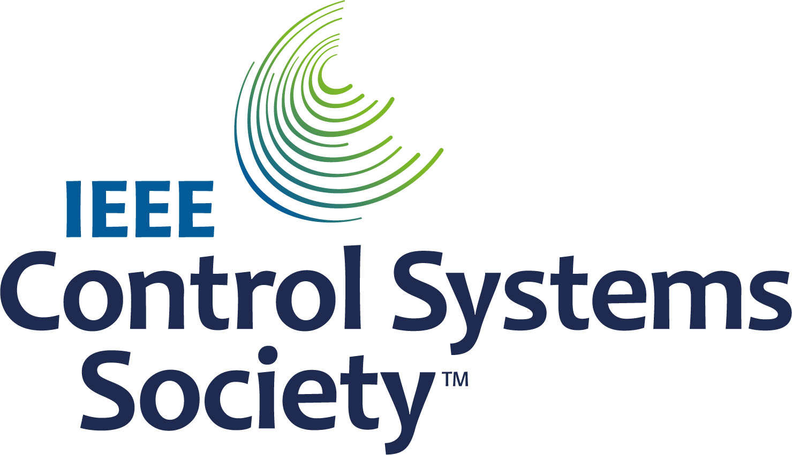
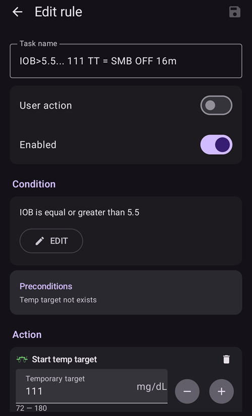

# 완전 폐쇄 루프

```{contents} In this page
:backlinks: entry
:depth: 2
```

완전 폐쇄 루프 **FCL**의 가장 큰 장점은 인공 췌장을 흉내 낼 수 있고, 식사 볼러스 없이도 일상 관리를 쉽게 만들 수 있다는 점입니다.

**하이브리드 폐쇄 루프**('HCL')는 알고리즘 기반이지만, 여전히 사용자가 식사 전에 직접 볼러스를 주입해야 합니다. 그 결과 루프가 인슐린 과다 주입을 막기 위해 일시적으로 멈출 수 있습니다(0 임시 기저).

**FCL**에서는 식사 크기에 맞춘 볼러스가 더 이상 필요하지 않습니다: 알고리즘에 맡기십시오!  **AAPS**는 ‘미입력 식사’ **(‘UAM’)**라는 모드에서, 사용자가 볼러스를 주지 않고 탄수화물을 입력하지 않아도 식사를 처리할 수 있습니다. **UAM**은 더 공격적으로 작동하여 **AAPS**가 잘못된 탄수화물 입력을 더 잘 견디게 합니다.

## 무엇을 기대할 수 있습니까?

**FCL**이 얻을 수 있는 좋은 결과에 대해 발표된 연구가 많습니다. 더 읽을 자료는 다음을 참조하십시오:

1)   National Library of Medicine, PubMed [First Use of Open-Source Automated Insulin Delivery AndroidAPS in Full Closed-Loop Scenario: Pancreas4ALL Randomized Pilot Study](https://pubmed.ncbi.nlm.nih.gov/36826996/);

2)  ClinicalTrials.gov National Library of Medicine, Clinical Trial [Feasibility and Safety Study of the Automated Insulin Delivery Closed Loop System Pancreas4ALL (ASAP)](https://www.clinicaltrials.gov/study/NCT04835350?term=Feasibility%20and%20Safety%20Study%20of%20the%20Automated%20Insulin%20Delivery%20Closed%20Loop%20System%20Pancreas4ALL%20(ASAP)&rank=1)

**FCL**에 성공하려면 사용자는 다음을 해야 합니다:

- **FCL** 전제 조건을 충족하는지 확인합니다;
- 일상 관리에 맞춘 **자동화**를 설정합니다; 그리고
- **AAPS** 설정(특히 **자동화**)을 세밀하게 조정합니다.


## HCL에서 FCL로 바꾸는(또는 바꾸지 않는) 이유에 대한 일반적인 고려 사항

**FCL**은 모든 사람에게 맞지는 않습니다:

- 일부 **FCL** 사용자는 TIR(70-180) 약 90%와 HbA1c 6% 미만을 달성하지만, 다른 사용자는 더 엄격한 조절을 선호합니다. 특히 빠른 탄수화물 식단에서 140 mg/dL 이상의 값을 최소화하려면 아마 사전 볼러스가 필요합니다.
- **AAPS** 조정은 어려울 수 있습니다. AAPS가 부담스럽게 느껴지는 사용자에게는 맞지 않습니다.  **FCL**을 조정하고 세밀하게 맞추는 데 몇 주를 들여야 합니다. 이렇게 시간을 들이면 더 좋은 결과와 더 좋은 **혈당** 조절을 얻을 수 있습니다.
- 식사 관리는 쉬워질 수 있지만, **FCL**에서도 운동은 여전히 어려울 수 있습니다. 우리 대부분은 체중을 조절하려고 운동 중 간식을 줄이고 싶어 합니다.
- 아이들에게 **FCL**을 적용하는 데에는 여전히 어려움이 있습니다(아래에서 설명).


## 잘 조정된 하이브리드 폐쇄 루프

**FCL**로 전환하기 전에 먼저 잘 조정된 **HCL**을 갖추는 것이 좋습니다.  **FCL**에 성공하려면 사용자 설정을 아주 개인에 맞게 조정해야 합니다. 그래야 **AAPS**가 바로 여러분의 성공적인 하이브리드 폐쇄 루프 모드를 가깝게 흉내 내어 인슐린을 줄 수 있습니다.

**FCL**에서는 사용자가 **자동화**를 설정하고 조정해야 합니다. 하지만 **FCL**을 시작하기 전에 사용자는 자신의 인슐린 관리 요구를 확실히 이해하고 있어야 합니다. 오류가 반대 방향의 오류로 가려질 수 있습니다. 이것은 불안정한 **FCL** 시스템을 만들고, 나중에 고치기 어렵게 합니다. FCL에서도 지금 **HCL**에서 보는 것과 비슷한 %TIR에 도달할 것으로 기대해야 합니다.

**FCL은 사용자가 성공적인 HCL과 초기 FCL 경험의 데이터를 분석하여 설정을 조정하면서 정하는 DIY 자동화 구성입니다.**

## 빠른 인슐린(Lyumjev, Fiasp)

**FCL**에는 빠른 인슐린이 필요합니다.  이렇게 하면 식사로 인한 **혈당** 상승이 시작될 때 **FCL**이 **혈당**을 범위 안(일반적인 정의로는 180 mg/dL (10 mmol/L) 미만)에 유지할 수 있습니다.

모델링 연구(자세한 내용은 LINK FullLoop V2/March2023의 2.2절 참조)는 다음을 정량적으로 보여 줍니다. *더 빠른 인슐린*은

출처:

 


IEEE Control Systems Magazine, ResearchGate [The Artificial Pancreas and Meal Control: An Overview of Postprandial Glucose Regulation in Type 1 Diabetes](https://www.researchgate.net/publication/322866519_The_Artificial_Pancreas_and_Meal_Control_An_Overview_of_Postprandial_Glucose_Regulation_in_Type_1_Diabetes);

- 느린 인슐린보다 **혈당** 피크를 크게 낮춥니다;
- 피크가 받아들일 수 없을 만큼 높아지지 않으면서, 첫 식사 볼러스가 몇 분 늦어지는 것을 견딥니다; 그리고
- 탄수화물 양(식사 크기)이 달라도 **혈당** 피크에 대한 영향을 최소화합니다.

사용자가 적당한 수준에서 낮은 수준의 탄수화물 식단을 하지 않는 한, Lyumjev나 Fiasp 이외의 인슐린으로는 **FCL**이 효과적이기 어렵습니다.

하지만 Fiasp나 Lyumjev는 바늘 길이 등을 최적화한 후에도 펌프 막힘이 자주 생길 수 있습니다. 캐뉼라 또는 Pod 사용 시간을 잘 지켜보는 것이 중요합니다. 많은 사용자는 캐뉼라/Pod 문제가 생기기 전까지 인슐린이 잘 듣는 한계를 48시간으로 봅니다.

## 전제 조건

**AAPS**가 귀중한 시간을 잃지 않고 최적으로 작동하려면 **혈당** 값과 안정된 블루투스 연결이 필요합니다. **FCL**에는 하루 24시간, 일주일 내내 기술적으로 안정된 시스템이 필요합니다:

- **CGM 성능**. CGM은 **FCL**이 식사 시작의 신호로 잘못 해석할 수 있는 들쭉날쭉한 **혈당** 값을 만들면 안 됩니다. 마찬가지로 **CGM** 보정도 들쭉날쭉한 결과를 만들 수 있습니다.
- **CGM** 평활화를 어떻게, 어디에서 하는지, 그리고 그것이 조정에 어떤 의미가 있는지. 특히 증분을 어떻게 정의하는지, 그리고 AAPS가 이것을 식사 시작의 신호로 인식하는지.
- 펌프와 CGM의 블루투스 안정성;
- 펌프 막힘을 피하는 것(또는 적어도 빨리 알아차리는 것);
- 데이터 흐름, 사용하는 휴대폰 앱, 센서 사용 일수에 따른 차이;
- 모든 **AAPS** 구성 요소를 충분히 충전하고, 예비 부품을 가까이 두는 것; 그리고
- 막힘 위험을 낮추도록 캐뉼라(또는 Pod) 교체를 항상 충분히 일찍 하는 것;

위 내용은 사용하는 **AAPS** 구성 요소와 생활 방식에 따라 다릅니다.

## 식사 관련 제한

- 식단에 **혈당**을 빠르고 크게 올리는 음식 성분이 없고, 식사 패턴이 날마다 크게 바뀌지 않는 사람은 **FCL**을 설정하기가 더 쉬울 수 있습니다. 이것이 반드시 저탄수화물을 뜻하지는 않습니다.

- 지방이나 단백질이 많은 식단, 또는 느린 소화/위마비는 **FCL**을 어렵게 하기보다 오히려 쉽게 합니다. 늦게 흡수되는 탄수화물이 피크 시점 무렵에 필요한 볼러스의 피할 수 없는 늦은 작용 “꼬리”를 잘 덮어 주기 때문입니다.

### 혈당 지수와 혈당에 미치는 영향

**UAM** 모드의 어려움은 '혈당에 미치는 영향'('EBG')이 클수록 커집니다

- 처음에는 적당하거나 낮게 시작하고, **프로파일** 설정을 조정하십시오. 그다음에야 **EBG**가 높은 식사로 "시험"하십시오.
- **EBG**가 매우 높은 음식을 먹는다면 < 50%의 초기 볼러스를 고려하십시오.

1) **EBG 없음**: 예: 신선한 고기, 생선, 달걀, 베이컨, 기름, 치즈. 2) **낮은 EBG**: 예: 신선한 채소와 베리류, 버섯, 견과류, 우유, 요구르트, 코티지 치즈. 3) **중간 EBG**: 예: 통곡물 빵/면, 감자, 야생 쌀, 귀리, 말린 과일. 4) **높은 EBG**: 예: 밀빵, 바게트, 토스트, 와플, 쿠키, 으깬 감자, 면, 쌀밥. 5) **매우 높은 EBG**: 예: 설탕, 단 음료, 과일 주스, 콘플레이크, 사탕, 단 과자, 감자칩, 짭짤한 프레첼 스틱.


**FCL**에서 가장 어려운 식사는 **EBG**가 매우 높거나 높은 성분만으로 된 음식입니다(그림의 빨간색 참조): **혈당**이 빠르게 치솟을 뿐 아니라, 초기에 높은 혈당을 잡으려 할 때 생기는 피할 수 없는 인슐린 활동의 “꼬리”를 상쇄할 지방/단백질/섬유질 성분도 거의 없습니다.

빠르게 흡수되는 탄수화물이 많은 간식과 단 음료를 불규칙하게 먹는 것은 **FCL**에 문제가 됩니다.


## 활동/운동 준비

운동하거나 활동할 때, 펌프나 하이브리드 폐쇄 루프에서는 운동 전에 **IOB**를 줄이는 것이 권장됩니다.

**FCL**에서는 알고리즘이 **UAM**을 감지하고 **혈당** 상승에 맞서 자동으로 인슐린을 주입하도록 조정되어 있습니다.  높은 **임시 목표**와 낮은 **프로파일 퍼센트**(이미 식사 시작 무렵부터 적용)를 활동 훨씬 전에 설정해야 합니다.

평소와 다르거나 불규칙한 운동량은 **FCL**에 어려움을 줍니다. 운동은 미리 계획해야 합니다(특히 운동 중 저혈당 때문에 응급 탄수화물/간식을 먹어야 하는 일을 줄이고 싶다면). 활동이 많았던 날에는 저녁 식사가 완전히 소화된 후 밤 동안 더 낮은 **프로파일 퍼센트**를 설정하는 것이 권장됩니다: **자동화**에서 높은(>100 mg/dL) **혈당** 목표를 설정하고, **AAPS** **설정**에서 **높은 임시 목표에서 SMB 활성화**를 끄십시오.

## 아이들에게 어려운 점

**FCL**은 아이들에게 추가적인 어려움을 줄 수 있으며, 다음과 같습니다:

- Lyumjev나 Fiasp를 구할 수 없거나 몸에 잘 맞지 않을 수 있습니다.
- 시간당 기저 주입량이 매우 낮을 수 있어, 큰 **SMB**의 기반이 약합니다.
- 식단에 단 성분이 많을 수 있습니다. 작은 몸은 보통 혈액량이 적어서 **혈당**이 매우 높게 치솟는 경향이 강합니다.
- 성장 호르몬과 인슐린 민감도의 뚜렷한 변화 때문에 **FCL**을 정확하게 조정된 상태로 유지하기 어렵습니다.


## 강화된 SMB 활성화: 안전

**HCL**에서는 루프가 자동으로 줄 수 있는 볼러스 크기에 대한 안전 제한이 적용됩니다.

**FCL** 사용자는 더 이상 식사 시작 무렵에 큰 볼러스를 줄 필요가 없습니다. 이 때문에 루프가 충분히 큰 **SMB**를 주입할 수 있도록 **SMB** 크기 제한을 넓혀야 합니다.

**AAPS** Master 릴리스를 사용한다면, **FCL**이 줄 수 있는 **SMB** 크기가 허용되는 최대값이 되도록 **AAPS**의 **설정**을 하는 것이 좋습니다(maxUAMSMBBasalMinutes=120, 즉 그 시간대 기저 2시간 분량).

기저 주입량이 매우 낮으면, 그에 따른 **SMB** 한도가 너무 낮아서 식후 **혈당** 상승을 충분히 조절하지 못할 수 있습니다. 한 가지 해결책은 **혈당**을 크게 치솟게 하는 식단을 피하는 것입니다. [Auto ISF](#Open-APS-features-auto-isf) 알고리즘(엔지니어링 모드가 켜진 dev 빌드에서만 사용 가능)에는 표준 최대값인 기저 2시간 분량을 >1 배수로 늘리는 **SMB 최대 범위 확장** 설정이 있고, 기본값 50%인 **SMB 주입 비율**을 올릴 수 있습니다.

**AAPS가 여러 번의 SMB로 볼러스를 흉내 낼 수 있도록 안내를 따르십시오**.

식사 시작 무렵 루프에 필요한 인슐린을 주입하기에 **SMB**가 충분히 허용되는지 확인하려면 **APS** 플러그인 화면(**구성 → APS → 플러그인 열기**)을 주기적으로 확인하십시오.

그렇지 않으면 조정 노력이 때때로 헛수고가 됩니다!


```{admonition} Boosting **ISF** can become dangerous
:class: danger

식사를 시작한 직후의 **SMB** 크기를 주의 깊게 관찰하고 분석하십시오. 단계적으로 조정하고, 한 번에 1~2개의 매개변수만 바꾸십시오.

**AAPS**의 설정은 여러분(!)의 다양한 식사에 대응할 수 있을 만큼 충분히 갖추어져야 합니다.
```

## 식사 감지/강화를 위한 자동화

**FCL**을 성공시키는 핵심 조정 매개변수는 **ISF**입니다. **AAPS** Master + **자동화**를 사용할 때는 **식사가 인식되면(혈당 증분으로) > 100% 프로파일 전환이 자동으로 실행되어야 하며**, 이것이 더 강한 **ISF**를 제공합니다.

**AAPS** Master는 **HCL** 모드에서 최대 130%의 임시 **프로파일**을 허용합니다. **ISF** 강화는 3단계로 이루어집니다:

- 1단계 - **프로파일**에서 이 식사 시간대에 적용되는 **ISF**를 검토하고, 예를 들어 Autosens가 몸의 현재(지난 몇 시간) 인슐린 민감도 상태를 반영하는 수정을 제안하는지 확인합니다.
- 2단계 - **ISF**를 강화하는 계수(**자동화**에서 설정한 1/Profile%)를 적용합니다.
- 3단계 - 제안된 **ISF**가 설정된 안전 한도 안에 있는지 확인합니다.

### FCL 자동화 템플릿

위쪽의 체크 상자. 다음과 같은 선택지가 있습니다:

- **자동화** 목록에서 각 항목 왼쪽의 체크 표시를 해제할 수 있습니다 => 그러면 해당 **자동화**가 비활성화됩니다. 예를 들어 아침 식사 관련 **FCL** **자동화**를 모두 이렇게 해제하면, 아침 식사에는 **HCL**로 돌아갈 수 있습니다.

- 각 **자동화** 규칙에서 사용자 동작 상자를 체크할 수 있습니다 => 그러면 조건이 맞아도 정의된 동작이 자동으로 실행되지 않습니다. 대신 **FCL**이 자동으로 **SMB**를 주려고 할 때마다 **AAPS** 메인 화면이 알려 줍니다. 그때 ‘예’ 또는 ‘아니요’를 선택할 수 있습니다. 이것은 조정 단계에서 매우 유용합니다.

이 기능은 아침에 일어날 때 **혈당**이 갑자기 오르는 “foot to floor” 증후군 같은 상황에 유용할 수 있습니다. 이때 사용자는 완전 자동의 “아침 식사 시작” 반응을 막고 싶어 합니다.

아래 섹션에서는 **자동화**의 조건을 묶는 방법과, **AAPS**가 인슐린 주입을 늘려야(또는 줄여야) 하는 상황에 대처하는 방법을 안내합니다. **ISF**는 직접 조정할 수 없으므로, **프로파일 퍼센트**를 100% 넘게 올리면 우리 목적에는 같은 효과를 냅니다.

### 혈당 상승 시 자동으로 큰 SMB

성공적인 **FCL**의 핵심: **식사로 혈당이 오르기 시작할 때 루프가 매우 큰 자동 SMB를 가능한 한 빨리 주어야 합니다**. 필요한 **IOB**를 “따라잡기” 위해서입니다(**HCL**에서 비슷한 식사에 보통 주던 볼러스와 비교하십시오!)

이를 위해 **HCL** 데이터를 분석하여 어떤 **증분**이 식사와 관련이 없을 수 있고 어떤 증분이 식사와 관련이 있을 수 있는지 판단해야 합니다.

- 미리 정한 시간 창 안에서 **자동화**를 정의할 수 있으므로 그 구간만 분석하면 됩니다.
- 아주 다른 종류의 식사를 한다면(예: 탄수화물이 많은 아침, 탄수화물이 적은 점심) 시간대마다 서로 다른 **자동화**(세트)를 만들 수 있습니다.
- 압박 저혈당(compression low)으로 인한 급변이 가끔 보이면 밤 시간은 제외하십시오.
- 보통은 지난 5분의 증분만 사용해도 충분합니다.
- 하지만 평균 증분 중 하나를 사용할 수도 있습니다. **자동화** 조건의 증분을 비교하면, **혈당**이 가속하며 오르는지 여부에 따라 공격성이 다른 동작을 정의할 수도 있습니다.

> ( delta – short avg delta )>n   은 가속을 감지하여 **혈당** 상승의 첫 징후에 첫 **SMB**를 실행하는 데 쓸 수 있는 식입니다. -                                                                             
> 주의: **CGM** 값이 나쁘거나 지나치게 평활화되어 있으면 사용할 수 없습니다!

데이터가 들쭉날쭉한 **CGM**은 사용자를 어려운 상황에 놓습니다. 안전하게 하려면 어떤 증분이 확실히 식사 시작의 신호인지에 대한 정의를 „보수적으로“ 잡아야 하기 때문입니다. 이것은 다음을 뜻합니다:

- **FCL**이 추가로 시간을 잃어서 **혈당** 피크가 높아지고 %**TIR**이 낮아집니다;
- 식사가 없을 때도 **SMB**를 실행시킬 수 있는 더 이르거나 더 작은 증분은 사용할 수 없습니다. 이 SMB는 **FCL**에서 사용자 볼러스를 대신하는 것입니다.

또한 식후 첫 상승은 **낮은 iob** 상태가 특징입니다. 이를 고려하면 저녁 식사용 자동화(#1)는 다음과 같을 수 있습니다:


자동화 #1

조건이 맞으면 **AAPS**는 설정한 높은 **프로파일 퍼센트**에 따라 강화된 **ISF**를 사용해 다음 12분 동안 1~2번의 **SMB**를 줍니다(예에서는 insulinReq를 30% 강화). 이 조건이 계속 맞는 동안 **자동화** 규칙은 12분씩 더 연장됩니다. 저탄수화물 식사는 **혈당**이 더 천천히 오를 수 있습니다. 더 낮은 증분에서 작동하고 인슐린을 더 약하게 높이는 또 다른 자동화(#2)가 있으면 도움이 됩니다.


자동화 #1에서 정의한 가파른 상승이 끝나면, 탄수화물이 많은 식사에서도 같은 **자동화**가 아마 작동할 것입니다.

식사(종류)에서 보이는 것에 맞도록 이 두 개(+ 아마 세 번째) **자동화**를 “단계별로” 배치해야 합니다 => 알맞은 증분 크기, **iob** 기준, 증폭을 정하는 것은 반복적인 조정 과정입니다.  또한 조건에 알맞은 시간대를 넣으면 하루의 여러 식사 시간(아침, 점심, 저녁)마다 다른 자동화를 쉽게 만들 수 있습니다.

아직 상승 단계(!)에서도 **iob**의 "넘침"을 막아야 합니다. 그래야 **인슐린**의 늦은 효과(3~5시간 뒤의 "**꼬리**")가 0 임시 기저(저혈당 위험을 줄이려고 기저를 “빼는” 것)로 제동하는 루프의 능력을 넘지 않습니다.

양이 많은 식사에서는 **가끔 두 번째 상승**이 있습니다. 그때쯤이면 보통 iob도 조금 줄어들어, 더 공격적인 자동화가 다시 작동합니다. (이것이 가능하도록 자동화 #2의 iob 조건이 너무 낮게 설정되지 않았는지 확인하십시오).

처음 몇 번의 **SMB**가 주입된 직후 **균형 단계**가 옵니다. 이때는 적당한 인슐린 주입으로 추가로 흡수되는 탄수화물을 감당해야 합니다. (저탄수화물 식사는 예외입니다. 이때 루프는 **혈당** 상승이 너무 약하다고 보고 지금 바로 0 임시 기저로 갈 수 있습니다).

이 단계에서 **AAPS** 메인 화면(**UAM** 완전 루프에서는 cob=0으로 보임)이 탄수화물이 더 필요하다고 요청할 수 있습니다. **UAM** 모드에서 이것은 아주 대략적인 타당성 확인을 할 수 있다는 뜻일 뿐입니다: 약 1시간 전 식사에서 아직 흡수되지 않은 탄수화물이 그만큼 몸에 있을 가능성이 있습니까(루프에는 이 식사 정보를 주지 않았습니다)?


### iob 임계값

보통 **자동화** #1 및/또는 #2는 iob를 **여러분의** 식사에 대개 충분한 높이까지 올립니다. 개인 맞춤 조정을 위해 **HCL** 데이터에서 잘 관리된 식사(대개 식사 볼러스)에서 나타나는 최대 iob 값과, 어느 크기 이상에서 마지막에 저혈당(또는 추가 탄수화물 필요)이 생겼는지 살펴보십시오.

루프의 공격성을 줄여야 하는 적절한 **iob 임계값**은 식사마다 같지 않을 수 있습니다. 하지만 특히 식사 시작 후 첫 1시간이 **UAM** 모드에서 매우 중요합니다. 사용자마다 다릅니다. 어떤 사용자는 시간당 약 30g만 흡수되므로, 정확한 식사와 상관없이 의미 있는 **iob**를 정할 수 있습니다.

특별한 식사에 맞추거나 운동이 이어질 때 낮추려면, **자동화**에서 **iob** 임계값을 빠르게 다르게 설정할 수 있습니다.

자동화(#3) "iobTH reached => **SMBs** off”는 공격적인 **SMB** 강화를 끝내도록(또는 탄수화물로 인한 상승이 다시 올 때까지 멈추도록) 정의되어 있습니다.



자동화 #3

이것은 루프에게, 설정한 **iob 임계값**을 넘으면 더 이상 **SMB**를 사용하지 않는 것이 낫다고 알려 줍니다

- 예시에서는 TT=111을 설정하여 이를 수행합니다(다소 임의의 값입니다. 자동 **SMB** 차단으로 쉽게 알아볼 수 있는 >100인 숫자를 고르십시오)
- **AAPS**의 [설정 → OpenAPS SMB](#Preferences-openaps-smb-settings)에서 일반적으로 높은 목표에서는 **SMB**를 허용하지 마십시오.                                                                                                                   
  그러면 필요한 인슐린은 **TBR**이라는 좁은 통로를 통해 훨씬 더 조심스럽게 주입되어야 합니다

**주의: 자동화 #3은 활성 TT가 없을 때만 작동합니다.** 따라서 EatingSoonTT를 사용했다면 그 시점까지 종료되어야 합니다. 보통 식사 시작 후 30~40분입니다.

한 가지 방법은 **iob**>65% * iobTH 조건에서 실행 중일 수 있는 EatingSoonTT를 끝내는 **자동화** 조건을 만드는 것입니다.
> EatingSoonTT 사용 방법 일부 사용자는 식사 시작 약 1시간 이상 전에 EatingSoonTT를 설정합니다(TT 버튼을 누르거나, 식사 시간대가 꽤 일정하면 **프로파일**의 **혈당** 목표를 낮춰 자동으로). 시작 **혈당**을 확실히 낮게 하고 **iob**를 조금 늘리기 위해서입니다. 하지만 **FCL**이 항상 목표를 향해 가고 있다고 보면 이것은 큰 효과가 없을 수 있습니다. 그래서 식사 시작을 인식할 때(혈당 증분, 또는 가속 = delta > avg delta) EatingSoonTT를 설정하는 **자동화**를 정의하는 편이 나을 수 있습니다. 이 단계에서는 낮은 **TT**가 중요합니다. 루프는 모든 **SMB**를 (예측 혈당 − TT)/sens로 계산하므로, TT가 작을수록 insulinReq가 커지기 때문입니다.

처음 강화된 **SMB**가 주입된 후에는, 설정한 iobTH와 **자동화** #3이 혈당 피크를 제한하면서도 식후 저혈당으로 이어지지 않도록 균형을 잘 잡아야 합니다.

아침 식사의 탄수화물 양이 평균 저녁 식사와 크게 다르다면, 각 시간대에 적용되고 서로 다른 **iobTH**(가능하면 다른 증분과 다른 **프로파일 퍼센트**도)를 가진 **자동화**를 정의하는 것이 도움이 될 수 있습니다. 식사 범위와 설정(특히 **iobTH**)을 정하는 여러분과, 펼쳐지는 **혈당** 곡선을 관리하는 루프 모두, **SMB**로 인한 **DIA** 끝 무렵의 저혈당 위험을 줄이기 위해 어느 정도의 피크 높이를 받아들여야 합니다.

### 높은 혈당 값에서의 정체

“풍성한” 식사 후 **높은 혈당** 값이 오래 정체되면, **자동화** #4(아래) “post-meal High”가 지방산 저항에 대처하는 데 도움이 됩니다: 여러 코스의 식사, 기름진 큰 피자, 라클렛 저녁 후에는 혈당 곡선이 두 개의 봉우리를 만들거나, 아주 흔히 길고 높은 고원을 만듭니다.


자동화 #4


자동화 #5

자동화 #4 “post-meal High”는 하이브리드 폐쇄 루프에도 적합합니다.

또한 혈당 값이 떨어지기 시작하면 바로 인슐린 투여의 공격성을 줄이도록 종료용 자동화 #5 “Stop pmH”가 필요합니다. (하지만 예측 혈당이 이미 낮게 가고 있기 때문에, 루프는 저혈당 예방을 위해 어차피 추가 인슐린을 제한하는 경우가 많습니다).

## 저혈당 예방

핵심 문제는 **UAM** **FCL**(탄수화물 입력 없음)이 **흡수될 탄수화물이 몇 g 남아 있는지 전혀 알 수 없다는 것**입니다. 남은 탄수화물이 그 “꼬리” 인슐린을 소비하여 저혈당이 생기지 않을 수도 있습니다.

강화된 **SMB**를 사용하여 **FCL**은 예전에 식사 볼러스로 하던 일을 “따라잡았습니다”. 하지만 **인슐린 작용의 “꼬리” 부분에서는 저혈당 예방이 중요한 문제가 될 수 있습니다**.

**FCL**을 준비하면서 사용자는 일반적인 식사에서 **iob의 시간 경과**를 자세히 보고, **언제 너무 많아지는지, 그리고 자동화를 조정하여 그것을 어떻게 잡을 수 있는지** 판단해야 합니다. 조정할 수 있는 나사가 여러 개 있으므로 이것이 가능합니다. 이것을 제대로 맞추는 것은 어려울 수 있습니다

일반적으로 한 종류의 식사에 맞춰 설정을 계속 최적화하는 것은 의미가 없습니다. 예를 들어 자주 먹는 한 가지 점심에 대해 충분히 좋은 설정을 찾았다면, 다른 종류의 식사에서도 어떻게 작동하는지, 그리고 어떻게 “타협”할지 시험하십시오.

식후 3~5시간의 저혈당을 막으려면 iob가 너무 많이 쌓이기 전에 공격성을 줄이십시오. 구체적인 방법:

- 자동화 예 #1과 #2처럼, 혈당이 오르는 동안 이미 **ISF**를 점점 더 약하게 하십시오.
- **AAPS**가 훨씬 더 조심스럽게 작동하기 시작하는 iob 임계값을 정하십시오(위의 자동화 #3). 이 **iob**는 적용되기 전의 마지막 **SMB**로 넘을 수 있고, 루프가 insulinReq를 보면 TBR로 더 넘을 수 있다는 점에 유의하십시오. 흡수되는 탄수화물은 iob를 낮추는 반대 방향의 움직임을 만듭니다.
- 식사에 따라 iob 임계값을 다르게 할 수 있습니다: 자동화를 복제하면 아침, 점심, 저녁 시간대(또는 회사 구내식당, 시댁 등 위치)에 따라 쉽게 구분할 수 있습니다
> 또한 저탄수화물과 빠른 탄수화물 등에 서로 다른 TT를 설정하여 이 시간대 안에서 더 세분할 수 있습니다. 그러면 이 시간대에 나올 수 있는 여러 식사 종류를 “코드화”하고, 이에 맞게 특별히 조정한 **자동화**로 불러올 수 있습니다. 식습관이 크게 달라지지 않는 한, 이것은 아마 필요하지 않습니다.

특별한 식사 전에 **iob** 임계값을 올리거나, 다른 자동화를 AAPS 휴대폰에서 바로 5초 안에 바꿀 수 있습니다(**관리 → 자동화**).

식사 몇 시간 뒤의 저혈당 위험은 기본적으로 식사 구성에 달려 있습니다. 즉 **대부분의 탄수화물에 맞서 주입된 인슐린의 꼬리**가 **“확장 탄수화물”에 의해 소비**(과도하거나 늦은 탄수화물 흡수/단백질/지방/섬유질)될 수 있는지의 문제입니다.

시간이 지나면 패턴을 알게 되고 자동화를 조정하게 됩니다. 식습관을 조금 바꿀 수도 있습니다. 예를 들어 가끔 늦게 작은(!) 간식을 즐기면, **전체** 식사(소화, 흡수) 시간 동안 **인슐린 활동과 탄수화물 흡수의 균형**을 잘 유지하는 데 도움이 되어 루프(와 여러분 자신)의 일이 쉬워질 수 있습니다.

### 프로그래밍한 자동화의 순서

**자동화**의 정의가 겹치면 문제가 생길 수 있습니다. 예: 문제는 증분 >8이 증분 >5이기도 하다는 것입니다. 즉 경쟁하는 두 개의 **자동화**가 있을 수 있습니다. 그러면 루프는 어떻게 할까요? 루프는 항상 **자동화**가 **관리 → 자동화**에 나타나는 순서에 따라 결정합니다.  예: 증분 > +8 규칙이 먼저 와야 합니다(모든 조건이 맞으면 가장 강한 부스트를 시작합니다). 그다음에 증분 >5 확인(과 더 약한 반응)이 옵니다. 순서가 반대이면 증분>5가 이미 적용되므로 증분>8 규칙은 절대 작동하지 않습니다.
> 자동화 팁: 순서는 아주 쉽게 바꿀 수 있습니다. **관리 → 자동화**에서 규칙 오른쪽의 **=** 손잡이를 길게 누르고 다른 위치로 끌어 놓으십시오.

또한 언제든지 AAPS 스마트폰에서 몇 초 만에 조건이나 동작을 아주 쉽고 빠르게 조정할 수 있습니다. 예를 들어 아주 특별한 식사 자리에 갈 때 그렇습니다. (하지만 다음 날에는 다시 정상으로 되돌리는 것을 잊지 마십시오).

(full-closed-loop-troubleshooting)=

## Troubleshooting

### 하이브리드 폐쇄 루프로 돌아가는 방법

**FCL** 관련 **자동화**의 체크 상자를 해제하고, 다시 식사 볼러스를 주고 탄수화물을 입력하는 방식으로 돌아갈 수 있습니다. 메인 화면에서 **인슐린** 또는 **계산기** 버튼을 없앴다면 [QuickLaunch 툴바](#quicklaunch) 구성에서 다시 추가하십시오(이 버튼은 하단 내비게이션의 **처치**에서 항상 사용할 수 있습니다). 이제 다시 식사 볼러스는 여러분이 직접 해야 한다는 점을 기억하십시오.

**자동화**가 완전히 정의되고 켜진 식사(시간대)에만 **FCL**을 사용하고, **HCL**을 하고 싶은(또는 전환 기간이라 아직 정의하지 않은) 다른 식사 시간의 자동화만 해제하는 것이 좋을 수 있습니다.

예를 들어 저녁 시간대용 **자동화**를 정의한 후에는 추가 단계 없이 저녁 식사에만 **FCL**을 사용하고, 아침과 점심은 익숙한 대로 **HCL**로 하는 것이 충분히 가능합니다.


### FCL의 전제 조건이 아직 충족됩니까?

- 기본 **프로파일**이 아직 올바릅니까?
- **CGM** 품질이 나빠졌습니까
- 전제 조건(위)을 참조하십시오.

### 혈당이 너무 높아짐

- 식사가 빨리 인식되지 않음
    - 블루투스 (불)안정성 확인
    - 첫 **SMB**를 실행할 증분을 더 작게 설정할 수 있는지 확인하십시오
    - 식사 시작 몇 분 전에 식전주나 수프로 시험해 보십시오
- SMB가 너무 약함
    - **자동화** 순서를 확인하십시오(예: 큰 증분이 작은 증분보다 먼저)
    - **APS** 플러그인 화면에서 (실시간으로) 시간당 프로파일 기저와 설정한 분(최대 120)이 허용 SMB 크기를 제한하는지 확인하십시오
    - **APS** 플러그인 화면에서 (실시간으로) %프로파일을 더 크게 설정해야 하는지 확인하십시오
- 모든 설정이 한계에 있으면 일시적인 고혈당을 받아들이거나 식단을 조정해야 할 수 있습니다.
> dev 빌드를 시험할 준비가 되었다면 [Auto ISF](#Open-APS-features-auto-isf)로 SMB 크기를 더 늘릴 수도 있습니다. 일부 사용자는 “FCL”에서 작은 사전 볼러스를 사용하기도 합니다. 하지만 이것은 혈당 곡선과, 그에 따른 상승 감지와 실행되는 **SMB**의 동작에 영향을 주므로, 전체적으로 확실한 이점이 있도록 적용하기가 쉽지 않습니다.
- 파일럿 사용자들의 중요한 관찰은, 식사 시작 시점에 혈당과 iob 곡선이 어떻게 다가가는지가 탄수화물로 인한 피크에 크게 영향을 준다는 것입니다: 내려가는 중이고(예: 설정한 EatingSoonTT 쪽으로), iob가 조금 쌓이고, 이미 강한 양의 가속 쪽으로 휘고 있으면 피크를 낮게 유지하는 데 매우 도움이 되는 것으로 보입니다.

### 혈당이 너무 낮아짐

- 식사가 잘못 인식됨
    - 첫 **SMB**를 실행할 증분을 더 크게 설정할 수 있는지 확인하십시오
    - 관련 자동화에서 “사용자 동작”을 클릭하십시오. 그러면 앞으로 식사와 관련이 없을 때 자동화 실행을 그때그때 막을 수 있습니다
    - 간식이 식사처럼 **SMB**를 실행하지 않도록, 간식을 먹을 때 TT>100을 설정하십시오(어차피 운동할 때나 저혈당 방지 간식을 먹을 때 하는 것처럼)
- SMB가 전체적으로 인슐린을 너무 많이 주입함
    - **APS** 플러그인 화면에서 (실시간으로) **SMB 최대 범위 확장**을 더 작게 설정해야 하는지 확인하십시오
    - **APS** 플러그인 화면에서 (실시간으로) **프로파일 퍼센트**를 더 작게 설정해야 하는지 확인하십시오
    - SMB 주입 비율을 더 작게 설정할 수 있을 것입니다. 이 경우 모든 **SMB**(모든 시간대)에 일괄 적용된다는 점에 유의하십시오,
- 식후 인슐린 “꼬리” 문제
    - 간식(저혈당 예측이 보일 때)이나 포도당 정제(이미 저혈당 구간이면)를 먹어야 할 수 있습니다. 하지만 루프가 어느 시점에 알려 주는 필요 탄수화물은 과장되었을 가능성이 매우 높습니다. 루프는 탄수화물 섭취에 대한 정보가 전혀 없기 때문입니다(반면 여러분은 지방과 단백질을 포함해 얼마나 더 흡수를 기다리고 있는지 짐작할 수 있습니다).
    - 문제가 주로 이미 혈당 상승 단계에서 시작되는지가 유용한 정보가 됩니다. 그러면 iobTH를 낮게 설정하는 것이 쉬운 해결책일 수 있습니다.
    - 추가 탄수화물이 자주 필요하면 몇 g이 필요했는지 적어 두십시오(결국 너무 많이 먹어서 다시 추가 인슐린이 필요했던 양은 세지 않습니다).  그다음 프로파일의 IC 값을 사용하여 **SMB**가 인슐린을 얼마나 덜 주입했어야 했는지 추정하고, 이 정보를 조정에 활용하십시오(**자동화**의 **프로파일 퍼센트**, 또는 설정한 iobTH). 이것은 혈당이 높았을 때 주입된 **SMB**와 관련될 수도 있고, **혈당** 상승 중의 **SMB**와 관련될 수도 있습니다.
    - 저혈당을 피하려면 더 높은 **혈당** 피크를 그냥 받아들여야 할 수도 있습니다. 또는 탄수화물이 적고 단백질과 지방이 많은 식단으로 바꾸십시오.


### 추가 정보

다른 **FCL** 사용자들과 꼭 계속 소통하십시오.

자동화를 사용하는 완전 폐쇄 루프 토론:

- 영어:   [Discord 채널](https://discord.gg/ChXj8BaKwA)

- 독일어:  [German Looper Community](https://de.loopercommunity.org/t/ueber-die-kategorie-full-loop/10107)
