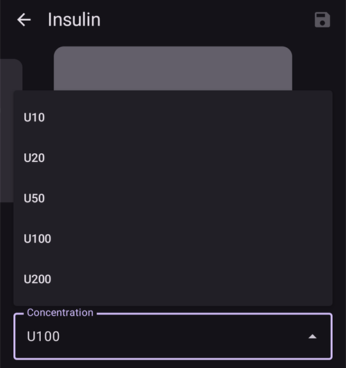
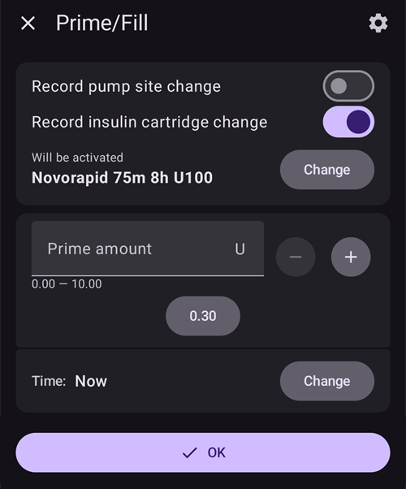

(Insulin-Concentration)=
# 인슐린 농도

```{warning}
모든 상용 펌프는 U100 인슐린**만** 사용하도록 설계되어 있습니다. 펌프에서 다른 인슐린 농도를 사용하는 것은 위험할 수 있습니다. 다른 농도로 AAPS를 사용하는 사용자가 점점 늘고 있지만, 환산은 항상 직접 관리해야 하며 자주 오류로 이어집니다(아주 숙련된 사용자에게도!).
```

## 인슐린 기본 사항 다시 보기

이 장에서는 인슐린 측정과 주입의 핵심 개념을 설명합니다.

### 인슐린 단위: 작용의 측정 단위

인슐린은 **국제 단위(IU)**로 측정합니다. 이 단위는 단순한 물리적 질량이 아니라 생물학적 활성(혈당을 낮추는 힘)을 나타냅니다.

- **정의:** 1 IU는 일정한 양의 인슐린이 가진 활성에 해당하며, **약 0.04167 mg**으로 표준화되어 있습니다.
- **핵심:** "단위"는 모든 인슐린 종류에서 같은 생물학적 효과를 뜻하므로 일정한 용량을 보장합니다.

### 인슐린 농도

인슐린은 여러 가지 농도로 나오며, 농도는 밀리리터(ml)당 단위 수로 정합니다.

- **U100:** 세계 표준이며 **100 IU/ml**를 포함합니다.
- **U200-U500:** 주사량을 줄이기 위한 더 농축된 인슐린입니다(예: U200은 200 IU/ml).
- **U40/U50:** 덜 흔한, 예전부터 써 온 농도입니다(40 IU/ml 및 50 IU/ml). **U40은 U40 전용 주사기가 필요합니다.**
- **수동 희석:** 신생아나 극도로 높은 민감도와 같은 드문 경우를 위해 아주 묽게 희석한 인슐린(예: U50, U10)을 만드는 임상적 방법입니다. 이를 위해서는 약국에서 매우 꼼꼼하게 준비해야 합니다.

```{admonition} Critical Warning
:class: danger
농도가 맞지 않는 기기에 인슐린을 사용하는 것은 매우 위험하며, 심각한 과다 주입이나 과소 주입을 일으킬 수 있습니다. **인슐린 농도가 주사기, 펜 또는 펌프 사양과 맞는지 항상 세 번 확인하십시오.**
```

## 비표준 농도는 언제 사용합니까?

인슐린 펌프는 U100 인슐린용으로 설계되었지만, 특정한 의료 상황에서는 비표준 농도가 필요합니다. 이런 경우에는 매우 신중하고 꼼꼼하게 관리해야 합니다.

### 사용 사례 1: 아주 적은 용량을 위한 희석 인슐린

- **상황:** 아주 어린 아기와 유아의 1형 당뇨병 관리.
- **문제:** 필요한 인슐린 양이 너무 적어서 펌프의 최소 주입량(예: 0.05 U)도 여전히 너무 클 수 있습니다. 그래서 혈당을 정밀하게 조절하기 어렵고 저혈당 위험이 높습니다.
- **해결 방법:** 아주 묽게 희석한 인슐린을 사용합니다(예: U10, 즉 10 IU/ml).
- **효과:** 인슐린 1단위당 주입되는 액체의 양이 늘어납니다. 인슐린 "한 묶음"의 부피는 크게 하고 농도는 약하게 하면, 펌프의 기존 설정으로 훨씬 더 세밀하게 조정하고 더 정확하게 주입할 수 있습니다.

```{admonition} Critical Safety Note on Dilution
:class: danger
인슐린 희석은 위험이 높은 절차입니다. 전문 교육과 의료진의 감독 없이 집에서 절대 시도하지 마십시오. 희석은 의료 전문가나 교육받은 보호자가 해당 인슐린 종류 전용으로 만든 멸균 희석액을 사용하여 해야 합니다. **수돗물, 식염수 또는 다른 액체는 절대 사용하지 마십시오.** 인슐린이 비활성화되거나 작용이 바뀌고, 위험한 오염 물질이 들어갈 수 있습니다.
```

### 사용 사례 2: 인슐린 필요량이 많거나 인슐린 저항성이 큰 경우를 위한 농축 인슐린

- **상황:** 인슐린 저항성이 큰 성인이나 청소년, 또는 표준 인슐린의 첨가물 때문에 주입 부위에 통증이 있는 사람의 관리.
- **문제:**
  1. **많은 필요량:** 하루 인슐린 필요량이 아주 많으면 펌프의 최대 볼러스나 하루 주입 한도를 넘을 수 있습니다.
  1. **통증:** 인슐린의 보존제 때문에 주입할 때 따끔거림이나 자극이 생길 수 있습니다.
- **해결 방법:** U200(200 IU/ml)과 같은 더 농축된 인슐린을 사용합니다.
- **효과:** 필요한 인슐린 용량을 절반의 부피로 주입합니다. 사용자는 두 배가 된 농도에 맞추어 펌프 내부 설정을 조정해야 합니다(예: 기저 주입량과 볼러스를 절반으로). 그래야 올바른 단위 수가 주입됩니다. 또한 피하로 주입되는, 자극을 줄 수 있는 액체의 양도 줄어듭니다.

## AAPS에서 인슐린 농도를 관리하는 방법 (AAPS 3 이하)

AAPS 루프에서 U100이 아닌 인슐린을 사용하려면, 소프트웨어의 계산을 실제로 주입되는 인슐린과 맞추기 위해 매우 꼼꼼하게 설정해야 합니다. 흔히 쓰는 방법 하나는 "수정된 프로파일 사용"입니다.

### 수정된 프로파일 사용

이 방법은 펌프가 설계된 것보다 더 농축된 인슐린을 주입하는 것을 보정하기 위해, 환자의 인슐린 필요량이 실제보다 적다고 AAPS가 믿게 만드는 방법입니다. 아래 사용 사례는 U100용으로 설계된 펌프에 U200 농도의 인슐린을 넣은 경우입니다.

- **핵심 문제:** U100용으로 설계된 펌프는 **1단위**에 **10 µL**를 주입하도록 맞추어져 있습니다. 펌프를 U200으로 채우면(U200 1단위는 인슐린 **5 µL**에 해당), 펌프에서 **1단위**를 선택할 때 인슐린 **10 µL**가 주입되지만, 이 부피에는 이제 **U200 인슐린 2단위**가 들어 있습니다. 이로 인해 100% 과다 주입이 됩니다.
- **"프로파일 전환 50%" 해결 방법:** 이를 바로잡기 위해, AAPS 안에서 환자의 전체 치료 프로파일을 "두 배 약하게" 조정합니다.
  1. 사용자는 "프로파일 전환 **50%**" 기능을 사용하여 표준 U100 프로파일을 바탕으로 새 프로파일을 만듭니다.
  1. 그러면 다음과 같은 새 프로파일이 만들어집니다:
     - **기저 주입량**이 절반이 됩니다.
     - **인슐린 대 탄수화물 비율(IC)**이 두 배가 됩니다(예: 1:10g이 1:20g이 됨).
     - **인슐린 민감도 계수(ISF)**가 두 배가 됩니다(예: 1단위가 혈당을 50 mg/dL(2.8 mmol/L) 낮추던 것이 100 mg/dL(5.6 mmol/L) 낮추는 것으로 바뀜).
- **바로잡힌 결과:** 이제 AAPS는 환자에게 인슐린이 절반만 필요하다고 믿습니다. AAPS가 **1단위** 볼러스를 계산하고 명령하면, 펌프(U100용으로 설계되었지만 U200으로 채움)는 **10 µL**를 주입하며, 여기에는 **실제 U200 인슐린 2단위**가 들어 있습니다. AAPS가 이 용량을 "절반 강도" 프로파일을 바탕으로 계산했기 때문에, 이 **실제 2단위** 주입이 올바른 의도된 용량입니다. 루프의 "절반 강도" 계산이 펌프의 "두 배 강도" 주입과 맞아떨어집니다.

```{admonition} Critical Risks and Common Errors
:class: caution

이 방법은 앱의 데이터와 실제 상황 사이에 계속 차이를 만들기 때문에 큰 위험이 있습니다.

**주요 오류: "외부 볼러스" 불일치**

가장 흔한 실수는 AAPS-펌프 시스템 **밖에서** 인슐린을 주입하고 기록할 때 생깁니다.

- **상황:** 수정된 프로파일을 사용하는 AAPS가 식사에 대해 **5단위** 볼러스를 계산합니다. 사용자는 이 볼러스를 U200 펜으로 주사합니다.
- **이중 오류:**
  1. **잘못된 용량 선택:** 사용자는 "AAPS가 5단위를 계산했다"고 생각하고, U200 펜이므로 아무 환산 없이 **실제 U200 5단위**를 주입하려고 합니다. 그러나 프로파일이 절반으로 줄어 있으므로, 몸에 실제로 필요한 양은 **실제 10단위**입니다. 이것은 **50% 과소 주입**이며, 고혈당으로 이어질 수 있습니다.
  1. **잘못된 활성 인슐린(IOB) 계산(IOB 과대 평가):** 사용자가 이 외부 볼러스를 AAPS에 기록할 때 **5단위**로 기록합니다. 이것은 잘못되었습니다. AAPS 프로파일이 U200용이므로, **AAPS의 1단위는 실제 2단위와 같습니다**. 따라서 펜으로 주입한 실제 5단위는 앱에 **2.5단위**로 기록해야 합니다. 5단위로 기록하면 사용자는 IOB를 100% 과대 평가하게 됩니다. 실제로는 5단위만 활성인데, AAPS는 이제 "농축 단위" 5단위(실제 10단위에 해당)가 몸에 남아 있다고 생각합니다. 이 때문에 루프가 기저 인슐린을 멈추거나 이후 볼러스를 줄일 수 있으며, 처음의 과소 주입으로 생긴 고혈당 위험이 더 커집니다.

**기타 위험:**

- **잘못된 데이터와 보고서:** AAPS나 Nightscout의 모든 데이터(IOB, 총 일일 용량(TDD), 이력 보고서 포함)가 "농축 단위"로 되어 있습니다. 이 때문에 사용자와 의료진이 상황을 잘못 보게 됩니다. 보고서를 보는 의사는 TDD 30단위를 보고 환자가 실제로는 60단위를 받았다는 것을 알아채지 못할 수 있으며, 그래서 치료를 잘못 평가할 수 있습니다.
- **바뀐 사고방식:** 오래 사용하면 사용자는 앱의 절반 값으로 "생각"하기 시작합니다. 자신의 ISF가 100 mg/dL(5.6 mmol/L)이고 기저가 0.5 U/h라고 기억하게 되고, 이 값이 "농축" 값이라는 것을 잊어버립니다. 그러면 시스템에 위험하게 의존하게 되고 실제 인슐린 필요량에 대한 감각을 잃게 됩니다. 이것은 펌프 고장이나 앱 문제가 있을 때 안전에 매우 중요합니다.

**결론:** 이 방법은 늘 주의를 기울여야 하며, 사용자는 앱의 "농축된 세계"와 실제 세계 사이를 계속 환산해야 합니다. 외부 인슐린 주입이나 데이터 검토가 있으면 이 사고방식이 깨지고, 심각한 위험이 생깁니다. 이 방법은 시스템에 있는 모든 숫자의 의미를 근본적으로 바꿉니다.
```

## 농도 매개변수 사용 (AAPS 4.0의 새 기능)

수정된 프로파일 사용의 위험을 줄이기 위해, 새 기능이 AAPS 안에서 인슐린 농도를 직접 관리합니다. 이 기능은 환산을 자동으로 처리하므로, 메인 앱은 항상 **실제 국제 단위(IU)**로 작동합니다.

### 작동 방식: 자동 환산

핵심 원칙은 앱의 로직과 펌프 통신을 확실하게 나누는 것입니다:

- **AAPS는 국제 단위를 사용합니다:** AAPS의 메인 데이터베이스, 알고리즘, 보고서, 로그는 **항상 실제 IU를 사용합니다**. 즉, IOB, TDD, 치료 설정(기저, ISF, IC)은 실제 생물학적 인슐린 단위를 나타냅니다.
- **펌프 드라이버는 농축 단위를 사용합니다:** 펌프 드라이버로 보내거나 펌프 드라이버에서 받는 모든 값은 선택한 농도에 따라 자동으로 환산되어, 펌프 드라이버 안에서는 "농축 단위"로 관리됩니다.
  - **U200 예시:** 사용자가 **1단위 볼러스**를 요청하면, 펌프 드라이버는 이를 펌프로 보내기 전에 **0.5 CU(농축 단위)**로 받습니다. 그러면 펌프(U100으로 설정됨)는 **5 µL**를 주입하며, 여기에는 **U200 인슐린 1 IU**가 들어 있습니다.

### 장점과 남은 위험

**장점:**

- 수정된 프로파일과 그에 따른 머릿속 환산 오류가 필요 없어집니다.
- 사용자는 항상 실제 IU로 "생각"할 수 있습니다.
- 펜으로 외부 볼러스를 줄 때는 펜에서 원하는 인슐린 양을 그대로 선택하면 됩니다(어떤 펜과 인슐린 농도를 사용하든 상관없습니다). U100 펜과 U200 펜은 단위 선택에 항상 IU를 사용하므로 환산이 필요 없습니다.
- AAPS의 모든 보고서와 데이터(TDD, IOB)는 실제 IU로 되어 있어 사용자와 의료진이 명확하게 볼 수 있습니다.
- 외부 볼러스가 실제 IU로 기록되므로, 외부 볼러스를 잘못 계산할 위험이 없어집니다.

**남은 위험:**

- **사고방식의 전환:** "수정된 프로파일" 방법에서 바꾸는 사용자는 프로파일을 올바른 실제 프로파일로 되돌려야 하며(즉, U200에서 왔다면 두 배 강하게), **사고방식**을 바꾸는 데 시간이 필요합니다. 앱에서 "농축" 값에 익숙해진 후에는, 모든 곳에 표시되는 **숨김 없는 실제 IU 값**을 믿는 법을 다시 배워야 합니다. 이 적응 기간에는 값을 잘못 해석할 위험이 있습니다.
- **펌프에서 수동 볼러스:** 펌프 자체의 볼러스 기능을 사용하면(AAPS를 거치지 않음) 100% 과다 주입이 됩니다. 펌프가 U100 부피 계산으로 U200 인슐린을 주입하기 때문입니다.
- **일반 경고:** 비표준 농도 사용은 여전히 위험이 있는 고급 절차이며, 공식적으로 권장하지 않습니다.

```{admonition} Never use the pump's own interface (tube pump users) to deliver a bolus manually
:class: danger
절대 잊지 않도록 펌프에 **"U200 인슐린"** 이라고 쓴 메모를 영구적으로 붙여 두십시오!
```

### 사용자 인터페이스 표시

명확하게 보여 주기 위해, 사용자 인터페이스는 필요한 곳에 실제 단위와 농축 단위를 모두 표시합니다. 현재 인슐린이 U100이면 사용자 인터페이스는 바뀌지 않습니다.

**표시 예시:**

- **볼러스 진행 대화 상자:**
  - 볼러스 진행 대화 상자는 AAPS 핵심 앱 안에 있으므로 IU 정보만 표시됩니다(사용자가 선택한 값과 같음): **`2.50 U / 10.00 U 주입됨`**
- **펌프 드라이버 화면(현재 상태):**
  - 펌프 개요 화면에서는 주입량이 두 단위로 모두 표시됩니다. 예를 들어 `U200`을 선택한 경우: **`마지막 볼러스: 10 U (5 CU) (10')`**

**참고:** 두 단위(U와 CU)는 메인 펌프 개요 화면에서만 보입니다. 펌프에 따라 농축 단위만 표시되는 다른 화면이 있을 수 있습니다. 펌프 드라이버 안의 이력 데이터는 보통 "농축 단위"로 남습니다.

### 기능 활성화

안전 위험이 있으므로 이 매개변수는 기본으로 활성화되어 있지 않습니다. 이 기능을 켜려면 목표 3을 완료하고 일반 설정에서 **인슐린 농도 지원**을 활성화하십시오.

### 다른 농도의 새 인슐린 만들기

다른 농도의 인슐린을 만들려면 먼저 **관리 → 인슐린 설정**을 여십시오.

- 화면 아래쪽의 "+" 아이콘을 누르십시오.
- 드롭다운 메뉴에서 원하는 새 농도를 선택하십시오(U10, U20, U50, U100, U200을 사용할 수 있습니다).
  - U10, U20 또는 U50 같은 희석 농도는 기저 주입량이 아주 낮은 어린이를 위한 것입니다.
  - U200은 주로 인슐린 필요량이 많은 성인용입니다.

  

- 피크 시간과 인슐린 작용 시간(DIA)을 조정하고, 필요하면 인슐린 별명을 정하십시오.
- 화면 오른쪽 위의 저장 버튼을 누르십시오.

이 단계에서 인슐린은 만들어졌지만, **인슐린 설정**에서 바로 선택할 수는 없습니다.

### U100에서 Uxxx로 농도 전환 (AAPS 4)

```{admonition} Switching concentration is only allowed during a reservoir or patch/pod change
:class: warning
안전을 위해 AAPS는 레저버 교체나 패치/Pod 교체 때에만 농도 전환을 기록합니다.
```

U100 인슐린에서 시작하는 경우, 모든 프로파일, 이력 데이터, 보고서가 국제 단위 표준과 맞으므로 전환이 아주 "쉽습니다":

- 패치/Pod 펌프는 펌프를 교체할 때 넣은 인슐린을 선택하는 전용 단계가 있습니다.
- 튜브 펌프는 개요 화면(상태 표시줄을 펼친 보기)에서 프라임/채우기 버튼(인슐린 교체용)을 누른 다음 "변경" 버튼을 누르십시오.

1. 드롭다운 메뉴에서 목표 농도를 선택하십시오(예: `U200`).
1. 그런 다음 아래에서 알맞은 인슐린을 선택하십시오. 확인하기 전까지는 인슐린 이름 위에 (**현재 사용 중** 대신) **활성화 예정**이라고 표시됩니다.

   

1. **중요:** 농도 전환은 프로파일 전환이 펌프에 적용된 후에만 AAPS에 기록됩니다.
   - 이 단계는 모든 패치/Pod 펌프에서 필수입니다.
   - 튜브 펌프는 프로파일 전환이 펌프에 적용될 때까지 기다리거나, **관리 → 프로파일** 또는 **인슐린 설정**에서 적용하십시오.

이것으로 끝입니다!

인슐린을 바꿀 때 임시 **프로파일 전환**(기간이 있는 전환)이 실행 중이면, 임시 전환이 끝난 후 돌아오는 프로파일에도 새 인슐린이 적용됩니다. 이전 인슐린은 돌아오지 않습니다.

### 50% 프로파일과 함께 U200 인슐린을 사용하던 사용자의 농도 전환 (AAPS 4)

이미 펌프에서 U200을 50% 프로파일과 함께 사용하고 있었다면, U100 인슐린에서 하는 표준 전환보다 단계를 더 해야 합니다.

가장 어려운 부분은 아마 AAPS에서 전환을 올바르게 하는 것이 아니라, "CU" 대신 "IU"로 생각하도록 머리를 다시 훈련하는 것임을 기억하십시오. 모든 표준 볼러스 값(아침, 점심, 저녁 식사...)이 두 배가 되며, TDD, 기저 주입량 등도 마찬가지입니다. 다시 국제 단위로 "생각"하게 될 때까지, 처음 몇 주 동안은 오류를 내지 않도록 매우 조심해야 합니다.

- 먼저, 모든 값이 국제 단위와 맞는 새 프로파일을 준비하십시오:
  - 현재 사용 중인 표준 프로파일의 200%로 임시 프로파일 전환을 하십시오.
  - 메뉴(☰) → **처치**를 열고 **프로파일 전환** 탭으로 가서 새 200% 프로파일을 복사하십시오([프로파일 전환 복사](#your-aaps-profile-clone-profile-switch) 참조).
  - 다음 레저버 또는 패치 교체 때까지 표준 프로파일로 다시 전환하십시오.
  - **관리 → 프로파일**로 가서 이 새 프로파일의 이름을 알아보기 쉬운 이름으로 바꾸십시오(AAPS 4에서 설정한 U200 인슐린과 함께 사용할 앞으로의 프로파일입니다).
- 동적 ISF(DynISF) 기능을 사용한다면 최소 1주일 동안 꺼야 합니다:
  - AAPS나 Nightscout에 기록된 모든 이력은 잘못된 단위(CU)로 되어 있으며, 국제 단위로 된 실제 값의 절반입니다. U200 인슐린을 사용하면서 최소 1주일을 기다린 후에 다시 켜십시오.
- 이제 다음 인슐린 교체나 Pod 교체 때 (**인슐린 설정**에서 새로 정한 U200으로) 인슐린을 전환할 준비가 되었습니다.
- 새 U200 인슐린이 올바르게 적용되면, 첫 단계에서 만든 새 표준 프로파일을 적용하는 것을 잊지 마십시오.

## 여러 펜으로 주는 외부 볼러스를 관리하는 방법

### 50% 프로파일과 함께 U200 인슐린 사용 (AAPS 3)

모든 펜의 눈금은 국제 단위라는 것을 기억하십시오. 그래서 어떤 펜(U100, U200)을 사용하든, 펜으로 외부 볼러스를 주면 양쪽 방향으로 환산해야 합니다:

- AAPS에서 펜으로: 계산기가 볼러스를 제안하거나 생각해 둔 양이 있으면, 펜에서 양을 선택할 때 AAPS에서 같은 볼러스를 줄 때보다 2를 곱하십시오.
- 펜에서 AAPS로: 펜에서 양을 선택해 외부 볼러스를 주었다면, CU(농축 단위)로 IOB가 올바르게 계산되도록 이 양을 2로 나누어 AAPS에 기록하십시오(인슐린 버튼, 외부 볼러스).

### AAPS 4에 포함된 농도 관리를 사용하는 U200 인슐린

AAPS 안에서 농도를 관리하면 훨씬 간단합니다. 펜에서 원하는 양을 그대로 선택하고(어떤 펜과 인슐린을 사용하든) AAPS에 기록하면 됩니다.

- 인슐린 버튼에서 외부 볼러스를 선택하면, **인슐린 설정**에 정의된 어떤 인슐린이든 선택할 수 있습니다(펜은 주로 U100, U200). 그러면 펜으로 사용한 인슐린의 피크/DIA가 펌프에서 사용하는 피크/DIA와 많이 달라도 매우 정확하게 IOB가 계산됩니다.
