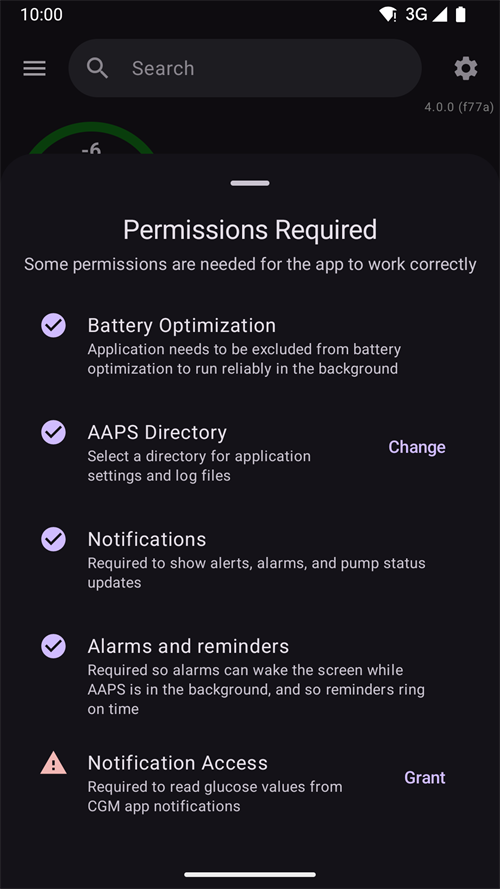

# Dexcom G7, ONE+ 및 Stelo


## 미리 알아야 할 기본 사항

G6와 달리 G7, ONE+ 및 Stelo 시스템은 앱에서도, 리더기에서도 값을 평활화하지 않는다는 점에 주의하십시오. 자세한 내용은 [여기](https://www.dexcom.com/en-us/faqs/why-does-past-cgm-data-look-different-from-past-data-on-receiver-and-follow-app)에서 볼 수 있습니다.

```{admonition} Smoothing method 
Dexcom G7/ONE+/Stelo에 권장하는 방법은 [평활화 방법](../CompatibleCgms/SmoothingBloodGlucoseData.md)을 읽어 보십시오.
```

## 1. xDrip(G7, ONE+ 또는 Stelo에 직접 연결)

- xDrip이 센서에 직접 연결합니다: 센서에는 앱 하나만 연결할 수 있으므로 Dexcom 앱을 삭제하십시오. Dexcom 앱을 계속 사용하려면 대신 [xDrip 동반 앱(Companion App)](#DexcomG7-xdrip-companion-app)을 사용하십시오.
- 여기의 안내를 따르십시오: [xDrip G7, ONE+ 및 Stelo](https://navid200.github.io/xDrip/docs/Dexcom/G7.html). 최신 xDrip 버전이 필요합니다. 최소 버전은 링크된 페이지를 확인하십시오.
- [**구성 → 혈당 출처**](#Config-Builder-bg-source)에서 xDrip을 선택하십시오.

- xDrip 설정 페이지 [xDrip 설정](../CompatibleCgms/xDrip.md)의 설명에 따라 xDrip 설정을 조정하십시오.

## 2. Build Your Own Dexcom App(G7만 해당)

```{admonition} Old app version
:class: warning
Dexcom BYODA는 이제 매우 오래된 버전의 앱이며 업데이트할 수 없습니다. ONE+와 Stelo에서는 사용할 수 없습니다.
```

-   [Build Your Own Dexcom App](https://docs.google.com/forms/d/e/1FAIpQLScD76G0Y-BlL4tZljaFkjlwuqhT83QlFM5v6ZEfO7gCU98iJQ/viewform?fbzx=2196386787609383750)(BYODA)은 AAPS로의 로컬 브로드캐스트를 지원합니다

-   이 앱을 사용하면 어떤 Android 스마트폰에서든 Dexcom G7을 사용할 수 있습니다.
-   원래 Dexcom 앱을 삭제하십시오
-   다운로드한 apk를 설치하십시오.
-   패치된 앱에 센서 코드를 입력하십시오
-   잠시 후 BYODA가 센서 신호를 받기 시작합니다.

(DexcomG7-xdrip-companion-app)=

## 3. xDrip 동반 앱(Companion App)(G7, ONE+ 및 Stelo)

공식 Dexcom 앱이 계속 센서에 연결되어 있습니다. xDrip은 Dexcom 앱의 알림에서 혈당값을 읽어 **AAPS**로 보냅니다.

```{admonition} Not a trusted data source
:class: note
**AAPS** does not consider xDrip in Companion App mode a [trusted BG data source](#GettingStarted-TrustedBGSource): SMBs are not allowed all the time.

To read the Dexcom app notifications without xDrip, as a trusted data source, use the [Notification Reader](#DexcomG7-notification-reader).
```

### Dexcom 앱 알림 읽기

- Dexcom 앱을 설치된 상태로 두고 센서에 연결해 두십시오. Dexcom 앱의 알림은 계속 보여야 합니다: 알림을 무음으로 하거나 숨기지 마십시오.
- [xDrip](https://github.com/NightscoutFoundation/xDrip)을 다운로드하여 설치하십시오. xDrip에서 Dexcom 앱과 같은 혈당 단위를 사용하십시오.
- xDrip에서 **Settings** > **Hardware Data Source**로 이동하여 **Companion App**을 선택하십시오.

  

- xDrip이 알림을 읽을 수 있는 권한을 요청합니다. **OK**를 누른 다음 목록에서 **xDrip**을 선택하고 **Allow notification access**(알림 액세스 허용)를 켜십시오.

  

- **Allow notification access**(알림 액세스 허용)가 회색으로 표시되면(*Controlled by Restricted Setting*), xDrip이 Play 스토어에서 설치되지 않았기 때문에 Android가 이를 막고 있는 것입니다:

  

  xDrip 앱 정보를 여십시오(xDrip 아이콘을 길게 누름 > **App info**(앱 정보)). 오른쪽 위의 점 세 개 메뉴를 누르고 **Allow restricted settings**(제한된 설정 허용)를 선택하십시오. 그런 다음 알림 액세스 화면으로 돌아가서 허용하십시오.

  

  

- Dexcom 앱에 새 값이 표시되면 xDrip에 측정값이 나타납니다. 아무것도 나타나지 않으면 xDrip에서 센서를 시작해야 할 수도 있습니다: 이것은 실제 센서에는 아무 영향이 없습니다. 이 모드에서 Stelo는 15분마다 측정값을 보냅니다.

### Companion Bluetooth(G7)

Dexcom 앱이 G7 센서에 연결되어 있으면, xDrip은 센서가 블루투스로 Dexcom 앱에 보내는 측정값도 함께 수신할 수 있습니다. xDrip은 센서와 페어링하지 않으며 센서 코드를 입력할 필요도 없습니다: Dexcom 앱이 계속 제어합니다.

**Companion Bluetooth**를 사용하면 xDrip은 알림이 나타난 시간 대신 센서에서 각 측정값의 정확한 시간과 추세를 받으며, 휴대폰이 범위 밖에 있던 동안의 빈 부분도 채웁니다(백필).

- xDrip에서 **Settings** > **Less common settings** > **Bluetooth Settings**로 이동하여 **Companion Bluetooth**를 켜십시오.

  

- 이 기능은 모든 휴대폰과 Android 버전에서 작동하지는 않습니다. 문제가 보이면 이 기능을 끄십시오.
- 오래된 Dexcom 센서가 아직 휴대폰의 블루투스 목록에 있으면 xDrip이 잘못된 센서를 수신할 수 있습니다: Android **Settings**(설정) > **Connected devices**(연결된 기기)에서 더 이상 사용하지 않는 센서를 삭제하십시오.
- Companion Bluetooth는 G7용입니다. ONE+와 Stelo에서는 알림을 사용하십시오.

### AAPS 설정

- [**구성 → 혈당 출처**](#Config-Builder-bg-source)에서 xDrip을 선택하십시오.
- xDrip 설정 페이지 [xDrip 설정](../CompatibleCgms/xDrip.md)의 설명에 따라 xDrip 설정을 조정하십시오.

## 4. Juggluco(G7 및 ONE+)

버전 9.0 이상 필요

- 이전에 센서에 연결되어 있던 앱을 비활성화하십시오: 앱을 삭제하거나 "강제 중지"를 사용하십시오. 앱 설정에서 "근처 기기" 권한을 끄십시오. 앱의 배터리 사용을 제한하십시오.

- 블루투스 설정에서 센서를 삭제하십시오: Android 설정의 연결된 기기 목록에서 센서를 찾아 "삭제"를 선택하십시오. Dexcom G7 센서 이름은 DXCM으로 시작합니다.

- 다른 센서의 간섭을 피하십시오: 오래된 Dexcom 센서는 블루투스 범위 밖에 두십시오.

- G7 센서를 Juggluco에 연결하십시오: Juggluco 열기 → 왼쪽 메뉴 → Photo. G7 센서 어플리케이터에 있는 데이터 매트릭스 코드를 스캔하십시오. Juggluco가 센서를 찾을 때까지 최대 5분 동안 기다리십시오.

- 페어링 조건: 센서를 Juggluco와 페어링하는 것에 동의하십시오. 페어링하는 동안 화면이 잠기지 않도록 하십시오. 페어링에 실패하면 5분 기다린 후 다시 시도하십시오.

- 예외: Wear OS 워치는 동의 버튼을 누르지 않아도 페어링할 수 있습니다.

(DexcomG7-notification-reader)=

## 5. Notification Reader (G7, ONE+ and Stelo)

공식 Dexcom 앱이 계속 센서에 연결되어 있습니다. **AAPS** reads the glucose value directly from the notification of the Dexcom app, without any other app in between.

```{admonition} Trusted data source
:class: note
Readings from the Dexcom G7, ONE+ and Stelo apps are a [trusted BG data source](#GettingStarted-TrustedBGSource): SMBs can be allowed all the time.
```

Compared to the other methods on this page, the Notification Reader has limits:

- **No trend arrow** and **no backfill**: readings missed while the phone was off or out of range are lost.
- Each reading gets the time the notification appeared, not the exact time of the sensor reading.
- Only values between 40 and 405 mg/dL (2.2 and 22.5 mmol/L) are read. "LOW" and "HIGH" are not read.
- Stelo gives a reading every 15 minutes.

### Set up the Dexcom app

- Dexcom 앱을 설치된 상태로 두고 센서에 연결해 두십시오.
- Make sure the Dexcom app shows the current glucose value in its notification. Dexcom 앱의 알림은 계속 보여야 합니다: 알림을 무음으로 하거나 숨기지 마십시오.
- Use the same glucose units (mg/dL or mmol/L) in the Dexcom app as in **AAPS**. Otherwise **AAPS** cannot read the value.

### AAPS 설정

- Select **Notification Reader** in [**Configuration → BG Source**](#Config-Builder-bg-source) and confirm the switch.

  

- Back on the main screen, **AAPS** shows **Permissions Required**. Next to **Notification Access**, tap **Grant**.

  

- Android opens its notification access list (its name depends on your Android version, for example *Notification read, reply & control*). Select **AAPS**, turn on **Allow notification access** and confirm with **Allow**.

  

  Android warns that **AAPS** could read all your notifications. **AAPS** only reads the notifications of supported CGM apps and ignores all others.

  

- If **Allow notification access** is greyed out (*Controlled by Restricted Setting*), Android blocks it because **AAPS** was not installed from the Play Store. Open the **AAPS** app info (long press the **AAPS** icon > **App info**), tap the three dots menu at the top right and select **Allow restricted settings**. 그런 다음 알림 액세스 화면으로 돌아가서 허용하십시오.
- Readings appear in **AAPS** when the Dexcom app shows a new value.

```{warning}
If the Dexcom app notification shows more than one glucose number, or none, **AAPS** skips that notification.
```
