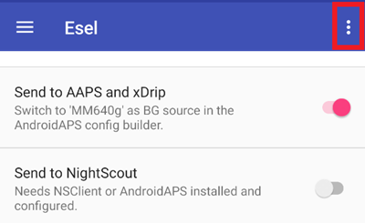
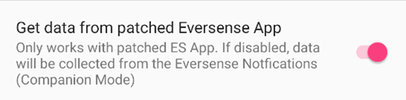

# Eversense

Eversense의 측정값을 받는 방법은 네 가지가 있습니다:

- ESEL 동반 모드(companion mode)
- ESEL 패치 모드(patched mode)
- xDrip 동반 앱(companion app)
- 알림 읽기(**AAPS**에 내장)

## ESEL

[ESEL 앱](https://github.com/BernhardRo/Esel/tree/master/apk)을 받아 이 [안내](https://github.com/BernhardRo/Esel?tab=readme-ov-file#esel)에 따라 설치하십시오.

- ESEL에서 오른쪽 위의 점 세 개 메뉴(⋮)를 열고 **Settings**를 선택하십시오(☰ 메뉴에서도 열 수 있습니다). 설정에서:
  - "Send to AAPS and xDrip"를 켜십시오
  - "Send to Nightscout"를 **끄십시오**
  - Eversense의 혈당 데이터는 노이즈가 많을 수 있으므로 ESEL에서 "Smooth Data"를 켜는 것을 권장합니다.



### 동반 모드(Companion Mode)

Eversense 앱의 알림에서 데이터를 읽습니다(표준 Eversense 앱과 함께 작동하며, ESEL 버전 3.0.1부터 사용할 수 있습니다).

1. Google Play 스토어의 공식 Eversense 앱을 사용하십시오
   - 선택 사항이지만 백필에는 필요: Eversense 계정에 로그인하십시오
   - Sync에서 Auto synchronization을 켜십시오
2. ESEL 설정:
   - "Get data from patched Eversense App" 설정을 끄십시오
   - 백필을 사용하려면: "Fill missing data from eversensedms.com"을 켜십시오
   - 이메일 주소와 비밀번호로 Eversense 로그인 정보를 입력하십시오
3. [**구성 → 혈당 출처**](#Config-Builder-bg-source)에서 혈당 출처로 "MM640g"를 설정하십시오.

### 패치된 Eversense 앱

 패치된 버전의 Eversense 앱이 필요합니다(백필을 포함하여 완전히 오프라인으로 작동합니다).

1. Eversense 앱을 삭제하십시오(경고: 휴대폰에 저장된 과거 데이터(1주일보다 오래된 것)는 사라집니다!)

2. [패치된 Eversense 앱](https://cr4ck3d3v3r53n53.club)을 설치하고 제공자의 설명대로 사용하십시오

   - Eversense 앱을 시작하고 로그인한 다음 트랜스미터에 연결하여 일반 앱과 똑같이 사용하십시오.

3. ESEL 설정:

   - "Get data from patched Eversense App" 설정을 켜십시오




새로 설치한 Eversense와 함께 ESEL을 처음 실행하면, 첫 값이 xDrip에 나타날 때까지 최대 15분이 걸릴 수 있습니다!

4. [**구성 → 혈당 출처**](#Config-Builder-bg-source)에서 혈당 출처로 "MM640g"를 설정하십시오.

## xDrip

xDrip은 ESEL처럼 제조사 앱의 알림을 읽을 수 있습니다. 백필을 사용할 수 없습니다.

- xDrip을 다운로드하여 설치하십시오: [xDrip](https://github.com/NightscoutFoundation/xDrip)
- xDrip의 데이터 소스로 “Companion App”을 선택해야 합니다.
- [**구성 → 혈당 출처**](#Config-Builder-bg-source)에서 xDrip을 선택하십시오.
- xDrip 설정 페이지 [xDrip 설정](../CompatibleCgms/xDrip.md)의 설명에 따라 xDrip 설정을 조정하십시오.
- AAPS에서 [지수 평활화](../CompatibleCgms/SmoothingBloodGlucoseData.md)를 켜십시오.

## 알림 읽기

**AAPS**는 중간에 다른 앱 없이, 공식 Eversense 앱이 올린 알림에서 혈당값을 직접 읽을 수 있습니다. 백필을 사용할 수 없습니다.

- [**구성 → 혈당 출처**](#Config-Builder-bg-source)에서 **알림 읽기**를 선택하고, 요청이 나오면 **AAPS**에 알림 접근 권한을 허용하십시오.
- Eversense 앱의 알림에 현재 혈당값이 표시되는지 확인하십시오.

```{warning}
혈당값을 읽는 간격이 항상 5분은 아니며, 중복된 값이 생길 수 있습니다.
```