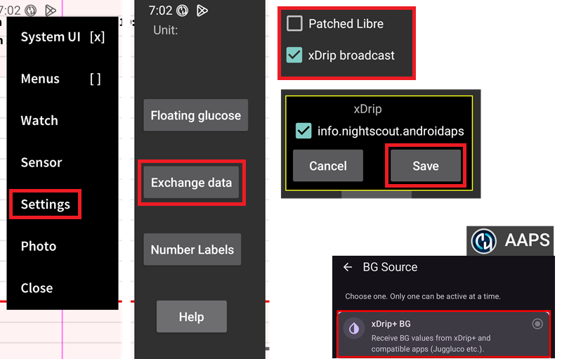

# Juggluco 설정

아직 설정하지 않았다면 [Juggluco](https://www.juggluco.nl/Juggluco/download.html)를 다운로드하십시오.

[안내](https://www.juggluco.nl/Jugglucohelp/introhelp.html)에 따라 센서를 연결하십시오.

## 모든 CGM 시스템에 공통인 기본 설정

### Nightscout 업로더 끄기

다른 앱이 Nightscout로 데이터(혈당과 처치)를 업로드하게 해서는 안 됩니다.

Juggluco에서 Nightscout로 업로드하는 기능을 모두 끄십시오.

(juggluco-to-aaps)=

## Juggluco에서 AAPS로

Juggluco는 혈당을 AAPS로 직접 보낼 수 있습니다. [신뢰할 수 있는 센서](#GettingStarted-TrustedBGSource)를 사용하면 SMB를 항상 사용할 수 있습니다.

Libre 2/2+/3/3+ 센서를 사용할 때는 1분마다의 측정값이 AAPS로 전송되지만, AAPS가 1분마다 계산하지는 않습니다.

Juggluco에서 xDrip broadcast를 켜고(Patched Libre는 켜지 마십시오), AAPS 패키지 정보를 확인하고 저장하십시오. AAPS에서 xDrip 혈당 데이터 소스를 선택하십시오.

AAPS에서 충분한 [평활화](./SmoothingBloodGlucoseData.md)를 적용하십시오.

(juggluco-to-xdrip)=

## Juggluco에서 xDrip으로

Juggluco는 혈당을 xDrip으로 보낼 수 있으며, xDrip이 이를 AAPS로 보냅니다.

Juggluco에서 Patched Libre를 켜고(xDrip broadcast는 켜지 마십시오), dexdrip 패키지 정보를 확인하고 저장하십시오. AAPS에서 xDrip 혈당 데이터 소스를 선택하십시오.

필요하면 AAPS에서 충분한 [평활화](./SmoothingBloodGlucoseData.md)를 적용하십시오. Libre 2/2+/3/3+ 센서를 사용할 때 xDrip은 1분마다의 측정값을 평균하여 5분 측정값으로 만들고 [평활화도 합니다](#libre2-value-smoothing-raw-values).

