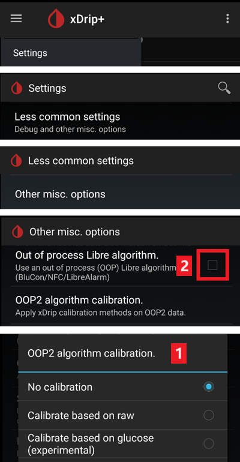

# Freestyle Libre 2 및 2+

이제 Freestyle Libre 2 센서는 공식 앱으로도 진짜 CGM입니다. 그래도 LibreLink는 AAPS로 데이터를 보낼 수 없습니다. AAPS와 함께 사용하는 방법은 여러 가지가 있습니다.

## 1. Bluetooth 브리지와 OOP 사용하기

Bluetooth 트랜스미터는 Libre 2 (EU) 또는 2+ (EU)와 외부 알고리즘(out of process algorithm) 앱과 함께 사용할 수 있습니다. [Libre 1](./Libre1.md)처럼 5분마다 혈당 측정값을 받을 수 있습니다.

사용하려는 브리지와 앱이 센서 및 xDrip과 호환되는지 확인하십시오.

Libre2 OOP([여기](#Libre2_OOP2)에서 찾을 수 있음)는 원래 리더기와 같은 혈당 측정값을 만듭니다. Libre 2를 사용하는 AAPS는 갑작스러운 값의 튐을 피하기 위해 10~25분 평활화를 합니다. 아래의 [값 평활화 및 원시 값](#libre2-value-smoothing-raw-values)을 참조하십시오. OOP는 5분마다 지난 5분의 평균으로 측정값을 만듭니다. 따라서 혈당 측정값이 아주 매끄럽지는 않지만, 원래 리더기와 일치하고 "실제" 혈당을 더 빠르게 따라갑니다. OOP로 루프를 사용하려면 xDrip에서 모든 평활화 설정을 켜십시오.

Bluetooth 트랜스미터를 사용하면 좋은 점이 몇 가지 있습니다:

-   여러 가지 OOP2 보정 방식을 선택할 수 있습니다(1): "no calibration"으로 리더기 값을 그대로 쓰거나, "calibrate based on raw"로 Libre 1처럼 센서를 보정하거나, "calibrate based on glucose"로 리더기와 비슷한 값을 보정할 수 있습니다.  
  OOP1은 꺼진 상태로 두십시오(2).

    → 햄버거 메뉴 → Settings → Less common settings → Other misc. options



-   Libre 2 센서는 Libre 1처럼 14.5일 동안 사용할 수 있습니다
-   8시간 백필(빠진 값 채우기)을 완전히 지원합니다

참고: 트랜스미터는 LibreLink 앱과 함께 사용해도 서로 방해하지 않습니다.

### 센서 시작

- → 햄버거 메뉴(1) → Start sensor(2) → Start sensor(3) → "Not Today"로 응답(4).


이 작업은 실제로 Libre2 센서를 시작하지 않으며, 어떤 경우에도 센서와 통신하지 않습니다. 이것은 단지 xDrip에 새 센서가 혈당 값을 보내고 있다는 것을 알리기 위한 것입니다. 가능하면 처음 보정을 위해 혈액으로 측정한 값 두 개를 입력하십시오. 이제 xDrip에 혈당 값이 5분마다 표시되어야 합니다. 예를 들어 휴대폰에서 너무 멀리 떨어져 있어서 빠진 값은 나중에 채워지지 않습니다.

센서를 교체하면 xDrip이 새 센서를 자동으로 감지하고 모든 보정 데이터를 삭제합니다. 활성화 후 혈당을 확인하고 처음 보정을 다시 할 수 있습니다.

### AAPS 설정(루프 사용 시에만)

-   **AAPS**에서 왼쪽 위의 **메뉴**(☰)를 열고 **구성** > **혈당 출처**로 이동하여 **xDrip+**를 선택하십시오


-   휴대폰이 비행기 모드일 때 AAPS가 혈당 값을 받지 못하면, [xDrip 설정 페이지](#xdrip-identify-receiver)에 설명된 대로 'Identify receiver'를 사용하십시오.

## 2. xDrip 직접 연결 사용하기

```{admonition} Libre 2 EU only
:class: warning
xDrip은 Libre 2 US 및 AUS와의 직접 연결을 지원하지 않습니다.
Libre 2 및 2+ **EU** 모델만 해당합니다.
```

- 원래 문서는 오래된 OOP2 버전에 연결되어 있으므로, xDrip을 설정할 때는 [이 안내](./Libre2MinimalL00per.md)를 따르십시오.
- [xDrip 설정 페이지](../CompatibleCgms/xDrip.md)의 설정 안내를 따르십시오.

-   [구성 > 혈당 출처](#Config-Builder-bg-source)에서 xDrip+를 선택하십시오.

(libre2-value-smoothing-raw-values)=

### 값 평활화 및 원시 값

기술적으로는 현재 혈당 값이 1분마다 xDrip으로 전송됩니다. 가중 평균 필터가 기본적으로 지난 25분 동안의 값으로 평활화된 값을 계산합니다. 이 기간은 NFC Scan features 메뉴에서 바꿀 수 있습니다.

→ 햄버거 메뉴 → Settings → NFC Scan features → Smooth libre 3 data when using xxx method


루프를 사용하려면 반드시 필요합니다. 곡선이 매끄럽게 보이고 루프 결과도 아주 좋습니다. 알람의 기준이 되는 원시 값은 조금 더 흔들리지만, 리더기가 표시하는 값과 일치합니다. 또한 빠른 변화에 제때 대응할 수 있도록 xDrip 그래프에 원시 값을 표시할 수 있습니다. Less Common Settings \> Advanced Settings for Libre2 \> "show Raw values" 및 "show Sensors Infos"를 켜십시오. 그러면 원시 값이 작은 흰 점으로 추가로 표시되고, 시스템 메뉴에서 추가 센서 정보를 볼 수 있습니다.

원시 값은 혈당이 빠르게 변할 때 매우 유용합니다. 점이 더 많이 흔들리더라도, 평활화된 선을 볼 때보다 추세를 훨씬 잘 알아볼 수 있어 올바른 치료 결정을 내리는 데 도움이 됩니다.

→ 햄버거 메뉴 → Settings → Less common settings → Advanced settings for Libre 2


#### 보정

Libre2는 **-40 mg/dL에서 +20 mg/dL까지 \[-2.2 mmol/L에서 +1.1 mmol/L까지\]의 오프셋**(절편)으로 보정할 수 있습니다. 기울기(slope)는 바꿀 수 없습니다. 새 센서를 부착한 뒤에는 손가락 채혈로 확인하십시오. 삽입 후 처음 12시간 동안은 정확하지 않을 수 있다는 점을 기억하십시오. 혈액 측정값과 차이가 클 수 있으므로, 24시간마다 확인하고 필요하면 보정하십시오. 며칠 후에도 센서 값이 완전히 맞지 않으면 센서를 교체해야 합니다.

## 3. Diabox 사용하기

- [Diabox](https://www.bubblesmartreader.com/_files/ugd/6afd37_f183eabd4fbd44fcac4b1926a79b094f.pdf)를 설치하십시오. Settings의 Integration에서 Share data with other apps를 켜십시오.


- [구성 > 혈당 출처](#Config-Builder-bg-source)에서 xDrip+를 선택하십시오.

## 4. Juggluco 사용하기

[여기](./Juggluco.md)를 참조하십시오.
