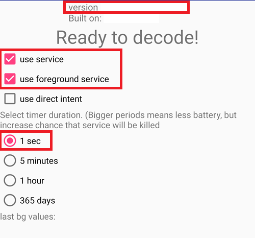
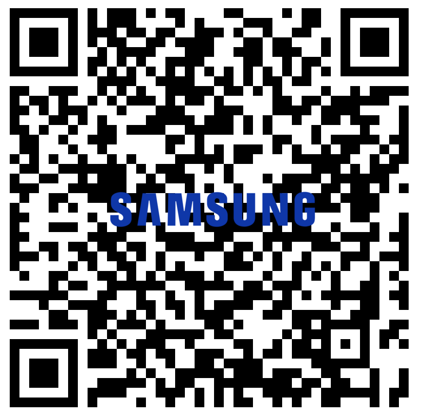
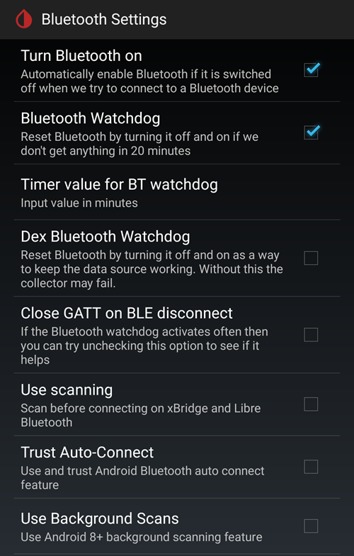
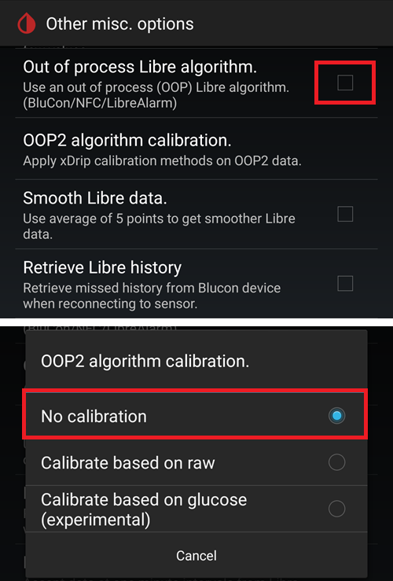
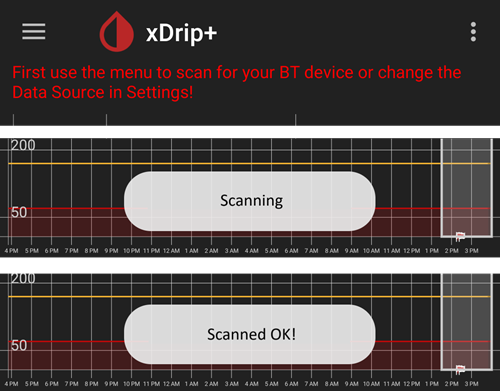
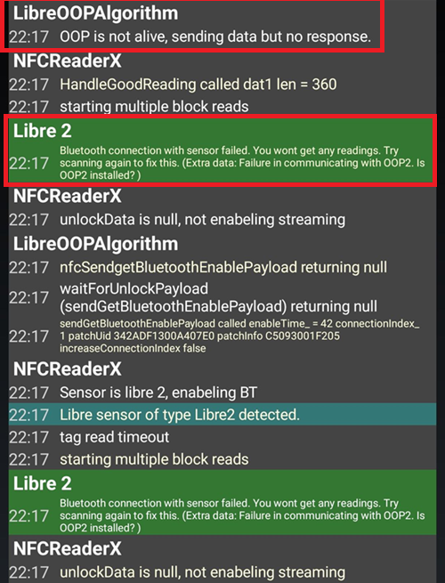

# xDrip에서 자체 Bluetooth 연결을 사용하도록 FSL 2와 OOP2를 설정하는 방법

[MinimalL00per](https://www.minimallooper.com/post/how-to-setup-freestyle-libre-2-and-oop2-to-use-a-native-Bluetooth-connection-in-xdrip)에서 markdown으로 옮기고 **수정/업데이트**함: 2025년 8월 25일 psonnera

이 문서의 맨 아래에 용어 정의 목록이 있습니다. 모르는 용어나 약어가 있으면 *[아래로 이동](#minimallooper-definitions)*하여 설명을 확인하십시오.

 

## 구성

### 하드웨어

- *FSL2 및 2+* **참고: US, CAN, NZ, AUS 버전은 지원되지 않습니다**

**(선택 사항) 리더기**(FSL2+와 호환되지 않음)

- 리더기 1(펌웨어 업데이트됨)

- 리더기 2

*참고: 이 방법에서 리더기를 사용하려면, 반드시 센서를 리더기로 먼저 시작해야 합니다. 그렇게 하지 않으면 활성화된 센서에서 리더기로 측정값을 읽을 수 없습니다. 센서 워밍업이 끝나면 LL 앱이나 xDrip에서 측정값을 읽을 수 있습니다.*

### 소프트웨어

**OOP** - Out of Process Algorithm(외부 알고리즘). 센서의 원시 데이터를 받아 혈당 값을 얻도록 돕는 외부 Android APK 앱입니다. xDrip이 수집한 FSL2 BT 원시 데이터를 OOP로 보내면, 혈당 값이 xDrip으로 돌아옵니다.

- **OOP2**

  - **유럽용 FSL2/2+ 센서에서만 작동합니다**

  - 비공개 소스(GitHub에서 구할 수 없음)

  - 목적은 암호화된 센서 원시 값을 해독하여 xDrip으로 돌려주는 것입니다. 그러면 xDrip에서 보정이 필요한 원시 데이터를 사용하거나, 리더기 1과 비슷한 혈당 값을 받을 수 있습니다.

[***xDrip***](https://jamorham.github.io/)

- [*Nightly*](https://github.com/NightscoutFoundation/xDrip/releases): 매일 밤 최신 소스 코드로 만든 빌드입니다. 충분히 테스트되지 않았습니다

- [*Stable*](https://xdrip-plus-updates.appspot.com/stable/xdrip-plus-latest.apk): 테스트를 거친 최신 안정 버전입니다.

- **참고: 새 센서에는 업데이트된 OOP2 앱이 필요합니다. 이를 위해 최신 OOP2와 맞는 최신 xDrip 릴리스(Stable) 버전 이상을 사용할 것을 권장합니다.**

 

## 절차

- *먼저 아래의 앱을 다운로드하여 설치하십시오*
- *충돌할 수 있는 앱 삭제하기*
- *LL과 xDrip을 사용하여 Bluetooth 자체 모드로 FSL2 센서를 시작하는 방법
  - [*1단계: 앱 설치 및 설정*](#minimallooper-step1)
  - [*2단계: xDrip 설정 구성*](#minimallooper-step2)
  - [*3단계: 센서를 몸에 삽입하기*](#minimallooper-step3)
  - [*4단계: LL 앱을 시작하고 맨 처음 NFC 스캔으로 센서 시작하기*](#minimallooper-step4)
  - [*5단계: xDrip을 열고 FSL2 센서를 NFC 스캔하기*](#minimallooper-step5)
  - [*6단계: xDrip에서 새 센서 시작하기*](#minimallooper-step6)
  - [*7단계: 60초 기다린 뒤 센서를 다시 NFC 스캔하기*](#minimallooper-step7)
  - [*8단계: 3~15분 동안 데이터 수집*](#minimallooper-step8)
  - [*9단계: 센서가 연결되어 데이터를 보내는지 확인하기*](#minimallooper-step9)

- *[참고](#minimallooper-notes)*
- *[장점](#minimallooper-advantages)*
- *[단점](#minimallooper-disadvantages)*
- <u>*\[문제 해결\](#minimallooper-troubleshooting)*</u>

## 시작하기 전에

이 절차는 **새 센서**로 진행할 것을 강력히 권장합니다. 이미 작동 중인 센서로도 연결할 수 있다는 보고가 있지만(***[아래](#minimallooper-started-sensor) 참조***), 연결하는 동안 LL 앱이나 리더기가 통신용 새 개인 공유 키를 만들 가능성이 매우 높습니다. 즉, 본딩 후 xDrip은 새 키를 모르므로 센서와 통신할 수 없게 됩니다. 작동 중인 센서로 연결을 시도하는 것은 본인 책임이며, 가능하면 센서 수명이 끝나갈 때 시도하십시오.

### 먼저 아래의 앱을 다운로드하여 설치하십시오

(Libre2_OOP2)=

- **OOP2** - OOP2 버전은 다음에서 찾을 수 있습니다:

  (*참고: 이 링크에 접근하려면 Google에 로그인해야 합니다.*)

*[oop2.apk](https://drive.google.com/file/d/1106h2s12b3Ev9gKCTU2G75q8h9ChHjcz/view?usp=sharing)* - OOP2_21_09_25 (05d1989) **2025.09.21** (최신 버전)

- **xDrip** - **<u>최신 버전</u>**(최소 버전 2025.09.26)은 다음에서 찾을 수 있습니다:

[*xDrip.apk*](https://github.com/NightscoutFoundation/xDrip/releases)

(minimallooper-started-sensor)=

### 센서가 이미 시작되어 있다면? xDrip에서 계속 측정값을 받을 수 있습니까? 가능합니다!

이 방법을 이미 작동 중인 센서에도 쓸 수 있는지 많은 분이 물었습니다. 답은 분명히 **예**입니다. 작동 중인 센서로도 시작할 수 있습니다.

1.  **먼저** 아래 설명대로 xDrip의 구성 변경과 설정을 마치고, OOP2를 설치하고 설정했는지 확인하십시오.

2.  **그런 다음** *5단계*로 진행하십시오. 시작하기 전에 LL을 강제 종료했는지 **반드시 확인**하십시오. 그런 다음 절차를 끝까지 따르십시오.

*참고: 활성화된 FSL2 센서를 FSLReader로 먼저 시작하지 않았다면, 그 센서는 FSLReader와 함께 사용할 수 없습니다. 센서를 FSLReader로 먼저 시작했다면, 센서를 **스캔**하여 센서와 LL, xDrip 같은 앱 양쪽에서 측정값을 읽을 수 있습니다.*

## LL과 xDrip을 사용하여 Bluetooth 자체 모드로 FSL2 센서를 시작하는 방법

*참고: 스크린샷에서 상자로 따로 표시하지 않았고 체크되지 않은(즉, 꺼진) 설정이 있다면, 그 설정은 꺼진 상태로 두십시오. 스크린샷은 보이는 모든 설정에 대해 작동하는 구성을 보여 줍니다. 센서가 정상 작동한 뒤 다른 기능을 켜거나 끄면서 실험하고 싶다면, 본인 책임으로 자유롭게 해 보셔도 됩니다.*

(minimallooper-step1)=

### 1단계: 앱 설치 및 설정

**OOP2를 설치하고 설정**한 뒤, 앱을 열어 보기만 해서 작동하는지 확인하십시오.


**설정**

- *Use service* **on**

- *Use foreground service* **on**

- *Timer Duration* **5 minutes**

  - 결과가 충분히 빨리 나오지 않으면 **1 sec**로 바꾸십시오(아래 스크린샷이 이 설정을 보여 줍니다).

**버전 2: 93e5cac-2020.12.08 (최신 버전)**



**xDrip 설치** 최소 버전: 최신 릴리스. xDrip 설치와 설정에 관한 자세한 문서는 [*여기*](../CompatibleCgms/xDrip.md)에서 볼 수 있습니다.

(minimallooper-step2)=

### 2단계: xDrip 설정 구성

**Hardware Data Source**: Libre Bluetooth


**NFC Scan features**: *언급하지 않은 설정은 꺼져 있는 것으로 간주합니다.*

- *Use NFC feature*: **on**
- *Sensor Age or Expiry*: **on**
- *Scan when not in xDrip*: **on**
- *Use Any-tag optimized reading method*: **off**. 단, 스캔이 잘 안 되면 **on**으로 해 보십시오


- *Starting Bluetooth connection with FSL2 sensor*: **Always connect to libre2 sensors**


- *Smooth libre 3 data when using xxx method*: 기본값으로 두십시오. 센서 값이 많이 흔들리면 값을 늘리고, 안정적이면 줄이십시오.


**Less Common Settings -\> Bluetooth Settings**(*중요한 설정이며 휴대폰/구성에 따라 다를 수 있습니다*)

- *Turn Bluetooth on*: **on**
- *Trust Auto-Connect*: **on**
- *Use Background Scans*: **on**
- *Always discover services*: **on**

아래 QR 코드로 xDrip을 설정할 수 있습니다. xDrip -> Auto Configure에서 이 코드를 스캔(또는 그림을 불러오기)해야 합니다.

```{admonition} QR Code
:class: dropdown


```


위의 QR 코드를 스캔한 뒤, Samsung 휴대폰을 사용한다면(많은 중국 브랜드 휴대폰에도 유용합니다) 아래의 다른 QR 코드도 스캔하여 더 안정적으로 연결되도록 설정을 바꾸십시오:

- *Trust Auto-Connect*: **off**
- *Use Background Scans*: **off**

```{admonition} QR Code
:class: dropdown


```



**Advanced settings for FSL2**(*선택 사항이지만 도움이 됨*)

- *show Raw values in Graph*: **on**

- *show Sensor info in Status*: **on**


**Extra Logging Settings**(*제대로 작동하지 않을 때 디버깅에 필요함*)

- *Extra tags for logging*: 다음 값을 입력하십시오

`BgReading:d,jamorham librereceiver:v,LibreOOPAlgorithm:v,jamorham nsemulator:v,DexCollectionService:v`


(minimallooper-OOPsettings)=

**Less Common Settings -\> Other misc options**

> **OOP2 구성을 위한 설정**

- *Out of process Libre algorithm*: **OFF**

(*OOP2를 사용할 때는 이 설정이 반드시 **OFF**여야 합니다. 그렇지 않으면 측정값을 받을 수 없습니다!*)



(minimallooper-step3)=

### 3단계: 센서를 몸에 삽입하기

(minimallooper-step4)=

### 4단계: LL 앱을 시작하고 맨 처음 NFC 스캔으로 센서 시작하기

LL 앱을 시작하고 새로 삽입한 센서를 스캔한 다음, LL 앱을 닫고 사용 중지하거나 삭제하십시오. **xDrip에서 센서를 시작하기 전에, 센서 워밍업이 끝나도록 60분을 모두 기다려야 합니다**. 센서가 아직 내부 보정 중이어서 값이 크게 달라지므로, 그 전의 측정값은 믿지 마십시오.

#### 4a단계(선택 사항, FSLReader 사용):

**맨 처음 NFC 스캔으로 FSLReader에서 FSL2(2+ 아님) 센서를 스캔하여 시작하십시오**

LL 앱이나 xDrip과 함께 **FSLReader**로도 FSL2 센서의 값을 읽고 싶다면, **새로 삽입한 FSL2 센서를 FSL Reader로 먼저 스캔해야 합니다.** 센서 워밍업이 끝나면 LL 앱이나 xDrip으로 측정값을 스캔할 수 있습니다.

*참고: LL 앱은 센서를 삽입한 뒤 맨 처음 NFC 스캔에만 필요합니다. 이 스캔은 워밍업 초기화 신호를 보내는 역할을 합니다. 그 후에는 앱을 반드시 사용 중지(앱 설정-\>강제 종료)하거나 삭제해야 합니다. 패치된 2.3 앱이나 공식 버전 중 어느 것을 사용해도 상관없습니다. 가장 중요한 것은 xDrip이 센서와 BT 본딩을 시작하려 할 때 LL 앱이 실행되지 않게 하는 것입니다. LL 앱은 통신을 방해하여 Bluetooth 재연결 과정에 간섭하기 때문입니다.*

*LL 앱의 Android 시스템 설정에서 **위치 권한**만 꺼도 연결을 방해하지 않는다는 보고가 있습니다. 몇몇 사용자가 이 방법으로 성공했다고 보고했습니다. 다시 말하지만 **앱을 사용 중지하거나 삭제할 것을 권장합니다**. 하지만 실험해 보고 싶다면 이 방법을 시도해도 됩니다.*

(minimallooper-step5)=

### 5단계: xDrip을 열고 FSL2 센서를 NFC 스캔하기

(*다시 한 번 기억하십시오! LL이 사용 중지(위치 권한 꺼짐)되었거나 삭제되었는지, 그리고 센서가 워밍업과 내부 보정을 마치도록 60분을 모두 기다렸는지 확인하십시오.*)

xDrip으로 FSL2 센서를 **NFC 스캔**하십시오. 이 스캔은 센서에 Bluetooth 페어링을 켜라는 신호를 보내 본딩 과정을 시작하게 합니다. FSL 2 센서의 NFC 스캔이 성공하면, xDrip Overview 화면 아래쪽에 **Scanning**이라는 작은 알림이 잠깐 나타난 뒤 **Scanned OK!** 알림이 나타납니다.



(minimallooper-step6)=

### 6단계: xDrip에서 새 센서 시작하기

**xDrip Overview 화면**에서 왼쪽 위의 **햄버거 메뉴**를 누르십시오. 그런 다음 **Start Sensor**를 선택하십시오.

**Start New Sensor** 화면에서 **Start Sensor**를 누르십시오. **Did you insert it today?**(오늘 삽입했습니까?)라고 묻는 창이 나타납니다. **NOT TODAY**를 눌러 응답하십시오.


*참고: 실수로 "YES, TODAY"를 눌렀다면, xDrip 메인 메뉴에서 "stop sensor"를 누른 다음 5단계부터 다시 진행하여 "start sensor"를 해야 합니다.*

(minimallooper-step7)=

### 7단계: 60초 기다린 뒤 센서를 다시 NFC 스캔하기

xDrip이 측정값을 받을 때 사용할 Bluetooth 기기로 센서를 **추가**하려면 두 번째 NFC 스캔이 필요합니다. 완료되면 **NEW SENSOR STARTED**라는 알림이 표시됩니다.


이 과정 중에는 센서를 1분에 한 번보다 자주 스캔할 수 없으므로 60초 대기 시간이 있습니다. 센서를 너무 일찍 스캔하면 xDrip Overview 화면에 **Not so quickly, wait 60 seconds** 경고가 표시됩니다.


xDrip 이벤트 로그를 열어 센서가 xDrip과 제대로 페어링되었는지 확인하십시오.


(minimallooper-step8)=

### 8단계: 3~15분 동안 데이터 수집

3~15분 사이에 첫 값을 표시할 만큼 데이터가 모입니다. *이때까지도 측정값을 받지 못한다면, 휴대폰을 재부팅하면 도움이 될 때가 있습니다.*

Samsung(또는 많은 중국 브랜드) 휴대폰을 사용하며 데이터를 받는 데 문제가 있다면, xDrip -> Auto Configure에서 아래 QR 코드를 스캔하십시오.

```{admonition} QR Code
:class: dropdown


```

이 코드는 xDrip Bluetooth 설정을 다음과 같이 바꿉니다:

- *Trust Auto-Connect*: **off**
- *Use Background Scans*: **off**

(minimallooper-step9)=

### 9단계: 센서가 연결되어 데이터를 보내는지 확인하기

xDrip Overview 화면 왼쪽 위의 햄버거 메뉴를 누르고 **System Status**를 선택하십시오. System Status 화면의 **Bluetooth Device:** 필드에 FSL2 Bluetooth 이름 형식인 **ABB___XXXXXXXXXXX**가 표시됩니다. 여기서 XXX는 센서 일련번호입니다. **Connection Status** 필드에 **Connected**가 표시되고, **Sensor Start:** 필드에 센서를 시작한 시간이 표시됩니다.


**BT Device** 화면(왼쪽으로 밀기)에서 센서의 자세한 연결 정보를 확인할 수 있으며, 이 화면을 연결 문제 해결에도 사용할 수 있습니다. 아래는 연결 문제 해결에 도움이 되는 필드와 그 용도의 목록입니다.

*참고: 이 창에서 **Bluetooth Pairing을 <u>건드려서</u> <u>Disabled</u>에서 바꾸지 마십시오**. 그렇게 하면 직접 페어링을 시도하지만 실패하며(Not bonded), 5단계부터 절차를 다시 시작해야 합니다.*


- **Phone Service State:** 휴대폰이 마지막으로 센서와 BT 연결을 한 시간(5분 이내여야 합니다)
- **Bluetooth Device:** 현재 연결 상태를 표시합니다(**Connected** 또는 **Disconnected**)
- **Device Mac Address**: 센서의 하드웨어 ID입니다
- **Bluetooth Pairing**: **<u>Disabled, tap to enable</u>**이어야 합니다. 이 항목을 누르지 않도록 주의하십시오. 실수로 눌렀다면 disabled로 돌아올 때까지 다시 누르십시오.
- **Slowest wake up**: 무시해도 됩니다. xDrip은 측정값을 계속 기다리지 않습니다. 일정 시간(보통 5분) 후에 측정값이 올 것으로 예상하기 시작합니다. 그 시간에 데이터가 오지 않으면 "Woke up early"가 표시됩니다. 이는 xDrip이 데이터가 준비되었을 것으로 예상했지만 데이터가 없었다는 뜻입니다. Slowest wake up은 평소 데이터를 받기 전까지 생긴 가장 긴 지연 시간입니다.
- **Next Wake up**: 5분으로 표시되어야 합니다


(minimallooper-notes)=

### 참고

- **xDrip에서 본딩/페어링이 끝난 후 LL NFC 스캔 사용하기**: NFC 스캔을 할 수 있지만, 먼저 xDrip과의 본딩/페어링 과정이 끝나 있어야 합니다. 항상 xDrip을 보고 5분 측정 시점에 가까운지(예: 4분 전) 확인하십시오. 5분에 가깝다면 새 BT 측정값이 들어올 때까지 기다린 뒤 NFC 스캔을 하십시오. 잘못된 때에 스캔하면 xDrip의 BT 과정을 방해하여 BT 측정값을 받지 못합니다. 다시 본딩하고 전송하기까지 시간이 걸릴 수 있으며, 때로는 센서 BT 연결을 LL에 "빼앗길" 수도 있습니다. 하지만 이 BT 측정 사이에 NFC 스캔을 하고 바로 앱을 사용 중지해도 저는 아무 문제가 없었습니다. LL을 매번 사용 중지해야 하는지는 확실하지 않지만, 안전을 위해 저는 사용 중지합니다.

- **무슨 일이 일어나는 걸까요?** Bluetooth 연결이 만들어지면, 센서와 이를 호출하는 앱/기기 사이의 통신에 필요한 개인 공유 키가 생성됩니다. 연결하는 동안 LL 앱이나 리더기가 통신용 새 개인 공유 키를 만들 가능성이 높습니다. 즉, 본딩 후 xDrip은 새 키를 모르므로 센서와 통신할 수 없게 됩니다.

  - 여러 사용자가 센서를 성공적으로 시작하고 xDrip에서 측정값을 받은 뒤에는 LL 앱을 다시 시작해도 된다고 보고했습니다. LL 앱의 Android 권한에서 **Allow Location**(위치 허용) 설정만 끄면 됩니다. 이 작업이 끝나면 LL 앱과 xDrip을 동시에 사용할 수 있습니다. NFC 스캔용 기본 앱을 선택하지 말고, NFC 스캔 때마다 센서를 읽을 앱을 직접 고르는 것을 권장합니다. 또한 다음 센서를 교체할 때, 새 센서의 첫 워밍업 NFC 스캔 후 LL 앱을 강제 종료하는 것을 잊지 마십시오. 센서 설정이 끝나고 xDrip에서 측정값을 받기 시작하면 LL 앱을 다시 시작할 수 있습니다.

&nbsp;

- **휴대폰 재부팅**: 재부팅한 뒤, 그리고 앱을 사용 중지하거나 강제 종료한 뒤에는 LL 앱이 실행되고 있지 않은지 반드시 확인하십시오. LL이 자동으로 다시 시작되는지 재부팅으로 시험해 보기를 권장합니다. 휴대폰의 Android 애플리케이션 설정에서 LL 앱 설정을 확인할 수 있습니다. 아직 사용 중으로 되어 있다면 LL 앱을 다시 사용 중지하십시오. 이를 막는 유일한 방법은 LL 앱을 삭제하는 것일 수도 있습니다. 이는 LL이 실수로 BT 본딩을 가로채는 것을 막기 위한 것입니다. 또한 재부팅한 뒤에도 센서에서 BT 측정값을 받기까지 똑같이 3~15분이 걸리므로 기다리십시오. 볼러스, 식사 등을 위해 혈당 측정값이 필요한 시간에 가깝게 재부팅한다면 이를 미리 계획하십시오.

&nbsp;

- **배터리 최적화 설정**: 휴대폰의 배터리 최적화 설정에서 이 앱들을 반드시 제외하십시오

  - xDrip

  - OOP 2

  - LL

  - AAPS

&nbsp;

- **비행기 모드 사용하기:** 비행기 모드를 켜야 하는 상황이 있습니다(비행기를 탈 때 ;-), 또는 밤에 잘 때 머리 가까이에 있는 휴대폰에서 Wi-Fi나 모바일 신호가 작동하지 않기를 원할 때). 이때 비행기 모드를 켜는 동안 Bluetooth 통신에 문제가 생길 수 있습니다. 휴대폰에서 비행기 모드를 켠 다음 Bluetooth를 켜면 혈당 측정값이 끊깁니다. 유일한 해결 방법은 xdrip+ -\> System Status -\> Classic Status Page에서 수집기(collector)를 다시 시작하는 것입니다. 수집기를 다시 시작한 뒤 혈당 측정값이 다시 나타났습니다.

 

(minimallooper-advantages)=

### 장점

- **LL 패치 앱이 더 이상 필요 없음** FSL2 센서에서 값을 읽기 위해 더 이상 패치된 LL 앱이 필요하지 않습니다. LL 패치 앱을 사용할 수도 있지만, 공식 LL 앱도 패치 앱과 같은 방식으로 첫 NFC 초기화 스캔을 할 수 있습니다. 센서를 시작하는 NFC 초기화 스캔에 관해서는 차이가 없습니다.

&nbsp;

- **타사 NFC 스캔 기기가 더 이상 필요 없음** 이제 센서만으로 Bluetooth를 통해 측정값을 보낼 수 있으므로, Miaomiao, Bubble, Blucon 같은 타사 NFC 스캔 기기는 측정값 수집에 더 이상 필요하지 않습니다*(그래도 계속 사용할 수는 있습니다)*. 하드웨어가 적을수록 문제가 생길 곳이 적고, 충전할 기기가 줄며, 구성이 더 간단해집니다.

&nbsp;

- **FSL2 센서를 FSL Reader로 먼저 시작했다면, FSL2 리더기(펌웨어가 업데이트된 버전 1 또는 버전 2)로 계속 NFC 스캔하여 측정값을 읽을 수 있습니다.** 센서가 Bluetooth로 xDrip과 본딩된 뒤에도 FSL2 리더기만으로 작동 중인 센서의 측정값을 스캔할 수 있습니다.

  - 센서 워밍업을 시작하는 맨 처음 NFC 스캔은 **반드시** **FSL Reader로 먼저** 해야 합니다. 이 시점 이후에는 다른 앱도 이제 활성화된 센서에서 NFC로 값을 읽을 수 있습니다.
- 제가 이해하기로는, FSL2 센서는 (연결이 만들어져 있지 않거나 연결을 시도하는 중이 아니라면) 항상 정확히 2분마다 BLE로 자신의 존재(및 사용 가능 여부)를 알립니다(Bluetooth 기기를 검색할 수 있는 모든 Bluetooth 기기에서 보입니다). 이 알림에 가장 먼저 응답한 기기가 경쟁에서 이기며, 센서에 연결하여 읽을 수 있는 *유일한* 기기가 됩니다. NFC 스캔 연결 과정에서 FSL 2 통신을 해독하는 데 쓰이는 개인 공유 키가 생성되기 때문입니다. 그러면 이 개인 공유 키가 없고 연결을 시도하고 있을 수도 있는 다른 기기는 이 센서를 사용할 수 없습니다. FSL 2 리더기는 "상대"가 무엇이든 항상 이 경쟁에서 이기는 것으로 보입니다.

&nbsp;

- **하드웨어 기기를 최소한으로 구성** 제 목표는 늘 몸에 부착하는 의료 기기를 최소한으로 유지하는 것이었습니다. FSL2와 Omnipod 시스템의 조합으로 이 목표를 이루었습니다. 이 점은 여행할 때(짧은 거리든 긴 거리든) 더욱 중요합니다. 챙길 물품의 수와 교체할 세트가 줄어서 짐 가방에 다른 물건을 넣을 공간이 더 생기기 때문입니다. 앞으로는 레저버만 교체할 수 있고, 칩과 모터 시스템은 계속 다시 쓸 수 있는 부분으로 만든 패치 펌프가 나오기를 바랍니다. 그러면 쓰레기가 줄고 부위 교체용 포장도 줄어서, 여행 가방에 다른 물건을 넣을 공간이 다시 더 생길 것입니다.

&nbsp;

- **센서 교체 시 1시간 공백이 더 이상 없음** LL 앱으로 첫 NFC 스캔을 하여 다른 센서를 시작할 수 있으므로, 그동안 현재 센서는 계속 작동하면서 Bluetooth로 측정값을 보낼 수 있습니다. 20분 후부터 새 센서의 측정값을 받을 수 있지만, 센서가 내부 보정을 제대로 마치도록 1시간 기다리는 것이 가장 좋습니다. 즉, 현재 센서를 중지하고 (1시간 전에 부착하고 LL NFC 스캔으로 워밍업한) 새 센서를 시작하면 3~15분 안에 첫 보정과 측정값을 얻을 수 있습니다.

&nbsp;

(minimallooper-disadvantages)=

### 단점

- **휴대폰 재부팅:** 휴대폰을 재부팅하면 Bluetooth 과정이 다시 시작되어야 하므로, 먼저 (삭제하지 않았다면) LL 앱을 직접 사용 중지했는지 확인하고, 첫 측정값이 들어올 때까지(3~15분) 기다려야 합니다. 따라서 교정 볼러스나 식사 및 간식 시간처럼 중요한 때에 재부팅이 일어나지 않도록 시점을 잘 정해야 합니다.

&nbsp;

- **Bluetooth 측정값을 받기 위해 LL과 xDrip을 동시에 실행할 수는 없습니다**. LL은 항상 센서와의 Bluetooth 연결과 본딩을 "가로채려고" 합니다. 그렇게 되면 센서 수명이 끝날 때까지 LL만 사용해야 합니다. 따라서 두 앱을 동시에 실행하는 것이 항상 되는 것은 아닙니다. 아래에서 말하듯이, LL 앱을 켜고 NFC 스캔을 하여 LL 측정값을 얻을 수는 있습니다(비교가 필요하거나, 본인 또는 내분비내과 의사 보고서용 이력을 가져오고 싶을 때). 하지만 측정값을 얻으면 바로 앱을 사용 중지해야 하며, xDrip이 Bluetooth 측정값을 받기 1분 이내에는 이 작업을 하지 마십시오. 이 과정에서 FSL2 리더기가 어떻게 작동하는지는 확실하지 않지만, 나중에 시험해 보겠습니다.
- 여러 사용자가 센서를 성공적으로 시작하고 xDrip에서 측정값을 받은 뒤에는 LL 앱을 다시 시작해도 된다고 보고했습니다. LL 앱의 Android 권한에서 **Allow Location**(위치 허용) 설정만 끄면 됩니다. 이 작업이 끝나면 LL 앱과 xDrip을 동시에 사용할 수 있습니다. NFC 스캔용 기본 앱을 선택하지 말고, NFC 스캔 때마다 센서를 읽을 앱을 직접 고르는 것을 권장합니다. 또한 다음 센서를 교체할 때, 새 센서의 첫 워밍업 NFC 스캔 후 LL 앱을 강제 종료하는 것을 잊지 마십시오. 센서 설정이 끝나고 xDrip에서 측정값을 받기 시작하면 LL 앱을 다시 시작할 수 있습니다.

&nbsp;

- **타사 NFC 스캔 기기는 계속 사용할 수 있음**. 네, 이것을 단점으로 적었지만, 센서에 문제가 생겨 LL이 센서 제어권을 가져가더라도 언제든지 센서에 NFC 스캔 기기를 붙여 xDrip에서 측정값을 받을 수 있다는 점도 말하고 싶었습니다. 타사 NFC 스캔 기기(Miaomiao, Bubble, Blucon)를 사용하는 구성이 더 편하다면, 직접 Bluetooth 연결 대신 이 기기를 사용할 수도 있습니다. 일부 휴대폰은 센서와의 자체 Bluetooth 본딩 및 데이터 수신이 잘 되지 않을 때가 있습니다. 이 기기들은 백업용으로 쓰거나 평소에 쓸 수 있습니다. 어느 쪽이든 선택지로 남아 있습니다.
- **FSL Reader**를 측정용 NFC 스캔 기기로 사용하려면, **맨 처음 NFC 스캔**으로 센서를 워밍업할 때 반드시 **리더기로 먼저** FSL2 센서를 시작해야 합니다.

&nbsp;

- **LV 데이터가 자동으로 업로드되지 않음** LL 앱은 계속 Bluetooth로 연결되어 있지 않으므로(센서가 Bluetooth로 측정값을 보내기 시작하면 LL을 xDrip과 동시에 실행하면 안 되기 때문입니다) 센서에서 측정값을 자동으로 받지 않습니다. 즉, 혈당 데이터가 LV로, 그리고 LV를 통해 LL을 사용하는 다른 휴대폰으로 자동 업로드되지 않습니다. 많은 부모가 이 기능에 의존하고, 의료진에게 LV 보고서를 제출해야 하는 사람도 있다는 것을 알기 때문에 이를 단점으로 표시했습니다. LL 앱을 열고 8시간마다 스캔하여 센서의 백필 데이터를 LL로 가져올 수는 있습니다(하루 3번, 최소 8시간마다. 하지만 24시간 데이터를 모두 받으려면 아마 더 많이 스캔해야 할 것입니다). 그러나 이것도 수동 작업입니다.

&nbsp;

(minimallooper-definitions)=

### 용어 정의

- **BT** - Bluetooth

- **BLE** - Bluetooth Low Energy(저전력 Bluetooth)

- **FSL** - FreeStyle Libre
  - **Libre 1 (FSL1)** - NFC만 지원. 센서의 첫 번째 버전

  - **Libre 2 (FSL2)** - Bluetooth 및 NFC. 센서의 두 번째 버전.

  - **Libre 3 (FSL3)** - Bluetooth 및 NFC. 더 작아진 세 번째 버전의 센서. OOP2에서 지원하지 않습니다(Juggluco 참조).

- **LL** - LibreLink. 첫 NFC 스캔으로 센서를 시작하는 데 쓰는 **앱**

- **LV** - LibreView. 내분비 의료진과 데이터를 공유하는 클라우드 서비스(Tidepool이나 Nightscout 사용을 고려하십시오)

- **MM** - MiaoMiao. Bluetooth로 xDrip에 측정값을 보내는 타사 NFC 스캔 기기의 이름이자 제조사입니다.

- **NFC** - Near Field Communication(근거리 무선 통신). 측정값을 읽기 위해 휴대폰의 NFC 센서를 센서 가까이에 가져가는 물리적인 동작입니다. 흔히 "센서 스캔하기", "센서 스캔" 또는 "NFC 스캔"이라고 부릅니다. 이 과정에서는 Bluetooth를 전혀 사용하지 않습니다.

- **OOP1** - Out of Process Algorithm 버전 1. (센서에서 Bluetooth 또는 NFC 스캔으로 xDrip에 전달된) 원시 값을 받아, (센서 칩의 하드웨어 알고리즘과 매우 비슷한) 알고리즘으로 원시 값을 처리하는 타사 앱입니다. 그런 다음 (xDrip 자체 보정이 아니라 OOP1 알고리즘으로) 보정된 혈당 값을 xDrip으로 돌려주며, xDrip은 이 값을 표시하거나 필요하면 (손가락 채혈 보정으로) xDrip 보정을 거쳐 추가로 처리합니다.

- **OOP2** - Out of Process Algorithm 버전 2. FSL 2 센서에서 (Bluetooth 또는 NFC 스캔으로) 전달된 암호화된 데이터를 받아 해독하는 타사 앱입니다. 해독된 데이터는 xDrip으로 보내집니다.

 

(minimallooper-troubleshooting)=

### Troubleshooting

#### NFC로 센서를 스캔할 수 없음

- Android 설정에서 휴대폰의 NFC 리더가 켜져 있는지 확인하십시오.
- NFC 리더는 **ISO 15693** 태그와 호환되어야 합니다. 일부 Cubot 휴대폰은 사용하기가 매우 어렵습니다.
- 휴대폰 설명서를 보고 NFC 안테나 위치를 확인하십시오. 휴대폰을 센서에 대고 10초 동안 그대로 두십시오. xDrip의 NFC 읽기는 제조사 앱이나 리더기보다 오래 걸립니다.
- 센서를 스캔하기 전에 xDrip을 닫아 보십시오.
- 센서를 읽으려는 다른 앱이 없는지 확인하십시오(스캔할 때 여러 앱 중에서 고르는 화면이 나타날 수 있습니다. xDrip을 선택하되 휴대폰은 움직이지 마십시오).
- xDrip NFC 설정인 *Use faster multi-block reading method*와 *Use Any-tag optimized reading method*의 모든 조합을 시도해 보십시오. 보통은 두 옵션을 모두 **off**로 했을 때 NFC 스캔이 더 안정적입니다.

#### 첫 측정값 수집 단계에서 멈춤

*참고: 수동으로 보정하면 FSL 2는 신뢰할 수 있는 데이터 소스로 인식되지 않습니다.*

모든 것이 제대로 작동할 때까지 [OOP2 보정](#minimallooper-OOPsettings) 방식을 "No calibration"으로 설정하십시오.

그 후에 보정할지 말지 정하면 됩니다.


#### 센서가 FSL1로 인식됨


최신 버전의 xDrip과 OOP2를 사용하고 있는지 확인하십시오.

#### 센서 연결 실패

- OOP1이 꺼져 있는지 확인하십시오([여기](#minimallooper-OOPsettings) 참조)



- 휴대폰의 배터리 절약 앱이나 설정이 OOP2를 절전 상태로 만들지 않는지 확인하십시오
- Google Play 프로텍트가 OOP2를 종료시키므로 꺼져 있는지 확인하십시오
- System Status에서 Bluetooth Pairing을 바꾸셨습니까? 다시 눌러 **<u>Disabled</u>**로 되돌리십시오


#### 측정값 누락

OOP2가 0이나 -1이 아닌 값을 표시하는지 확인하십시오. 그렇지 않다면 센서가 고장 나고 있다는 신호일 수 있습니다(아래 예시는 mmol/L).


센서 사용 기간(Sensor age)이 늘어나지 않는 것도 센서에 문제가 있다는 신호일 수 있습니다. 이는 xDrip이 값을 받았지만 허용할 수 없는 값이어서(센서 오류) 버렸다는 뜻입니다.


#### 센서 페어링을 처음부터 다시 시작하기

1. xDrip 메뉴 -> Stop sensor(FSL2를 멈추지는 않으며, xDrip 상태만 시작되지 않음으로 바꿉니다)
2. xDrip 메뉴 -> System status -> Forget device
3. xDrip NFC로 센서를 스캔하십시오. 최소 1분 기다리십시오
4. xDrip 메뉴 -> Start sensor. 최소 1분 기다리십시오
5. xDrip NFC로 센서를 몇 번 스캔하십시오. 두 번 스캔하는 사이에는 항상 최소 1분을 기다리십시오.
