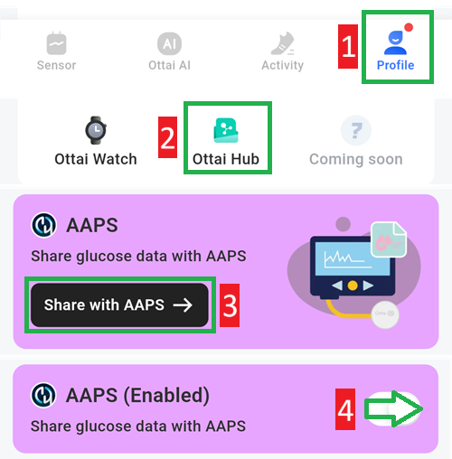

# Ottai M8

## Ottai 앱으로 M8 사용하기

-   <https://play.google.com/store/apps/details?id=com.ottai.seas>에서 apk를 다운로드하여 설치하십시오. Ottai 중국 버전은 <https://ottai.com.cn/70ICjxAI4i>를 사용하십시오

-   센서 시작

- [**구성 → 혈당 출처**](#Config-Builder-bg-source)에서 **Syai/Ottai**를 선택하십시오.

Ottai 앱에서 broadcast를 켜십시오:

1. Profile을 선택하십시오
2. Ottai hub
3. Share with AAPS를 누르고 제3자 데이터 전송 동의서에 동의하십시오
4. Share glucose data with AAPS를 켜십시오

