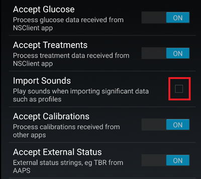
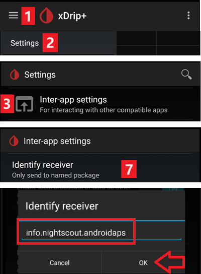

# xDrip 설정

아직 설치하지 않았다면 [xDrip 릴리스 페이지](https://github.com/NightscoutFoundation/xDrip/releases)에서 최신 xDrip 릴리스를 다운로드하여 설치하십시오.

xDrip 앱의 배터리 최적화를 끄고 백그라운드 활동을 허용하십시오.

## 모든 CGM & FGM 시스템의 기본 설정

### Nightscout 업로드 끄기

다른 앱이 Nightscout로 데이터(혈당과 처치)를 업로드하게 해서는 안 됩니다.

→ Hamburger Menu (1) → Settings (2) → Cloud Upload (3) → Nightscout Sync (REST-API) (4) → `Enabled`를 **OFF**로 전환 (5)

#### 자동 보정과 처치 끄기

`Automatic Calibration` (7)이 꺼져 있는지 확인하십시오. `Automatic Calibration` 체크박스가 선택되어 있으면 `Download treatments` (6)를 한 번 켜고, `Automatic Calibration` 체크박스를 해제한 다음 `Download treatments`를 다시 끄십시오.

`Extra Options`(8)를 누르십시오

    {admonition} 안전 경고
    :class: warning
    xDrip에서 "Upload treatments"를 반드시 꺼야 합니다. 그렇지 않으면 AAPS에서 처치가 두 번 기록되어 COB와 IOB가 잘못 계산될 수 있습니다.

`Upload treatments`(9)를 끄고 `Back-fill data` (11)를 **사용하지 않도록** 하십시오.

`Alert on failures` 옵션도 꺼야 합니다 (10). 그렇지 않으면 Wi-Fi/모바일 네트워크 문제가 있거나 서버를 사용할 수 없을 때 5분마다 알람이 울립니다.

### **Inter-app Settings** (Broadcast)

AAPS를 사용한다면, 데이터가 AAPS로 전달되도록 xDrip의 Inter-App settings에서 broadcast를 켜야 합니다.

→ Hamburger Menu (1) → Settings (2) → Inter-app settings (3) → Broadcast locally **ON** (4)

AAPS의 값이 xDrip의 값과 같도록 하려면 `Send the displayed glucose value` (5)를 켜야 합니다.

Compatible Broadcast를 켜십시오 (6).

xDrip에서 `Accept treatments`를 켜고 AAPS xDrip 플러그인에서 `xDrip+로 브로드캐스트 활성화`도 켰다면, xDrip은 AAPS로부터 인슐린, 탄수화물, 기저 주입량 정보를 받습니다.

`Accept Calibrations`를 켜면 xDrip은 AAPS의 보정 값을 사용합니다. Dexcom 센서에서 이 기능을 사용할 때는 주의하십시오. 먼저 [이 문서](https://navid200.github.io/xDrip/docs/Calibrate-G6.html)를 읽으십시오.

AAPS가 기저/프로파일 변경을 보낼 때마다 xDrip이 벨소리를 울리지 않도록 Import Sounds를 꺼 두십시오.

(xdrip-identify-receiver)=

#### Identify receiver

- 로컬 브로드캐스트에 문제가 있다면(AAPS가 xDrip에서 혈당 값을 받지 못함) → Hamburger Menu (1) Settings (2) → Inter-app settings (3) → Identify receiver (7)로 가서 AAPS 빌드의 경우 `info.nightscout.androidaps`를 입력하십시오(PumpControl 빌드를 사용한다면 대신 `info.nightscout.aapspumpcontrol`을 입력하십시오!!).
- 주의: 자동 수정 기능이 i를 대문자로 바꾸는 경우가 있습니다. `info.nightscout.androidaps`(PumpControl의 경우 `info.nightscout.aapspumpcontrol`)를 입력할 때는 **소문자만 사용해야 합니다**. 대문자 I를 쓰면 앱이 xDrip에서 혈당 값을 받지 못합니다.
    
    

## AAPS를 사용하여 xDrip에서 보정하기

- AAPS로 보정하려면 xDrip에서 Settings → Interapp Compatibility → Accept Calibrations로 가서 ON을 선택하십시오. 
- Settings → Less Common Settings → Advanced Calibration Settings의 옵션도 확인해 보는 것이 좋습니다.

## Dexcom 센서

Dexcom 센서와 트랜스미터 자체에 관한 모든 내용(시작, 중지, 교체, 보정, 문제 해결)은 [xDrip Dexcom 문서](https://navid200.github.io/xDrip/docs/Dexcom_page.html)에 설명되어 있으며 최신 상태로 유지됩니다. 센서는 그 설명을 따르십시오. 이 페이지 위에서 설명한, xDrip을 **AAPS**에 연결하는 설정만 AAPS에 해당하는 부분입니다.

### Dexcom G6 및 ONE

- [권장 설정](https://navid200.github.io/xDrip/docs/G6-Recommended-Settings.html)에 따라 xDrip을 설정하십시오.
- Dexcom G6 및 ONE 트랜스미터는 Dexcom 수신기(또는 t:slim 펌프)와 휴대폰의 앱 하나에 동시에 연결할 수 있습니다.
- xDrip을 수신기로 사용할 때는 먼저 Dexcom 앱을 삭제하십시오. **xDrip과 Dexcom 앱을 동시에 트랜스미터에 연결할 수 없습니다!**
- Clarity가 필요하면서 xDrip 기능도 활용하고 싶다면, xDrip으로 로컬 브로드캐스트하는 [Build Your Own Dexcom App](#DexcomG6-if-using-g6-with-build-your-own-dexcom-app)을 사용하거나, 공식 Dexcom 앱의 알림을 받는 동반 앱(Companion app)으로 xDrip을 사용하십시오(혈당 측정값이 지연될 수 있음).

#### 센서 재시작

- 현재 트랜스미터에서 xDrip은 항상 트랜스미터의 [자체 알고리즘(native algorithm)](https://navid200.github.io/xDrip/docs/Native-Algorithm.html)을 사용합니다. 이것을 끌 이유는 없습니다.
- [선제적 재시작(Preemptive restart)](https://navid200.github.io/xDrip/docs/Preemptive-Restart.html)은 오래된 트랜스미터(펌웨어 1.6.5.25 이하)에서만 작동합니다. 이런 트랜스미터에서는 10일 후 센서가 멈추는 것을 막기 위해 필요합니다. 최신(Firefly) 트랜스미터는 이를 무시합니다.
- Firefly 트랜스미터에서 센서를 다시 시작하려면 [트랜스미터를 분리](https://navid200.github.io/xDrip/docs/Remove-transmitter.html)해야 하며, 재시작 후에는 측정값에 큰 오차가 생길 수 있습니다. 이는 루프 사용 중에 위험합니다. [센서 재시작](https://navid200.github.io/xDrip/docs/Restart-G6-sensor.html)을 끝까지 읽고 [신중하게 보정하십시오](https://navid200.github.io/xDrip/docs/Calibrate-after-G6Restart.html).

(xdrip-connect-g6-transmitter-for-the-first-time)=

#### 센서 시작, 중지 및 교체

다음 설명을 따르십시오:

- [G6 또는 ONE 트랜스미터 시작](https://navid200.github.io/xDrip/docs/Starting-G6.html)
- [G6 또는 ONE 센서 중지 및 시작](https://navid200.github.io/xDrip/docs/Dexcom/StartG6Sensor.html)
- [센서에서 트랜스미터 분리](https://navid200.github.io/xDrip/docs/Remove-transmitter.html)
- [트랜스미터 수명](https://navid200.github.io/xDrip/docs/Transmitter-lifetime.html)은 배터리를 교체했거나 개조한 트랜스미터에서만 연장할 수 있으며([하드 리셋](https://navid200.github.io/xDrip/docs/Hard-Reset.html)), Firefly에서는 연장할 수 없습니다.

(xdrip-replace-transmitter)=

#### 트랜스미터 교체

- 원래 Dexcom 수신기를 사용한다면 끄고, xDrip에 측정값이 표시되기 전에는 다시 켜지 마십시오.
- xDrip에서(System Status → Forget Device) 그리고 스마트폰의 블루투스 설정에서 모두 기기 등록을 해제하십시오(DexcomXX로 표시되며, XX는 트랜스미터 일련번호의 마지막 두 자리입니다).
- 다시 연결되지 않도록 이전 트랜스미터를 블루투스 범위 밖에 두십시오.
- 그런 다음 [G6 또는 ONE 트랜스미터 시작](https://navid200.github.io/xDrip/docs/Starting-G6.html)을 따르십시오.

### Dexcom G7, ONE+ 및 Stelo

- [G7, ONE+ 및 Stelo 설명](https://navid200.github.io/xDrip/docs/Dexcom/G7.html)을 따르십시오(최신 xDrip 릴리스가 필요합니다. 링크된 페이지를 참조하십시오).
- **AAPS**와 함께 사용할 수 있는 구성은 [Dexcom G7, ONE+ 및 Stelo 페이지](../CompatibleCgms/DexcomG7.md)도 참조하십시오.

(xdrip-troubleshooting-dexcom-g5-g6-and-xdrip)=

### Dexcom 및 xDrip 문제 해결

- [G6/ONE 연결 문제 해결](https://navid200.github.io/xDrip/docs/Connectivity-troubleshoot.html)
- [G7/ONE+/Stelo 문제 해결](https://navid200.github.io/xDrip/docs/Dexcom/G7_Troubleshooting.html)
- [새 센서를 시작할 때의 문제](https://navid200.github.io/xDrip/docs/Dexcom/SensorFailedStart.html)
- 전체 목록: [xDrip Dexcom 페이지](https://navid200.github.io/xDrip/docs/Dexcom_page.html)의 **Troubleshooting**을 참조하십시오.

## Libre 1

- xDrip에서 NFC-블루투스 브리지 설정하기
    
    → Hamburger Menu (1) → Settings (2) → Less common settings (3) → Bluetooth Settings (4)

- Bluetooth Settings에서 아래 스크린샷과 정확히 같게 체크박스를 설정하십시오 (5)
    
    - Watchdog 옵션은 끄십시오. 휴대폰의 블루투스를 초기화하여 펌프 연결을 끊기 때문입니다.
    
    

- 다음 설정을 켜 볼 수 있습니다 (7)
    
    - Use scanning
    - Trust Auto-Connect
    - Use Background Scans

- 브리지 연결이 쉽게 끊기거나 연결 복구가 어렵다면 **이 설정을 끄십시오** (8).
    
    

- 켜야 하는 이유를 알지 못한다면 다른 옵션은 모두 꺼 두십시오.
    
    

### Libre smart reader 배터리 잔량

- MiaoMiao와 Bubble 같은 브리지의 배터리 잔량을 AAPS에 표시할 수 있습니다(Blucon은 안 됨).
- 자세한 내용은 [스크린샷 페이지](#screens-sensor-level-battery)에서 볼 수 있습니다.

### Libre 트랜스미터 연결 & 센서 시작

- 센서에 필요하다면(Libre 2 EU 및 Libre 1 US) 최신 out of process algorithm을 설치하십시오.

- 센서는 제조사 앱이나 리더기로 이미 시작되어 있어야 합니다(xDrip은 Libre 센서를 시작하거나 중지할 수 없습니다).

- 데이터 소스를 Libre Bluetooth로 설정하십시오.
    
    → Hamburger Menu (1) → Settings (2) → Hardware Data source에서 Libre Bluetooth 선택 (3)
    
    

- 블루투스를 검색하여 브리지를 연결하십시오.
    
    → Hamburger Menu (1) → Scan Bluetooth (2) → Scan (3)
    
    - xDrip이 브리지를 찾지 못하면 브리지가 제조사 앱에 연결되어 있지 않은지 확인하십시오. 브리지를 충전기에 연결하고 초기화하십시오.
    
    

- xDrip에서 센서를 시작하십시오.
    
        {admonition} 안전 경고
        :class: warning
        1시간 준비 시간이 끝나기 전에는 센서 데이터를 사용하지 마십시오. 값이 매우 높게 나올 수 있으며 AAPS가 잘못된 결정을 내리게 할 수 있습니다.
    
    → Hamburger Menu (1) → Start sensor (2) → Start sensor (3) → 리더기나 제조사 앱으로 센서를 시작한 정확한 시간을 설정하십시오. 오늘 시작하지 않았다면 "Not Today"를 선택하십시오 (4).

(xdrip-libre2-patched-app)=

## Libre 2 패치된 앱

- 데이터 소스를 Libre patched app으로 설정하십시오.
    
    → Hamburger Menu (1) → Settings (2) → Hardware Data source에서 Libre (patched App) 선택 (3)
    
    

- Less Common Settings->Extra Logging Settings->Extra tags for logging에 `BgReading:d,xdrip libre_receiver:v`를 추가할 수 있습니다. 그러면 문제 해결을 위한 추가 오류 메시지가 로그에 기록됩니다.

