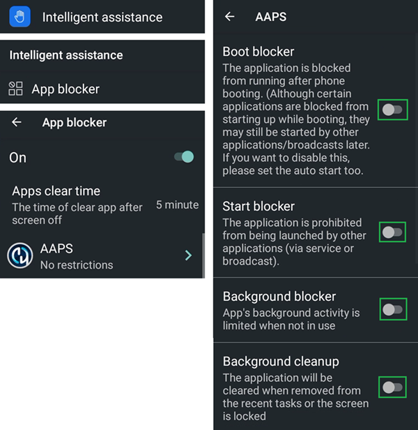
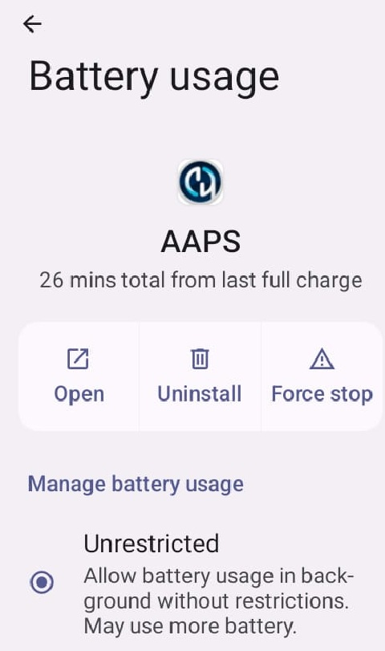

# Jelly

## Jelly Star Mini

**기능**

* Android 13
* 8 GB RAM

**장점**

* It's really small.
* 사람들에게 말하더라도 이것을 일반 스마트폰으로 여기지 않을 수 있어서, 휴대폰이 보통 허용되지 않는 곳에서도 예외로 더 쉽게 받아들여질 수 있습니다.

**단점**

* 경험이 많은 루프 사용자에게만 권장합니다. 일부 설정은 알아보기 쉽지 않습니다. 큰 Android AAPS 휴대폰을 써 본 경험으로 무엇이 어디에 있는지 알고 있어야 합니다. 일부 AAPS 버튼은 작아서 누르기 어렵습니다. 굵은 손가락이 아니라 정확한 터치가 필요합니다.
* 루프 전용 휴대폰으로만 사용할 수 있습니다. 주머니에는 일반 스마트폰을 함께 가지고 다니는 것이 좋습니다. 

### 배터리 수명 최적화

Jelly에는 강력한 최적화 기능이 있으며, AAPS(및 BYODA, xDrip, OOP2, Juggluco 등 다른 DIY 앱)에 대해서는 이 기능을 **반드시** 꺼야 합니다.

Intelligent assistance는 켜 두어도 되지만, **DIY 앱에 대해서는 반드시 꺼야 합니다**.

Libre 센서를 위해 NFC를 켤 수 있습니다.

### 배터리 수명 최적화

**AAPS**와의 간섭을 피하려면, **AAPS**(및 BYODA, xDrip, OOP2, Juggluco 등 다른 **DIY 앱**)에 대해 'unrestricted'(제한 없음)를 선택하여 Jelly Star의 'battery usage'(배터리 사용량) 제한을 꺼야 합니다.

### Google Play Protect

Google Play Protect를 끄는 것을 잊지 마십시오.

### Wear apk를 위한 Remote Connection

Samsung Galaxy 같은 일부 스마트워치에서는 Wi-Fi를 통해 원격으로 Jelly, **Wear.apk** & **AAPS**를 사용하려면 Galaxy Wearable 앱의 Advanced features에 있는 'Remote connection'을 **켜야** 합니다.

