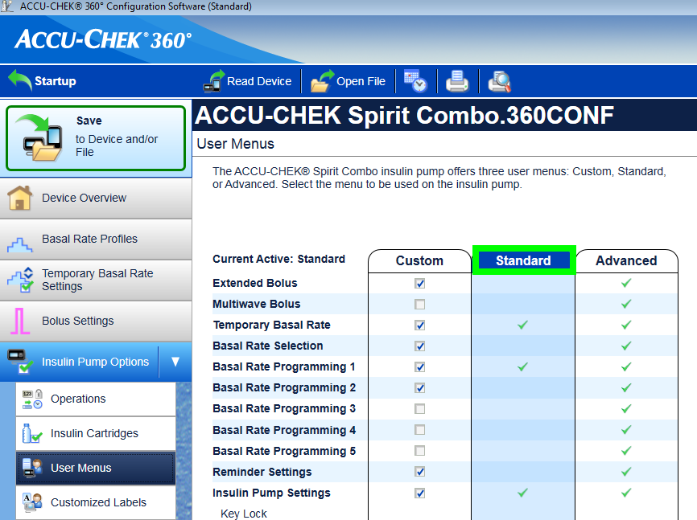
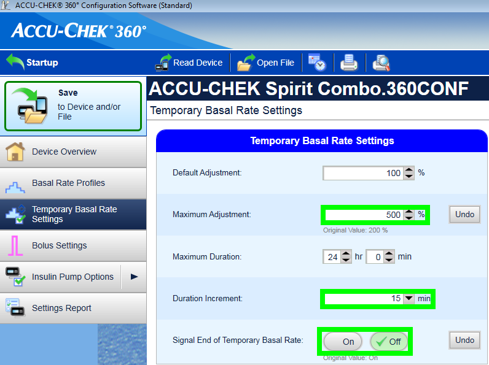
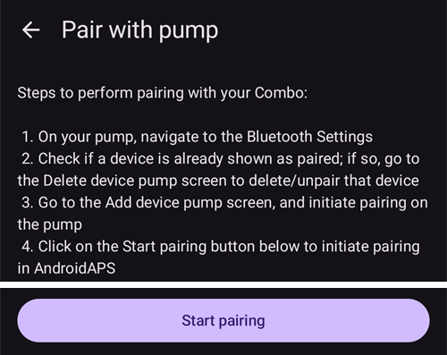
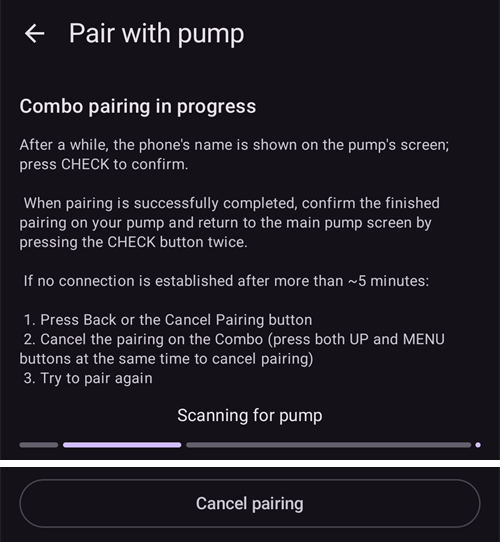
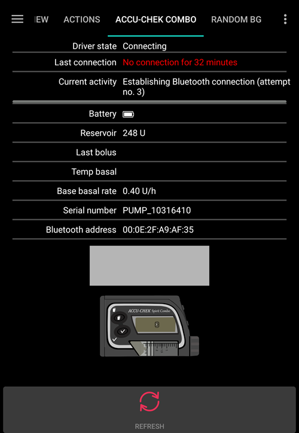

# Accu-Chek Combo

**이 소프트웨어는 DIY 솔루션의 일부이며 제품이 아닙니다. 사용 방법을 포함하여 시스템을 직접 읽고, 배우고, 이해해야 합니다. 이 소프트웨어가 당뇨 관리를 모두 대신해 주지는 않습니다. 하지만 필요한 시간을 들일 의지가 있다면 당뇨 관리와 삶의 질을 개선할 수 있습니다. 서두르지 말고 배울 시간을 충분히 가지십시오. 이 소프트웨어로 무엇을 하든 그 책임은 전적으로 사용자 본인에게 있습니다.**

```{admonition} Accu-Chek Combo is being phased out
:class: note

Roche는 당뇨 사업을 Accu-Chek SmartGuide CGM에 다시 집중하기 위해 인슐린 펌프 시장에서 철수하고 있습니다. Roche는 Accu-Chek Combo와 Accu-Chek Insight 펌프의 판매 종료를 알렸습니다. 남아 있는 Accu-Chek Solo 마이크로펌프도 단계적으로 중단되고 있습니다(독일에서는 2025년 말에 마지막 공급). 이 변경은 독일을 시작으로 지역별로 진행되며, 다른 유럽 시장도 뒤따를 것으로 예상됩니다. 이 펌프를 사용하고 있다면 지원되는 펌프로 바꿀 계획을 미리 세우십시오.
```

```{contents} Table of contents
:depth: 1
:local: true
```

## AAPS에서 사용할 수 있는 펌프 기능

* 추가 통신 장치 없이 휴대폰의 자체 블루투스로 **AAPS**와 통신합니다.
* DST와 시간대를 자동으로 처리합니다.

## 하드웨어와 소프트웨어의 필요 요건

* Roche Accu-Chek Combo(펌웨어 버전은 상관없으며, 모두 작동합니다).
* 펌프를 구성하기 위한 Smartpix 또는 Realtyme 장치와 360 Configuration Software. (Roche는 고객이 요청하면 Smartpix 장치와 구성 소프트웨어를 무료로 보내 줍니다.)
* Android 12 이상을 실행하는 호환 휴대폰. 자세한 내용은 [릴리스 노트](#maintenance-android-version-aaps-version)를 참조하십시오.
* 휴대폰에 설치된 **AAPS** 앱.

휴대폰의 블루투스 지원 품질과 매우 공격적인 추가 절전 기능이 있는지에 따라 어떤 휴대폰은 다른 휴대폰보다 더 잘 작동할 수 있습니다. 휴대폰 목록은 [스마트폰](#Phones-list-of-tested-phones) 문서에 있습니다. 이 목록은 완전한 목록이 아니며 사용자의 개인 경험을 반영한 것입니다. 여러분의 경험도 입력하여 다른 사람을 도와 주십시오(이 프로젝트들은 받은 도움을 다른 사람에게 돌려주는 것으로 이루어집니다).

(combov2-before-you-begin)=
## 시작하기 전에

**안전이 최우선** - 오류가 생겼을 때 복구할 수 없는 환경에서는 이 과정을 시도하지 마십시오. Smartpix / Realtyme 장치와 360 Configuration Software를 가까이에 준비해 두십시오. 모든 것을 설정하고 모든 것이 제대로 작동하는지 확인하는 데 약 1시간이 걸린다고 생각하십시오.

다음 제한 사항을 알아 두십시오.

* 확장 볼러스와 멀티웨이브 볼러스는 현재 지원되지 않습니다(대신 [확장 탄수화물 / "eCarbs"](../DailyLifeWithAaps/ExtendedCarbs.md)를 사용할 수 있습니다).
* 기저 프로파일은 하나(첫 번째 프로파일)만 지원됩니다.
* **프로파일**의 가장 낮은 기저 주입량은 0.05 U/h입니다. **AAPS**는 이보다 낮은 주입량이 있는 **프로파일**을 거부합니다. Combo는 기저 주입량을 자체 단위로 반올림합니다(1 U/h 미만은 0.01 U/h, 10 U/h까지는 0.05 U/h, 그 이상은 0.1 U/h). **AAPS**는 펌프가 실제로 주입하는 주입량을 사용합니다.
* 임시 기저 주입량은 현재 기저 주입량의 500%로 제한됩니다. **AAPS**는 이 제한을 고려합니다.
* 펌프에서 현재 활성화된 프로파일이 1번 프로파일이 아니면 루프가 비활성화됩니다. 이 상태는 1번 프로파일이 활성 프로파일이 될 때까지 계속됩니다. 그렇게 하면 다음에 AAPS가 연결할 때(잠시 후 자동으로, 또는 Accu-Chek Combo 펌프 화면에서 **새로고침**을 누를 때) 1번 프로파일이 현재 프로파일임을 알아차리고 루프를 다시 활성화합니다.
* 루프가 실행 중인 TBR을 취소하도록 요청하면, Combo는 대신 15분 동안 90% 또는 110%의 TBR을 설정합니다. 실제로 TBR을 취소하면 펌프에서 경고가 발생하고 진동이 많이 울리는데, 이 진동은 끌 수 없기 때문입니다.
* 블루투스 연결 안정성은 휴대폰마다 다르며, 펌프와 더 이상 연결되지 않는 "펌프에 연결할 수 없습니다" 경고가 발생할 수 있습니다. 이 오류가 발생하면 블루투스가 켜져 있는지 확인하고, 펌프 화면(**관리** > **펌프**)에서 **새로고침**을 눌러 일시적인 문제였는지 확인하십시오. 그래도 연결되지 않으면 휴대폰을 다시 시작하십시오. 보통 이렇게 하면 해결됩니다.
* 다시 시작해도 해결되지 않는 다른 문제도 있습니다. 이 경우 펌프가 휴대폰의 연결을 다시 받아들이려면 펌프의 버튼을 눌러야 합니다(이렇게 하면 펌프의 블루투스 스택이 초기화됩니다).
* 루프가 TBR을 제어하므로 펌프에서 직접 TBR을 설정하지 마십시오. 펌프에서 새 TBR을 감지하는 데 최대 20분이 걸릴 수 있으며, TBR의 효과는 감지된 시점부터만 계산됩니다. 따라서 최악의 경우 20분 동안의 TBR이 IOB에 반영되지 않을 수 있습니다.

드라이버는 현재 Combo에서 다음 언어를 지원하도록 작성되어 있습니다. (이것은 AAPS의 언어와는 관계가 없으며, Combo의 LCD 자체에 표시되는 언어입니다.)

* English
* 스페인어
* 프랑스어
* 이탈리아어
* 러시아어
* 터키어
* 폴란드어
* 체코어
* 헝가리어
* 슬로바키아어
* 루마니아어
* 크로아티아어
* 네덜란드어
* 그리스어
* 핀란드어
* 노르웨이어
* 포르투갈어
* 스웨덴어
* 덴마크어
* 독일어
* 슬로베니아어
* 리투아니아어

**중요**: 펌프가 이 목록에 없는 언어로 설정되어 있다면 개발자에게 연락하고, 펌프 언어를 이 목록에 있는 언어로 설정하십시오. 그렇지 않으면 드라이버가 제대로 작동하지 않습니다.

## 휴대폰 설정

배터리 최적화가 꺼져 있는지 반드시 확인해야 합니다. AAPS는 이러한 최적화가 적용되어 있는지 스스로 감지하고, 화면에서 최적화를 끄도록 요청합니다. 하지만 최신 Android 휴대폰에서는 블루투스 _자체_도 하나의 앱(시스템 앱)입니다. 그리고 보통 이 "블루투스 앱"은 _기본적으로 배터리 최적화가 켜진 상태로_ 실행됩니다. 그 결과 휴대폰이 전력을 아끼려고 블루투스 앱을 종료하면 블루투스가 응답하지 않을 수 있습니다. 따라서 블루투스 시스템 앱의 설정에서도 배터리 최적화를 꺼야 합니다. 안타깝게도 블루투스 시스템 앱을 찾는 방법은 휴대폰마다 다릅니다. 기본 Android에서는 Settings(설정) -> Apps(앱) -> See all N apps(N개 앱 모두 보기)로 이동합니다(N = 휴대폰에 설치된 앱 수). 그다음 오른쪽 위 모서리의 메뉴를 열고 "Show system"(시스템 앱 표시), "Show system apps" 또는 "All apps"(모든 앱)를 누릅니다. 이제 새로 펼쳐진 앱 목록에서 "Bluetooth"(블루투스) 앱을 찾습니다. 그 앱을 선택하고 "App info"(앱 정보) 화면에서 "Battery"(배터리)를 누릅니다. 여기에서 배터리 최적화를 끕니다(때로는 "battery usage"(배터리 사용량)라고 합니다).

## Combo 설정

* Accu-Chek 360 Configuration Software로 펌프를 구성합니다. 소프트웨어가 없다면 Accu-Chek 고객센터(핫라인)에 문의하십시오. 보통 등록된 사용자에게 "360° Pump Configuration Software"가 담긴 CD와 SmartPix USB-적외선 연결 장치를 보내 줍니다(Realtyme 장치가 있다면 그것도 사용할 수 있습니다).

  - **필수 설정**(스크린샷에서 초록색으로 표시):

     * 메뉴 구성을 "Standard"로 설정하거나 그대로 두십시오. 이렇게 하면 펌프에서 지원되는 메뉴/동작만 표시되고, 지원되지 않는 메뉴/동작(확장/멀티웨이브 볼러스, 여러 기저 주입량)은 숨겨집니다. 지원되지 않는 기능을 사용하면 루프를 안전하게 실행할 수 없으므로 루프 기능이 제한됩니다.
     * _Quick Info Text_가 "QUICK INFO"(따옴표 없이)로 설정되어 있는지 확인하십시오(_Insulin Pump Options_에 있습니다).
     * TBR _Maximum Adjustment_를 500%로 설정하십시오.
     * _Signal End of Temporary Basal Rate_를 끄십시오.
     * TBR _Duration increment_를 15 min으로 설정하십시오.
     * 블루투스를 켜십시오.

  - **권장 설정**(스크린샷에서 파란색으로 표시)

     * 카트리지 부족 알람을 원하는 대로 설정하십시오.
     * 소프트웨어의 버그로부터 보호하기 위해 치료에 맞는 최대 볼러스를 구성하십시오.
     * 마찬가지로 안전 장치로 최대 TBR 지속 시간을 구성하십시오. 펌프를 3시간 동안 분리하는 옵션은 3시간 동안 0%를 설정하므로, 최소 3시간을 허용하십시오.
     * 펌프에서 볼러스를 주입하지 못하도록 펌프의 키 잠금을 켜십시오. 특히 예전에 펌프를 사용하면서 빠른 볼러스를 습관적으로 사용했다면 더욱 그렇습니다.
     * 디스플레이 시간 초과와 메뉴 시간 초과를 각각 최솟값인 5.5와 5로 설정하십시오. 이렇게 하면 AAPS가 오류 상황에서 더 빨리 복구할 수 있고, 이러한 오류 중에 발생할 수 있는 진동 횟수가 줄어듭니다.

  

  

  

  

## 드라이버 활성화와 Combo 페어링

* 왼쪽 위 모서리의 **메뉴**(☰)를 열고 [**구성** > **펌프**](../SettingUpAaps/ConfigBuilder.md)로 이동하여 **Accu-Chek Combo**를 선택합니다.

  

  선택하면 **Accu-Chek Combo** 카드에 **설정**과 **플러그인 열기**의 두 버튼이 표시됩니다.

  

  **설정**은 Accu-Chek Combo 드라이버의 설정을 엽니다(아래의 [설정](#combov2-preferences) 참조).

  

  **플러그인 열기**(또는 **관리** > **펌프**)는 Accu-Chek Combo 펌프 화면을 엽니다. 펌프를 페어링하기 전에는 **펌프에 페어링되지 않음**이 표시됩니다.

  

* 펌프 화면에서 **페어링**을 누릅니다. **펌프와 페어링** 화면이 열립니다. 화면에 표시된 단계를 따른 다음 **페어링 시작**을 누릅니다. Android가 휴대폰을 다른 블루투스 기기에 표시할 수 있도록 권한을 요청하면 **Allow**(허용)를 누릅니다. 잠시 후 Combo 화면에 10자리 페어링 PIN이 표시되고, **AAPS**가 이 PIN을 요청합니다. 이 PIN을 **10자리 PIN** 필드에 입력합니다.

  

  

  

  다음 그림은 이전 **AAPS** 버전의 것입니다. 단계와 문구는 같지만 화면 모양이 조금 다릅니다.

  

  

  

* PIN을 잘못 입력하면 **AAPS**가 **PIN이 맞지 않습니다. 오타가 있는지 확인하십시오. 계속 이런 일이 생기면 페어링을 취소하고 다시 시도하십시오.**를 표시합니다.

  

* **Combo와 성공적으로 페어링됨**이 표시되면 **확인**을 누릅니다. 펌프 화면으로 돌아가며, 이제 펌프 상태가 표시됩니다(아래의 [Accu-Chek Combo 펌프 화면 내용](#combov2-tab-contents) 참조). **페어링** 버튼이 **페어링 해제** 버튼으로 바뀝니다.

* 설정을 확인하려면(안전을 위해 펌프를 모든 캐뉼라에서 **분리한** 상태로!) AAPS로 15분 동안 500%의 TBR을 설정하고 볼러스를 주입하십시오. 이제 펌프에서 TBR이 실행 중이고 이력에 볼러스가 있어야 합니다. AAPS에도 활성 TBR과 주입된 볼러스가 표시되어야 합니다.

* Combo에서는 펌프에서 볼러스를 주입하지 못하도록 키 잠금을 켜는 것을 권장합니다. 특히 예전에 펌프를 사용하면서 "quick bolus"(빠른 볼러스) 기능을 습관적으로 사용했다면 더욱 그렇습니다.

## 페어링에 대한 참고 사항

Accu-Chek Combo는 블루투스 4.0이 발표되기 전, 그리고 최초의 Android 버전이 발표된 지 겨우 1년 뒤에 개발되었습니다. 그래서 다른 기기와 페어링하는 방식이 오늘날 Android에서 페어링하는 방식과 100% 호환되지는 않습니다. 이 문제를 완전히 해결하려면 AAPS에 시스템 수준 권한이 필요한데, 이 권한은 시스템 앱만 가질 수 있습니다. 시스템 앱은 휴대폰 제조사가 휴대폰에 설치하며, 사용자는 시스템 앱을 설치할 수 없습니다.

그 결과 페어링이 100% 문제없이 진행되지는 않습니다. 특히 페어링 중에 Android의 블루투스 PIN 대화 상자가 잠깐 나타났다가 자동으로 사라질 수 있습니다. 하지만 때로는 화면에 계속 남아서 4자리 PIN을 요청합니다. (이것을 10자리 Combo 페어링 PIN과 혼동하지 마십시오.) 아무것도 입력하지 말고 취소만 누르십시오. 페어링이 계속되지 않으면 화면의 안내에 따라 페어링을 다시 시도하십시오.

(combov2-tab-contents)=
## Accu-Chek Combo 펌프 화면 내용

펌프 화면을 열려면 **관리** > **펌프**로 이동합니다. 펌프가 페어링되면 다음 정보가 표시됩니다(항목은 위에서 아래 순서로 나열되어 있습니다).


1. **드라이버 상태**: 드라이버는 다음 상태 중 하나일 수 있습니다.
   - **연결 끊김**: 블루투스 연결이 없습니다. 드라이버는 대부분의 시간 동안 이 상태이며, 필요할 때만 펌프에 연결합니다. 이렇게 하면 전력이 절약됩니다.
   - **연결 중**
   - **펌프 점검**: 펌프가 연결되었지만, 드라이버가 모든 것이 정상이고 최신 상태인지 확인하기 위해 안전 점검을 하고 있습니다.
   - **준비**: 드라이버가 AAPS의 명령을 받을 준비가 되었습니다.
   - **중지됨**: 펌프가 중지되었습니다(Combo에서는 "stopped"로 표시됨).
   - 실행 중인 명령에 대한 설명. 예: **기저 프로파일 설정** 또는 **펌프 상태 업데이트**
   - **오류**: 오류가 발생했습니다. 연결이 종료되었고, 진행 중이던 명령이 모두 중단되었습니다.
2. **마지막 연결**: 드라이버가 몇 분 전에 Combo에 성공적으로 연결했는지 표시합니다. 30분을 넘으면 이 항목이 빨간색으로 표시됩니다.
3. **배터리**: 배터리 잔량입니다. Combo는 **가득 참**, **낮음**, **비어 있음**만 알려 주고 그보다 정확한 값(예: 퍼센트)은 제공하지 않으므로, 여기에는 이 세 단계만 표시됩니다.
4. **레저버**: 현재 Combo의 레저버에 들어 있는 IU의 양
5. **마지막 볼러스**: 마지막 볼러스가 몇 분 전에 주입되었는지 표시합니다. AAPS를 시작한 뒤 아직 주입된 볼러스가 없으면 표시되지 않습니다.
6. **임시 기저**: 현재 활성화된 임시 기저의 세부 정보입니다. 활성화된 임시 기저가 없으면 표시되지 않습니다.
7. **기본 기저 주입량**: 현재 활성화된 기본 기저 주입량("기본"은 기저 주입량 비율에 영향을 주는 활성 TBR이 없는 상태의 기저 주입량을 뜻합니다)
8. **일련번호**: 펌프가 알려 주는 Combo 일련번호(Combo 뒷면에 표시된 일련번호와 같습니다)
9. **블루투스 주소**: `XX:XX:XX:XX:XX:XX` 형식으로 표시되는 Combo의 6바이트 블루투스 주소

드라이버가 작업을 하는 동안(예: 기저 프로파일 설정) 목록 아래의 상자에 현재 작업이 설명되고, 얇은 진행 표시줄로 진행 상황이 표시됩니다.

Combo는 블루투스를 통해 _원격 터미널_ 모드 또는 _명령_ 모드로 작동할 수 있습니다. 원격 터미널 모드는 Combo 혈당 측정기의 "원격 조작 모드"에 해당하며, 펌프의 LCD와 네 개의 버튼을 흉내 냅니다. 일부 명령은 명령 모드에 해당하는 기능이 없으므로 드라이버가 이 모드에서 실행해야 합니다. 명령 모드는 훨씬 빠르지만, 앞서 말했듯이 할 수 있는 일이 제한됩니다. 원격 터미널 모드가 활성화되어 있으면 Combo 그림 바로 위에 있는 필드에 현재 원격 터미널 화면이 표시됩니다. 하지만 드라이버가 명령 모드로 전환하면 이 필드는 비어 있습니다.

(사용자가 이것에 영향을 주지는 않습니다. 어떤 모드를 사용할지는 드라이버가 전적으로 스스로 결정합니다. 이것은 그 필드에 가끔 Combo 화면이 보이는 이유를 알려 드리기 위한 참고 사항일 뿐입니다.)

아래쪽에는 다음 버튼이 있습니다.

- **새로고침**: 펌프 상태를 즉시 업데이트합니다. 또한 이전에 발견된 오류가 이제 해결되었으니 AAPS가 모든 것이 정상인지 다시 확인해도 된다는 것을 AAPS에 알릴 때도 사용합니다(자세한 내용은 아래의 [경고에 대한 섹션](#combov2-alerts) 참조). 드라이버가 연결 끊김, 중지됨 또는 오류 상태일 때만 누를 수 있습니다.
- **페어링 해제**: **펌프 페어링을 해제하시겠습니까?**를 확인하면 페어링된 Combo를 **AAPS**와 Android에서 페어링 해제합니다. 페어링된 펌프가 없으면 이 버튼이 **페어링** 버튼으로 바뀝니다.

(combov2-preferences)=
## 설정

Combo 드라이버에는 다음 설정이 있습니다(**구성** > **펌프** > **Accu-Chek Combo** > **설정**, 또는 펌프 화면의 설정 아이콘(톱니바퀴)). 항목은 위에서 아래 순서로 나열되어 있습니다.

1. **검색 기간(초)**: 페어링할 때 드라이버가 휴대폰을 펌프가 검색할 수 있는 상태로 만듭니다. 이 설정은 검색 가능한 상태가 얼마나 오래 유지되는지 정합니다. 기본값으로 최댓값(300초 = 5분)이 선택되어 있습니다. Android에서는 검색 가능 상태를 무기한 유지할 수 없으므로 지속 시간을 정해야 합니다.
2. **인슐린 레저버 교체를 자동으로 감지하고, 자동으로 입력함**: 켜면, 보통 **관리** > **프라임/채우기**에서 직접 입력하는 "레저버 교체"를 드라이버가 입력합니다. 이에 대해서는 [아래에서 더 자세히](#combov2-autodetections) 설명합니다.
3. **배터리 교체를 자동으로 감지하고, 자동으로 입력함**: 켜면, 보통 **관리** > **펌프 배터리 교체**에서 직접 입력하는 "배터리 교체"를 드라이버가 입력합니다. 이에 대해서는 [아래에서 더 자세히](#combov2-autodetections) 설명합니다.
4. **Combo 상세 로그 활성화**: 드라이버가 남기는 로그의 양이 크게 늘어납니다. **주의**: 개발자가 요청하지 않는 한 이 설정을 켜지 마십시오. 그렇지 않으면 **AAPS** 로그에 불필요한 내용이 많아져 로그의 유용성이 떨어질 수 있습니다.

페어링과 페어링 해제는 설정이 아니라 펌프 화면에서 합니다(위 참조).

(combov2-autodetections)=
## 배터리 및 레저버 교체의 자동 감지와 자동 입력

드라이버는 배터리 잔량과 레저버 잔량을 계속 추적하여 배터리 및 레저버 교체를 감지할 수 있습니다. 마지막으로 펌프 상태를 업데이트했을 때 Combo가 배터리 잔량을 낮음으로 보고했고, 이번 펌프 상태 업데이트에서 배터리 잔량이 정상으로 나타나면, 드라이버는 사용자가 배터리를 교체했다고 판단합니다. 레저버 잔량에도 같은 방식을 사용합니다. 레저버 잔량이 이전보다 많아졌으면 레저버 교체로 해석합니다.

이 기능은 잔량이 낮음으로 보고되었을 때 배터리와 레저버를 교체하고, _그리고_ 배터리와 레저버가 충분히 채워졌을 때만 작동합니다.

이 자동 감지 기능은 드라이버 [설정](#combov2-preferences)에서 끌 수 있습니다.

(combov2-alerts)=
## 경고(warning)와 오류(error), 그리고 처리 방법

Combo는 경고를 원격 터미널 화면으로 표시합니다. 경고는 "Wx" 코드(x는 숫자)와 짧은 설명으로 표시됩니다. 예를 들면 "W7", "TBR OVER"가 있습니다. 오류도 비슷하지만 대신 "Ex" 코드로 표시됩니다.

일부 경고는 드라이버가 자동으로 해제합니다. 그 경고는 다음과 같습니다.

- W1 "reservoir low" : 드라이버가 이 경고를 AAPS 메인 화면에 표시되는 "레저버 부족" 경고로 바꿉니다.
- W2 "battery low" : 드라이버가 이 경고를 AAPS 메인 화면에 표시되는 "배터리 부족" 경고로 바꿉니다.
- W3, W6, W7, W8 : 모두 사용자에게 정보를 알리는 경고일 뿐이므로 드라이버가 자동으로 해제해도 안전합니다.

다른 경고는 자동으로 해제되지 _않습니다_. 또한 오류는 _절대_ 자동으로 해제되지 않습니다. 이 두 경우는 같은 방식으로 처리됩니다. 드라이버가 AAPS 화면 위에 경고 대화 상자를 띄우고, 진행 중인 명령 실행을 모두 중단합니다. 그러면 드라이버가 "오류" 상태로 바뀝니다([위의 Accu-Chek Combo 펌프 화면 내용](#combov2-tab-contents) 참조). 이 상태에서는 어떤 명령도 실행할 수 없습니다. 사용자가 펌프에서 오류를 처리해야 합니다. 예를 들어 막힘 오류가 생기면 캐뉼라를 교체해야 할 수 있습니다. 사용자가 오류를 처리한 뒤 Accu-Chek Combo 펌프 화면에서 **새로고침**을 누르면 정상 작동을 재개할 수 있습니다. 그러면 드라이버가 Combo에 연결하여 상태를 업데이트하고, 화면에 아직 오류가 표시되는지 등을 확인합니다. 또한 드라이버는 잠시 후 펌프 상태를 자동으로 새로 고치므로, 그 버튼을 직접 누를 필요는 없습니다.

볼러스는 특별한 경우입니다. 볼러스는 Combo의 명령 모드에서 실행되는데, 이 모드는 볼러스 중에 경고가 나타나도 알려 주지 않습니다. 그 결과 드라이버는 볼러스 _도중에_ 경고를 자동으로 해제할 수 없습니다. 안타깝게도 볼러스가 끝날 때까지 펌프에서 경고음이 울린다는 뜻입니다. 볼러스 중 가장 흔한 경고는 보통 W1 "reservoir low"(레저버 부족)입니다. 볼러스 중에는 Combo 경고를 펌프에서 직접 해제하지 **마십시오**. 볼러스가 중단될 위험이 있습니다. 볼러스가 끝나면 드라이버가 경고를 처리합니다.

드라이버가 Combo에 연결되어 있지 않은 동안 발생한 경고는 드라이버가 알아차리지 못합니다. Combo는 경고를 휴대폰으로 자동 전송할 방법이 없습니다. 연결은 항상 휴대폰이 시작해야 합니다. 그 결과 드라이버가 펌프에 연결할 때까지 경고가 계속 남아 있습니다. 펌프 화면에서 **새로고침**을 누르면 연결을 시작하여 드라이버가 그 자리에서 바로 경고를 처리하게 할 수 있습니다(AAPS가 스스로 연결을 시작할 때까지 기다리지 않아도 됩니다).

**중요**: 오류가 발생하거나 자동으로 해제되지 않는 경고가 나타나면 드라이버는 오류 상태가 됩니다. 이 상태에서는 펌프 상태를 새로 고칠 때까지 루프가 **차단됩니다**! 펌프 상태가 업데이트되고(**새로고침**을 누르거나 드라이버가 자동으로 업데이트하여) 더 이상 오류가 표시되지 않으면 차단이 해제됩니다.

## Combo를 사용할 때 주의할 점

* 이것은 제품이 아니라는 점을 기억하십시오. 특히 처음에는 사용자가 시스템과 그 한계, 그리고 시스템이 어떻게 실패할 수 있는지를 지켜보고 이해해야 합니다. 사용하는 사람이 시스템을 완전히 이해할 수 없다면 이 시스템을 사용하지 말 것을 강력히 권고합니다.
* Combo의 원격 조작 기능이 작동하는 방식 때문에, 일부 작업(특히 기저 프로파일 설정)은 다른 펌프보다 느립니다. 이것은 극복할 수 없는 Combo의 안타까운 한계입니다.
* 펌프에서 TBR을 설정하거나 취소하지 마십시오. 루프가 TBR을 제어하며, 사용자가 펌프에서 설정한 TBR의 시작 시간을 알 수 없으므로 그렇지 않으면 루프가 안정적으로 작동할 수 없습니다.
* AAPS가 펌프와 통신하는 동안에는 펌프의 버튼을 누르지 마십시오(펌프가 AAPS에 연결되어 있는 동안 펌프에 블루투스 로고가 표시됩니다). 버튼을 누르면 블루투스 연결이 끊어집니다. 연결에 문제가 있을 때만 그렇게 하십시오([위의 "시작하기 전에" 섹션](#combov2-before-you-begin) 참조).
* 펌프가 볼러스를 주입하는 동안에는 버튼을 누르지 마십시오. 특히 버튼을 눌러 경고를 해제하려고 하지 마십시오. 그 이유에 대한 자세한 설명은 [경고에 대한 섹션](#combov2-alerts)을 참조하십시오.

## Combo와 연결할 수 없을 때의 점검 목록

드라이버는 Combo에 연결하기 위해 최선을 다하며, 안정성을 높이기 위해 몇 가지 방법을 사용합니다. 그래도 때때로 연결되지 않을 수 있습니다. 이 상황을 해결하기 위해 시도할 수 있는 단계는 다음과 같습니다.

1. Combo의 버튼을 누르십시오. 때때로 Combo의 블루투스 스택이 응답하지 않고 더 이상 연결을 받아들이지 않습니다. Combo의 버튼을 눌러 LCD에 무언가가 표시되게 하면 블루투스 스택이 초기화됩니다. 대부분은 이 단계만으로 연결 문제가 해결됩니다.
2. 휴대폰을 다시 시작하십시오. 휴대폰의 블루투스 스택 자체에 문제가 있으면 이 단계가 필요할 수 있습니다.
3. Combo의 배터리 캡이 오래되었다면 교체를 고려하십시오. 오래된 배터리 캡은 Combo의 전원 공급에 문제를 일으킬 수 있으며, 이것이 블루투스에 영향을 줍니다.
4. 그래도 계속 연결에 실패하면 펌프의 페어링을 해제한 다음 다시 페어링하는 것을 고려하십시오.

(combov2-tips-for-basic-usage)=
## 기본 사용 팁

### 원활한 작동을 위한 방법

* 항상 **스마트폰을 몸에 지니고** 다니고, 밤에는 침대 옆에 두십시오. 잠자는 동안 펌프가 몸 뒤나 아래에 있을 수 있으므로, 휴대폰은 높은 곳(선반이나 받침대 위)에 두는 것이 가장 좋습니다.
* 펌프 배터리가 항상 최대한 가득 차 있도록 하십시오. 배터리에 대한 팁은 배터리 섹션을 참조하십시오.
* 가능하면 펌프는 AAPS 앱으로만 조작하십시오. 이를 위해 펌프에서 **PUMP SETTINGS / KEY LOCK / ON**으로 키 잠금을 켜십시오. 배터리나 카트리지를 교체할 때만 펌프의 버튼을 사용해야 합니다.


### 펌프에 연결할 수 없습니다. 어떻게 해야 합니까?

#### 펌프 연결 불가 알람 켜기
* **AAPS**에서 메인 화면 오른쪽 위의 **설정**(톱니바퀴) 아이콘을 누르고 **로컬 알림**으로 이동하여 **펌프에 연결할 수 없으면 경고**를 켜고 **펌프 연결 불가 기준값**을 **31**분으로 설정합니다.
* 이렇게 하면 휴대폰을 책상에 두고 방을 나갈 때는 알람이 울리지 않을 만큼 시간 여유가 있으면서도, 펌프에 임시 기저 주입량의 지속 시간보다 오래 연결할 수 없으면 알려 줍니다.

#### 펌프 연결 복구

* AAPS가 **펌프에 연결할 수 없습니다** 알람을 알리면, 먼저 키 잠금을 풀고 **펌프의 아무 버튼이나 누르십시오**(예: "down" 버튼). 펌프 화면이 꺼지면 바로 Accu-Chek Combo 펌프 화면(**관리** > **펌프**)에서 **새로고침**을 누릅니다. 대부분 그러면 통신이 다시 작동합니다.
* 그래도 해결되지 않으면 스마트폰을 다시 시작하십시오. 다시 시작하면 AAPS가 다시 활성화되고 펌프와 새로 연결됩니다.

* 여러 스마트폰으로 시험한 결과, 일부 스마트폰에서 "펌프에 연결할 수 없습니다" 오류가 다른 스마트폰보다 더 자주 발생했습니다. 시험에 성공한 스마트폰은 [스마트폰](#Phones-list-of-tested-phones)을 참조하십시오.

#### 잦은 통신 오류의 근본 원인과 결과
* **메모리가 적은** 휴대폰(또는 **공격적인 절전** 설정이 있는 휴대폰)에서는 AAPS가 자주 종료됩니다. 이 경우 AAPS를 열 때 시스템이 초기화 중이어서 메인 화면에 처치 버튼(QuickLaunch 툴바)이 표시되지 않는 것으로 알 수 있습니다. 이로 인해 시작할 때 "펌프에 연결할 수 없습니다" 알람이 울릴 수 있습니다. 펌프 화면(**관리** > **펌프**)의 **마지막 연결** 필드에서 AAPS가 마지막으로 펌프와 통신한 시간을 확인할 수 있습니다.



* 앱이 다시 시작될 때 펌프에서 기저 프로파일을 읽으므로, 이 오류는 펌프 배터리를 더 빨리 소모시킬 수 있습니다.
* 또한 펌프의 버튼을 누를 때까지 펌프가 들어오는 연결을 모두 거부하게 되는 오류가 발생할 가능성도 높아집니다.

### 임시 기저 주입량 취소 실패
* 가끔 AAPS가 **TBR CANCELED** 경고를 자동으로 해제하지 못할 수 있습니다. 그러면 Accu-Chek Combo 펌프 화면에서 **새로고침**을 누르거나 펌프에서 알람을 확인해야 합니다.

### 펌프 배터리 관련 사항

#### 배터리 교체
* **low battery** 알람이 울린 뒤에는, 휴대폰이 펌프에서 더 멀리 떨어져 있어도 스마트폰과 안정적으로 블루투스 통신을 할 수 있는 충분한 전력을 항상 확보하기 위해 가능한 한 빨리 배터리를 교체해야 합니다.
* **low battery** 알람이 울린 뒤에도 배터리를 상당히 오래 사용할 수 있습니다. 하지만 "low battery" 알람이 울린 뒤에는 항상 새 배터리를 가지고 다니는 것을 권장합니다.
* 배터리를 교체하기 전에 메인 화면의 **루프** 기호를 누르고 **루프 일시 중지**를 1시간 동안 선택하십시오.
* 휴대폰이 펌프와 통신하고 펌프의 블루투스 로고가 사라질 때까지 기다리십시오.


* 펌프의 키 잠금을 풀고, 펌프를 정지 모드로 바꾸고, 취소되었을 수 있는 임시 기저 주입량을 확인한 다음, 배터리를 빨리 교체하십시오.
* 배터리를 교체한 뒤 펌프 시계를 다시 설정할 필요는 없습니다. AAPS가 펌프의 날짜와 시간을 자동으로 업데이트합니다.
* 그다음 펌프를 다시 실행 모드로 바꾸고, 메인 화면에서 **루프 일시 중지됨** 아이콘을 눌러 **재개**를 선택하십시오.
* 다음 혈당 값이 들어오면 AAPS가 필요한 임시 기저 주입량을 다시 설정합니다.

(Accu-Chek-Combo-Tips-for-Basic-usage-battery-type-and-causes-of-short-battery-life)=
#### 배터리 종류와 배터리 수명이 짧은 원인
* 블루투스 통신을 많이 하면 전력을 많이 쓰므로, Energizer Ultimate Lithium, "대형" Accu-Chek 서비스 팩에 들어 있는 "power one" 같은 **고품질 배터리**만 사용하십시오. 충전식 배터리를 쓰려면 Eneloop 배터리를 사용하십시오.

 

배터리 종류별 일반적인 사용 기간은 다음과 같습니다.
* **Energizer Ultimate Lithium**: 4~7주
* 서비스 팩의 **Power One Alkaline**(Varta): 2~4주
* **Eneloop 충전식** 배터리(BK-3MCCE): 1~3주

배터리 수명이 위의 범위보다 훨씬 짧다면 다음과 같은 원인을 확인하십시오.
* Combo 펌프의 나사식 배터리 캡 중 일부는 배터리를 부분적으로 단락시켜 배터리를 빨리 소모시킵니다. 이 문제가 없는 캡은 금색 금속 접점으로 알아볼 수 있습니다.
* 배터리를 잠깐 교체하는 동안 펌프 시계가 "유지되지" 않으면, 짧은 정전 동안 시계를 계속 작동시키는 축전기가 고장 났을 가능성이 높습니다. 이 경우 Roche에서 펌프를 교환받으면 도움이 될 수 있으며, 보증 기간 중에는 문제없이 교환할 수 있습니다.
* 스마트폰 하드웨어와 소프트웨어(Android 운영 체제와 블루투스 스택)도 펌프의 배터리 수명에 영향을 주지만, 정확한 요인은 아직 완전히 밝혀지지 않았습니다. 기회가 있다면 다른 스마트폰을 사용해 보고 배터리 수명을 비교해 보십시오.

### 확장 볼러스, 멀티웨이브 볼러스
OpenAPS 알고리즘은 병행하는 확장 볼러스나 멀티웨이브 볼러스를 지원하지 않습니다. 하지만 다음 대안으로 비슷한 처치를 할 수 있습니다.
* 탄수화물을 입력하거나 볼러스 마법사를 사용할 때, 식사 전체의 탄수화물과 그 탄수화물이 혈당으로 나타날 것으로 예상되는 시간을 입력하여 **확장 탄수화물 (e-carbs)**를 사용하십시오. 그러면 시스템이 작은 탄수화물을 전체 시간에 고르게 나누어 계산하므로, 알고리즘이 전체적인 혈당 상승/하강을 계속 확인하면서 그에 맞는 인슐린을 주입합니다. 멀티웨이브 볼러스처럼 하려면 작은 즉시 볼러스와 확장 탄수화물을 함께 사용할 수도 있습니다.
* 식사 전에 80 mg/dL(4.4 mmol/L)의 **식사 직전** 임시 목표를 몇 시간 동안 설정하십시오(메인 화면에서 목표를 누르거나 **관리** > **임시 목표**). 지속 시간은 확장 볼러스에 선택했을 시간 간격을 기준으로 정해야 합니다. 이렇게 하면 목표가 평소보다 낮게 유지되어 주입되는 인슐린 양이 늘어납니다.
* 그다음 **볼러스 마법사**로 식사 전체의 탄수화물을 입력하되, 제안된 값을 바로 적용하지는 마십시오. 멀티웨이브 볼러스와 비슷하게 주입하려면 인슐린 용량을 낮게 수정하십시오. 식사에 따라 알고리즘은 이제 혈당 상승을 막기 위해 추가 SMB나 더 높은 임시 기저 주입량을 주입해야 합니다. 이때 기저 주입량의 안전 제한(최대 U/h, 최대 기저 IOB)은 매우 신중하게 시험해 보고, 필요하면 일시적으로 변경해야 합니다.

* 펌프에서 직접 확장 볼러스나 멀티웨이브 볼러스를 사용하지 마십시오. 드라이버는 이 기능을 지원하지 않습니다([시작하기 전에](#combov2-before-you-begin) 참조). 그래도 펌프에서 멀티웨이브 볼러스를 주입하면, **AAPS**는 펌프 이력에서 이것을 일반 볼러스와 확장 볼러스로 기록하므로 IOB에 포함됩니다. 확장 볼러스는 폐쇄 루프 환경에서 작동하지 않습니다(자세한 내용은 [이 페이지](#extended-bolus-and-why-they-wont-work-in-closed-loop-environment) 참조).

### 볼러스 주입 시 알람
* 볼러스를 주입할 때마다 드라이버는 펌프의 볼러스 이력을 읽습니다. 이것은 펌프에서 직접 볼러스를 주입한 경우에도 활성 인슐린(IOB)을 올바르게 계산하기 위한 안전 장치입니다.
* 볼러스 전에 펌프 이력에 **AAPS**가 몰랐던 볼러스(예: 펌프에서 직접 주입한 볼러스)가 있으면, 요청한 볼러스는 그 인슐린을 빼고 계산되었으므로 **주입되지 않습니다**. **AAPS**는 **펌프 이력에 AAPS가 몰랐던 볼러스가 있습니다. 요청한 볼러스는 주입하지 않았습니다...**를 표시합니다. 펌프의 볼러스 이력과 IOB를 확인하십시오. 볼러스가 아직 필요하면 다시 계산하십시오. 새로 연결했을 때 알 수 없는 볼러스가 발견된 경우에도 마찬가지입니다.
* 볼러스는 주입되었지만 펌프 이력에 **AAPS**가 몰랐던 다른 볼러스도 있었다면, 그 볼러스는 이제 기록되고 **AAPS**가 다음 볼러스 전에 IOB를 확인하도록 요청합니다.
* 볼러스 **도중에** 펌프와의 연결이 끊기면, **AAPS**는 0 U로 기록하지 않습니다. 그때까지 펌프가 주입한 양을 표시하고, 펌프가 나머지를 계속 주입할 수 있다고 경고합니다. **다시 볼러스하지 마십시오.** **AAPS**는 다음 연결 때 펌프 이력에서 실제 주입량을 읽습니다.
* **AAPS**가 볼러스를 보내는 동안 연결이 끊기면, 펌프가 볼러스를 받았는지 알 수 없습니다. 다음 볼러스 전에 펌프의 볼러스 이력을 확인하십시오.
* **AAPS**가 볼러스 주입을 확인할 수 없으면 **볼러스 주입에 실패했습니다. 볼러스가 주입되지 않은 것으로 보입니다. 이중 볼러스를 피하기 위해 펌프를 확인한 다음 다시 볼러스하십시오.**를 표시합니다. 볼러스는 절대 자동으로 재시도되지 않습니다.

## 도움을 받을 수 있는 곳

Combo 드라이버는 커뮤니티가 **자원봉사**로 개발하고 있습니다. 도움을 요청하기 전에:

1. 기능이 어떻게 작동해야 하는지 확인하려면 이 문서의 관련 부분을 **읽으십시오**.
2. [Discord](https://discord.gg/4fQUWHZ4Mw)의 *#AAPS* 채널이나 다른 [커뮤니티 채널](../GettingHelp/WhereCanIGetHelp.md)에서 **질문하십시오**.
3. [기존 이슈](https://github.com/nightscout/AndroidAPS/issues)를 검색하여 **버그를 보고하십시오**. 목록에 없으면 [새 이슈](https://github.com/nightscout/AndroidAPS/issues)를 열고 [로그 파일](../GettingHelp/AccessingLogFiles.md)을 첨부하십시오.

도움을 요청할 때는 휴대폰 제조사와 모델, Android 버전, **AAPS** 버전, 그리고 문제를 쉬운 말로 설명한 내용(무엇이 바뀌었는지, 마지막으로 정상 작동한 때가 언제인지)을 포함하십시오.
