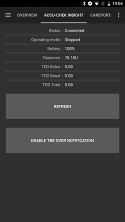

# Accu-Chek Insight

**이 소프트웨어는 DIY 인공 췌장 솔루션의 일부이며 제품이 아닙니다. 하지만 여러분이 직접 사용법을 포함하여 시스템을 읽고, 배우고, 이해해야 합니다. 이 소프트웨어가 당뇨 관리를 모두 대신해 주지는 않지만, 필요한 시간을 들일 준비가 되어 있다면 당뇨 관리와 삶의 질을 개선하는 데 도움이 됩니다. 서두르지 마시고, 배울 시간을 충분히 가지십시오. 이 소프트웨어로 하는 일에 대한 책임은 오직 사용자 본인에게 있습니다.**

```{admonition} Accu-Chek Insight는 단계적으로 판매가 중단되고 있습니다 :class: note

Roche는 당뇨 제품을 Accu-Chek SmartGuide CGM에 다시 집중하기 위해 인슐린 펌프 시장에서 철수하고 있습니다. Roche는 Accu-Chek Combo와 Accu-Chek Insight 펌프의 판매 종료를 알렸습니다. 남아 있는 Accu-Chek Solo 마이크로펌프도 단계적으로 중단되고 있습니다(독일에서는 2025년 말에 마지막 공급). 이 변경은 독일을 시작으로 지역별로 진행되며, 다른 유럽 시장도 뒤따를 것으로 예상됩니다. Insight 지원은 이미 종료된 것으로 표시되어 있습니다([더 이상 판매되지 않는 펌프](./Future-possible-Pump-Drivers.md) 참조). 이 펌프를 사용하고 있다면 지원되는 펌프로 바꿀 계획을 미리 세우십시오.

    <br />```{note}
    **AAPS**에 자체 Insight 드라이버가 생기기 전에는 별도의 [SightRemote](https://github.com/TebbeUbben/SightRemote) 앱으로 Insight를 제어했습니다. SightRemote는 더 이상 필요하지 않으며 유지 관리되지 않습니다. 그때 설치한 앱이 아직 있다면 삭제하고 최신 버전의 **AAPS**를 사용하십시오.
    

```{contents} 목차 :depth: 1 :local: true

    <br />## AAPS와 함께 사용할 때 펌프 기능
    
    * 추가 통신 장치 없이 휴대폰의 자체 블루투스로 **AAPS**와 통신합니다.
    * 서머타임(DST)과 시간대 변경을 자동으로 처리합니다.
    
    ## 하드웨어 및 소프트웨어 요구 사항
    
    * Roche Accu-Chek Insight 펌프(모든 펌웨어에서 작동합니다)
    
    참고: AAPS는 데이터를 항상 **펌프의 첫 번째 기저 주입량 프로파일**에 씁니다.
    
    * Android 12 이상을 실행하는 Android 휴대폰([스마트폰](../Getting-Started/Phones.md) 참조)
    * 휴대폰에 설치된 AAPS 앱
    
    ## 설정
    
    * Insight 펌프는 한 번에 하나의 기기에만 연결해야 합니다. 이전에 Insight 리모컨(측정기)을 사용했다면 펌프의 페어링된 기기 목록에서 측정기를 제거해야 합니다: **Menu** > **Settings** > **Communication** > **Remove device**.
    
       
    
    * [구성 > 펌프](#Config-Builder-pump)에서 **아큐-첵 Insight** 카드를 선택하십시오. 한 번에 하나의 펌프만 활성화할 수 있습니다.
    
       
    
       선택하면 **아큐-첵 Insight** 카드에 **설정**과 **플러그인 열기** 두 버튼이 표시됩니다:
    
       
    
       **설정**은 Accu-Chek Insight 드라이버의 설정을 엽니다([AAPS 설정](#Accu-Chek-Insight-Pump-settings-in-aaps) 참조).
    
       **플러그인 열기**(또는 **관리 → 펌프**)는 Accu-Chek Insight 펌프 화면을 엽니다. 펌프를 페어링하기 전에는 다음과 같이 보입니다:
    
       
    
    (accu-chek-insight-pairing)=
    ### 페어링
    
    * 펌프 화면에서 **Insight 페어링**을 누르십시오. 페어링 마법사가 열리고 주변의 블루투스 기기를 검색합니다(아래 그림의 위쪽).
    * Insight 펌프에서 **Menu** > **Settings** > **Communication** > **Add Device**로 이동하십시오. 펌프에 펌프 일련번호가 있는 다음 화면이 표시됩니다(아래 그림의 아래쪽).
    
       
    
    * 휴대폰으로 돌아와 블루투스 기기 목록에서 펌프 일련번호를 누르십시오. Android가 페어링을 확인하라고 요청하면 **페어링**을 누르십시오.
    
       
    
    * 펌프와 휴대폰에 모두 코드가 표시됩니다. 두 기기의 코드가 같은지 확인하십시오. 펌프에서 확인하고, 휴대폰에서 **네**를 누르십시오. (코드가 일치하지 않으면 **아니요**를 누르십시오.)
    
       
    
    * 휴대폰에 **페어링 완료**가 표시됩니다. **종료**를 눌러 펌프 화면으로 돌아가십시오.
    
       
    
    * 모든 것이 잘 되었는지 펌프 화면(**관리 → 펌프**)에서 확인하십시오. 펌프가 페어링되면 **일련번호**, **제조일**, **출시 소프트웨어 버전**, **블루투스 주소**와 같은 펌프 정보가 표시됩니다.
    
       
    
       ```{admonition} 이전 스크린샷
       :class: note
       첫 번째 그림의 위쪽을 제외하면, 위의 페어링 스크린샷은 이전 **AAPS** 버전의 것이며 **AAPS** 4에서는 다르게 보일 수 있습니다.
       ```
    
    * 페어링을 제거하려면 펌프 화면에서 **페어링 해제**를 누르고 **페어링 정보를 초기화하시겠습니까?**를 확인하십시오. 그러면 **Insight 페어링** 버튼이 다시 나타납니다.
    
    참고: 펌프와 휴대폰은 계속 연결되어 있지 않습니다. **AAPS**는 필요할 때만 연결합니다(예: 임시 기저 설정, 볼러스 주입, 펌프 이력 읽기). 그렇지 않으면 휴대폰과 펌프의 배터리가 너무 빨리 닳습니다.
    
    (Accu-Chek-Insight-Pump-settings-in-aaps)=
    ## AAPS 설정
    
    **구성** > **펌프**의 **아큐-첵 Insight** 카드에서 **설정**을 누르거나, 펌프 화면 오른쪽 위의 톱니바퀴 아이콘을 눌러 설정을 여십시오.
    
    
    
    **AAPS**의 Insight 설정에서 다음 옵션을 활성화할 수 있습니다:
    
    * **레저버 교체 기록**: 펌프에서 카트리지를 교체하면 인슐린 카트리지 교체를 자동으로 기록합니다.
    
    * **튜브 교체 기록**: 펌프에서 "tube filling" 프로그램을 실행하면 **AAPS** 데이터베이스에 노트를 추가합니다.
    
    * **위치 변경 기록**: 펌프에서 "cannula filling" 프로그램을 실행하면 **AAPS** 데이터베이스에 노트를 추가합니다. **참고: 위치 변경은 Autosens도 초기화합니다.**
    
    * **배터리 교체 기록**: 펌프에 새 배터리를 넣으면 배터리 교체를 기록합니다.
    
    * **작동 모드 변경 기록**: 펌프를 시작, 정지 또는 일시 중지할 때마다 **AAPS** 데이터베이스에 노트를 추가합니다.
    
    * **경고 기록**: 펌프가 경고를 낼 때마다 **AAPS** 데이터베이스에 노트를 추가합니다(알림, 볼러스 및 TBR 취소는 기록되지 않습니다).
    
    * **임시 기저 에뮬레이션 활성화**: Insight 펌프는 임시 기저(TBR)를 최대 250%까지만 설정할 수 있습니다. 이 제한을 피하기 위해, 250%를 넘는 TBR이 요청되면 TBR 에뮬레이션은 추가 인슐린을 확장 볼러스로 주입하도록 펌프에 지시합니다.
    
      **참고: 확장 볼러스는 한 번에 하나만 사용하십시오. 여러 확장 볼러스를 동시에 사용하면 오류가 생길 수 있습니다.**
    
    * **수동 볼러스 주입 시 진동 비활성화**: Insight 펌프가 수동 볼러스(또는 확장 볼러스)를 주입할 때 진동하지 않게 합니다. Insight 펌웨어 3.x에서만 사용할 수 있습니다.
    
    * **자동 볼러스 주입 시 진동 비활성화**: Insight 펌프가 자동 볼러스(SMB 또는 TBR 에뮬레이션을 사용한 임시 기저)를 주입할 때 진동하지 않게 합니다. Insight 펌웨어 3.x에서만 사용할 수 있습니다.
    
    * **최소 복구 시간 [초]** 및 **최대 복구 시간 [초]**: 연결 시도가 실패한 후 **AAPS**가 다시 시도하기 전에 기다리는 시간입니다. 0초에서 20초까지 선택할 수 있습니다. 연결 문제가 있으면 더 긴 대기 시간을 선택하십시오.
        <br><br>예시: 최소 복구 시간 = 5, 최대 복구 시간 = 20
        <br><br>연결 없음 -> <b>5</b>초 대기
          <br>  재시도 -> 연결 없음 -> <b>6</b>초 대기
          <br>  재시도 -> 연결 없음 -> <b>7</b>초 대기
          <br>  재시도 -> 연결 없음 -> <b>8</b>초 대기
          <br>...
          <br>재시도 -> 연결 없음 -> <b>20</b>초 대기
          <br>재시도 -> 연결 없음 -> <b>20</b>초 대기
          <br>...
    
    * **연결 해제 지연 [초]**: 작업이 끝난 후 **AAPS**가 펌프와의 연결을 끊기 전에 기다리는 시간(초)입니다. 0초에서 15초까지 선택할 수 있습니다. 기본값은 5초입니다.
    
    펌프가 정지된 기간에 대해 **AAPS**는 0% 임시 기저를 기록합니다.
    
    ### 펌프 화면
    
    Accu-Chek Insight 펌프 화면(**관리 → 펌프**)에는 **상태**, **마지막 연결**, **작동 모드**, **배터리**, **레저버 잔량**, 오늘의 총 일일 용량(**TDD 볼러스**, **TDD 기저**), 기저 주입량, 마지막 볼러스 등 펌프의 현재 상태가 표시됩니다. 펌프가 페어링되면 다음 버튼이 있습니다:
    
    * **새로고침**: 펌프 상태를 새로 고칩니다.
    * **임시 기저 종료 알림 활성화 (펌프 설정)** / **임시 기저 종료 알림 비활성화 (펌프 설정)**: 기본 Insight 펌프는 TBR이 끝나면 알람을 울립니다. 이 버튼은 설정 소프트웨어 없이 이 알람을 켜거나 끕니다.
    * **페어링 해제**: 펌프와의 페어링을 제거합니다([페어링](#accu-chek-insight-pairing) 참조).
    
    
    
    ```{admonition} 이전 스크린샷
    :class: note
    위 스크린샷은 이전 **AAPS** 버전의 것입니다. **AAPS** 4에서는 펌프 화면이 다르게 보이며 **페어링 해제** 버튼도 있습니다.
    

## 펌프 설정

펌프의 알람을 다음과 같이 설정하십시오:

* Menu > Settings > Device settings > Mode settings > Quiet > Signal > Sound
* Menu > Settings > Device settings > Mode settings > Quiet > Volume > 0 (막대를 모두 제거)
* Menu > Modes > Signal mode > Quiet

이렇게 하면 펌프의 모든 알람이 무음이 되며, 알람이 사용자에게 중요한지는 AAPS가 판단합니다. AAPS가 알람을 확인하지 않으면 알람이 점점 강해집니다(먼저 신호음, 그다음 진동).

(Accu-Chek-Insight-Pump-vibration)=

### 진동

펌프의 펌웨어 버전에 따라 Insight는 볼러스가 주입될 때마다 짧게 진동합니다(예: AAPS가 SMB를 주입하거나 TBR 에뮬레이션이 확장 볼러스를 주입할 때).

* 펌웨어 1.x: 설계상 진동이 없습니다.
* 펌웨어 2.x: 진동을 끌 수 없습니다.
* 펌웨어 3.x: AAPS는 볼러스를 조용히 주입합니다.

펌웨어 버전은 메뉴에서 확인할 수 있습니다.

## 배터리 교체

루프 사용 시 Insight의 배터리 수명은 10일에서 14일이며, 최대 20일입니다. 이 내용을 보고한 사용자는 Energizer 리튬 배터리를 사용합니다.

The Insight pump has a small internal battery to keep essential functions like the clock running while you are changing the removable battery. If changing the battery takes too long, this internal battery may run out of power, the clock will reset, and you will be asked to enter a new time and date after inserting a new battery. 이런 경우 올바른 시간을 정확히 알 수 없으므로, 배터리 교체 전에 AAPS에 기록된 모든 항목은 더 이상 계산에 포함되지 않습니다.

(Accu-Chek-Insight-Pump-insight-specific-errors)=

## Insight 관련 오류

### 확장 볼러스

여러 확장 볼러스를 동시에 사용하면 오류가 생길 수 있으므로, 한 번에 하나의 확장 볼러스만 사용하십시오.

### Time out

**AAPS**가 연결을 설정하는 동안 Insight 펌프가 응답하지 않을 때가 있습니다. 그러면 **AAPS**에 "핸드셰이크 중 시간 초과 - 블루투스 재설정" 알림이 표시됩니다.


이 경우 펌프와 휴대폰 모두에서 블루투스를 약 10초 동안 끈 다음 다시 켜십시오.

## Insight 펌프로 시간대 이동하기

여러 시간대를 넘어 여행하는 방법은 [펌프로 시간대 이동하기](#timezone-traveling-insight) 섹션을 참조하십시오.

## 도움을 받을 수 있는 곳

Insight 드라이버는 커뮤니티가 **자원봉사**로 개발합니다. 도움을 요청하기 전에:

1. 이 문서의 관련 섹션을 **읽고** 기능이 어떻게 작동해야 하는지 확인하십시오.
2. [Discord](https://discord.gg/4fQUWHZ4Mw)의 *#AAPS* 채널이나 다른 [커뮤니티 채널](../GettingHelp/WhereCanIGetHelp.md)에서 **질문하십시오**.
3. [기존 이슈](https://github.com/nightscout/AndroidAPS/issues)를 검색하여 **버그를 보고하십시오**. 해당 이슈가 없으면 [새 이슈](https://github.com/nightscout/AndroidAPS/issues)를 열고 [로그 파일](../GettingHelp/AccessingLogFiles.md)을 첨부하십시오.

도움을 요청할 때는 휴대폰 제조사와 모델, Android 버전, **AAPS** 버전, 그리고 문제에 대한 쉬운 영어 설명(무엇이 바뀌었는지, 마지막으로 언제 작동했는지)을 포함하십시오.