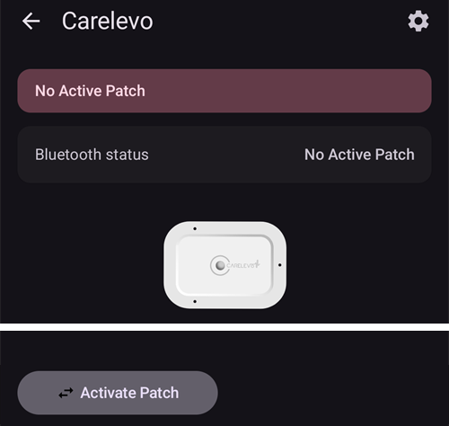

# CareLevo

CareLevo는 CareMedi가 만든 튜브 없는 패치 펌프입니다. 패치 1개에는 인슐린을 최대 300 U까지 채울 수 있으며, 최대 7일(168시간) 동안 착용합니다. 추가 장치 없이 휴대폰의 블루투스로 **AAPS**와 통신합니다.

```{admonition} New driver
:class: warning
CareLevo 드라이버는 **AAPS**에 새로 추가되었습니다. 첫 번째 패치를 활성화하기 전에 이 페이지 전체를 읽고, 펌프의 사용 설명서를 가까이 두십시오.
```

패치가 주입할 수 있는 가장 작은 용량은 0.05 U입니다. **프로파일**의 기저 주입량을 최소 0.05 U/h, 0.05 U/h 단위로 설정하십시오. 그렇지 않으면 **프로파일**이 예상하는 인슐린과 패치가 주입하는 인슐린이 조금 다릅니다. **AAPS**는 패치가 받아들인 기저 주입량을 사용합니다.

```{contents} Table of contents
:depth: 1
:local: true
```

## AAPS에서 사용할 수 있는 펌프 기능

* 추가 통신 장치 없이 휴대폰의 자체 블루투스로 **AAPS**와 통신합니다.
* 볼러스는 0.05 U 단위입니다.
* 기저 주입량은 0.05 U/h에서 15 U/h까지 0.05 U/h 단위이며, 기저 구간은 30분 단위입니다.
* 임시 기저는 절대값으로 최대 12시간까지 설정합니다.
* 확장 볼러스는 최대 8시간까지입니다.
* 서머타임(DST)과 시간대 변경은 수동으로 처리해야 합니다. 시간대가 바뀌면 패치가 알려 줍니다.

## 펌프 설정

1. **AAPS** 메인 화면 왼쪽 위의 **메뉴**(☰)를 열고 **구성**을 선택하십시오.
1. 펌프 섹션에서 **Carelevo**를 선택하십시오.
1. 뒤로 키를 눌러 메인 화면으로 돌아가십시오.


## 설정

**관리 → 펌프**(또는 **구성 → 펌프 → 플러그인 열기**)로 펌프 화면을 여십시오.

오른쪽 위의 **설정**(톱니바퀴) 아이콘을 눌러 CareLevo 설정을 여십시오. 설정은 세 가지가 있습니다:


### 인슐린 부족 알람 설정 값

레저버에 남은 인슐린이 선택한 양에 도달하면 패치가 알려 줍니다. 20 U에서 50 U까지 5 U 단위로 설정할 수 있습니다. 기본값은 30 U입니다. 이 설정과 관계없이, 남은 인슐린이 10 U 미만이면 패치가 위험 알람을 울리고 인슐린 주입을 멈춥니다.

### 패치 사용 기간 알림 설정 값

패치를 선택한 시간 동안 착용하면 패치가 알려 주므로, 교체를 미리 계획할 수 있습니다. 24시간에서 167시간까지 설정할 수 있습니다. 기본값은 116시간입니다.

### 패치 부저 알람

이 설정을 켜면 볼러스, 확장 볼러스 또는 임시 기저가 시작될 때와 끝날 때 패치에서 삐 소리가 납니다. 기본값은 꺼짐입니다.

## 펌프 화면



펌프 화면에는 **블루투스 상태**(활성 패치 없음, 연결 끊김 또는 연결됨), 패치의 **시리얼 넘버**, **시작 시간**과 **만료 시간**, 현재 **기저 주입량**과 **임시 기저**, **인슐린 잔량**(남은 양 / 채운 양), **패치 남은 시간**, **총 인슐린 주입량**이 표시됩니다.

버튼은 패치 상태에 따라 다릅니다:

* **패치 연결**: 새 패치의 활성화를 시작합니다. 아래를 참조하십시오.
* **인슐린 채우기 가이드**: 패치에 인슐린을 채우는 12단계를 보여 줍니다.
* **주입 정지** / **주입 재개**: 인슐린 주입을 일시 중지하고 다시 시작합니다. 아래를 참조하십시오.
* **패치 종료**: 새 패치를 활성화할 수 있도록 현재 패치를 종료합니다.

## 패치 활성화하기

시작하기 전에 **AAPS**에서 **프로파일**이 활성화되어 있고 블루투스가 켜져 있는지 확인하십시오. 패치는 전원을 켠 후 정해진 시간 안에 활성화해야 합니다. 시간이 지나면 패치가 **패치 적용 시간 종료** 알람을 울리며 사용할 수 없습니다.

펌프 화면에서 **패치 연결**을 누르고 단계를 따르십시오. 바늘을 삽입하기 전에는 언제든지 취소할 수 있습니다. 입력한 내용은 삭제됩니다.

### 인슐린 선택

사용하는 인슐린을 확인하십시오. 패치에는 초속효성 U-100 인슐린이 필요합니다.

### 패치에 인슐린 채우기

착용할 기간을 고려하여 패치에 50~300 U를 채우십시오. 채우는 방법이 필요하면 **인슐린 채우기 가이드**를 누르십시오. 그런 다음 인슐린 양 입력 버튼을 누르고 채운 양을 선택하십시오. **AAPS**는 이 값으로 인슐린 잔량을 표시합니다.

### 패치 연결

1. 패치를 포장재에서 꺼내고 바늘 보호캡을 제거하십시오.
1. 패치의 전원 버튼을 1초 이상 누르십시오. 신호음이 울린 후 **패치 검색**을 누르십시오.
1. 찾은 패치가 맞으면 **확인**을 누르십시오. 맞지 않으면 **재검색**을 누르십시오.

### 안전 점검

패치가 연결되면 **안전 점검**을 누르십시오. 패치가 스스로 점검하고 프라임합니다. 바늘 끝에 인슐린 방울이 맺혔는지 확인하십시오. 방울이 보이지 않으면 **재시도**를 누르십시오. 점검이 끝나면 **다음**을 누르십시오.

### 부착 부위와 패치 부착

1. 패치를 착용할 부위를 선택하십시오.
1. 알콜솜으로 부위를 깨끗이 소독하십시오.
1. 보호 테이프를 제거하고, 패치에 표시된 점이 위로 향하게 피부에 부착하십시오.
1. 패치를 부착한 후 **다음**을 누르십시오.

### 바늘 삽입

1. 안전캡을 화살표 방향으로 돌려 제거하십시오.
1. 어플리케이터의 푸시 버튼을 끝까지 누르고 10초 동안 누른 상태로 유지하십시오. 바늘이 삽입되면 신호음이 울립니다.
1. 어플리케이터를 분리하고 **바늘 삽입 완료**를 누르십시오.

삽입에 실패하면 **AAPS**가 남은 시도 횟수를 알려 줍니다. 남은 시도가 없으면 패치가 **바늘 삽입 오류** 알람을 울리며, 패치를 교체해야 합니다.

삽입이 확인되면 바로 인슐린 주입이 시작됩니다.

## 볼러스 메시지

패치가 볼러스를 거부하면 **AAPS**가 이유를 알려 줍니다. 예를 들어 *볼러스를 주입할 수 없습니다. 주입 가능량: 2.8 U*는 패치가 지금 그 양만 주입할 수 있다는 뜻입니다.

볼러스를 정지했는데 패치가 정지를 확인하지 않으면, **AAPS**는 볼러스가 끝날 때까지 기다린 후 패치가 보고한 양을 기록합니다. 볼러스가 기록되지 않은 경우(예: 주입 중에 정지한 경우) **AAPS**는 패치의 총량에서 이 볼러스를 추가하고, 다시 시도하기 전에 IOB를 확인하라고 요청합니다.

## 인슐린 주입 일시 중지 및 재개

펌프 화면에서 **주입 정지**를 누르고 주입을 멈출 시간을 선택하십시오. 30분에서 4시간까지 30분 단위로 선택할 수 있습니다. 주입은 자동으로 재개되지 않습니다. 정지 시간이 끝나면 패치가 **주입 재개** 경고를 울립니다. 펌프 화면에서 **주입 재개**를 누르거나 경고에서 **주입 재개**를 누르고 확인하십시오.

## 패치 폐기

펌프 화면에서 **패치 종료**를 누르고 확인하십시오. 인슐린 주입이 멈추고 패치는 더 이상 사용할 수 없습니다. 몸에서 패치를 제거하고 새 패치를 활성화하십시오.

위험 알람으로 패치가 멈춘 경우에는 알람에 대신 **사용 종료** 버튼이 표시됩니다. 이 버튼을 누르면 같은 방법으로 패치가 폐기됩니다.

(carelevo-alarms-and-notifications)=

## 알람 및 알림

패치는 세 가지 수준의 이벤트를 보고합니다. 모든 이벤트는 **AAPS** 알림으로 표시됩니다.

### 위험 알람

인슐린 주입이 멈췄습니다. 바로 조치하십시오:

* **인슐린 부족**: 남은 인슐린이 10 U 미만입니다. 패치 사용을 종료하고 교체하십시오.
* **패치 사용 종료**: 패치의 사용 기간이 끝났습니다. 패치 사용을 종료하고 교체하십시오.
* **배터리 부족**: 패치를 폐기하고 교체하십시오.
* **부적합 온도**: 40 ℉~99 ℉(4.4 ℃~37.2 ℃) 사이의 알맞은 온도로 이동하십시오.
* **앱 미사용 주입 차단**: 앱 미사용 주입 차단(Auto-Off) 경고를 무시하여 패치가 멈췄습니다. 기저 주입을 다시 시작하려면 **주입 재개**를 누르십시오.
* **패치 적용 시간 종료**, **안전점검 실패**, **패치 오류**, **주입구 막힘**, **바늘 삽입 오류**: 패치 사용을 종료하고 교체하십시오.

### Alerts

인슐린 주입은 계속되지만 확인이 필요한 상황입니다:

* **인슐린 부족**: 레저버의 인슐린이 **인슐린 부족 알람 설정 값**에서 설정한 양에 도달했습니다. 패치 교체를 준비하십시오.
* **패치 사용 종료 임박** 및 **패치 사용 기간 만료**: 패치를 교체하십시오.
* **배터리 부족**: 패치 교체를 준비하십시오.
* **부적합 온도**: 패치 온도가 다시 40 ℉~99 ℉(4.4 ℃~37.2 ℃) 사이가 될 때까지 주입이 일시 중지됩니다.
* **앱 미사용 주입 차단**: **확인**을 누르십시오. 무시하면 경고가 위험 알람으로 바뀌고 주입이 멈춥니다.
* **패치 적용 미완료**: 활성화를 완료하려면 **확인**을 누르십시오.
* **주입 재개**: 설정한 일시 중지 시간이 끝났습니다. 주입을 재개하려면 **주입 재개**를 누르십시오.
* **블루투스 켜기** 및 **BLE 연결 안됨**: 휴대폰이 패치에 연결할 수 없습니다. 블루투스를 켜거나 패치 연결을 확인하십시오.

### 안내

정보 제공용: **인슐린 부족**, **패치 사용 기간 알림**(**패치 사용 기간 알림 설정 값**에서 설정한 시간이 지남), **패치 점검 알림**, **시간대 변경**, **혈당 확인**(볼러스 후 설정된 시간이 지남).

패치는 자체 저혈당 주입정지(**LGS**) 기능이 시작되거나 끝날 때도 알려 줍니다. **AAPS**는 이 기능을 사용하지 않습니다. 저혈당은 루프가 직접 처리합니다.

## 도움을 받을 수 있는 곳

CareLevo 드라이버의 문제는 [AAPS GitHub 이슈 페이지](https://github.com/nightscout/AndroidAPS/issues)나 AAPS 커뮤니티 채널에 보고하십시오. [어디에서 도움을 받을 수 있습니까?](../GettingHelp/WhereCanIGetHelp.md)를 참조하십시오.
