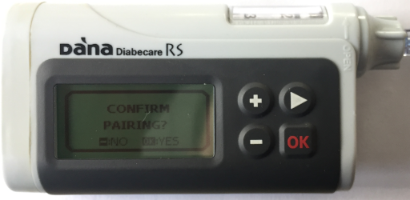

# DanaRS, Dana-i 및 Dana-i2

*다음 지침은 2017년 이후의 DanaRS, Dana-i 또는 Dana-i2를 사용하는 경우 앱과 펌프를 구성하는 방법입니다. 기존 DanaR를 사용한다면 [DanaR](./DanaR-Insulin-Pump.md) 페이지를 참조하십시오.*

**Dana-i2는 AAPS 버전 4.0부터 사용할 수 있습니다.** Dana-i와 같은 **Dana-i/RS** 드라이버를 사용합니다.

* DanaRS/i/i2 펌프에서 앱은 "BASAL A"를 사용합니다. 기존 데이터는 덮어쓰입니다.

    {contents} 목차
    :depth: 1
    :local: true

## AAPS에서 사용할 수 있는 펌프 기능

* 추가 통신 장치 없이 휴대폰의 자체 블루투스로 **AAPS**와 통신합니다.
* 서머타임(DST)과 시간대 변경은 수동으로 처리해야 합니다([시간대 이동](#timezone-traveling-danarv2-danars) 참조).

(DanaRS-Insulin-Pump-pairing-pump)=

## 펌프 페어링

* **AAPS** 메인 화면 왼쪽 위의 **메뉴**(☰)를 열고 **구성**을 선택하십시오.
* **펌프**를 누르고 **Dana-i/RS**를 선택하십시오.
    
    
    
    선택하면 **Dana-i/RS** 카드에 **설정**과 **플러그인 열기** 두 버튼이 표시됩니다:
    
    
    
    **설정**은 Dana-i/RS 드라이버의 설정을 엽니다:
    
    
    
    **플러그인 열기**(또는 **관리** > **펌프**)는 Dana-i/RS 펌프 화면을 엽니다. 펌프를 페어링하기 전에는 다음과 같이 보입니다:
    
    

* 펌프 화면에서 **페어링**을 누르십시오. **AAPS**가 주변의 펌프를 검색합니다.

* 목록에서 사용하는 펌프 항목을 누르십시오.
    
    

* **펌프에서 페어링을 확인해야 합니다!** 이는 이미 알고 있는 다른 블루투스 페어링(예: 스마트폰과 자동차 오디오)과 같은 방식입니다.
    
    

* 펌프 종류와 펌웨어에 따라 페어링 절차를 따르십시오:
    
    * DanaRS v1에서는 **AAPS**가 **펌프 비밀번호 (v1 전용)**를 묻습니다. 펌프 비밀번호를 입력하십시오([기본 비밀번호](#DanaRS-Insulin-Pump-default-password) 참조).
    * DanaRS v3에서는 **AAPS**가 펌프에서 OK를 누르고, 펌프에 표시된 숫자와 문자로 된 2개의 문자열을 입력하라고 요청합니다. 끝날 때까지 마이너스 버튼을 눌러 펌프 화면이 켜져 있게 하십시오. 그런 다음 **완료**를 누르십시오.
    * Dana-i와 Dana-i2에서는 표준 Android 페어링 대화 상자가 나타납니다. 펌프에 표시된 6자리 숫자를 입력하십시오.

* **페어링 성공!**이 표시되면 **완료**를 누르십시오.
    
    
    
    펌프 화면으로 돌아오며, 이제 펌프 상태가 표시됩니다.
    
    

* **설정**에서 **볼러스 속도**를 선택하여 기본 볼러스 속도(12 s/U, 30 s/U 또는 60 s/U)를 변경하십시오.

* Doctors menu를 사용하여 펌프의 기저 단위를 0.01 U/h로 설정하십시오(펌프 사용 설명서 참조).
* Doctors menu를 사용하여 펌프의 볼러스 단위를 0.05 U로 설정하십시오(펌프 사용 설명서 참조). **AAPS**는 펌프에서 기저 단위와 볼러스 단위를 읽어 모든 볼러스에 사용하므로, 볼러스는 항상 펌프에 설정된 단위와 맞습니다. 펌프 화면의 **기저/볼러스 단위** 행에 이 값이 표시됩니다.
* 펌프에서 확장 볼러스를 활성화하십시오.

### 일부 모델에만 표시되는 옵션

* **자동 잠금**: Dana-i2에서는 **사용자 옵션** 화면(펌프 화면, **관리** > **펌프**)에 펌프의 자동 잠금 설정을 위한 **자동 잠금** 스위치가 있습니다. 변경한 후에는 **펌프에 옵션 저장**을 누르십시오.
* **이지 모드**: 간편 메뉴 모드가 있는 펌프 모델에서는 펌프 화면에 **켜짐** 또는 **꺼짐**을 보여 주는 **이지 모드** 행이 표시됩니다.
* Dana-i2가 볼러스를 거부하면 **AAPS**가 이유를 표시합니다. 예: *펌프가 프라임되지 않았습니다*, *레저버에 인슐린이 부족합니다* 또는 *펌프에서 이지 수면 모드가 켜져 있습니다*.

(DanaRS-Insulin-Pump-default-password)=

### 기본 비밀번호

* 펌웨어 v1 및 v2의 DanaRS에서 기본 비밀번호는 1234입니다.
* 펌웨어 v3의 DanaRS 또는 Dana-i에서 기본 비밀번호는 제조일에서 만들어지며 MMDD 형식입니다. MM은 펌프가 생산된 월, DD는 일입니다(예: '0124'는 월 01, 일 24를 나타냅니다).
    
    * MAIN MENU에서 REVIEW를 선택한 다음 하위 메뉴에서 SHIPPING INFORMATION을 여십시오
    * 3번은 제조일입니다. 
    * v3/i에서 이 비밀번호는 펌프의 메뉴 잠금에만 사용됩니다. 이 비밀번호는 통신에 사용되지 않으며 AAPS에 입력할 필요가 없습니다.

(DanaRS-Insulin-Pump-change-password-on-pump)=

## Change password on pump

* 펌프에서 OK 버튼을 누르십시오.
* 메인 메뉴에서 "OPTION"을 선택하십시오(화살표 버튼을 여러 번 눌러 오른쪽으로 이동).
    
    

* 옵션 메뉴에서 "USER OPTION"을 선택하십시오.
    
    

* 화살표 버튼으로 "11. password"까지 아래로 스크롤하십시오.
    
    

* OK를 눌러 이전 비밀번호를 입력하십시오.

* **이전 비밀번호**를 입력하고(기본 비밀번호는 [위](#DanaRS-Insulin-Pump-default-password) 참조) OK를 누르십시오
    
    

* 여기에서 잘못된 비밀번호를 입력해도 실패를 알리는 메시지가 표시되지 않습니다!

* **새 비밀번호**를 설정하십시오(+ & - 버튼으로 숫자 변경 / 화살표 버튼으로 오른쪽으로 이동).
    
    

* OK 버튼으로 확인하십시오.

* OK를 눌러 설정을 저장하십시오.
    
    

* 아래로 "14. EXIT"까지 이동한 다음 OK를 눌러 종료하십시오.
    
    

(DanaRS-Insulin-Pump-dana-rs-specific-errors)=

## Dana RS 관련 오류

### 인슐린 주입 중 오류

볼러스 인슐린 주입 중 AAPS와 Dana RS의 연결이 끊기면(예: Dana RS가 인슐린을 주입하는 동안 휴대폰에서 멀어지는 경우) 다음 메시지가 표시되고 알람 소리가 납니다.

* 대부분의 경우 이것은 단순한 통신 문제이며, 올바른 양의 인슐린이 주입됩니다.
* 펌프 이력에서 올바른 볼러스가 주입되었는지 확인하십시오. 펌프 자체에서 확인하거나, **AAPS**의 펌프 화면(**관리** > **펌프**) > **펌프 이력** > **볼러스**에서 확인할 수 있습니다.
* 원하면 [처치](#screens-bolus-carbs)에서 오류 항목을 삭제하십시오.
* 실제 양은 다음 연결 때 읽어서 기록됩니다. 바로 읽게 하려면 펌프 화면에서 **새로고침**을 누르거나, 다음 연결까지 기다리십시오.

## 휴대폰을 바꿀 때 특별 참고 사항

새 휴대폰으로 바꿀 때는 다음 단계가 필요합니다:

* 이전 휴대폰에서 [설정 내보내기](../Maintenance/ExportImportSettings.md)를 실행하십시오
* 이전 휴대폰에서 새 휴대폰으로 설정 옮기기

### DanaRS v1

* 새 휴대폰과 Dana RS를 **수동으로 페어링**하십시오
* 가져올 때 **펌프 설정도 교체**를 선택하면 펌프 연결 설정도 함께 가져옵니다. 그러면 새 휴대폰의 AAPS가 이미 펌프를 "알고" 있으므로 블루투스 검색을 시작하지 않습니다. 따라서 새 휴대폰과 펌프를 수동으로 페어링해야 합니다.
* 새 휴대폰에 AAPS를 설치하십시오.
* 새 휴대폰에서 [설정 가져오기](../Maintenance/ExportImportSettings.md)를 실행하십시오

### DanaRS v3, Dana-i, Dana-i2

* [위](#DanaRS-Insulin-Pump-pairing-pump)에서 설명한 대로 페어링 절차를 시작하십시오.
* 때로는 먼저 **AAPS**에서 페어링 정보를 지워야 할 수 있습니다. 펌프 화면(**관리** > **펌프**)에서 **페어링 해제**를 누르고 **페어링 정보를 초기화하시겠습니까?**를 확인하십시오. 그런 다음 다시 **페어링**을 누르십시오.

## DanaRS, Dana-i 및 Dana-i2 펌프로 시간대 이동하기

여러 시간대를 넘어 여행하는 방법은 [펌프로 시간대 이동하기](#timezone-traveling-danarv2-danars) 섹션을 참조하십시오.

## 도움을 받을 수 있는 곳

DanaRS/Dana-i/Dana-i2 드라이버는 커뮤니티가 **자원봉사**로 개발합니다. 도움을 요청하기 전에:

1. 이 문서의 관련 섹션을 **읽고** 기능이 어떻게 작동해야 하는지 확인하십시오.
2. [Discord](https://discord.gg/4fQUWHZ4Mw)의 *#AAPS* 채널이나 다른 [커뮤니티 채널](../GettingHelp/WhereCanIGetHelp.md)에서 **질문하십시오**.
3. [기존 이슈](https://github.com/nightscout/AndroidAPS/issues)를 검색하여 **버그를 보고하십시오**. 해당 이슈가 없으면 [새 이슈](https://github.com/nightscout/AndroidAPS/issues)를 열고 [로그 파일](../GettingHelp/AccessingLogFiles.md)을 첨부하십시오.

도움을 요청할 때는 휴대폰 제조사와 모델, Android 버전, **AAPS** 버전, 그리고 문제에 대한 쉬운 영어 설명(무엇이 바뀌었는지, 마지막으로 언제 작동했는지)을 포함하십시오.