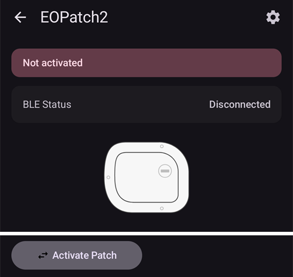
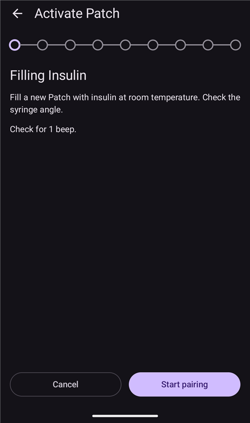
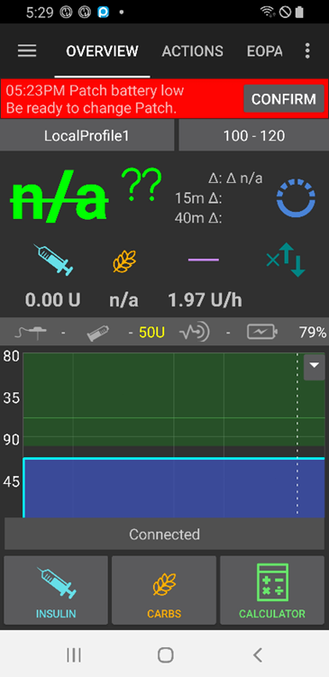

# EOPatch2

패치에는 NovoRapid나 Humalog 같은 초속효성 U-100 인슐린이 필요합니다. 의사가 처방한 초속효성 인슐린을 사용하십시오.

패치가 주입할 수 있는 최소 용량은 0.05 U입니다. **프로파일**의 모든 기저 주입량을 0.05 U/hr 이상, 0.05 U/hr 단위로 설정하십시오. 그렇지 않으면 **AAPS**가 각 주입량을 가장 가까운 0.05 U/hr로 반올림하고(0으로 내리지는 않음) 패치가 실제로 주입하는 값을 사용합니다. 그래서 하루 총 인슐린 양이 **프로파일**과 조금 다릅니다. 마찬가지로 볼러스도 0.05 U 이상이어야 합니다.

```{contents} Table of contents
:depth: 1
:local: true
```

## AAPS에서 사용할 수 있는 펌프 기능

* 추가 통신 장치 없이 휴대폰의 자체 블루투스로 **AAPS**와 통신합니다.
* 서머타임(DST)과 시간대 변경은 수동으로 처리해야 합니다.

## 펌프 설정

1. **AAPS** 메인 화면 왼쪽 위의 **메뉴**(☰)를 열고 **구성**을 선택하십시오.
1. **펌프** 부분에서 **EOPatch2**를 선택하십시오.
1. 뒤로 키를 눌러 메인 화면으로 돌아가십시오.

 

선택하면 **EOPatch2** 카드에 **설정**과 **플러그인 열기** 두 버튼이 표시됩니다:


## 설정

EOPatch2 설정은 두 가지 방법 중 하나로 엽니다:

* **구성**의 **EOPatch2** 카드에서 **설정**을 누르거나,
* 펌프 화면(**관리** → **펌프**)을 열고 오른쪽 위의 톱니바퀴 아이콘을 누릅니다.

설정은 세 가지입니다:


### 레저버 부족 경고

패치에 남은 인슐린이 이 양 이하로 줄면 경고가 나타납니다. 10 ~ 50 U 범위에서 5 U 단위로 설정할 수 있습니다. 기본값은 10 U입니다.

### Patch expiration Reminder

현재 패치가 만료되기 전에 남은 시간을 알려 줍니다. 1 ~ 24시간 범위에서 1시간 단위로 설정할 수 있습니다. 기본값은 4시간입니다.

### 패치 신호 알림

이 설정을 켜면 볼러스, 확장 볼러스 또는 임시 기저가 시작될 때와 끝날 때 패치에서 삐 소리가 납니다. 일반 기저에는 영향을 주지 않습니다. 기본값은 꺼짐입니다.

## 새 패치 활성화

### 활성화 마법사 열기

**관리** → **펌프**로 펌프 화면을 여십시오(또는 **구성**의 **EOPatch2** 카드에서 **플러그인 열기**를 누르십시오). 활성 패치가 없으면 화면에 **활성화되지 않음**이 표시되고 아래쪽에 **패치 활성화** 버튼이 있습니다.

**패치 활성화**를 눌러 마법사를 시작하십시오.



마법사가 각 단계를 안내합니다. 위쪽의 점들은 어디까지 진행했는지 보여 줍니다.

```{note}
**AAPS**에서 **프로파일**을 한 번도 활성화한 적이 없으면, 마법사는 먼저 **프로파일 필요** 페이지를 보여 줍니다. 사용할 프로파일을 선택하고 **프로파일 활성화**를 누르십시오.
```

### 인슐린 채우기

주사기 바늘을 패치의 인슐린 채우기 포트에 꽂으십시오. 플런저를 천천히 밀어 패치를 채우십시오. 패치에 80 U 이상이 들어가면 삐 소리가 한 번 나고 패치가 시작(부팅)됩니다.

삐 소리가 들리면 **페어링 시작**을 누르십시오.



```{warning}
- 마법사가 지시할 때까지 바늘 작동 레버를 돌리지 마십시오. 너무 일찍 돌리면 채우기나 안전 점검 중에 심각한 문제가 생길 수 있습니다.
- 패치에는 80 ~ 200 U가 들어갑니다. 80 U보다 적게 넣으면 패치가 작동하지 않습니다.
- 인슐린이 상온이 되도록 채우기 15 ~ 30분 전에 냉장고에서 꺼내 두십시오. 인슐린은 10°C 이상이어야 합니다.
```

### 패치 페어링

이제 **AAPS**가 자동으로 패치와 페어링을 시도합니다. 페어링 중에 Android 블루투스 페어링 요청이 두 번 나타납니다. 첫 번째 요청에서 **확인**을 누르십시오. 패스키가 표시되는 두 번째 요청에서도 **확인**을 누르십시오.

```{warning}
- 페어링하는 동안 패치와 휴대폰을 30 cm 이내로 가까이 두십시오.
- 패치가 부팅된 후에는 페어링이 끝날 때까지 3분마다 삐 소리가 납니다.
- 패치가 부팅된 후 60분 안에 패치 활성화를 끝내야 합니다. 끝내지 못하면 패치를 폐기하십시오.
```

  

```{admonition} Older screenshot
:class: note
두 블루투스 페어링 스크린샷은 이전 **AAPS** 버전의 것입니다. Android 페어링 요청 뒤에 보이는 **AAPS** 화면은 **AAPS** 4에서 다르게 보입니다.
```

### 인슐린 선택

패치에 채운 인슐린을 선택하고 **다음**을 누르십시오. **AAPS**는 활성화 후 이 인슐린으로 프로파일 전환을 적용합니다.

### 패치 부착 준비

패치에서 접착 테이프를 떼어 낸 다음 **다음**을 누르십시오.

바늘이 튀어나와 있거나, 패치가 젖었거나 더럽거나, 접착 테이프가 접혀 있으면 대신 **폐기**를 누르고 새 패치를 사용하십시오.


### 부착 위치

이 단계는 위치 순환 설정에서 **펌프 위치 순환 관리**가 켜져 있을 때만 나타납니다. 몸 그림에서 패치를 붙일 곳을 누르고 **다음**을 누르거나, **건너뛰기**를 누르십시오.

### 패치 부착

인슐린은 피부 아래에 지방 조직이 있고 신경이나 혈관이 적은 곳에 들어가야 합니다. 배, 팔 또는 허벅지가 좋습니다. 부착 부위를 깨끗이 하고 말린 다음 패치를 피부에 붙이십시오.

주입 부위를 확인한 다음 **안전 점검 시작**을 누르십시오.

```{warning}
- 패치 전체가 피부에 단단히 붙도록 패치 테이프의 가장자리를 고르게 눌러 주십시오.
- 패치가 완전히 붙지 않으면 패치와 피부 사이에 공기가 들어갈 수 있습니다. 그러면 패치의 접착력과 방수 기능이 약해집니다.
```


### 안전 점검

안전 점검은 약 30초 걸립니다. 안전 점검이 끝나면 패치에서 삐 소리가 한 번 납니다. 실패하면 **재시도**를 누르십시오.

```{warning}
안전한 사용을 위해 안전 점검이 끝날 때까지 바늘 작동 레버를 돌리지 마십시오.
```

 

```{admonition} Older screenshot
:class: note
**패치 부착 준비**부터 **안전 점검**까지의 스크린샷은 이전 **AAPS** 버전의 것이며 **AAPS** 4에서는 다르게 보일 수 있습니다.
```

### Inserting the needle

패치를 단단히 잡으십시오. 바늘을 삽입하려면 바늘 작동 레버를 위쪽으로 100° 넘게 돌리십시오. 바늘이 올바르게 삽입되면 패치에서 삐 소리가 한 번 납니다. 그런 다음 레버를 끝까지 계속 돌려 레버를 제거하십시오. **다음**을 누르십시오.

```{caution}
삐 소리를 듣지 않고 다음 단계로 가면 **바늘 삽입 오류**가 나타납니다. 삐 소리를 확인하고 **재시도**를 누르십시오. 오류가 계속되면 **폐기**를 눌러 패치를 비활성화하십시오.
```

### 패치 활성화 완료

마지막 페이지는 패치가 활성화되었고 만료 시간이 다가오면 알려 준다는 것을 확인해 줍니다. **완료**를 눌러 펌프 화면으로 돌아가십시오.

## 패치 폐기

패치에 인슐린이 부족하거나, 만료되었거나, 고장 났으면 패치를 교체하십시오. 각 패치는 부팅 후 84시간 이하로 사용하는 것을 권장합니다.

1. 펌프 화면(**관리** → **펌프**)을 여십시오. 패치가 활성 상태일 때 **패치 폐기**를 누르십시오.
1. **패치 폐기** 페이지에는 패치의 남은 시간과 남은 인슐린이 표시됩니다. **패치 폐기**를 누르십시오.
1. 확인을 요청하는 대화 상자가 나타납니다. **패치 폐기**를 다시 누르십시오.
1. 패치가 비활성화되면 마법사에 **패치 폐기가 완료되었습니다.**가 표시됩니다. 몸에서 패치를 떼어 내고 **확인**을 누르십시오.

그 후 마법사는 바로 새 패치 활성화로 이어집니다(위 참조). 여기서 멈추려면 뒤로 화살표를 누르십시오.

활성 패치가 없는 동안 **AAPS**는 펌프를 일시 중지 상태로 표시하고 0 U/hr 임시 기저를 기록합니다. 그래서 다음 패치가 활성화될 때까지 기저 인슐린이 IOB에 포함되지 않습니다.

   

```{admonition} Older screenshot
:class: note
위의 스크린샷은 이전 **AAPS** 버전의 것입니다. **AAPS** 4에서는 **관리** → **펌프**에서 펌프 화면을 열며, 화면의 버튼 이름은 **패치 폐기**입니다.
```

```{admonition} If the patch does not respond
:class: warning
**AAPS**가 패치와 통신할 수 없으면 패치 알람을 수동으로 끄는 방법에 대한 페이지가 나타날 수 있습니다: 몸에서 패치를 떼어 내고, 접착 테이프를 벗긴 다음, 클립으로 인슐린 채우기 포트 옆의 구멍을 세게 누르십시오.

**패치 폐기** 페이지에는 **강제 초기화** 버튼도 있습니다. 이 버튼은 패치에 명령을 보내지 않고 **AAPS**에서만 패치를 지웁니다. 패치는 배터리가 다 되거나 직접 끌 때까지 인슐린을 계속 주입합니다. 일반 폐기가 실패할 때만 사용하고, 몸에서 패치를 떼어 내십시오.
```

## 인슐린 주입 일시 중지 및 재개

인슐린 주입을 일시 중지하면 진행 중인 확장 볼러스와 임시 기저도 취소됩니다. 재개할 때 이들은 다시 시작되지 **않습니다**. 인슐린 주입이 일시 중지된 동안 패치는 15분마다 삐 소리를 냅니다.

### 인슐린 주입 일시 중지

1. 펌프 화면(**관리** → **펌프**)을 열고 **펌프 일시 중지**를 누르십시오.
1. 무엇이 일시 중지되는지 설명하는 대화 상자가 나타납니다. **확인**을 누르십시오.
1. **기저 중지 시간** 대화 상자에서 일시 중지할 시간을 선택하십시오: 30분, 1시간, 1시간 30분 또는 2시간. **확인**을 누르십시오.

선택한 시간 동안 인슐린 주입이 일시 중지됩니다.

  

```{admonition} Older screenshot
:class: note
위의 스크린샷은 이전 **AAPS** 버전의 것입니다. **AAPS** 4에서는 **관리** → **펌프**에서 펌프 화면을 열며, 화면의 버튼 이름은 **펌프 일시 중지**입니다.
```

### 인슐린 주입 재개

1. 펌프 화면(**관리** → **펌프**)을 열고 **펌프 재개**를 누르십시오.
1. **인슐린 주입 재개** 대화 상자에서 **확인**을 누르십시오.

 

```{admonition} Older screenshot
:class: note
위의 스크린샷은 이전 **AAPS** 버전의 것입니다. **AAPS** 4에서는 **관리** → **펌프**에서 펌프 화면을 열며, 화면의 버튼 이름은 **펌프 재개**입니다.
```

```{warning}
일시 중지 시간이 끝나면 **AAPS**에 **인슐린 일시 중지 종료** 경고가 표시됩니다. 확인하기 전까지 인슐린 주입은 다시 시작되지 **않습니다**. 확인하지 않으면 고혈당이 생길 수 있습니다.
```

(eopatch2-alarms-and-warnings)=

## 알람 및 경고

### Alarms

알람은 우선순위가 가장 높은 긴급 상황을 위한 것이며 즉시 조치가 필요합니다. **AAPS**는 확인할 때까지 계속 울리는 알람을 내고, **개요** 화면에 메시지를 알림으로 표시합니다. 알람은 사용 중인 패치에 문제가 있다는 뜻입니다. 대부분의 경우 패치를 폐기하고 새 패치로 교체해야 합니다.

알림에서 **확인**을 누르면 **AAPS**가 알람을 처리합니다. 대부분의 알람에서는 이때 패치가 비활성화됩니다. **부적합한 온도** 알람에서는 버튼이 **재시도**입니다.

 

```{admonition} Older screenshot
:class: note
알람 스크린샷은 이전 **AAPS** 버전의 것이며 **AAPS** 4에서는 다르게 보일 수 있습니다.
```

각 알람은 아래에서 설명합니다.

| Alarm          | 설명                                                                          |
| -------------- | --------------------------------------------------------------------------- |
| 레저버 비어 있음      | 패치의 인슐린이 다 떨어졌습니다.                                                          |
| 패치 만료됨         | 패치의 사용 시간이 끝나서 더 이상 인슐린을 주입할 수 없습니다.                                        |
| 주입구 막힘         | 패치의 인슐린 경로가 막힌 것 같습니다.                                                      |
| 전원 켜기 자가 진단 실패 | 패치가 부팅 후 자가 진단 중에 예상하지 못한 오류를 발견했습니다.                                       |
| 부적합한 온도        | 패치를 활성화하거나 사용하는 동안 패치가 정상 작동 온도를 벗어났습니다. 패치를 적절한 온도(4.4 ~ 37°C)의 장소로 옮기십시오. |
| 바늘 삽입 오류       | 활성화 중에 바늘이 올바르게 삽입되지 않았습니다. 패치의 바늘 삽입 가장자리와 바늘 작동 레버가 일직선에 있는지 확인하십시오.      |
| 패치 배터리 오류      | 패치의 내장 배터리가 곧 다 떨어져서 패치가 꺼집니다.                                              |
| 패치 활성화 오류      | 패치가 부팅 후 60분 안에 완전히 활성화되지 않았습니다.                                            |
| 패치 오류          | 패치를 활성화하거나 사용하는 중에 예상하지 못한 오류를 발견했습니다.                                      |

### 경고

경고는 중간 또는 낮은 우선순위의 상황을 위한 것입니다. 경고는 **개요** 화면에 알림으로 나타납니다.



```{admonition} Older screenshot
:class: note
이 스크린샷은 이전 **AAPS** 버전의 것입니다. **AAPS** 4에서는 경고가 메인 화면에 나타나며, 모양이 다릅니다.
```

각 경고는 아래에서 설명합니다.

| Warning      | 설명                                                           |
| ------------ | ------------------------------------------------------------ |
| 인슐린 일시 중지 종료 | 선택한 일시 중지 시간이 끝났습니다. 인슐린 주입을 다시 시작하려면 알림에서 **펌프 재개**를 누르십시오. |
| 레저버 부족       | 패치에 남은 인슐린이 **레저버 부족 경고**에서 설정한 양보다 적습니다.                    |
| 패치 작동 수명 만료됨 | 패치의 사용 기간이 끝났습니다.                                            |
| 패치가 곧 만료됨    | 1시간 안에 패치를 폐기해야 합니다.                                         |
| 패치 활성화 미완료   | 페어링 후 패치 활성화가 3분 넘게 중단되었습니다. 펌프 화면을 열고 패치 활성화를 끝내십시오.        |
| 패치 배터리 부족    | 패치의 배터리가 부족합니다.                                              |

## 도움을 받을 수 있는 곳

EOPatch2 드라이버는 커뮤니티가 **자원봉사**로 개발합니다. 도움을 요청하기 전에:

1. 기능이 어떻게 작동해야 하는지 확인하려면 이 문서의 관련 부분을 **읽으십시오**.
2. [Discord](https://discord.gg/4fQUWHZ4Mw)의 *#AAPS* 채널이나 다른 [커뮤니티 채널](../GettingHelp/WhereCanIGetHelp.md)에서 **질문하십시오**.
3. [기존 이슈](https://github.com/nightscout/AndroidAPS/issues)를 검색하여 **버그를 보고하십시오**. 목록에 없으면 [새 이슈](https://github.com/nightscout/AndroidAPS/issues)를 열고 [로그 파일](../GettingHelp/AccessingLogFiles.md)을 첨부하십시오.

도움을 요청할 때는 휴대폰 제조사와 모델, Android 버전, **AAPS** 버전, 그리고 문제를 쉬운 말로 설명한 내용(무엇이 바뀌었는지, 마지막으로 정상 작동한 때가 언제인지)을 포함하십시오.
