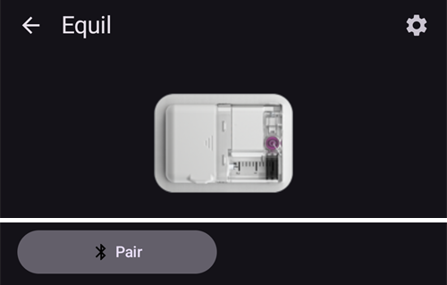
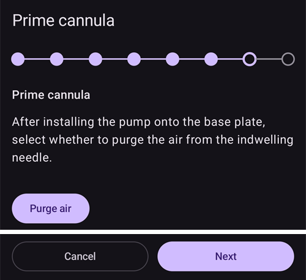

# Equil

이 안내는 Equil 인슐린 펌프를 구성하는 방법입니다.

```{contents} Table of contents
:depth: 1
:local: true
```

## AAPS에서 사용할 수 있는 펌프 기능

* 추가 통신 장치 없이 휴대폰의 자체 블루투스로 **AAPS**와 통신하는 튜브 없는 패치 펌프입니다.
* **AAPS**는 Equil을 200 U 레저버가 있는 패치 펌프로 취급합니다: 메인 화면에 패치 펌프 상태 표시등이 나타나고, **프라임/채우기**와 **펌프 배터리 교체**는 제공되지 않습니다. 채우기, 프라임, 배터리 교체는 펌프 마법사에서 합니다.
* 펌프가 일시 중지되거나 멈춘 동안 **AAPS**는 0 U/h 임시 기저를 기록합니다. 그래서 기저 인슐린이 IOB에 포함되지 않습니다.
* 서머타임(DST)과 시간대 변경은 수동으로 처리해야 합니다.

## 하드웨어와 소프트웨어의 필요 요건
* **호환되는 Equil 하드웨어**

  현재 Equil 5.3과 5.4를 지원합니다.

* [APK 빌드](../SettingUpAaps/BuildingAaps.md) 안내에 따라 빌드하고 설치한 **AAPS**

## 설정

### Equil 펌프 선택

왼쪽 위의 **메뉴**(☰)를 열고 **[구성](#Config-Builder-pump)**을 선택한 다음, **펌프**에서 **Equil**을 선택하십시오.

선택하면 **Equil** 카드에 **설정**과 **플러그인 열기** 두 버튼이 표시됩니다:


**플러그인 열기**(또는 **관리** → **펌프**)는 Equil 펌프 화면을 엽니다. 펌프를 페어링하기 전에는 다음과 같이 보입니다:



### 설정

**Equil** 카드의 **설정**이나 펌프 화면 오른쪽 위의 톱니바퀴 아이콘으로 Equil 설정을 여십시오.


* **배터리 부족 알람**: 펌프 배터리가 부족하면 경고합니다.
* **인슐린 부족 알람**: 레저버의 인슐린이 부족하면 경고합니다.
* **알림음**: 펌프가 알리는 방식입니다: **무음**, **진동만**, **소리만** 또는 **진동과 소리**.
* **볼러스 속도**: 볼러스를 주입하는 속도입니다: **1.5 U/min (표준)**, **3 U/min**, **6 U/min** 또는 **12 U/min**. 볼러스가 빠를수록 막힘 알람이 더 자주 날 수 있습니다.


```{admonition} Max basal and max bolus on the patch
:class: note
패치 자체는 **AAPS**가 패치에 설정한 최대값보다 높은 기저 주입량을 거부합니다. **AAPS**는 **최대 기저** [설정](../SettingUpAaps/Preferences.md)과 **프로파일**의 가장 높은 시간당 기저 주입량 중 더 높은 값을 사용합니다. 그래서 패치는 항상 프로파일과 루프가 요청하는 임시 기저를 받아들입니다. **AAPS**는 최대 허용 볼러스도 패치로 보냅니다.

**최대 기저**나 **최대 볼러스**를 바꾸면 **AAPS**가 새 값을 자동으로 패치로 보냅니다. 프로파일 전환 때마다 이 값도 함께 보냅니다. 패치 자체에서 설정할 것은 없습니다.
```

### 펌프 페어링

펌프 화면에서 **페어링**을 누르십시오. 마법사가 각 단계를 안내합니다. 위쪽의 점들은 어디까지 진행했는지 보여 줍니다.

**AAPS**가 주변 기기를 찾고 연결해도 되는지 Android가 물으면 **Allow**(허용)를 누르십시오. **AAPS**가 펌프를 찾으려면 이 권한이 필요합니다.


마법사는 다음 단계로 이루어집니다. 다음 단계로 가려면 **다음**을, 마법사를 나가려면 **취소**를 누르십시오.

1. **프로파일 필요**: **AAPS**에서 **프로파일**을 한 번도 활성화한 적이 없을 때만 표시됩니다. 사용할 프로파일을 선택하고 **프로파일 활성화**를 누르십시오.
1. **펌프 조립**: 펌프, 채운 레저버, 충전한 배터리를 조립합니다.

   

1. **펌프 찾기**: **AAPS**가 주변의 Equil 펌프를 검색합니다. 목록에서 펌프를 선택하십시오.

   
1. **기기 페어링**: **페어링 비밀번호 설정**에서 페어링 비밀번호를 입력할 수 있습니다. `ABCDEF0123456789` 중에서 고른 4자리여야 합니다. **페어링**을 누르십시오.

   

1. **인슐린 선택**: 인슐린이 두 개 이상 설정되어 있을 때만 표시됩니다. 레저버에 든 인슐린을 선택하십시오.
1. **프라임 / 채우기**: 펌프가 베이스 플레이트에 **없어야** 합니다. **프라임/채우기**를 누르고 바늘 끝에 인슐린 방울이 맺힐 때까지 레저버를 프라임하십시오. **다음**을 누르십시오.

   
1. **위치 순환**: 위치 순환 설정에서 **펌프 위치 순환 관리**가 켜져 있을 때만 표시됩니다. 펌프를 붙일 곳을 누르거나 **건너뛰기**를 누르십시오.
1. **펌프 부착**: 펌프를 베이스 플레이트에 부착합니다.

   
1. **캐뉼라 프라임**: 펌프가 베이스 플레이트에 부착되면 **공기 제거**를 눌러 캐뉼라에서 공기를 빼십시오. **다음**을 누르십시오.

   

1. **확인**: 펌프를 몸에 붙이고 **완료**를 누르십시오.

   

```{warning}
직접 페어링 비밀번호를 설정했다면(안전을 위해 권장) 안전한 곳에 보관하십시오. 비밀번호는 펌프에 저장됩니다. **AAPS**에서 펌프를 올바르게 페어링 해제할 때까지, 펌프는 새로 페어링할 때마다 이 비밀번호를 묻습니다. 그때까지는 원래의 휴대용 컨트롤러(PDA)로도 펌프를 사용할 수 없습니다.
```

### 페어링 후의 펌프 화면

펌프가 페어링되면 펌프 화면에 다음 버튼이 표시됩니다:

* **새로고침**: 지금 펌프의 상태와 이력을 읽습니다.
* **일시 중지** / **주입 재개**: 인슐린 주입을 멈추거나 다시 시작합니다.
* **레저버 교체**: 펌프 분리, 새 레저버 장착(필요하면 새 배터리도), 프라임, 다시 부착하는 과정을 안내합니다. 첫 단계에서 *새 주입 세트(베이스 플레이트와 캐뉼라)도 부착하시겠습니까?*라고 묻습니다.
  * **예, 새 주입 세트**: 위치를 선택하고 캐뉼라를 프라임하며, **AAPS**가 인슐린 교체와 캐뉼라 교체를 기록합니다.
  * **아니요, 레저버 또는 배터리만**: 캐뉼라는 프라임하지 않으며 **AAPS**는 인슐린 교체만 기록합니다.

  레저버 교체 후에는 **AAPS**가 펌프에서 배터리 잔량을 다시 읽을 때까지 배터리 잔량이 **-**로 표시됩니다.

  

* **이력**: 펌프가 기록한 이벤트를 보여 줍니다.
* **기기 페어링 해제**: 펌프를 분리하고 **AAPS**에서 페어링을 해제하는 과정을 안내합니다. 이 과정은 인슐린 주입을 멈추고, 펌프 플런저를 맨 아래로 되돌리고, 페어링을 삭제합니다.

### Alarms

* 인슐린 부족 알람은 각 단계(10 U, 5 U, 2 U)마다 한 번, 그리고 레저버가 비었을 때 울립니다. 배터리 부족 알람은 10%에서 한 번, 5%에서 한 번 울립니다. 각 단계의 알람은 다음 레저버 교체 전까지 한 번만 울립니다.
* 펌프 알람과 정지는 펌프가 기록한 시각으로 처치에 공지로도 기록됩니다. 그래서 나중에 펌프가 언제, 왜 멈췄는지 볼 수 있습니다.
* 볼러스 중에 레저버가 비면 **AAPS**는 그때까지 주입된 인슐린만 기록하고 두 양을 모두 알려 줍니다.

## 도움을 받을 수 있는 곳

Equil 드라이버는 커뮤니티가 **자원봉사**로 개발합니다. 도움을 요청하기 전에:

1. 기능이 어떻게 작동해야 하는지 확인하려면 이 문서의 관련 부분을 **읽으십시오**.
2. [Discord](https://discord.gg/4fQUWHZ4Mw)의 *#AAPS* 채널이나 다른 [커뮤니티 채널](../GettingHelp/WhereCanIGetHelp.md)에서 **질문하십시오**.
3. [기존 이슈](https://github.com/nightscout/AndroidAPS/issues)를 검색하여 **버그를 보고하십시오**. 목록에 없으면 [새 이슈](https://github.com/nightscout/AndroidAPS/issues)를 열고 [로그 파일](../GettingHelp/AccessingLogFiles.md)을 첨부하십시오.

도움을 요청할 때는 휴대폰 제조사와 모델, Android 버전, **AAPS** 버전, 그리고 문제를 쉬운 말로 설명한 내용(무엇이 바뀌었는지, 마지막으로 정상 작동한 때가 언제인지)을 포함하십시오.
