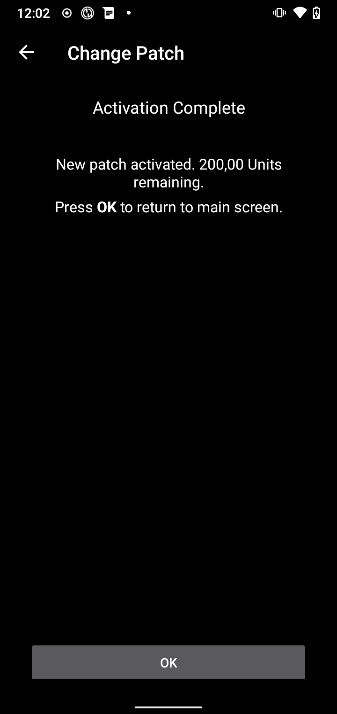
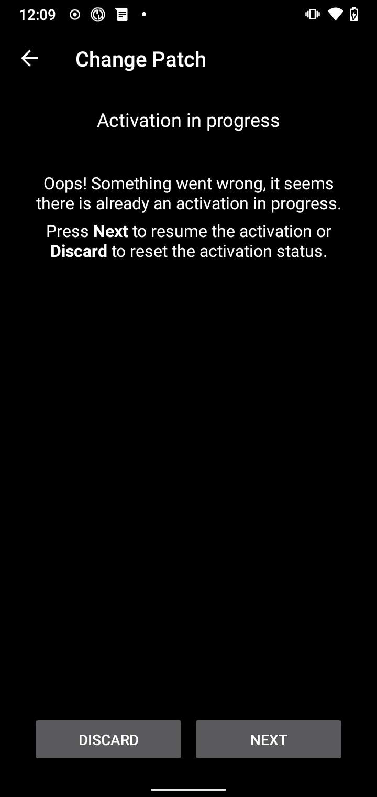

(medtrum-nano-300u)=
# Medtrum Nano 200U / 300U

이 안내는 Medtrum 인슐린 펌프를 설정하는 방법입니다.

```{contents} Table of contents
:depth: 1
:local: true
```

## AAPS에서 사용할 수 있는 펌프 기능
* 모든 루프 기능을 지원합니다 (SMB, TBR 등)
* 일광 절약 시간(DST)과 시간대를 자동으로 처리합니다
* AAPS 드라이버는 확장 볼러스를 지원하지 않습니다

## 하드웨어와 소프트웨어의 필요 요건
* **호환되는 Medtrum 펌프 베이스와 레저버 패치**
    - 현재 지원되는 모델:
        - 펌프 베이스 참조 번호 **MD0201** 및 **MD8201**인 Medtrum TouchCare Nano 200U.
        - 펌프 베이스 참조 번호 **MD8301**인 Medtrum TouchCare 300U.
        - 지원되지 않는 모델을 가지고 있고 기기를 기증하거나 테스트를 도울 수 있다면 [여기](https://discordapp.com/channels/629952586895851530/1076120802476441641)에서 Discord로 연락해 주십시오.
* [APK 빌드](../SettingUpAaps/BuildingAaps.md) 안내에 따라 **AAPS를 빌드하고 설치**한 상태.
* BLE 블루투스 연결을 지원하는 **호환 Android 휴대폰**
    - AAPS [릴리스 노트](../Maintenance/ReleaseNotes.md)를 참조하십시오

## 시작하기 전에

**안전 제일** 오류가 생겼을 때 복구할 수 없는 환경에서는 이 과정을 시도하지 마십시오 (여분의 패치, 인슐린, 펌프 제어 기기가 반드시 있어야 합니다).

**AAPS로 활성화한 패치에서는 PDM과 Medtrum 앱이 작동하지 않습니다.** 이전에는 PDM이나 Medtrum 앱으로 펌프에 명령을 보냈을 수 있습니다. 보안상의 이유로, 활성화된 패치는 그 패치를 활성화한 기기나 앱으로만 사용할 수 있습니다.

*그렇다고 PDM을 버려야 한다는 뜻은 아닙니다. 비상시를 대비한 예비 수단으로 안전한 곳에 보관하는 것을 권장합니다. 예를 들어 휴대폰을 잃어버렸거나 AAPS가 제대로 작동하지 않을 때 필요합니다.*

**펌프는 AAPS에 연결되어 있지 않아도 인슐린 주입을 멈추지 않습니다** 기본 기저 주입량은 현재 활성 프로파일에 정의된 대로 펌프에 프로그래밍됩니다. AAPS가 작동하는 동안에는 최대 120분 동안 실행되는 임시 기저 주입량 명령을 보냅니다. 어떤 이유로 펌프가 새 명령을 받지 못하면 (예: 펌프와 휴대폰 사이의 거리 때문에 통신이 끊긴 경우), 임시 기저 주입량이 끝난 후 펌프는 펌프에 프로그래밍된 기본 기저 주입량으로 돌아갑니다.

**AAPS 프로파일은 30분 단위의 기저 주입량 시간대를 지원하지 않습니다** AAPS를 처음 사용하면서 기저 주입량 프로파일을 처음 설정하는 경우, 30분에 시작하는 기저 주입량은 지원되지 않으므로 기저 주입량 프로파일이 정시에 시작하도록 조정해야 합니다. 예를 들어 09:30에 시작하여 2시간 동안 이어지고 11:30에 끝나는 1.1 U 기저 주입량이 있다면, 이것은 작동하지 않습니다. 이 1.1 U 기저 주입량을 9:00-11:00 또는 10:00-12:00 시간 범위로 바꿔야 합니다. Medtrum 펌프 하드웨어 자체는 30분 단위의 기저 주입량 프로파일을 지원하지만, 현재 AAPS의 알고리즘은 이것을 고려할 수 없습니다.

**0U/h 프로파일 기저 주입량은 AAPS에서 지원되지 않습니다** Medtrum 펌프는 0 기저 주입량을 지원하지만, AAPS는 프로파일 기저 주입량의 배수를 사용하여 자동 처치를 결정하므로 0 기저 주입량으로는 작동할 수 없습니다. 프로파일의 최소 기저 주입량은 0.05 U/h입니다.

일시적인 0 기저 주입량은 "펌프 연결 해제" 기능으로, 또는 루프 비활성화/임시 기저 주입량이나 루프 일시 중지/임시 기저 주입량을 함께 사용하여 만들 수 있습니다.

## 설정

```{caution}
**AAPS**로 패치를 활성화할 때에는 Medtrum 펌프 베이스와 통신할 수 있는 다른 모든 기기(예: 사용 중인 PDM 또는 Medtrum 앱)를 **반드시** 꺼야 합니다.
```

### 1단계: Medtrum 펌프 선택

#### 옵션 1: 새로 설치

**AAPS**를 처음 설치하는 경우 **설정 마법사**가 설정 과정을 안내합니다. **펌프** 단계에 이르면 **Medtrum**을 선택하십시오.

확실하지 않으면 **가상 펌프**를 선택하고, **AAPS** 설정을 마친 후에 **Medtrum**을 선택할 수도 있습니다 (방법 2 참조).


#### 옵션 2: 구성 화면

기존 설치에서는 [구성 > 펌프](#Config-Builder-pump)에서 **Medtrum** 펌프를 선택할 수 있습니다:

왼쪽 위의 **메뉴**(☰)를 열고 **구성** > **펌프**를 누른 다음 **Medtrum** 카드를 선택하십시오. 한 번에 하나의 펌프만 활성화할 수 있습니다.


선택하면 **Medtrum** 카드에 **설정**과 **플러그인 열기** 두 버튼이 표시됩니다:


**플러그인 열기**(또는 **관리 → 펌프**)를 누르면 Medtrum 펌프 화면이 열립니다. 이 화면에서 패치를 교체하고 펌프 상태를 확인합니다. 패치를 활성화하기 전에는 다음과 같이 보입니다:


(medtrum-step-2)=
### 2단계: Medtrum 설정 변경

**구성** > **펌프**에서 **Medtrum** 카드의 **설정**을 누르십시오. Medtrum 펌프 화면 오른쪽 위의 톱니바퀴 아이콘을 눌러도 됩니다. 그러면 **Medtrum 펌프 설정**이 열립니다:


```{note}
**일련번호** 설정은 이제 없습니다. **AAPS**는 처음 패치를 활성화할 때 블루투스 검색으로 펌프 베이스를 찾고([3단계](#medtrum-activate-patch) 참조), 그 일련번호를 기억합니다. 다른 펌프 베이스를 사용하려면 [페어링 해제](#medtrum-unpair)를 참조하십시오.
```

#### 알람 설정

***기본값: 신호음.***

이 설정은 경고나 오류가 있을 때 펌프가 알려 주는 방식을 바꿉니다.

- **신호음**: 알람과 경고가 있을 때 패치가 신호음을 냅니다.
- **무음**: 알람과 경고가 있어도 패치가 알리지 않습니다.

참고: 무음 모드에서도 **AAPS**는 휴대폰의 음량 설정에 따라 알람을 울립니다. 알람에 응답하지 않으면 결국 패치가 신호음을 냅니다.

#### 펌프 경고 알림

***기본값: 활성화.***

이 설정은 심각하지 않은 펌프 경고를 **AAPS**가 알림으로 표시하는 방식을 바꿉니다. 활성화하면 펌프 경고가 발생할 때 휴대폰에 알림이 표시됩니다. 예:
- 배터리 부족
- 레저버 부족 (20 U)
- 패치가 곧 만료됨

펌프 알람을 **무음**으로 설정한 경우 이 설정을 켜 두는 것을 권장합니다. 어느 경우든 이 경고는 Medtrum 펌프 화면의 [활성 알람](#medtrum-active-alarms)에도 표시됩니다.

(medtrum-patch-expiration)=
#### 패치 만료

***기본값: 활성화.***

이 설정은 패치의 동작을 바꿉니다. 활성화하면 패치는 3일 후에 만료되며, 소리를 켜 두었다면 소리로 경고합니다. 3일 8시간이 지나면 패치는 작동을 멈춥니다.

이 설정을 끄면 패치는 멈추기 전에 경고하지 않습니다. 최신 펌프 베이스 펌웨어에서는 패치가 최대 5일 동안 작동합니다.

#### 펌프 만료 경고 [시간]

***기본값: 72시간.***

이 설정은 만료 경고 시간을 바꿉니다. [패치 만료](#medtrum-patch-expiration)가 활성화되어 있으면, **AAPS**는 활성화 후 여기서 정한 시간이 지나면 알림을 표시합니다.

#### 시간당 최대 인슐린 [U]

***기본값: 25U.***

이 설정은 1시간 동안 주입할 수 있는 최대 인슐린 양을 바꿉니다. 이 한도를 넘으면 패치가 주입을 중지하고 알람을 울립니다. 펌프 화면의 **알람 재설정** 버튼으로 알람을 재설정할 수 있습니다. [알람 재설정](#nano-reset-alarms)을 참조하십시오.

자신의 인슐린 필요량에 맞는 적절한 값으로 설정하십시오.

#### 일일 최대 인슐린 [U]

***기본값: 80U.***

이 설정은 하루 동안 주입할 수 있는 최대 인슐린 양을 바꿉니다. 이 한도를 넘으면 패치가 주입을 중지하고 알람을 울립니다. 펌프 화면의 **알람 재설정** 버튼으로 알람을 재설정할 수 있습니다. [알람 재설정](#nano-reset-alarms)을 참조하십시오.

자신의 인슐린 필요량에 맞는 적절한 값으로 설정하십시오.

#### 연결 오류 시 검색

***기본값: 끔.***

**고급 설정**에 있습니다.

연결 문제가 있을 때만 이 설정을 켜십시오. 활성화하면 드라이버는 펌프에 다시 연결하기 전에 펌프를 다시 검색합니다. **AAPS**의 위치 권한이 "항상 허용"으로 설정되어 있는지 확인하십시오.

### 2b단계: AAPS 경고 설정

이 설정은 Medtrum 드라이버의 일부가 아닙니다. 메인 화면 오른쪽 위의 **설정**(톱니바퀴) 아이콘에서 여십시오. 자세한 내용은 [설정](../SettingUpAaps/Preferences.md)을 참조하십시오.

#### BT 워치독

**설정** > **펌프**를 여십시오:


**BT 워치독**은 **AAPS**가 펌프에 연결할 수 없을 때 휴대폰의 블루투스를 1초 동안 끕니다. 블루투스가 멈추는 일부 휴대폰에서 도움이 될 수 있습니다.

펌프와 연결 문제가 자주 생기면 이 설정을 켜십시오.

#### 로컬 알림

**설정** > **로컬 알림**을 여십시오:


##### 펌프에 연결할 수 없으면 경고

***기본값: 활성화.***

Medtrum 드라이버를 사용하면 이 설정은 강제로 켜집니다. 펌프에 연결할 수 없을 때 경고합니다. 펌프가 범위를 벗어났을 때, 또는 패치나 펌프 베이스의 결함 때문에 펌프가 응답하지 않을 때 이런 일이 생길 수 있습니다. 예를 들어 펌프 베이스와 패치 사이로 물이 새어 들어간 경우입니다.

안전상의 이유로 이 설정은 끌 수 없습니다.

##### 펌프 연결 불가 기준값

***기본값: 30분.***

이 설정은 펌프에 연결할 수 없다고 경고하기 전에 **AAPS**가 기다리는 시간을 바꿉니다.

Medtrum 펌프를 사용할 때 이 설정을 바꿀 수 있지만, 안전을 위해 30분으로 두는 것을 권장합니다.

(medtrum-activate-patch)=
### 3단계: 패치 활성화

**계속하기 전에:**
- Medtrum 펌프 베이스와 새 레저버 패치를 준비하십시오.
- Medtrum 펌프와 통신할 수 있는 다른 기기(PDM과 Medtrum 앱)를 끄십시오.
- 가능하면 **AAPS**가 설정되어 있고 [프로파일이 활성화](../DailyLifeWithAaps/ProfileSwitch-ProfilePercentage.md)되어 있는지 확인하십시오. 활성 프로파일이 없으면 활성화는 **프로파일 필요** 단계로 시작하며, 이 단계에서 활성화할 프로파일을 선택합니다.

#### 활성화 시작하기

[Medtrum 펌프 화면](#nano-overview)(**관리 → 펌프**)을 열고 **패치 교체**를 누르십시오. [설정 보안](#Preferences-protection)을 설정했다면 먼저 비밀번호나 PIN을 입력해야 합니다.

이미 활성화된 패치가 있으면 먼저 비활성화하라는 요청이 나옵니다. [패치 비활성화](#nano-deactivate-patch)를 참조하십시오.

활성화는 단계별 마법사로 진행됩니다. 안내에 따라 새 패치를 채우고 활성화하십시오. 어느 단계에서든 멈추려면 **취소**를 누르십시오.

```{important}
마법사가 안내할 때에만(프라임이 끝난 후) 패치를 몸에 붙이고 캐뉼라를 삽입하십시오.
```

처음에 보이는 단계는 설정에 따라 다릅니다:

1. **프로파일 필요**: 활성 프로파일이 없을 때에만 나옵니다. 적용할 프로파일을 선택한 다음 계속하십시오.
2. **펌프 찾기**: 처음 한 번, 또는 [페어링 해제](#medtrum-unpair)를 사용한 후에만 나옵니다. 펌프 베이스를 새 패치에 연결하여 전원을 켜십시오. **AAPS**가 근처의 Medtrum 펌프 베이스를 검색합니다 (이름이 `MT`로 시작합니다). 목록에서 자신의 펌프 베이스를 누르십시오. **AAPS**는 그 일련번호를 저장한 다음, 바로 패치 채우기 단계로 넘어갑니다.

   

3. **패치 활성화**: **AAPS**가 이미 펌프 베이스를 알고 있을 때에만 나옵니다. 화면에 "활성화된 패치가 없습니다. 활성화 과정을 시작하려면 **다음**을 누르십시오."라고 표시됩니다. 펌프 베이스가 아직 패치에 연결되어 있지 **않은지** 확인한 다음 **다음**을 누르십시오.


#### 연결과 채우기


펌프 베이스를 패치에 연결하고, 남은 공기를 제거한 후 패치에 인슐린을 채우십시오. 활성화하려면 최소 70 U가 필요합니다. 화면에 레저버 잔량이 표시됩니다. 아직 몸에 패치를 붙이지 마십시오.

패치가 감지되고 채워지면 **다음** 버튼이 나타납니다. 이 버튼을 누르십시오.

#### 인슐린 선택

이 단계는 **AAPS**에 인슐린이 둘 이상 설정되어 있을 때에만 나옵니다. 패치에 채우는 인슐린을 선택하십시오. **AAPS**는 활성화 후 이 인슐린으로 프로파일 전환을 적용합니다.

#### 패치 프라임


안전 잠금 장치를 제거하지 **마십시오**. 패치의 바늘 버튼을 반쯤 누른 다음 **다음**을 눌러 프라임을 시작하십시오.


프라임이 끝날 때까지 기다리십시오.


프라임이 끝나면 **다음**을 눌러 계속하십시오.

#### 위치 순환

이 단계는 [위치 순환](#Aapsscreens-site-rotation)으로 펌프 위치를 관리하는 경우(설정 **펌프 위치 순환 관리**)에만 나옵니다. 몸에서 패치를 붙일 위치를 선택하거나, 이 단계를 건너뛰십시오.

#### 패치 부착


피부를 깨끗이 하고 스티커를 떼십시오. 안전 잠금 장치를 제거하고, 패치를 몸에 붙인 다음, 바늘 버튼을 눌러 캐뉼라를 삽입하십시오.

**다음**을 눌러 패치를 활성화하십시오.

#### 패치 활성화


**AAPS**가 펌프를 활성화하고 초기 기저 주입량을 설정합니다. 기다리십시오. 활성화가 끝나면 다음 화면이 나타납니다:



```{admonition} Older screenshot
:class: note
**펌프 찾기**를 제외하면, 위의 활성화 스크린샷은 이전 **AAPS** 버전의 것이므로 **AAPS** 4에서는 다르게 보일 수 있습니다.
```

패치에 남은 인슐린 양(U)이 표시됩니다. **확인**을 눌러 펌프 화면으로 돌아가십시오.

```{tip}
새 패치를 활성화한 후에는 [설정을 내보내십시오](../Maintenance/ExportImportSettings.md). 그러면 나중에 이 패치 세션을 복구할 수 있습니다. 예를 들어 새 휴대폰에서 필요합니다.
```

(nano-deactivate-patch)=

### 패치 비활성화

활성 패치를 비활성화하려면 [Medtrum 펌프 화면](#nano-overview)(**관리 → 펌프**)을 열고 **패치 교체**를 누르십시오.


현재 패치를 비활성화할지 확인하라는 메시지가 나옵니다. **이 작업은 되돌릴 수 없습니다.** 비활성화하려면 **다음**을, 펌프 화면으로 돌아가려면 **취소**를 누르십시오.


**AAPS**가 패치를 비활성화할 수 없으면 (예: 펌프 베이스를 이미 패치에서 분리한 경우) **폐기**를 눌러 현재 패치 세션을 잊게 하십시오. 그런 다음 새 패치를 활성화할 수 있습니다.


비활성화가 끝나면 바늘을 뒤로 당기고 몸에서 패치를 떼십시오. 펌프 베이스를 분리하고 사용한 패치를 폐기하십시오. 펌프 화면으로 돌아가려면 **확인**을, 새 패치 활성화를 시작하려면 **다음**을 누르십시오.

(nano-resume-interrupted-activation)=

### 중단된 활성화 재개

패치 활성화가 중단되면 (예: 휴대폰 배터리가 다 된 경우) 활성화를 재개할 수 있습니다. [Medtrum 펌프 화면](#nano-overview)(**관리 → 펌프**)을 열고 **패치 교체**를 누르십시오.



활성화를 재개하려면 **다음**을 누르십시오. 활성화 상태를 초기화하여 새 패치를 활성화하려면 **폐기**를 누르십시오.


```{admonition} Older screenshot
:class: note
**패치 비활성화**와 **중단된 활성화 재개**의 스크린샷은 이전 **AAPS** 버전의 것이므로 **AAPS** 4에서는 다르게 보일 수 있습니다.
```

드라이버가 펌프에서 활성화 상태를 읽습니다. 성공하면 마법사는 멈추었던 단계부터 계속합니다.

(nano-overview)=

## 펌프 화면

Medtrum 펌프 화면(**관리 → 펌프**)은 Medtrum 패치의 현재 상태를 보여 줍니다. 패치 교체, 알람 재설정, 상태 새로고침 버튼도 있습니다. 위쪽의 배너는 중요한 상태를 보여 줍니다. 예: **패치가 활성화되지 않음** 또는 **펌프 중지됨**.


화면에는 다음 행이 표시될 수 있습니다. 일부 행은 값이 있을 때에만 나타납니다.

- **마지막 연결**: **AAPS**가 펌프에 마지막으로 연결한 후 지난 시간.
- **마지막 볼러스**: 마지막으로 주입된 볼러스.
- **배터리**: 패치의 현재 배터리 전압.
- **레저버**: 현재 레저버 잔량.
- **일련번호**: 펌프 베이스의 일련번호.
- **펌프 상태**: 펌프의 현재 상태. 예: **활성**(패치가 활성화되어 정상적으로 작동 중) 또는 **중지됨**(패치가 활성화되지 않음).
- **기본 기저 주입량**: 지금 실행 중인 프로파일의 기저 주입량.
- **임시 기저**: 실행 중인 임시 기저 주입량이 있으면 표시됩니다.
- **활성 볼러스**: 지금 주입되고 있는 볼러스.
- **활성 알람**: [아래](#medtrum-active-alarms)를 참조하십시오.
- **펌프 종류**: 펌프 베이스의 모델.
- **펌웨어 버전**: 펌프 베이스의 펌웨어 버전.
- **패치 번호**: 활성화된 패치의 순번. 새 패치를 활성화할 때마다 1씩 올라갑니다.
- **활성화**: 패치를 활성화한 날짜와 시간, 그리고 그 후 지난 시간.
- **패치 만료**: 패치가 만료되는 날짜와 시간. [패치 만료](#medtrum-patch-expiration)가 꺼져 있으면 **활성화 안 됨**으로 표시됩니다.

(medtrum-active-alarms)=
### 활성 알람

이 행은 지금 활성 상태인 알람을 보여 줍니다. 예: 레저버 부족, 곧 만료되는 패치.

### 새로고침

이 버튼은 패치 상태를 새로 고칩니다. 패치가 활성 상태이고 그 순간 **AAPS**가 펌프에 연결되어 있지 않을 때에만 사용할 수 있습니다.

### 패치 교체

이 버튼은 패치 교체 마법사를 시작합니다. 자세한 내용은 [패치 활성화](#medtrum-activate-patch)를 참조하십시오.

(medtrum-unpair)=
### 페어링 해제

이 버튼은 **AAPS**가 펌프 베이스를 알고 있을 때에만 나타납니다. 저장된 펌프 베이스 일련번호를 지우고 연결을 끊습니다. 다음에 패치를 활성화할 때 **AAPS**는 펌프 베이스를 다시 검색합니다 (**펌프 찾기** 단계). 다른 펌프 베이스로 바꿀 때 사용하십시오. 활성 패치가 없을 때에만 사용하십시오.

(nano-reset-alarms)=

### Reset alarms

**알람 재설정** 버튼은 패치가 스스로 주입을 중지했을 때(예: 일일 최대 인슐린 알람 후)에만 펌프 화면에 나타납니다. 이 버튼을 눌러 알람을 재설정하고 인슐린 주입을 재개하십시오.


```{admonition} Older screenshot
:class: note
위 스크린샷은 이전 **AAPS** 버전의 것입니다. **AAPS** 4에서는 펌프 화면이 다르게 보이지만, **알람 재설정** 버튼은 같은 방식으로 작동합니다.
```

## 휴대폰 교체, 설정 내보내기/가져오기

새 휴대폰으로 바꿀 때에는 다음과 같이 하십시오:
* 이전 휴대폰에서 [설정을 내보내십시오](../Maintenance/ExportImportSettings.md).
* 설정 파일을 이전 휴대폰에서 새 휴대폰으로 옮기고 **AAPS**로 가져오십시오. 가져오기 화면에서 **펌프 설정도 교체**에 체크하십시오. 그렇지 않으면 패치 세션이 새 휴대폰으로 옮겨지지 않습니다.

가져오는 설정 파일은 지금 사용 중인 패치 세션의 것이어야 합니다. 그렇지 않으면 패치가 연결되지 않습니다 ([튜브 없는 펌프](#ExportImportSettings-tubeless-pumps) 참조).

설정을 가져온 후 드라이버는 펌프와 이력을 동기화합니다. 설정 파일이 얼마나 오래되었는지에 따라 시간이 걸릴 수 있습니다. 진행 상황("기록 동기화 중, ...개 남음")은 메인 화면에 표시됩니다:


(medtrum-nano-troubleshooting)=

## Troubleshooting

### 연결 문제

연결 시간 초과나 다른 연결 문제가 있으면:
- **AAPS**의 Android 앱 설정에서 위치 권한을 "항상 허용"으로 설정하십시오.
- **연결 오류 시 검색**(Medtrum 설정 > **고급 설정**)과 **BT 워치독**(**설정** > **펌프**)을 켜 보십시오. [2단계](#medtrum-step-2)를 참조하십시오.

### 블루투스 문제
블루투스 연결의 알려진 문제, 펌프/Pod 연결 끊김, 활성화 및 연결 문제는 [블루투스 문제 해결](../GettingHelp/BluetoothTroubleshooting.md)을 참조하십시오.

### 활성화 중단됨

활성화가 중단되면 (예: 휴대폰 배터리가 다 되거나 휴대폰이 멈춘 경우) 활성화를 재개할 수 있습니다. 펌프 화면에서 **패치 교체**를 누르고 [중단된 활성화 재개](#nano-resume-interrupted-activation)의 단계를 따르십시오.

### 패치 결함 예방

패치는 여러 가지 오류를 낼 수 있습니다. 잦은 오류를 예방하려면:
- 펌프 베이스가 패치에 제대로 끼워져 있고 틈이 보이지 않는지 확인하십시오.
- 패치를 채울 때 플런저에 너무 큰 힘을 주지 마십시오. 자신의 모델에 해당하는 최대량을 넘어서 패치를 채우려고 하지 마십시오.

## 도움을 받을 수 있는 곳

Medtrum 드라이버의 모든 개발 작업은 커뮤니티가 **자원봉사**로 하고 있습니다. 이 점을 기억하고, 도움을 요청하기 전에 다음 지침을 따라 주십시오:

-  **레벨 0:** 이 문서의 관련 부분을 읽고, 문제가 있는 기능이 원래 어떻게 작동해야 하는지 이해했는지 확인하십시오.
-  **레벨 1:** 이 문서로 해결할 수 없는 문제가 계속되면 [이 초대 링크](https://discord.gg/4fQUWHZ4Mw)를 사용하여 **Discord**의 *#Medtrum* 채널로 가십시오.
-  **레벨 2:** 같은 문제가 이미 보고되었는지 [Issues](https://github.com/nightscout/AAPS/issues)에서 기존 이슈를 검색하십시오. 이슈가 있으면 그 이슈에서 문제를 확인하거나, 의견을 남기거나, 정보를 추가하십시오. 이슈가 없으면 [새 이슈](https://github.com/nightscout/AndroidAPS/issues)를 만들고 [로그 파일](../GettingHelp/AccessingLogFiles.md)을 첨부하십시오.
-  **인내심을 가지십시오. 커뮤니티 회원 대부분은 선의의 자원봉사자이며, 문제를 해결하려면 사용자와 개발자 모두에게 시간과 인내가 필요한 경우가 많습니다.**