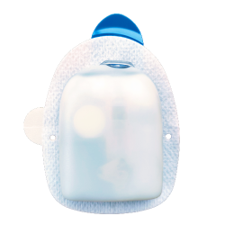
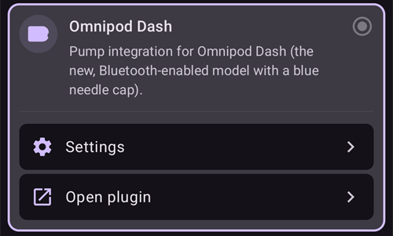
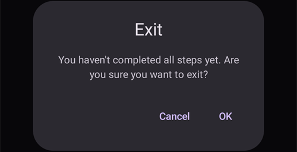
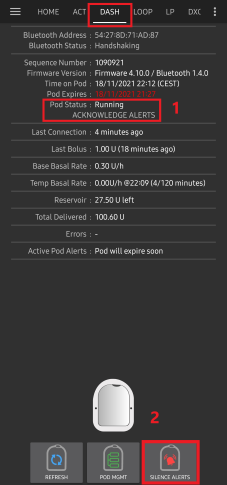
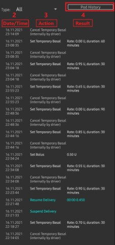
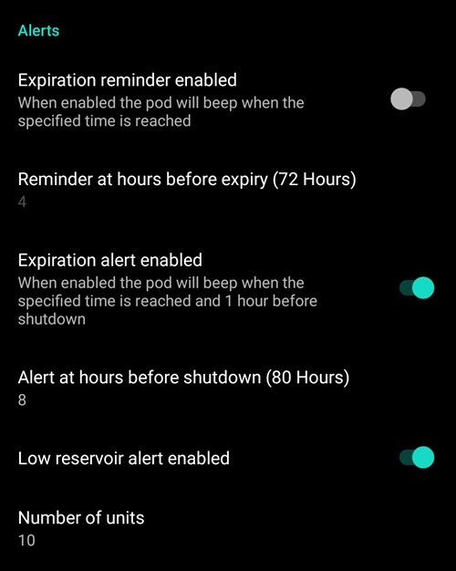
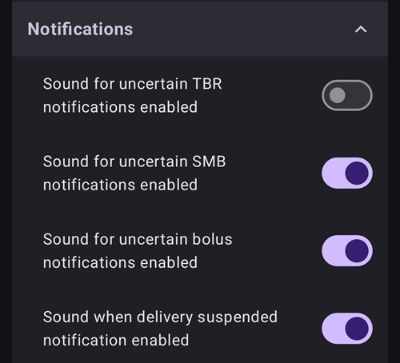
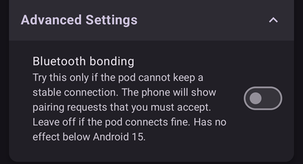
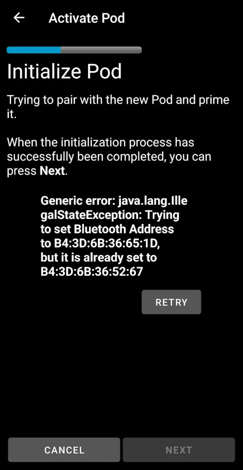

# Omnipod DASH

이 안내는 **Omnipod DASH** 세대 펌프 **(Omnipod Eros가 아님)**를 구성하는 방법입니다. DASH 드라이버는 Omnipod로 루프를 사용하는 검증된 방법입니다.

```{contents} Table of contents
:depth: 1
:local: true
```

## Omnipod DASH 사양

**Omnipod DASH** ('DASH')의 주요 특징:

- DASH Pod는 **파란색 바늘 캡**으로 구별합니다 (이전 EROS Pod는 투명한 바늘 캡입니다). 그 밖에는 Pod의 물리적 크기가 같습니다.
- DASH에는 BLE 연결/브리지 장치가 필요하지 않습니다 (RileyLink, OrangeLink, EmaLink가 필요 없습니다).
- DASH의 블루투스 연결은 명령을 보낼 때만 사용되며 (예: 볼러스), 명령을 보낸 직후 연결이 끊어집니다.
- **AAPS**는 Pod에 연결할 수 있을 때까지 기다렸다가 명령을 보냅니다.
- Pod를 활성화할 때 **AAPS**가 새 DASH Pod를 찾아서 연결합니다.
- 휴대폰과의 예상 통신 거리: 5-10미터 (환경에 따라 다를 수 있음).

(omnipod-dash-constraints)=

## Omnipod DASH의 알려진 AAPS 제약 사항/문제
- 일반적으로 **AAPS**는 Android 14나 16에서 실행할 것을 권장합니다. Android 15는 커뮤니티에서 보고된 [문제](https://github.com/nightscout/AndroidAPS/issues/3471)가 많습니다. 하지만 Android 15에서 실행한다면, Pod를 문제없이 활성화하고 사용하기 위해 **블루투스 본딩**을 켜야 할 가능성이 높습니다 ([Dash 설정](#omnipod-dash-advanced-settings)의 **고급 설정** 부분). 본딩 설정에 대한 자세한 내용은 [일반 문제 해결](../GettingHelp/GeneralTroubleshooting.md)을 참조하십시오.
- 일광 절약 시간(DST)과 시간대 변경은 자동으로 적용되지 않습니다. 시계가 바뀐 후에는 Pod를 직접 업데이트해야 합니다: DASH 펌프 화면에서 **새로고침**을 누른 다음, **시간 설정** (Pod와 휴대폰의 시간대가 다를 때 표시됨)을 누르거나 **프로파일 전환**을 하십시오 ([Omnipod Dash의 시간대 변경](#timezone-traveling-with-pumps) 참조).
- Dash는 기저 주입량을 0.05 U/h 단위로만 지원합니다. **AAPS 프로파일**에서 기저를 0.01 단위로 설정하면, Pod가 주입량을 0.05 단위로 올림하는데도 AAPS는 경고를 표시하지 않습니다. DASH 펌프 화면에서 **Pod 이력**을 열면 0.05 기저가 설정되었다고 표시됩니다. 그래서 **AAPS**에서 DASH가 허용하는 가장 낮은 기저 주입량도 0.05U/h입니다.
- 설정 파일에는 활성 Pod 세션이 들어 있습니다. Pod를 활성화할 때마다 설정을 내보내고, 설정을 가져오기 전에 [설정 내보내기와 가져오기](#omnipod-dash-export-import)를 읽으십시오.
- 새 기저 프로파일을 설정할 때 DASH는 새 기저 **프로파일**을 설정하기 전에 주입을 중지합니다. 통신이 끊기거나 오류가 생기면 기저 프로파일은 자동으로 다시 시작되지 않습니다. 자세한 내용은 [인슐린 주입 재개](#omnipod-dash-resuming-insulin-delivery) 부분을 참조하십시오.
- 경고가 설정되어 있고 Pod가 곧 만료되면, 경고를 음소거할 때까지 Pod가 계속 신호음을 냅니다. 자세한 내용은 [Pod 경고 음소거](#omnipod-dash-silencing-pod-alerts)를 참조하십시오.
- Pod 활성화 문제를 일으킬 수 있는 블루투스 관련 알려진 문제가 여러 가지 있습니다. 이런 문제의 알려진 원인과 해결 방법은 [블루투스 문제 해결](../GettingHelp/BluetoothTroubleshooting.md)을 참조하십시오.

(hardware-software-requirements)=

(omnipod-dash-hardware-software-requirements)=
## 하드웨어와 소프트웨어의 필요 요건

- Omnipod DASH는 파란색 바늘 캡으로 구별합니다.



- Bluetooth Low Energy (BLE)를 지원하는 **호환 Android 휴대폰** (자세한 내용은 [스마트폰](../Getting-Started/Phones.md) 참조). 그 밖에 호환 휴대폰에서 DASH를 문제없이 활성화하고 사용하는 데 중요한 다른 사항은 아래 정보를 참고하십시오:
    -  **AAPS** Omnipod Dash 드라이버는 블루투스로 DASH Pod에 연결합니다.  
      **AAPS**는 Pod에 명령을 보내야 할 때마다 (예: 볼러스) 자동으로 새 블루투스 연결을 만들고, 명령을 보낸 후에는 블루투스 연결을 바로 끊습니다.
       - **참고:**
         - 블루투스 연결은 **AAPS**가 실행되는 휴대폰에 연결된 다른 블루투스 기기 (이어폰 등) 때문에 끊기거나 방해받을 수 있습니다. 이런 기기는 일부 휴대폰 모델에서 연결 오류나 Pod 활성화 문제를 일으킬 수 있습니다. Omnipod DASH에 사용할 휴대폰을 고를 때는 작동이 확인된 구성을 알기 위해 [테스트된 하드웨어 구성](https://docs.google.com/spreadsheets/u/1/d/e/2PACX-1vScCNaIguEZVTVFAgpv1kXHdsHl3fs6xT6RB2Z1CeVJ561AvvqGwxMhlmSHk4J056gMCAQE02sAWJvT/pubhtml?gid=683363241&single=true) 목록을 확인하는 것이 좋습니다.
         - Pod 활성화 문제를 일으킬 수 있는 Bluetooth 관련 알려진 문제가 여러 가지 있습니다(다른 Bluetooth 문제에 대한 조언은 [문제 해결](#omnipod-dash-troubleshooting) 참조). 특히 [Bluetooth 관련 문제](#omnipod-dash-bluetooth-related-issues) 부분을 보십시오.
    - 휴대폰은 **Android 12 이상**이어야 하며, [**APK 빌드**](../SettingUpAaps/BuildingAaps.md) 안내에 따라 **AAPS**를 빌드하고 설치해야 합니다. 항상 최신 릴리스 버전을 사용하십시오.
- 지원되는 [**연속 혈당 측정기(CGM)**](../Getting-Started/CompatiblesCgms.md)

아래 안내는 **AAPS**를 사용하여 새 Pod 세션을 활성화하는 방법을 설명합니다. **AAPS**로 새 Pod를 활성화해야 하므로, 현재 Pod가 만료될 때가 가까워질 때까지 기다리십시오. Pod는 한 번 비활성화하면 다시 사용하거나 다시 활성화할 수 없습니다. 비활성화는 되돌릴 수 없습니다.

## 시작하기 전에

알려진 문제를 겪지 않도록, 이 안내서 전체와 **시작하기 전에** 부분, 그리고 **[Omnipod 및 AAPS 제약 사항과 문제](#omnipod-dash-constraints)**를 읽고 이해했는지 확인하십시오.

### **안전 제일** - 다음 항목이 모두 준비되지 않은 상태에서 처음으로 **AAPS**를 Pod에 연결하려고 **해서는 안 됩니다**:
1. 여분의 Pod (3개 이상)
2. 여분의 인슐린과 MDI(다회 주사) 장비
3. 작동하는 Omnipod PDM (**AAPS**가 작동하지 않을 때를 대비)
4. 지원되는 휴대폰이 꼭 필요합니다! ([하드웨어/소프트웨어 요구 사항](#hardware-software-requirements) 참조)
5. 올바른 버전의 AAPS를 빌드하고 설치

### AAPS Dash 드라이버가 Pod를 활성화하면 Omnipod Dash PDM은 필요 없게 됩니다.
- **AAPS**를 사용하기 전에는 사용자나 보호자가 Omnipod PDM (또는 일부 지역에서는 휴대폰 앱)으로 Pod를 관리하고 DASH에 명령 (예: 볼러스)을 보냈을 것입니다.
- DASH는 관리하고 명령을 보내기 위한 블루투스 기기 (예: PDM 또는 휴대폰) 연결을 하나만 허용합니다.
- Pod를 성공적으로 활성화한 기기만 그 이후로 그 Pod와 통신할 수 있습니다. 따라서 **AAPS**를 사용하여 Android 휴대폰으로 DASH를 활성화하면, **그 Pod에는 더 이상 PDM을 사용할 수 없습니다!** 그 Pod가 활성화되어 있는 동안에는 Android 휴대폰에서 실행되는 **AAPS** Dash 드라이버가 Pod의 새 PDM입니다.
- **PDM을 버리지 마십시오!** 휴대폰을 잃어버렸거나 **AAPS**가 제대로 작동하지 않을 때 같은 비상시를 대비하여 예비로 보관하는 것을 권장합니다.

### Pod는 AAPS에 연결되어 있지 않아도 인슐린 주입을 **멈추지 않습니다**.
기본 기저 주입량은 활성화할 때 현재 활성 [**프로파일**](../SettingUpAaps/YourAapsProfile.md)에 정의된 대로 Pod에 프로그래밍됩니다.  
**AAPS**가 작동하는 동안에는 최대 120분 동안 실행되는 기저 주입량 조정 명령을 보냅니다.  
어떤 이유로 Pod가 새 명령을 받지 못하면 (예: Pod ➜ 휴대폰 사이의 거리 때문에 통신이 끊긴 경우), Pod는 자동으로 [**프로파일**](../SettingUpAaps/YourAapsProfile.md)에 정의된 기본 기저 주입량으로 돌아갑니다.

### AAPS 프로파일은 30분 단위의 기저 주입량 시간대를 지원하지 않습니다
**AAPS**를 처음 사용하고 기저 주입량 [**프로파일**](../SettingUpAaps/YourAapsProfile.md)을 처음 설정하는 경우, 30분 단위로 시작하는 기저 주입량은 지원되지 않는다는 점에 주의하십시오. 예를 들어 Omnipod PDM에서 09:30에 시작하여 2시간 동안 이어지고 11:30에 끝나는 1.1 U 기저 주입량이 있다면, 이 기저 **프로파일**을 **AAPS**에서 똑같이 만들 수 없습니다.  
이 1.1 U 기저 주입량을 9:00-11:00 또는 10:00-12:00 시간 범위로 바꿔야 합니다. DASH 하드웨어 자체는 30분 단위의 기저 주입량 **프로파일**을 지원하지만, **AAPS**는 이 기능을 지원하지 않습니다.

### 0U/h 프로파일 기저 주입량은 AAPS에서 지원되지 않습니다
DASH는 0 기저 주입량을 지원하지만, **AAPS**는 사용자 **프로파일** 기저 주입량의 배수를 사용하여 자동 처치를 결정하므로 0 기저 주입량으로는 작동할 수 없습니다.  
대신 일시적인 0 기저 주입량은 "펌프 연결 해제" 기능으로, 또는 루프 비활성화/임시 기저 주입량이나 루프 일시 중지/임시 기저 주입량을 함께 사용하여 만들 수 있습니다.  
**참고:** **AAPS**에서 DASH가 허용하는 가장 낮은 기저 주입량은 0.05U/h입니다.

## AAPS에서 Dash 선택하기

**AAPS**에서 Omnipod DASH 드라이버를 선택하는 방법은 **두 가지**입니다:

### 옵션 1: 새로 설치

**AAPS**를 처음 설치하면 **설정 마법사**가 **AAPS**의 주요 기능과 설치 요구 사항을 안내합니다. **펌프** 단계가 되면 **Omnipod Dash**를 선택하십시오.


아직 확실하지 않다면 지금은 **가상 펌프**를 선택하고, **AAPS** 설정을 마친 후에 **Omnipod Dash**를 선택할 수 있습니다 (옵션 2 참조).

(omnipod-dash-option-2-config-builder)=
### 옵션 2: 구성 화면

이미 설치되어 있다면 **구성** 화면에서 **Omnipod Dash** 펌프를 선택할 수 있습니다:

1. 메인 화면 왼쪽 위의 **메뉴** (☰)를 열고 **구성**을 선택하십시오.
2. **펌프**를 누르고 **Omnipod Dash**의 라디오 버튼을 선택하십시오 (*"Omnipod Dash(파란색 바늘 캡이 있는 새 블루투스 모델)용 펌프 통합"*).

3. 선택하면 **Omnipod Dash** 카드에 버튼 두 개가 표시됩니다:
   - **설정**은 [Dash 설정](#omnipod-dash-settings)을 엽니다.
   - **플러그인 열기**는 [DASH 펌프 화면](#omnipod-dash-tab)을 엽니다.

   

### Omnipod 드라이버 선택 확인

**Omnipod Dash**가 선택되었는지 확인하려면, **관리** (메인 화면 아래쪽 탐색 메뉴)를 열고 **펌프**를 누르십시오. 다음 부분에 나오는 DASH 펌프 화면이 열립니다.

(omnipod-dash-tab)=

## DASH 펌프 화면

DASH 펌프 화면에서 Pod를 관리합니다: Pod 활성화와 비활성화, Pod 상태 새로고침, 경고 음소거, Pod 이력 보기를 할 수 있습니다. **관리** > **펌프**로 열거나, **구성** > **펌프**의 **Omnipod Dash** 카드에서 **플러그인 열기**로 여십시오.

활성 Pod가 없을 때의 화면입니다:


활성 Pod가 있을 때의 화면입니다:


오른쪽 위의 **설정** (톱니바퀴) 아이콘은 [Dash 설정](#omnipod-dash-settings)을 엽니다.

***참고:** 펌프 화면의 항목에 (불확실)이 표시되면 **새로고침**을 눌러 Pod 상태를 업데이트하십시오.*

### 항목

- **블루투스 주소:** Pod의 블루투스 주소입니다.

- **연결 품질:** **AAPS**가 Pod에 얼마나 안정적으로 연결되는지를 *성공한 연결 수 / 전체 연결 시도 수 :: 성공률* 형식으로 보여 줍니다. 예: `412/420 :: 98.10 %`. 성공한 연결이 50번을 넘으면, 값이 90 % 미만일 때 노란색, 70 % 미만일 때 빨간색으로 바뀝니다. 값이 낮으면 블루투스 문제가 있다는 뜻입니다 ([블루투스 관련 문제](#omnipod-dash-bluetooth-related-issues) 참조).

- **주입 상태:** Pod가 보고한 원래의 주입 상태입니다. 이 항목은 엔지니어링 모드 빌드에서만 표시됩니다.

- **고유 ID:** 활성화할 때 **AAPS**가 Pod에 부여한 고유 ID입니다.

- **LOT 번호:** Pod의 생산 로트 번호입니다.

- **시퀀스 번호:** Pod의 시퀀스 번호입니다.

- **펌웨어 버전:** Pod의 펌웨어 버전과 블루투스 버전입니다.

- **Pod 시간:** Pod의 현재 시간과 시간대입니다. Pod의 시간대가 휴대폰의 시간대와 다르면 글자가 빨간색으로, Pod 시간이 10분 넘게 차이 나면 노란색으로 바뀝니다.

- **Pod 만료:** Pod가 만료되는 날짜와 시간입니다 (활성화 후 72시간). 이 시간 전 마지막 4시간 동안 글자가 노란색으로 바뀝니다. 이 시간이 지나도 Pod는 인슐린을 계속 주입하므로 빨간색으로는 바뀌지 않습니다.

- **Pod 최종 종료:** Pod 유예 기간이 끝나는 시간입니다 (**Pod 만료** 8시간 후, Pod 최대 사용 시간은 80시간). 유예 기간이 시작되면 (**Pod 만료** 시점) 글자가 노란색으로 바뀌고, 최종 종료 전 마지막 4시간 동안 빨간색으로 바뀝니다. 유예 기간 동안에는 남은 시간도 표시됩니다. 예: *(17분 남음)*. Pod는 최종 종료 시점에 인슐린 주입을 멈추므로 반드시 교체해야 합니다.

- **Pod 상태:** Pod의 상태입니다: **활성화된 Pod 없음**, **설정 진행 중**, **실행 중**, **중지됨** 또는 Pod 결함 후에는 **ALARM**.

- **마지막 연결:** **AAPS**가 Pod와 마지막으로 통신한 지 얼마나 지났는지 보여 줍니다.

  - *방금 전* - 10초 이내.

  - *1분 이내* - 10초에서 60초 사이.

  - *XX분 전* - 1분 넘게 지났을 때 (1시간이 지나면 *X시간 XX분 전*).

- **마지막 볼러스:** Pod에 보낸 마지막 볼러스의 양과 주입한 지 얼마나 지났는지 보여 줍니다. 확인되지 않은 볼러스에는 (불확실)이 표시됩니다.

- **기본 기저 주입량:** 기저 **프로파일**에서 현재 시간에 프로그래밍된 기저 주입량입니다.

- **임시 기저 주입량:** 현재 실행 중인 임시 기저 주입량 (TBR)과 시작 시간, 기간입니다. 이 항목은 TBR이 실행 중일 때만 표시됩니다.

- **레저버:** 레저버에 50 U보다 많이 남아 있으면 *50 U 이상 남음*이 표시됩니다. 50 U 미만이면 정확한 양이 표시됩니다. 20 U 미만이면 값이 빨간색으로 바뀝니다.

- **총 주입량:** 레저버에서 주입된 인슐린의 총량입니다. 프라임에 사용된 인슐린도 포함됩니다.

- **활성 Pod 경고:** 현재 Pod에서 활성화된 경고입니다. 예: *Pod가 곧 만료됩니다.* 또는 *레저버 부족*.

- **오류:** Pod가 고장 났다면 Pod 결함이 빨간색으로 *Pod 결함:* 다음에 결함 코드와 이름이 붙어서 표시됩니다. 예: *Pod 결함: 020 ALARM_OCCLUDED*. 지난 오류와 더 자세한 정보는 [Pod 이력](#omnipod-dash-view-pod-history)과 로그 파일을 확인하십시오. [Pod 고장](#omnipod-dash-pod-failures)을 참조하십시오.

- **PDM 알림:** Pod 결함 후에만 표시됩니다. Omnipod PDM이 표시했을 방식대로 결함을 보여 줍니다: 제목 (예: *막힘 감지됨*, *레저버 비었음* 또는 *Pod 만료됨*), 무슨 일이 있었는지 (예: *인슐린 주입이 중지되었습니다. 지금 Pod를 교체하십시오.*), 그리고 *Ref:* 코드.

### Buttons

펌프 화면 아래쪽의 버튼은 Pod 상태에 따라 바뀝니다. 그 순간에 의미 있는 버튼만 표시됩니다.

- **새로고침:** Pod에 현재 상태를 요청합니다.
  - *Pod 상태를 업데이트하고 (불확실)이 표시된 항목을 정리할 때 사용하십시오.*
  - *자세한 내용은 아래의 [문제 해결](#omnipod-dash-troubleshooting) 부분을 참조하십시오.*

- **경고 음소거:** Pod 경고 신호음 (예: Pod 만료 또는 레저버 부족)을 멈춥니다. Pod에 활성 경고가 있을 때만 표시됩니다. [Pod 경고 음소거](#omnipod-dash-silencing-pod-alerts)를 참조하십시오.

- **주입 재개:** 중지된 Pod의 인슐린 주입을 재개합니다. 주입이 중지되었을 때만 표시됩니다. [인슐린 주입 재개](#omnipod-dash-resuming-insulin-delivery)를 참조하십시오.

- **시간 설정:** 기저 **프로파일**을 다시 보내서 Pod를 휴대폰의 시간대로 업데이트합니다. Pod의 시간대가 휴대폰의 시간대와 다를 때만 표시됩니다.

- [**Pod 활성화**](#omnipod-dash-activate-pod): 새 Pod를 프라임하고 활성화합니다. 활성 Pod가 없을 때 표시됩니다.

- [**Pod 비활성화**](#omnipod-dash-deactivate-pod): 활성 Pod를 비활성화합니다. Pod가 **AAPS**와 페어링되면 바로 표시됩니다. 활성화가 중간에 멈춘 경우에도 표시됩니다 (예: 활성화 중에 Pod가 고장 난 경우). **AAPS**는 Pod를 비활성화하기 전에 확인을 요청합니다.

- **테스트 신호음 작동:** Pod가 테스트 신호음을 한 번 냅니다.

- [**Pod 이력**](#omnipod-dash-view-pod-history): 활성 Pod의 활동 이력을 보여 줍니다.

- **Pod 폐기:** 완료되지 않은 Pod를 **AAPS**에서 제거합니다. Pod 활성화가 중간에 멈췄을 때만 표시됩니다. **AAPS**가 확인을 요청합니다. 폐기한 후에는 **AAPS**가 그 Pod와 더 이상 통신할 수 없습니다: Pod를 몸에서 제거하십시오.


```{admonition} Older screenshot
:class: note
위 스크린샷은 별도의 **Pod 관리** 메뉴가 있던 이전 **AAPS** 버전의 것입니다. **AAPS** 4에서는 **Pod 활성화**, **Pod 비활성화**, **테스트 신호음 작동**, **Pod 이력**을 포함한 이 모든 동작이 펌프 화면에 바로 있는 글자 버튼입니다.
```

(omnipod-dash-activate-pod)=

## Activate Pod

1. DASH 펌프 화면 (**관리** > **펌프**)을 열고 **Pod 활성화**를 누르십시오. 활성화 마법사가 열립니다.

   

   ```{admonition} Older screenshot
   :class: note
   위 스크린샷은 이전 **AAPS** 버전의 것입니다. **AAPS** 4에서는 **Pod 활성화**가 **Pod 관리** 메뉴가 아니라 DASH 펌프 화면에 바로 있는 버튼입니다.
   ```

   **AAPS**에서 **프로파일**을 한 번도 활성화한 적이 없다면, 마법사는 먼저 **프로파일 필요** 단계를 보여 줍니다: 활성화할 때 적용할 프로파일을 선택하고 계속하십시오.

2. **Pod 채우기** 단계가 표시됩니다. 새 Pod를 3일 동안 사용할 수 있는 충분한 인슐린으로 채우십시오. **최소 80 U**가 필요합니다. Pod에서 나는 두 번의 신호음을 들으십시오: 최소량인 80 U가 채워졌다는 뜻입니다. 두 번의 신호음을 들은 후에도 채우기용 주사기를 완전히 비우십시오. 아직 Pod의 바늘 캡을 제거하지 마십시오.

   ***참고:** 3일 동안 필요한 인슐린 양을 계산할 때, Pod 프라임에 약 3-10 U가 사용된다는 점을 기억하십시오.*

   

   

   새 Pod와 **AAPS**가 실행되는 휴대폰이 서로 가까이 있는지 확인하고 **다음**을 누르십시오.

3. **AAPS**에서 인슐린을 두 가지 이상 사용하면 **인슐린 선택** 단계가 표시됩니다. **현재 사용 중**인 인슐린이 표시됩니다. Pod에 다른 인슐린을 채웠다면 **변경**을 누르고 그 인슐린을 선택하십시오. 활성화가 끝나면 **AAPS**가 이 인슐린으로 **프로파일 전환**을 적용합니다. **다음**을 누르십시오.

   

4. **Pod 초기화** 단계에서 **AAPS**는 새 Pod와 페어링하고 Pod를 프라임합니다. Pod가 스스로 프라임하는 동안 딸깍 소리에 이어 째깍거리는 소리가 여러 번 들립니다. 이 과정이 성공적으로 끝나면 **다음** 버튼이 나타납니다. **다음**을 누르십시오.

       

   ***참고**: _검색 실패_ 또는 _'Could not find an available pod for activation'_ 같은 오류 메시지가 나타나도 (이런 일은 생길 수 있습니다) 당황하지 마십시오. **재시도**를 누르십시오. 대부분의 경우 활성화가 문제없이 계속됩니다.*

   

   Pod가 고장 났다면 (예: 활성화 시간이 초과된 경우) **재시도** 대신 **Pod 비활성화**가 표시됩니다. 그것을 사용하고 새 Pod로 다시 시작하십시오.

   활성화가 끝나기 전에 **취소**를 누르면, **AAPS**가 정말 나가려는지 확인을 요청합니다. 마법사를 나가려면 **확인**을, 남아 있으려면 **취소**를 누르십시오.

   

5. **AAPS**에서 펌프 위치 순환을 관리한다면 ([위치 순환](#Aapsscreens-site-rotation) 설정의 **펌프 위치 순환 관리**), **부위 위치** 단계가 표시됩니다. 몸 그림에서 Pod를 붙일 곳을 선택하고 **다음**을 누르거나, **건너뛰기**를 누르십시오.

   

6. 다음으로, 새 Pod를 붙일 주입 부위를 준비하십시오. 감염 위험을 피하기 위해 손을 씻으십시오. 비누와 물이나 알코올 솜으로 주입 부위를 닦고, 계속하기 전에 피부가 완전히 마를 때까지 기다리십시오. 접착제 때문에 피부가 자극을 받으면 보호용 물티슈(barrier wipe)나 보호용 스프레이(barrier spray)를 사용해 보십시오.

   **Pod 부착** 단계에서 Pod의 파란색 플라스틱 바늘 캡을 제거하십시오. 캐뉼라나 다른 무엇이 Pod 밖으로 튀어나와 있거나 평소와 달라 보이면 **멈추십시오**: **취소**를 누르고 새 Pod로 다시 시작하십시오. 모든 것이 **정상**으로 보이면, 접착면의 흰색 종이를 떼어 내고 몸의 선택한 위치에 Pod를 붙이십시오.

   다 되면 **다음**을 누르십시오.

   

7. 확인 대화 상자가 나타납니다: *확인을 누르면, 캐뉼라가 삽입될 것입니다.* **캐뉼라를 삽입할 준비가 되었을 때만 확인을 누르십시오!**

   

8. **캐뉼라 삽입** 단계에서 **AAPS**가 기저 일정을 설정하고 Pod가 캐뉼라를 삽입합니다. 시간이 조금 걸릴 수 있습니다 (최대 1-2분). **인내심을 가지십시오!**

   ***참고:** 캐뉼라가 삽입되기 전에 캐뉼라 삽입 지점 근처의 피부를 집어 올리는 것이 좋습니다. 그러면 바늘이 부드럽게 들어가고 막힘이 생길 가능성이 줄어듭니다.*

       

9. 캐뉼라가 성공적으로 삽입되면 **다음** 버튼이 나타납니다. **다음**을 누르십시오.

   

10. **Pod 활성화됨** 단계가 표시됩니다. 캐뉼라가 올바르게 삽입되었는지 확인하고, 그렇지 않다고 생각되면 Pod를 교체하십시오.

    **완료**를 누르십시오.

    축하합니다! 이제 새 Pod 세션을 시작했습니다.

    

11. DASH 펌프 화면으로 돌아옵니다. 이제 화면에 활성 Pod의 정보가 표시됩니다. 현재 기저 주입량, 인슐린 잔량, 주입된 인슐린, Pod 오류와 경고가 포함됩니다. **Pod 활성화** 대신 **Pod 비활성화**가 표시됩니다: 활성 Pod를 먼저 비활성화하지 않으면 다른 Pod를 활성화할 수 없습니다.

    ***참고:** 표시되는 정보에 대한 자세한 내용은 [DASH 펌프 화면](#omnipod-dash-tab)을 참조하십시오.*

    

    ***참고:** Pod를 활성화한 후에 설정을 내보내는 것이 좋습니다. Pod를 교체할 때마다, 그리고 한 달에 한 번 설정을 내보내십시오. 휴대폰을 잃어버릴 때를 대비하여 내보낸 설정 파일을 클라우드 저장소 (예: Google Drive)나 휴대폰이 아닌 다른 곳에 복사하십시오 ([**설정 내보내기**](../Maintenance/ExportImportSettings.md) 참조).*

이전 활성화가 Pod를 프라임한 후에 멈췄다면, **Pod 활성화**를 누르면 **Pod 부착** 단계부터 계속합니다.

(omnipod-dash-deactivate-pod)=

## Deactivate Pod

일반적인 경우 Pod는 3일 (72시간) 동안 사용하며, Pod 만료 경고 후 8시간의 유예 기간이 더해져 모두 80시간입니다.

Pod를 비활성화하려면 (만료되었거나 고장 났을 때):

1. DASH 펌프 화면 (**관리** > **펌프**)을 열고 **Pod 비활성화**를 누르십시오.

   

2. **Pod 비활성화** 단계에서 **다음**을 누르십시오. 대화 상자가 다음과 같이 묻습니다: *비활성화된 Pod는 다시 사용할 수 없습니다. 지금 이 Pod를 비활성화하시겠습니까?* Pod 비활성화를 시작하려면 **확인**을, Pod를 유지하려면 **취소**를 누르십시오. 비활성화하면 모든 인슐린 주입이 중지되며 되돌릴 수 없습니다.

   

3. **AAPS**가 Pod를 비활성화하는 동안 **Pod 비활성화 중** 단계가 표시됩니다. 비활성화가 성공하면 Pod가 신호음을 내어 알려 줍니다.

   

   ```{admonition} Older screenshot
   :class: note
   위 스크린샷은 이전 **AAPS** 버전의 것입니다. **AAPS** 4에서는 마법사의 진행 상황이 진행 막대 대신 위쪽의 점 한 줄로 표시됩니다.
   ```

   비활성화가 성공적으로 끝나면 **다음** 버튼이 나타납니다. **다음**을 누르십시오.

   

   비활성화가 실패하면 오류 메시지와 **Pod 폐기** 버튼이 표시됩니다. 이 버튼을 사용하기 전에 아래의 [Pod 폐기하기](#omnipod-dash-discard-pod)를 읽으십시오. **취소**를 누르고 나중에 **Pod 비활성화**를 다시 시도할 수도 있습니다.

4. **Pod 비활성화됨** 단계가 표시됩니다. Pod를 몸에서 제거하고 **완료**를 누르십시오.

   

5. DASH 펌프 화면으로 돌아옵니다. **Pod 상태** 항목에 **활성화된 Pod 없음**이 표시되고 **Pod 활성화** 버튼이 다시 표시되는지 확인하십시오.

   

(omnipod-dash-discard-pod)=

### Pod 폐기하기

Pod와의 모든 통신이 계속 실패할 때만 Pod를 폐기하십시오. **AAPS**가 아직 Pod와 통신할 수 있다면 대신 **Pod 비활성화**를 사용하십시오.

- **AAPS**는 Pod를 폐기하기 전에 확인을 요청합니다.
- 그 후에는 **AAPS**가 그 Pod와 더 이상 통신할 수 없습니다.
- Pod가 제대로 비활성화되지 않았기 때문에 **인슐린 주입은 중지되지 않았습니다**. **Pod를 몸에서 제거하십시오!**
- **Pod 폐기됨** 단계에서 Pod 상태가 폐기되었음을 확인할 수 있습니다. **완료**를 누르십시오. 이제 새 Pod를 활성화할 수 있습니다.

(omnipod-dash-resuming-insulin-delivery)=

## 인슐린 주입 재개

**참고**: **프로파일 전환** 중에는 PDM을 사용할 때와 마찬가지로 **AAPS**가 새 기저 **프로파일**을 설정하기 전에 Pod의 주입을 중지해야 합니다. 중지 명령과 재개 명령 사이에 통신이 실패하면 주입이 중지된 상태로 남을 수 있습니다. 자세한 내용은 문제 해결 부분의 [**주입 중지됨**](#omnipod-dash-delivery-suspended)을 읽으십시오.

인슐린 주입이 중지되었을 때는 Pod에 인슐린 주입을 재개하라고 명령해야 합니다. 명령이 성공적으로 처리되면, Pod는 활성 기저 **프로파일**의 현재 시간 기저 주입량으로 다시 인슐린을 주입합니다. Pod는 다시 볼러스, **TBR**, **SMB** 명령을 받아들입니다.

1. DASH 펌프 화면을 열고 **Pod 상태** 항목에 **중지됨**이 표시되는지 확인하십시오. **주입 재개**를 눌러 Pod에 정상적인 인슐린 주입을 재개하라고 명령하십시오.

   

2. 명령이 성공하면 **Pod 상태** 항목에 **실행 중**이 표시되고 **주입 재개** 버튼이 사라집니다.

   

   

   ```{admonition} Older screenshot
   :class: note
   위 스크린샷은 확인 대화 상자를 보여 주던 이전 **AAPS** 버전의 것입니다. **AAPS** 4에서는 DASH 펌프 화면에서 결과를 확인합니다: **Pod 상태** 항목에 **실행 중**이 표시되고 **주입 재개** 버튼이 사라집니다.
   ```

   명령이 실패하면 **AAPS**는 *주입 재개 실패함*으로 시작하는 경고 대화 상자를 표시합니다. **새로고침**을 누르고 다시 시도하십시오.

   

(omnipod-dash-silencing-pod-alerts)=

## Pod 경고 음소거

이 부분에서는 Pod 수명이 거의 끝나 갈 때 Pod 신호음을 멈추는 방법을 설명합니다. 이 신호음이 언제 시작되는지는 **경고** 설정에 따라 다릅니다 ([Dash 설정](#omnipod-dash-settings) 참조):

- **만료 전 알림 시간 (72시간):** 72시간 만료 몇 시간 전에 Pod가 신호음을 내기 시작할지 정합니다.
- **종료 전 경고 시간 (80시간):** 80시간 종료 몇 시간 전에 Pod가 다시 신호음을 낼지 정합니다.

Pod의 최대 사용 시간은 80시간 (3일 8시간)입니다. 하지만 Pod 제조사는 72시간 (3일)을 넘기지 말 것을 권장합니다.

***참고**: **경고 음소거** 버튼은 Pod에 활성 경고 (예: Pod 만료 또는 레저버 부족)가 있을 때만 DASH 펌프 화면에 표시됩니다. **경고 음소거** 버튼이 보이지 않는데 Pod 신호음이 들리면 **새로고침**을 누르십시오.*

1. 알림 시간이 되면 Pod가 신호음을 내어 곧 만료되므로 교체해야 한다고 알려 줍니다. DASH 펌프 화면의 **Pod 만료 (1)** 항목에 Pod가 만료되는 정확한 시간이 표시됩니다 (활성화 후 72시간). 이 시간 4시간 전에 글자가 노란색으로 바뀝니다. 그 후에는 **Pod 최종 종료**가 노란색으로 바뀌고 Pod가 인슐린 주입을 멈출 때까지 남은 시간을 보여 줍니다. **활성 Pod 경고 (2)** 항목에 **Pod가 곧 만료됩니다.**가 표시되고, **경고 음소거 (3)** 버튼이 표시됩니다.

   

2. **경고 음소거**를 누르십시오. **AAPS**가 Pod에 만료 신호음을 멈추는 명령을 보냅니다.

   

   ```{admonition} Older screenshot
   :class: note
   위 스크린샷은 이 화면이 **DASH** 탭이었던 이전 **AAPS** 버전의 것입니다. **AAPS** 4에서는 **경고 음소거** 버튼이 DASH 펌프 화면 (**관리** > **펌프**)에 있습니다.
   ```

3. 경고가 음소거되면 **활성 Pod 경고** 항목에 더 이상 그 경고가 표시되지 않고, **경고 음소거** 버튼이 사라지며, Pod가 만료 신호음을 멈춥니다.

   

   ```{admonition} Older screenshot
   :class: note
   위 스크린샷은 확인 대화 상자를 보여 주던 이전 **AAPS** 버전의 것입니다. **AAPS** 4에서는 DASH 펌프 화면에서 결과를 확인합니다: **활성 Pod 경고** 항목에서 경고가 사라집니다.
   ```

   명령이 실패하면 **AAPS**는 *경고 음소거 실패함*으로 시작하는 경고 대화 상자를 표시합니다. **새로고침**을 누르고 다시 시도하십시오.

레저버 부족 경고도 같은 방식으로 작동합니다. Pod에 남은 인슐린이 **경고** 설정의 **단위 수**까지 줄어들면 Pod가 신호음을 냅니다. **레저버** 항목에 남은 양이 표시되고, **활성 Pod 경고** 항목에 **레저버 부족**이 표시되며, **경고 음소거** 버튼이 표시됩니다. **경고 음소거**를 눌러 신호음을 멈추고, 다음 Pod 교체를 계획하십시오.


(omnipod-dash-view-pod-history)=

## Pod 이력 보기

이 부분에서는 활성 Pod의 이력을 보고 동작 유형별로 거르는 방법을 설명합니다. Pod 이력은 3일 (72 - 80시간) 사용 기간 동안 활성 Pod에 보낸 명령과 그 결과를 보여 줍니다.

Pod에 보낸 볼러스, TBR, 기저 명령을 확인할 때 유용합니다. 다른 범주는 문제 해결에 도움이 되며, 고장에 이르기까지 일어난 일의 순서를 보여 줍니다.

**참고:** **마지막 명령만 불확실할 수 있습니다**. **마지막 '불확실' 명령이 '확인됨' 또는 '거부됨'이 될 때까지** 새 명령은 *보내지 않습니다*. 불확실한 명령을 '해결'하려면 DASH 펌프 화면에서 **새로고침**을 누르십시오.

1. DASH 펌프 화면을 열고 **Pod 이력**을 누르십시오.

   

   ```{admonition} Older screenshot
   :class: note
   위 스크린샷은 이전 **AAPS** 버전의 것입니다. **AAPS** 4에서는 **Pod 이력**이 **Pod 관리** 메뉴가 아니라 DASH 펌프 화면에 바로 있는 버튼입니다.
   ```

2. **Pod 이력** 화면이 **전체** 필터가 선택된 상태로 열립니다. 모든 명령이 시간과 결과와 함께 최신 순으로, 날짜별로 묶여서 표시됩니다. 위쪽의 필터 버튼 (예: **볼러스** 또는 **기저**)을 사용하여 한 가지 유형의 명령만 표시하십시오. 뒤로 화살표를 눌러 DASH 펌프 화면으로 돌아가십시오.

    

   ```{admonition} Older screenshot
   :class: note
   위의 두 번째 스크린샷은 **유형** 목록에서 명령 유형을 고르던 이전 **AAPS** 버전의 것입니다. **AAPS** 4에서는 첫 번째 스크린샷에 보이는 필터 버튼을 사용합니다.
   ```

   볼러스가 일반 볼러스가 아니면 양 뒤에 볼러스 유형이 표시됩니다. 예: *0.05 U (SMB)* 또는 *0.05 U (기저 보정)*. 기저 보정은 드라이버가 스스로 보내는 아주 작은 볼러스 (Pod 펄스 1회, 0.05 U)입니다. 사용자가 요청한 것이 아닙니다.

   ```{admonition} Why basal corrections happen
   :class: note
   Pod는 내부 시계에 맞춰 0.05 U 펄스로 기저 인슐린을 주입합니다. 기저 주입량이 바뀔 때마다 (예: 루프가 새 **TBR**을 설정할 때) Pod는 이 시계를 다시 시작하며, 세고 있던 펄스는 사라집니다. 루프는 특히 밤에 기저 주입량을 자주 바꾸므로, Pod가 예상보다 적은 기저 인슐린을 주입할 수 있습니다.

   **AAPS**는 Pod가 주입했다고 보고한 기저 인슐린과 주입했어야 하는 양을 비교합니다. 부족한 양이 펄스 반 개 이상이 되면, 드라이버가 기저 보정으로 펄스를 한 번 더 주입합니다. 그래서 프로파일과 루프가 요청한 기저 인슐린을 받을 수 있습니다. Pod가 중지되어 있거나 0 **TBR**이 실행 중일 때는 보정을 보내지 않습니다.
   ```

(omnipod-dash-settings)=

## Dash 설정

Dash 드라이버 설정을 여는 방법은 두 가지입니다:

- [DASH 펌프 화면](#omnipod-dash-tab) 오른쪽 위의 **설정** (톱니바퀴) 아이콘을 누르십시오.
- 메인 화면 왼쪽 위의 **메뉴** (☰)를 열고 **구성** > **펌프**를 선택하십시오. **Omnipod Dash** 카드에서 **설정**을 누르십시오.

설정은 펼칠 수 있는 네 부분으로 나뉘어 있습니다: **확인 신호음**, **경고**, **알림**, **고급 설정**. 부분을 눌러 여십시오:


대부분의 설정은 켜기/끄기 스위치입니다.

### 확인 신호음


볼러스, 기저, SMB, TBR 주입과 변경에 대한 Pod의 확인 신호음입니다.

**볼러스 신호음 활성화됨:**    볼러스가 주입될 때 Pod가 신호음을 냅니다. 기본값은 켜짐입니다.

**기저 신호음 활성화됨:**    새 기저 주입량이 설정되거나, 활성 기저 주입량이 취소되거나 변경될 때 Pod가 신호음을 냅니다. 기본값은 꺼짐입니다.

**SMB 신호음 활성화됨:**  SMB가 주입될 때 Pod가 신호음을 냅니다. 기본값은 켜짐입니다.

**TBR 신호음 활성화됨:**  TBR이 설정되거나 취소될 때 Pod가 신호음을 냅니다. 기본값은 꺼짐입니다.

### Alerts



```{admonition} Older screenshot
:class: note
위 스크린샷은 이전 **AAPS** 버전의 것입니다. **AAPS** 4에서는 이 설정이 펼칠 수 있는 **경고** 부분에 있습니다.
```

Pod 만료, 종료, 레저버 부족에 대한 Pod 경고입니다. Pod가 활성화되어 있을 때 이 설정을 바꾸면 **AAPS**가 새 경고 설정을 Pod에 보냅니다.

***참고:** 경고가 발생한 후 **AAPS**가 Pod와 통신하면, 어떤 경고든 **AAPS** 알림이 항상 표시됩니다. 알림을 닫아도 Pod 경고는 멈추지 않습니다. 경고를 멈추려면 DASH 펌프 화면을 열고 **경고 음소거**를 누르십시오.*

**만료일 알림 활성화됨:**    켜면 알림 시간이 되었을 때 Pod가 신호음을 냅니다. 기본값은 켜짐입니다.

**만료 전 알림 시간 (72시간):** 72시간 Pod 만료 몇 시간 전에 알림을 시작할지 정합니다 (1-24시간, 기본값 4).

**만료 경고 켜짐:**   켜면 경고 시간이 되었을 때, 그리고 종료 1시간 전에 다시 Pod가 신호음을 냅니다. 기본값은 켜짐입니다.

**종료 전 경고 시간 (80시간):**  80시간 Pod 종료 몇 시간 전에 경고를 시작할지 정합니다 (1-8시간, 기본값 8).

**레저버 부족 경고 활성화됨:**    레저버에 남은 인슐린이 **단위 수**의 값까지 줄어들면 Pod가 경고합니다. 기본값은 켜짐입니다.

**단위 수:**    레저버 부족 경고가 발생하는 U 수입니다 (5-50 U, 기본값 20).

### Notifications



TBR, SMB 또는 볼러스가 주입되었는지 불확실할 때와 주입이 중지되었을 때, **AAPS**가 알림과 함께 소리를 낼지 선택합니다.

***참고:** 이것은 휴대폰 알림일 뿐이며 Pod 자체는 신호음을 내지 않습니다.*

**불확실한 TBR 알림 소리 활성화:**  **AAPS**가 TBR이 설정되었는지 불확실할 때 알림과 함께 소리를 냅니다.

**불확실한 SMB 알림 소리 켜짐:**  **AAPS**가 SMB가 주입되었는지 불확실할 때 알림과 함께 소리를 냅니다.

**불확실한 볼러스 알림 소리 활성화:**    **AAPS**가 볼러스가 주입되었는지 불확실할 때 알림과 함께 소리를 냅니다.

**주입 일시 중지 알림 소리 켜짐:**     인슐린 주입이 중지되었을 때 알림과 함께 소리를 냅니다.

(omnipod-dash-advanced-settings)=

### Advanced Settings



**블루투스 본딩:**  블루투스로 Pod와 휴대폰을 본딩합니다. Pod가 안정적인 연결을 유지하지 못할 때만 사용하십시오. 예: Android 15 ([Omnipod DASH의 알려진 AAPS 제약 사항/문제](#omnipod-dash-constraints) 참조). 켜져 있으면 휴대폰에 페어링 요청이 나타나며, 이를 수락해야 합니다. Pod가 잘 연결되면 끄십시오. Android 15 미만에서는 효과가 없습니다. 기본값은 꺼짐입니다.

## 인슐린 및 캐뉼라 사용 기간

메인 화면의 [상태 표시줄](#screens-sensor-level-battery)에 인슐린과 캐뉼라의 사용 기간이 표시됩니다. Omnipod에서는 튜브 펌프와 조금 다르게 작동합니다.

**AAPS**는 Pod를 활성화할 때마다 캐뉼라 교체와 인슐린 교체를 자동으로 기록합니다. 그래서 Pod를 교체할 때마다 **인슐린**과 **캐뉼라** 사용 기간이 0으로 초기화됩니다. **프라임/채우기**로 직접 기록할 필요가 없습니다. Pod는 붙인 곳의 피부에 캐뉼라를 바로 삽입하기 때문입니다: Omnipod는 튜브를 사용하지 않습니다.

**펌프 배터리** 사용 기간은 보고되지 않습니다: 배터리와 인슐린 레저버가 각 Pod에 들어 있으며, 배터리는 항상 Pod 자체보다 오래 갑니다 (최대 80시간).


```{admonition} Older screenshot
:class: note
위 스크린샷은 이 사용 기간이 **동작** 탭의 **케어포털** 부분에 표시되던 이전 **AAPS** 버전의 것입니다. **AAPS** 4에서는 메인 화면의 상태 표시줄에 표시됩니다.
```

### Level

**인슐린 잔량**

표시되는 인슐린 잔량은 Pod가 보고한 양입니다. 하지만 Pod는 실제 레저버 잔량을 50 U 미만일 때만 보고합니다. 그 전까지는 *50 U 이상 남음*이 표시됩니다. 보고되는 양은 정확하지 않습니다: Pod가 '비었음'을 보고해도 대부분의 경우 레저버에는 인슐린이 몇 U 남아 있습니다.

DASH 펌프 화면은 잔량을 다음과 같이 표시합니다:

  * **50 U 이상 남음** - Pod가 레저버에 50 U보다 많이 있다고 보고합니다.
  * **50 U 미만** - Pod가 보고한, 레저버에 남은 정확한 인슐린 양입니다.

추가 참고:
  * **SMS** - SMS 응답에서 값을 반환하며, 50 U를 넘으면 50+U를 반환합니다.
  * **Nightscout** - 50 U를 넘으면 Nightscout에 50 값을 업로드합니다 (14.07 버전 이하). 더 새로운 버전은 50 U를 넘으면 50+ 값을 보고합니다.

(omnipod-dash-troubleshooting)=

## Troubleshooting

이 부분에서는 AAPS로 Omnipod DASH를 사용할 때 자주 생기는 알려진 문제와 해결 방법을 다룹니다. 문서에는 [일반 문제 해결](../GettingHelp/GeneralTroubleshooting.md) 부분도 있습니다. 일부 Pod 문제와 관련된 내용도 다루므로 함께 읽어 보십시오.

---

(omnipod-dash-bluetooth-related-issues)=

## 블루투스 관련 문제

블루투스 연결의 알려진 문제, 펌프/Pod 연결 끊김, 활성화 및 연결 문제는 [블루투스 문제 해결](../GettingHelp/BluetoothTroubleshooting.md)을 참조하십시오.

---

(omnipod-dash-delivery-suspended)=

### 주입 중지됨

  - 일시 중지 버튼은 더 이상 없습니다. Pod를 "일시 중지"하려면 x분 동안 0 **TBR**을 설정할 수 있습니다.
  - **프로파일 전환** 중에 DASH는 새 기저 **프로파일**을 설정하기 전에 주입을 중지해야 합니다. 두 명령 사이에 통신이 실패하면 주입이 중지된 상태로 남을 수 있습니다. 이런 일이 생기면:
     - 인슐린이 전혀 주입되지 않습니다. 기저, SMB, 수동 볼러스 등이 모두 포함됩니다.
     - 명령 중 하나가 확인되지 않았다는 알림이 나타날 수 있습니다. 이는 실패가 언제 일어났는지에 따라 다릅니다.
     - **AAPS**는 15분마다 새 기저 프로파일 설정을 시도합니다.
     - 주입이 여전히 중지되어 있으면 (주입 재개 실패), **AAPS**는 15분마다 주입이 중지되었다는 알림을 표시합니다.
     - 주입을 직접 재개하려면 DASH 펌프 화면에 표시되는 [**주입 재개**](#omnipod-dash-resuming-insulin-delivery) 버튼을 사용하십시오.
     - **AAPS**가 스스로 주입을 재개하지 못하면 (Pod에 연결할 수 없거나, 소리가 꺼져 있는 경우 등), Pod는 3분 동안 1분마다 4번 신호음을 냅니다. 주입이 20분 넘게 계속 중지되어 있으면 이것을 15분마다 반복합니다.
  - 확인되지 않은 명령은 DASH 펌프 화면에서 **새로고침**을 눌러 성공 여부를 확인하십시오.

*****참고:** Pod에서 신호음이 들리면 휴대폰을 확인하지 않고 주입이 계속될 것이라고 생각하지 마십시오. 주입이 중지된 상태로 남아 있을 수 있으므로 ***반드시 확인해야 합니다!******

---
(omnipod-dash-pod-failures)=

### Pod 고장

- Pod는 Pod 자체의 하드웨어 문제를 포함한 여러 가지 이유로 가끔 고장 납니다.
- AAPS는 승인된 Pod 사용 방법이 아니므로, Insulet에 지원이나 교체를 요청하지 않는 것이 좋습니다.
- 원인을 찾는 데 도움이 되는 결함 코드 목록은 [**여기에서 볼 수 있습니다**](https://github.com/openaps/openomni/wiki/Fault-event-codes).

Pod가 고장 나면 인슐린 주입을 멈추고 계속 신호음을 냅니다. **AAPS**는 메인 화면에 결함 코드와 이름, *Ref:* 코드가 있는 알림을 표시합니다. 예: *Pod 결함: 020 ALARM_OCCLUDED*. **닫기**를 눌러 알림을 닫으십시오. 그래도 Pod 신호음은 멈추지 않습니다.


DASH 펌프 화면에서 **Pod 상태** 항목에 **ALARM**이 표시되고, **오류** 항목에 Pod 결함이 표시되며, **PDM 알림** 항목이 이를 설명합니다. 예: *막힘 감지됨. 인슐린 주입이 중지되었습니다. 지금 Pod를 교체하십시오. 혈당을 확인하십시오*.


고장 난 Pod는 다시 사용할 수 없습니다. 혈당을 확인한 다음, [Pod를 비활성화](#omnipod-dash-deactivate-pod)하고 새 Pod를 활성화하십시오.

---
### 오류 49 Pod 고장 예방

이 고장은 명령에 맞지 않는 Pod 상태나 인슐린 주입 명령 중의 오류와 관련이 있습니다. 드라이버와 Pod가 실제 상태에 대해 서로 다르게 알고 있을 때 생깁니다. 그러면 Pod는 (내장된 안전 장치 때문에) 복구할 수 없는 오류 코드 49 (0x31)로 반응하고, 이른바 “스크리머(screamer)”가 됩니다. 이것은 길고 귀에 거슬리는 신호음으로, Pod 뒷면의 정해진 위치에 구멍을 뚫어야만 멈출 수 있습니다. “49 Pod 고장”의 정확한 원인은 찾기 어려운 경우가 많습니다. 예를 들어 앱이 비정상 종료된 후, 개발 버전을 실행할 때, 또는 다시 설치한 후에 일어날 수 있습니다.

---

### 펌프에 연결할 수 없음 경고

미리 설정한 시간 동안 Pod와 통신할 수 없으면 “펌프에 연결할 수 없습니다” 경고가 나타납니다. 펌프에 연결할 수 없음 경고는 메인 화면 오른쪽 위의 **설정** (톱니바퀴) 아이콘을 누른 다음 **로컬 알림** ➜ **펌프 연결 불가 기준값**을 선택하여 설정할 수 있습니다. 권장 값은 **120**분 후 경고입니다.

---
(omnipod-dash-export-import)=
### 설정 내보내기와 가져오기

**AAPS** 설정을 내보내 두면, 예를 들어 **AAPS**를 다시 설치한 후나 새 휴대폰에서 모든 설정과 목표를 복원할 수 있습니다. **Pod를 활성화할 때마다 바로 설정을 내보내고** 파일을 휴대폰이 아닌 안전한 곳 (예: Google Drive)에 복사하십시오. 그러면 활성 Pod도 복원할 수 있습니다. [백업 만들기와 복원하기](#ExportImportSettings-Settings-Export)를 참조하십시오.

```{admonition} Importing settings can end your active Pod
:class: warning
이미 Pod를 사용 중인 휴대폰에서는 **펌프 설정도 교체**를 선택하지 마십시오: Pod 세션은 유지되고 다른 설정만 가져옵니다. 새 휴대폰에서만, 그리고 지금 착용하고 있는 Pod를 사용하는 동안 내보낸 파일로만 선택하십시오. [튜브 없는 펌프](#ExportImportSettings-tubeless-pumps)를 참조하십시오.
```

가져온 설정에 더 이상 활성 상태가 아닌 Pod가 들어 있으면 다음 부분을 참조하십시오.

---
### 비활성 Pod의 상태가 들어 있는 설정 가져오기

더 이상 활성 상태가 아닌 Pod의 데이터가 들어 있는 설정을 가져오면, AAPS는 그 Pod에 연결하려고 시도하지만 당연히 실패합니다. 이 상태에서는 새 Pod를 활성화할 수 없습니다.

이전 Pod 세션을 제거하려면:
1. DASH 펌프 화면에서 **Pod 비활성화**를 누르십시오. 비활성화는 대부분 실패합니다.
2. 실패하면 **Pod 폐기**를 누르고 확인하십시오 ([Pod 폐기하기](#omnipod-dash-discard-pod) 참조).
3. 이전 Pod가 제거되면 새 Pod를 활성화할 수 있습니다.

### 일반적인 오류: java.lang.IllegalStateException: Trying to set a Bluetooth Address to ***, but it is already set to ***.

새 Pod를 초기화하려고 할 때 이 오류가 나타나면, **AAPS**의 구성에 이전 Pod의 설정이 아직 저장되어 있어서 실패하는 것입니다.



백업에서 복원했거나 Pod 비활성화가 실패했을 때 이런 일이 생길 수 있습니다.

해결하려면 **취소**를 눌러 활성화를 나가십시오. DASH 펌프 화면에 **Pod 폐기**가 표시되면 누르십시오. 표시되지 않으면 **Pod 비활성화**를 누르고, 비활성화가 실패하면 **Pod 폐기**를 누르십시오 ([Pod 폐기하기](#omnipod-dash-discard-pod) 참조).

이제 새 Pod를 활성화할 수 있습니다.

---
### AAPS 다시 설치하기

**AAPS**를 삭제하면 모든 설정, 목표, 현재 Pod 세션을 잃게 됩니다. **이것들을 복원하려면 최근에 내보낸 설정 파일이 꼭 있어야 합니다!**

Pod가 활성화되어 있을 때는 현재 Pod 세션 중에 내보낸 파일을 사용하십시오 ([설정 내보내기와 가져오기](#omnipod-dash-export-import) 참조).

1. 설정을 내보내고 사본을 안전한 곳 (예: Google Drive)에 보관하십시오.
2. **AAPS**를 삭제하고 휴대폰을 다시 시작하십시오.
3. 새 버전의 **AAPS**를 설치하십시오.
4. 설정을 가져오십시오.
5. 모든 설정을 확인하십시오 (필요하면 설정을 다시 가져오십시오).
6. 새 Pod를 활성화하십시오.
7. 완료되면: 현재 설정을 내보내십시오.

---
### AAPS를 새 버전으로 업데이트하기

대부분의 경우 삭제할 필요가 없습니다. 새 버전의 설치를 시작하여 “덮어쓰기” 설치를 할 수 있습니다. 이것은 Pod 세션이 활성화되어 있을 때도 할 수 있습니다.

1. 설정을 내보내십시오.
2. 새 **AAPS** 버전을 설치하십시오.
3. 설치가 성공했는지 확인하십시오
4. Pod의 주입을 재개하거나 새 Pod를 활성화하십시오.
5. 완료되면: 현재 설정을 내보내십시오.

---
### Omnipod 드라이버 경고

Omnipod Dash 드라이버는 **메인 화면**에 여러 가지 고유한 경고를 표시합니다. 대부분은 정보용이며 닫을 수 있지만, 일부는 경고의 원인을 해결하기 위해 사용자의 조치가 필요합니다.

자주 볼 수 있는 주요 경고는 아래와 같습니다:

- *Pod 결함: XXX NAME* 다음에 *Ref: ...*: Pod가 고장 나서 인슐린 주입을 멈췄습니다. Pod를 교체하십시오. [Pod 고장](#omnipod-dash-pod-failures)을 참조하십시오.
- *활성화된 Pod 없음*: Pod 세션을 찾지 못했습니다. 이 알림은 새 Pod를 활성화할 때까지 계속 다시 나타납니다. Pod가 활성화되면 자동으로 사라집니다.
- *인슐린 주입이 중지됨*: Pod가 인슐린 주입을 중지했습니다. [인슐린 주입 재개](#omnipod-dash-resuming-insulin-delivery)를 참조하십시오.
- *기저 프로파일 설정이 실패했을 수 있습니다. 주입이 중지되었을 수 있습니다! 펌프 화면에서 Pod 상태를 수동으로 새로 고치고, 필요하면 주입을 재개하십시오.* Pod에 기저 **프로파일**을 설정하는 것이 실패했을 수 있습니다. DASH 펌프 화면에서 **새로고침**을 누르고, **주입 재개**가 표시되면 누르십시오.
- *SMB(X U)가 성공했는지 확인할 수 없습니다. Pod 상태를 새로 고쳐 이 명령의 성공 여부를 확인하십시오.* **AAPS**가 **SMB**가 주입되었는지 확인하지 못했습니다. DASH 펌프 화면에서 **새로고침**을 누르고 **마지막 볼러스** 항목을 확인하십시오.
- *볼러스 주입 상태가 불확실합니다. Pod 상태를 새로 고쳐 성공 여부를 확인하십시오.* 일반 볼러스도 마찬가지입니다: DASH 펌프 화면에서 **새로고침**을 누르십시오.
- *Pod의 시간대가 휴대폰의 시간대와 다릅니다. 기저 주입량이 정확하지 않습니다. 해결하려면 프로파일을 전환하십시오.* [Omnipod DASH의 알려진 AAPS 제약 사항/문제](#omnipod-dash-constraints)의 일광 절약 시간(DST)과 시간대 참고 사항을 참조하십시오.

(omnipod-dash-where-to-get-help-for-dash)=

## 도움을 받을 수 있는 곳

DASH의 모든 개발 작업은 커뮤니티가 **자원봉사**로 하고 있습니다. 이 점을 기억하고, 도움을 요청하기 전에 다음 지침을 따르십시오:

-  **레벨 0:** 이 문서의 관련 부분을 읽고, 문제가 있는 기능이 원래 어떻게 작동해야 하는지 이해했는지 확인하십시오.
-  **레벨 1:** 이 문서로 해결할 수 없는 문제가 계속 있다면, [이 초대 링크](https://discord.gg/4fQUWHZ4Mw)를 사용하여 **Discord**의 *#AAPS* 채널로 가십시오. 질문할 수 있는 Facebook 그룹과 다른 그룹도 많이 있습니다 ([**도움 받기**](../GettingHelp/WhereCanIGetHelp.md) 참조)
-  **레벨 2:** [Issues](https://github.com/nightscout/AndroidAPS/issues)에서 기존 이슈를 검색하여 같은 문제가 이미 보고되었는지 확인하십시오. 이슈가 있으면 그 이슈에서 문제를 확인하거나, 의견을 남기거나, 정보를 추가하십시오. 이슈가 없으면 [새 이슈](https://github.com/nightscout/AndroidAPS/issues)를 만들고 [로그 파일](../GettingHelp/AccessingLogFiles.md)을 첨부하십시오.
-  **인내심을 가지십시오. 커뮤니티 회원 대부분은 선의의 자원봉사자이며, 문제를 해결하려면 사용자와 개발자 모두에게 시간과 인내가 필요한 경우가 많습니다.**

도움을 요청할 때는 커뮤니티 사람들이 구체적인 질문과 문제를 도울 수 있도록 다음 정보를 준비하십시오:
- Android 휴대폰 제조사와 모델
- Android OS 버전 (예: 15 또는 16)
  - 최근에 Android OS 버전을 업그레이드했습니까?
- 사용 중인 **AAPS** 버전
- 다음 사항을 고려하여 겪고 있는 문제를 쉬운 말로 설명
   - 전에는 작동했습니까?
   - 언제 작동했고 언제 작동하지 않았습니까?
   - 구성이나 프로파일 설정을 바꾼 적이 있습니까?
   - 새 블루투스 기기를 페어링했습니까?
   - 앱을 업그레이드하거나 새 앱을 설치했습니까?
   - 작동이 멈추기 전에 얼마나 오래 작동했습니까?
