# Omnipod Eros

이 안내는 Omnipod Eros 세대 펌프를 설정하는 방법입니다 (**Omnipod Dash가 아님**).

```{admonition} Omnipod Eros is being phased out
:class: note

[Omnipod System](https://www.omnipod.com/current-podders/resources/omnipod-system) (PDM(Personal Diabetes Manager)과 Pod로 구성된 원래의 Omnipod)은 판매가 중단되고 있으며, 종료 날짜는 나라마다 다릅니다. 예를 들어 캐나다에서는 2026년 6월 30일 이후 더 이상 구할 수 없습니다. Eros 펌프를 사용하고 있다면, 지원되는 펌프로 바꾸는 것을 미리 계획하십시오.
```

**이 소프트웨어는 DIY 인공 췌장 솔루션의 일부이며 완성된 제품이 아닙니다. 사용 방법을 포함하여 시스템을 직접 읽고, 배우고, 이해하는 것은 사용자의 책임입니다. 이 소프트웨어로 무엇을 하든 그 책임은 전적으로 사용자 본인에게 있습니다.**

```{contents} Table of contents
:depth: 1
:local: true
```

## 하드웨어와 소프트웨어의 필요 요건

- **Pod 통신 장치**

> AAPS가 설치된 휴대폰과 Eros 세대 Pod 사이의 통신을 연결해 주는 구성 요소입니다.
> 
> > -   [OrangeLink 웹사이트](https://getrileylink.org/product/orangelink)
> > -  [433MHz RileyLink](https://getrileylink.org/product/rileylink433)
> > -   [Emalink 웹사이트](https://github.com/sks01/EmaLink) - [연락처](mailto:getemalink@gmail.com)
> > - 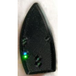  DiaLink - [연락처](mailto:Boshetyn@ukr.net)
> > -   [LoopLink 웹사이트](https://www.getlooplink.org/) - [연락처](https://jameswedding.substack.com/) - 테스트되지 않음

-   **휴대폰 장치**

> AAPS를 실행하고 Pod 통신 장치에 제어 명령을 보내는 구성 요소입니다.
> 
> > - **AAPS**와 관련 구성 요소가 설정된 지원되는 [Android 휴대폰](#Phones-list-of-tested-phones).

-   **인슐린 주입 장치**

> AAPS가 설치된 휴대폰에서 보내고 Pod 통신 장치를 거쳐 받은 명령을 해석하는 구성 요소입니다.
> 
> > - 새 Omnipod Pod (Eros 세대 - **DASH가 아님**)

이 안내는 새 Pod 세션을 시작한다고 가정합니다. 그렇지 않다면 조금 기다렸다가 다음 Pod 교체 때 이 과정을 시작하십시오.

이 페이지에서 **RileyLink**는 위에 나열된 모든 Pod 통신 장치를 뜻합니다.

## 시작하기 전에

**안전이 우선입니다** - 오류가 생겼을 때 복구할 수 없는 환경에서는 이 과정을 시도하지 마십시오 (여분의 Pod, 인슐린, 충전된 RileyLink, 휴대폰 장치가 꼭 필요합니다).

**AAPS Omnipod 드라이버가 Pod를 활성화한 후에는 Omnipod PDM을 더 이상 사용할 수 없습니다**. 이전에는 Omnipod PDM으로 Omnipod Eros Pod에 명령을 보냈습니다. Omnipod Eros Pod는 하나의 장치만 Pod와 통신할 수 있게 합니다. Pod를 성공적으로 활성화한 장치만 그 이후로 그 Pod와 통신할 수 있습니다. 따라서 AAPS Omnipod 드라이버를 통해 RileyLink로 Omnipod Eros Pod를 활성화하면, **그 Pod에는 더 이상 PDM을 사용할 수 없습니다**. 이제 RileyLink와 함께 사용하는 AAPS Omnipod 드라이버가 PDM 역할을 합니다. *그렇다고 PDM을 버려야 한다는 뜻은 아닙니다. 예비용으로, 그리고 AAPS가 제대로 작동하지 않는 비상시를 대비하여 보관하는 것을 권장합니다.*

**한 번에 하나의 RileyLink만 Pod와 통신할 수 있습니다.** **AAPS**는 페어링된 RileyLink 하나를 기억합니다. 다른 RileyLink를 페어링하면 이전 RileyLink를 대체합니다.

**RileyLink가 통신 범위를 벗어나도 Pod는 꺼지지 않습니다.** RileyLink가 범위를 벗어나거나 신호가 막혀 활성 Pod와 통신할 수 없을 때에도 Pod는 기저 인슐린을 계속 주입합니다. Pod를 활성화하면 AAPS에 정의된 기저 프로파일이 새 Pod에 프로그래밍됩니다. Pod와의 연결이 끊기면 Pod는 이 기저 프로파일로 돌아갑니다. RileyLink가 다시 범위 안으로 들어와 연결이 다시 이루어질 때까지는 새 명령을 보낼 수 없습니다.

**AAPS에서는 30분 단위 기저 주입량 프로파일을 지원하지 않습니다.** AAPS를 처음 사용하고 기저 주입량 프로파일을 처음 설정한다면, 30분에 시작하는 기저 주입량은 지원되지 않으므로 기저 주입량 프로파일이 정시에 시작하도록 조정해야 합니다. 예를 들어 09:30에 시작하여 2시간 동안 이어지고 11:30에 끝나는 1.1 U의 기저 주입량이 있다면, 이것은 작동하지 않습니다.  이 1.1 U 기저 주입량을 9:00-11:00 또는 10:00-12:00의 시간 범위로 바꾸어야 합니다.  Omnipod 하드웨어 자체는 30분 단위 기저 주입량 프로파일을 지원하지만, 현재 AAPS의 알고리즘은 이를 고려할 수 없습니다.

## AAPS에서 Omnipod 드라이버 활성화하기

AAPS에서 Omnipod 드라이버를 활성화하는 방법은 **두 가지**입니다:

### 옵션 1: 설정 마법사

새 버전의 AAPS를 설치하면 **설정 마법사**가 자동으로 시작됩니다. 이전 설치에서 설정을 이미 내보냈다면, 마법사에서 설정을 가져올 수 있습니다. 새로 설치하는 경우 아래 내용을 계속 진행하십시오.

**펌프** 단계에 도달할 때까지 [설정 마법사](../SettingUpAaps/SetupWizard.md)를 진행한 다음, **Omnipod Eros**를 선택하십시오 (설명은 "Omnipod Eros용 펌프 통합"으로 되어 있습니다).


설정 마법사는 RileyLink를 페어링하지 않습니다. 마법사를 마친 후 Omnipod 펌프 화면을 열고 [RileyLink 설정 부분](#OmnipodEros-rileylink-setup)에 설명된 대로 RileyLink를 페어링하십시오.

**또는**

### 옵션 2: 구성 화면

왼쪽 위의 **메뉴** (☰) > **구성** > **펌프**를 열고 **Omnipod Eros**의 **라디오 버튼**을 선택하십시오.

선택하면 **Omnipod Eros** 카드에 **설정**과 **플러그인 열기** 두 버튼이 표시됩니다:


**설정**은 Omnipod 드라이버의 설정을 엽니다 ([Omnipod 설정](#OmnipodEros-omnipod-settings) 참조):


**플러그인 열기**는 Omnipod 펌프 화면을 엽니다. 메인 화면에서 **관리** > **펌프**로 언제든지 열 수도 있습니다. 이 페이지에서는 이 화면을 **Omnipod 펌프 화면**이라고 부릅니다. RileyLink를 페어링하고 Pod를 활성화하기 전에는 다음과 같이 보입니다:

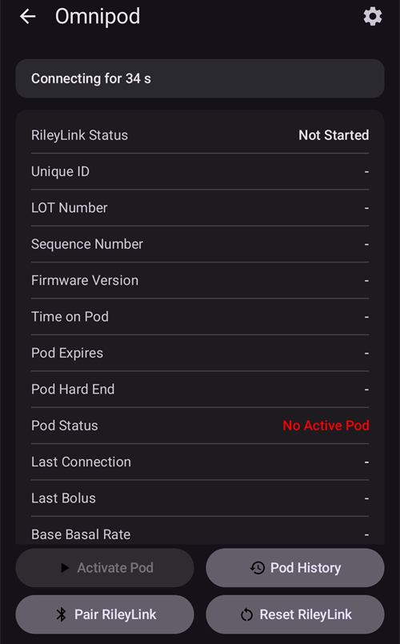

### Omnipod 드라이버 선택 확인

Omnipod 드라이버가 활성화되었는지 확인하려면 메인 화면에서 **관리** > **펌프**를 여십시오. 위에 보이는 **Omnipod Eros** 펌프 화면이 보여야 합니다. 아직 RileyLink를 페어링하지 않았다면 **RileyLink 상태**에 **시작 안 됨**이, **Pod 상태**에 **활성화된 Pod 없음**이 표시됩니다.

## Omnipod 구성

모든 Pod 및 RileyLink 기능은 [Omnipod 펌프 화면](#OmnipodEros-omnipod-pod-tab)(**관리** > **펌프**)의 버튼입니다. 일부 버튼은 Pod가 활성화되어 있을 때처럼 특정 상황에서만 나타납니다.

>  Pod 연결 및 상태 새로고침
> 
>  Pod 관리 (활성화, 비활성화, 테스트 신호음 작동, RileyLink 통계, Pod 이력)

```{admonition} Older screenshot
:class: note
위의 스크린샷은 이전 **AAPS** 버전의 것입니다. **AAPS** 4에는 **POD MGMT** 버튼이나 Pod 관리 메뉴가 없습니다: **새로고침**과 모든 Pod 관리 작업은 Omnipod 펌프 화면의 버튼입니다.
```

(OmnipodEros-rileylink-setup)=

### RileyLink 설정

RileyLink를 이미 페어링했다면 아래 [Pod 활성화하기 부분](#OmnipodEros-activating-a-pod)으로 넘어가십시오.

*참고: RileyLink가 연결되지 않았다는 것을 눈으로 쉽게 알 수 있는 표시는 메인 화면의 처치 버튼(QuickLaunch 툴바)이 사라지는 것입니다. AAPS가 시작된 후 처음 약 30초 동안에도 RileyLink에 연결하는 중이므로 같은 현상이 나타납니다.*

1. RileyLink가 완전히 충전되어 있고 켜져 있는지 확인하십시오.

2. RileyLink를 [휴대폰 가까이](#OmnipodEros-optimal-omnipod-and-rileylink-positioning)(약 30 cm 이내)에 두십시오.

3. Omnipod 펌프 화면(**관리** > **펌프**)을 열고 **RileyLink 페어링**을 누르십시오.

4. **RileyLink 페어링** 화면이 바로 블루투스 장치 검색을 시작합니다. 찾은 장치 목록에서 사용하는 RileyLink를 누르십시오.

   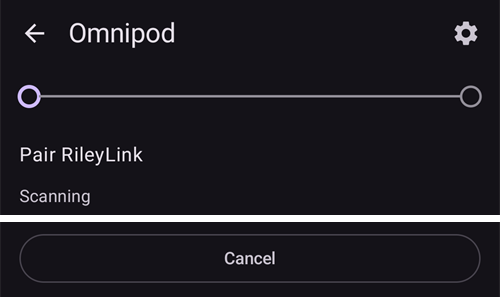

5. 장치의 이름과 주소와 함께 **RileyLink 페어링 성공**이 표시되면 **확인**을 누르십시오.

6. Omnipod 펌프 화면으로 돌아와서 **RileyLink 상태**가 **연결됨**으로 바뀌는지 확인하십시오. **Pod 상태**에는 **활성화된 Pod 없음**이 표시되어야 합니다. RileyLink가 연결되지 않으면 **RileyLink 초기화**를 누르거나 **AAPS**를 다시 시작하십시오.

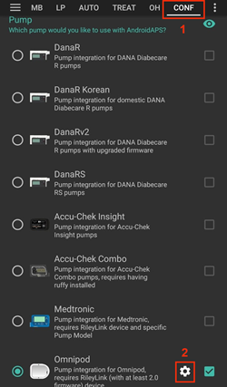 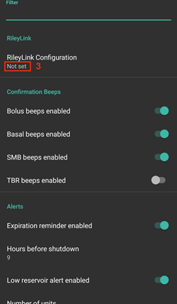

 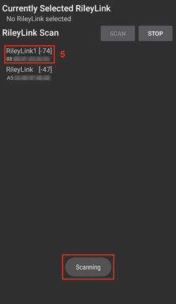

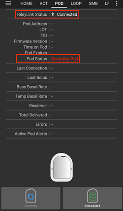


```{admonition} Older screenshot
:class: note
위의 스크린샷 6장(6단계 이후)은 이전 **AAPS** 버전의 것입니다. **AAPS** 4에서는 Omnipod 설정의 **RileyLink Configuration** 대신 Omnipod 펌프 화면의 **RileyLink 페어링** 버튼으로 RileyLink를 페어링하며, 검색이 자동으로 시작됩니다.
```

```{note}
다른 RileyLink(예: 예비 장치)로 바꾸려면 **RileyLink 페어링**을 다시 누르고 새 장치를 선택하십시오. 새 장치가 이전에 페어링한 장치를 대체합니다. 이전 장치를 먼저 제거할 필요는 없습니다.
```

(OmnipodEros-activating-a-pod)=

### Pod 활성화하기

Pod를 활성화하기 전에 RileyLink가 페어링되어 있고 **RileyLink 상태**에 **연결됨**이 표시되는지 확인하십시오. RileyLink가 준비될 때까지 **Pod 활성화** 버튼은 비활성화되어 있습니다.

*알림: 보안 안전 조치 때문에 Pod 활성화 페어링을 할 때에는 Pod 통신 거리가 제한됩니다. 페어링 전에는 Pod의 무선 신호가 약하지만, 페어링 후에는 최대 신호 세기로 작동합니다. 이 과정에서는 Pod가* [가까운 거리](#OmnipodEros-optimal-omnipod-and-rileylink-positioning) *(약 30 cm 이내)에 있되, RileyLink 바로 위나 바로 옆에는 두지 마십시오.*

01. Omnipod 펌프 화면(**관리** > **펌프**)을 열고 **Pod 활성화**를 누르십시오.

    프로파일을 한 번도 활성화한 적이 없다면 **프로파일 필요** 단계가 먼저 나타납니다. 활성화할 때 적용할 프로파일을 선택하십시오.

    >   
    > 
    > ```{admonition} Older screenshot
    >     :class: note
    >     위의 스크린샷은 이전 **AAPS** 버전의 것입니다. **AAPS** 4에서 **Pod 활성화**는 **POD MGMT** 메뉴 대신 Omnipod 펌프 화면의 버튼입니다.
    > ```

02. **Pod 채우기** 화면이 표시됩니다. 3일 동안 사용할 수 있는 충분한 인슐린으로 새 Pod를 채우고 두 번의 신호음을 들으십시오. 이 신호음은 최소량인 80 U가 채워졌다는 뜻입니다. 두 번의 신호음을 들은 후에도 채우기용 주사기를 완전히 비우십시오. 3일 동안 필요한 인슐린 총량을 계산할 때, Pod 프라임에 12~15 U가 사용된다는 점을 고려하십시오. 아직 Pod의 바늘 캡을 제거하지 마십시오.

    > 
    > 
    > 새 Pod와 RileyLink가 서로 가까이(약 30 cm 이내) 있는지 확인하고 **다음**을 누르십시오.

03. **인슐린 선택** (인슐린이 두 개 이상 설정된 경우에만 표시됨): Pod에 채우는 인슐린을 선택하고 **다음**을 누르십시오. 활성화 후 이 인슐린으로 프로파일 전환이 적용됩니다.

04. **Pod 초기화** 화면에서 Pod가 프라임을 시작합니다 (Pod가 스스로 프라임하는 동안 딸깍 소리 후 째깍거리는 소리가 여러 번 들립니다). RileyLink가 활성화하는 Pod와 통신할 수 있는 거리 밖에 있으면 **Pod에서 반응 없음** 오류 메시지가 나타납니다. 이런 일이 생기면 [RileyLink를 Pod에 더 가까이](#OmnipodEros-optimal-omnipod-and-rileylink-positioning)(약 30 cm 이내) 옮기되 Pod 바로 위나 바로 옆에는 두지 말고, **재시도**를 누르십시오.

    >  

05. 프라임이 성공하면 녹색 체크 표시가 나타나고 **다음** 버튼이 활성화됩니다. **다음**을 누르십시오.

    > 

06. **부위 위치** ([위치 순환](#Aapsscreens-site-rotation)에서 **펌프 위치 순환 관리**가 켜져 있을 때만 표시됨): 몸에서 Pod를 붙일 위치를 선택하고 **다음**을 누르십시오.

07. **Pod 부착** 화면이 표시됩니다. 새 Pod의 주입 부위를 준비하십시오. Pod의 플라스틱 바늘 캡과 접착면의 흰색 보호 종이를 떼어 내고, 몸에서 선택한 위치에 Pod를 붙이십시오. 캐뉼라가 튀어나와 있으면 **취소**를 누르고 Pod를 폐기하십시오. 다 되면 **다음**을 누르십시오.

    > 

08. 확인 대화 상자가 나타납니다: "확인을 누르면, 캐뉼라가 삽입될 것입니다". **캐뉼라를 삽입할 준비가 되었을 때만 확인을 누르십시오**.

    > 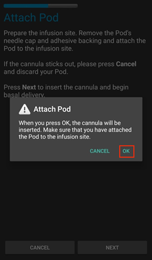

09. **캐뉼라 삽입** 화면에서 Omnipod가 반응하여 캐뉼라를 삽입하기까지 시간이 걸릴 수 있으니 (최대 1~2분) 기다리십시오.

    > RileyLink가 활성화하는 Pod와 통신할 수 있는 거리 밖에 있으면 **Pod에서 반응 없음** 오류 메시지가 나타납니다. 이런 일이 생기면 RileyLink를 Pod에 더 가까이(약 30 cm 이내) 옮기되 Pod 바로 위나 바로 옆에는 두지 말고, **재시도**를 누르십시오.
    > 
    > RileyLink가 블루투스 범위 밖에 있거나 휴대폰과 연결되어 있지 않으면 **RileyLink에서 반응 없음** 오류 메시지가 나타납니다. 이런 일이 생기면 RileyLink를 휴대폰에 더 가까이 옮기고 **재시도**를 누르십시오.
    > 
    > *참고: 캐뉼라를 삽입하기 전에 캐뉼라 삽입 위치 근처의 피부를 집어 주는 것이 좋습니다. 이렇게 하면 바늘이 부드럽게 들어가고 막힘이 생길 가능성이 줄어듭니다.*
    > 
    > 
    > 
    >  

10. 캐뉼라가 성공적으로 삽입되면 녹색 체크 표시가 나타나고 **다음** 버튼이 활성화됩니다. **다음**을 누르십시오.

    > 

11. **Pod 활성화됨** 화면이 표시됩니다. 캐뉼라가 올바르게 삽입되었는지 확인하고, 그렇지 않다고 생각되면 Pod를 교체하십시오. **완료**를 누르십시오. 축하합니다! 이제 새 Pod 세션을 시작했습니다.

    >  
    > 
    > ```{admonition} Older screenshot
    >     :class: note
    >     2~11단계의 스크린샷은 이전 **AAPS** 버전의 것이며 **AAPS** 4에서는 다르게 보일 수 있습니다. **인슐린 선택**과 **부위 위치** 단계는 그림에 없습니다.
    > ```

12. Omnipod 펌프 화면으로 돌아갑니다. 활성 Pod를 먼저 비활성화하지 않으면 다른 Pod를 활성화할 수 없으므로, **Pod 활성화** 버튼이 **Pod 비활성화**로 바뀝니다.

    이제 펌프 화면에 현재 기저 주입량, 인슐린 잔량, 주입된 인슐린, Pod 오류와 경고를 포함한 활성 Pod 정보가 표시됩니다. 자세한 내용은 [Omnipod 펌프 화면](#OmnipodEros-omnipod-pod-tab) 부분을 참조하십시오.

     

    ```{admonition} Older screenshot
    :class: note
    위의 스크린샷은 이전 **AAPS** 버전의 것입니다. **AAPS** 4에는 Pod 관리 메뉴가 없습니다: 바로 Omnipod 펌프 화면으로 돌아가며, 그곳에서 **Pod 활성화** 대신 **Pod 비활성화**가 표시됩니다.
    ```

```{note}
프라임 후에 활성화가 중단되었다면 (예: 앱이 종료된 경우) **Pod 활성화**를 다시 누르십시오. 마법사가 캐뉼라 삽입 단계부터 계속됩니다.
```

### Pod 비활성화하기

보통 Pod는 3일(72시간) 동안 사용하고, Pod 만료 경고 후 8시간을 더 사용할 수 있어 총 80시간 동안 사용할 수 있습니다.

Pod를 비활성화하려면 (만료되었거나 Pod 고장이 났을 때):

1. Omnipod 펌프 화면(**관리** > **펌프**)을 열고 **Pod 비활성화**를 누르십시오.

   >  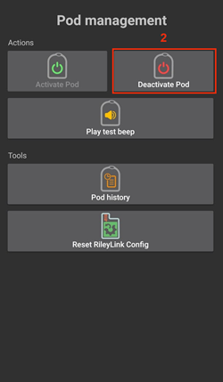 
   > 
   > ```{admonition} Older screenshot
   >    :class: note
   >    위의 스크린샷은 이전 **AAPS** 버전의 것입니다. **AAPS** 4에서 **Pod 비활성화**는 **POD MGMT** 메뉴 대신 Omnipod 펌프 화면의 버튼입니다.
   > ```

2. **Pod 비활성화** 화면에서 먼저 RileyLink가 Pod 가까이 있되 Pod 바로 위나 바로 옆에는 있지 않은지 확인하십시오. 그런 다음 **다음**을 누르십시오. 대화 상자가 다음과 같이 묻습니다: *비활성화된 Pod는 다시 사용할 수 없습니다. 지금 이 Pod를 비활성화하시겠습니까?* Pod 비활성화를 시작하려면 **확인**을, Pod를 유지하려면 **취소**를 누르십시오. 비활성화하면 모든 인슐린 주입이 중지되며 되돌릴 수 없습니다.

   > 

3. **Pod 비활성화 중** 화면이 나타나고, 비활성화가 성공하면 Pod에서 확인 신호음이 울립니다.

   > 
   > 
   > **비활성화가 실패하여** 확인 신호음이 울리지 않으면 **RileyLink에서 반응 없음** 또는 **Pod에서 반응 없음** 메시지가 나타날 수 있습니다. **재시도**를 눌러 비활성화를 다시 시도하십시오. 비활성화가 계속 실패하면 **Pod 폐기**를 누르고 확인하십시오. 그러면 **AAPS**는 그 Pod를 잊어버립니다. 인슐린 주입은 중지되지 **않았으므로** Pod를 몸에서 제거하십시오. Pod가 계속 울리는 알람을 내면, **Pod 폐기**로는 소리가 멈추지 않으므로 핀이나 클립으로 직접 소리를 꺼야 할 수 있습니다.
   > 
   > >   

4. 비활성화가 성공하면 녹색 체크 표시가 나타납니다. **다음**을 눌러 **Pod 비활성화됨** 화면을 표시하십시오. 활성 세션이 비활성화되었으므로 이제 Pod를 제거할 수 있습니다.

   > 

5. **완료**를 눌러 Omnipod 펌프 화면으로 돌아가십시오.

   >  
   > 
   > ```{admonition} Older screenshot
   >    :class: note
   >    2~5단계의 스크린샷은 이전 **AAPS** 버전의 것이며 **AAPS** 4에서는 다르게 보일 수 있습니다.
   > ```

6. Omnipod 펌프 화면에서 **RileyLink 상태**에 **연결됨**이, **Pod 상태**에 **활성화된 Pod 없음**이 표시되는지 확인하십시오.

   > 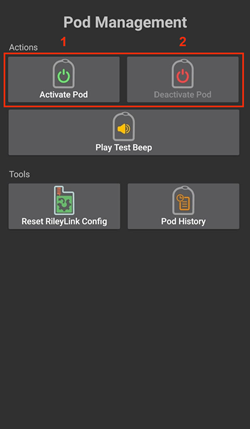   
   > 
   > ```{admonition} Older screenshot
   >    :class: note
   >    위의 스크린샷은 이전 **AAPS** 버전의 것입니다. **AAPS** 4에서는 **완료**를 누르면 바로 Omnipod 펌프 화면으로 돌아갑니다. Pod 관리 메뉴나 **Omnipod (POD)** 탭은 없습니다.
   > ```

### 인슐린 주입 중지 및 재개

아래 과정은 인슐린 주입을 중지하고 재개하는 방법을 보여 줍니다.

*참고 - **중지** 버튼이 보이지 않으면*, 기본적으로 숨겨져 있기 때문입니다. Enable **Show Suspend Delivery button in Omnipod tab** in the [Omnipod settings](#OmnipodEros-omnipod-settings) under **Other**.

#### 인슐린 주입 중지

이 명령으로 활성 Pod를 중지 상태로 만듭니다. 중지 상태에서는 Pod가 인슐린을 전혀 주입하지 않습니다. 이 명령은 원래 Omnipod PDM이 활성 Pod에 보내는 중지 기능과 같은 일을 합니다.

1. Omnipod 펌프 화면(**관리** > **펌프**)을 열고 **중지**를 누르십시오. 중지 명령이 RileyLink를 통해 활성 Pod로 보내집니다.

2. Pod가 모든 인슐린 주입을 중지하면 **Pod 상태**에 **중지됨**이 표시되고, **중지** 버튼이 **주입 재개**로 바뀝니다.

   >  
   > 
   > 
   > 
   >  
   > 
   > ```{admonition} Older screenshot
   >    :class: note
   >    위의 스크린샷은 이전 **AAPS** 버전의 것입니다. **AAPS** 4에서는 이 단계가 **Omnipod (POD)** 탭 대신 Omnipod 펌프 화면에서 이루어지며, 결과는 **Pod 상태**에 표시됩니다.
   > ```

명령이 실패하면 **경고** 대화 상자에 "주입 중지 실패함"과 그 이유가 표시됩니다. RileyLink 연결을 확인하고 다시 시도하십시오.

#### 인슐린 주입 재개

이 명령으로 현재 중지된 활성 Pod에 인슐린 주입을 재개하도록 지시합니다. 명령이 성공적으로 처리되면, 활성 기저 프로파일에서 현재 시간에 해당하는 기저 주입량으로 인슐린 주입이 정상적으로 재개됩니다. Pod는 다시 볼러스, TBR, SMB 명령을 받습니다.

1. Omnipod 펌프 화면을 열고 **Pod 상태**에 **중지됨**이 표시되는지 확인하십시오. **주입 재개**를 누르십시오.

2. 명령이 성공하면 **Pod 상태**에 다시 **실행 중**이 표시되고 **주입 재개** 버튼이 사라집니다 (설정에서 켰다면 **중지** 버튼이 다시 표시됩니다).

   > 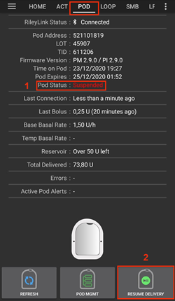 
   > 
   > 
   > 
   >  
   > 
   > ```{admonition} Older screenshot
   >    :class: note
   >    위의 스크린샷은 이전 **AAPS** 버전의 것입니다. **AAPS** 4에서는 이 단계가 **Omnipod (POD)** 탭 대신 Omnipod 펌프 화면에서 이루어지며, 결과는 **Pod 상태**에 표시됩니다.
   > ```

명령이 실패하면 **경고** 대화 상자에 "주입 재개 실패함"과 그 이유가 표시됩니다. RileyLink 연결을 확인하고 다시 시도하십시오.

### Pod 경고 음소거

*참고 - **경고 음소거** 버튼은 Pod에 활성 경고(예: Pod 만료 경고 또는 레저버 부족 경고)가 있을 때, 그리고 **자동으로 Pod 경고 음소거**가 꺼져 있을 때만 Omnipod 펌프 화면에 표시됩니다.*

아래 과정은 Pod가 만료 전 경고 시간에 도달했을 때 시작되는 Pod 신호음을 음소거하는 방법을 보여 줍니다. 이 경고 시간은 Omnipod **경고** 설정의 **종료 전 경고 시간 (80시간)**으로 정합니다. Pod의 최대 사용 시간은 80시간(3일 8시간)이지만, Insulet은 72시간(3일) 한도를 넘기지 않도록 권장합니다.

*참고 - Omnipod **경고** 설정에서 **자동으로 Pod 경고 음소거**를 켰다면, **AAPS**가 다음에 Pod와 통신할 때 경고를 자동으로 음소거하므로 직접 할 필요가 없습니다.*

1. 경고 시간이 되면 Pod가 곧 만료되어 교체해야 한다는 것을 알리기 위해 신호음을 냅니다. Omnipod 펌프 화면에서 **Pod 만료**는 Pod가 만료되는 정확한 시간(활성화 후 72시간)을 표시하며, 4시간 전에 **노란색**으로 바뀝니다. **Pod 최종 종료**는 Pod가 인슐린 주입을 멈추는 시간을 표시합니다. **활성 Pod 경고**에 **Pod가 곧 만료됩니다.**가 표시되고 **경고 음소거** 버튼이 나타납니다. **AAPS**도 곧 다가오는 Pod 만료에 대한 알림을 표시합니다.

   >   
   > 
   > ```{admonition} Older screenshot
   >    :class: note
   >    위의 스크린샷은 이전 **AAPS** 버전의 것입니다. **AAPS** 4에서 **ACK ALERTS** 버튼은 **경고 음소거**라고 불리며 Omnipod 펌프 화면에 있습니다.
   > ```

2. **경고 음소거**를 누르십시오. RileyLink가 Pod에 만료 경고 신호음을 멈추라는 명령을 보냅니다.

   >  
   > 
   > ```{admonition} Older screenshot
   >    :class: note
   >    위 스크린샷은 이전 **AAPS** 버전의 것입니다. **AAPS** 4에서 이 버튼은 **경고 음소거**라고 불립니다.
   > ```

3. 경고가 음소거되면 Pod가 신호음을 두 번 냅니다. **활성 Pod 경고**에 더 이상 경고가 표시되지 않고, **경고 음소거** 버튼이 사라지며, Pod가 만료 경고 신호음을 멈춥니다.

   >  
   > 
   > ```{admonition} Older screenshot
   >    :class: note
   >    위 스크린샷은 이전 **AAPS** 버전의 것입니다. **AAPS** 4에서는 결과가 Omnipod 펌프 화면에 표시됩니다: 경고가 **활성 Pod 경고**에서 사라집니다.
   > ```

명령이 실패하면 (예: RileyLink가 Pod와 통신할 수 있는 거리 밖에 있는 경우) **경고** 대화 상자에 "경고 음소거 실패함"과 그 이유가 표시됩니다. RileyLink를 Pod에 더 가까이 옮기고 다시 시도하십시오.


```{admonition} Older screenshot
:class: note
위 스크린샷은 이전 **AAPS** 버전의 것입니다. **AAPS** 4에서는 **경고** 대화 상자에 "경고 음소거 실패함"과 그 이유가 표시됩니다.
```

(OmnipodEros-view-pod-history)=

### Pod 이력 보기

이 부분에서는 활성 Pod 이력을 보고 여러 동작 범주로 필터링하는 방법을 설명합니다. Pod 이력 도구로 현재 활성 Pod의 3일(72~80시간) 사용 기간 동안 Pod에 실행된 동작과 그 결과를 볼 수 있습니다.

이 기능은 주입한 볼러스, TBR, 기저 변경이 완료되었는지 확실하지 않을 때 확인하는 데 유용합니다. 나머지 범주는 일반적으로 문제를 해결하고 고장이 생기기 전에 일어난 이벤트의 순서를 파악하는 데 유용합니다.

*참고:* **불확실** 명령도 Pod 이력에 표시되지만, 그 특성상 정확성을 보장할 수 없습니다.

1. Omnipod 펌프 화면(**관리** > **펌프**)을 열고 **Pod 이력**을 누르십시오.

   >  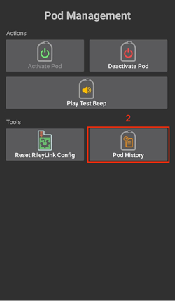 
   > 
   > ```{admonition} Older screenshot
   >    :class: note
   >    위의 스크린샷은 이전 **AAPS** 버전의 것입니다. **AAPS** 4에서 **Pod 이력**은 **POD MGMT** 메뉴 대신 Omnipod 펌프 화면의 버튼입니다.
   > ```

2. **Pod 이력** 화면에는 모든 Pod 동작과 그 결과가 날짜별로 묶여 최신 항목부터 표시됩니다. 기본적으로 **전체**가 선택되어 있습니다. 위쪽의 필터 버튼 중 하나를 누르면 한 범주만 표시됩니다. 왼쪽 위의 뒤로 화살표를 눌러 Omnipod 펌프 화면으로 돌아가십시오.

   > 

   > 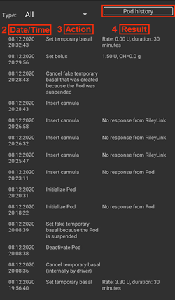 
   > 
   > ```{admonition} Older screenshot
   >    :class: note
   >    두 번째 스크린샷은 이전 **AAPS** 버전의 것이며 **AAPS** 4에서는 다르게 보일 수 있습니다.
   > ```

### RileyLink 설정과 이력 보기

**RileyLink 통계** 화면에는 RileyLink와 활성 Pod의 설정, 그리고 두 장치의 통신 이력이 표시됩니다. 이 화면에는 **설정**과 **이력** 두 개의 탭이 있습니다.

**RileyLink 통계** 버튼은 기본적으로 숨겨져 있습니다. Omnipod 펌프 화면에 이 버튼을 표시하려면 [Omnipod 설정](#OmnipodEros-omnipod-settings)의 **기타**에서 **Pod 관리 메뉴에 RileyLink 통계 버튼 표시**를 켜십시오.

#### Pod 통신 장치의 블루투스 연결 수동으로 다시 연결하기

Pod 통신 장치가 한동안 휴대폰의 블루투스 범위 밖에 있었다면, Omnipod 펌프 화면의 **RileyLink 상태**에 **RileyLink에 연결할 수 없음**이 표시될 수 있습니다. 장치가 다시 범위 안으로 들어오면 **AAPS**는 보통 스스로 다시 연결합니다. 다시 연결되지 않으면:

1. RileyLink가 켜져 있고, 충전되어 있으며, 휴대폰 가까이 있는지 확인하십시오.

2. Omnipod 펌프 화면에서 **RileyLink 초기화**를 누르십시오. **RileyLink 설정 초기화** 메시지가 나타납니다. 아래의 [RileyLink 초기화 참고 사항](#OmnipodEros-reset-rileylink-config-notes)을 참조하십시오.

3. **블루투스 연결**이 다시 이루어지지 않으면, 휴대폰의 블루투스 기능을 직접 **껐다가** 다시 **켜** 보십시오.

4. 그래도 다시 연결되지 않으면 **RileyLink 페어링**을 누르고 RileyLink를 다시 선택하십시오.

5. 다시 연결에 성공하면 **RileyLink 상태**에 **연결됨**이 표시됩니다. **RileyLink 통계** 화면의 **설정** 탭에서 **연결 상태**도 확인할 수 있습니다. 축하합니다. 설정한 Pod 통신 장치를 AAPS에 다시 연결했습니다!

 

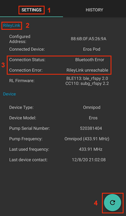


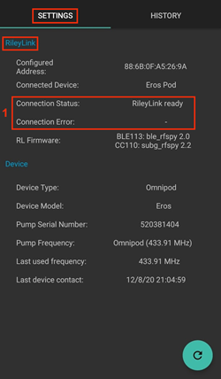

```{admonition} Older screenshot
:class: note
위의 스크린샷은 이전 **AAPS** 버전의 것입니다. **AAPS** 4에서는 RileyLink 설정 화면의 새로고침 버튼 대신 Omnipod 펌프 화면의 **RileyLink 초기화** 또는 **RileyLink 페어링**으로 다시 연결합니다.
```

#### Pod 통신 장치와 활성 Pod 설정

이 화면에는 현재 페어링된 Pod 통신 장치와 현재 활성 Omnipod Eros Pod의 정보와 상태가 표시됩니다. 정보는 자동으로 새로고침됩니다.

1. Omnipod 펌프 화면(**관리** > **펌프**)을 열고 **RileyLink 통계**를 누르십시오. **설정** 탭에는 현재 페어링된 **RileyLink**와 활성 Pod(**장치**)가 표시됩니다.

   > 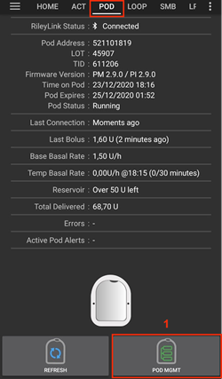 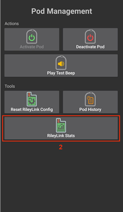 
   > 
   > ```{admonition} Older screenshot
   >    :class: note
   >    위의 스크린샷은 이전 **AAPS** 버전의 것입니다. **AAPS** 4에서 **RileyLink 통계**는 **POD MGMT** 메뉴 대신 Omnipod 펌프 화면의 버튼입니다.
   > ```

   > 

##### RileyLink 항목

> - **주소:** 페어링된 Pod 통신 장치의 MAC 주소입니다.
> - **이름:** 페어링된 Pod 통신 장치의 블루투스 이름입니다.
> - **배터리 잔량:** 연결된 Pod 통신 장치의 현재 배터리 잔량입니다. **OrangeLink/EmaLink/DiaLink에서 보고한 배터리 잔량 나타내기**가 켜져 있을 때만 표시됩니다.
> - **연결 상태**: Pod 통신 장치와 AAPS가 실행되는 휴대폰 사이의 현재 블루투스 연결 상태입니다.
> - **연결 오류:** Pod 통신 장치의 블루투스 연결에 오류가 있으면 여기에 자세한 내용이 표시됩니다.
> - **펌웨어 버전:** 현재 연결된 Pod 통신 장치에 설치된 펌웨어 버전입니다.

##### 장치 항목 - 활성 Pod가 있을 때

> - **장치 타입:** Pod 통신 장치와 통신하는 장치의 종류입니다 (Omnipod (Eros)).
> - **설정된 장치 모델:** Pod 통신 장치와 통신하도록 설정된 장치의 모델입니다.
> - **연결된 장치 모델:** 현재 Pod 통신 장치와 통신하고 있는 장치의 모델입니다.
> - **펌프 일련번호:** 현재 활성화된 Pod의 일련번호입니다.
> - **펌프 주파수:** Pod와 통신하는 데 사용하는 무선 주파수입니다.
> - **최근 사용된 주파수:** Pod가 Pod 통신 장치와 통신하는 데 마지막으로 사용한 것으로 알려진 무선 주파수입니다.
> - **최근 장치 연결:** Pod가 Pod 통신 장치와 마지막으로 연결한 날짜와 시간입니다.

(omnipod-eros-rileylink-and-active-pod-history)=
#### RileyLink와 활성 Pod 이력

이 탭에는 RileyLink 또는 현재 연결된 Pod의 각 상태나 동작이 최신 항목부터 표시됩니다. 이력은 현재 활성 Pod에 대해서만 볼 수 있습니다. Pod를 교체하면 이 이력은 지워지고, 새로 활성화한 Pod의 이벤트만 기록되고 표시됩니다.

1. Omnipod 펌프 화면(**관리** > **펌프**)을 열고 **RileyLink 통계**를 누른 다음 **이력** 탭을 누르십시오.

   >  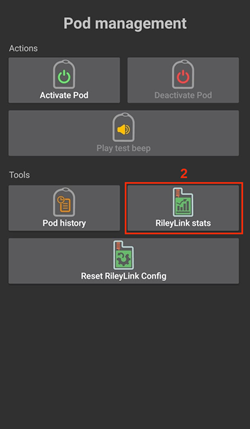 
   > 
   > ```{admonition} Older screenshot
   >    :class: note
   >    위의 스크린샷은 이전 **AAPS** 버전의 것입니다. **AAPS** 4에서 **RileyLink 통계**는 **POD MGMT** 메뉴 대신 Omnipod 펌프 화면의 버튼입니다.
   > ```

   > 

##### 항목

각 항목에는 다음이 표시됩니다:

> - **장치:** 동작이나 상태와 관련된 장치입니다.
> - **시간:** 이벤트가 일어난 시간입니다.
> - **상태 또는 동작:** 장치의 상태나 장치가 실행한 동작입니다.

(OmnipodEros-omnipod-pod-tab)=

## Omnipod 펌프 화면

아래는 **Omnipod 펌프 화면**(**관리** > **펌프**, 또는 **구성** > **펌프** > **플러그인 열기**)의 상태 항목과 버튼에 대한 설명입니다.

오른쪽 위의 톱니바퀴 아이콘을 누르면 [Omnipod 설정](#OmnipodEros-omnipod-settings)이 열립니다.

*참고: 상태 항목에 (불확실)이 표시되면 **새로고침**을 눌러 Pod 상태를 새로고침하고 그 표시를 지우십시오.*


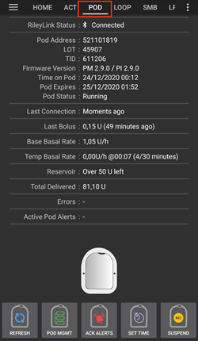

```{admonition} Older screenshot
:class: note
위의 스크린샷은 이 화면이 **Omnipod (POD)** 탭이었던 이전 **AAPS** 버전의 것입니다. **AAPS** 4에서는 Omnipod 펌프 화면이며, 일부 항목 이름과 버튼이 다릅니다.
```

### 항목

- **RileyLink 상태:** RileyLink의 현재 연결 상태를 표시합니다. 오류는 빨간색으로 표시됩니다.

- *시작 안 됨* - 아직 페어링된 RileyLink가 없거나 연결이 시작되지 않았습니다.
- *RileyLink에 연결할 수 없음* - Pod 통신 장치가 휴대폰의 블루투스 범위 밖에 있거나, 꺼져 있거나, 블루투스 통신을 막는 고장이 있습니다.
- *RileyLink 준비* - Pod 통신 장치가 켜져 있고 블루투스 연결을 초기화하는 중입니다.
- *연결됨* - Pod 통신 장치가 켜져 있고, 연결되어 있으며, 블루투스로 통신할 수 있는 상태입니다.

- **고유 ID:** 활성 Pod의 주소를 표시합니다.

- **LOT 번호:** 활성 Pod의 LOT 번호를 표시합니다.

- **일련번호:** Pod의 일련번호(TID)를 표시합니다.

- **펌웨어 버전:** 활성 Pod의 펌웨어 버전을 표시합니다.

- **Pod 시간:** 활성 Pod의 현재 시간을 표시합니다. 휴대폰 시간과 5분 넘게 차이가 나면 강조 표시됩니다.

- **Pod 만료:** 활성 Pod가 만료되는 날짜와 시간을 표시합니다. 이 시간 전 마지막 4시간 동안 글자가 노란색으로 바뀝니다. 이 시간이 지나도 Pod는 인슐린을 계속 주입하므로 빨간색으로는 바뀌지 않습니다.

- **Pod 최종 종료:** Pod 유예 기간이 끝나는 시간을 표시합니다 (**Pod 만료** 8시간 후, Pod 최대 사용 시간은 80시간). 유예 기간이 시작되면 (**Pod 만료** 시점) 글자가 노란색으로 바뀌고, 최종 종료 전 마지막 4시간 동안 빨간색으로 바뀝니다. 유예 기간 동안에는 남은 시간도 표시됩니다. 예: *(17분 남음)*. Pod는 최종 종료 시점에 인슐린 주입을 멈추므로 반드시 교체해야 합니다.

- **Pod 상태:** 활성 Pod의 상태를 표시합니다 (예: **활성화된 Pod 없음**, **실행 중** 또는 **중지됨**).

- **마지막 연결:** 활성 Pod와 마지막으로 통신한 시간을 표시합니다. [펌프 연결 불가 기준값](#OmnipodEros-troubleshooting)을 넘으면 글자가 빨간색으로 바뀝니다.

- *방금 전* - 20초 전보다 짧은 시간.
- *1분 이내* - 20초보다 길고 60초보다 짧은 시간.
- *1분 전* - 60초보다 길고 120초(2분)보다 짧은 시간
- *XX분 전* - 2분보다 긴 시간, XX 값으로 표시됨

- **마지막 볼러스:** 활성 Pod에 마지막으로 보낸 볼러스의 용량과, 괄호 안에 그 볼러스를 보낸 지 얼마나 지났는지를 표시합니다.

- **기본 기저 주입량:** 기저 주입량 프로파일에서 현재 시간에 프로그래밍된 기저 주입량을 표시합니다.

- **임시 기저 주입량:** 임시 기저 주입량이 실행 중일 때만 표시됩니다. 다음 형식으로 표시합니다:

- TBR이 실행된 시간의 시간당 U @ 시각 (실행된 분 / TBR이 실행될 전체 분)
- *예:* 0.00U/h @18:25 ( 90/120분)

- **레저버:** 레저버에 50 U보다 많이 남아 있으면 **50 U 이상 남음**을 표시합니다. 이 값보다 적으면 대략적인 단위 수가 표시됩니다. [경고 설정](#OmnipodEros-omnipod-settings)에서 정한 레저버 부족 기준값보다 적어지면 글자가 빨간색으로 바뀝니다.

- **총 주입량:** 레저버에서 주입된 인슐린의 총 단위 수를 표시합니다. *Pod를 프라임하고 채우는 과정은 정확하지 않으므로 이 값은 근사값입니다.*

- **활성 Pod 경고:** 활성 Pod에서 현재 울리고 있는 경고를 표시합니다. 보통 Pod 사용 시간이 72시간을 넘고 Pod 자체의 경고 신호음이 울리고 있을 때 사용합니다.

- **오류:** 마지막으로 발생한 오류를 표시합니다 (빨간색으로 표시됨). 과거 오류와 더 자세한 정보는 [Pod 이력](#OmnipodEros-view-pod-history), [RileyLink 이력](#omnipod-eros-rileylink-and-active-pod-history), 로그 파일에서 확인하십시오.

### Buttons

펌프 화면 아래쪽의 버튼은 상황에 따라 바뀝니다. 지금 사용할 수 없는 버튼은 회색으로 표시됩니다 (예: RileyLink가 연결되어 있지 않을 때).

**Pod 상태 버튼** (Pod가 활성화되어 있을 때 표시됨):

- **새로고침:** 활성 Pod에 새로고침 명령을 보내 상태를 업데이트합니다. Pod 상태를 새로고침하고 (불확실)이 표시된 상태 항목을 지울 때 사용하십시오. 자세한 내용은 아래 [문제 해결 부분](#OmnipodEros-troubleshooting)을 참조하십시오.

  

  ```{admonition} Older screenshot
  :class: note
  위의 스크린샷은 이전 **AAPS** 버전의 것입니다. **AAPS** 4에서는 Omnipod 펌프 화면에 있는 **새로고침**이라는 텍스트 버튼입니다.
  ```

- **경고 음소거:** Pod 만료 및 레저버 부족 신호음과 알림을 음소거합니다. Pod에 활성 경고가 있고 **자동으로 Pod 경고 음소거**가 꺼져 있을 때만 표시됩니다. 경고를 음소거하면 버튼이 사라집니다.

  

  ```{admonition} Older screenshot
  :class: note
  위의 스크린샷은 이전 **AAPS** 버전의 것입니다. **AAPS** 4에서 이 버튼은 **경고 음소거**라고 불립니다.
  ```

- **시간 설정:** Pod의 시간을 휴대폰의 현재 시간으로 업데이트합니다. Pod 시간이 휴대폰 시간과 5분 넘게 차이가 날 때만 표시됩니다.

  

  ```{admonition} Older screenshot
  :class: note
  위의 스크린샷은 이전 **AAPS** 버전의 것입니다. **AAPS** 4에서는 Omnipod 펌프 화면에 있는 **시간 설정**이라는 텍스트 버튼입니다.
  ```

- **중지:** 활성 Pod의 인슐린 주입을 중지합니다. Only shown if enabled in the settings (**Show Suspend Delivery button in Omnipod tab**).

  

  ```{admonition} Older screenshot
  :class: note
  위의 스크린샷은 이전 **AAPS** 버전의 것입니다. **AAPS** 4에서는 Omnipod 펌프 화면에 있는 **중지**라는 텍스트 버튼입니다.
  ```

- **주입 재개:** 현재 중지된 활성 Pod의 인슐린 주입을 재개합니다. Pod가 중지되어 있을 때만 표시됩니다.

  

  ```{admonition} Older screenshot
  :class: note
  위의 스크린샷은 이전 **AAPS** 버전의 것입니다. **AAPS** 4에서는 Omnipod 펌프 화면에 있는 **주입 재개**라는 텍스트 버튼입니다.
  ```

**Pod 및 RileyLink 관리 버튼:**


```{admonition} Older screenshot
:class: note
위 스크린샷은 이전 **AAPS** 버전의 것입니다. **AAPS** 4에는 Pod 관리 메뉴가 없습니다: 이 작업들은 Omnipod 펌프 화면에 바로 있는 버튼입니다.
```

- **Pod 활성화:** 새 Pod를 프라임하고 활성화합니다. 활성 Pod가 없을 때 표시됩니다. RileyLink가 연결되어 있을 때만 사용할 수 있습니다.

  

  ```{admonition} Older screenshot
  :class: note
  위의 스크린샷은 이전 **AAPS** 버전의 것입니다. **AAPS** 4에서 **Pod 활성화**는 Pod 관리 메뉴 대신 Omnipod 펌프 화면의 버튼입니다.
  ```

- **Pod 비활성화:** 현재 활성 Pod를 비활성화합니다. Pod가 페어링되면 바로 표시되며, 활성화가 중간에 멈춘 경우(예: 활성화 중 Pod가 고장 난 경우)에도 표시됩니다. RileyLink가 연결되어 있을 때만 사용할 수 있습니다. **AAPS**는 Pod를 비활성화하기 전에 확인을 요청합니다.

- 계속 울리는 Pod(“스크리머”, 오류 49)를 비활성화할 때 이 명령을 사용하십시오.
- 비활성화가 실패하면 비활성화 마법사에서 **Pod 폐기** 옵션을 제공합니다.

  

  ```{admonition} Older screenshot
  :class: note
  위의 스크린샷은 이전 **AAPS** 버전의 것입니다. **AAPS** 4에서 **Pod 비활성화**는 Pod 관리 메뉴 대신 Omnipod 펌프 화면의 버튼입니다.
  ```

- **테스트 신호음 작동:** 누르면 Pod에서 테스트 신호음을 한 번 냅니다. Pod가 페어링되어 있을 때 표시됩니다.

  

  ```{admonition} Older screenshot
  :class: note
  위의 스크린샷은 이전 **AAPS** 버전의 것입니다. **AAPS** 4에서 **테스트 신호음 작동**은 Pod 관리 메뉴 대신 Omnipod 펌프 화면의 버튼입니다.
  ```

- **Pod 이력:** 활성 Pod의 활동 이력을 표시합니다. [Pod 이력 보기](#OmnipodEros-view-pod-history)를 참조하십시오.

  

  ```{admonition} Older screenshot
  :class: note
  위의 스크린샷은 이전 **AAPS** 버전의 것입니다. **AAPS** 4에서 **Pod 이력**은 Pod 관리 메뉴 대신 Omnipod 펌프 화면의 버튼입니다.
  ```

- **RileyLink 페어링:** Pod 통신 장치를 검색하고 페어링합니다. [RileyLink 설정](#OmnipodEros-rileylink-setup)을 참조하십시오.

- **RileyLink 통계:** 두 개의 탭이 있는 RileyLink 통계 화면을 엽니다. 설정에서 켰을 때만 표시됩니다 (**Pod 관리 메뉴에 RileyLink 통계 버튼 표시**).

- **설정** - RileyLink와 활성 Pod의 설정 정보를 표시합니다
- **이력** - RileyLink와 Pod의 통신 이력을 표시합니다

  

  ```{admonition} Older screenshot
  :class: note
  위의 스크린샷은 이전 **AAPS** 버전의 것입니다. **AAPS** 4에서 **RileyLink 통계**는 Pod 관리 메뉴 대신 Omnipod 펌프 화면의 버튼입니다.
  ```

- **RileyLink 초기화:** 현재 연결된 Pod 통신 장치의 설정을 초기화합니다. 통신이 시작되면 특정 데이터가 RileyLink로 보내지고 설정됩니다:

- 메모리 레지스터가 설정됩니다
- 통신 프로토콜이 설정됩니다
- 튜닝된 무선 주파수가 설정됩니다
  > 
  > 아래의 [추가 참고 사항](#OmnipodEros-reset-rileylink-config-notes)을 참조하십시오.

  

  ```{admonition} Older screenshot
  :class: note
  위의 스크린샷은 이전 **AAPS** 버전의 것입니다. **AAPS** 4에서 이 버튼은 **RileyLink 초기화**라고 불리며 Omnipod 펌프 화면에 있습니다.
  ```

- **Pod 폐기:** 확인을 거친 후, 반응하지 않는 Pod의 Pod 상태를 폐기합니다. Pod가 시작되었지만 완전히 페어링되지 않아 정상적인 비활성화가 더 이상 불가능할 때만 표시됩니다:

- **Pod가 완전히 페어링되지 않아** 비활성화 명령을 무시할 때.
- 페어링 과정 중 단계 사이에서 **Pod가 멈췄을 때**.
- **Pod가 아예 페어링되지 않을 때.**
  > 
  > Pod를 폐기하면 **AAPS**는 더 이상 그 Pod와 통신할 수 없습니다. Pod를 몸에서 제거하십시오.

  

  ```{admonition} Older screenshot
  :class: note
  위의 스크린샷은 이전 **AAPS** 버전의 것입니다. **AAPS** 4에서 **Pod 폐기**는 Pod 관리 메뉴 대신 Omnipod 펌프 화면의 버튼입니다.
  ```

(OmnipodEros-reset-rileylink-config-notes)=

#### *RileyLink 초기화 참고 사항*

- 이 기능은 주로 현재 활성 Pod 통신 장치가 반응하지 않고 통신이 멈춘 상태일 때 사용합니다.
- Pod 통신 장치를 껐다가 다시 켜면, 이 통신 매개변수가 Pod 통신 장치에 다시 설정되도록 **RileyLink 초기화**를 누르십시오.
- 이렇게 하지 않으면 Pod 통신 장치를 껐다 켠 후 AAPS를 다시 시작해야 합니다.
- 서로 다른 Pod 통신 장치 사이에서 바꿀 때에는 이 버튼을 누를 필요가 **없습니다**.

(OmnipodEros-omnipod-settings)=

## Omnipod 설정

Omnipod 드라이버 설정을 열려면 다음 중 하나를 하십시오:

- Omnipod 펌프 화면(**관리** > **펌프**) 오른쪽 위의 톱니바퀴 아이콘을 누르거나,
- 왼쪽 위의 **메뉴** (☰) > **구성** > **펌프**를 열고 **Omnipod Eros** 카드의 **설정**을 누르십시오.

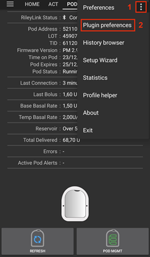

```{admonition} Older screenshot
:class: note
위 스크린샷은 이전 **AAPS** 버전의 것입니다. **AAPS** 4에서는 **구성**의 설정 톱니바퀴나 점 3개 메뉴 대신 **Omnipod Eros** 카드의 **설정** 또는 Omnipod 펌프 화면의 톱니바퀴 아이콘으로 설정을 엽니다.
```

설정은 아래와 같이 그룹으로 나뉘어 있습니다. 그룹을 누르면 펼쳐집니다. 대부분의 항목은 켜거나 끌 수 있는 스위치입니다:


*참고: 별표(\*)는 기본적으로 켜져 있는 설정을 나타냅니다.*

### RileyLink

Pod 통신 장치에 대한 설정입니다. 장치 자체는 펌프 화면의 **RileyLink 페어링** 버튼으로 페어링합니다 ([RileyLink 설정](#OmnipodEros-rileylink-setup) 참조).

- **스캔 사용하기:** OrangeLink에 연결하기 전에 스캔합니다. 이렇게 하면 연결이 좋아질 수 있습니다. 필요하면 다른 RileyLink 클론에서도 사용할 수 있습니다.

- **OrangeLink/EmaLink/DiaLink에서 보고한 배터리 잔량 나타내기:** OrangeLink/EmaLink/DiaLink의 실제 배터리 잔량을 보고합니다. 모든 OrangeLink/EmaLink/DiaLink 사용자는 이 설정을 켜는 것을 **강력히 권장**합니다.

- 오리지널 RileyLink에서는 작동하지 않습니다.
- 다른 RileyLink 대체 기기에서는 작동하지 않을 수 있습니다.
- 켬 - 지원되는 Pod 통신 장치의 현재 배터리 잔량을 보고합니다.
- 끔 - n/a 값을 보고합니다.

- **Actions 탭에서 배터리 교체 기록 활성화:** 위의 배터리 보고 설정이 켜져 있을 때만 사용할 수 있습니다. 일부 Pod 통신 장치는 교체할 수 있는 일반 배터리를 사용합니다. 이 설정을 켜면 **펌프 배터리 교체** [케어포털 항목](#aaps-screens-careportal)을 기록하여 교체를 메모하고 배터리 사용 기간을 초기화할 수 있습니다.

### 확인 신호음

볼러스, 기저, SMB, TBR의 주입과 변경에 대해 Pod에서 확인 신호음을 냅니다.

- **\*볼러스 신호음 활성화됨:** 볼러스가 주입될 때 확인 신호음을 켜거나 끕니다.
- **기저 신호음 활성화됨:** 새 기저 주입량이 설정되거나, 활성 기저 주입량이 취소되거나, 현재 기저 주입량이 변경될 때 확인 신호음을 켜거나 끕니다.
- **\*SMB 신호음 활성화됨:** SMB가 주입될 때 확인 신호음을 켜거나 끕니다.
- **TBR 신호음 활성화됨:** TBR이 설정되거나 취소될 때 확인 신호음을 켜거나 끕니다.

### Alerts

정해진 기준 단위에 따라 Pod 만료, 종료, 레저버 부족에 대한 AAPS 경고와 Nightscout 공지를 제공합니다.

*경고가 발생한 후 Pod와 처음 통신하면 그 경고에 대한 AAPS 알림이 반드시 표시됩니다. **자동으로 Pod 경고 음소거**가 켜져 있지 않으면, 알림을 닫아도 경고는 음소거되지 않습니다. 경고를 직접 음소거하려면 Omnipod 펌프 화면을 열고 **경고 음소거**를 누르십시오.*

- **\*만료일 알림 활성화됨:** 켜면 아래에서 정한 시간이 되었을 때 Pod가 신호음을 냅니다.
- **종료 전 경고 시간 (80시간):** Pod가 종료(활성화 후 80시간)되기 몇 시간 전에 만료 알림을 울릴지 정하는 시간입니다 (1~8시간, 기본값 8).
- **\*레저버 부족 경고 활성화됨:** Pod의 남은 단위가 단위 수 항목에 정한 레저버 부족 한도에 도달하면 경고를 켜거나 끕니다.
- **단위 수:** Pod 레저버 부족 경고를 울릴 단위 수입니다 (5~50, 기본값 20).
- **자동으로 Pod 경고 음소거:** 켜면 알림은 계속 표시되지만, 경고가 시작된 후 Pod와 다음에 통신할 때 경고가 자동으로 음소거됩니다.

### Notifications

TBR, SMB 또는 볼러스 이벤트가 성공했는지 불확실할 때 AAPS 알림과 휴대폰 경고음을 제공합니다.

*참고: 이것은 알림일 뿐이며, Pod 신호음은 울리지 않습니다.*

- **\*불확실한 TBR 알림 소리 활성화:** TBR이 성공적으로 설정되었는지 AAPS가 확실하지 않을 때 경고음과 화면 알림을 내도록 이 설정을 켜거나 끕니다.
- **\*불확실한 SMB 알림 소리 켜짐:** SMB가 성공적으로 주입되었는지 AAPS가 확실하지 않을 때 경고음과 화면 알림을 내도록 이 설정을 켜거나 끕니다.
- **\*불확실한 볼러스 알림 소리 활성화:** 볼러스가 성공적으로 주입되었는지 AAPS가 확실하지 않을 때 경고음과 화면 알림을 내도록 이 설정을 켜거나 끕니다.

### 기타

디버깅을 돕는 고급 설정을 제공합니다.

- **Show Suspend Delivery button in Omnipod tab:** Hide or display the **Suspend** button in the Omnipod tab.
- **Pod 관리 메뉴에 Pulse 로그 버튼 표시:** 이 설정은 아직 목록에 있지만, 현재 버전의 펌프 화면에는 **Pulse 로그** 버튼이 없습니다.

- **Pod 관리 메뉴에 RileyLink 통계 버튼 표시:** Omnipod 펌프 화면의 **RileyLink 통계** 버튼을 숨기거나 표시합니다.
- **\*섬머타임제/시간대 감지 활성화됨:** 섬머타임(DST)을 시행하는 지역에서 휴대폰을 사용할 때 시간대 변경을 자동으로 감지할 수 있게 합니다.

### 활성 Pod 통신 장치(RileyLink) 바꾸기 또는 제거하기

오리지널 RileyLink를 대체하는 여러 모델(OrangeLink, EmaLink 등)이 있고, 같은 Pod 통신 장치를 여러 개 또는 예비로 가지고 있어야 할 수도 있으므로, 다른 장치로 바꿔야 할 때가 있습니다.

바꾸려면 [RileyLink 설정](#OmnipodEros-rileylink-setup)에 설명된 대로 Omnipod 펌프 화면(**관리** > **펌프**)을 열고 **RileyLink 페어링**을 누른 다음 새 장치를 선택하십시오. 새 장치가 이전에 페어링한 장치를 대체합니다.

 


 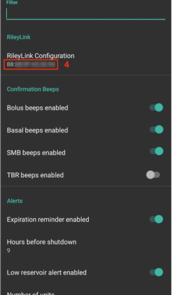

```{admonition} Older screenshot
:class: note
위의 스크린샷은 이전 **AAPS** 버전의 것입니다. **AAPS** 4에서는 Omnipod 설정의 **RileyLink Configuration** 대신 Omnipod 펌프 화면의 **RileyLink 페어링**으로 장치를 추가하며, 검색이 자동으로 시작됩니다.
```

페어링된 장치를 제거하는 별도의 버튼은 없습니다. RileyLink를 더 이상 사용하지 않으면, 필요할 때 새 RileyLink를 페어링하면 됩니다.


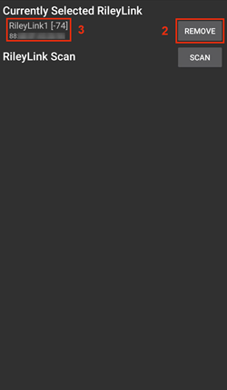

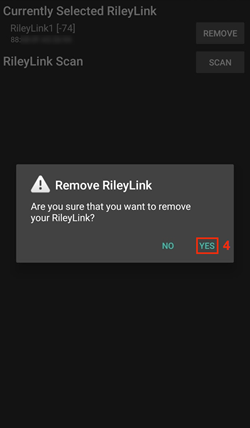


```{admonition} Older screenshot
:class: note
위의 스크린샷은 이전 **AAPS** 버전의 것입니다. **AAPS** 4에는 **삭제** 버튼이 없습니다: 새 RileyLink를 페어링하면 이전 RileyLink를 대체합니다.
```

## 상태 표시줄과 케어포털

Omnipod Pod가 튜브 펌프와 다른 점 때문에, 특히 새 Pod를 붙인 후에 해당하는 몇 가지 항목이 있습니다.

메인 화면 [상태 표시줄](#screens-sensor-level-battery)의 **인슐린**과 **캐뉼라** 사용 기간은 **Pod를 교체할 때마다** 0일 0시간으로 **초기화**됩니다. 이는 Omnipod 펌프의 구조와 작동 방식 때문입니다. **펌프 배터리**와 **인슐린 레저버**는 각 Pod 안에 들어 있습니다. Pod는 Pod를 붙인 위치의 피부에 캐뉼라를 직접 삽입하므로, Omnipod 펌프에는 일반적인 튜브를 사용하지 않습니다. *따라서 Pod를 교체하면 이 값들의 사용 기간은 자동으로 0으로 초기화됩니다.* Pod 안의 배터리는 항상 Pod 사용 기간(최대 80시간)보다 오래가므로 **펌프 배터리 사용 기간**은 보고되지 않습니다.

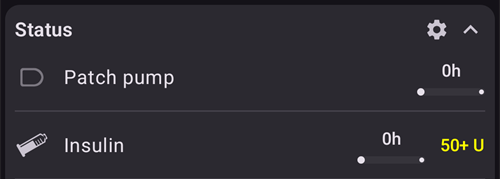

### Levels

**인슐린 잔량**

Omnipod Eros Pod의 인슐린 양 보고는 정확하지 않습니다. Pod에 인슐린이 정확히 얼마나 들어갔는지는 알 수 없고, Pod를 채우는 동안 신호음이 2번 울리면 최소 80 U가 채워졌다는 것만 알 수 있기 때문입니다. Pod에는 최대 200 U를 넣을 수 있습니다. 프라임도 정확한 과정이 아니므로 오차가 생길 수 있습니다. 이 두 가지 요인 때문에 Omnipod 드라이버는 레저버에 남은 인슐린의 가장 좋은 근사값을 보여 주도록 만들어졌습니다.

> - **50 U 초과** - 레저버에 현재 50 U보다 많이 있으면 50+U 값을 보고합니다.
> - **50 U 미만** - 레저버에 남은 인슐린의 계산된 근사값을 보고합니다.
> - **SMS** - SMS 응답으로 값 또는 50+U를 돌려줍니다
> - **Nightscout** - 50 U를 넘으면 Nightscout에 50 값을 업로드합니다 (버전 14.07 이하).  새 버전에서는 50 U를 넘으면 50+ 값을 보고합니다.

**Battery Level**

배터리 잔량 보고는 OrangeLink, EmaLink, DiaLink 같은 Pod 통신 장치의 현재 배터리 잔량을 돌려주도록 켤 수 있는 설정입니다.  RileyLink 하드웨어는 배터리 잔량을 보고할 수 없습니다.  배터리 잔량은 Pod와 통신할 때마다 보고되므로, 충전 중에 잔량이 일정하게 올라가지 않을 수 있습니다.  수동으로 새로고침하면 현재 배터리 잔량이 업데이트됩니다.  지원되는 Pod 통신 장치의 연결이 끊기면 0% 값이 보고됩니다.

> - **RileyLink 하드웨어는 배터리 잔량을 보고할 수 없습니다**
> - **배터리 잔량 값을 보고하려면 Omnipod 설정에서 "OrangeLink/EmaLink/DiaLink에서 보고한 배터리 잔량 나타내기" 설정을 반드시 켜야 합니다**
> - **배터리 잔량 보고는 OrangeLink, EmaLink, DiaLink 장치에서만 작동합니다**
> - **배터리 잔량 보고는 다른 장치에서도 작동할 수 있습니다 (RileyLink 제외)**
> - **SMS** - 실제 잔량이 있으면 현재 배터리 잔량을 응답으로 돌려줍니다. n/a 값은 돌려주지 않습니다
> - **Nightscout** - 실제 잔량이 있으면 배터리 잔량이 보고됩니다. n/a 값은 보고되지 않습니다

(OmnipodEros-troubleshooting)=

## Troubleshooting

### Pod 고장

Pod는 Pod 자체의 하드웨어 문제를 포함한 여러 가지 이유로 가끔 고장 납니다. AAPS는 승인된 사용 방법이 아니므로, 이런 고장을 Insulet에 신고하지 않는 것이 좋습니다. 원인을 찾는 데 도움이 되는 결함 코드 목록은 [여기](https://github.com/openaps/openomni/wiki/Fault-event-codes)에서 볼 수 있습니다.

### 오류 49 Pod 고장 예방

이 고장은 명령에 맞지 않는 Pod 상태나 인슐린 주입 명령 중의 오류와 관련이 있습니다. Nightscout 동기화는 *업로드만* 하도록 설정할 것을 권장합니다: 생길 수 있는 오류를 막기 위해 Nightscout 클라이언트의 동기화 설정에서 "NS에서 ... 받기" 옵션을 모두 끄십시오 ([Nightscout](../SettingUpAaps/Nightscout.md) 참조).

### 펌프에 연결할 수 없음 경고

펌프 연결 불가 경고는 **120분**으로 설정할 것을 권장합니다. 메인 화면 오른쪽 위의 **설정**(톱니바퀴) 아이콘을 누르고 **로컬 알림** > **펌프 연결 불가 기준값**을 선택하여 **120**으로 설정하십시오.

(OmnipodEros-import-settings-from-previous-aaps)=
### 이전 AAPS에서 설정 가져오기

```{admonition} Importing settings can end your active Pod
:class: warning
이미 Pod를 사용 중인 휴대폰에서는 **펌프 설정도 교체**를 선택하지 마십시오: Pod 세션은 유지되고 다른 설정만 가져옵니다. 지금 사용 중인 Pod를 쓰는 동안 내보낸 파일일 때만 체크하십시오. [튜브 없는 펌프](#ExportImportSettings-tubeless-pumps)를 참조하십시오.
```

**AAPS**를 다시 설치하는 가장 안전한 방법은 두 Pod 사이에 하는 것입니다:

1. Pod 세션을 비활성화하십시오. 활성 Pod 세션이 없는지 확인하십시오.
2. 설정을 내보내고 사본을 안전한 곳에 보관하십시오.
3. 이전 버전의 AAPS를 삭제하고 휴대폰을 다시 시작하십시오.
4. 새 버전의 AAPS를 설치하고 활성 Pod 세션이 없는지 확인하십시오.
5. 설정을 가져오고 새 Pod를 활성화하십시오.

### Omnipod 드라이버 경고

Omnipod 드라이버는 **메인 화면**에 여러 가지 고유한 경고를 표시합니다. 대부분은 정보성이며 닫을 수 있지만, 일부는 경고의 원인을 해결하기 위해 사용자가 해야 할 조치를 알려 줍니다. 자주 볼 수 있는 주요 경고는 아래와 같습니다:

#### No active Pod

활성 Pod 세션이 감지되지 않았습니다. **스누즈**를 누르면 이 경고를 잠시 닫을 수 있지만, 새 Pod가 활성화될 때까지 계속 다시 울립니다. 새 Pod가 활성화되면 이 경고는 자동으로 음소거됩니다.

#### Pod suspended

Pod가 중지되었음을 알려 주는 정보성 경고입니다.

#### 기저 프로파일 설정 실패. 주입이 중지되었을 수 있습니다! 펌프 화면에서 Pod 상태를 수동으로 새로 고치고, 필요하면 주입을 재개하십시오.

Pod 기저 프로파일 설정이 실패했음을 알려 주는 정보성 경고입니다. Omnipod 펌프 화면을 열고 **새로고침**을 누른 다음, 필요하면 **주입 재개**를 누르십시오.

#### SMB 볼러스가 성공했는지 확인할 수 없습니다. 볼러스가 성공하지 않은 것이 확실하면 '처치'에서 SMB 기록을 수동으로 삭제해야 합니다.

SMB 볼러스의 성공 여부를 확인할 수 없음을 알려 주는 경고입니다. Omnipod 펌프 화면의 **마지막 볼러스** 항목을 확인하여 SMB가 성공했는지 보십시오. 성공하지 않았다면 처치에서 그 기록을 삭제하십시오.

#### "볼러스/TBR/SMB 작업"이 완료되었는지 불확실합니다. 성공했는지 직접 확인하십시오.

RileyLink와 Omnipod가 통신하는 방식 때문에, 명령이 성공적으로 처리되었는지 *불확실한* 상황이 생길 수 있습니다. 그래서 이런 불확실성을 사용자에게 알려야 했습니다.

아래는 불확실 알림이 나타날 수 있는 몇 가지 예입니다.

- **볼러스** - 불확실한 볼러스는 자동으로 확인할 수 없습니다. 알림은 다음 볼러스까지 남아 있지만, Pod를 수동으로 새로고침하면 메시지가 지워집니다. *사용자가 직접 확인해야 하므로 이 알림 유형에는 기본적으로 경고 신호음이 켜져 있습니다.*
- **TBR, Pod 상태, 프로파일 전환, 시간 변경** - Pod를 수동으로 새로고침하면 메시지가 지워집니다.
- **Pod 시간 편차 -** Pod의 시간과 휴대폰의 시간이 너무 많이 다르면 AAPS 루프가 제대로 작동하고 정확한 예측과 용량 권장을 하기 어렵습니다. Pod와 휴대폰의 시간 차이가 5분을 넘으면 Omnipod 펌프 화면에 **시간 설정** 버튼이 나타납니다. **시간 설정**을 눌러 Pod의 시간을 휴대폰의 시간과 맞추십시오. **Pod 상태**에 그 후 **중지됨**이 표시되면 **주입 재개**를 눌러 Pod의 정상 작동을 계속하십시오.

## 권장 사용 방법

(OmnipodEros-optimal-omnipod-and-rileylink-positioning)=

### Omnipod와 RileyLink의 최적 위치

RileyLink가 Omnipod Pod와 통신하는 데 사용하는 안테나는 433 MHz 나선형 안테나입니다. 이 안테나는 구조상 3차원 도넛 모양의 전방향 신호를 내보내며, z축은 세로로 서 있는 안테나를 나타냅니다. 따라서 특히 Pod 활성화와 비활성화 과정에서는 RileyLink를 두기에 가장 좋은 위치가 있습니다.


> *(그림 1. 전방향 패턴의 나선형 안테나 그래프*)

안전과 보안 문제 때문에 Pod *활성화*는 볼러스 주입, TBR 설정, Pod 상태 새로고침 같은 다른 작업보다 *더 가까운 거리(약 30 cm 이내)*에서 해야 합니다. RileyLink 안테나의 신호 전송 특성 때문에 Pod를 RileyLink 바로 위나 바로 옆에 두는 것은 권장하지 않습니다.

아래 그림은 Pod 활성화와 비활성화 과정에서 RileyLink를 두는 가장 좋은 방법을 보여 줍니다. 다른 위치에서도 Pod가 활성화될 수 있지만, 아래 그림의 위치를 사용하면 성공할 가능성이 가장 높습니다.

*참고: Pod와 RileyLink를 가장 좋은 위치에 두었는데도 통신이 실패하면, 배터리가 부족하여 RileyLink 안테나의 전송 거리가 줄어든 것일 수 있습니다. 이 문제를 피하려면 이 과정 동안 RileyLink를 충분히 충전하거나 충전 케이블에 직접 연결하십시오.*

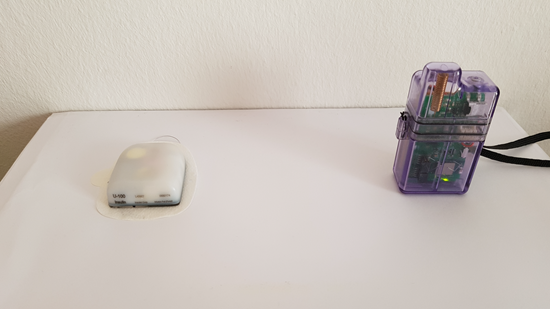

## 도움을 받을 수 있는 곳

Omnipod 드라이버의 모든 개발 작업은 커뮤니티가 자원봉사로 하고 있습니다. 이 점을 배려하여 도움을 요청할 때 다음 지침을 따르십시오:

- **레벨 0:** 이 문서의 관련 부분을 읽고, 문제가 있는 기능이 원래 어떻게 작동해야 하는지 이해했는지 확인하십시오.
- **레벨 1:** 이 문서로 해결할 수 없는 문제가 계속 있다면, [이 초대 링크](https://discord.gg/4fQUWHZ4Mw)를 사용하여 **Discord**의 *#androidaps* 채널로 가십시오.
- **레벨 2:** 기존 이슈를 검색하여 같은 문제가 이미 보고되었는지 확인하십시오. 보고되지 않았다면 새 [이슈](https://github.com/nightscout/AndroidAPS/issues)를 만들고 [로그 파일](../GettingHelp/AccessingLogFiles.md)을 첨부하십시오.
- **인내심을 가지십시오. 커뮤니티 회원 대부분은 선의의 자원봉사자이며, 문제를 해결하려면 사용자와 개발자 모두에게 시간과 인내가 필요한 경우가 많습니다.**
