# AAPS 화면

```{contents}
:backlinks: entry
:depth: 2
```

(the-homescreen)= (AapsScreens-the-homescreen)=

## 메인 화면


**AAPS**를 열면 처음 보게 되는 화면이며, 매일 필요한 정보 대부분이 들어 있습니다.

### 섹션 A - 상단 바

* 왼쪽의 **메뉴**(☰)는 **처치 이력**, **이력 브라우저**, **통계**, **프로파일 도우미**, **정비**, **설정 마법사**, **구성** 등이 있는 탐색 창을 엽니다.
* **검색 창**은 설정, 대화 상자, 문서를 찾아 줍니다. 입력을 시작하기만 하면 됩니다([전체 검색](../DailyLifeWithAaps/GlobalSearch.md) 참조).
* 오른쪽의 **설정**(톱니바퀴) 아이콘은 모든 [설정](../SettingUpAaps/Preferences.md)을 엽니다.

(aaps-screens-profile--target)=

### 섹션 B - 상태 블록

#### 현재 혈당

CGM의 최신 혈당 측정값은 왼쪽의 큰 원 안에 표시되며, 이전 측정값과의 차이(증분)와 측정값의 경과 시간도 함께 표시됩니다.

혈당 값의 색은 설정된 [범위](#Preferences-range-for-visualization)에 대한 상태를 나타냅니다.

* 녹색 = 범위 안
* 빨간색 = 범위 아래
* 노란색 = 범위 위

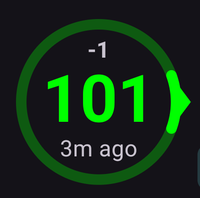  

(loop-status)= (AapsScreens-loop-status)=

#### 루프 상태


혈당 원 옆의 아이콘은 루프의 실행 모드를 보여 줍니다(그림에서 위에서 아래 순서).

1. 녹색 원 = [폐쇄 루프](#KeyAapsFeatures-ClosedLoop), 루프 실행 중
2. 점선이 있는 보라색 원 = [저혈당 주입 정지(LGS)](#KeyAapsFeatures-LGS)
3. 점선이 있는 파란색 원 = [개방 루프](#KeyAapsFeatures-OpenLoop)
4. X 표시가 있는 빨간색 원 = 루프 비활성화(계속 작동하지 않음)
5. 빨간색 일시 중지 아이콘 = 루프 일시 중지(잠시 멈추지만 기저 인슐린은 주입됨) - 남은 시간이 아이콘 옆에 표시됩니다
6. 플러그가 있는 회색 원 = 펌프 연결 해제(잠시 인슐린이 전혀 주입되지 않음) - 남은 시간이 아이콘 옆에 표시됩니다

아이콘을 누르면 루프 대화 상자가 열립니다. 대화 상자의 내용은 현재 상태에 따라 다릅니다.

* 루프가 **실행 중**일 때(폐쇄, 개방 또는 LGS) 실행 모드를 바꾸거나(폐쇄 루프, 저혈당 주입 정지, 개방 루프 또는 루프 비활성화), 선택한 시간 동안 루프를 **일시 중지**하거나 펌프를 **연결 해제**할 수 있습니다.
* 루프가 **비활성화**되어 있을 때는 실행 모드를 선택하여 다시 활성화하거나, 펌프를 연결 해제할 수 있습니다.
* 루프가 **일시 중지**되어 있을 때는 루프를 **재개**하거나, 펌프를 연결 해제하거나, **루프 일시 중지** 아래에서 새 시간을 골라 일시 중지를 연장할 수 있습니다.
* 펌프가 **연결 해제**되어 있을 때는 펌프를 **재연결**하거나, **펌프 연결 해제** 아래에서 새 시간을 골라 연결 해제를 연장할 수 있습니다.

일시 중지나 연결 해제를 연장하면 새 시간은 **지금부터 시작**합니다. 새 시간은 남은 시간을 대신하며, 남은 시간에 더해지지 않습니다. 먼저 재개하거나 재연결할 필요는 없습니다.

폐쇄 루프로 실행 중일 때의 대화 상자:

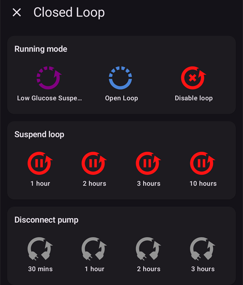

루프가 일시 중지되었을 때의 대화 상자. **재개**와 일시 중지를 연장할 시간이 있습니다:


펌프가 연결 해제되었을 때의 대화 상자. **펌프 재연결**과 연결 해제를 연장할 시간이 있습니다:


저혈당 주입 정지, 개방 루프, 루프 비활성화 상태의 대화 상자는 제공하는 실행 모드만 다릅니다.

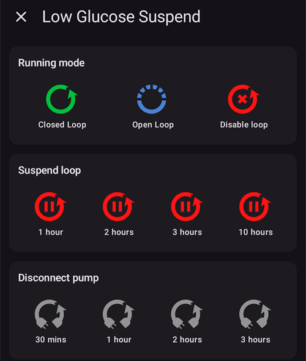


각 모드에서 메인 화면은 다음과 같이 보입니다. 그래프 위쪽의 색 띠는 모드가 바뀐 시점에 바뀝니다.

저혈당 주입 정지:

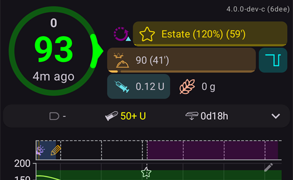

개방 루프:


루프 비활성화:


루프 일시 중지 — 남은 시간이 아이콘 옆에 표시됩니다:


펌프 연결 해제 — 남은 시간이 아이콘 옆에 표시됩니다. 처치 버튼은 QuickLaunch 툴바에 그대로 남아 있으므로, 펜으로 주입한 인슐린이나 탄수화물을 계속 기록할 수 있습니다:

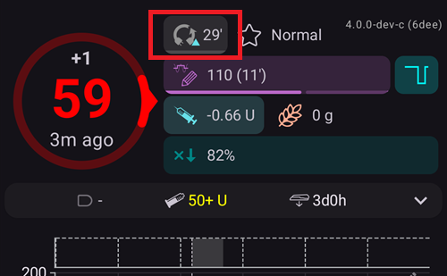

선택할 때마다 확인이 필요합니다.

```{admonition} 알람: 펌프가 0 임시 기저를 받아들이지 않았습니다 :class: warning 펌프가 연결 해제되어 있는 동안 **AAPS**는 펌프에 0 임시 기저를 유지하고, 없으면 다시 설정합니다. 10분이 지나도 계속 실패하면 **AAPS**는 긴급 알람을 울립니다: *"펌프가 0 임시 기저를 받아들이지 않았습니다. 아직 기저 인슐린을 주입하고 있을 수 있습니다. 펌프를 확인하십시오."* 이 알람은 0 임시 기저가 설정되거나 연결 해제가 끝날 때까지 15분마다 반복됩니다. 이 알람이 보이면 펌프를 확인하십시오. **AAPS**에는 연결 해제로 표시되어도 펌프가 기저 인슐린을 주입하고 있을 수 있습니다.

    <br />참고: 제공되는 모드는 [목표](../SettingUpAaps/CompletingTheObjectives.md) 진행 상황에 따라 다릅니다. 폐쇄 루프와 LGS는 목표를 완료해야 사용할 수 있습니다.
    
    (aaps-screens-bg-warning-sign)=
    #### 혈당 경고 표시
    
    **AAPS**가 받은 혈당 측정값에서 문제를 감지하면, 메인 화면 하단 바에 혈당 출처로 가는 바로가기(출처 이름으로 표시됨, 예: **xDrip+ 혈당**)가 빨간색 경고 배지와 함께 나타납니다. 이것을 누르면 [혈당 출처 화면](#aaps-screens-bg-source)이 열립니다.
    
    ##### 중복 혈당 데이터
    
    빨간색 경고 표시는 즉시 조치하라는 신호입니다. **중복 혈당 데이터**를 받고 있어서 루프가 제대로 작동하지 못합니다. **AAPS**는 중복된 측정값으로는 혈당 추세를 믿을 수 있게 계산할 수 없으므로 교정을 멈춥니다.
    
    루프가 폐쇄 루프였다면 **AAPS**는 [저혈당 주입 정지(LGS)](#KeyAapsFeatures-LGS) 모드로 전환합니다. 루프 아이콘이 보라색으로 바뀝니다.
    
      
    
    루프 아이콘을 누르십시오. 맨 위의 **제한** 카드에 이유가 나옵니다: "BgQualityCheck: 혈당 출처의 중복 값 때문에 LGS 모드".
    
      
    
    ```{admonition} 루프가 저혈당 주입 정지로 실행 중입니다
    :class: note
    루프는 계속 실행되지만 저혈당을 막는 데에만 사용됩니다. **AAPS**는 여전히 기저를 줄이거나 멈출 수 있지만, 이 문제를 해결할 때까지 교정 인슐린은 주입하지 않습니다!
    

중복 혈당 값이 왜 생기는지 원인을 찾아야 합니다.

* Nightscout 사이트에서 Dexcom bridge가 활성화되어 있습니까? Nightscout 인스턴스의 관리 패널로 가서 "enable" 변수를 편집하고 그곳에서 "bridge" 부분을 지워 bridge를 끄십시오. (Heroku의 경우 [자세한 내용은 여기에 있습니다](https://nightscout.github.io/troubleshoot/troubleshoot/#heroku).)
* 여러 소스가 혈당을 Nightscout에 업로드하고 있습니까? BYODA 앱을 사용한다면 **AAPS**에서 업로드를 켜고, xDrip을 함께 사용한다면 xDrip에서는 켜지 마십시오.
* 혈당을 받은 다음 다시 Nightscout 사이트에 업로드하는 팔로워가 있습니까?
* 마지막 방법: [NSClient 설정](#Preferences-nsclient)에서 동기화 설정을 선택하고 "NS에서 CGM 데이터 받기" 옵션을 끄십시오.

경고를 바로 없애고 루프가 다시 교정하게 하려면, 혈당 출처 화면에서 중복 항목을 삭제하십시오. 하단 바의 바로가기를 누르면 됩니다. 중복된 측정값은 빨간색으로 강조 표시됩니다. 측정값을 길게 눌러 선택을 시작하고, 중복 항목에 체크한 다음 오른쪽 위의 휴지통 아이콘을 누르십시오.


하지만 중복이 많으면 다음과 같이 하는 것이 더 쉬울 수 있습니다.

* [설정을 백업하고](../Maintenance/ExportImportSettings.md),
* 정비 메뉴에서 데이터베이스를 초기화한 다음
* [설정을 다시 가져오십시오](../Maintenance/ExportImportSettings.md).

    {admonition} 폐쇄 루프로 직접 다시 전환하십시오
    :class: important
    중복이 없어져도 **AAPS**는 스스로 **폐쇄 루프**로 돌아가지 않습니다. 메인 화면에서 루프 아이콘을 누르고 다시 **폐쇄 루프**를 선택하십시오.

##### 평평한 혈당 데이터

일부 혈당 출처(Libre 1, AiDEX, Glutec, Medtronic 및 센서 종류를 알려 주지 않는 출처)에서는 **AAPS**가 변하지 않는 측정값도 확인합니다. 45분 동안 혈당 변화가 2 mg/dL(0.1 mmol/L)보다 작으면 데이터가 잘못된 것으로 봅니다. 그러면 혈당 출처 바로가기에 빨간색 평평한 추세 배지가 표시되고, 측정값이 다시 변할 때까지 루프는 높은 임시 기저를 모두 멈추고 교정 인슐린을 주입하지 않습니다. 센서와 측정값을 보내는 앱을 확인하십시오.

##### 불규칙한 혈당 데이터

측정값이 불규칙한 간격으로 들어오거나 일부가 빠지면, **AAPS**는 가지고 있는 측정값으로 5분 간격의 값을 다시 계산합니다. 예를 들어 센서를 교체한 후나, 몇 시간마다 시간이 1~2분씩 어긋나는 Libre 센서에서 이런 일이 생깁니다. 루프는 계속 작동하며, 따로 조치할 필요는 없습니다. **AAPS** 4에서는 이 경우 노란색 경고 표시가 더 이상 나타나지 않습니다.

#### 현재 프로파일

현재 프로파일은 별 아이콘 옆에 표시됩니다.

프로파일 이름을 누르면 [프로파일 화면](#aaps-screens-profile)이 열립니다. 이곳에서 프로파일 세부 정보를 보고 [다른 프로파일로 전환](../DailyLifeWithAaps/ProfileSwitch-ProfilePercentage.md)할 수 있습니다.

**프로파일 퍼센트를 변경**하려면(기간 포함) 프로파일 이름을 누른 다음, 프로파일 화면 오른쪽 아래의 둥근 **▶**(활성화) 버튼을 누르십시오. **AAPS** 3.x에서는 프로파일 이름을 길게 눌러 이 화면을 열었습니다. **AAPS** 4에서는 길게 눌러도 아무 일도 일어나지 않습니다. 단계별 안내: [프로파일 퍼센트 변경](#ProfileSwitch-change-percentage).


1. 일반 표시: 표준 프로파일이 활성화된 상태입니다.
2. 특정 퍼센트 90%와 남은 시간 9분인 프로파일 전환 — 임시 프로파일 전환이 실행되는 동안 프로파일 이름은 노란색으로 바뀝니다.
3. 시간 이동 1시간과 남은 시간 9분인 프로파일 전환.

#### 목표

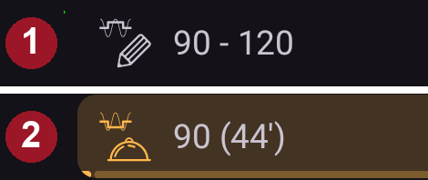

현재 목표 혈당은 프로파일 이름 아래에 표시됩니다.

목표를 짧게 누르면 **[임시 목표](../DailyLifeWithAaps/TempTargets.md)** 화면이 열립니다.

1. 일반 표시: 프로파일에 정의된 목표 범위입니다.
2. 임시 목표가 설정되어 있으면 목표가 사용한 프리셋 아이콘과 함께 노란색/주황색으로 바뀌고, 남은 시간(분)이 괄호 안에 표시됩니다.

(AapsScreens-visualization-of-dynamic-target-adjustment)=

#### 동적 목표 조정 표시

[SMB 알고리즘](#Config-Builder-aps)과 [Autosens](#Open-APS-features-autosens) 기능을 사용하면, **AAPS**는 민감도에 따라 목표를 동적으로 조정할 수 있습니다.

[OpenAPS SMB 설정](#Preferences-openaps-smb-settings)에서 다음 옵션 중 하나 또는 둘 다 켜십시오.

* "민감도가 높으면 목표 높이기" 및/또는
* "저항성이면 목표 낮추기"

**AAPS**가 저항성이나 민감도를 감지하면 목표가 프로파일에 설정된 값에서 바뀌고, 표시된 목표의 색이 바뀌어 조정되었음을 알려 줍니다.

(aaps-screens-iob-cob-basal-sens)=

#### IOB, COB, 기저 및 민감도


1. **주사기**: 활성 인슐린(IOB) - 몸 안의 활성 인슐린 양  
    표준 기저만 실행 중이고 이전 볼러스에서 남은 인슐린이 없다면 활성 인슐린 값은 0입니다. 
    * 최근에 기저가 줄어든 기간이 있었다면 IOB가 음수일 수 있습니다.
    * 칩을 누르면 볼러스 인슐린과 기저 인슐린이 나뉘어 표시됩니다(그림의 첫 번째 대화 상자 — 기저가 줄어든 기간 후의 음수 IOB 예).
2. **곡물**: [활성 탄수화물(COB)](../DailyLifeWithAaps/CobCalculation.md) - 이전에 먹었지만 아직 흡수되지 않은 탄수화물
3. 오른쪽의 청록색 버튼은 **현재 기저 주입**을 나타냅니다. 프로파일 기저가 실행 중이면 평평한 선이고, 임시 기저 주입량이 활성화되어 있으면 아이콘이 바뀝니다.
4. **퍼센트 행**은 현재 민감도([Autosens](#Open-APS-features-autosens) / [DynamicISF](../DailyLifeWithAaps/DynamicISF.md))를 보여 줍니다. 루프가 ISF를 바꾸면 이 행에는 프로파일 ISF, 화살표, 루프가 지금 사용하는 ISF도 표시됩니다. 예: "80% 2.0 ↗ 2.5". 이 행을 누르면 Autosens 값과 유효 ISF가 표시됩니다(그림의 두 번째 대화 상자). 루프가 마지막 Autosens 결과와 다른 값으로 작동하면(예: 임시 목표가 민감도를 바꾸는 경우), 대화 상자에 그 값이 **알고리즘의 Autosens**로도 표시됩니다. Autosens가 꺼져 있으면 루프는 프로파일 ISF를 그대로 사용하며 유효 ISF는 표시되지 않습니다.

IOB 칩을 누르면 열리는 IOB 대화 상자:


청록색 버튼을 누르면 실행 중인 임시 기저 주입량, 시작 시각, 실행된 시간이 표시됩니다:


(aaps-screens-carbs-required)=

#### 필요한 탄수화물


참조 설계(알고리즘)가 탄수화물이 필요하다고 판단하면 탄수화물 제안이 표시됩니다.

oref 알고리즘이 0 임시 기저만으로는 저혈당을 막을 수 없어서 탄수화물이 필요하다고 판단하는 경우입니다.

탄수화물 알림은 볼러스 계산기의 알림보다 훨씬 정교합니다. 볼러스 계산기에는 부족한 탄수화물이 표시되지 않는데도 탄수화물 제안이 보일 수 있습니다.

원하면 탄수화물 필요 알림을 Nightscout로 보낼 수 있습니다. 이 경우 공지가 표시되고 전송됩니다.

### 섹션 C - 상태 표시줄


상태 표시줄은 다음 항목에 대해 시각적인 경고를 표시합니다.

* 캐뉼라 사용 기간
* 인슐린 사용 기간(레저버를 사용한 일수)과 인슐린 잔량(단위)
* 센서 사용 기간
* 펌프 배터리 사용 기간과 잔량(%)

경고 임계값을 넘으면 값이 노란색으로 표시됩니다.

위험 임계값을 넘으면 값이 빨간색으로 표시됩니다.

화면 크기와 관계없이 사용 기간은 항상 짧은 형식으로 표시됩니다: 첫날에는 *4h*, 그 후에는 *3d4h*.

임계값은 상태 표시줄을 **펼쳤을** 때(오른쪽의 꺾쇠) 나타나는 작은 **설정** 아이콘에서 바꿀 수 있습니다. [상태 등](#Preferences-status-lights)을 참조하십시오.

펼친 상태 패널에는 일부 행 끝에 교체를 기록하는 버튼도 있으며, 이 버튼은 해당 사용 기간을 초기화합니다. **센서** 행의 **추가**는 센서 삽입을 기록합니다. 펌프가 지원하면 **캐뉼라**(또는 **패치 펌프**) 행과 **인슐린** 행에 **프라임/채우기**가, **펌프 배터리** 행에 **추가**가 나타납니다.


사용하는 펌프에 따라 이 아이콘이 모두 표시되지 않을 수 있습니다.

(screens-sensor-level-battery)=

#### 센서 잔량(배터리)

MiaoMiao 2와 같은 추가 트랜스미터가 있는 CGM에서 작동합니다. (기술적으로는 센서가 배터리 잔량 정보를 xDrip으로 보내야 합니다.)

임계값은 [상태 등](#Preferences-status-lights)에서 설정할 수 있습니다.

(aaps-screens-main-graph)=

### 섹션 D - 메인 그래프


그래프는 혈당 측정기(CGM)에서 읽은 혈당(BG)을 보여 줍니다.

그래프에서 스크롤과 두 손가락 확대/축소 동작으로 보이는 시간 범위를 바꿀 수 있습니다.

녹색 영역은 목표 범위를 나타냅니다.

이 그래프에는 다음 정보도 표시됩니다.

* 수동 볼러스: 혈당 곡선 바로 위에 있는 파란색 삼각형. 그 시점의 측정값을 아래로 가리키며, 인슐린 양이 함께 표시됩니다
* 탄수화물 입력: 혈당 곡선 바로 아래에 있는 주황색 삼각형. 측정값을 위로 가리키며, 탄수화물 양이 함께 표시됩니다. 볼러스와 함께 입력한 식사는 측정값을 사이에 둔 하나의 표시처럼 보입니다.
* 삼각형은 그날의 가장 큰 양과 비교한 양에 따라 세 가지 크기(작음, 중간, 큼)로 표시됩니다. 그 시점에 혈당 측정값이 없으면(센서 공백) 삼각형은 그래프 아래쪽에 그려집니다.
* 혈당 체크와 보정: 측정한 값 위치에 그려지므로 센서 곡선과 비교할 수 있습니다
* 프로파일에 정의되었거나 임시 목표로 바뀐 목표: 녹색 선
* 프로파일 전환: 그래프 위쪽의 별 아이콘
* 루프 상태: [실행 모드](#AapsScreens-loop-status)가 폐쇄 루프가 아닐 때 그래프 위쪽에 나타나는 색 띠: 파란색 = 개방 루프, 보라색 = LGS, 빨간색 = 루프 비활성화, 노란색 = 루프 일시 중지, 회색 = 펌프 연결 해제, 주황색 = 슈퍼 볼러스(스크린샷에서는 보라색 다음 노란색). 이 변경 이력은 [실행 모드](#AapsScreens-running-mode)에 나열됩니다
* [SMB](#Open-APS-features-super-micro-bolus-smb)는 혈당 그래프에 그려지지 않습니다(몇 분마다 하나씩 생기기 때문입니다). SMB는 [IOB 그래프](#aaps-screens-iob)에 표시됩니다.

그래프의 **혈당 체크**를 누르면 그 값과, 노트를 썼다면 노트도 볼 수 있습니다.

(aaps-screens-graph-press-and-hold)=

#### 특정 시간의 값 보기

혈당 그래프를 잠시 **길게 누르면** 한 측정값의 값을 볼 수 있습니다. 가장 가까운 측정값에 점이 표시되고, 모든 그래프에서 그 시각에 점선이 그려지며, 그래프 위쪽의 팝업에 다음이 표시됩니다.

* 시간과 혈당 값
* 그 시각의 IOB, COB(0 g보다 클 때만), 기저 주입량 — 기저 아이콘은 메인 화면에서처럼 임시 기저 주입량이 실행 중이었는지 보여 줍니다
* 그 시각의 볼러스, SMB 또는 탄수화물. 그래프와 같은 삼각형으로 표시됩니다

손가락을 화면에 댄 채 왼쪽이나 오른쪽으로 움직이면 다음 측정값으로 이동합니다. 측정값마다 가벼운 진동이 느껴지며, 이렇게 하는 동안 그래프는 스크롤되지 않습니다. 손가락을 떼면 팝업은 2초 동안 남아 있습니다.

혈당 그래프 아래의 [추가 그래프](#aaps-screens-additional-graphs)(IOB, COB...)에서도 같은 방식으로 작동합니다. 아무 그래프나 길게 누르십시오.


(aaps-screens-graph-clock-change)=

#### 시계 변경

서머타임 변경이나 새 시간대에서 휴대폰 시계가 바뀐 경우, 혈당 그래프에 그 시점을 표시하는 세로 점선이 그려지고 아래쪽에 작은 시계 아이콘이 표시됩니다. 같은 점선이 아래의 [추가 그래프](#aaps-screens-additional-graphs)에도 그려집니다.


(AapsScreens-activate-optional-information)=

#### 추가 정보 켜기

그래프 오른쪽 위의 **연필** 아이콘을 누르면 그래프 설정이 열립니다:

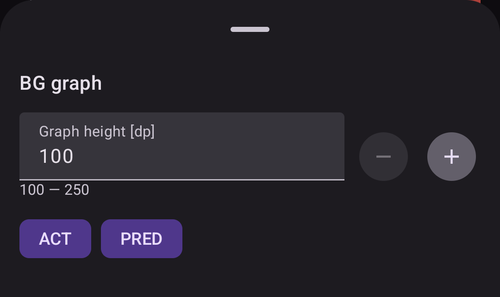

* **그래프 높이**는 그래프를 그리는 높이를 조정합니다.
* **ACT**는 인슐린 활동 곡선을 겹쳐 표시합니다: 노란 연두색 실선 <span style="background:#141218;color:#D3F166;padding:0 0.3em;border:1px solid #141218;border-radius:4px">━━━━</span>(노란색 점선인 UAM 예측과 혼동하지 마십시오)
* **PRED**는 [예측선](#aaps-screens-prediction-lines)을 겹쳐 표시합니다(아래 참조)

(aaps-screens-prediction-lines)=

#### 예측선

**PRED**가 켜져 있으면 AAPS는 "현재" 선의 오른쪽에 예측을 **점선**으로 그립니다. 예측마다 고유한 색이 있습니다. 어두운 테마에서는 같은 색의 더 밝은 색조를 사용하며, 녹색 목표 범위 안에 있는 선은 약간 더 녹색으로 보일 수 있습니다.

| 선                | 밝은 테마                                                                                                                             | 어두운 테마                                                                                                                             | 예측 내용           |
| ---------------- | --------------------------------------------------------------------------------------------------------------------------------- | ---------------------------------------------------------------------------------------------------------------------------------- | --------------- |
| **IOB**(파란색)     | <span style="background:#FFFFFF;color:#1E88E5;padding:0 0.3em;border:1px solid #CCCCCC;border-radius:4px">●●●●</span>             | <span style="background:#141218;color:#64B5F6;padding:0 0.3em;border:1px solid #141218;border-radius:4px">●●●●</span>              | 인슐린만            |
| **COB**(주황색)     | <span style="background:#FFFFFF;color:#FB8C00;padding:0 0.3em;border:1px solid #CCCCCC;border-radius:4px">●●●●</span>             | <span style="background:#141218;color:#FFB74D;padding:0 0.3em;border:1px solid #141218;border-radius:4px">●●●●</span>              | 활성 탄수화물         |
| **UAM**(노란색)     | <span style="background:#FFFFFF;color:#C9BD60;padding:0 0.3em;border:1px solid #CCCCCC;border-radius:4px">●●●●</span>             | <span style="background:#141218;color:#E6D39A;padding:0 0.3em;border:1px solid #141218;border-radius:4px">●●●●</span>              | 미입력 식사          |
| **ZT**(청록색)      | <span style="background:#FFFFFF;color:#00D2D2;padding:0 0.3em;border:1px solid #CCCCCC;border-radius:4px">●●●●</span>             | <span style="background:#141218;color:#4DD4D4;padding:0 0.3em;border:1px solid #141218;border-radius:4px">●●●●</span>              | 0 임시 기저(인슐린 중지) |
| **aCOB**(연한 주황색) | <span style="background:#FFFFFF;color:rgba(251,140,0,0.5);padding:0 0.3em;border:1px solid #CCCCCC;border-radius:4px">●●●●</span> | <span style="background:#141218;color:rgba(255,183,77,0.5);padding:0 0.3em;border:1px solid #141218;border-radius:4px">●●●●</span> | 예전 AMA 알고리즘에서만  |

두 예측의 값이 같으면 점이 겹쳐서 색이 하나만 보입니다(예: 혈당이 평평할 때 IOB 위의 UAM).

* **COB** 선(주황색): [활성 탄수화물](CobCalculation.md)(AAPS 전체에서 주황색은 COB와 탄수화물에 사용됩니다)
    
    이 예측선은 탄수화물 흡수로 인한 편차가 일정하게 유지된다고 가정하고, 현재 **프로파일** 설정에 따라 혈당이 어디로 갈지를 보여 줍니다(COB 자체가 아닙니다!). This line only appears if there are known COB.

* **IOB** 선(파란색): 활성 인슐린(AAPS 전체에서 파란색은 IOB와 인슐린에 사용됩니다)
    
    이 예측선은 인슐린의 영향만 있을 때 어떻게 될지를 보여 줍니다. 예를 들어 인슐린을 주입한 다음 탄수화물을 전혀 먹지 않은 경우입니다.

* **ZT** 선(청록색): 0 임시 기저(0% 임시 기저 주입량이 설정된다고 가정한 예측 혈당)
    
    이 예측선은 펌프가 모든 인슐린 주입을 멈추었을 때(0% TBR) 혈당 곡선이 어떻게 바뀔지를 보여 줍니다. 이 선은 목표보다 높아지면 멈춥니다.
    
    *이 선은 [SMB](#Config-Builder-aps) 알고리즘을 사용할 때만 나타납니다.*

* **UAM** 선(노란색): [미입력 식사](#SensitivityDetectionAndCob-sensitivity-oref1)
    
    미입력 식사(UAM)는 식사, 아드레날린 또는 다른 영향으로 혈당이 크게 오르는 것이 감지되었다는 뜻입니다. 예측선은 **주황색 COB 선**과 비슷하지만, 편차가 일정한 속도로 줄어든다고 가정합니다(현재 감소 속도를 연장하여).
    
    *이 선은 [SMB](#Config-Builder-aps) 알고리즘을 사용하고, OpenAPS SMB 설정에서 **UAM 활성화**가 켜져 있으며, 혈당이 인슐린만으로 설명되는 것보다 더 많이 오를 때만 나타납니다.*

* **aCOB** 선(연하고 투명한 주황색): 가속된 탄수화물 흡수
    
    COB와 비슷하지만, 탄수화물 흡수 속도를 10 mg/dL/5분(0.555 mmol/L/5분)으로 고정한다고 가정합니다. 더 이상 사용되지 않으며 쓸모가 크지 않습니다.
    
    *이 선은 예전 [AMA](#Config-Builder-aps) 알고리즘을 사용할 때만 나타납니다.*

보통 실제 혈당 곡선은 이 선들의 중간쯤에서 끝나거나, 내 상황과 가장 비슷한 가정을 하는 선에 가깝게 끝납니다.

(aaps-screens-how-predictions-become-a-dosing-decision)=

#### AAPS가 예측을 주입 결정으로 바꾸는 방법

AAPS는 현재 혈당만 보고 인슐린을 주입하지 않습니다. 루프 주기마다(대략 5분마다) 위의 모든 예측선을 함께 보고 가장 안전한 조치를 정합니다.

핵심 규칙은 **안전 우선**입니다. 어느 시간 범위에서든 예측선이 *하나라도* 저혈당 안전 기준값 아래로 내려가면, 현재 혈당이 높더라도 AAPS는 0 임시 기저(0% 임시 기저 주입량)를 실행하고 추가 인슐린을 주입하지 않습니다. 모든 예측선이 그 기준값 위에 머무를 때만 AAPS는 인슐린을 더 주입하는 것을 고려합니다.

인슐린을 더 주입해도 안전하면, AAPS는 합쳐진 예측에서 혈당이 최종적으로 어디에 도달할지(**최종 혈당**)를 보고, 그 최종 혈당을 목표로 되돌리려면 교정이 얼마나 필요한지 계산합니다. 이 교정은 높인 임시 기저 주입량으로, 또는 (oref1/[SMB](#Open-APS-features-super-micro-bolus-smb) 알고리즘이 활성화되어 있으면) 작은 즉시 볼러스로 주입됩니다. 지금 혈당이 높지만 이미 스스로 충분히 내려가는 추세라면, AAPS는 인슐린을 더하지 않고 기다리거나 기저 주입량을 줄일 수도 있습니다. 인슐린을 더하면 나중의 저혈당이 더 낮아질 뿐이기 때문입니다.

실제 스크린샷으로 이 결정 과정을 설명한 예는 [임상의 가이드의 주입 시나리오](#clinicianguide-dosing-scenarios)를 참조하십시오. 임상의를 위해 쓴 내용이지만 모든 AAPS 사용자에게 해당됩니다.

*이 예측과 그에 따른 주입 결정이 어떻게 계산되는지에 대한 전체 기술 설명은 [OpenAPS의 determine-basal 문서](https://openaps.readthedocs.io/en/latest/docs/While%20You%20Wait%20For%20Gear/Understand-determine-basal.html)를 참조하십시오.*

#### 기저

**파란색 실선**은 펌프의 기저 주입을 보여 주며, 시간에 따른 실제 주입량을 나타냅니다.

**파란색 점선**은 임시 기저 조정(TBR)이 없었다면 기저 주입량이 얼마였을지를 나타냅니다.

표준 기저 주입량이 주입될 때 곡선 아래 영역은 진한 파란색으로 표시됩니다. 기저 주입량이 일시적으로 조정되면(늘어나거나 줄어들면) 곡선 아래 영역은 연한 파란색으로 표시됩니다.

#### Activity

**얇은 노란색** 선은 인슐린의 활동을 보여 줍니다.

이 선은 다른 요인(예: 탄수화물)이 없을 때, 몸 안에 있는 인슐린으로 예상되는 혈당 하락을 바탕으로 합니다.

(AapsScreens-section-g-additional-graphs)= (aaps-screens-additional-graphs)=

### 섹션 E - 추가 그래프

메인 그래프 아래에 추가 그래프를 켤 수 있습니다. [간단 모드](#preferences-simple-mode)에서는 추가 그래프가 미리 정해져 있으며 바꿀 수 없습니다. 추가 그래프를 직접 구성하려면 **간단 모드**를 끄십시오.

추가 그래프는 메인 그래프를 따라 움직입니다. 혈당 그래프를 스크롤하거나 확대/축소하면 함께 움직입니다. 추가 그래프를 옆으로 끌어도 모든 그래프가 스크롤됩니다. 추가 그래프에는 자체 시간 표시가 없습니다. 시간은 혈당 그래프에서 읽으십시오.

추가 그래프를 구성하려면 그래프 오른쪽 위의 **연필** 아이콘을 누르십시오:

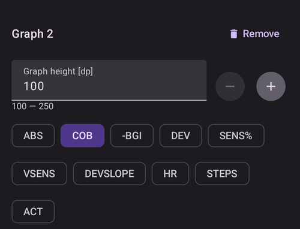

이 그래프에서 보고 싶은 데이터에 해당하는 칩을 선택하십시오. **삭제** 버튼은 그래프를 삭제합니다.

그래프를 하나 더 만들려면 마지막 그래프 아래의 **그래프 추가**를 누르고 같은 방법으로 칩을 선택하십시오:

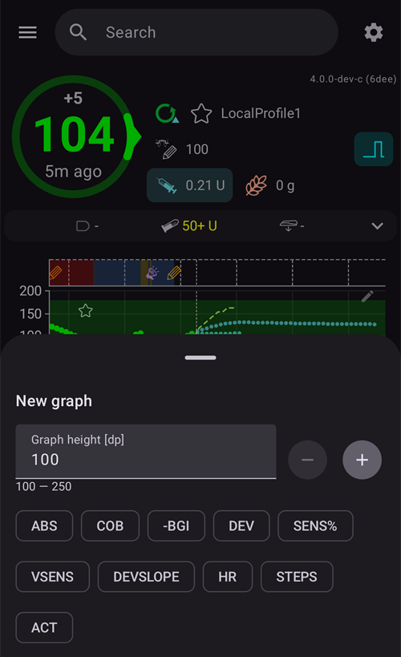

새 그래프는 다른 그래프들 아래에 추가됩니다. 여기서는 **SENS%**와 **DEV**가 있는 두 번째 추가 그래프입니다:


대부분의 사용자는 다음과 같은 추가 그래프 구성이면 충분하다고 생각합니다.

* 그래프 1: IOB, COB, 민감도 변화
* 그래프 2: 편차와 BGI

#### 절대 인슐린(ABS)

볼러스**와 기저**를 포함한 활성 인슐린입니다.

(aaps-screens-iob)=

#### 활성 인슐린 (IOB)

몸 안에 남아 있는 인슐린(= 체내 활성 인슐린)을 보여 줍니다. 볼러스와 임시 기저로 주입된 인슐린을 포함합니다(**하지만 프로파일에 설정된 기저 주입량은 포함하지 않습니다**).

DIA 시간 동안 [SMB](#Open-APS-features-super-micro-bolus-smb), 볼러스, TBR이 하나도 없었다면 이 값은 0입니다.

SMB는 이 그래프에 파란색 삼각형으로 표시되며, 그날의 가장 큰 SMB와 비교한 양에 따라 세 가지 크기로 표시됩니다.

남은 볼러스가 없고 오랫동안 0 임시 기저나 낮은 임시 기저가 실행되었다면 IOB는 음수일 수 있습니다.

흡수 속도는 [DIA 및 인슐린 종류 설정](#Config-Builder-insulin-dia)에 따라 달라집니다.

#### 활성 탄수화물(COB)

몸 안에 남아 있는 탄수화물(= 아직 흡수되지 않은 체내 활성 탄수화물)을 보여 줍니다.

흡수 속도는 [알고리즘이 감지하는 편차](../DailyLifeWithAaps/CobCalculation.md)에 따라 달라집니다.

예상보다 탄수화물 흡수가 많다고 감지하면 인슐린이 주입되고, 그러면 IOB가 늘어납니다(안전 설정에 따라 많거나 적게).

#### 민감도 변화(SENS%)

[Autosens](#Open-APS-features-autosens)가 감지한 민감도를 보여 줍니다.

민감도는 운동, 호르몬 등으로 달라지는 인슐린 민감도를 계산한 값입니다.

민감도 감지/[Autosens](#Open-APS-features-autosens)가 주입되는 인슐린 양을 자동으로 조정하게 하려면 [목표 8](#objectives-objective8)에 있어야 합니다. 이 목표에 도달하기 전에는 그래프의 선이 정보용으로만 표시됩니다.

### 가변 민감도(VSENS)

[DynamicISF](../DailyLifeWithAaps/DynamicISF.md)가 계산한 민감도를 보여 줍니다. 이 기능을 사용할 때만 값이 표시됩니다.

(screen-heart-rate-steps)=

#### 심박수(HR) & 걸음 수

이 데이터는 [Wear 스마트워치](../WearOS/WearOsSmartwatch.md)를 사용할 때 볼 수 있습니다. **AAPS** Wear 앱에서 이 기능을 켜고 건강 데이터 권한을 허용하십시오.

걸음 수는 막대로 그려지고, 심박수는 곡선으로 그려집니다. 시계가 데이터를 보내지 않은 구간에서는 곡선이 끊깁니다.

#### 편차(DEV)

* **회색** 막대는 탄수화물로 인한 편차를 보여 줍니다.
* **녹색** 막대는 혈당이 알고리즘의 예상보다 높다는 것을 보여 줍니다. 녹색 막대는 [Autosens](#Open-APS-features-autosens)에서 저항성을 높이는 데 사용됩니다.
* **빨간색** 막대는 혈당이 알고리즘의 예상보다 낮다는 것을 보여 줍니다. 빨간색 막대는 [Autosens](#Open-APS-features-autosens)에서 민감도를 높이는 데 사용됩니다.
* **노란색** 막대는 UAM으로 인한 편차를 보여 줍니다.
* **검은색** 막대는 민감도 계산에 반영되지 않는 작은 편차를 보여 줍니다.

#### 혈당 영향(-BGI)

이 선은 인슐린 활동만으로 혈당이 얼마나 오르거나 내려'야 하는지'를 보여 줍니다.


이 선을 편차 막대와 함께 표시하면 좋습니다. 두 항목은 같은 눈금을 쓰지만 다른 추가 데이터와는 눈금이 다르므로, 위와 같이 별도의 그래프에 표시하는 것이 좋습니다. BGI 선과 편차 막대를 비교하면 **혈당**이 어떻게 변하는지 다른 방법으로 이해할 수 있습니다. 여기서 **1**로 표시된 시점에서는 편차 막대가 BGI 선보다 훨씬 위에 있습니다. 혈당이 인슐린 활동만으로 설명되는 것보다 더 많이 오르고 있다는 뜻입니다(예: 탄수화물을 먹은 후). **2**로 표시된 시점에서는 편차 막대가 0 아래(빨간색)에 있습니다. 혈당이 알고리즘의 예상보다 낮다는 뜻입니다.

### 섹션 F - QuickLaunch 툴바


화면 아래쪽에 떠 있는 툴바에는 **[QuickLaunch](../DailyLifeWithAaps/QuickLaunch.md)** 동작이 들어 있습니다. 작은 **톱니바퀴**를 누르면 QuickLaunch 구성이 열리며, 여기서 표시할 버튼을 고릅니다(처치, 케어포털 항목, CGM 동작, **관리** 시트의 화면, [빠른 마법사](../DailyLifeWithAaps/QuickWizards.md) 버튼, [장면](../DailyLifeWithAaps/Scenes.md) 등).

위 그림은 일반적인 구성입니다: **인슐린**, **탄수화물**, **볼러스 마법사**.

펌프가 **연결 해제**되어 있는 동안에도 처치 버튼은 툴바에 남아 있습니다. 예를 들어 펜으로 주입한 인슐린을 기록할 수 있습니다(아래 [인슐린](#aaps-screens-buttons-insulin) 참조). 같은 동작은 하단 내비게이션의 [처치 시트](#aaps-screens-treatments-sheet)에서도 사용할 수 있습니다.

(aaps-screens-buttons-insulin)=

#### 인슐린

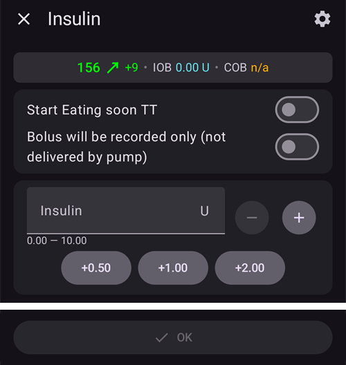

[볼러스 계산기](#aaps-screens-bolus-wizard)를 사용하지 않고 일정한 양의 인슐린을 주입할 때 사용합니다.

**식사 직전 임시 목표 시작**을 켜면 [식사 직전 임시 목표](#TempTargets-eating-soon-temp-target)를 자동으로 시작할 수 있습니다.

펌프로 볼러스를 주입하지 않고 인슐린 양만 기록하려면(예: 펜으로 주입한 인슐린) "**볼러스는 기록만 됩니다(펌프로 주입하지 않음)**"를 켜십시오. 그러면 **지금**으로 설정된 **시간** 행이 추가로 나타나며, 과거에 주사한 인슐린을 기록할 수 있습니다. **-** / **+**로 바꾸거나, 꺾쇠를 눌러 분을 입력하거나 날짜와 시간을 고르십시오.

 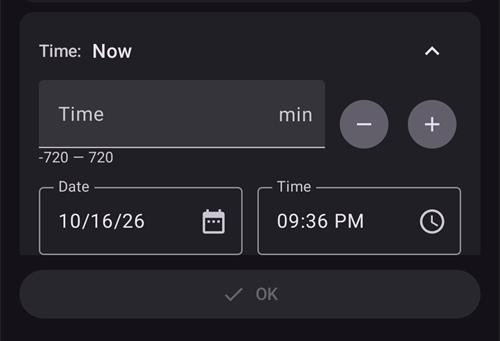

**+0.5 / +1.0 / +2.0** 버튼으로 인슐린 양을 빠르게 늘릴 수 있습니다. 증가량은 [볼러스 마법사 설정](#Preferences-deliver-this-part-of-bolus-wizard-result)에서 바꿀 수 있습니다.

인슐린 대화 상자는 펌프가 일시 중지되었거나 연결 해제되었을 때도 사용할 수 있습니다. 예를 들어 펜으로 주사한 인슐린을 기록할 때입니다. 이 경우 "**볼러스는 기록만 됩니다(펌프로 주입하지 않음)**"가 강제로 켜지고(빨간색으로 표시됨), 인슐린 종류와 과거 주사를 위한 **시간** 오프셋을 고르는 칸이 추가로 나타납니다:


#### Carbs


볼러스 없이 탄수화물을 기록할 때 사용합니다.

일부 [미리 설정된 임시 목표](#TempTargets-hypo-temp-target)(저혈당, 식사 직전, 활동)는 위쪽의 스위치로 바로 시작할 수 있습니다.

**탄수화물 시간**: 탄수화물을 언제 먹을지 / 언제 먹었는지.

**기간**: ["확장 탄수화물"](ExtendedCarbs.md)에 사용합니다. 이 행은 접혀 있어서 실수로 그램을 입력하지 않게 됩니다. **-** / **+**로 바꾸거나, 꺾쇠를 눌러 행을 펼치고 값을 입력하십시오.

**+5 / +10 / +20** 버튼으로 탄수화물 양을 빠르게 늘릴 수 있습니다.

#### 빠른 마법사

미리 구성한 버튼 하나로 탄수화물 양을 쉽게 입력하고 계산 기준을 설정합니다.

자세한 설정은 [빠른 마법사](../DailyLifeWithAaps/QuickWizards.md)에서 합니다.

(aaps-screens-treatments-sheet)=

### 섹션 G - 하단 내비게이션

하단 내비게이션 바에서 다음을 열 수 있습니다.

* **처치** — 처치 동작이 있는 빠른 동작 시트:
    
    

* **장면** — [장면](../DailyLifeWithAaps/Scenes.md)이 하나 이상 있거나 **사용자 동작**으로 표시된 **자동화** 규칙이 있을 때만 표시됩니다. 이것을 누르면 장면을 시작할 수 있는 시트가 열립니다. 배지는 지금 시작할 수 있는 개수를 보여 줍니다. 시트 위쪽의 **연필**을 누르면 **관리 → 장면**이 열립니다.

* **관리** — **AAPS**에서 관리하는 모든 것을 모은 곳입니다: 프로파일, 인슐린 설정, 임시 목표, 빠른 마법사, 장면, 자동화, 음식, 위치 순환, 펌프, 허가된 클라이언트. 그 아래에는 센서 삽입, 임시 기저와 같은 기기 및 기저 동작이 있습니다. 일부 항목은 설정에 해당할 때만 나타납니다. 예를 들어 프라임/채우기와 배터리 교체는 펌프에 따라 다르고, 임시 기저, 확장 볼러스, 케어포털 항목은 [간단 모드](#preferences-simple-mode)에서 숨겨집니다:
    
    

* **목표** — [목표](../SettingUpAaps/CompletingTheObjectives.md) 진행 상황입니다. 배지는 완료한 목표 수를 보여 줍니다. 모든 목표를 마치면 이 항목은 사라지며, **AAPSClient**에는 없습니다.

(aaps-screens-notifications)=

#### Notifications

하단 바 위 오른쪽에 **알림 풍선**이 나타날 수 있습니다. 이 풍선은 **AAPS**의 활성 알림을 모아 보여 주며, 작은 숫자는 알림 개수를 나타냅니다. 풍선의 색은 가장 중요한 알림을 따릅니다: 긴급 메시지는 빨간색, 단순 정보는 녹색입니다.


풍선을 누르면 **알림** 패널이 열립니다. 각 메시지에는 발생한 시각이 표시됩니다. 메시지를 없애려면 메시지 아래의 **닫기**를 누르십시오. 일부 메시지에는 그 대신 다른 버튼이 있어, 확인이 필요한 설정으로 이동합니다.


(bolus-wizard)= (aaps-screens-bolus-wizard)=

## 볼러스 마법사


식사 볼러스를 주입할 때 보통 여기에서 합니다.

### 섹션 I

**계산** 머리글에 계산된 볼러스가 표시됩니다. 활성 인슐린의 양이 이미 계산된 볼러스보다 많으면, 아직 필요한 탄수화물의 양만 표시합니다.

볼러스 계산기는 현재 **혈당**이 너무 높거나 너무 낮을 때를 포함하여 언제든지 사용할 수 있습니다. **혈당**이 목표보다 높으면 식사 볼러스에 교정이 더해집니다. **혈당**이 목표보다 낮으면 볼러스가 줄어들고, 이미 있는 활성 인슐린이 필요보다 많으면 계산기는 인슐린을 제안하는 대신 아직 필요한 탄수화물의 양을 알려 줍니다.

머리글 아래의 아이콘 행은 어떤 입력이 계산에 들어가는지 보여 줍니다(혈당, 추세, IOB, 임시 목표, COB). 아이콘을 누르면 그 항목을 계산에 넣거나 뺍니다. **(i)** 아이콘은 계산의 자세한 숫자를 보여 줍니다.

#### Combinations of COB and IOB and what they mean

* 안전을 위해 COB가 켜져 있으면 IOB 입력을 끌 수 없습니다. 그렇지 않으면 **AAPS**가 이미 주입된 인슐린을 고려하지 않아 인슐린이 너무 많이 주입될 위험이 있습니다.
* COB와 IOB를 모두 켜면, 아직 인슐린으로 처리되지 않은 미흡수 탄수화물 + TBR이나 SMB로 주입된 모든 인슐린이 계산에 반영됩니다.
* COB 없이 IOB만 켜면 **AAPS**는 이미 주입된 인슐린을 고려하지만, 아직 흡수될 탄수화물과 상쇄하지는 않습니다. This leads to a 'missing carbs' notice.
* 식사 볼러스 직후에 **추가 음식**(예: 추가 디저트)에 대해 볼러스를 주입한다면 **모든 입력을 끄는 것**이 도움이 될 수 있습니다. 이렇게 하면 새로 먹은 탄수화물만 더해집니다. 식사 볼러스 직후에는 주 식사가 아직 다 흡수되지 않았을 수 있으므로 IOB와 COB가 정확히 맞지 않기 때문입니다.
* 안전을 위해 **임시 목표**는 그 입력을 직접 켰을 때만 계산에 포함됩니다.

(AapsScreens-section-j)=

### 섹션 J - 입력 칸

**탄수화물** 칸에는 볼러스를 주입할 탄수화물의 추정량을 **그램 단위로** 입력합니다. 그 아래의 **+** 버튼으로 탄수화물을 빠르게 더할 수 있습니다. **AAPS**는 그램만 사용합니다. 빵 단위나 교환 단위(*예:* DAFNE "CHO" 교환 단위)로 계산한다면, 입력하기 전에 그램으로 환산하십시오. 프로파일 페이지의 [빵 단위에 대한 참고](#your-aaps-profile-insulin-to-carbs-ratio)를 참조하십시오.

#### 탄수화물 종류: 빵, 케이크 또는 피자

**탄수화물** 칸 아래의 **빵**, **케이크**, **피자** 버튼은 식사가 얼마나 빨리 흡수되는지를 **AAPS**에 알려 줍니다. **케이크**와 **피자**를 선택하면 볼러스는 지금 탄수화물의 일부만 처리하고, 나머지는 나중에 eCarbs로 더해집니다. 퍼센트와 시간은 확장 탄수화물 페이지의 [탄수화물 종류: 빵, 케이크 또는 피자](#AapsScreens-carbs-type)를 참조하십시오.

**교정** 행은 어떤 이유로 최종 용량을 바꾸고 싶을 때 사용합니다.

**탄수화물** 칸만 항상 펼쳐져 있습니다. 다른 행(**교정**, **탄수화물 시간**, **혈당**, **퍼센트 사용**)은 접혀 있습니다. 이 행들은 값과 **-** / **+** 버튼을 보여 주므로 값을 조금씩 바꿀 수 있습니다. 꺾쇠를 누르면 행이 펼쳐져 값을 입력할 수 있고, 다시 누르면 행이 접힙니다. 이렇게 하면 실수로 **교정** 칸에 그램을 입력하는 것을 막을 수 있습니다.


**프로파일** 행의 아무 곳이나 누르면 프로파일 목록이 열립니다. 이름을 누르면 이번 계산에 그 프로파일을 사용합니다.


**탄수화물 시간** 칸은 사전 볼러스를 위한 것입니다. 탄수화물이 들어오기까지 시간이 걸린다는 것을 시스템에 알려 줄 수 있습니다. 이미 먹은 탄수화물에 대해 볼러스를 주입하는 경우에는 이 칸에 음수를 입력할 수 있습니다.

**알람 설정**(식사 알림): 미래의 탄수화물 시간을 입력하면 "**알람 설정**" 스위치가 나타납니다. 이 스위치를 켜면 정한 시각에 **AAPS**에 입력한 탄수화물을 먹으라고 알려 줍니다:

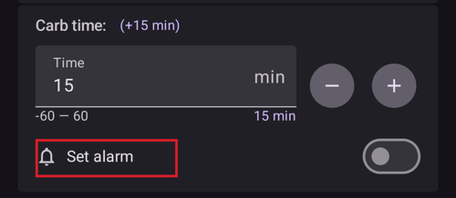

알림은 볼러스 주입이 끝났을 때 시작합니다. 알림이 진행되는 동안 메인 화면의 **식사할 시간** 바가 남은 시간을 세며, **정지**와 **+5분**이 함께 표시됩니다. **+5분**은 대기 종료 시간을 5분 뒤로 미루며, 바에는 전체 대기 시간이 표시됩니다. 시간이 되면 알림이 부드러운 주방 타이머 같은 전용 소리로 울립니다. 알람 화면에는 **알람 음소거**(화면은 열린 채로 있음)와 **음소거 후 닫기** 외에 **+5분**도 있으며, 이것은 새로 5분 대기를 시작합니다. 알림이 울린 후 바에는 *시간이 되었습니다*와 함께 **+5분**과 **닫기**가 표시됩니다. **음소거 후 닫기**를 누르면 바도 사라집니다. 바와 알람은 **AAPSClient**와 [시계](#WearOsSmartwatch-wizard-carb-time)에도 표시됩니다. 알림은 휴대폰 시계 앱에 타이머를 만들지 않습니다. Android가 **AAPS**의 알람 설정을 허용하지 않으면, 마법사가 Android 설정에서 **AAPS**에 대해 *알람 및 리마인더*를 허용하도록 요청합니다. 과거의 탄수화물 시간에는 종 아이콘이 제공되지 않습니다.


**혈당** 칸에는 보통 CGM의 최신 측정값이 이미 들어 있습니다. 작동하는 CGM이 없으면 이 칸은 비어 있습니다. 측정값이 최근 것이면 **혈당** 행은 접힌 상태로 있습니다. 마법사가 열려 있는 동안 이 칸은 새 측정값을 따라 바뀝니다. 직접 값을 바꾸면 더 이상 바뀌지 않습니다.

아래쪽의 결과 버튼에 제안된 볼러스가 표시됩니다. 이 버튼을 누르면 인슐린을 주입하기 전에 확인을 요청합니다. 확인을 기다리는 동안 루프는 SMB를 주지 않으므로, 확인하는 볼러스가 계속 올바른 값으로 유지됩니다. 그 순간 SMB가 주입되고 있다면, **OK**는 SMB 주입이 끝날 때까지 기다립니다.

알아 두면 좋은 점:

* 계산된 볼러스가 **[최대 볼러스](#Preferences-maximum-bolus)**보다 크면 최대 볼러스로 줄어들고, 확인 화면에 "볼러스 제한 적용됨" 경고가 표시됩니다. 반면 [빠른 마법사](../DailyLifeWithAaps/QuickWizards.md)는 거부됩니다.
* 볼러스를 기록만 하는 경우(예: 펌프가 연결 해제되어 있을 때)에는 "**볼러스는 기록만 됩니다(펌프로 주입하지 않음)**" 경고가 스크롤해도 대화 상자 위쪽에 계속 표시됩니다.
* 직접 주입하는 볼러스는 주입을 기다리는 [SMB](#Open-APS-features-super-micro-bolus-smb)보다 우선합니다. 그 SMB는 취소되고 루프가 다시 계산합니다. 지금 SMB가 주입되고 있다면 볼러스는 다음 메시지와 함께 거부됩니다: "지금 SMB를 주입하고 있습니다. 주입이 끝나면 다시 시도하십시오." 인슐린은 주입되지 않으며, 그 볼러스와 함께 입력한 탄수화물도 저장되지 않습니다. 잠시 기다린 후 다시 입력하십시오.

(AapsScreens-wrong-cob-detection)=

#### Wrong COB detection


볼러스 마법사를 사용한 후 위의 경고가 보이면, **AAPS**가 계산된 COB 값이 틀릴 수 있다고 감지한 것입니다. 따라서 COB가 남아 있는 이전 식사 후에 다시 볼러스를 주입하려면 과다 주입에 주의해야 합니다!

자세한 내용은 [COB 계산 페이지](#CobCalculation-detection-of-wrong-cob-values)의 힌트를 참조하십시오.

**AAPS** 3.x의 **동작** 탭을 찾고 있습니까? 그 기능은 메인 화면, **관리** 시트, QuickLaunch 툴바로 옮겨졌습니다. [동작 탭은 어디로 갔습니까?](#screens-action-tab)를 참조하십시오.

(aaps-screens-careportal)=

## 케어포털 항목

[상태 표시줄](#screens-sensor-level-battery)에 표시되는 사용 기간과 잔량(센서, 인슐린, 캐뉼라, 펌프 배터리)은 케어포털 항목을 바탕으로 합니다: **프라임/채우기**(펌프 위치 교체와 인슐린 카트리지 교체를 기록), **센서 삽입**, **펌프 배터리 교체**.

이 항목은 메인 화면의 펼친 상태 패널, **관리** 시트 또는 [QuickLaunch](../DailyLifeWithAaps/QuickLaunch.md) 버튼으로 기록할 수 있습니다.

**프라임/채우기**는 펌프 위치 교체와/또는 인슐린 카트리지 교체를 기록하며, 프라임 양을 주입할 수 있습니다:

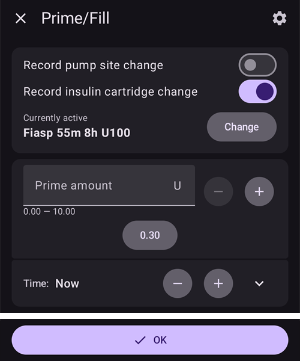

**센서 삽입**과 **펌프 배터리 교체**는 이벤트 시간만 묻습니다:


 운동, 공지, 질문, 노트 항목은 Nightscout 케어포털과 같으며, 노트의 특별한 형태입니다.

**관리** 시트에서 아래로 스크롤하고 **케어포털**을 누르면 다음 항목이 표시됩니다: **혈당 체크**, **노트**, **운동**, **질문**, **공지**.


**혈당 체크**, **질문**, **공지**에서는 혈당 값(측정기, 센서 또는 다른 출처), 노트, 이벤트 시간을 입력할 수 있습니다. **질문**과 **공지**에서는 혈당 행이 접혀 있고 값 옆에 측정 종류가 표시됩니다. 값을 바꾸면 종류가 **센서**에서 **측정기**로 바뀝니다.

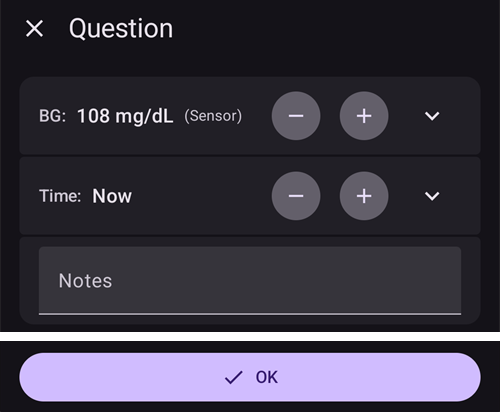

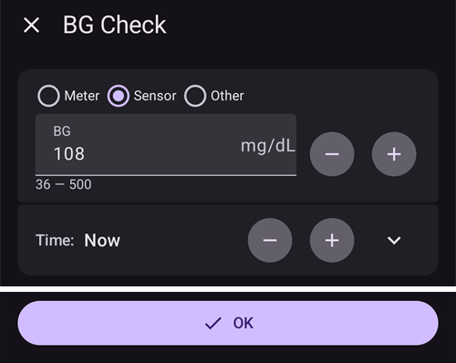

**노트**와 **운동**에서는 기간(접힌 행: **-** / **+**를 사용하거나 꺾쇠를 눌러 입력), 노트, 이벤트 시간을 입력할 수 있습니다:


이 모든 대화 상자(**프라임/채우기**, **센서 삽입**, **펌프 배터리 교체**, 케어포털 항목)에서 이벤트 시간은 [인슐린 대화 상자](#aaps-screens-buttons-insulin) 및 볼러스 마법사와 같은 **시간** 행을 사용합니다. **-** / **+**로 시간을 5분 단위로 옮기거나(최대 1주 전부터 12시간 후까지), 꺾쇠를 눌러 원하는 날짜와 시간을 고르십시오.

## 위치 순환

**관리 → 위치 순환**은 각 캐뉼라와 센서를 몸의 어느 위치에 붙였는지 신체 지도에 기록하므로, 위치를 돌아가며 바꿀 수 있습니다. 펌프와 캐뉼라 페이지의 [위치 순환](#Aapsscreens-site-rotation)을 참조하십시오.

**TDD**(총 일일 용량)와 기저/볼러스 비율에 대한 경험 규칙은 [통계의 인슐린 탭](#reviewing-tdd)에서 설명합니다.

(AapsScreens-insulin-profile)=

## 인슐린


**관리 → 인슐린 설정**에서 인슐린 구성을 보고 관리합니다. 각 구성은 **피크 시간**과 **[DIA](#Config-Builder-insulin-dia)**가 있는 카드로 표시되며, 사용 중인 구성에는 **활성**이 표시됩니다. 카드 아래에는 활동 곡선이 보입니다. 활성 구성을 제외한 모든 구성의 별명, 피크, DIA를 편집할 수 있습니다. 사용 중인 인슐린을 바꾸려면 [새 구성을 추가하고 활성화하십시오](#Config-Builder-insulin-change-active).

인슐린 작용 시간이 무엇이고 어떻게 설정하는지는 [인슐린 작용 시간](#Config-Builder-insulin-dia)을 참조하십시오.

## Pump Status

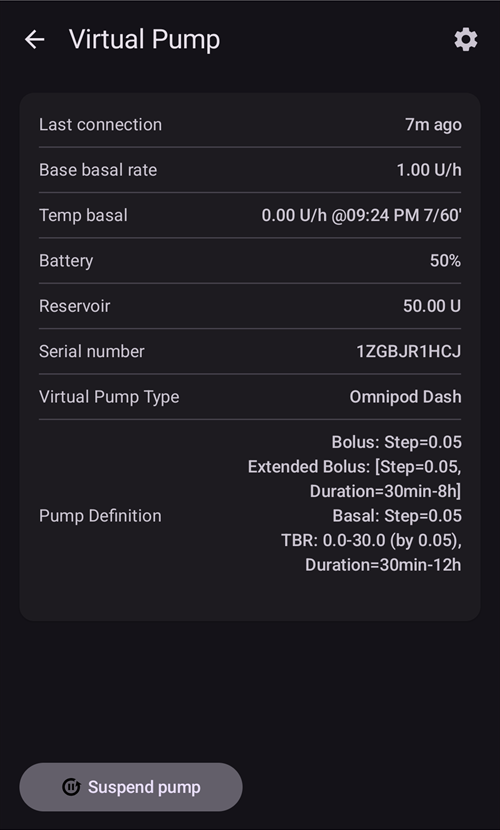

**관리 → 펌프**(또는 **구성 → 펌프 → 플러그인 열기**)는 펌프 상태를 보여 줍니다: 마지막 연결, 기본 기저 주입량, 배터리, 레저버...

* 표시되는 정보는 펌프 모델에 따라 다릅니다.
* 자세한 내용은 [펌프 페이지](../Getting-Started/CompatiblePumps.md)를 참조하십시오.

## 루프, AMA / SMB

**구성 → 루프 → 플러그인 열기**(및 **구성 → APS → 플러그인 열기**)는 알고리즘 계산과 **AAPS**가 왜 그렇게 동작하는지에 대한 자세한 정보를 보여 줍니다: 마지막 실행, 그 결과인 요청, 제한. **루프** 화면에는 실제로 주입된 임시 기저 주입량이나 SMB를 제한한 제한만 나열됩니다(폐쇄 루프가 허용되지 않는 경우 그 이유도 표시됩니다). **APS** 화면에는 계산에 들어간 모든 제한이 나열됩니다.

시스템이 CGM에서 새 측정값을 받을 때마다 계산이 실행됩니다.

자세한 내용은 [구성 페이지의 APS 섹션](#Config-Builder-aps)을 참조하십시오.

(aaps-screens-profile)=

## Profile


**관리 → 프로파일**(또는 메인 화면에서 프로파일 이름 누르기)은 프로파일 화면을 엽니다. 프로파일이 옆으로 넘길 수 있는 카드 캐러셀로 표시되며, 프로파일을 추가, 편집, 복사, 삭제, **활성화**하는 버튼이 있습니다.

프로파일에는 개인 당뇨병 설정 정보가 들어 있습니다. 자세한 내용은 **[프로파일](../SettingUpAaps/YourAapsProfile.md)** 페이지를 참조하십시오.

## Automation


**관리 → 자동화**에는 자동화 규칙이 나열됩니다. [여기](../DailyLifeWithAaps/Automations.md)의 전용 페이지를 참조하십시오.

## NSClient


**구성 → 통신 → NSClientV3 → 플러그인 열기**는 Nightscout 사이트와의 연결 상태를 보여 줍니다: URL, 웹소켓 상태, 대기열, 동기화 활동 로그.

설정은 [NSClient 설정](#Preferences-nsclient)에서 바꿀 수 있습니다.

문제 해결은 이 [페이지](../GettingHelp/TroubleshootingNsClient.md)를 참조하십시오.

(aaps-screens-bg-source)=

## 혈당 출처 - xDrip, BYODA...


**구성 → 혈당 출처 → 플러그인 열기**는 CGM 측정값 이력을 보여 주며, 오류(예: 압박으로 인한 저혈당 값)나 중복 측정값이 있으면 측정값을 삭제할 수 있습니다.

## 처치 이력

**메뉴**(☰)를 열고 **처치 이력**을 선택하면 **AAPS**가 기록한 모든 것을 보고, 확인하고, 고칠 수 있습니다: 탄수화물과 볼러스, 임시 기저, 임시 목표, 프로파일 전환, 케어포털 항목, 루프 모드 변경, 사용자 항목. 데이터 검토 페이지의 [처치 이력](#aaps-screens-treatments)을 참조하십시오.

## 이력 브라우저


**메뉴**(☰)를 열고 **이력 브라우저**를 선택하십시오.

**AAPS** 이력을 거슬러 올라가 볼 수 있습니다. 전용 페이지 [데이터 검토 > 이력 브라우저](../Maintenance/Reviewing.md)를 참조하십시오.

(aaps-screens-statistics)=

## Statistics


**메뉴**(☰)를 열고 **통계**를 선택하십시오.

네 개의 탭에서 총 일일 용량, 범위 내 시간, 하루 동안의 혈당 프로파일(AGP), 인슐린 주기 패턴에 대한 통계를 보여 줍니다. 전용 페이지 [데이터 검토 > 통계](#reviewing-statistics)를 참조하십시오.

(aaps-screens-profile-helper)=

## 프로파일 도우미

**메뉴**(☰)를 열고 **프로파일 도우미**를 선택하십시오.


프로파일 도우미로 프로파일을 비교하고 어린이용 시작 프로파일을 만들 수 있습니다. [AAPS 프로파일](../SettingUpAaps/YourAapsProfile.md)의 [어린이용 프로파일을 처음부터 만들기](#your-aaps-profile-profile-from-scratch-for-a-kid) 및 [두 프로파일 비교](#your-aaps-profile-compare-profiles) 섹션을 참조하십시오.

(aaps-screens-widgets)=

## 홈 화면 위젯

**AAPS**는 휴대폰 홈 화면에 추가할 수 있는 위젯 다섯 개를 제공하므로, 앱을 열지 않고도 데이터를 볼 수 있습니다. 전용 페이지 [홈 화면 위젯](../DailyLifeWithAaps/Widgets.md)을 참조하십시오.

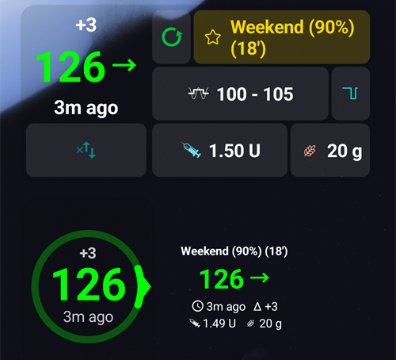