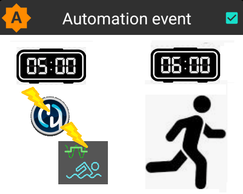
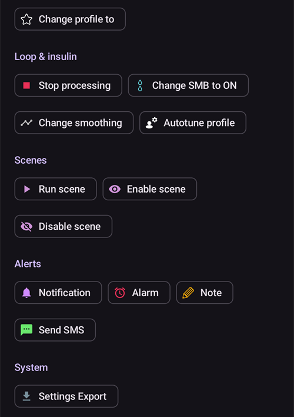
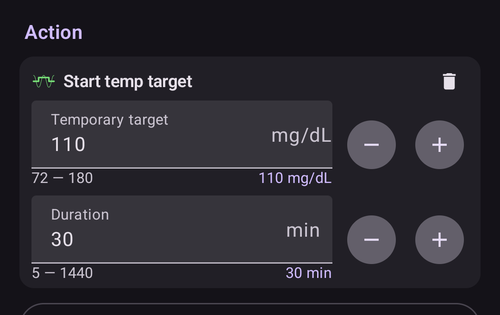

# Automation

```{contents} In this page
:backlinks: entry
:depth: 2
```

## 자동화란 무엇입니까?

"**자동화**"는 AAPS에서 작업을 자동화할 수 있는 기능입니다.

자동화는 하나 이상의 조건 또는 트리거에 따라 특정 동작을 실행합니다. 트리거에는 낮은 혈당이나 높은 혈당, 또는 정해진 양의 음수 활성 인슐린(IOB) 같은 불규칙한 이벤트가 포함될 수 있습니다. 자동화는 하루 중 정해진 시간의 식사나 운동처럼 반복되는 이벤트, 또는 사용자가 GPS 위치나 Wi-Fi SSID 영역에서 특정 거리 안에 있을 때도 처리할 수 있습니다. 자동화는 일정에 따라 또는 Pod를 교체할 때마다 AAPS 설정 백업을 실행할 수 있습니다.

자동화 규칙은 **자동화** 화면(**관리 → 자동화**)에서 만들고 수정합니다. 각 규칙은 두 가지 속성으로 정의됩니다:

- 동작을 시작하는 하나 이상의 조건 또는 '트리거'.

    특정 시간 일정, 이벤트 또는 AAPS의 속성 값을 생각해 보십시오

- 실행할 하나 이상의 동작.

    예: 알람, 프로파일 퍼센트 설정, Pod 교체 시 AAPS 설정 내보내기.


자동화 옵션은 매우 다양하므로, AAPS 앱의 자동화 섹션에서 직접 살펴보시기 바랍니다. [**Facebook**](https://www.facebook.com/groups/AndroidAPSUsers)과 [**Discord**](https://discord.gg/4fQUWHZ4Mw)의 AAPS 사용자 그룹에서 다른 사용자의 자동화 예를 검색할 수도 있습니다.

## 자동화가 도울 수 있는 일

1. **반복 작업 자동화:** 사용자의 조작 없이 미리 설정한 동작을 자동으로 실행합니다.

1. **결정 피로 줄이기:** **자동화**의 가장 큰 장점은 사용자가 **AAPS**에서 직접 개입해야 하는 부담을 덜어주는 것입니다. [연구](https://www.ncbi.nlm.nih.gov/pmc/articles/PMC6286423/#ref4)에 따르면 1형 당뇨병이 있는 사람은 하루 평균 180가지 결정을 추가로 내려야 합니다. **자동화**는 정신적 부담을 줄여, 사용자가 삶의 다른 부분에 정신적 에너지를 쓸 수 있게 해줍니다.

1. **혈당 조절 개선 가능성:** 예를 들어 **자동화**는 바쁘거나 깜빡 잊는 때에도 필요할 때 항상 **임시 목표**가 설정되도록 도와줄 수 있습니다. 예를 들어 당뇨병이 있는 아이가 학교에서 화요일 오전 10시와 목요일 오후 2시에 체육 수업이 있고, 운동 30분 전에 높은 임시 목표('TT')가 필요하다면, **자동화**로 **임시 목표**를 켤 수 있습니다.

1. **AAPS를 세밀하게 맞춤 설정:** 사용자의 선호에 따라 특정 상황에서 더 공격적으로 또는 덜 공격적으로 동작하게 할 수 있습니다. 예를 들어 한밤중에 음수 **IOB**가 생기면(현재 **프로파일**이 너무 강할 수 있다는 신호) 정해진 시간 동안 **프로파일** %를 일시적으로 낮추도록 실행할 수 있습니다.

아래 예는 **자동화**로 어떻게 단계를 줄일 수 있는지 보여줍니다.

사용자가 매일 아침 6시에 운동을 합니다: 운동 전 5시에 AAPS에서 "임시 목표-활동"을 직접 설정하는 것을 기억해야 합니다.


사용자는 6시 운동을 준비하며 **혈당**과 **IOB**가 최적이 되도록 5시에 ‘임시 목표-활동’을 실행하는 **자동화**를 설정했습니다:



## 자동화를 시작하기 전에 고려할 중요한 점

1. 일부 자동화를 설정하기 전에 **AAPS**로 **혈당**을 어느 정도 잘 조절할 수 있어야 합니다. 자동화를 최적이 아닌 기저, **ISF** 또는 **CR** 설정을 보상하는 데 사용하면 안 됩니다 (아래에서 더 설명합니다). (_예:_ 음식으로 인한) **혈당** 상승을 보상하려고 자동 **프로파일 전환**을 설정하지 마십시오. 이런 경우는 다른 방법(SMB 등)으로 다루는 것이 더 좋습니다.

1. 모든 기술과 마찬가지로 **CGM**, **펌프**, 휴대폰도 고장 날 수 있습니다: 기술적 문제나 센서 오류가 **자동화** 동작을 방해할 수 있으며, 직접 개입해야 할 수도 있습니다.

1. **일상이 바뀌면 자동화에 필요한 것도 바뀔 수 있습니다**. 직장/학교/휴가 기간이 바뀔 때는 현재 활성화된 **자동화**를 검토하도록 달력에 알림을 설정하십시오 (자동화는 쉽게 활성화하고 비활성화할 수 있습니다). 예를 들어 휴가를 가서 학교 체육이나 매일 운동을 위한 자동화가 더 이상 필요 없거나, 시간을 조정해야 하는 경우입니다.

1. **자동화**는 서로 충돌할 수 있습니다. 새 **자동화** 설정은 안전한 환경에서 신중하게 검토하고, **자동화**가 왜 예상대로 실행되었는지 또는 실행되지 않았는지 이해하는 것이 좋습니다.

1. Autosens를 사용한다면 **프로파일 전환** 대신 **임시 목표**를 사용하십시오. **임시 목표**는 Autosens를 0으로 초기화하지 않습니다. **프로파일 전환**은 Autosens를 초기화합니다.

1. 대부분의 **자동화**는 **제한된 기간** 동안만 설정해야 합니다. 그 후 필요하고 조건이 아직 맞으면 **AAPS**가 다시 평가하여 **자동화**를 반복할 수 있습니다. 예: "7.0 mmol/L 임시 목표를 30분 동안 시작" 또는 "**프로파일** 110%를 10분 동안 시작" _그리고_ "5.0 mmol/L 임시 목표를 10분 동안 시작". **자동화**로 영구적인 변경(예: 더 강한 프로파일 %)을 만들면 저혈당 위험이 있습니다.

## 자동화는 언제부터 사용할 수 있습니까?

**자동화**는 **목표 10**에서 시작할 수 있습니다.

## AAPS에서 자동화는 어디에 있습니까?

메인 화면 아래쪽 탐색 막대에서 **관리**를 열고 **자동화**를 선택하십시오.

## 자동화는 어떻게 설정합니까?

**자동화**를 설정하려면 자동화 화면에서 **+** 버튼을 눌러 ‘규칙’을 만드십시오:


* ‘규칙’에 제목(작업명)을 지정하십시오;
* **조건** 아래의 "**편집**"을 누르십시오. **조건** 화면에서 트리거를 결합하는 방법(**그리고**, **또는**, **배타적 또는**)을 선택하고 "**트리거 추가**"를 누르십시오:


* 트리거를 하나 이상 추가하십시오:


* **동작** 아래의 "**추가**"를 누르고 동작 하나를 선택하십시오:


* **저장** 버튼으로 규칙을 저장하고, **자동화**를 활성화하려면 규칙 이름 왼쪽의 체크박스가 ‘체크’되어 있는지 확인하십시오:


**자동화** 규칙을 비활성화하려면 **자동화** 이름 왼쪽의 체크박스를 해제하십시오. 아래 예는 활성화된(‘체크됨’) **자동화**와 비활성화된(‘체크 해제됨’) 자동화를 보여줍니다:


**자동화**를 설정할 때는 먼저 "동작"에서 ‘알림’ 옵션을 활성화하여 테스트할 수 있습니다. 이렇게 하면 **AAPS**는 실제로 동작을 자동 실행하지 않고 먼저 알림만 표시합니다. 알림이 올바른 시간/조건에서 실행된다고 확신하면, **자동화** 규칙에서 ‘알림’을 실제 ‘동작’으로 바꾸면 됩니다.


```{admonition} Important note
:class: note

**자동화**는 루프가 비활성화되어 있어도 계속 작동합니다!
```


## 규칙을 확인하는 시점

**AAPS**는 새 혈당 측정값이 처리될 때마다 모든 **자동화** 규칙을 확인합니다. 따라서 규칙은 CGM 주기에 맞춰 평가되며, 휴대폰 화면이 꺼져 있을 때도 마찬가지입니다. 규칙은 휴대폰 충전이 시작될 때, 네트워크나 위치가 바뀔 때, 블루투스 장치가 연결될 때도 확인합니다. 확인은 한 번에 하나만 실행되므로, 동작에 시간이 걸리는 규칙(예: 펌프 명령)이 두 번 실행될 수는 없습니다.

## 안전 제한

**자동화**에는 다음과 같은 안전 제한이 있습니다:

* **자동화**로 설정하는 **임시 목표**는 72에서 180 mg/dL (또는 4에서 10 mmol/L) 사이여야 합니다.
* **프로파일 퍼센트**는 50%에서 130% 사이여야 합니다.
* **자동화** 실행 사이(그리고 첫 실행)에는 5분의 시간 제한이 있습니다.

## 음수 값의 올바른 사용

```{admonition} Warning
:class: warning

**자동화**에서 음수 값을 선택할 때는 주의하십시오
```

**자동화**의 ‘조건’에서 "보다 작은"처럼 ‘음수 값’을 선택할 때는 주의해야 합니다. 예를 들어:


**예 1:** **"보다 작은"** "-0.1mmol/L" (또는 "-2mg/dL") 조건을 만들면:

**-0.1 (-2)보다 확실히 작은** 모든 숫자에서 **자동화**를 실행합니다. 여기에는 -0.2, -0.3, -0.4 (-4, -6, -8) 같은 숫자가 포함됩니다. -0.1 (-2) 자체는 이 조건에 **포함되지 않는다는** 것을 기억하십시오. ("-0.1mmol/L (-2 mg/dL)과 같거나 작은" 조건이라면 -0.1 mmol/L 또는 -2 mg/dL도 _포함됩니다_).

**예 2:** "보다 큰" -0.1mmol/L (-2mg/dL) 조건을 만들면:

-0.1mmol/L (-2mg/dL)**보다 큰** 모든 숫자에서 **자동화**를 실행합니다. 여기에는 0, 0.2, 0.4mmol/L (0, 4, 8mg/dL) 같은 숫자와 다른 모든 양수가 포함됩니다.

이런 조건과 값을 고를 때는 **자동화**의 정확한 의도를 신중하게 생각하는 것이 중요합니다.

(automations-automation-triggers)=
## 자동화 트리거


아래로 스크롤하면 목록의 나머지가 표시됩니다:


사용자가 선택할 수 있는 ‘트리거’는 여러 가지가 있습니다. 트리거는 자동화가 실행되기 위해 맞아야 하는 조건입니다. 아래 목록이 전부는 아닙니다:

**트리거:** 조건 연결

**옵션:**

여러 조건을 다음으로 연결할 수 있습니다
* “그리고”
* “또는”
* “배타적 또는” (조건 중 하나만, 오직 하나만 맞을 때 동작이 실행된다는 뜻입니다)

**트리거:** 시간과 반복 시간

**옵션:**

* 시간 = 한 번만 일어나는 시간 이벤트
* 반복 시간 = 정기적으로 일어나는 일 (예: 일주일에 한 번, 평일마다 등)

**트리거:** 위치

**옵션:**

* [설정 > 자동화](#preferences-maintenance-settings)에서 사용할 위치 서비스를 선택할 수 있습니다.

**트리거:** 위치 서비스

**옵션:**

* 패시브 위치 사용: **AAPS**는 다른 앱이 위치를 요청할 때만 위치를 가져옵니다.
* 네트워크 위치 사용: Wi-Fi의 위치.
* GPS 위치 사용 (주의! 배터리가 매우 빨리 소모될 수 있습니다!)

**트리거** : 펌프 및 센서 데이터

* 캐뉼라 사용 기간 트리거: 모든 펌프에서 사용 가능
* 인슐린 사용 기간 트리거: 지원되는 펌프에서 사용 가능
* 배터리 사용 기간 트리거: 지원되는 펌프에서 사용 가능
* 센서 사용 기간 트리거: 항상 사용 가능
* Pod 활성화 트리거: 패치 펌프에서 사용 가능

사용 기간 관련 트리거는 모두 "같은" 비교로는 거의 실행되지 않습니다. 이 경우 범위를 만들려면 트리거 두 개가 필요합니다

* 레저버 잔량 트리거: 모든 펌프에서 사용 가능. **AAPS**에서는 이 값이 항상 채워져 있으므로 "NOT\_AVAILABLE" 비교는 이 트리거에서 작동하지 않습니다
* 펌프 배터리 레벨 트리거: 지원되는 펌프에서 사용 가능. **AAPS**에서는 이 값이 항상 채워져 있으므로 "NOT\_AVAILABLE" 비교는 이 트리거에서 작동하지 않습니다

(automations-automation-action)=
## 동작


아래로 스크롤하면 목록의 나머지가 표시됩니다:



**동작:** **임시 목표** 시작

**옵션:**

* **혈당**은 72 mg/dL에서 180 mg/dL (4 mmol/L에서 10 mmol/L) 사이여야 합니다
* **TT**는 이전 임시 목표가 없을 때만 작동합니다. **AAPS**는 이를 자동으로 규칙에 "**전제 조건: 임시 목표가 없습니다**" 줄로 추가합니다

**동작:** **임시 목표** 중지

**옵션:**

none

**동작:** **프로파일 퍼센트**

**옵션:**

* **프로파일**은 50%에서 130% 사이여야 합니다
* 이전 퍼센트가 100%일 때만 작동합니다

**동작:** **평활화 변경** (**루프 & 인슐린** 그룹)

**옵션:**

* 바꿀 [평활화 방법](../CompatibleCgms/SmoothingBloodGlucoseData.md)을 선택하십시오. 목록은 **구성** > **평활화**의 목록과 같으며, 이 동작은 그곳에서 바꿀 때와 똑같이 작동합니다: 새 방법이 저장되고, 페어링된 클라이언트와 동기화되며, 혈당 데이터가 바로 다시 평활화됩니다.
* 그 평활화 방법이 아직 활성 상태가 아닐 때만 실행됩니다. **AAPS**는 이를 자동으로 규칙에 "**전제 조건: 평활화 … 비활성 상태**" 줄로 추가합니다. 선택한 평활화가 이미 활성 상태이면 규칙은 아무 표시 없이 건너뜁니다.
* 예: 새 센서는 첫날에 노이즈가 많은 경우가 흔합니다. **센서 사용 기간** 트리거를 사용하는 두 규칙으로, 센서가 안정되는 동안에는 더 강한 필터링을 하고 그 후에는 지연 없는 평활화를 사용합니다:
  * **센서 사용 기간** 24시간 미만: **평활화 변경**을 **Unscented Kalman Filter**로
  * **센서 사용 기간** 24시간 초과: **평활화 변경**을 **평균 평활화**로

**동작:** **노트** (목록의 **경고** 그룹)

**옵션:**

* 기록할 이벤트를 선택하십시오: **노트**, **운동**, **질문**, **공지** 또는 **펌프 위치 변경**. 노트는 선택 사항입니다. 동작의 이름이 선택한 이벤트로 바뀝니다.
* **기간**: **노트**, **운동**, **펌프 위치 변경**에 사용됩니다. **질문**과 **공지**에는 기간이 없습니다: 대신 현재 혈당을 기록합니다.
* **펌프 위치 변경**은 위치 변경을 직접 기록한 것처럼 캐뉼라 사용 기간을 초기화합니다. 예: 일부 펌프(Combo 등)는 레저버 교체는 스스로 기록하지만 위치 변경은 기록하지 않습니다. 항상 둘을 함께 바꾼다면, **인슐린 사용 기간**이 1시간 미만이고 **캐뉼라 사용 기간**이 24시간 초과인 규칙으로 위치 변경을 대신 기록할 수 있습니다.

 

**동작:** **모든 번호에 SMS 전송** (**경고** 그룹)

**옵션:**

* 메시지 내용을 입력하십시오. [SMS 통신기](../RemoteFeatures/SMSCommands.md) 설정에서 허용된 모든 전화번호로 보냅니다. SMS 통신기 플러그인이 활성화되어 있어야 합니다.

**동작:** **다음 프로파일로 전환** (**프로파일** 그룹)

**옵션:**

* 활성화할 **프로파일**을 선택하십시오. 시간 이동 없이 100%로 활성화됩니다. 이 프로파일이 이미 활성 상태이면 동작은 아무것도 하지 않습니다.

**동작:** **SMB 활성화/비활성화** (**루프 & 인슐린** 그룹)

**옵션:**

* **켬** 또는 **끔**을 선택하십시오. 이 동작은 OpenAPS SMB의 **SMB 활성화** 설정을 **설정**에서 직접 바꾼 것과 똑같이 변경하며, 사용자나 다른 규칙이 다시 바꿀 때까지 유지됩니다.

**동작:** **Autotune 실행하기** (**루프 & 인슐린** 그룹)

**옵션:**

* 조정할 프로파일과 일수를 선택하십시오: [자동화 규칙으로 Autotune 실행하기](#autotune-run-autotune-with-an-automation-rule)를 참조하십시오.

**동작:** **처리 중단하기** (**루프 & 인슐린** 그룹)

**옵션:**

* 없음. 이 동작이 있는 규칙의 조건이 참인 동안, **AAPS**는 목록에서 그 아래에 있는 규칙을 확인하지 않습니다. 조건이 다시 거짓이 되면, 아래 규칙들은 평소처럼 확인됩니다. 아래쪽 규칙보다 우선해야 하는 규칙에 추가하십시오 ([자동화의 순서](#Automations-the-order-of-the-automations-in-the-list-matters) 참조).

**동작:** **장면 실행**, **장면 활성화**, **장면 비활성화** (**장면** 그룹)

**옵션:**

* 실행, 활성화 또는 비활성화할 [장면](Scenes.md)을 선택하십시오.

‘동작’을 추가한 후에는 기본값을 눌러 원하는 숫자로 바꿔야 합니다.



(Automations-the-order-of-the-automations-in-the-list-matters)=
## 목록에서 **자동화**의 순서가 중요합니다
 **AAPS**는 만든 규칙을 **자동화** 목록의 맨 위부터 우선순위 순서대로 실행합니다. 예를 들어 ‘저혈당’ **자동화**가 다른 모든 규칙보다 가장 중요한 **자동화**라면, 아래처럼 이 **자동화**가 사용자의 **자동화** 목록 맨 위에 있어야 합니다:


**자동화** 규칙의 우선순위를 바꾸려면, 규칙 오른쪽의 **=** 핸들을 길게 누른 채 움직이십시오. 규칙을 위아래로 옮겨 **자동화**의 순서를 바꾸십시오.


## 자동화 규칙을 삭제하는 방법

**자동화** 규칙을 삭제하려면 휴지통 아이콘을 누르십시오.


## 자동화의 예

아래는 **자동화**의 예입니다. **자동화**에 대한 더 많은 논의와 사용자들이 **자동화**를 어떻게 자신에게 맞추었는지는 Facebook 토론 그룹이나 Discord에서 볼 수 있습니다. **자동화**가 어떻게 작동하는지 잘 이해하지 못한 상태에서 아래 예를 그대로 따라 하면 안 됩니다.

(automations-low-glucose-temp-target)=
### 저혈당 임시 목표

이 **자동화**는 **혈당**이 특정 기준값 아래로 떨어지면 자동으로 **임시 목표**를 실행합니다. 여기서는 혈당이 70 mg/dL보다 낮으면 110 mg/dL 목표를 30분 동안 시작합니다:


### 점심 시간 임시 목표 (‘위치’ 사용)


이 **자동화**는 평일마다 거의 같은 시간에 직장에서 점심을 먹는 사용자를 위해 만든 것이며, 사용자가 설정한 ‘위치’ 안에 있을 때만 실행됩니다.  따라서 어느 날 사용자가 직장에 없으면 이 **자동화**는 실행되지 않습니다.

이 **자동화**는 점심 식사를 준비하기 위해 13:00에 낮은 **임시 목표**(식사직전)를 설정하여 혈당을 90 mg/dL (또는 5 mmol/L)로 이끕니다.

‘트리거’ 위치에는 이름, 위치(**지도에서 선택**을 누르거나 현재 위치 사용), 미터 단위의 반경이 있으며, 사용자가 그 지역 안에(또는 밖에) 있을 때 실행됩니다:


‘그리고’ 연결 때문에 이 **자동화**는 ‘선택한 시간’ 동안, 그리고 사용자가 선택한 위치에 있을 때만 실행됩니다.

이 **자동화**는 이 위치에서 다른 시간에는 실행되지 않고, 이 시간에도 선택한 위치 주변 50미터 반경 밖에서는 실행되지 않습니다.

### Wi-Fi SSID 위치 자동화

특정 Wi-Fi 네트워크 범위 안에 있을 때 **자동화**를 실행하려면 (GPS와 비교하여) Wi-Fi SSID를 사용하는 것이 좋은 방법입니다: 꽤 정확하고, 배터리를 덜 쓰며, GPS나 다른 위치 서비스를 쓸 수 없는 실내에서도 작동합니다.

다음은 평일 아침 식사 전에만 **임시 목표**를 설정하는 또 다른 예입니다 (1).


이 **자동화**는 월요일-금요일에만 오전 5:30에 (2)  
그리고 집 Wi-Fi 네트워크에 연결되어 있을 때 실행됩니다 (3).


그런 다음 75 mg/dL **임시 목표**를 30분 동안 설정합니다(4). 위치를 포함하는 장점 중 하나는, 예를 들어 사용자가 휴가로 여행 중일 때는 실행되지 않는다는 것입니다.


아래로 스크롤하면 동작을 볼 수 있습니다: 75 mg/dL **임시 목표**를 30분 동안(4).


다음은 **자동화** 트리거를 자세히 보여주는 스크린샷입니다:

1) 주 “그리고” 아래 (실행하려면 두 조건이 모두 맞아야 합니다) 1) 반복 시간 = 월,화,수,목,금 오전 5:30  
1) Wi-Fi SSID = My_Home_WiFi_Name


(automating-preference-settings-export)=

## 설정 내보내기 자동화

### 자동 내보내기: 일정에 따라 (매일)

자동화 트리거를 자세히 보여주는 스크린샷:

1) 조건: 반복 시간 = 월,화,수,목,금 오전 8:00 1) 동작: 설정 내보내기 ("처치에 기록할 텍스트"에 "Daily" 입력)


참고: 내보내기 실행은 케어포털에 기록됩니다

### 자동 내보내기: Pod 활성화 (패치 펌프만)

자동화 트리거를 자세히 보여주는 스크린샷:

1) 조건: Pod 활성화 1) 동작: 설정 내보내기 ("처치에 기록할 텍스트"에 "Pod Activation: settings export" 입력)


참고: 내보내기 실행은 케어포털에 기록됩니다. 참고: 이전에 설정을 직접 내보낸 적이 없으면 자동화는 **전혀** 실행되지 않습니다. 자동 설정 내보내기를 올바르게 활성화하는 방법은 [설정 → 정비](#preferences-maintenance-settings)를 참조하십시오.


## 자동화 로그

**AAPS**는 **자동화** 화면 아래쪽, 규칙 아래에 최근 **자동화** 이벤트 로그를 표시합니다. 이 로그로 규칙이 예상한 때에 실행되었는지 확인하십시오.

아래 예에서는 **저혈당 임시 목표** 규칙(1)(위의 [저혈당 임시 목표](#automations-low-glucose-temp-target) 참조)이 활성화되어 있습니다. 로그(2)를 보면 오후 03:09에 혈당이 70 mg/dL 아래로 떨어져 규칙이 실행되었습니다:
* 동작은 "임시 목표 시작: 110mg/dL@30 min"이었습니다: 110 mg/dL **임시 목표**를 30분 동안;
* 끝에 있는 **OK**는 동작이 성공적으로 실행되었다는 뜻입니다.


(automations-troubleshooting)=

## Troubleshooting

* 문제: __AAPS가 내 자동화를 실행하지 않습니까?__

규칙이 활성화되도록 **자동화** 이름 왼쪽의 체크박스가 ‘체크’되어 있는지 확인하십시오:


* 문제: __내 자동화가 잘못된 순서로 실행됩니다.__

위에서 설명한 규칙의 우선순위 순서를 확인하십시오.

* 문제: __조건에 "알 수 없는 트리거 … - 항상 거짓"이 표시됩니다.__

규칙에 이 버전의 **AAPS**가 읽을 수 없는 트리거가 있습니다. 예를 들어 이전 버전으로 되돌아갔거나 더 새로운 버전의 설정을 가져온 경우입니다. 이런 트리거는 절대 참이 되지 않으므로 규칙이 실행되지 않습니다. 이 트리거는 그대로 보존되므로 더 새로운 버전에서는 계속 사용할 수 있습니다. 규칙을 편집하여 트리거를 바꾸거나 **AAPS**를 업데이트하십시오.

## 자동화의 대안

고급 사용자는 IFTTT나 Automate라는 타사 Android 앱을 사용하여 작업을 자동화하는 다른 방법도 사용할 수 있습니다. 
