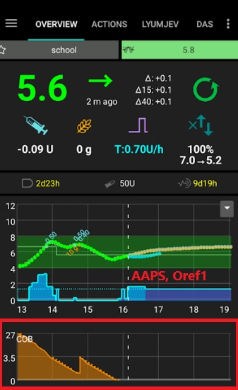
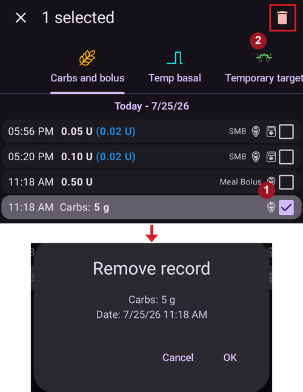

# COB calculation

## AAPS는 COB 값을 어떻게 계산합니까?

사용자가 식사 입력이나 탄수화물 수정의 일부로 탄수화물을 입력하면, **AAPS**는 이 양을 현재 활성 탄수화물(**COB**)에 더합니다. 그런 다음 **AAPS**는 사용자의 **혈당** 값에서 관찰된 편차를 바탕으로 탄수화물 흡수를 계산합니다. 흡수 속도는 탄수화물 민감도 계수(**CSF**)에 따라 달라집니다. 이것은 사용자의 **프로파일**에 있는 항목이 아니라, **AAPS**가 **ISF/I:C** 설정에 따라 계산하는 값입니다. 탄수화물 1 g이 사용자의 **혈당**을 몇 mg/dL 올리는지로 정해집니다.

## 탄수화물 민감도 계수

**AAPS**가 사용하는 공식은 다음과 같습니다:

- absorbed_carbs = deviation * ic / isf.

사용자의 **프로파일**에 대한 영향은 다음과 같습니다:

- **IC**를 _높이면_ 5분마다 흡수되는 탄수화물이 늘어나므로 전체 흡수 시간이 짧아집니다.

- **ISF**를 _높이면_ 5분마다 흡수되는 탄수화물이 줄어들므로 전체 흡수 시간이 길어집니다.

- **프로파일 퍼센트**를 _변경하면_ 두 값이 모두 높아지거나 낮아지므로 탄수화물 흡수 시간에는 영향이 없습니다.

예를 들어 사용자의 **프로파일**에서 **ISF**가 100이고 **I:C**가 5이면, 사용자의 탄수화물 민감도 계수는 20입니다. 사용자의 **혈당**이 20 mg/dL 오를 때마다, **AAPS**는 탄수화물 1 g이 흡수된 것으로 계산합니다. 양수인 **IOB**도 **COB** 계산에 영향을 줍니다. 따라서 **AAPS**가 **IOB** 때문에 사용자의 **혈당**이 20 mg/dL 내려갈 것으로 예측했는데 실제로는 그대로 유지되었다면, **AAPS**는 탄수화물 1 g이 흡수된 것으로 계산합니다.

탄수화물은 사용자의 **AAPS**에서 선택한 민감도 알고리즘에 따라 아래에 설명한 방법으로도 흡수됩니다.

## 탄수화물 민감도 - Oref1

흡수되지 않은 탄수화물은 지정된 시간이 지나면 잘라냅니다:




```{admonition} Older screenshot
:class: note
위의 스크린샷은 이전 **AAPS** 버전의 것입니다. **AAPS** 4에서는 그래프가 조금 다르게 보이지만, **COB** 그래프는 같은 정보를 보여줍니다.
```


## 탄수화물 민감도 - WeightedAverage

지정된 시간이 지나면 COB = 0이 되도록 흡수를 계산합니다:


**혈당** 편차에서 계산한 값 대신 최소 탄수화물 흡수(min_5m_carbimpact)를 사용하면, **COB** 그래프에 주황색 점이 나타납니다.

(CobCalculation-detection-of-wrong-cob-values)=
## 잘못된 COB 값 감지

알고리즘이 현재 **COB** 계산이 잘못되었다고 감지하면, 사용자가 이전 식사의 **COB**가 있는 상태로 볼러스를 하려고 할 때 **AAPS**가 경고합니다. 이 경우 볼러스 마법사를 사용한 후 확인 화면에 추가 안내를 표시합니다.

### AAPS는 잘못된 COB 값을 어떻게 감지합니까?

보통 __AAPS__는 **혈당** 편차를 통해 탄수화물 흡수를 감지합니다. 사용자가 탄수화물을 입력했지만 **AAPS**가 **혈당** 편차로 예상 흡수를 감지할 수 없으면, 대신 [min_5m_carbimpact](#Preferences-min_5m_carbimpact) 방법으로 흡수를 계산합니다 (이른바 ‘대체 방법(fallback)’). 이 방법은 **혈당** 편차를 고려하지 않고 최소 탄수화물 흡수만 계산하므로, 잘못된 COB 값이 나올 수 있습니다.


위의 스크린샷에서는 시간의 66% 동안 탄수화물 흡수를 편차에서 감지한 값 대신 min_5m_carbimpact로 계산했습니다. 이것은 사용자의 실제 **COB**가 알고리즘이 계산한 것보다 적었을 수 있다는 뜻입니다.

### 이 경고에 어떻게 대처해야 합니까?

- 처치를 취소하는 것을 고려하십시오. 확인 대신 ‘취소’를 누르십시오.
- **COB**를 체크하지 않은 상태로 볼러스 마법사에서 다가오는 식사를 다시 계산하십시오.
- 교정 볼러스가 필요하면 직접 입력하십시오.
- 과다 주입이나 인슐린 중첩(stacking)이 생기지 않도록 주의하십시오!


### 알고리즘이 COB를 올바르게 감지하지 못하는 이유는 무엇입니까?

이유는 다음과 같을 수 있습니다:
- 사용자가 탄수화물을 입력할 때 양을 너무 많게 추정했을 수 있습니다.
- 이전 식사 후의 활동 / 운동.
- I:C 조정이 필요합니다.
- min_5m_carbimpact 값이 잘못되었습니다 (SMB 사용 시 8, AMA 사용 시 3 권장).


## 입력한 탄수화물의 수동 수정

탄수화물을 너무 많게 또는 너무 적게 추정했다면 [여기](#screens-bolus-carbs)에 설명한 대로 **처치 이력** 화면에서 수정할 수 있습니다.


## 탄수화물 수정 - 처치에서 탄수화물 항목을 삭제하는 방법


**처치 이력** 화면에서 잘못된 탄수화물 항목을 삭제하여 수정할 수 있습니다. 사용자가 탄수화물 입력량을 너무 많게 또는 너무 적게 추정했기 때문일 수 있습니다:



1. **AAPS** 메인 화면에서 현재 **COB**와 **IOB**를 확인하고 기억해 두십시오.
2. **처치 이력**(측면 메뉴 → *처치 이력*)을 열고 **탄수화물과 볼러스** 탭을 선택하십시오. 펌프에 따라 탄수화물이 인슐린과 함께 한 줄에 표시되거나 별도 항목으로 표시될 수 있습니다 (예: Dana RS).
3. 잘못된 탄수화물 항목을 **길게 누르십시오**. 목록이 모든 줄에 체크박스가 있는 **선택 모드**로 바뀌고, 그 항목이 체크됩니다 (위의 **1** 표시). 함께 삭제할 다른 항목도 체크하십시오.
4. 위쪽 막대의 **🗑 삭제** 아이콘(**2** 표시)을 누르고 확인하십시오. 확인 대화 상자에 삭제될 항목이 정확히 표시됩니다.
5. **AAPS** 메인 화면에서 **COB**를 다시 확인하여 탄수화물이 제대로 삭제되었는지 확인하십시오.
6. 탄수화물과 인슐린이 한 줄에 함께 있었다면 **IOB**도 같은 방법으로 확인하십시오.
7. 이 섹션의 설명대로 탄수화물을 의도대로 삭제하지 않고 탄수화물을 추가로 입력하면, **COB** 항목이 너무 높아지고 그 결과 **AAPS**가 인슐린을 너무 많이 주입할 수 있습니다.
8. **탄수화물** 대화 상자(**처치** → **탄수화물**)에서 올바른 탄수화물 양을 입력하고 올바른 이벤트 시간을 설정하십시오.
9. 탄수화물과 인슐린이 한 줄에 함께 있었다면 인슐린 양도 다시 입력해야 합니다. 올바른 이벤트 시간을 설정하고, 새 항목을 확인한 후 메인 화면에서 **IOB**를 확인하십시오.

