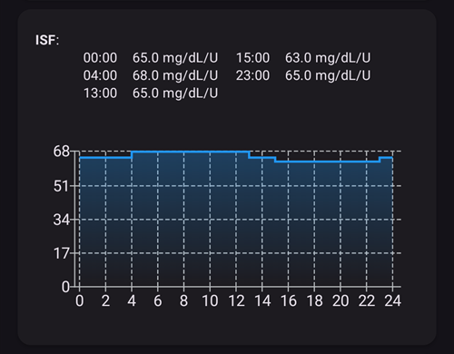

(Open-APS-features-DynamicISF)=
# 동적 ISF (DynISF)

지금까지 **AMA**와 **SMB**에서는 **ISF**를 **프로파일**에서 정의했고, 하루 중 정해진 각 구간 동안 고정된 값이었습니다. 하지만 실제로 사람의 **ISF**는 그렇게 고정되어 있지 않고 **혈당** 수준에 따라 달라집니다: 혈당이 높을 때는 낮은 **혈당**일 때보다 **혈당**을 50 mg/dL / 3 mmol/L 내리는 데 더 많은 인슐린이 필요합니다. [Autosens](#Open-APS-features-autosens)는 식사 시간 이외에 **ISF**를 조정하여 이 문제를 해결하려고 한 첫 번째 알고리즘이었습니다.

**동적 ISF**(**DynISF**라고도 합니다)는 같은 목적을 갖지만, 언제나 사용할 수 있으므로 더 발전된 방법입니다. **AAPS**의 제어와 모니터링을 잘 다룰 수 있는 고급 사용자에게만 권장합니다. 사용해 보기 전에 아래의 [동적 ISF를 활성화할 때 고려할 점](#dyn-isf-things-to-consider-when-activating-dynamicisf)을 읽으십시오.

```{admonition} CAUTION - Automations or Profile Percentage change
:class: warning

**자동화**는 항상 주의해서 사용해야 합니다. **동적 ISF**에서는 특히 그렇습니다.

**동적 ISF**를 사용할 때는 **자동화** 규칙으로 임시 **프로파일**을 변경하는 것을 모두 끄십시오. 그렇지 않으면 **동적 ISF**가 교정 볼러스를 지나치게 공격적으로 주입하여 저혈당이 생길 수 있습니다. 이것이 바로 **동적 ISF**의 목적이므로, 높은 **혈당**일 때 자동화로 **AAPS**에 인슐린을 추가로 주입하라고 지시할 필요가 없습니다.

```

**동적 ISF**를 사용하려면 **AAPS** 데이터베이스에 사용자의 **AAPS** 데이터가 최소 7일 분량 있어야 합니다.

## 동적 ISF는 무엇을 합니까?

**동적 ISF**는 인슐린 민감도 계수(**ISF**)를 사용자의 다음 값에 따라 동적으로 조정합니다:

- 인슐린 총 일일 용량(**TDD**);
- 현재 및 예측 혈당 값.

**동적 ISF**를 사용하면 **프로파일**에 입력한 **ISF** 값은 더 이상 전혀 사용되지 않습니다. 단, **AAPS** 데이터베이스에 TDD 데이터가 충분하지 않을 때(*예:* 앱을 새로 다시 설치한 경우)에는 대체 값으로 사용됩니다.

**SMB/AMA** - 사용자가 설정하고 **SMB**와 **AMA**가 사용하는 고정 **ISF**가 있는 사용자 **프로파일**의 예.



**동적 ISF** - **동적 ISF**가 정하는 대로 바뀌는 사용자 **ISF**의 예.


빨간색 원으로 표시한 부분은 `profile ISF` -> `ISF as calculated by DynISF`를 보여줍니다. <br/> 이 부분을 누르면 계산기와 탄수화물 흡수에 사용되는 **ISF** 등 추가 정보가 있는 대화 상자가 표시됩니다 (아래의 [ISF의 다른 용도](#dynisf-other-usages-of-isf) 참조).

**DynISF** 값은 그래프로도 볼 수 있습니다: 메인 화면의 그래프 아래에 있는 **그래프 추가**를 누르고 **VSENS**(가변 민감도)를 선택하십시오. 흰색 선으로 표시됩니다 (위 이미지의 아래쪽).

## 동적 ISF는 어떻게 계산됩니까?

**동적 ISF**는 **프로파일**에 설정한 사용자의 고정 **ISF** 값 대신 Chris Wilson의 모델을 사용하여 **ISF**를 정합니다. 자세한 설명은 여기에서 볼 수 있습니다: [Chris Wilson on Insulin Sensitivity (Correction Factor) with Loop and Learn, 2/6/2022](https://www.youtube.com/watch?v=oL49FhOts3c).

구현된 **동적 ISF** 공식은 다음과 같습니다: `ISF = 1800 / ((TDD * DynISF Adjust Factor) * Ln (( current BG / insulin divisor) + 1 ))`

이 공식에 사용되는 변수는 아래에서 자세히 설명합니다.<br/> 참고: `Ln`은 수학 함수인 자연로그를 뜻합니다.

구현에서는 위의 공식을 사용하여 현재 **ISF**를 계산하고, oref1의 [**IOB**, **ZT**(0 임시 기저), **UAM** 예측](#aaps-screens-prediction-lines)에도 사용합니다. **COB**와 볼러스 마법사에서도 사용됩니다 (아래의 [ISF의 다른 용도](#dynisf-other-usages-of-isf) 참조).

### TDD (총 일일 용량)
TDD는 다음 값들을 조합하여 사용합니다:
1.  7일 평균 **TDD**;
2.  전날의 **TDD**;
3.  최근 8시간 동안의 인슐린 사용량을 가중 평균하여 24시간으로 늘린 값.

위 공식에 사용되는 **TDD**는 위의 각 값에 3분의 1씩 가중치를 둔 값입니다.

### 동적 ISF 조정 계수

이 값은 사용자의 **설정**에서 정하며, **동적 ISF**를 더 공격적으로 또는 덜 공격적으로 만드는 데 사용됩니다. 아래의 [설정](#dyn-isf-preferences) 섹션을 참조하십시오.

### 인슐린 제수
인슐린 제수(insulin divisor)는 사용하는 인슐린의 피크에 따라 달라지며, 피크 시간에 반비례합니다. Lyumjev는 이 값이 75, Fiasp는 65, 일반 초속효성 인슐린은 55입니다.

### 주입 결정에는 예측 혈당을 바탕으로 한 ISF 사용

동적 민감도는 **현재 혈당** 값으로 계산되며, **AAPS**에 현재 ISF로 표시됩니다. 하지만 주입량을 계산할 때 oref1 알고리즘은 대신 **미래 ISF**를 계산하여 사용합니다.

이렇게 하는 이유는 **혈당**이 낮거나 낮아질 것으로 예측될 때 인슐린을 너무 많이 주입하지 않기 위해서입니다.

**미래 ISF**는 위에서 설명한 것과 같은 공식을 사용합니다. 다만 **현재 혈당** 대신 **최소 예측 혈당**을 사용할 수 있습니다. [oref1에서 계산하는](#aaps-screens-how-predictions-become-a-dosing-decision) **최소 예측 혈당**은 전체 예측 기간 동안 혈당이 내려갈 것으로 예측되는 가장 낮은 값입니다.

* 현재 **혈당**이 목표보다 높고<br/> **그리고** **혈당** 수준이 +/- 3 mg/dL 이내로 평탄하면:<br/>공식에 다음 혈당을 사용합니다: `average(minimum predicted BG, current BG)`.
* 최종 **혈당**이 목표보다 높고 혈당이 오르고 있거나,<br/> **또는** 최종 **혈당**이 현재 **혈당**보다 높으면:<br/>공식에 다음 혈당을 사용합니다: `current BG`.
* 그 밖의 경우:<br/>공식에 다음 혈당을 사용합니다: `minimum predicted BG`.

간단한 설명은 위의 상황을 보여주는 아래 스크린샷을 참조하십시오. 주황색 점은 **예측 혈당**을, 보라색 점은 **average(예측 혈당, 현재 혈당)**을, 파란색 점은 **현재 혈당**을 사용합니다.


(dynisf-other-usages-of-isf)=
## ISF의 다른 용도

### ISF와 COB 흡수

[COB 계산](../DailyLifeWithAaps/CobCalculation.md) 페이지에서 설명한 대로, 보통 COB 흡수는 다음 공식으로 계산합니다:   
`absorbed_carbs = deviation * ic / isf`  
**동적 ISF**를 사용할 때 여기에서 사용하는 **ISF**는 지난 24시간 동안의 동적 ISF 값의 평균입니다.

### 볼러스 마법사의 ISF

[볼러스 마법사](#aaps-screens-bolus-wizard)를 사용할 때 **혈당**이 목표보다 높으면 교정량을 더하는 데 **ISF**를 사용합니다.

**동적 ISF**를 사용할 때 여기에서 사용하는 **ISF**는 지난 24시간 동안의 동적 ISF 값의 평균입니다.

(dyn-isf-preferences)=
## 설정

활성화하려면 [설정 > OpenAPS SMB](#Preferences-openaps-smb-settings)에서 **동적 민감도 사용**을 체크하십시오. 선택하면 새 설정을 사용할 수 있습니다.


(dyn-isf-adjustment-factor)=
### DynamicISF 조정 계수
**동적 ISF**는 모든 사람에게 적용된다고 가정하는 하나의 규칙을 바탕으로 동작합니다. 즉, **TDD**가 같은 사람은 민감도도 같다고 봅니다. 사용자마다 고유한 민감도가 있으므로, **조정 계수**로 자신이 "표준" 사람보다 인슐린에 더 민감한지 덜 민감한지 정할 수 있습니다.

**조정 계수**는 1%에서 300% 사이의 값입니다. 이 값은 **TDD** 값에 곱해집니다.

* 이 값을 100%보다 높이면 **DynISF**가 더 공격적이 됩니다: **ISF** 값이 *작아집니다* (_즉,_ **혈당**을 조금 내리는 데 더 많은 인슐린이 필요합니다)
* 이 값을 100%보다 낮추면 **DynISF**가 덜 공격적이 됩니다: **ISF** 값이 커집니다 (_즉,_ **혈당**을 조금 내리는 데 더 적은 인슐린이 필요합니다).

[퍼센트를 지정한 **프로파일 전환**](../DailyLifeWithAaps/ProfileSwitch-ProfilePercentage.md)을 활성화할 때도 **조정 계수**가 바뀝니다. **프로파일 퍼센트**를 낮추면 **조정 계수**도 낮아지고, **프로파일 퍼센트**를 높이면 반대로 높아집니다.

예를 들어 **조정 계수**가 80%이고 80%로 **프로파일 전환**을 하면, 결과 **조정 계수**는 `0.8*0.8=0.64`가 됩니다.

따라서 **DynISF**를 사용할 때 **프로파일 퍼센트**로 민감도를 일시적으로 직접 미세 조정할 수 있습니다. 이는 신체 활동(낮은 퍼센트), 질병(높은 퍼센트) 등에 유용할 수 있습니다.

### LGS 임계값

인슐린 주입이 중지되는 기준 **혈당** 값입니다 (저혈당 주입정지, low glucose suspend). 기본값은 표준 목표 모델을 사용합니다. 이 값은 60 mg/dL (3.3 mmol/L)에서 100 mg/dL (5.5 mmol/L) 사이로 설정할 수 있습니다. 65/3.6보다 낮은 값은 기본 모델을 사용합니다.

### DynamicISF 민감도 조정

이 설정(*"DynamicISF를 사용할 때 민감도 계산을 조정합니다."*)은 Autosens를 대신하며, 표준 Autosens와 같은 방식으로 최근 24시간 **TDD**/7일 **TDD**를 기준으로 기저 주입량을 높이거나 낮춥니다. 민감도로 목표를 조정하는 옵션이 켜져 있으면, 이 계산된 값은 목표를 조정하는 데에도 사용됩니다. Autosens와 달리, 이 옵션은 **ISF** 값을 조정하지 않습니다.

(dyn-isf-things-to-consider-when-activating-dynamicisf)=
## 동적 ISF를 활성화할 때 고려할 점

* **동적 ISF**는 **AAPS**의 제어와 모니터링을 잘 다룰 수 있는 고급 사용자에게만 권장합니다. **동적 ISF**로 넘어가기 전에, 가능하면 **SMB**로 혈당을 잘 조절할 수 있어야 합니다.
* 위에서 말한 대로, **혈당**에 따라 **프로파일 퍼센트**를 활성화하는 [**자동화**](../DailyLifeWithAaps/Automations.md)를 모두 끄십시오. 너무 공격적이 되어 인슐린을 과다 주입할 수 있습니다! 이 기능은 이미 **동적 ISF** 알고리즘에 포함되어 있습니다.
* 동적 ISF 계산에는 [프로파일 퍼센트](../DailyLifeWithAaps/ProfileSwitch-ProfilePercentage.md)가 반영됩니다 (위의 [동적 ISF 조정 계수](#dyn-isf-adjustment-factor) 참조). 100%가 아닌 **프로파일 퍼센트**를 오랫동안 사용하는 것은 좋지 않습니다. **프로파일**이 바뀌었다고 판단되면, 특정 퍼센트의 **프로파일**을 쓰는 대신 수정된 값으로 새 **프로파일**을 만드십시오.
* **동적 ISF**가 모든 사람에게 맞는 것은 아닙니다. 특히 다음 상황 중 하나에 해당하면 예상하지 못한 결과가 나올 수 있습니다:
  * 일정하지 않은 생활 방식 (식사나 신체 활동 패턴이 일정하지 않음)
  * TDD나 민감도가 날마다 일정하지 않음.
* **조정 계수**의 초기값을 정하는 정확한 지침은 없습니다. 하지만 시작점으로: **프로파일** 값이 올바르다고 가정하면, 범위 안에 있고 **혈당**이 평탄할 때 **DynISF** 값은 이전에 **프로파일**에 있던 값과 거의 같아야 합니다.<br/>**동적 ISF**가 너무 공격적이면 **조정 계수**를 낮추고, 반대의 경우에는 높이십시오.
* **DynISF**는 **프로파일 ISF**를 전혀 사용하지 않지만, 민감도가 **프로파일**에 저장된 값과 크게 다르다면 프로파일을 최신 상태로 유지하는 것이 좋습니다. 이는 **AAPS** 데이터를 잃어버린 경우(_예:_ 새 휴대폰, 새 **AAPS** 버전…)에 유용할 수 있습니다. 앞으로 7일 동안 **프로파일 ISF**가 대체 값으로 사용되기 때문입니다.