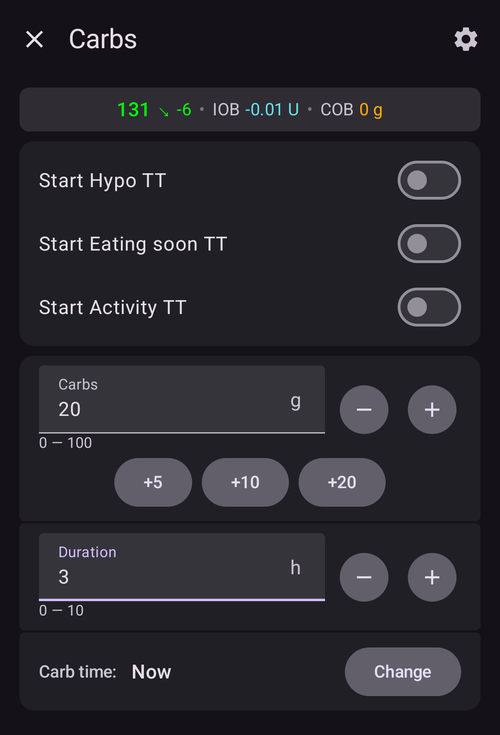
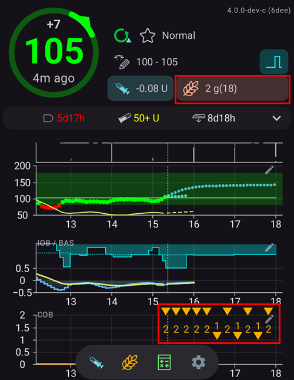

(Extended-Carbs-extended-carbs-ecarbs)=
# 확장 탄수화물 / "eCarbs"

## eCarbs란 무엇이며 언제 유용합니까?

일반 펌프 치료에서는 확장 볼러스가 기름진 음식이나 천천히 흡수되는 음식을 처리하는 좋은 방법입니다. 이런 음식은 인슐린이 작용하는 시간보다 더 오래 혈당을 올립니다. 그러나 루프에서는 확장 볼러스가 그다지 의미가 없습니다(기술적인 문제도 있습니다). 확장 볼러스는 기본적으로 높은 임시 기저 주입량을 고정하는 것과 같으며, 이것은 기저 주입량을 동적으로 조정하는 루프의 작동 방식과 맞지 않기 때문입니다. 자세한 내용은 아래의 [확장 볼러스](#extended-bolus-and-why-they-wont-work-in-closed-loop-environment)를 참조하십시오.

하지만 이런 음식을 처리할 필요는 여전히 있습니다. 그래서 AAPS는 이른바 확장 탄수화물, 즉 eCarbs를 지원합니다.

eCarbs는 여러 시간에 걸쳐 나누어진 탄수화물입니다. 지방/단백질보다 탄수화물이 많은 일반적인 식사에서는 보통 탄수화물을 미리 입력하는 것(필요하면 처음 볼러스를 줄이는 것)으로 인슐린이 너무 일찍 주입되는 것을 막을 수 있습니다.  하지만 천천히 흡수되는 식사에서 탄수화물을 모두 미리 입력하면 SMB 때문에 IOB가 너무 많아집니다. 이런 경우 eCarbs를 사용하면 탄수화물(그리고 다른 영양소에 대해 입력한 탄수화물 환산량)이 어떻게 흡수되고 혈당에 영향을 주는지 더 정확하게 시뮬레이션할 수 있습니다. 이 정보로 루프는 이 탄수화물을 처리하기 위해 SMB를 더 천천히 나누어 줄 수 있습니다. 이것은 동적인 확장 볼러스로 볼 수 있습니다(SMB 없이도 작동하지만 아마 효과가 덜할 것입니다).

**참고:** eCarbs는 지방/단백질이 많은 식사에만 쓰는 것이 아닙니다: 혈당을 올리는 영향이 있는 모든 상황에서 도움이 될 수 있습니다. 예를 들면 코르티코스테로이드 같은 다른 약물입니다.

## eCarbs 사용 방법

eCarbs를 입력하려면 **탄수화물** 대화 상자(**처치** → **탄수화물**)를 열고, 총 탄수화물을 입력하고, **기간**을 설정하고, 필요하면 **탄수화물 시간**으로 시작 시간을 옮기십시오(*아래 숫자는 예시일 뿐입니다. 자신의 상황에서 만족스러운 혈당 반응을 얻으려면 직접 값을 시도해 보아야 합니다*):

메인 화면의 eCarbs: **COB** 항목의 괄호 안 숫자는 아직 들어올 탄수화물을 보여 주고, **COB** 그래프는 앞으로 들어올 각 eCarbs 항목을 주황색 표시로 보여 줍니다. **COB** 그래프가 보이지 않으면 그래프 아래의 **그래프 추가**로 추가하십시오([AAPS 화면](../DailyLifeWithAaps/AapsScreens.md) 참조).

(AapsScreens-carbs-type)=
## 볼러스 마법사의 식사 유형: 빵, 케이크 또는 피자

[볼러스 마법사](#aaps-screens-bolus-wizard)에서 **탄수화물** 항목 아래의 버튼 세 개로 식사가 얼마나 빨리 흡수되는지 선택할 수 있습니다. 확인하기 전에 하나를 선택하십시오. 유형에 따라 **AAPS**는 입력한 탄수화물의 일부를 일반 탄수화물로 처리하고, 천천히 흡수되는 기름진 식사에는 나중에 [확장 탄수화물("eCarbs")](#Extended-Carbs-extended-carbs-ecarbs)을 추가합니다. 버튼 옆의 **(i)** 아이콘을 누르면 선택한 유형의 대표적인 음식과 그 유형이 탄수화물을 어떻게 바꾸는지 볼 수 있습니다.

| 유형          | 대표적인 음식(앱에 나온 예)                                   | 지금 처리되는 탄수화물(볼러스에 사용) | 추가되는 eCarbs                 |
| ----------- | -------------------------------------------------- | --------------------- | --------------------------- |
| **빵** (기본값) | 빵, 짠 페이스트리, 요거트, 과일, 감자, 쌀, 오트밀, 채소                | 100 %                 | None                        |
| **케이크**     | 만두, 파스타, 탄수화물과 지방이 많은 아시아 음식, 단 빵과 발효 빵, 시리얼, 꿀, 잼 | 90 %                  | 20 %, 60분 후에 시작, 2시간에 걸쳐 나눔 |
| **피자**      | 라자냐, 피자, 햄버거, 감자튀김, 구운 감자, 칩                       | 80 %                  | 35 %, 60분 후에 시작, 3시간에 걸쳐 나눔 |

**예**: 100 g을 입력하고 **피자**를 선택합니다. 볼러스는 80 g에 대해 계산되며, 이 80 g은 지금 기록됩니다. 35 g의 eCarbs는 1시간 후에 시작하여 3시간에 걸쳐 나누어집니다.

알아 두면 좋은 점:
* 이것은 단순한 분할이 아닙니다: **케이크**와 **피자**에서는 기록되는 탄수화물의 합이 **입력한 값보다 많습니다**(110 %와 115 %). 추가된 양은 eCarbs에만 들어갑니다.
* 볼러스는 지금 기록되는 탄수화물만 처리합니다. **AAPS**는 eCarbs에 대해 미리 볼러스를 주입하지 않습니다: 다른 [eCarbs](#Extended-Carbs-extended-carbs-ecarbs)와 마찬가지로, eCarbs가 시작되면 루프가 이를 고려합니다.
* **탄수화물 시간**을 설정하면 eCarbs는 그 시간보다 60분 후에 시작합니다.
* 확인 대화 상자에는 eCarbs가 별도의 줄에 표시됩니다. _예:_ "eCarbs 35 g / 3시간 (+60분)".
* 그램은 정수로 내림합니다.
* 퍼센트, 지연 시간, 기간은 고정되어 있으며 설정에서 바꿀 수 없습니다.
* 선택은 기억되지 않습니다: 마법사는 매번 **빵**으로 열립니다.

______________________________________________________________________

이 기능으로 지방과 단백질을 처리하는 방법은 여기에 설명되어 있습니다: [https://adriansloop.blogspot.com/2018/04/page-margin-0.html](https://adriansloop.blogspot.com/2018/04/page-margin-0.html)

______________________________________________________________________

## 권장 설정, 예시 시나리오, 중요 참고 사항

권장 설정은 OpenAPS SMB APS 플러그인을 사용하고, SMB를 활성화하고, *COB가 있을 때 SMB 활성화* 설정도 활성화하는 것입니다.

예를 들어 피자의 경우, *볼러스 마법사*로 (일부) 볼러스를 미리 주입한 다음 *탄수화물* 대화 상자로 나머지 탄수화물을 4-6시간 기간으로, 1-2시간 후에 시작하도록 입력할 수 있습니다.

더 빨리 시작하려면 *볼러스 마법사*가 eCarbs를 대신 추가하게 할 수 있습니다: **탄수화물** 항목 아래에서 [식사 유형](#AapsScreens-carbs-type) **케이크** 또는 **피자**를 선택하십시오(위 참조). 양과 시간은 고정되어 있으므로, 다른 값을 원하면 대신 *탄수화물* 대화 상자를 사용하십시오.

**중요 참고 사항:** 물론 어떤 값이 자신에게 맞는지 직접 시도해 보아야 합니다. 알고리즘을 더 공격적으로 또는 덜 공격적으로 만들려면 *SMB 제한을 위한 최대 기저 시간(분)* 설정을 신중하게 조정할 수도 있습니다. 저탄수화물, 고지방/고단백 식사에서는 수동 볼러스 없이 eCarbs만 사용해도 충분할 수 있습니다(위의 블로그 글 참조). eCarbs를 만들면 모든 입력 내용을 기록하는 케어포털 노트도 함께 만들어집니다. 그래서 입력 값을 반복해서 다듬고 개선하기가 더 쉽습니다.

(extended-bolus-and-why-they-wont-work-in-closed-loop-environment)=
## 확장 볼러스와 폐쇄 루프 환경에서 작동하지 않는 이유

위에서 말한 것처럼 확장 볼러스나 멀티웨이브 볼러스는 폐쇄 루프 환경에서 제대로 작동하지 않습니다. 자세한 내용은 [아래](#why-extended-boluses-won-t-work-in-a-closed-loop-environment)를 참조하십시오

(Extended-Carbs-extended-bolus-and-switch-to-open-loop-dana-and-insight-pump-only)=
### 확장 볼러스와 개방 루프로 전환 - Dana 및 Insight 펌프만 해당

일부 사용자는 특별한 음식을 익숙한 방식으로 처리하고 싶어서, 그래도 AAPS에서 확장 볼러스를 사용할 수 있는 옵션을 요청했습니다.

그래서 **AAPS**는 Dana 및 Insight 펌프 사용자에게 확장 볼러스를 제공합니다: **관리**를 열고 **확장 볼러스**를 선택하십시오.

**AAPS**는 먼저 확장 볼러스가 실행되는 동안 폐쇄 루프가 중지된다고 경고합니다. 계속하려면 **확인**을 누르십시오:

**인슐린** 양과 **기간**을 입력한 다음, 아래쪽의 확인 버튼과 **확인**을 누르십시오:

Insight 펌프에서는 [TBR 에뮬레이션](#Accu-Chek-Insight-Pump-settings-in-aaps)을 사용하면 확장 볼러스를 *사용할 수 없습니다*.

확장 볼러스가 실행되는 동안 루프는 **개방 루프** 모드로 실행되고(메인 화면의 루프 아이콘이 바뀝니다), 확장 볼러스가 끝나면 폐쇄 루프가 자동으로 다시 켜집니다:

**관리** 메뉴에 속도와 경과 시간 / 전체 시간이 있는 **취소** 버튼이 표시됩니다(예: **취소 2.00 U/h 1/60'**). 확장 볼러스를 일찍 중지하려면 이 버튼을 누르십시오:

(why-extended-boluses-won-t-work-in-a-closed-loop-environment)=
### 확장 볼러스가 폐쇄 루프 환경에서 작동하지 않는 이유

1. 루프가 지금 1.55U/h를 주입해야 한다고 결정합니다. 이것이 확장 볼러스로 주입되든 TBR로 주입되든 알고리즘에는 상관없습니다. 실제로 일부 펌프는 확장 볼러스를 사용합니다. 그러면 어떻게 되어야 합니까? 대부분의 펌프 드라이버는 이때 확장 볼러스를 중지합니다 -> 처음부터 시작할 필요도 없었던 것입니다.

2. 확장 볼러스를 입력으로 받았다면, 모델에서는 어떻게 되어야 합니까?

   1. 기저 주입량(BR)과 함께 중립으로 간주하고 그것을 바탕으로 루프를 실행해야 합니까? 그렇다면 예를 들어 혈당이 너무 낮아져서 모든 "중립" 인슐린이 없어지면 루프가 볼러스도 줄일 수 있어야 합니까?
   2. 확장 볼러스를 그냥 더해야 합니까? 그러면 루프가 그냥 계속하도록 두어야 합니까? 가장 심한 저혈당에서도 그렇습니까? 이것은 좋지 않다고 생각합니다: 저혈당이 예측되는데 막으면 안 된다는 말입니까?

3. 확장 볼러스가 쌓는 IOB는 5분 후 다음 실행 때 반영됩니다. 그에 따라 루프는 기저를 더 적게 줍니다. 그러니 크게 바뀌는 것은 없습니다... 저혈당을 피할 가능성이 없어진다는 것만 빼면 말입니다.
