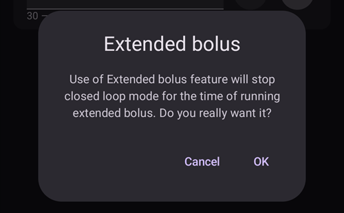

(Extended-Carbs-extended-carbs-ecarbs)=
# 확장 탄수화물 / "eCarbs"

## What are eCarbs and when are they useful?

보통 펌프의 확장 bolus 기능은 기름진 음식이나 소화가 느린 음식 등으로 인슐린 작용시간 이후에도 혈당을 높이는 경우에 사용하면 좋은 방법이다. 그러나 Loop에서는 확장 bolus 기능을 이용하여 basal 양을 동적으로 조절하는 동작을 하기 때문에 기본적으로 높은 임시 basal 양으로 고정시킨다.(기술적인 문제를 야기할 수도 있다) 그러므로 고유의 확장 bolus 기능을 사용하는 것은 좋은 방법이 아니다. For details see [extended bolus](#extended-bolus-and-why-they-wont-work-in-closed-loop-environment) below.

하지만 이러한 음식들에 대한 처리는 여전히 필요하다. Which is why AAPS supports so called extended carbs or eCarbs.

eCarbs are carbs that are split up over several hours. 단백질/지방보다 탄수화물이 많은 표준식단에서 앞에 탄수화물을 입력하고 필요에 따라 초기 인슐린을 줄이는 것은 인슐린이 너무 일찍 주입되는 것을 막아 준다.  하지만 앞에 입력된 많은 탄수화물양은 소화가 느리게 되는 식사의 경우 SMB가 작동하여 너무 많은 IOB를 생성하게 되기 때문에 eCarbs는 어떻게 탄수화물양이 흡수되고 혈당에 영향을 주는지 좀더 정확하게 시뮬레이션하는데 사용된다. 이 정보를 통해 Loop는 탄수화물을 처리하기 위한 SMB를 관리할 수 있게 한다. 그것은 확장 bolus처럼 보일 수도 있지만 확장 bolus는 SMB 없이도 동작하고 그것만으로는 효과적이지 않을 수 있다.

**Note:** eCarbs aren't limited to fatty / protein heavy meals: they can be also be used to help in any situation where there are influences that increase the blood sugar, e.g. other medication like corticosteroids.

## Mechanics of using eCarbs

To enter eCarbs, open the **Carbs** dialog (**Treatments** → **Carbs**), enter the total carbs, set a **Duration**, and optionally shift the start with **Carb time** (*numbers below are just examples, you will need to try your own values to arrive at satisfactory glucose response for your use-cases*):

The eCarbs on the main screen: the number in brackets in the **COB** field shows the carbs still to come, and the **COB** graph shows each future eCarbs entry as an orange marker. If you don't see a **COB** graph, add one with **Add graph** below the graphs (see [AAPS screens](../DailyLifeWithAaps/AapsScreens.md)).

(AapsScreens-carbs-type)=
## Carbs type in the Bolus wizard: bread, cake or pizza

In the [Bolus wizard](#aaps-screens-bolus-wizard), three buttons below the **Carbs** field let you choose how fast your meal is absorbed. Pick one before you confirm. Depending on the type, **AAPS** takes a part of the carbs you typed as normal carbs, and adds [extended carbs ("eCarbs")](#Extended-Carbs-extended-carbs-ecarbs) later for slow, rich meals. Press the **(i)** icon next to the buttons to see the typical foods for the selected type and what it does to your carbs.

| Type                | Typical foods (as listed in the app)                                                                 | Carbs now, used for the bolus | eCarbs added                                         |
| ------------------- | ---------------------------------------------------------------------------------------------------- | ----------------------------- | ---------------------------------------------------- |
| **Bread** (default) | Bread, savory pastries, yogurt, fruit, potatoes, rice, oatmeal, vegetables                           | 100 %                         | None                                                 |
| **Cake**            | Dumplings, pasta, Asian dishes rich in carbs and fats, sweet and yeast pastries, cereals, honey, jam | 90 %                          | 20 %, starting 60 minutes later, spread over 2 hours |
| **Pizza**           | Lasagna, pizza, hamburgers, fries, baked potatoes, chips                                             | 80 %                          | 35 %, starting 60 minutes later, spread over 3 hours |

**Example**: you type 100 g and choose **Pizza**. The bolus is calculated for 80 g, recorded now. 35 g of eCarbs start 1 hour later and are spread over 3 hours.

Good to know:
* This is not a simple split: with **Cake** and **Pizza**, the carbs recorded add up to **more than you typed** (110 % and 115 %). The extra is only in the eCarbs.
* The bolus only covers the carbs taken now. **AAPS** does not bolus up front for the eCarbs: the loop takes them into account once they start, like any other [eCarbs](#Extended-Carbs-extended-carbs-ecarbs).
* If you set a **Carb time**, the eCarbs start 60 minutes after that time.
* The confirmation dialog shows the eCarbs on their own line, _e.g._ "eCarbs 35g / 3h (+60min)".
* Grams are rounded down to whole numbers.
* The percentages, delays and durations are fixed; they can't be changed in the settings.
* The choice is not remembered: the wizard opens on **Bread** every time.

______________________________________________________________________

A way to handle fat and protein with that feature is described here: [https://adriansloop.blogspot.com/2018/04/page-margin-0.html](https://adriansloop.blogspot.com/2018/04/page-margin-0.html)

______________________________________________________________________

## Recommended setup, example scenario, and important notes

The recommended setup is to use the OpenAPS SMB APS plugin, with SMBs enabled as well as the *Enable SMB with COB* preference being enabled.

A scenario e.g. for a Pizza might be to give a (partial) bolus up front via the *Bolus wizard* and then use the *Carbs* dialog to enter the remaining carbs for a duration of 4-6 hours, starting after 1 or 2 hours.

For a quicker start, the *Bolus wizard* can add eCarbs for you: choose the [carbs type](#AapsScreens-carbs-type) **Cake** or **Pizza** below the **Carbs** field (see above). The amounts and timing are fixed, so use the *Carbs* dialog instead if you want other values.

**Important notes:** You'll need to try out and see which concrete values work for you of course. You might also carefully adjust the setting *max minutes of basal to limit SMB to* to make the algorithm more or less aggressive. 저탄수화물, 고지방/고단백질 음식은 수동적인 bolus 없이 eCarbs만 사용해도 된다.(위의 블로그 포스트를 참고) eCarbs가 입력되면, 케어포털 메뉴는 더 쉽게 입력하게 만들어주고 모든 입력 내용을 문서화 한다.

(extended-bolus-and-why-they-wont-work-in-closed-loop-environment)=
## Extended bolus and why they won't work in closed-loop environment?

위에서 언급한 것과 같이, 확장 또는 멀티 웨이브 bolus는 Closed Loop에서 효과적으로 동작하지 않는다. [See below](#why-extended-boluses-wont-work-in-a-closed-loop-environment) for details

(Extended-Carbs-extended-bolus-and-switch-to-open-loop-dana-and-insight-pump-only)=
### Extended bolus and switch to open loop - Dana and Insight pump only

Some people were asking for an option to use extended bolus in AAPS anyway as they wanted to treat special foods the way they are used to.

That's why **AAPS** offers an extended bolus for users of Dana and Insight pumps: open **Manage** and select **Extended Bolus**.

**AAPS** first warns you that the closed loop will be stopped while the extended bolus runs. Tap **OK** to continue:

Enter the **Insulin** amount and the **Duration**, then tap the confirm button at the bottom and **OK**:

On the Insight pump, the extended bolus is *not available* if [TBR emulation](#Accu-Chek-Insight-Pump-settings-in-aaps) is used.

While the extended bolus is running, the loop runs in **Open Loop** mode (the loop icon on the main screen changes), and closed loop is switched on again automatically when the extended bolus ends:

The **Manage** menu shows a **Cancel** button with the rate and the elapsed / total time (for example **Cancel 2.00 U/h 1/60'**). Tap it to stop the extended bolus early:

(why-extended-boluses-won-t-work-in-a-closed-loop-environment)=
### Why extended boluses won't work in a closed loop environment

1. Loop는 현재 1.55U/h로 주입하기로 결정한다. 이것이 확장 bolus로 주입되는지 TBR로 주입되는지는 알고리즘에서 중요하지 않다. 사실, 일부 펌프는 확장 bolus을 사용한다. 그러면 어떻게 동작해야 할까? Most pump drivers then stop the extended bolus -> You didn't even need to start it.

2. 만약 사용자가 확장 bolus를 입력했다면, 모델에서는 어떤일이 일어날까?

   1. BR과 Loop와는 독립적인 것으로 여겨져야 할까? 그러면 Loop는 bolus를 줄여야만 할까? 예를 들어 사용자에게 적은 인슐린이 주입될까?
   2. 간단하게 확장 bolus가 추가 되어야 할까? 그래서 Loop는 단순하게 계속 주입되는 것을 허용해야 할까? 최악의 저혈당에서 조차? 이것은 좋은 방법이 아니라고 생각한다: 저혈당은 예측될 수는 있지만 방지해서는 안될까?

3. 확장 bolus로 생성되는 IOB는 다음 실행에서 5분 후에 적용된다. 따라서, Loop는 더 적은 basal을 주입한다. So not much changes... except that the possibility of hypo avoidance is taken.
