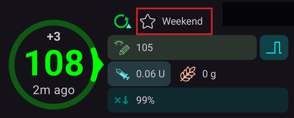
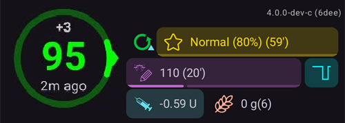
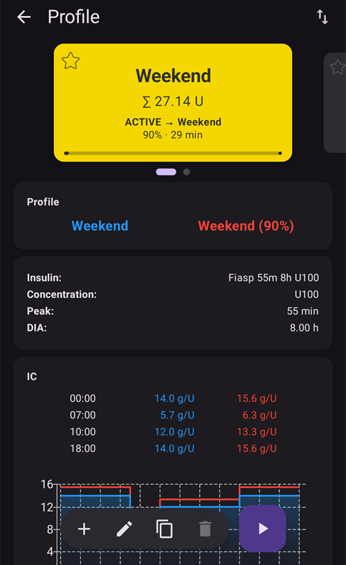
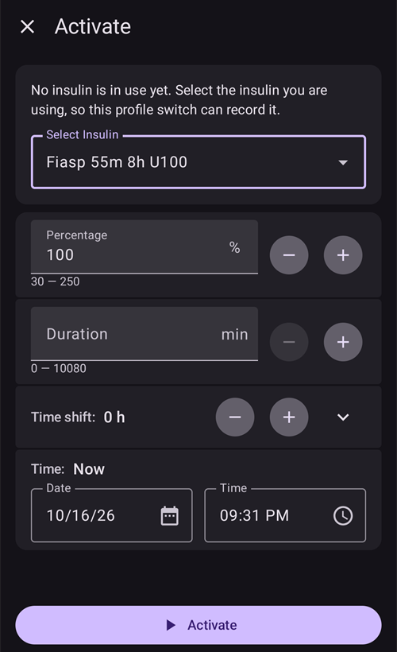

# 프로파일 전환과 프로파일 퍼센트

이 섹션에서는 **프로파일 전환**과 **프로파일 퍼센트**가 무엇인지 설명합니다. **프로파일**을 만드는 방법은 [AAPS 프로파일](#your-aaps-profile-create-and-edit-profiles)에서 배울 수 있습니다.

**AAPS**를 처음 시작할 때는 **프로파일**을 만들고, **프로파일 전환**을 실행하는 방법을 이해하고, **AAPS**에서 **프로파일 퍼센트**가 미치는 영향을 알아야 합니다. **프로파일 전환** 또는 **프로파일 퍼센트** 기능은 특히 다음과 같은 경우에 유용합니다:

- 생리 주기 - **자동화**에서 **프로파일** 안의 퍼센트 조정을 설정하여, **AAPS**가 호르몬 주기의 여러 단계와 예상되는 인슐린 저항성에 맞출 수 있게 할 수 있습니다.

- 운동 - 운동할 때 기저 주입을 줄이기 위해 **자동화**에서 **프로파일** 안의 퍼센트 조정을 설정할 수 있습니다.

- 야간 또는 교대 근무자 - 교대 근무자는 얼마나 늦게/일찍 잠자리에 들거나 일어날지에 맞춰 **프로파일**의 시간 수를 바꾸어 **프로파일**에 시간 이동을 설정할 수 있습니다.

왜 임시 기저 조정 대신 **프로파일 퍼센트**를 사용합니까? 더 효과적으로 적용하기 위해 **프로파일 퍼센트**는 기저, ISF, I:C 모두에 같은 비율로 감소 또는 증가를 적용합니다. 이렇게 하면 **AAPS**가 사용자의 인슐린을 주입할 때 균형 잡힌 계산을 합니다. 알고리즘이 ISF와 I:C에 계속 같은 비율을 사용한다면, **AAPS**의 **프로파일**에서 기저만 줄여서는 얻는 이점이 거의 없습니다.

(ProfileSwitch-change-percentage)=

## 메인 화면에서 프로파일 퍼센트 바꾸기

저장된 **프로파일**이 하나 이상 필요합니다. **프로파일 퍼센트**는 항상 **프로파일 전환**을 통해 적용됩니다: **프로파일**을 다시 활성화하되, 이번에는 퍼센트를 함께 지정합니다.

```{admonition} AAPS 3에서 오셨습니까? :class: note 프로파일 이름을 길게 눌러도 더 이상 프로파일 전환 대화 상자가 열리지 않습니다. 프로파일 이름을 **탭**한 다음, 오른쪽 아래의 둥근 **▶** 버튼을 탭하십시오: 같은 설정(퍼센트, 기간, 활동 임시 목표)이 열립니다.

    <br />1. 메인 화면에서 **프로파일 이름을 탭**하십시오(별 아이콘 옆). [프로파일 화면](#ProfileSwitch-manage-v4)이 실행 중인 **프로파일**의 카드에서 열립니다. 이 카드에는 **활성** 표시가 있습니다.
    
       
    
    2. 같은 **프로파일**을 유지하려면 **활성** 카드를 선택된 상태로 두십시오. 동시에 **프로파일**을 바꾸려면 다른 카드로 밀어 넘기십시오.
    3. 오른쪽 아래의 둥근 **▶** 버튼(**활성화**)을 탭하십시오. **활성화** 화면이 열립니다.
    4. **−** / **+**(5 % 단위)로 **퍼센트**를 설정하거나 직접 입력하십시오(30~250 %). 이 항목은 항상 **100 %**에서 시작합니다: 지금 실행 중인 퍼센트를 보여주지 않습니다. 예를 들어 인슐린을 20 % 줄이려면 **80**을, 20 % 늘리려면 **120**을 입력하십시오.
    5. **기간**을 분 단위로 설정하십시오:
       * **0**은 다른 **프로파일 전환**을 할 때까지 새 퍼센트를 유지합니다;
       * 다른 값은 그 시간이 지나면 전환을 끝내고, **AAPS**는 이전에 실행 중이던 **프로파일**로 돌아갑니다.
    
       
    
    6. 화면 아래의 **▶ 활성화**를 탭하십시오. **프로파일 전환** 대화 상자에서 요약을 확인하고 **확인**을 탭하십시오.
    
       
    
    메인 화면으로 돌아오면 프로파일 이름에 퍼센트와 남은 시간이 표시되며(예: *Normal (80%) (59')*), 기간이 있는 전환이 실행 중인 동안 노란색으로 바뀝니다. 혈당 그래프에는 별이 전환을 표시합니다. [메인 화면](#aaps-screens-profile--target)을 참조하십시오.
    
    
    
    끝나기 전에 **100 %로 돌아가려면** 같은 단계를 반복하고 **퍼센트**는 100, **기간**은 0으로 두십시오.
    
    ```{admonition} 한 번 탭으로 퍼센트 적용
    :class: tip
    같은 퍼센트(운동, 질병)를 자주 사용한다면 QuickLaunch 툴바에 [프로파일 바로가기](#profile-shortcuts)를 추가하거나 [장면](Scenes.md)을 만드십시오. 둘 다 한 번 탭으로 미리 정한 퍼센트와 기간의 프로파일을 적용합니다.
    

(ProfileSwitch-manage-v4)=

## 프로파일 관리 및 활성화 (관리 → 프로파일)

**AAPS** v4에서는 프로파일을 **관리** 화면(하단 내비게이션) → **프로파일**(*“프로파일 관리 및 활성화”*)에서 관리하고 활성화합니다.

프로파일 화면은 프로파일을 **밀어 넘길 수 있는 카드 캐러셀**로 보여줍니다. 실행 중인 프로파일의 카드에는 **활성** 표시와 하루 총 기저량(예: *∑ 30.15 U*)이 표시됩니다. 선택한 카드 아래에서 그 프로파일의 세부 정보를 볼 수 있습니다 — **인슐린** 종류, 그리고 그래프와 함께 **IC**, **ISF**, **기저**, **목표** 일정.

임시 전환이 실행 중이면 **활성** 카드에 퍼센트와 시간 이동, 남은 시간이 진행 막대 위에 표시됩니다. 예: *110% +2 h · 2 h 40 min*. 두 값은 30초마다 새로 고쳐집니다. 그러면 아래 세부 정보는 두 열로 표시됩니다: 파란색은 프로파일의 값, 빨간색은 퍼센트를 적용하여 실제로 사용 중인 값입니다.



아래쪽 버튼은 **선택한** 프로파일에 적용됩니다: **➕ 추가**, **✏️ 편집**, **⧉ 복사**, **‘️ 삭제**, 그리고 오른쪽의 둥근 **▶ 활성화** 버튼입니다. 편집기에서 네 가지 일정(IC / ISF / BAS / TARG)을 입력하는 방법은 [프로파일 만들기와 편집](#your-aaps-profile-create-and-edit-profiles)을 참조하십시오.

**⧉ 복사**는 흔히 *복사하기*(클립보드)에 쓰이는 두 사각형 아이콘을 사용하지만, 붙여 넣을 것은 없습니다: 한 단계로 사본을 만듭니다. *프로파일 "Normal"을(를) 복사하시겠습니까?*를 확인하면 *Normal 복사본*이라는 새 프로파일이 캐러셀 끝에 추가되고 선택됩니다. 바로 **✏️ 편집**할 수 있습니다(여기서 이름도 바꿀 수 있습니다). 이것은 처치 이력에서 과거의 **프로파일 전환**을 복사하는 것과 다릅니다. 그 경우에는 *퍼센트와 시간 이동이 적용된* 새 프로파일이 만들어집니다. [나중에 사용하기 위해 프로파일 전환 보관하기](#ProfileSwitch-keep-for-later)를 참조하십시오.

(ProfileSwitch-read-only-mode)= **▶ 활성화 버튼만 보입니까?** 설정이 보호되어 있어 화면이 읽기 전용으로 열립니다. 상단 바의 **✏️ 연필**을 탭하고 설정 비밀번호를 입력하십시오. [설정 보안이 이제 관리 화면도 잠급니다](#v4changes-read-only-management)를 참조하십시오.

### 프로파일 순서 변경

프로파일이 둘 이상이면 캐러셀의 순서를 정할 수 있습니다: 상단 바의 **순서 변경** 아이콘(⇅, 위아래를 가리키는 두 화살표)을 탭하십시오. 페이지 표시가 *위치 / 전체* 표시와 함께 **◀ / ▶ 이동 버튼**으로 바뀝니다 — 가운데 카드를 앞이나 뒤로 옮긴 다음 **✓**로 확인하십시오(또는 **✕**로 취소). 새 순서는 확인할 때 한 번 저장됩니다.


### 프로파일 활성화하기

프로파일을 선택하고 **▶ 활성화**를 탭하십시오. **활성화** 화면에서 **프로파일 전환**을 어떻게 적용할지 정할 수 있습니다:


- **퍼센트**(30–250 %, 매번 100 %에서 시작) — 프로파일 전체의 크기를 조정합니다. 100 %는 프로파일을 그대로 사용합니다. 예를 들어 70 %는 기저와 계산된 인슐린 용량(식사 볼러스와 교정 모두)을 30 % 줄입니다. 혈당 목표나 탄수화물 흡수는 바꾸지 않습니다. 전체 효과는 [프로파일 퍼센트](#ProfileSwitch-profile-percentage)를 참조하십시오.
- **기간**(0–10080분, 즉 최대 7일) — 전환이 얼마나 지속되는지 정합니다. **0 = 무기한**(다시 전환할 때까지). 0이 아닌 값이면 끝날 때 이전 프로파일로 돌아갑니다.
- **임시 목표 / 활동** — **기간**과 100 % 미만의 **퍼센트**를 설정했을 때만 나타납니다. 이것을 켜면 운동 전에 하듯이 같은 기간 동안 [활동 임시 목표](#TempTargets-activity-temp-target)도 시작합니다.
- **시간 이동** — *0h*를 표시합니다. **변경**을 탭하면 일정을 최대 23시간까지 앞이나 뒤로 옮길 수 있습니다(교대 근무나 여행에 유용). [시간 이동](#ProfileSwitch-ProfilePercentage-time-shift-of-the-circadian-percentage-profile)을 참조하십시오.
- **재사용** — 실행 중인 전환의 퍼센트가 100 %가 아니거나 시간 이동이 있을 때 나타납니다. 예: **80% 0시간 재사용**. 탭하면 같은 퍼센트와 시간 이동이 입력됩니다. 예를 들어 곧 끝날 전환을 연장할 때 사용합니다.
    
    

- **시간** — 기본값은 *지금*입니다. 지금으로부터 최대 24시간 전이나 후의 다른 시간을 선택할 수 있습니다. 미래로 설정한 전환은 그 시간에 시작하며, 함께 설정한 활동 임시 목표도 그 시간에 시작합니다.
    
    

- **노트** — [대화 상자에 노트 표시](#Preferences-show-notes-field-in-treatments-dialogs)가 켜져 있을 때만 표시됩니다.

선택한 퍼센트의 기저 주입량이 펌프와 맞지 않으면 위쪽에 경고가 나타나고 **▶ 활성화**가 비활성화된 채로 남습니다: 다른 퍼센트를 선택하십시오.

**▶ 활성화**를 탭한 다음, 확인 대화 상자에서 **확인**을 탭하십시오. 이제 실행 중인 프로파일의 카드에 **활성** 배지가 표시됩니다.

```{admonition} 펌프가 기저 주입량을 반올림할 수 있습니다 :class: note 각 펌프는 자체 단위(예: 0.05 U/h)로만 기저를 주입할 수 있으므로 **프로파일**의 기저 주입량을 반올림합니다. 그러면 **AAPS**는 펌프가 실제로 주입하는 기저를 사용하므로 IOB와 TDD가 정확하게 유지됩니다. 펌프가 **프로파일**보다 하루에 인슐린을 조금 더 또는 덜 주입하면, *"펌프의 기저 프로파일이 업데이트되었습니다"* 알림이 그 양을 알려 줍니다. 예: *"하루에 10.12 U 대신 10.00 U를 주입합니다"*.

펌프가 **프로파일**과 크게 다른 기저를 보고하면, **AAPS**는 **프로파일**의 기저를 유지하고 펌프의 기저 주입량을 확인하라고 요청합니다.

    <br />```{admonition} 퍼센트와 시간 이동으로 프로파일 하나를 폭넓게 사용하기
    :class: note
    비슷한 프로파일을 여러 개 만드는 대신, 기본 프로파일 하나를 유지하고 반복되는 상황(질병, 운동, 여행)에는 다른 **퍼센트**나 **시간 이동**으로 적용하십시오. 바로 이것을 [장면](Scenes.md)이 자동화합니다.
    

프로파일 전환은 이 화면에서만 할 수 있는 것이 아닙니다. 같은 전환을 **Wear OS 워치**, 페어링된 **클라이언트**([마스터 ↔ 클라이언트 제어](../RemoteFeatures/ClientMasterControl.md) 참조), **[장면](Scenes.md)** 또는 **자동화** 규칙에서도 실행할 수 있습니다.

(ProfileSwitch-profile-percentage)=

## Profile Percentage

사용자는 **프로파일 퍼센트**의 핵심 특징을 이해해야 합니다. **프로파일 전환**에 퍼센트 증가 또는 감소를 적용하면, **프로파일**에 설정된 사용자 설정 매개변수도 같은 퍼센트만큼 높아지거나 낮아집니다.

예: **프로파일 전환**을 130%로 하면(사용자의 인슐린 저항성이 30% 더 높다는 뜻) **AAPS**는 다음과 같이 합니다:

- 기저 주입량을 30% **높입니다**; 
- **ISF**를 1.3으로 나누어 **낮춥니다**;
- **I:C**를 1.3으로 나누어 **낮춥니다**.

**ISF**나 **I:C**를 낮춘다는 것은 비율이 더 강해지고 더 많은 인슐린이 주입된다는 뜻임을 기억하십시오. **AAPS**를 처음 쓰는 사용자는 이 점을 쉽게 놓칠 수 있습니다.

선택하면 **AAPS**는 기본 기저 주입량을 다시 조정하고, **AAPS**(개방 또는 폐쇄)는 선택한 퍼센트 **프로파일**을 바탕으로 계속 작동합니다.

**프로파일** 퍼센트의 효과는 아래 표에 요약되어 있습니다:

| 프로파일 전환  
퍼센트 |   효과   |     I:C  
g/U     | 예  
15 g |          ISF  
mmol/L/U  
mg/dL/U          | 낮추는 데 필요한 U  
2mmol/L  
40mg/dL |
|:-------------:|:------:|:-----------------:|:--------:|:------------------------------------------:|:-------------------------------:|
|      90%      |  더 약함  | 5/0.9  
=**5.55** |  2.7 U   | 2.2/0.9  
=**2.4**  
  
40/0.9  
=**44.4** |              0.8 U              |
|   **100%**    | **표준** |       **5**       | **3 U**  |                **2.2  
40**                |            **0.9** U            |
|     130%      |  더 강함  | 5/1.3  
=**3.85** |  3.9 U   | 2.2/1.3  
=**1.7**  
  
40/1.3  
=**30.8** |              1.2 U              |

(ProfileSwitch-ProfilePercentage-time-shift-of-the-circadian-percentage-profile)=

## 하루 주기 퍼센트 프로파일의 시간 이동

사용자 **프로파일** 기능의 ‘시간 이동’은 사용자의 **프로파일** 설정을 하루 24시간 시계(‘하루 주기’) 위에서 입력한 시간 수만큼 옮깁니다. 다음과 같은 경우에 도움이 됩니다:

- **야간 또는 교대 근무자**: 얼마나 늦게/일찍 잠자리에 들거나 일어날지에 맞춰 **프로파일**의 시간 수를 바꾸어 야간 근무에 대응할 수 있습니다; 
- **여행 중 시간대를 바꾸는 사용자**; 또는
- **1형 당뇨가 있는 어린이 사용자**: 정해진 취침 루틴과 인슐린 저항성이 **프로파일**에 반영되어 있는 경우. 어떤 이유로든 아이가 평소보다 늦게 잘 것으로 예상되면, 보호자는 아이의 **프로파일**에 ‘시간 이동’을 적용하여 **AAPS**가 사용자가 정한 시간대에 인슐린 저항성에 대응하게 할 수 있습니다.

중요한 것은 항상 어느 시간의 **프로파일** 설정이 현재 시간의 설정을 대신해야 하는가입니다. 이 시간을 x시간만큼 이동해야 합니다. 따라서 다음 예에 설명된 방향에 주의하십시오:

- Current time: 12:00
- **양수(+)** time shift 
    - 2:00 **+10 h** -> 12:00
    - 양의 시간 이동 때문에 보통 12:00에 사용하는 설정 대신 2:00의 설정이 사용됩니다.
- **음수(-)** time shift 
    - 22:00 **-10 h** -> 12:00
    - 음의 시간 이동 때문에 보통 12:00에 사용하는 설정 대신 22:00(오후 10시)의 설정이 사용됩니다.


**프로파일**의 스냅샷을 저장하는 이 방식 덕분에 과거를 훨씬 더 정확하게 계산할 수 있고 **프로파일** 변경을 추적할 수 있습니다.

(ProfileSwitch-keep-for-later)=

## 나중에 사용하기 위해 프로파일 전환 보관하기

퍼센트 및/또는 시간 이동으로 프로파일 전환을 실행한 후에는, 이 임시 프로파일을 새 프로파일로 복사할 수 있습니다.

이렇게 하려면 메뉴(☰) → **처치**를 열고 **프로파일 전환** 탭으로 이동하십시오. [프로파일 전환을 새 프로파일로 복사하기](#your-aaps-profile-clone-profile-switch)를 참조하십시오.