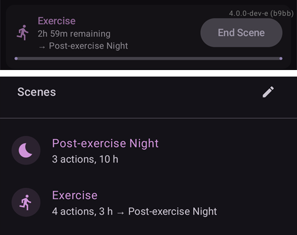

(scenes)=
# 장면 (상황별 프리셋)

**장면**은 이름을 붙인 프리셋으로, **여러 동작을 한 번에** 적용합니다. 예를 들어 *수면*, *운동*, *아픈 날* 프리셋은 한 번 탭으로 프로파일을 전환하고, 임시 목표를 설정하고, SMB를 켜거나 끄고, 케어포털 메모를 추가합니다. 원하면 정해진 기간 동안만 적용할 수도 있습니다.

```{contents} Table of contents
:depth: 2
:local: true
```

---

## 장면이란

자주 있는 상황이 올 때마다 여러 가지를 직접 바꾸는 대신, 한 번 장면으로 설정해 두고 한 번 탭으로 활성화합니다. 장면에는 다음 동작을 원하는 대로 넣을 수 있습니다:

- **프로파일 전환** — 프로파일을 전환하거나 퍼센트로 조정합니다(예: 70 %). 둘 다 할 수도 있습니다.
- **임시 목표** — 임시 목표를 설정합니다(예: *활동*, *식사 직전* 또는 직접 정한 값).
- **SMB 켜기/끄기** — 장면이 활성인 동안 SMB(super-micro-bolus)를 활성화하거나 비활성화합니다.
- **실행 모드** — 실행 모드를 바꿉니다(예: 더 보수적인 모드로).
- **케어포털 메모** — 이벤트(예: *운동*, *질병*)를 기록하여 그래프와 Nightscout에 표시되게 합니다.

장면에는 **기간**도 있습니다. 기간은 정해진 시간(분/시간/일) 또는 *무기한 (직접 종료)*입니다. 또한 장면이 끝날 때 실행되는 **종료 동작**이 있습니다. 종료 동작은 **알림**이거나, 다른 장면으로 **이어지는** 것입니다(예: *아픈 날 → 운동*).

---

## 장면 관리

**관리 → 장면**을 열면 장면을 보고, 만들고, 편집하고, 활성화/비활성화하고, 순서를 바꿀 수 있습니다.


각 장면 카드에는 다음이 표시됩니다:

- 장면을 활성화/비활성화하는 **체크박스**,
- **아이콘**과 **이름**,
- 요약 — *“동작 N개, 기간”*, 그리고 다른 장면으로 이어지는 경우 **→ 이어지는 장면**,
- 그리고 세 개의 버튼: **▶ 활성화**, **✏️ 편집**, **🗑️ 삭제**.

새 장면을 만들려면 **+** 버튼을 탭하십시오.

---

## 장면 만들기 또는 편집

### 템플릿에서 시작

장면을 **만들려면** 장면 화면에서 **+** 버튼을 탭하십시오. 첫 단계는 **템플릿에서 시작**입니다. 자주 있는 상황에 맞게 미리 만들어진 장면을 고르십시오 — *운동*, *아픈 날*, *아픈 날 — 구토*, *수면*, *운동 후 밤*, *식사 전*, *음주*, *운전*, *목욕*, *황체기*, *더운 날씨*, *의료 시술* — 또는 *빈 장면*에서 시작하십시오. 각 템플릿은 **권장 동작을 미리 채웁니다**. 다음 단계에서 모든 것을 조정할 수 있습니다.


템플릿을 고르면 계속하기 전에 그 목적, 즉 *언제*, *왜* 사용하는지 설명이 표시됩니다:


### 동작 단계 진행

편집기의 나머지 부분은 짧은 **단계별** 마법사입니다. 각 단계는 한 가지 동작 종류이며 *“장면에 … 포함”* 스위치가 있습니다. 이 장면에서 실행할 동작만 켜고 나머지는 꺼 두십시오.


**다음**/**뒤로**로 단계를 진행하십시오: *프로파일 전환*, *임시 목표*, *SMB*, *실행 모드*, *케어포털 메모*, 그다음 **기간**, **종료 동작**(알림 또는 다른 장면으로 이어짐), 마지막으로 장면의 **이름과 아이콘**입니다. 다 끝나면 저장하십시오. (기존 장면을 **편집**하려면 그 장면의 **✏️** 버튼을 탭하십시오. 바로 이 단계들로 이동합니다.)

각 단계는 그 동작이 하는 일을 짧게 설명하며 시작합니다. 단계는 다음과 같습니다. 여기서는 *운동* 템플릿을 사용한 예입니다:

**임시 목표** — 임시 목표 프리셋 중 하나를 고릅니다:


**SMB** — 장면이 활성인 동안 SMB를 활성화하거나 비활성화합니다:


**실행 모드** — 원하면 실행 모드를 바꿉니다:


**케어포털** — 기록할 이벤트 종류와 노트입니다:


**기간** — 장면이 활성 상태로 유지되는 시간입니다. 0은 직접 종료할 때까지라는 뜻입니다:


**후속 장면** — 원하면 이 장면이 끝날 때 시작될 장면을 고릅니다:


**장면** — 이름과 아이콘입니다. **완료**를 눌러 저장하십시오:


---

## 장면 활성화

**장면** 목록(**▶** 버튼) 또는 하단 내비게이션의 **장면** 항목에서 장면을 활성화하십시오. 하단 내비게이션의 **장면** 시트에서 각 장면은 장면 목록과 같은 요약을 보여 줍니다. 시트 맨 위의 **연필** 아이콘을 누르면 **관리 → 장면**이 열려 장면을 만들거나 편집할 수 있습니다.


[볼러스 보안](#Preferences-protection)이 켜져 있으면, **AAPS**는 장면이 시작되거나 끝나기 전에 이를 요구합니다. 장면을 변경할 때는 대신 [설정 보안](#Preferences-settings-protection)이 필요합니다.

무엇이든 적용되기 전에 장면이 할 일을 정확히 나열한 **확인** 화면이 표시되므로 검토할 수 있습니다:


장면이 다른 장면으로 이어지면, 확인 화면은 **→** 와 그 후속 장면의 이름으로 끝납니다. 장면 목록에 표시되는 방식과 같습니다.

하단 내비게이션의 **장면** 항목에서 장면을 시작하면, 확인 화면은 같은 동작 목록을 보여 주는 더 간단한 대화 상자입니다. **확인**을 눌러 활성화하십시오:


확인하면 동작이 적용되고, 개요 화면 맨 위에 **활성 장면**이 **장면 종료** 버튼과 함께 표시됩니다. 장면이 다른 장면으로 이어지면 배너에 그 후속 장면의 이름도 표시됩니다:


장면의 동작은 다음 때까지 유지됩니다:

- **기간**이 끝날 때(**종료 동작**이 실행됩니다 — 알림, 또는 다음 장면으로 이어짐), 또는
- **장면 종료**를 탭하여 직접 끝낼 때. 장면이 다른 장면으로 이어지면 두 가지 중에서 고를 수 있습니다: **(후속 장면)(으)로 건너뛰기**(활성 장면이 끝나고 후속 장면이 지금 시작됨) 또는 **장면 종료**(활성 장면이 끝나고 후속 장면은 시작되지 않음).

후속 장면이 없는 장면은 확인만 요청합니다:


장면을 끝내면 장면이 만든 변경 사항이 **되돌려집니다**(예: 장면이 시작한 프로파일 전환과 임시 목표).

장면이 활성인 동안, 장면이 설정한 프로파일과 목표에는 메인 화면에서 작은 장면 아이콘이 붙습니다. 하단 내비게이션의 **장면** 시트는 다른 장면을 시작할 수 있도록 계속 사용할 수 있습니다:



기간이 스스로 끝나면 변경 사항이 바로 되돌려지고, 배너는 **닫기** 버튼이 있는 **장면 종료됨**으로 바뀝니다. 닫기는 화면에서 배너만 지웁니다. 장면 자체는 이미 끝났으므로 자동화 규칙과 이어지는 장면은 이를 기다리지 않고 계속 진행됩니다.

---

## 자동화에서 장면 실행

장면을 꼭 직접 시작할 필요는 없습니다. **자동화**가 대신 실행할 수 있습니다. 자동화 규칙에 동작을 추가할 때(**관리 → 자동화**) 동작 선택기에는 **장면** 범주가 있습니다:

- **장면 실행** — 규칙의 트리거가 작동하면 장면을 활성화합니다(예: 정해진 시간에, 어떤 장소에 도착했을 때, 또는 혈당이 임계값을 넘을 때).
- **장면 활성화** / **장면 비활성화** — 장면을 실행하지 않고 사용 가능(또는 사용 불가)하게 만듭니다.


자동화는 장면에 **반응**할 수도 있습니다. 트리거 목록에 **장면** 트리거가 있으므로, 특정 장면이 활성인 동안에만 규칙이 실행되게 할 수 있습니다. 장면의 **종료 동작**(되돌리기, 알림 또는 다른 장면으로 이어짐)과 함께 사용하면 장면이 자동으로 시작되고, 이어지고, 끝나게 할 수 있습니다.

---

## 마스터/클라이언트 및 워치에서의 장면

**현재 활성 장면은 페어링된 모든 장치에서 동기화됩니다**. 한 휴대폰에서 활성화하면 다른 장치에도 표시됩니다.

페어링된 **클라이언트**(**AAPSClient**)도 장면을 활성화하거나 끝낼 수 있습니다. 요청은 **마스터**로 보내지고, 마스터가 확인 화면을 만들고 자신의 상태에 장면을 적용합니다. 작동 방식은 [마스터 ↔ 클라이언트 제어](../RemoteFeatures/ClientMasterControl.md)를 참조하십시오.

(scenes-from-watch)=
### Wear OS 워치에서

장면은 **Wear OS 워치**에서 **장면 타일**로 사용할 수 있습니다. 워치의 타일 캐러셀에서 **장면** 타일로 밀어 이동하고(아직 없으면 먼저 캐러셀의 타일 목록에서 추가하십시오) 시작할 장면을 탭하십시오:


타일에는 칸이 네 개 있습니다. 기본적으로 각 칸은 휴대폰에서의 순서대로, 활성화된 다음 장면으로 **자동**으로 채워집니다. 직접 고르려면 **타일을 길게 누르고** 설정을 여십시오. 네 칸마다 **자동**을 유지하거나, **특정 장면**을 고정하거나, **없음**을 선택하여 칸을 비워 둘 수 있습니다. 고정한 장면이 그 후에 삭제되거나 비활성화되면 그 칸에는 **사용할 수 없음**이 표시됩니다. 그 칸에 다른 장면을 고르십시오.

그러면 워치에 확인 화면이 표시됩니다. **✓**를 탭하여 활성화하거나, 뒤로 밀어서 취소하십시오:


클라이언트와 마찬가지로 **마스터가 확인 화면을 만들고 장면을 실행합니다**. 워치는 요청을 전달하기만 합니다(워치가 클라이언트와 페어링되어 있으면 클라이언트 휴대폰을 거칩니다).

장면이 실행 중이거나 휴대폰에 **장면 종료됨** 배너가 아직 표시되어 있는 동안, 타일에는 **종료** 버튼과 그 아래에 장면 이름이 표시됩니다. 이 버튼을 탭하면 손목에서 활성 장면을 끝내거나 남아 있는 배너를 지울 수 있습니다.

실행 중인 장면이 다른 장면으로 이어지면, 타일에는 **건너뛰기** 버튼과 그 아래에 후속 장면 이름도 표시됩니다. 휴대폰과 같은 두 가지 선택입니다:

- **종료** — 활성 장면이 끝납니다. 확인 화면에 후속 장면이 시작되지 않는다고 표시됩니다.
- **건너뛰기** — 활성 장면이 끝나고 후속 장면이 지금 시작됩니다. 확인 화면에 두 장면이 모두 표시됩니다.

워치의 [루프 상태 화면](#WearOsSmartwatch-loop-status)에도 활성 장면, 남은 시간, 후속 장면이 표시됩니다.

---


<!-- =====================================================================
     Screenshots captured from a real master device:
       - scenes_list.png        (Manage → Scenes management list)
       - templates_picker.png   (create: "Start from template" picker)
       - template_explanation.png (create: chosen template's explanation)
       - scene_editor.png       (scene editor, Profile switch step)
       - scene_confirmation.png (scene activation confirmation — also used on the Client/Master page)
       - scene_active_banner.png (overview active-scene banner with the End Scene button)
       - automation_scene_action.png (Automation action picker — Scenes category)
       - scene_watch_tile.png    (Wear OS Scene tile)
       - scene_watch_confirm.png (Wear OS scene confirmation)
     Maintainers: relocate page + images and fix cross-links as needed.
     ===================================================================== -->
