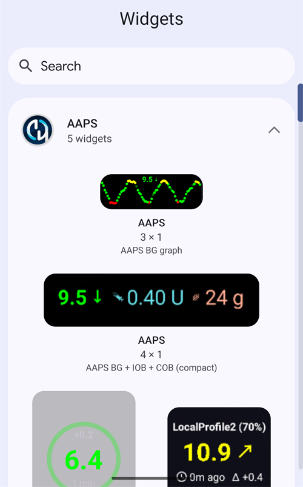

(widgets)=
# 홈 화면 위젯

**AAPS**는 휴대폰의 홈 화면에 추가할 수 있는 위젯을 제공합니다. 위젯은 앱을 열지 않아도 현재 데이터를 보여 줍니다. 위젯을 누르면 **AAPS**가 열립니다.

```{contents} Table of contents
:depth: 2
:local: true
```

---

## 사용할 수 있는 위젯

위젯은 다섯 가지입니다. Android 위젯 선택 화면에서 **AAPS** 아래에 표시됩니다:



| 위젯                            | 기본 크기 | 표시 내용                                                                                                                             |
| ----------------------------- | ----- | --------------------------------------------------------------------------------------------------------------------------------- |
| **AAPS 위젯**                   | 5 × 2 | 메인 화면의 상태 영역: 추세와 증분이 있는 혈당, 프로파일 이름 옆에 아이콘으로 표시되는 루프 모드, 목표, 민감도(메인 화면과 같은 방식으로 표시), IOB, COB. 텍스트는 잘리지 않고 위젯에 지정한 크기에 맞게 작아집니다. |
| **AAPS 혈당 원**                 | 2 × 2 | 메인 화면의 혈당 원: 혈당 색의 링, 추세 호, 증분, 혈당 값, 마지막 측정 후 지난 시간.                                                                             |
| **AAPS 소형**                   | 2 × 2 | 프로파일 이름, 추세 화살표가 있는 혈당, 마지막 측정 후 지난 시간, 증분, IOB, COB.                                                                             |
| **AAPS 혈당 + IOB + COB (컴팩트)** | 4 × 1 | 혈당과 추세 화살표, IOB, COB를 한 줄로 표시합니다.                                                                                                 |
| **AAPS 혈당 그래프**               | 3 × 1 | 혈당 값과 최근 측정값의 작은 그래프.                                                                                                             |

홈 화면의 **AAPS 위젯**, **혈당 원**, **소형** 위젯:


**컴팩트** 위젯과 **혈당 그래프** 위젯:


혈당 값은 **AAPS**와 같은 색을 사용합니다: 범위 안은 녹색, 범위 위는 노란색, 범위 아래는 빨간색.

---

## 위젯 추가하기

정확한 단계는 휴대폰과 런처에 따라 다릅니다. 대부분의 휴대폰에서는:

1. 홈 화면의 빈 곳을 길게 누르고 **Widgets**(위젯)를 선택하십시오.

   

2. 목록에서 **AAPS**를 열고 원하는 위젯을 누르십시오.
3. **Add**(추가)를 누르십시오(또는 위젯을 원하는 위치로 끌어 놓으십시오).

   

위젯이 홈 화면에 놓입니다. 추가한 직후에는 위젯에 조절점이 표시됩니다: 조절점을 끌어 위젯의 **크기를 조절**하거나, 위젯을 끌어 옮기십시오. 혈당 원은 어떤 크기로든 조절할 수 있습니다.


홈 화면 페이지가 가득 차 있으면 휴대폰이 위젯을 새 페이지에 놓습니다.

---

## 위젯 설정

위젯을 추가한 직후 위젯에 표시되는 **연필** 버튼을 누르십시오. 나중에는 위젯을 길게 누르면 조절점과 연필 버튼이 다시 나타납니다.

**위젯 설정** 대화 상자에는 설정이 두 가지 있습니다:

- **불투명도 설정** — 위젯 배경이 얼마나 불투명한지 정합니다. 값이 낮으면 배경 화면이 비쳐 보입니다.
- **검은색 사용** — 기본 배경 대신 검은색 배경을 사용합니다.


위젯마다 설정이 따로 있습니다.

---

## 알아 두면 좋은 점

- 위젯은 데이터를 **표시**만 합니다. 위젯에서 볼러스를 하거나 아무것도 변경할 수 없습니다.
- 위젯은 **AAPS**가 새로 고칩니다. **AAPS**가 실행 중이 아니거나 Android가 백그라운드에서 제한하면, 위젯에 오래된 데이터가 표시될 수 있습니다. 마지막 측정 후 지난 시간을 확인하고, **AAPS**가 [배터리 최적화](#SetupWizard-StoragePermission)에서 제외되어 있는지 확인하십시오.
- **AAPSClient**, **AAPSClient2**, **AAPSClient3**에서는 앱을 구분할 수 있도록 위젯 배경이 각각 노란색, 파란색, 녹색입니다. 색이 잘 보이지 않으면 위젯 설정에서 불투명도를 높이십시오. [AAPSClient, AAPSClient2, AAPSClient3 정보](#remotecontrol-aapsclient-versions)를 참조하십시오.
