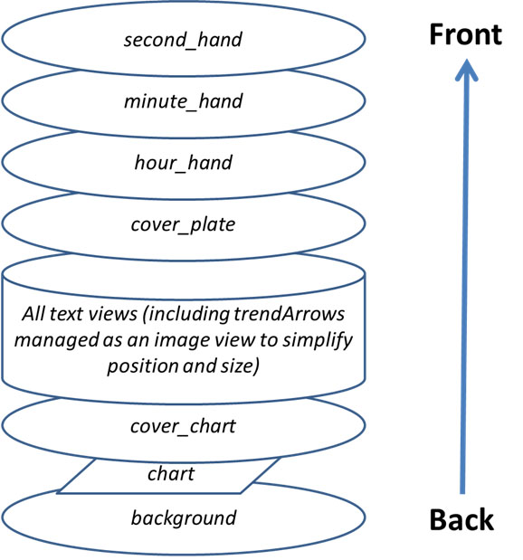

# 사용자 지정 워치 페이스 참조 문서

이 페이지는 새 워치 페이스를 만드는 디자이너를 위한 것입니다. 새 워치 페이스를 만들거나 애니메이션을 넣을 때 사용할 수 있는 모든 키워드와 기능을 나열합니다.

- Custom Watchface V2(Wear apk 3.3.0 이상)에서 사용할 수 있는 새 기능과 키는 [여기](#cwf-reference-new-v2-features)에 있습니다

## 사용자 지정 워치 페이스 형식

Custom Watchface는 AAPS를 위해 설계된 공개 형식이며, 워치에서 사용할 수 있는 새 "AAPS (Custom)" 워치 페이스와 연결되어 있습니다.

워치 페이스 파일은 간단한 zip 파일입니다. 하지만 워치 페이스 파일로 인식되려면 zip 파일에 다음 파일이 들어 있어야 합니다:

- CustomWatchface라는 이름의 이미지 파일 1개 (비트맵 파일 `CustomWatchface.jpg`, `CustomWatchface.png` 또는 벡터 파일 `CustomWatchface.svg`일 수 있습니다). 이 파일은 "워치 페이스 불러오기" 버튼을 누를 때 워치 페이스를 선택하는 데 사용하는 작은 아이콘이며, AAPS 워치 플러그인에도 표시되는 이미지입니다.
- `CustomWatchface.json`이라는 이름의 파일 1개 (아래 [JSON 구조](#cwf-reference-json-structure) 참고). 이 두 번째 파일은 핵심 파일입니다. 워치 페이스를 디자인하는 데 필요한 모든 정보가 이 파일에 들어 있습니다. 이 json 파일은 유효해야 합니다 (텍스트 편집기에서 이 파일을 직접 편집할 때 가장 까다로운 점일 것입니다. 쉼표 하나가 빠지거나 더 있어도 json 형식이 깨집니다). 이 JSON 파일에는 비어 있지 않은 값을 가진 `"name"` 키가 있는 `"metadata"` 블록도 있어야 합니다. 이것이 사용자 지정 워치 페이스의 이름이 됩니다 (아래 [Metadata 설정](#cwf-reference-metadata-settings) 참고)
- 이 zip 파일의 크기는 가능한 한 작아야 합니다 (약 500kb 미만). 이 파일이 너무 크면 차단되어 워치로 전송되지 않습니다.

zip 파일에는 추가 리소스 파일도 들어 있을 수 있습니다:

- 워치 페이스에 들어 있는 표준 뷰에 사용할 이미지의 고정 파일 이름 (`Background`, `CoverChart`... 등. 아래 [고정 이름 리소스 파일 목록](#cwf-reference-list-of-hardcoded-resource-files) 참고). 이 파일들은 모두 `jpg`, `png` 또는 `svg` 형식일 수 있습니다. 하지만 대부분의 파일에는 투명도를 지원하는 `png` 또는 `svg`를 사용해야 합니다 (jpg는 png보다 크기가 작지만 투명도가 없습니다). 일반적으로 가장 작은 크기로 가장 좋은 품질을 얻을 수 있는 것은 svg 파일(벡터 형식)입니다.
- 이름을 자유롭게 정할 수 있는 추가 리소스 파일. 이 추가 파일은 이미지 파일이거나 글꼴 파일일 수 있습니다 (글꼴은 `ttf` 및 `otf` 형식을 사용할 수 있습니다). 이 추가 파일의 경우 `filename`(확장자 없이)이 JSON 파일에서 keyValue로 사용되어, 이 파일을 어디에서 또는 언제 사용할지 지정합니다.
  - 이미지 파일은 텍스트 뷰의 배경이나 동적 애니메이션(예: 0%에서 100%까지의 배터리 잔량)에 자주 사용됩니다
  - 글꼴 파일을 사용하면 워치 페이스에서 전용 글꼴을 사용할 수 있습니다

(cwf-reference-json-structure)=

## JSON 구조

JSON 파일은 Notepad(또는 notepad++) 텍스트 편집기로 편집할 수 있습니다 (JSON을 인식하고 색상 서식을 사용하는 notepad++를 권장합니다)

- 이 파일에는 문자열 키 `"string_key":`와 키 값이 들어 있습니다. 키 값은 `"key value"` 같은 문자열, 정수, `true` 또는 `false` 같은 불리언, 또는 데이터 블록일 수 있습니다.
- 각 값은 쉼표 `,`로 구분됩니다
- 데이터 블록은 `{`로 시작하고 `}`로 끝납니다
- json 파일은 하나의 전체 블록이므로 `{`로 시작하고 `}`로 끝납니다. 이 파일 안의 모든 하위 블록은 블록 안에서 고유해야 하는 `"key"`와 연결되어 있습니다
- json 파일을 읽기 쉽게 하려고 보통 들여쓰기를 합니다 (새 키는 새 줄에 쓰고, 새 블록은 공백 4개만큼 오른쪽으로 이동합니다)

(cwf-reference-metadata-settings)=

### Metadata 설정

이 블록은 json 파일에 들어 있는 첫 번째 블록이며 반드시 있어야 합니다. 이 블록에는 이 워치 페이스와 관련된 모든 정보(이름, 작성자, 만든 날짜 또는 업데이트 날짜, 작성자 버전 또는 플러그인 버전 등)가 들어 있습니다.

아래에서 metadata 블록의 예를 보십시오:

```text
"metadata": {
    "name": "Default Watchface",
    "author": "myName",
    "created_at": "07\/10\/2023",
    "author_version": "1.0",
    "cwf_version": "1.0",
    "comment": "Default watchface, you can click on EXPORT WATCHFACE button to generate a template"
},
```

날짜에 사용하는 `/`는 특수 문자입니다. 따라서 json 파일에서 올바르게 인식되도록 그 앞에 "이스케이프" 문자 `\`를 넣어야 합니다

일부 json 파일에서는 추가 키 `"filename"`을 볼 수 있습니다. 이 키는 사용자 지정 워치 페이스를 AAPS에 불러올 때 자동으로 만들어지거나 업데이트됩니다 (exports 폴더에 있는 zip 파일 이름을 사용자에게 보여 주는 데 사용됩니다). 따라서 metadata 블록에서 이 키를 삭제해도 됩니다.

(cwf-reference-general-parameter-settings)=

### 일반 매개변수 설정

metadata가 있는 첫 번째 블록 뒤에 일부 일반 매개변수를 설정합니다 (아래 [일반 매개변수 목록](#cwf-reference-list-of-general-parameters) 참고). 여기서 그래프 색상(탄수화물, 볼러스, 혈당 값...)과, 범위 내, 고혈당, 저혈당 값의 기본 색상(혈당 값과 화살표의 기본 색상)을 설정할 수 있습니다

아래에서 일반 매개변수의 예를 보십시오

```text
"highColor": "#FFFF00",
"midColor": "#00FF00",
"lowColor": "#FF0000",
"lowBatColor": "#E53935",
"carbColor": "#FB8C00",
"basalBackgroundColor": "#0000FF",
"basalCenterColor": "#64B5F6",
"gridColor": "#FFFFFF",
"pointSize": 2,
"enableSecond": true,
```
(cwf-reference-imageview-settings)=

### ImageView 설정

사용자 지정 이미지는 사용자 지정 워치 페이스 레이아웃에 들어 있는 각 ImageView에 연결된 올바른 파일 이름을 사용하여 조정할 수 있습니다. 그러면 json 블록은 위치, 크기, 뷰의 표시 여부를 정하고 필요하면 색상을 조정하는 데에만 사용됩니다:

아래에서 second_hand에 대한 Image 블록의 예를 보십시오 (이 경우 zip 파일에 이미지가 없으므로 기본 초침 이미지가 사용되지만, 사용자 지정 색상으로 조정됩니다).

```text
"second_hand": {
    "width": 400,
    "height": 400,
    "topmargin": 0,
    "leftmargin": 0,
    "visibility": "visible",
    "color": "#BC906A"
}
```
second_hand를 기본 혈당 색상(lowRange, midRange 또는 highRange)으로 칠하려면, 마지막 줄을 keyValue `bgColor`로 바꾸기만 하면 됩니다

```json
    "color": "bgColor"
```

(cwf-reference-textview-settings)=

### TextView 설정

TextView에는 ImageView보다 사용할 수 있는 매개변수가 더 많습니다: 회전(도 단위 정수 값), textsize(픽셀 단위 정수 값), gravity(텍스트 값을 가운데(기본값)에 둘지, 왼쪽 또는 오른쪽에 맞출지 정함)를 조정하고, font, fontStyle, fontColor와 TextView의 배경색도 설정할 수 있습니다

```text
"basalRate": {
    "width": 91,
    "height": 32,
    "topmargin": 133,
    "leftmargin": 249,
    "rotation": 0,
    "visibility": "visible",
    "textsize": 23,
    "gravity": "center",
    "font": "default",
    "fontStyle": "bold",
    "fontColor": "#BDBDBD"
},
```
워치 페이스에서 어떤 뷰를 사용하지 않으려면 `"visibility"` 키를 `"gone"`으로 설정하고, 크기와 위치도 다음과 같이 보이는 영역 밖으로 설정하십시오:

```text
"second": {
    "width": 0,
    "height": 0,
    "topmargin": 0,
    "leftmargin": 0,
    "rotation": 0,
    "visibility": "gone",
    "textsize": 46,
    "gravity": "center",
    "font": "default",
    "fontStyle": "bold",
    "fontColor": "#BDBDBD"
},
```
크기와 위치가 보이는 영역 안에 있으면, 워치 페이스가 새로 고쳐지는 동안 숨겨진 값이 잠깐 "번쩍" 보일 수 있습니다.

텍스트 뷰의 배경 이미지를 사용자 지정하려면 `"background":` 키를 사용하고, zip 파일에 들어 있는 이미지의 파일 이름을 keyValue로 넣으십시오. `"color:"` 키를 사용하여 배경색만 바꿀 수도 있습니다.

```json
"background": "fileName"
```

또한 특별한 TextView 4개(freetext1에서 freetext4까지)가 있습니다. 이 뷰에는 특별한 매개변수 `"textvalue":`가 있으며, 예를 들어 레이블을 설정하는 데 사용할 수 있습니다

(cwf-reference-chartview-settings)=

### ChartView 설정

Chart 뷰는 매우 특별한 뷰로, ImageView 또는 TextView와 일부 매개변수를 함께 사용할 수 있습니다...

이 뷰의 표준 설정은 매우 간단합니다:

```text
"chart": {
    "width": 400,
    "height": 170,
    "topmargin": 230,
    "leftmargin": 0,
    "visibility": "visible"
},
```
Chart 뷰에 넣을 수 있는 추가 매개변수 2개는 `"color"` 키를 사용하는 배경색(기본값은 투명)과 `"background"` 키를 사용하는 배경 이미지입니다.

(cwf-reference-how-to-build-watchface)=

## 첫 번째 워치 페이스를 만들고 디자인하는 방법

### 필요한 도구

- 텍스트 편집기: NotePad++(또는 비슷한 프로그램)를 사용할 것을 권합니다. 간단한 텍스트 편집기이지만, 서식이 있는 텍스트를 색상 코드로 볼 수 있어서 오류를 찾기가 더 쉽습니다. 간단한 텍스트 편집기라면 무엇이든 됩니다. 목적은 json 정보를 조정하는 것이기 때문입니다.
- 이미지 편집기 (비트맵 및/또는 벡터)
  - 비트맵을 사용하는 경우
    - 이미지 편집기는 투명도(배경 위에 있는 모든 이미지에 필요)와 png 형식(비트맵 이미지를 사용한 경우)을 지원해야 합니다
    - 배경 이미지는 jpg 형식이어도 됩니다 (png보다 작습니다)
    - 이미지 편집기에서 그래픽 개체(간단한 사각형이어도 됨)를 픽셀 단위로 측정할 수 있어야 합니다 (top, left, width, height)
    - 이미지 편집기는 색상을 16진수 RRGGBB 코드로 보여 줄 수 있어야 합니다
    - 이미지 편집기는 이미지 크기를 400px x 400px로 바꿀 수 있어야 합니다 (이 해상도로 작업하는 것이 매우 중요합니다)
  - 벡터를 사용하는 경우
    - 벡터 이미지는 svg 형식으로 내보내야 합니다

### 처음부터 시작하지 않도록 템플릿 받기

첫 번째 워치 페이스를 디자인할 때는 기본 워치 페이스에서 시작하는 것이 가장 좋습니다 (그러면 사용 가능한 모든 뷰가 올바르게 정렬된 최신 버전을 사용할 수 있습니다)

- 워치 플러그인에서 "템플릿 내보내기" 버튼을 누르면 zip 파일을 받을 수 있습니다. zip 파일은 AAPS/exports 폴더에 저장됩니다
- 사용자 지정 워치 페이스 버튼을 보려면 워치가 AAPS에 연결되어 있어야 합니다 (사용자 지정 워치 페이스를 확인하고, 시험하고, 조정하는 데에도 워치가 필요합니다)

기본 워치 페이스는 매우 간단하며, zip 파일에는 다음 2개 파일만 들어 있습니다:

- CustomWatchface.png (워치 페이스 선택에 사용하는 기본 워치 페이스 이미지)
- CustomWatchface.json

### 컴퓨터에서 파일 정리하기

가장 쉬운 작업 방법은 휴대폰을 컴퓨터에 연결하고 두 개의 특정 폴더로 작업하는 것입니다:

- 탐색기 하나는 특정 폴더를 엽니다. 이 폴더에는 모든 파일(json, 비트맵 이미지, 벡터 이미지, 글꼴)과 CustomWatchface.zip 파일이 들어 있습니다
- 다른 탐색기 하나(또는 조정한 탐색 트리)는 휴대폰/AAPS/exports 폴더를 엽니다

이렇게 하면 작업이 매우 쉽습니다. 텍스트 편집기로 json 파일을 고치거나 이미지 편집기(비트맵 또는 벡터)로 이미지를 고칠 때마다 다음만 하면 됩니다:

1. 각 앱에서 수정 내용을 저장합니다
2. 모든 파일을 CustomWatchface.zip 파일 안으로 끌어다 놓습니다
3. CustomWatchface.zip을 휴대폰의 AAPS/exports 폴더로 끌어다 놓습니다
4. 결과를 확인하기 위해 CustomWatchface를 워치로 보냅니다

### 워치 페이스 사용자 지정 시작하기

첫 단계로 워치 페이스 이름(시험할 때 쉽게 선택하려면 필요)을 정하고, json 파일 시작 부분의 metadata 키를 조정하기 시작해야 합니다

그다음 어떤 정보를 표시할지, 즉 어떤 뷰를 보이게 하고 어떤 뷰를 숨길지 정해야 합니다.

- 초를 표시하겠습니까?
- 아날로그 시계를 디자인하겠습니까, 디지털 시계를 디자인하겠습니까 (또는 둘 다...)

이제 각 뷰의 `"visibility":` 키를 `"visible"` 또는 `"gone"`으로 설정하여 json 파일을 수정할 수 있습니다 (뷰를 유지할지 여부에 따라)

워치 페이스 배치를 시작하기 위해 top, left margin, width, height 값을 대략 조정하기 시작할 수도 있습니다 (이 값들은 나중에 이미지 편집기를 사용하여 조정합니다)

참고: 모든 것은 **400px x 400px 사각형** 안에서 디자인합니다. 따라서 모든 것은 이 크기 안에서 절대 좌표로 배치됩니다.

첫 번째 워치 페이스를 디자인할 때 알아야 할 점이 있습니다. 모든 것은 뒤쪽에서 위쪽으로 레이어별로 구성되므로, 각 뷰(ImageView 또는 TextView)는 그 뒤에 있는 것을 가릴 수 있습니다...





그리고 json 파일 안에서 모든 뷰는 뒤쪽에서 위쪽 순서로 정렬되어 있습니다 (무엇이 무엇의 뒤에 있는지 기억하는 데 도움이 됩니다...)

첫 번째 사용자 지정 워치 페이스를 디자인하거나 조정할 때는 간단한 것부터 시작하십시오: 일부 뷰의 표시 여부를 바꾸거나, json 파일을 바꾸지 않고 전용 배경 이미지를 넣어 보십시오...

### 색상 관리

json 파일에는 색상을 지정하는 키가 여러 개 있습니다: 뷰에는 `"color"`, `"fontColor"`가 있고, 그 외에 `"highColor"`, `"midColor"`, `"lowColor"`, ... 도 있습니다 ([일반 매개변수 목록](#cwf-reference-list-of-general-parameters) 참고)

색상은 `#`로 시작하고 그 뒤에 16진수 형식의 RRGGBB(빨강, 초록, 파랑) 값이 오는 텍스트 필드로 지정합니다:

- `"#FFFFFF"`는 흰색, `"#000000"`은 검은색, `"#FF0000"`은 빨간색입니다...

알파 레이어를 위한 값 2개를 더 넣어 투명도를 지정할 수도 있습니다 (AARRGGBB):

- `"#00000000"`은 완전히 투명하고, `"#FF000000"`은 완전히 불투명합니다 (따라서 `"#FF000000"`은 `"#000000"`과 같습니다)

특별한 keyvalue `"bgColor"`를 사용하면 혈당 값에 따라 일반 매개변수에 지정한 `"highColor"`, `"midColor"`, `"lowColor"`를 자동으로 사용할 수도 있습니다:

- `"fontColor": "bgColor",`는 혈당 값에 따라 뷰의 글꼴 색상을 자동으로 설정합니다
- `sgv`(혈당 값) 및 `direction`(추세 화살표) 뷰는 일반 매개변수에서 설정한 혈당 색상을 자동으로 적용합니다 (이 2개 뷰에 다른 색상을 사용하려면, 고급 [dynData](#cwf-reference-dyndata-feature) 기능을 단일 단계 색상으로 사용해야 합니다...)

ImageView와 `"color":` 키에 대한 자세한 내용은 아래의 전용 장 [이미지 색상 조정](#cwf-reference-tune-image-color)을 참고하십시오.

### 고정 이름 이미지 넣기

워치 페이스 조정을 시작하는 가장 쉬운 방법은 특정 이름을 가진 이미지를 zip 파일에 넣는 것입니다 ([고정 이름 리소스 파일 목록](#cwf-reference-list-of-hardcoded-resource-files) 참고)

- 이미지는 `.jpg`, `.png` 또는 `.svg` 형식이어야 합니다. 하지만 주의하십시오. jpg는 투명도를 지원하지 않으므로 배경 레이어에만 사용해야 합니다. 모든 중간 레이어(cover_chart, cover_plate, 바늘)에는 `.png` 또는 `.svg` 이미지를 사용하십시오

- 벡터 이미지 편집기(예: Illustrator)가 있다면 이 형식을 사용하십시오. `.svg` 확장자를 가진 작은 텍스트 파일로 가장 좋은 품질을 얻을 수 있습니다.
- 정확한 파일 이름(대문자/소문자 포함)을 사용하도록 주의해야 합니다

이제 전용 배경 이미지를 사용하려면 zip 파일에 `Background.jpg`라는 파일을 넣기만 하면 됩니다 (다른 것은 바꿀 필요가 없습니다). zip 파일을 워치로 보내고 결과를 확인하십시오!

아날로그 시계의 hour_hand, minute_hand 또는 second_hand를 사용자 지정하려면 `HourHand.png`(또는 `HourHand.svg`), `MinuteHand.png`, `SecondHand.png`를 넣기만 하면 됩니다.

- 이 이미지들은 이미지 중심을 기준으로 자동으로 회전합니다. 따라서 이미지는 00:00:00으로 설정해야 합니다 (그리고 "전체 화면" 아날로그 시계의 경우 크기 400 x 400 px, 위치 top 0 left 0을 사용하십시오)

[고정 이름 리소스 파일 목록](#cwf-reference-list-of-hardcoded-resource-files)에서 각 이미지 뷰마다 고정 파일 이름 `High`와 `Low`가 두 개 더 있는 것도 볼 수 있습니다 (예를 들어 `BackgroundHigh.jpg`와 `BackgroundLow.jpg`라는 다른 이미지를 zip 파일에 넣을 수 있습니다). 그러면 혈당 수준(범위 내, 고혈당 또는 저혈당)에 따라 이미지가 자동으로 바뀝니다. 예로 AIMICO 워치 페이스를 보십시오.

(cwf-reference-tune-image-color)=

### 이미지 색상 조정

`"color"` 키를 사용하여 기본 이미지 색상을 조정할 수 있습니다:

- background 뷰에 적용하면 배경색을 설정합니다 (기본값 검은색)
- cover_plate(간단한 다이얼)나 바늘에 적용하면 기본 이미지(흰색)를 지정한 색상(`"bgColor"` 포함)으로 바꿉니다

비트맵 이미지(`.jpg` 또는 `.png`)에 `"color"` 키를 적용하면 색상 채도에 흥미로운 효과가 나타납니다. 따라서 비트맵을 여전히 알아볼 수 있습니다.

마지막으로 `.svg` 이미지 파일에서는 `"color"` 키가 아무 효과가 없습니다. 벡터 파일의 색상은 이미지 안에 고정되어 있다고 생각하십시오. 색상을 바꾸려면 `svg` 파일을 여러 개 넣고 고급 [dynData](#cwf-reference-dyndata-feature) 기능을 사용하여 바꿔야 합니다

### TextView에 추가 글꼴 사용하기

wear apk에는 이미 여러 기본 글꼴이 있습니다 ([키 값](#cwf-reference-key-values) 장에 있는 글꼴 키 참고). 하지만 기본으로 제공되지 않는 추가 글꼴을 사용하려면 zip 파일에 추가 글꼴을 넣을 수 있습니다:

- 사용할 수 있는 글꼴 형식은 `.ttf`와 `.otf` 파일 2가지입니다
- zip 파일에 사용자 지정 글꼴을 넣으면 (예: `myCustomFont.ttf`라는 파일), json 파일의 TextView에서 그 글꼴을 사용하려면 파일 이름을 사용해야 합니다:

```
"font": "myCustomFont",
```

일부 글꼴은 파일이 클 수 있다는 것을 기억하십시오 (zip 파일 크기에는 최대 한도가 있습니다). 따라서 아주 적은 문자(숫자, `.`, `,`)만 사용한다면, 무료 도구로 사용하지 않는 문자를 지워서 (예: [여기](https://products.aspose.app/font/generator/ttf-to-ttf)) 글꼴 크기를 줄일 수 있습니다.

(cwf-reference-advanced-features)=

## 고급 기능

(cwf-reference-preference-feature)=

### 설정 기능

사용자 지정 워치 페이스는 워치 페이스가 올바르게 보이도록 일부 워치 설정을 자동으로 조정할 수 있습니다 (사용자가 워치 설정에서 허가한 경우).

하지만 이 기능은 주의해서 사용해야 합니다. 설정은 다른 모든 워치 페이스와 공유됩니다. 따라서 이 기능을 사용할 때 지켜야 할 규칙이 몇 가지 있습니다:

- 숨겨진 뷰와 관련된 설정은 절대 설정하지 마십시오
- 보이는 뷰를 최대한 많이 사용하십시오
- 일부 뷰의 너비는 넉넉하게 크게 잡아도 됩니다:
  - 임시 기저(TBR)는 퍼센트(작은 너비)로 표시할 수도 있고, 훨씬 넓은 절대값으로 표시할 수도 있습니다
  - 자세한 정보가 있는 증분 또는 평균 증분은 넓을 수 있습니다
  - iob2도 마찬가지입니다: 이 뷰는 총 IOB를 표시할 수 있지만, 자세한 IOB를 선택하면 텍스트가 매우 길어질 수 있습니다

올바르게 표시하기 위해 여전히 매우 특별한 설정이 필요하다면 (아래 예에서는 자세한 IOB를 표시할 공간이 부족하면, 워치의 이 매개변수를 `false`로 "강제"할 수 있습니다) metadata 블록에 다음과 같은 설정 제약을 넣을 수 있습니다

```text
"metadata": {
    "name": "Default Watchface",
    "author": "myName",
    "created_at": "07\/10\/2023",
    "author_version": "1.0",
    "cwf_version": "1.0",
    "comment": "Default watchface, you can click on EXPORT WATCHFACE button to generate a template",
    "key_show_detailed_iob": false
},
```

사용자가 사용자 지정 워치 페이스에 워치 매개변수 수정을 허가하면 (워치 플러그인의 설정), "IOB 자세히 표시하기"가 "비활성화"로 설정되고 비활성화 상태로 잠깁니다 (워치 플러그인 매개변수에서 허가를 끄거나 다른 워치 페이스를 선택할 때까지 이 매개변수를 바꿀 수 없습니다)

- 사용자가 워치 페이스를 선택할 때, 워치 페이스 선택 화면에서 "필요한 매개변수"의 개수를 볼 수 있습니다

아래 예에서 Gota 워치 페이스에는 필요한 매개변수가 1개 있습니다. 허가하지 않았으면 흰색으로 표시됩니다. 허가했으면 이 매개변수가 워치에 설정되고 잠깁니다 (이 경우 숫자는 주황색입니다)


(cwf-reference-twinview-feature)=

### TwinView 기능

트윈 뷰를 사용하면 보이는 뷰에 따라 뷰 위치를 쉽게 조정할 수 있습니다. 이 기능은 전체를 LinearLayout으로 만든 레이아웃만큼 강력하지는 않지만, 흔한 경우를 많이 처리할 수 있습니다.

아래 예에서는 설정에서 모든 뷰를 보이게 한 AAPS (Cockpit) 워치 페이스와, "리그 배터리 표시"와 "평균 증분 표시"를 비활성화한 같은 워치 페이스를 볼 수 있습니다


트윈 뷰 중 하나가 숨겨지면 다른 하나가 가운데로 이동하는 것을 볼 수 있습니다

이 예에서 `"uploader_battery"` 블록에는 `"rig_battery"` 뷰를 지정하는 `"twinView":` 키가 추가되어 있고, `"rig_battery"` 블록에서는 `"twinView":` 키가 `"uploader_battery"`를 트윈으로 지정하는 것을 볼 수 있습니다. 그리고 추가 키 `"leftOffsetTwinHidden":`은 트윈이 숨겨졌을 때 뷰를 이동할 픽셀 수를 정합니다.

이 숫자를 계산하려면, 두 트윈 뷰의 leftMargin 차이가 50픽셀이라는 것을 보십시오. 따라서 가운데에 있으려면 한쪽 또는 다른 쪽 방향으로 그 절반만큼 이동해야 합니다.

트윈 뷰가 세로로 배치되어 있으면 `"topOffsetTwinHidden":` 키를 사용해야 합니다

```text
"uploader_battery": {
    "width": 49,
    "height": 30,
    "topmargin": 354,
    "leftmargin": 150,
    "rotation": 0,
    "visibility": "visible",
    "textsize": 23,
    "gravity": "center",
    "font": "roboto_condensed_bold",
    "fontStyle": "bold",
    "fontColor": "#FFFFFF",
    "twinView": "rig_battery",
    "leftOffsetTwinHidden": 25
},
"rig_battery": {
    "width": 49,
    "height": 30,
    "topmargin": 354,
    "leftmargin": 200,
    "rotation": 0,
    "visibility": "visible",
    "textsize": 23,
    "gravity": "center",
    "font": "roboto_condensed_bold",
    "fontStyle": "bold",
    "fontColor": "#FFFFFF",
    "twinView": "uploader_battery",
    "leftOffsetTwinHidden": -25
},
```
(cwf-reference-dyndata-feature)=

### DynData 기능

DynData는 일부 내부 값(혈당 값, 혈당 수준, 증분, 배터리 % 등... 사용할 수 있는 데이터 목록은 [여기](#cwf-reference-dyndata-key-values) 참고)에 따라 워치 페이스에 애니메이션을 넣으려는 경우 가장 강력한 기능입니다

이 기능을 설명하기 위해 AAPS (SteamPunk) 워치 페이스를 예로 들겠습니다:


이 워치 페이스에서는 오른쪽의 [혈당 값 회전](#cwf-reference-background-management)(30도에서 330도까지), [avg_delta의 동적 범위](#cwf-reference-avg-delta-management)(값에 따라 5mgdl, 10mgdl 또는 20mgdl까지의 눈금), 눈금과 동기화되어야 하는 [포인터 회전](#cwf-reference-dynamic-rotation-management), 그리고 뷰의 여러 레이어를 관리해야 합니다...

이 워치 페이스를 관리하기 위해 zip 파일에 들어 있는 모든 이미지를 아래에서 보십시오:

참고: 투명도를 볼 수 있도록 이 이미지들은 모두 노란색 배경 위에 있고 빨간 사각형으로 둘러싸여 있습니다


- 첫 번째 줄에서 Background.jpg와 CoverPlate.png는 해당 뷰에 자동으로 연결되고 (기본 뷰 파일 이름), steampunk_pointer.png는 dynData로 관리됩니다
- 두 번째 줄에서는 avg_delta의 동적 범위를 위한 눈금 3개를 볼 수 있습니다. 이것도 dynData로 관리됩니다
- 세 번째 줄에서 chartBackground.jpg는 chart 뷰에 수동으로 연결되고, HourHand.png와 MinuteHand.png 파일은 해당 뷰에 자동으로 연결됩니다

(cwf-reference-background-management)=

#### 배경 관리

먼저 혈당 값 이미지는 선택의 여지가 없습니다. 배경 레이어에만 있을 수 있습니다 (그렇지 않으면 chart 뷰 앞에 있게 되어 chart가 보이지 않습니다!). 따라서 혈당 값을 배경에 연결한 다음, 혈당 값에 따라 배경 이미지를 회전해야 합니다.

`"background"` 블록 안에 이 회전을 위한 전용 키 2개를 넣습니다:

```text
"background": {
    "width": 400,
    "height": 400,
    "topmargin": 0,
    "leftmargin": 0,
    "dynData": "rotateSgv",
    "rotationOffset": true,
    "visibility": "visible"
},
```
`"dynData":` 키는 애니메이션(값, 범위, 변환...)을 정의하는 데 사용할 블록을 정합니다. 여기서는 이 블록의 이름을 "rotateSgv"로 정했습니다 (이 기능을 사용할 때는 의미가 분명한 이름을 고르십시오),

`"rotationOffset": true,`는 값에 따라 기대하는 애니메이션이 회전이라는 것을 정합니다. (슬라이더를 만들려면 사용할 수 있는 다른 키는 `"leftOffset"`과 `"topOffset"`입니다)

이제 파일의 끝, 마지막 뷰 뒤로 가 보겠습니다:

```text
"second_hand": {
    "width": 120,
    "height": 120,
    "topmargin": 140,
    "leftmargin": 140,
    "visibility": "gone"
},
"dynData": {
    "rotateSgv": {
        "valueKey": "sgv",
        "minData": 30,
        "maxData": 330
    },
```
마지막 뷰(`"second_hand"`) 뒤에 모든 애니메이션이 들어 있는 새 `"dynData": { ... }` 블록을 추가한 것을 볼 수 있습니다:

`"background"` 뷰에서 지정한 블록의 이름은 `"rotateSgv"`였습니다. 이 블록이 `"dynData"`에서 찾을 수 있는 첫 번째 블록입니다!

이 블록은 간단합니다: 첫 번째 키 `"valueKey":`는 어떤 값을 사용할지 정하는 데 사용됩니다. 이 경우 `"sgv"`는 혈당 값을 나타내는 "keyValue"입니다 (대부분의 경우 keyValue는 이 정보를 표시하는 뷰와 이름이 같습니다).

혈당 값의 경우 기본 최소 데이터는 39mgdl, 기본 최대 데이터는 400mgdl로 설정되어 있습니다 (사용할 수 있는 모든 keyValue와 관련 최소/최대 데이터 값은 아래 [DynData 키 값 참조](#cwf-reference-dyndata-key-values)를 보십시오).

`"rotateSgv"` 블록 안의 추가 키 2개(`"minData":`와 `"maxData":`)는 최소 및 최대 데이터를 30과 330으로 조정하는 데 사용됩니다. 이 최소값과 최대값을 사용하면 데이터 값을 (변환 없이) 그대로 사용하여 배경을 도 단위로 회전할 수 있습니다. 이 경우 330mgdl보다 높은 모든 혈당 값은 이미지의 상한인 330으로 제한됩니다.

#### Chart 관리

chart의 기본 배경은 투명합니다. 따라서 배경 이미지에 있는 혈당 눈금을 가리려면 전용 배경 이미지를 넣어야 합니다 (이 이미지에는 Steampunk 워치 페이스의 전체 그림자가 들어 있습니다). chartBackground.jpg 파일과의 연결은 `"background":` 키로 합니다

물론 뷰의 크기와 위치는 픽셀 단위로 정확히 맞춰야 합니다!

```text
"chart": {
    "width": 216,
    "height": 107,
    "topmargin": 280,
    "leftmargin": 80,
    "visibility": "visible",
    "background": "chartBackground"
},
```
(cwf-reference-avg-delta-management)=

#### 평균 증분 관리

평균 증분의 동적 범위를 관리하기 위해 freetext 뷰 4개를 사용합니다. freetext1은 이미지 눈금을 관리하는 데 사용하고, freetext2에서 freetext4까지는 눈금에 따른 포인터 회전을 관리하는 데 사용합니다.

**freetext1**

앞에서 설명한 것처럼 freetext 뷰는 chart와 배경의 앞에 있습니다. 그래서 이 이미지들을 볼 수 있도록 투명한 영역(이미지의 오른쪽과 아래쪽)을 넣었습니다

이 이미지에서 잘라 낸 아래쪽 부분은 완벽하게 어울리도록 chart의 배경으로 사용했습니다.

```text
"freetext1": {
    "width": 400,
    "height": 400,
    "topmargin": 0,
    "leftmargin": 0,
    "rotation": 0,
    "visibility": "visible",
    "dynData": "avgDeltaBackground"
},
```
이 뷰에는 `avgDeltaBackground`라는 다른 `"dynData"` 블록으로의 연결을 넣습니다. 이 블록은 avgDelta 값에 따라 avgDelta 눈금을 관리합니다.

```text
"avgDeltaBackground": {
    "valueKey": "avg_delta",
    "minData": -20,
    "maxData": 20,
    "invalidImage": "steampunk_gauge_mgdl_5",
    "image1": "steampunk_gauge_mgdl_20",
    "image2": "steampunk_gauge_mgdl_20",
    "image3": "steampunk_gauge_mgdl_10",
    "image4": "steampunk_gauge_mgdl_5",
    "image5": "steampunk_gauge_mgdl_5",
    "image6": "steampunk_gauge_mgdl_10",
    "image7": "steampunk_gauge_mgdl_20",
    "image8": "steampunk_gauge_mgdl_20"
},
```
- `"valueKey":`는 `"avg_delta"` 값과 연결합니다
- 최소 및 최대 데이터는 범위를 이 워치 페이스에서 사용할 수 있는 최대값(-20mgdl에서 20mgdl까지)으로 제한합니다. mmol 사용자는 AAPS의 모든 내부 값이 항상 mgdl이라는 것을 기억하십시오.

이제 값에 따라 동적 배경 이미지를 관리하는 방법을 보겠습니다.

`"invalidImage":`는 데이터가 유효하지 않을 때(또는 데이터가 없을 때) 표시할 이미지를 관리하는 키입니다. 여기서는 zip 파일에 들어 있는 5 mgdl 눈금의 추가 리소스 이미지와 연결합니다

그다음 `"image1":`에서 `"image8":`까지 일련의 이미지를 사용합니다. 제공하는 이미지 수에 따라 `minData`와 `maxData` 사이의 단계 수가 정해집니다.

- `image1`은 avg_delta가 `minData`와 같거나 가까울 때 표시할 이미지를 정하고, 번호가 가장 큰 이미지(여기서는 `image8`)는 avg_delta가 `maxData`와 같거나 가까울 때 표시할 이미지를 정합니다
- -20mgdl과 20mgdl 사이의 전체 범위는 40mgdl입니다. 이를 8(제공한 이미지 수)로 나누면 5mgdl씩 8단계가 됩니다
- 이제 가장 낮은 값부터 시작하여 avg_delta 값에 따라 배경 이미지를 연결할 수 있습니다: -20과 -15 사이, 그리고 -15와 -10 사이에서는 눈금으로 `steampunk_gauge_mgdl_20`을 사용하고, -10과 -5 사이에서는 `steampunk_gauge_mgdl_10`을 사용하며, 이런 식으로 계속하여 +15와 +20 사이에서는 다시 `steampunk_gauge_mgdl_20` 배경 이미지를 사용합니다

(cwf-reference-dynamic-rotation-management)=

**freetext2에서 freetext4까지**

이 뷰들에서는 동적 이미지와 앞에서 설명한 회전 기능을 함께 사용합니다:

```text
"freetext2": {
    "width": 276,
    "height": 276,
    "topmargin": 64,
    "leftmargin": 64,
    "rotation": 0,
    "visibility": "visible",
    "dynData": "avgDelta5",
    "rotationOffset": true
},
"freetext3": {
    "width": 276,
    "height": 276,
    "topmargin": 64,
    "leftmargin": 64,
    "rotation": 0,
    "visibility": "visible",
    "dynData": "avgDelta10",
    "rotationOffset": true
},
"freetext4": {
    "width": 276,
    "height": 276,
    "topmargin": 64,
    "leftmargin": 64,
    "rotation": 0,
    "visibility": "visible",
    "dynData": "avgDelta20",
    "rotationOffset": true
},
```
여기서 각 뷰는 특정 눈금 전용입니다 (따라서 전용 dynData 블록에 연결되어 있습니다). 이 3개 뷰에서 `"rotationOffset":` 키가 켜져 있는 것도 볼 수 있습니다. 이제 첫 번째 dynData 블록을 보십시오:

```text
"avgDelta5": {
    "valueKey": "avg_delta",
    "minData": -20,
    "maxData": 20,
    "rotationOffset": {
        "minValue": -120,
        "maxValue": 120
    },
    "invalidImage": "null",
    "image1": "null",
    "image2": "null",
    "image3": "null",
    "image4": "steampunk_pointer",
    "image5": "steampunk_pointer",
    "image6": "null",
    "image7": "null",
    "image8": "null"
},
```
여기서는 동적 범위가 avg_delta 데이터 -5와 +5 사이에서만 사용되더라도, 눈금이 바뀔 때 포인터가 배경과 동기화되도록 전체 범위 -20, +20mgdl을 유지하는 것이 중요합니다. 그래서 `avgDeltaBackground`와 같은 전체 범위와 같은 단계 수(이미지 8개)를 유지합니다.

`"invalidImage"`나 여러 `"imagexx"`의 키 값이 `"null"`인 것을 볼 수 있습니다 (zip 파일에 파일 이름으로 존재하지 않는 문자열이면 무엇이든 됩니다). 파일 이름을 찾지 못하면 뷰 배경 이미지는 투명해집니다. 따라서 이 설정은 포인터가 4단계와 5단계(평균 증분이 -5mgdl과 +5 mgdl 사이)에서만 보이고, 이 범위 밖에서는 보이지 않게 합니다.

이제 새 블록 `"rotationOffset":`을 볼 수 있습니다. 이 블록 안에는 키 2개 `"minValue":`와 `"maxValue":`가 있습니다. 이 값들은 내부 데이터(mgdl)와 원하는 회전 각도 사이의 변환에 사용됩니다.

- Steampunk 워치 페이스는 포인터가 최대 -30도에서 30도까지 회전하도록 디자인되어 있습니다. 따라서 눈금(여기서는 -5mgdl에서 5mgdl까지)에 맞추어 이 값들에 대해 30도가 되도록 합니다. `minData`와 `maxData`가 4배 크므로, 이에 해당하는 minValues와 maxValues는 4 * 30도, 즉 -120도와 +120도입니다. 하지만 +-30도를 넘거나 그보다 작은 모든 회전에서는 포인터가 숨겨지고 (보이는 이미지 없음), 포인터는 -5와 +5mgdl 사이의 값에서만 보입니다... 이것이 바로 여기서 원하는 결과입니다.

다른 dynData 블록도 같은 방법으로 정의하여 `"avgDelta10"`과 `"avgDelta20"`을 조정합니다

#### loop 뷰

Steampunk 워치 페이스에서는 loop의 초록색과 빨간색 화살표(상태 표시용)가 비활성화되어 있습니다. 이것도 loop 뷰에 연결된 전용 dynData 블록으로 관리합니다.

```text
    "loopArrows": {
        "invalidImage": "greyArrows",
        "image1": "greenArrows",
        "image2": "redArrows"
    }
```
이 블록은 loop 뷰에서만 호출되고, 이 뷰가 관리하는 기본 데이터가 루프 정보이므로 `"valueKey":` 키는 선택 사항입니다.

loop의 기본 `minData`와 `maxData`는 0분과 28분으로 정해져 있습니다. 따라서 이미지가 2개이면 14분 미만의 모든 데이터 값은 배경 `image1`로 표시되고, 14분을 넘는 모든 데이터 값은 `image2`로 표시됩니다. 14분은 초록색 화살표에서 빨간색 화살표로 바뀌는 정확한 기준값입니다.

이 예에서 `greyArrows`, `greenArrows`, `redArrows` 파일은 zip 파일에 들어 있지 않으므로 이 화살표들은 그냥 사라집니다 (보이지 않음). 하지만 사용자 지정 배경 이미지로 상태 화살표를 조정하려면 이 블록을 "그대로" 사용할 수 있습니다.

#### rig_battery 및 uploader_battery 뷰

dynData 기능에 대한 설명을 마치기 위해 배터리 관리를 살펴보겠습니다. 여기서 목표는 배터리 잔량(0에서 100%까지)에 따라 텍스트 색상을 바꾸는 것입니다

```text
"uploader_battery": {
    "width": 60,
    "height": 28,
    "topmargin": 100,
    "leftmargin": 170,
    "rotation": 0,
    "visibility": "visible",
    "textsize": 20,
    "gravity": "center",
    "font": "default",
    "fontStyle": "bold",
    "fontColor": "#00000000",
    "dynData": "batteryIcons",
    "twinView": "rig_battery",
    "topOffsetTwinHidden": -13
},
"rig_battery": {
    "width": 60,
    "height": 28,
    "topmargin": 74,
    "leftmargin": 170,
    "rotation": 0,
    "visibility": "visible",
    "textsize": 20,
    "gravity": "center",
    "font": "default",
    "fontStyle": "bold",
    "fontColor": "#00000000",
    "dynData": "batteryIcons",
    "twinView": "uploader_battery",
    "topOffsetTwinHidden": 13
},
```
여기서 두 뷰가 `batteryIcons`라는 같은 `dynData` 블록을 함께 사용하는 것을 볼 수 있습니다. 이것이 가능한 이유는 기본적으로 연결된 데이터가 뷰의 데이터이기 때문입니다 (따라서 `batteryIcons` 블록에 `"valueKey":` 키를 지정하지 않으면, 뷰에 따라 `uploader_battery` 데이터 또는 `rig_battery` 데이터에 적용됩니다).

이 두 뷰는 [여기](#cwf-reference-twinview-feature)에서 설명한 TwinView 기능도 사용합니다.

이제 dynData 블록을 살펴보겠습니다:

```text
"batteryIcons": {
    "invalidFontColor": "#00000000",
    "fontColor1": "#A00000",
    "fontColor2": "#000000",
    "fontColor3": "#000000",
    "fontColor4": "#000000",
    "fontColor5": "#000000"        
},
```
여기서는 동적 배경 이미지와 정확히 같은 논리를 사용하지만, 전용 키(`"invalidFontColor"`와 `"fontColor1"`에서 `"fontColor5"`까지)를 사용하여 각각 20%씩 5단계를 지정합니다.

- `"fontColor1"`(진한 빨간색)은 20% 미만의 모든 값에 사용되고, 이 기준값을 넘는 모든 값에는 흰색이 사용됩니다.
- 기준값을 "10% 미만"으로 낮추려면 `"fontColor6"`에서 `"fontColor10"`까지 키 5개를 더 넣기만 하면 됩니다. 또는 초록색에서 노란색, 주황색, 빨간색으로 점점 바뀌게 하려면 각 색상을 조정할 수도 있습니다...

(cwf-reference-dynpref-feature)=

### DynPref 기능

이 장을 읽기 전에 [dynData](#cwf-reference-dyndata-feature)가 어떻게 작동하는지 이해해야 합니다. DynPref는 DynData의 고급 사용법이기 때문입니다: 이제 사용자가 설정한 설정에 따라 각 DynData 블록을 조정할 수 있습니다:

DynPref 기능을 설명하기 위해 두 가지 예를 사용합니다:

- Steampunk 워치 페이스 (간단한 사용법: 같은 워치 페이스에 mgdl 버전과 mmol 버전을 함께 넣습니다. 워치 페이스는 AAPS에서 선택한 단위에 따라 자동으로 바뀝니다).
- AAPS V2 워치 페이스는 여러 설정을 조합하여 dark 및 match divider 설정에 따라 텍스트 색상과 배경을 관리합니다.

#### Steampunk 워치 페이스에서 dynPref의 간단한 사용법

Steampunk에는 단위에 따라 이미지 세트가 두 개 있습니다: 혈당 눈금이 있고 혈당 값에 따라 회전하는 `background` 이미지. 그리고 avgDelta 값에 따른 동적 눈금이 들어 있는 `freeText1`입니다. 올바른 단위를 자동으로 표시하는 워치 페이스 하나를 만들려면, 선택한 단위에 따라 이미지를 선택해야 합니다.

이를 위해 뷰 블록 안에서 `dynData` 키를 `dynPref` 키로 바꿉니다:

```text
 "background": {
    "width": 400,
    "height": 400,
    "topmargin": 0,
    "leftmargin": 0,
    "dynPref": "rotateSgv",
    "rotationOffset": true,
    "visibility": "visible"
},
```
`dynPref` 키의 사용법은 앞 장에서 설명한 `dynData` 키와 매우 비슷합니다

이제 json 파일의 끝, `dynData` 블록 뒤를 살펴보겠습니다:

```text
"dynData": {
    ...
},
"dynPref": {
    "rotateSgv": {
        "prefKey": "key_units",
        "true": {
            "valueKey": "sgv",
            "minData": 30,
            "maxData": 330,
            "invalidImage": "Background_mgdl",
            "image1": "Background_mgdl"
        },
        "false": {
            "valueKey": "sgv",
            "minData": 30,
            "maxData": 330,
            "invalidImage": "Background_mmol",
            "image1": "Background_mmol"
        }
    },
    ...
}
```
`background` 뷰 블록에서 정의한 dynpref 키(`"dynPref": "rotateSgv"`)가 json 파일 끝에 있는 `dynPref` json 블록에 있는 것을 볼 수 있습니다:

이 블록에는 어떤 설정을 사용할지 정하는 `"prefKey"` 키가 있어야 합니다. 이 예에서 키 `"key_units"`는 휴대폰의 AAPS에서 선택한 단위와 연결되어 있습니다. 선택한 단위가 mgdl이면 값은 `"true"`, mmol이면 `"false"`입니다.

그다음 "dynData" 형식을 사용하는 json 블록 두 개가 있으며, 선택한 설정에 따라 사용됩니다

이제 배경 이미지의 "고정" 파일 이름은 혈당 값과 관계없이 같은 동적 이미지로 대체됩니다 (key_units가 "true"이면 `Background_mgdl.png` 파일, false이면 `Background_mmol.png`). 또한 휴대폰에서 데이터를 받지 못했더라도 항상 배경 이미지가 있도록 `"invalidImage"` 키도 넣습니다.

#### AAPS V2에서 dynPref로 여러 설정 조합하기

대부분의 경우 설정을 바꾸는 것은 "동적 동작"을 얻기 위해서가 아니라 선택한 대로의 결과를 얻기 위해서입니다. 하지만 dynPref 안에서는 이것도 동적 기능으로 간주됩니다...

- `dynData`에서는 매개변수 전체 블록(이미지, fontColor, Color, ...)을 하나로 지정하지만, `dynPref`에서는 각 매개변수를 특정 설정 하나에 따라 조합할 수 있습니다.
- 여기서는 match divider 설정을 dark 설정과 연결하여, 켜져 있을 때(true) 어두운 워치 페이스(dark 매개변수 true)에서는 검은색 배경에 흰색 텍스트를, 밝은 워치 페이스(dark false)에서는 흰색 배경에 검은색 텍스트를 표시하는 방법을 보겠습니다...

먼저 json 파일의 시작 부분을 보겠습니다:

```text
"dynPrefColor": "prefColorDark",
"pointSize": 2,
"enableSecond": false,
"background": {
    "width": 400,
    "height": 400,
    "topmargin": 0,
    "leftmargin": 0,
    "visibility": "visible",
    "dynPref": "dark"
},
```
`"dynPrefColor": "prefColorDark"`는 뷰 밖의 모든 기본 색상에 대한 dynPref 블록을 지정합니다. 이 색상들은 `"prefColorDark"` 안에서 dark 매개변수에 따라 조정됩니다:

그리고 끝에 있는 `dynPref` 블록 안에 기본 색상을 위한 특별한 dynPref 블록이 있습니다:

```text
"prefColorDark": {
    "prefKey": "key_dark",
    "true": {
        "highColor": "#FFFF00",
        "midColor": "#00FF00",
        "lowColor": "#FF0000",
        "lowBatColor": "#E53935",
        "carbColor": "#FB8C00",
        "basalBackgroundColor": "#0000FF",
        "basalCenterColor": "#64B5F6",
        "gridColor": "#FFFFFF"
    },
    "false": {
        "highColor": "#A0A000",
        "midColor": "#00A000",
        "lowColor": "#A00000",
        "lowBatColor": "#E53935",
        "carbColor": "#D07C00",
        "basalBackgroundColor": "#0000A0",
        "basalCenterColor": "#64B5F6",
        "gridColor": "#303030"
    }
}
```
이 dynPref 블록과 뷰에 사용하는 다른 표준 dynPref 블록의 차이점은, 여기에는 `"key_dark"` 매개변수의 각 값에 대한 dynData 블록이 없고 주요 색상 목록(`highColor`, `midColor` , ...)만 있다는 것입니다

이제 "경계선 배너"에 들어 있는 항목을 살펴보겠습니다 (아래 예에서는 `"matchDivider"` dynPref 뷰에 연결된 `"basalRate"` 뷰):

```text
"basalRate": {
    "width": 90,
    "height": 32,
    "topmargin": 127,
    "leftmargin": 242,
    "rotation": 0,
    ...
    "leftOffsetTwinHidden": 33,
    "dynPref": "matchDivider"
},
```
그다음 dynPref 블록 안에서 Match divider 매개변수(`key_match_divider` 키)에 "true"와 "false" 블록 2개가 있는 것을 볼 수 있습니다. 하지만 이 두 블록은 뷰가 "dark" dynBlock(배너 밖의 다른 뷰와 완전히 같은 배경색과 텍스트 색상)을 사용할지, 배경과 텍스트에 반대 색상을 설정하는 "white" dynBLock을 사용할지 정하는 데에만 사용됩니다...

```text
"matchDivider": {
    "prefKey": "key_match_divider",
    "true": {
        "dynPref": "dark"
    },
    "false": {
        "dynPref": "white"
    }
},
"dark": {
    "prefKey": "key_dark",
    "true": {
        "color1": "#000000",
        "fontColor1": "#FFFFFF"
    },
    "false": {
        "color1": "#FFFFFF",
        "fontColor1": "#000000"
    }
},
```
여기서는 "dynData" 블록 안에 있다는 점에 주의하십시오. 따라서 color나 fontColor를 정의하려면 dynData(여기서는 지정하지 않음)와 단일 단계(`"color1"`과 `'fontColor1'`을 사용)를 사용합니다

- `image` 이외의 모든 매개변수에서 기본 "유효하지 않은 값"은 (`"invalidColor"` 키 또는 `"invalidFontColor"` 키로 따로 설정하지 않았다면) `"color1"`과 `"fontColor1"`입니다.


그다음 IOB 뷰(`iob1`와 `iob2`)를 사용하는 세 번째 예를 보겠습니다. 여기서는 자세한 IOB에는 작은 텍스트를, 총 IOB에는 큰 텍스트를 사용합니다:

```text
"iob1": {
    "width": 125,
    "height": 33,
    "topmargin": 168,
    "leftmargin": 275,
    "rotation": 0,
    "visibility": "visible",
    "textsize": 19,
    ...
    "dynPref": "prefIob1"
},
"iob2": {
    "width": 125,
    "height": 33,
    "topmargin": 196,
    "leftmargin": 275,
    "rotation": 0,
    "visibility": "visible",
    "textsize": 24,
    ...
    "leftOffsetTwinHidden": -10,
    "dynPref": "prefIob2"
},
```
기본 뷰 설정에서 텍스트 크기(`iob1`은 19, `iob2`는 24)와, textsize(자세한 IOB 매개변수에 따라)와 색상(dark 매개변수에 따라)을 조정하는 두 개의 다른 `dynPref` 블록을 볼 수 있습니다

```text
"prefIob1": {
    "prefKey": "key_show_detailed_iob",
    "true": {
        "dynPref": "dark",
        "textsize1": 24
    },
    "false": {
        "dynPref": "dark"
    }
},
"prefIob2": {
    "prefKey": "key_show_detailed_iob",
    "true": {
        "dynPref": "dark",
        "textsize1": 19
    },
    "false": {
        "dynPref": "dark"
    }
},
```
여기서 자세한 IOB 매개변수(`"key_show_detailed_iob"` 키)가 "true"이면 textsize가 기본값보다 큰 고정 값(19 대신 24)으로 정해지는 것을 볼 수 있습니다. 이것은 textsize "단계" 기능을 값 하나, 즉 단계 하나로 사용하여 만든 것입니다... (참고: 이미지 이외의 모든 매개변수에서 invalidTextSize를 설정하지 않으면 유효하지 않은 데이터에는 textsize1이 사용됩니다)

그다음 "dark" dynPref 블록을 사용하여 color와 fontColor를 설정합니다

이 예에서 자세한 IOB가 켜져 있고 dark가 켜져 있으면 iob1 뷰에 사용되는 dynData 블록은 다음과 같습니다:

```text
{
    "color1": "#000000",
    "fontColor1": "#FFFFFF",
    "textsize1": 24
},
```

따라서 텍스트는 검은색 배경에 흰색으로 표시되고, 뷰에서 설정한 기본 크기 19 대신 크기 24가 사용됩니다

자세한 IOB가 꺼져 있고 dark가 꺼져 있으면 같은 iob1 뷰에 사용되는 dynData 블록은 다음과 같습니다:

```text
{
    "color1": "#FFFFFF",
    "fontColor1": "#000000"
},
```

이제 텍스트는 흰색 배경에 검은색으로, 크기 19로 표시됩니다

#### dynPref 팁과 요령

- 원하는 만큼 많은 설정을 조합할 수 있지만 주의하십시오. 설명해야 할 블록 수가 매우 빠르게 늘어날 수 있습니다 (지수적으로 늘어납니다): 매개변수 3개를 연결하고 모든 경우를 정의하려면, 각 매개변수에 값이 2개만 있어도 블록 8개를 설명해야 합니다...
- "무한 루프"를 만들지 않도록 주의하십시오 (예를 들어 dynpref1 블록을 dynpref2 블록이 완성하고, dynpref2 블록을 다시 dynpref1 블록이 완성하는 경우...). 이 경우 dynpref 블록은 유효하지 않은 것으로 간주됩니다...
- 키 뒤에 숫자 인덱스를 넣는 것을 잊지 마십시오 (예를 들어 뷰 안에서 `"textsize"` 키를 사용하면, dynPref 값 블록 안에서는 `"textsize1"`을 사용해야 합니다. "dynData" 형식이므로 이 경우 단일 단계로 값에 연결되기 때문입니다)
- 한 뷰에는 `"valueKey"` 키를 하나만 설정해야 합니다. 따라서 최종 `dynData` 블록이 여러 `dynPref` 블록으로 만들어지는 경우, `"valueKey"`(와 관련 `"minData"`, `"maxData"`, ...)를 여러 번 넣지 마십시오

(cwf-reference-new-v2-features)=

### CustomWatchface V2의 새 기능 (AAPS V3.3.0 이상)

이 새 기능이나 뷰를 사용하는 워치 페이스에는 AAPS 3.3.0 버전으로 빌드한 최신 wear apk가 필요합니다.

CustomWatchface V1이 들어 있는 워치에서 "v2" zip을 사용하면 워치 페이스에서 정보가 빠지거나 내용이 잘못 표시됩니다.

CustomWatchface V2에는 다음 새 기능이 있습니다:

- [새 Status 뷰](#cwf-reference-new-status-feature)
- [새 TempTarget 뷰](#cwf-reference-new-temp-target-feature)
- [새 레저버 잔량 뷰](#cwf-reference-new-reservoir-level-feature)
- [새 서식 기능](#cwf-reference-new-formating-feature)
- [팔로워를 위한 외부 데이터 표시](#cwf-reference-show-external-datas) (워치 페이스 하나에 AAPS, AAPSCLIENT, AAPSCLIENT2의 데이터 세트를 최대 3개까지 표시)

(cwf-reference-new-status-feature)=

#### 새 Status 뷰

이 뷰의 키는 `"status"`이며, 관련 블록은 wear apk "Custom Watchface V2"(AAPS 3.3.0 버전 이상으로 빌드)에서 내보낸 템플릿에 자동으로 들어 있습니다

이 뷰는 이전에 있던 AAPS (NoChart), AAPS (BigChart), AAPS (Large) 워치 페이스에 들어 있었으며, 문자열 값(wear apk 안에서 만들어짐)을 표시합니다.

이 이전 워치 페이스들은 AAPS 3.3.0에서 삭제되고 새 사용자 지정 워치 페이스 3개로 대체되었습니다.

- 최소 정보는 IOB 값입니다 (워치의 IOB 매개변수와 관계없이 항상 보임)
- 그다음 설정에서 켜져 있으면 자세한 IOB 값(BolusIOB|BasalIOB)이 표시됩니다
- 그리고 BGI 값이 표시됩니다 (이것도 설정에서 켜져 있는 경우)

이 `"status"` 뷰는 표시 여부를 관리하기 위해 `"key_show_loop_status"` 키(dynPref 안에서)와 연결되어 있습니다.

V1에서도 기존 `"iob1"`, `"iob2"`, `"bgi"` 뷰를 사용하여 이 뷰를 관리할 수 있었지만, 워치에서 선택한 여러 설정에 따라 각 정보 사이의 간격을 관리하려면 복잡한 dynPref 설정이 필요했습니다.

(cwf-reference-new-temp-target-feature)=

#### 새 TempTarget 뷰

이 뷰의 키는 `"tempTarget"`이며, 관련 블록은 wear apk "Custom Watchface V2"(AAPS 3.3.0 버전 이상으로 빌드)에서 내보낸 템플릿에 자동으로 들어 있습니다.

이 뷰는 워치 페이스에 다음을 표시합니다:

- 프로파일 목표 (단일 값 또는 최소-최대 목표 값) (기본 색상 흰색)
- 루프가 조정한 목표 (기본 색상 초록색)
- 사용자가 정한 임시 목표 (기본 색상 노란색)

이 `"tempTarget"` 뷰는 표시 여부를 관리하기 위해 `"key_show_temp_target"` 키(dynPref 안에서)와 연결되어 있습니다.

DynData 키(색상 정보와 연결됨)는 `"tempTarget"`입니다 (TempTarget 뷰와 연결된 기본 DynData 키)

DynData 값:

- 0 (프로파일 목표),
- 1 (루프 목표) 또는
- 2 (사용자 임시 목표)

이 뷰는 외부 데이터에도 사용할 수 있습니다 ([아래](#cwf-reference-show-external-datas) 참고). `"tempTarget_Ext1"` 및 `"tempTarget_Ext2"` 키(뷰 및 DynData)를 사용합니다

(cwf-reference-new-reservoir-level-feature)=

#### 새 레저버 잔량 뷰

이 뷰의 키는 `"reservoir"`이며, 관련 블록은 wear apk "Custom Watchface V2"(AAPS 3.3.0 버전 이상으로 빌드)에서 내보낸 템플릿에 자동으로 들어 있습니다.

이 뷰는 레저버 잔량(`U` 단위)을 표시합니다. 기본 색상은 흰색이고, 경고 수준이면 노란색, 긴급 수준이면 빨간색입니다

이 `"reservoir"` 뷰는 표시 여부를 관리하기 위해 `"key_show_reservoir_level"` 키(dynPref 안에서)와 연결되어 있습니다.

레저버 잔량과 연결된 DynData 키는 다음과 같습니다:

-  `"reservoir"` (레저버 잔량 뷰와 연결된 기본 DynData 키): 인슐린 잔량(`U`)과 연결됩니다
  - 최소값은 0.0 U입니다
  - 최대값은 500.0 U입니다
-  `"reservoirLevel"`
  - 0 (표준 수준, 기본 색상 흰색)
  - 1 (경고 수준, 기본 색상 노란색)
  - 2 (긴급 수준, 기본 색상 빨간색)

이 뷰는 외부 데이터에도 사용할 수 있습니다 ([아래](#cwf-reference-show-external-datas) 참고). `"reservoir_Ext1"`, `"reservoir_Ext2"`, `"reservoirLevel_Ext1"` 및 `"reservoirLevel_Ext2"` 키(뷰 및 DynData)를 사용합니다.

(cwf-reference-new-formating-feature)=

#### DynData 또는 DynPref를 위한 새 서식 기능

이제 워치가 받는 원시 값 중 아래 [dyndata 키 값 표](#cwf-reference-dyndata-key-values)에 있는 값의 서식을 사용자 지정할 수 있습니다.

이 기능이 어떻게 작동하는지 보여 주기 위해 AAPS (Large) 워치 페이스를 예로 들어, "경과 시간 값"과 새 "status" 뷰의 표시 여부에 따른 결과를 보겠습니다:


- 왼쪽 첫 번째 스크린샷에서는 status 뷰가 보입니다 (IOB, 자세한 IOB, BGI 포함). 따라서 줄의 1/3만 timestamp를 표시하는 데 사용할 수 있습니다 (`1'`처럼 매우 짧은 정보, 업로더 배터리 정보는 `U: 55%`)
- 두 번째 스크린샷에서는 워치 매개변수에서 `status` 뷰를 숨겼습니다. 따라서 timestamp 정보와 업로더 배터리의 전체 레이블(`1 minute ago`와 `Uploader : 55%`)을 표시할 공간이 많습니다
- 오른쪽 세 번째 스크린샷에서는 워치 설정이 완전히 같지만, timestamp가 바뀌어 "1"보다 큽니다. 이제 사용자 지정 워치 페이스는 복수형을 관리하여 업데이트된 레이블(`2 minutes ago`)을 표시할 수 있습니다

아래에서 zip 파일 안의 전체 뷰를 어떻게 관리하는지(여러 설정에 따른 각 뷰의 위치)는 설명하지 않고, AAPS (Large) 워치 페이스에서 서식 기능과 관련 동적 값을 관리하는 방법에만 집중하겠습니다.


**이 기능에는 "동적 블록"이 필요합니다** (`dynData` 블록 또는 `dynPref` 블록 중 하나)

- AAPS (Large) 워치 페이스에서는 매개변수에 따라 형식을 조정하고 싶었기 때문에 (`status` 뷰 표시 여부에 따라 짧은 형식 또는 긴 형식), `dynPref` 블록을 사용했습니다.

먼저 뷰부터 시작하겠습니다:

```text
"uploader_battery": {
    "width": 200,
    "height": 50,
    "topmargin": 175,
    "leftmargin": 0,
    "rotation": 0,
    "visibility": "visible",
    "textsize": 25,
    "gravity": "center",
    "font": "roboto_condensed_light",
    "fontStyle": "normal",
    "dynPref": "uploader",
    "dynValue": false,
    "fontColor": "#BDBDBD"
},

"timestamp": {
    "width": 200,
    "height": 50,
    "topmargin": 175,
    "leftmargin": 0,
    "rotation": 0,
    "visibility": "visible",
    "textsize": 25,
    "gravity": "center",
    "font": "roboto_condensed_light",
    "fontStyle": "normal",
    "dynPref": "timestamp",
    "dynValue": false,
    "fontColor": "#FFFFFF"
},
```
여기서 가장 중요한 키는 `"dynValue"`입니다: 이 키 정보가 있으면 원시 값의 동적 관리가 활성화됩니다. 그 뒤의 불리언(true 또는 false)은 값을 "변환할지 여부"를 정합니다

- `false`: 원시 값이 제한이나 변환 없이 그대로 사용됩니다
- `true`: 원시 값이 변환됩니다 (dynData 블록의 `minData`와 `maxData` 키, 그리고 dynData에서 정의한 `minValue`와 `maxValue`를 사용)

이 워치 페이스에서는 원시 값을 변환 없이 사용하므로, 두 뷰 모두 `"dynValue"` 키를 `false`로 설정했습니다.


이제 `"dynPref"` 안에서 정의한 `"uploader"` 블록을 살펴보겠습니다:

```text
"uploader": {
    "prefKey": "key_show_loop_status",
    "true": {
        "dynPref": "uploader_true_ago",
        "invalidTextvalue": "U: --",
        "textvalue1": "U: %.0f%%"
    },
    "false": {
        "dynPref": "uploader_false_ago",
        "invalidTextvalue": "Uploader: --",
        "textvalue1": "Uploader: %.0f%%"
    }
},
```
기본적으로 `"uploader_battery"` 뷰는 `"uploader_battery"`에 연결되어 있으므로, 다음 줄을 명시적으로 추가할 필요가 없습니다

`"valueKey": "uploader_battery"` (최소값 0, 최대값 100, 원시 값은 휴대폰 배터리의 퍼센트)

서식 문자열은 `"textvalue1"` 키에 들어 있습니다 (`"textvalue1"`, `"textvalue2"` 등의 키는 `view` 블록에 넣을 수 있는 `"textvalue"` 키와 연결되어 있습니다)

- `"textvalue"` 키는 뷰 블록 안에서 서식 정보와 함께 사용할 수 있습니다 (이 경우 값이나 설정과 관계없이 형식은 고정됩니다)
- 설정이나 값에 따라 서식 정보를 바꾸려면 모든 dynData 기능을 적용할 수 있습니다. 전용 키는 `"invalidTextValue"` 키(값이 유효하지 않으므로 "서식 정보" 없이)와 `"textvalue1"`, `"textvalue2"`... 입니다 (minData와 maxData 사이에서 관리하려는 단계 수만큼 값을 넣습니다)
- 추가 `"dynPref"` 키는 보이는 뷰, dark 및 matchDivider 설정에 따른 위치 변화와 색상 변화를 위한 다른 블록을 정의하는 데 사용됩니다

이제 서식 문자열의 구문은 다음과 같습니다: `%[flags][width][.precision]f`

- `%`는 서식의 시작이고, `f`는 끝이며 Double 값 변환에 사용해야 합니다.
  - 문자열 안에서 `%` 문자를 사용하려면, 서식 문자열이 아니라 퍼센트 문자라는 것을 나타내기 위해 `%%`를 사용해야 합니다.
- `[flag]`는 선택 사항입니다. 숫자 앞에 항상 부호를 붙이려면 주로 `+`, 음수 값을 괄호로 표시하려면 `(`를 사용할 수 있습니다
- `[width]`는 선택 사항이며, 출력할 최소 문자 수를 정합니다
- `[.precision]`은 소수점 뒤의 자릿수를 정하는 데 사용됩니다.
  - 값은 Double이므로 항상 정밀도를 설정하는 것이 좋습니다 (kotlin 정밀도 때문에 소수점 뒤에 문자가 많이 생기는 것을 막기 위해)

따라서 위의 예에서 `%.0f`는 Double 값을 정수로 표시합니다


이제 복수형을 관리하는 timestamp dynPref 블록을 살펴보겠습니다:

```text
"timestamp": {
    "prefKey": "key_show_loop_status",
    "true": {
        "dynPref": "timestamp_true_uploader",
        "invalidTextvalue": "U: --",
        "textvalue1": "%.0f'"
    },
    "false": {
        "dynPref": "timestamp_false_uploader",
        "minData": 0,
        "maxData": 3,
        "invalidTextvalue": "-- minute ago",
        "textvalue1": "%.0f minute ago",
        "textvalue2": "%.0f minutes ago"
    }
},
```
- 여기서 `status` 뷰가 보이면 (즉 `"key_show_loop_status"` 키가 `true`이면), 하나의 형식(`"textvalue1"`)이 사용되며 `'`가 "단위"입니다
- `status` 뷰가 숨겨져 있으면 2가지 형식이 사용됩니다: 0 또는 1에는 단수형, 2 이상의 값에는 복수형입니다
  - `"minData"`와 `"maxData"`는 범위를 정하고, 단수형에서 복수형으로의 전환이 값 1과 2 사이에서 일어나도록 하는 데 사용됩니다
  - `"maxData"`(정수)를 2가 아니라 3으로 설정한 이유는, 시스템에서 관리하는 Double 데이터가 정수가 아니기 때문입니다. 따라서 1보다 조금 크거나 조금 작은 값은 정수로 반올림하면 1이 되더라도 단수형 또는 복수형 형식이 될 수 있습니다.

- `timestamp` 뷰에서는 `"dynValue"` 키를 `false`로 설정하는 것이 중요합니다. 그렇지 않으면 서식(단수/복수) 때문에 `maxData`를 사용한 변환으로 3보다 큰 모든 값이 `3 minutes ago`로 제한됩니다...


**서식 기능에 대한 추가 설명**

- 사용할 수 있는 동적 값은 [여기](#cwf-reference-dyndata-key-values)에 나열된 값뿐이라는 것을 기억하십시오
- 모든 `BG` 값은 mgdl 단위입니다. 서식 기능을 사용하여 값을 mmol 단위로 표시하려면 mgdl에서 mmol로의 변환을 직접 관리해야 합니다. `dynData` 또는 `dynPref` 블록 안에서, 값 변환을 위한 `"minValue"`와 `"maxValue"`를 담는 블록의 이름을 정하는 키는 `"dynValue": { ...  }`여야 합니다. ([DynData 키](#cwf-reference-dyndata-keys) 참고)
- 뷰 안에서 고정 서식 문자열을 사용하려면, 형식을 정하는 `"textvalue"` 키와 동적 값 사용을 정하는 `"dynValue"` 키를 사용하고, 서식 기능을 사용할 수 있도록 `"dynData"` 또는 `"dynPref"` 블록(비어 있어도 됨)도 사용해야 합니다.
- `"textvalue1"`, `"textvalue2"`에서 textvalue*n*까지는 서식 기능 없이 사용하여 double 값 단계를 전용 텍스트 레이블로 바꿀 수도 있습니다 (예: `"day_name"` 키 값과 7단계를 사용하여 요일의 사용자 지정 이름을 정의, ... )

- 전체 문서는 [Class Formatter](https://docs.oracle.com/javase/8/docs/api/java/util/Formatter.html)를 참고하십시오

(cwf-reference-show-external-datas)=

#### 팔로워를 위한 외부 데이터 표시

이제 사용자 지정 워치 페이스는 한 워치 페이스에 최대 3개의 데이터 세트를 표시할 수 있습니다: AAPS, AAPSCLIENT, AAPSCLIENT2

이 기능을 사용하려면 다음이 필요합니다:

- 휴대폰에 다음 3개 앱(AAPS, AAPSCLIENT, AAPSCLIENT2) 중 2개 이상이 설치되어 있어야 합니다
- AAPSCLIENT 및/또는 AAPSCLIENT2에서 "워치로 데이터 전송"(Broadcast data)을 켜서, CustomWatchface와 동기화하는 데 사용하는 메인 앱(AAPS 또는 AAPSCLIENT)으로 데이터를 보내십시오
- 키에 `_Ext1` 또는 `_Ext2`가 들어 있는 뷰를 구현한 CustomWatchface를 사용하십시오 (아래 [키와 KeyValue 참조](#cwf-reference-key-and-keyvalue-reference) 참고)

휴대폰의 메인 앱이 AAPSCLIENT이고 데이터를 보내는 보조 앱이 AAPSCLIENT2인 경우, 표준 뷰와 Ext1 추가 뷰를 사용하는 워치 페이스를 사용한다면 사용자 지정 워치 페이스 전용 매개변수에서 `워치 페이스에서 외부 데이터 전환` 매개변수를 켜야 합니다 (Ext1은 AAPSCLIENT에, Ext2는 AAPSCLIENT2에 연결되어 있습니다)

또한 새 뷰 3개(`"patient_name"`, `"patient_name_Ext1"`, `"patient_name_Ext2"` *)가 추가되어, 환자 이름(AAPS 설정에서 지정)을 워치 페이스에 자동으로 넣을 수 있습니다 (아래 예 참고)


(cwf-reference-key-and-keyvalue-reference)=

## 키와 KeyValue 참조

(cwf-reference-list-of-metadata-keys)=

### Metadata 키 목록

(cwf-reference-list-of-standard-metadata-keys)=

#### 표준 정보 metadata 키 목록

| 키                  | 설명                                                                |
| ------------------ | ----------------------------------------------------------------- |
| `"name"`           | 사용자 지정 워치 페이스의 이름                                                 |
| `"author"`         | 작성자의 이름 또는 닉네임                                                    |
| `"created_at"`     | 만든 날짜(또는 업데이트 날짜). 주의하십시오: `/`는 특수 문자이므로 날짜에 사용하려면 앞에 `\`를 넣으십시오 |
| `"cwf_version"`    | 워치 페이스 디자인과 호환되는 워치 페이스 플러그인                                      |
| `"author_version"` | 작성자가 여기에 자신의 워치 페이스 버전을 적을 수 있습니다                                 |
| `"comment"`        | 현재 워치 페이스에 대한 정보나 제한 사항을 알려 주는 데 사용할 수 있는 자유 텍스트                  |

(cwf-reference-preference-keys)=

#### 설정 키

| 키                             | 기본값과 설명                                                                                                                                                                          |
| ----------------------------- | -------------------------------------------------------------------------------------------------------------------------------------------------------------------------------- |
| `"key_show_detailed_iob"`     | true이면 `iob2` 뷰에 자세한 IOB 데이터가 고정되고, `iob1`(보이고 아이콘으로 바뀌지 않은 경우)은 총 IOB를 표시합니다.<br />false이면 `iob2` 뷰에 총 IOB가 고정됩니다. `iob2`의 너비가 너무 작아서 자세한 IOB를 올바르게 표시할 수 없을 때 사용할 수 있습니다 |
| `"key_show_detailed_delta"`   | false (디자인이 `delta` 및 `avg_delta` 뷰의 자세한 증분 너비와 맞지 않을 때만)                                                                                                                        |
| `"key_show_bgi"`              | 디자인에 `bgi` 정보가 필요하면 true                                                                                                                                                         |
| `"key_show_iob"`              | 디자인에 `iob1` 또는 `iob2` 뷰가 필요하면 true                                                                                                                                               |
| `"key_show_cob"`              | 디자인에 `cob1` 또는 `cob2` 뷰가 필요하면 true                                                                                                                                               |
| `"key_show_delta"`            | 디자인에 `delta` 정보가 필요하면 true                                                                                                                                                       |
| `"key_show_avg_delta"`        | 디자인에 `avg_delta` 정보가 필요하면 true                                                                                                                                                   |
| `"key_show_temp_target"`      | 디자인에 `tempTarget` 정보가 필요하면 true                                                                                                                                                  |
| `"key_show_reservoir_level"`  | 디자인에 `reservoir` 정보가 필요하면 true                                                                                                                                                   |
| `"key_show_uploader_battery"` | 디자인에 `uploader_battery`(휴대폰 배터리) 정보가 필요하면 true                                                                                                                                   |
| `"key_show_rig_battery"`      | 디자인에 `rig_battery` 정보가 필요하면 true                                                                                                                                                 |
| `"key_show_temp_basal"`       | 디자인에 `basalRate` 정보가 필요하면 true                                                                                                                                                   |
| `"key_show_direction"`        | 디자인에 `direction` 정보(혈당 변화 화살표)가 필요하면 true                                                                                                                                        |
| `"key_show_ago"`              | 디자인에 `timestamp` 정보(마지막으로 받은 혈당이 몇 분 전인지)가 필요하면 true                                                                                                                             |
| `"key_show_bg"`               | 디자인에 `sgv` 정보(혈당 값)가 필요하면 true                                                                                                                                                   |
| `"key_show_loop_status"`      | 디자인에 `loop` 정보(루프 상태와 경과 시간)가 필요하면 true                                                                                                                                          |
| `"key_show_week_number"`      | 디자인에 `week_number` 정보가 필요하면 true                                                                                                                                                 |
| `"key_show_date"`             | 디자인에 `Date`, `Month` 또는 `Day of the week` 정보가 필요하면 true                                                                                                                          |

#### 내부 키

| 키                     | 설명                                                                                |
| --------------------- | --------------------------------------------------------------------------------- |
| `"filename"`          | 이 키는 워치 페이스를 불러올 때 자동으로 만들어지거나 업데이트되며, exports 폴더에 있는 로컬 zip 파일 이름을 담습니다          |
| `"cwf_authorization"` | 이 키는 워치 페이스를 불러올 때 만들어지고, 워치 설정에서 허가 설정을 바꿀 때마다 업데이트됩니다. 허가 상태를 워치와 동기화하는 데 사용됩니다 |

(cwf-reference-list-of-general-parameters)=

### 일반 매개변수 목록

| 키                        | 설명                                                                                                                                         |
| ------------------------ | ------------------------------------------------------------------------------------------------------------------------------------------ |
| `"highColor"`            | `"#FFFF00"`(기본값 노란색): 혈당이 상한보다 높을 때(고혈당) 혈당 값, 추세 화살표, 그래프의 혈당 값 색상                                                                        |
| `"midColor"`             | `"#00FF00"`(기본값 초록색): 혈당이 범위 안에 있을 때 혈당 값, 추세 화살표, 그래프의 혈당 값 색상                                                                            |
| `"lowColor"`             | `"#FF0000"`(기본값 빨간색): 혈당이 하한보다 낮을 때(저혈당) 혈당 값, 추세 화살표, 그래프의 혈당 값 색상                                                                        |
| `"lowBatColor"`          | `"#E53935"`(기본값 진한 빨간색): 값이 낮을 때(30% 미만) `uploader_battery`의 색상                                                                            |
| `"carbColor"`            | `"#FB8C00"`(기본값 주황색): 그래프의 탄수화물 점 색상                                                                                                       |
| `"basalBackgroundColor"` | `"#0000FF"`(기본값 진한 파란색): 그래프의 임시 기저(TBR) 곡선 색상                                                                                             |
| `"basalCenterColor"`     | `"#64B5F6"`(기본값 밝은 파란색): 그래프의 볼러스 또는 SMB 점 색상                                                                                              |
| `"gridColor"`            | `"#FFFFFF"`(기본값 흰색): 그래프의 선과 눈금 텍스트 색상                                                                                                     |
| `"pointSize"`            | 2 (기본값): 그래프의 점 크기 (1은 작은 점, 2는 큰 점)                                                                                                       |
| `"enableSecond"`         | false (기본값): 워치 페이스가 `time`, `second` 또는 `second_hand` 뷰에서 초를 관리할지 정합니다. 뷰 표시 여부와 이 전체 설정을 서로 맞추는 것이 중요합니다. 이 설정은 시간 정보를 매초 업데이트할 수 있게 합니다 |
| `"dayNameFormat"`        | "E" (기본값): "E"에서 "EEEE"까지 요일 이름 형식을 지정합니다 (숫자, 짧은 이름, 전체 이름)                                                                               |
| `"monthFormat"`          | "MMM" (기본값): "M"에서 "MMMM"까지 월 형식을 지정합니다 (숫자, 짧은 이름, 전체 이름)                                                                                 |

(cwf-reference-list-of-hardcoded-resource-files)=

### 고정 이름 리소스 파일 목록

대부분의 이미지에서 High 및 Low 접미사를 사용하면 혈당 수준(범위 내, 고혈당 또는 저혈당)에 따라 이미지를 조정할 수 있습니다

| 파일 이름                                                           | 설명                                                                                          |
| --------------------------------------------------------------- | ------------------------------------------------------------------------------------------- |
| CustomWatchface                                                 | 워치 페이스 선택 화면과 워치 플러그인에 표시되는 이미지                                                             |
| Background,<br />BackgroundHigh,<br />BackgroundLow | 없음 (기본값 검은색): 배경 이미지. 배경은 항상 보이며, 이미지를 제공하지 않으면 기본 색상은 검은색입니다. 워치 페이스 디자인에 맞게 색상을 바꿀 수 있습니다 |
| CoverChart,<br />CoverChartHigh,<br />CoverChartLow | 없음 (기본값): Chart 앞에 있는 이미지 (뒤에 있는 Chart가 보이도록 투명도가 있어야 합니다). 그래프의 경계를 제한하는 데 사용할 수 있습니다      |
| CoverPlate,<br />CoverPlateHigh,<br />CoverPlateLow | 간단한 다이얼 (기본값): 모든 텍스트 값 앞에 있는 이미지. 뒤에 있는 모든 값이 보이도록 투명도가 반드시 필요합니다                          |
| HourHand,<br />HourHandHigh,<br />HourHandLow       | hour_hand (기본값): 시침 이미지. 기본 이미지가 제공되며 아날로그 디자인에 맞게 색을 입힐 수 있습니다. 참고: 회전축은 이미지의 중심입니다        |
| MinuteHand,<br />MinuteHandHigh,<br />MinuteHandLow | minute_hand (기본값): 분침 이미지. 기본 이미지가 제공되며 아날로그 디자인에 맞게 색을 입힐 수 있습니다. 참고: 회전축은 이미지의 중심입니다      |
| SecondHand,<br />SecondHandHigh,<br />SecondHandLow | second_hand (기본값): 초침 이미지. 기본 이미지가 제공되며 아날로그 디자인에 맞게 색을 입힐 수 있습니다. 참고: 회전축은 이미지의 중심입니다      |
| ArrowNone                                                       | ?? (기본값): 유효한 화살표가 없을 때 표시되는 이미지.                                                           |
| ArrowDoubleUp                                                   | ↑↑ (기본값): 위쪽 이중 화살표 이미지                                                                     |
| ArrowSingleUp                                                   | ↑ (기본값): 위쪽 단일 화살표 이미지                                                                      |
| Arrow45Up                                                       | ↗ (기본값): 위쪽 45도 화살표 이미지                                                                     |
| ArrowFlat                                                       | → (기본값): 수평 화살표 이미지                                                                         |
| Arrow45Down                                                     | ↘ (기본값): 아래쪽 45도 화살표 이미지                                                                    |
| ArrowSingleDown                                                 | ↓ (기본값): 아래쪽 단일 화살표 이미지                                                                     |
| ArrowDoubleDown                                                 | ↓↓ (기본값): 아래쪽 이중 화살표 이미지                                                                    |

위의 각 파일 이름에서 확장자는 `.jpg`, `.png` 또는 `.svg` 중 하나일 수 있습니다. 하지만 주의하십시오. `.jpg`는 투명도를 지원하지 않습니다 (따라서 뒤에 있는 뷰를 가리지 않도록 대부분의 파일은 .png 또는 .svg여야 합니다...)

(cwf-reference-list-of-view-keys)=

### 뷰 키 목록

이 목록은 배경에서 전경 순서로 정렬되어 있습니다. 일부 이미지나 텍스트는 다른 이미지에 가려질 수 있으므로, 워치 페이스를 구성할 때 이 순서를 아는 것이 매우 중요합니다.

참고: 끝에 `_Ext1` 또는 `_Ext2`가 붙은 모든 키는 새 키이며, 다중 사용자 워치 페이스 전용입니다.

| 키                                                                                      | 뷰 유형       | 연결된 데이터                                                       | DynData 키                                                                                                                                        |
| -------------------------------------------------------------------------------------- | ---------- | ------------------------------------------------------------- | ------------------------------------------------------------------------------------------------------------------------------------------------ |
| `"background"`                                                                         | Image 뷰    |                                                               |                                                                                                                                                  |
| `"chart"`                                                                              | 특수 Chart 뷰 | 그래프 곡선                                                        |                                                                                                                                                  |
| `"cover_chart"`                                                                        | Image 뷰    |                                                               |                                                                                                                                                  |
| `"freetext1"`                                                                          | Text 뷰     |                                                               |                                                                                                                                                  |
| `"freetext2"`                                                                          | Text 뷰     |                                                               |                                                                                                                                                  |
| `"freetext3"`                                                                          | Text 뷰     |                                                               |                                                                                                                                                  |
| `"freetext4"`                                                                          | Text 뷰     |                                                               |                                                                                                                                                  |
| `"patient_name"` *<br/>`"patient_name_Ext1"` *<br/>`"patient_name_Ext2"` * | Text 뷰     | 환자 이름                                                         |                                                                                                                                                  |
| `"iob1"`<br/>`"iob1_Ext1"` *<br/>`"iob1_Ext2"` *                           | Text 뷰     | IOB 레이블 또는 총 IOB                                              |                                                                                                                                                  |
| `"iob2"`<br/>`"iob2_Ext1"` *<br/>`"iob2_Ext2"` *                           | Text 뷰     | 총 IOB 또는 자세한 IOB                                              |                                                                                                                                                  |
| `"cob1"`<br/>`"cob1_Ext1"` *<br/>`"cob1_Ext2"` *                           | Text 뷰     | 탄수화물 레이블                                                      |                                                                                                                                                  |
| `"cob2"`<br/>`"cob2_Ext1"` *<br/>`"cob2_Ext2"` *                           | Text 뷰     | COB 값                                                         |                                                                                                                                                  |
| `"delta"`<br/>`"delta_Ext1"` *<br/>`"delta_Ext2"` *                        | Text 뷰     | 짧은 증분 (5분)                                                    | delta<br/>delta_Ext1<br/>delta_Ext2                                                                                                  |
| `"avg_delta"`<br/>`"avg_delta_Ext1"` *<br/>`"avg_delta_Ext2"` *            | Text 뷰     | 평균 증분 (15분)                                                   | avg_delta<br/>avg_delta_Ext1<br/>avg_delta_Ext2                                                                                  |
| `"tempTarget"`*<br/>`"tempTarget_Ext1"` *<br/>`"tempTarget_Ext2"` *        | Text 뷰     | 혈당 목표 (단일 값 또는 최소 - 최대 목표 값)                                  | tempTarget<br/>tempTarget_Ext1<br/>tempTarget_Ext2                                                                                   |
| `"reservoir"`*<br/>`"reservoir_Ext1"` *<br/>`"reservoir_Ext2"` *           | Text 뷰     | 레저버 잔량                                                        | reservoir<br/>reservoirLevel<br/>reservoir_Ext1<br/>reservoirLevel_Ext1<br/>reservoir_Ext2<br/>reservoirLevel_Ext2 |
| `"uploader_battery"`                                                                   | Text 뷰     | 휴대폰 배터리 잔량 (%)                                                | uploader_battery                                                                                                                                 |
| `"rig_battery"`<br/>`"rig_battery_Ext1"` *<br/>`"rig_battery_Ext2"` *      | Text 뷰     | 리그 배터리 잔량 (%)                                                 | rig_battery<br/>rig_battery_Ext1<br/>rig_battery_Ext2                                                                            |
| `"basalRate"`<br/>`"basalRate_Ext1"` *<br/>`"basalRate_Ext2"` *            | Text 뷰     | % 또는 절대값                                                      |                                                                                                                                                  |
| `"bgi"`<br/>`"bgi_Ext1"` *<br/>`"bgi_Ext2"` *                              | Text 뷰     | mgdl/(5분) 또는 mmol/(5분)                                        |                                                                                                                                                  |
| `"status"` *<br/>`"status_Ext1"` *<br/>`"status_Ext2"` *                   | Text 뷰     | IOB(워치의 IOB 설정과 관계없이), 자세한 IOB(워치 설정에 따라), BGI(워치 설정에 따라)의 요약 |                                                                                                                                                  |
| `"time"`                                                                               | Text 뷰     | HH:MM 또는 HH:MM:SS                                             |                                                                                                                                                  |
| `"hour"`                                                                               | Text 뷰     | HH                                                            |                                                                                                                                                  |
| `"minute"`                                                                             | Text 뷰     | MM                                                            |                                                                                                                                                  |
| `"second"`                                                                             | Text 뷰     | SS                                                            |                                                                                                                                                  |
| `"timePeriod"`                                                                         | Text 뷰     | AM or PM                                                      |                                                                                                                                                  |
| `"day_name"`                                                                           | Text 뷰     | 요일 이름 (dayNameFormat 참고)                                      | day_name                                                                                                                                         |
| `"day"`                                                                                | Text 뷰     | DD 날짜                                                         | day                                                                                                                                              |
| `"week_number"`                                                                        | Text 뷰     | (WW) 주 번호                                                     | week_number                                                                                                                                      |
| `"month"`                                                                              | Text 뷰     | 월 이름 (monthFormat 참고)                                         |                                                                                                                                                  |
| `"loop"`<br/>`"loop_Ext1"` *<br/>`"loop_Ext2"` *                           | Text 뷰     | 마지막 실행 후 경과 시간(분)과 상태 (배경의 색 화살표). 색 화살표는 DynData로 조정할 수 있습니다 | loop                                                                                                                                             |
| `"direction"`<br/>`"direction_Ext1"` *<br/>`"direction_Ext2"` *            | Image 뷰    | TrendArrows                                                   | direction                                                                                                                                        |
| `"timestamp"`<br/>`"timestamp_Ext1"` *<br/>`"timestamp_Ext2"` *            | Text 뷰     | 정수 (경과 시간, 분)                                                 | timestamp                                                                                                                                        |
| `"sgv"`<br/>`"sgv_Ext1"` *<br/>`"sgv_Ext2"` *                              | Text 뷰     | sgv 값 (mgdl 또는 mmol)                                          | sgv<br />sgvLevel<br/>sgv_Ext1<br />sgvLevel_Ext1<br/>sgv_Ext2<br />sgvLevel_Ext2                                  |
| `"cover_plate"`                                                                        | Image 뷰    |                                                               |                                                                                                                                                  |
| `"hour_hand"`                                                                          | Image 뷰    |                                                               |                                                                                                                                                  |
| `"minute_hand"`                                                                        | Image 뷰    |                                                               |                                                                                                                                                  |
| `"second_hand"`                                                                        | Image 뷰    |                                                               |                                                                                                                                                  |

**Custom Watchface V2.0 이상에서 추가된 뷰 (AAPS 3.3.0 wear apk 이상에서 사용 가능)*

(cwf-reference-list-of-json-keys)=

### Json 키 목록

(cwf-reference-common-keys)=

#### 공통 키

 모든 뷰 유형(Text 뷰, Image 뷰, 그래프 뷰)에서 사용할 수 있는 키

| 키                        | 유형      | 설명 / 값                                                                                                                      |
| ------------------------ | ------- | --------------------------------------------------------------------------------------------------------------------------- |
| `"width"`                | int     | 뷰의 너비 (픽셀)                                                                                                                  |
| `"height"`               | int     | 뷰의 높이 (픽셀)                                                                                                                  |
| `"topmargin"`            | int     | 위쪽 여백 (픽셀)                                                                                                                  |
| `"leftmargin"`           | int     | 왼쪽 여백 (픽셀)                                                                                                                  |
| `"rotation"`             | int     | 회전 각도 (도)                                                                                                                   |
| `"visibility"`           | string  | 키 값 표를 참고하십시오                                                                                                               |
| `"dynData"`              | string  | 연결할 동적 데이터와 관련 애니메이션(색상, 이미지, 이동, 회전)을 지정하는 키 블록 이름<br />`"dynData": "customName",` (아래 참고)                           |
| `"leftOffset"`           | boolean | dynData 값에 따라 가로 이동(양수 또는 음수 값)을 사용하려면 이 키를 키 값 true로 넣으십시오                                                                 |
| `"topOffset"`            | boolean | dynData 값에 따라 세로 이동(양수 또는 음수 값)을 사용하려면 이 키를 키 값 true로 넣으십시오                                                                 |
| `"rotationOffset"`       | boolean | dynData 값에 따라 회전(양수 또는 음수 값)을 사용하려면 이 키를 키 값 true로 넣으십시오                                                                    |
| `"twinView"`             | string  | 다른 뷰의 키 (보통 다른 뷰에도 이 뷰의 키가 들어 있는 twinView 매개변수가 있습니다)                                                                       |
| `"topOffsetTwinHidden"`  | int     | 트윈 뷰가 숨겨졌을 때 뷰 위치를 세로로 이동할 픽셀 수 (양수 또는 음수 값)<br />topOffsetTwinHidden = (topOffset twinView - topOffset thisView)/2   |
| `"leftOffsetTwinHidden"` | int     | 트윈 뷰가 숨겨졌을 때 뷰 위치를 가로로 이동할 픽셀 수 (양수 또는 음수 값)<br />leftOffsetTwinHidden= (leftOffset twinView - leftOffset thisView)/2 |
| `"dynPref"`              | string  | 연결할 동적 설정과 관련 애니메이션(색상, 이미지, 이동, 회전)을 지정하는 키 블록 이름<br />`"dynPref": "customName",` (아래 참고)                            |

(cwf-reference-textview-keys)=

#### TextView 키

| 키              | 유형      | 설명                                                                                                                                                                                                                                                                                                                                                                                                                                                                                                                     |
| -------------- | ------- | ---------------------------------------------------------------------------------------------------------------------------------------------------------------------------------------------------------------------------------------------------------------------------------------------------------------------------------------------------------------------------------------------------------------------------------------------------------------------------------------------------------------------- |
| `"textsize"`   | int     | 글꼴 크기 (픽셀) (글꼴에는 위쪽과 아래쪽 여백이 포함될 수 있으므로, 실제 텍스트 크기는 보통 설정한 픽셀 수보다 작습니다). 잘리지 않도록 크기는 뷰 높이보다 작아야 합니다                                                                                                                                                                                                                                                                                                                                                                                                                    |
| `"gravity"`    | string  | 키 값 표를 참고하십시오                                                                                                                                                                                                                                                                                                                                                                                                                                                                                                          |
| `"font"`       | string  | 사용할 수 있는 글꼴은 키 값 표를 참고하십시오.<br />zip 파일에 들어 있는 글꼴의 경우 글꼴 파일 이름(확장자 없이)을 사용할 수도 있습니다                                                                                                                                                                                                                                                                                                                                                                                                                              |
| `"fontStyle"`  | string  | 키 값 표를 참고하십시오                                                                                                                                                                                                                                                                                                                                                                                                                                                                                                          |
| `"fontColor"`  | string  | 글꼴 색상을 관리합니다<br />`"#RRGGBB"`: RGB 형식의 색상 코드, 16진수 값 #FF0000은 빨간색입니다<br />`"#AARRGGBB"`: AA에는 알파 정보(투명도)가 들어 있습니다. 00은 투명, FF는 불투명입니다<br />`"bgColor"`: keyValue bgColor는 혈당 값에 따라 highColor, midColor 또는 lowColor를 쉽게 사용하는 방법입니다                                                                                                                                                                                                                                                                    |
| `"allCaps"`    | boolean | 텍스트를 대문자로 표시하려면 true (주로 요일 이름이나 월 이름)                                                                                                                                                                                                                                                                                                                                                                                                                                                                                 |
| `"background"` | string  | `resource_filename` 리소스 이미지를 텍스트 뷰의 배경으로 넣을 수 있습니다 (리소스 파일은 이미지 비율을 유지하면서 텍스트 뷰의 높이와 너비에 맞게 크기가 조정됩니다). 텍스트 값은 배경 이미지 앞에 표시됩니다.<br />- 참고: 이 키는 `chart` 뷰에도 사용하여 배경 이미지 앞에 chart의 사용자 지정 배경을 설정할 수 있습니다                                                                                                                                                                                                                                                                                                          |
| `"color"`      | string  | 뷰 배경의 색상을 관리하거나 이미지의 색상을 조정합니다 (비트맵만)<br />`"#RRGGBB"`: RGB 형식의 색상 코드, 16진수 값 #FF0000은 빨간색입니다<br />`"#AARRGGBB"`: AA에는 알파 정보(투명도)가 들어 있습니다. 00은 투명, FF는 불투명입니다<br />`"bgColor"`: keyValue bgColor는 혈당 값에 따라 highColor, midColor 또는 lowColor를 쉽게 사용하는 방법입니다<br />- 기본 내장 이미지(바늘, 다이얼)에는 색상이 직접 적용되고, 비트맵 이미지(jpg 또는 png)에는 이미지에 채도 그라데이션 필터가 적용됩니다<br />- svg에는 이 매개변수가 아무 효과가 없습니다 (svg 파일의 색상은 바꿀 수 없습니다)<br />- 참고: 이 키는 `chart` 뷰에도 사용하여 배경 이미지 앞에 chart의 사용자 지정 배경을 설정할 수 있습니다 |
| `"textvalue"`  | string  | 레이아웃에 들어 있는 freetext 뷰 4개(freetext1에서 freetext4까지)에만 사용하는 키입니다. 표시할 텍스트를 설정할 수 있습니다 (레이블이거나, 시 뷰와 분 뷰 사이에 구분 기호를 넣으려면 그냥 `:`일 수 있습니다...)  
Custom Watchface 플러그인 v2(AAPS 3.3)부터 textvalue를 사용하여 다른 TextView에도 형식 문자열을 넣을 수 있습니다 (`dynValue` 키 및 `dynData` 또는 `dynPref`와 함께 사용). 예를 들어                                                                                                                                                                                                                                  |
| `"dynValue"`*  | boolean | 원시 값(double)을 넣으려면 true. 값을 표시할 전용 형식이 필요할 때 `textvalue` 키와 함께 사용하면 유용합니다                                                                                                                                                                                                                                                                                                                                                                                                                                              |

**Custom Watchface V2.0 이상에서 추가된 키 (AAPS 3.3.0 wear apk 이상에서 사용 가능)*

(cwf-reference-imageview-keys)=

#### ImageView 키

| 키         | 유형     | 설명                                                                                                                                                                                                                                                                                                                                                                                                                                                                                                                     |
| --------- | ------ | ---------------------------------------------------------------------------------------------------------------------------------------------------------------------------------------------------------------------------------------------------------------------------------------------------------------------------------------------------------------------------------------------------------------------------------------------------------------------------------------------------------------------- |
| `"color"` | string | 뷰 배경의 색상을 관리하거나 이미지의 색상을 조정합니다 (비트맵만)<br />`"#RRGGBB"`: RGB 형식의 색상 코드, 16진수 값 #FF0000은 빨간색입니다<br />`"#AARRGGBB"`: AA에는 알파 정보(투명도)가 들어 있습니다. 00은 투명, FF는 불투명입니다<br />`"bgColor"`: keyValue bgColor는 혈당 값에 따라 highColor, midColor 또는 lowColor를 쉽게 사용하는 방법입니다<br />- 기본 내장 이미지(바늘, 다이얼)에는 색상이 직접 적용되고, 비트맵 이미지(jpg 또는 png)에는 이미지에 채도 그라데이션 필터가 적용됩니다<br />- svg에는 이 매개변수가 아무 효과가 없습니다 (svg 파일의 색상은 바꿀 수 없습니다)<br />- 참고: 이 키는 `chart` 뷰에도 사용하여 배경 이미지 앞에 chart의 사용자 지정 배경을 설정할 수 있습니다 |

(cwf-reference-chartview-keys)=

#### ChartView 키

| 키              | 유형     | 설명                                                                                                                                                                                                                                                                                                                                                                                                                                                                                                                     |
| -------------- | ------ | ---------------------------------------------------------------------------------------------------------------------------------------------------------------------------------------------------------------------------------------------------------------------------------------------------------------------------------------------------------------------------------------------------------------------------------------------------------------------------------------------------------------------- |
| `"color"`      | string | 뷰 배경의 색상을 관리하거나 이미지의 색상을 조정합니다 (비트맵만)<br />`"#RRGGBB"`: RGB 형식의 색상 코드, 16진수 값 #FF0000은 빨간색입니다<br />`"#AARRGGBB"`: AA에는 알파 정보(투명도)가 들어 있습니다. 00은 투명, FF는 불투명입니다<br />`"bgColor"`: keyValue bgColor는 혈당 값에 따라 highColor, midColor 또는 lowColor를 쉽게 사용하는 방법입니다<br />- 기본 내장 이미지(바늘, 다이얼)에는 색상이 직접 적용되고, 비트맵 이미지(jpg 또는 png)에는 이미지에 채도 그라데이션 필터가 적용됩니다<br />- svg에는 이 매개변수가 아무 효과가 없습니다 (svg 파일의 색상은 바꿀 수 없습니다)<br />- 참고: 이 키는 `chart` 뷰에도 사용하여 배경 이미지 앞에 chart의 사용자 지정 배경을 설정할 수 있습니다 |
| `"background"` | string | `resource_filename` 리소스 이미지를 텍스트 뷰의 배경으로 넣을 수 있습니다 (리소스 파일은 이미지 비율을 유지하면서 텍스트 뷰의 높이와 너비에 맞게 크기가 조정됩니다). 텍스트 값은 배경 이미지 앞에 표시됩니다.<br />- 참고: 이 키는 `chart` 뷰에도 사용하여 배경 이미지 앞에 chart의 사용자 지정 배경을 설정할 수 있습니다                                                                                                                                                                                                                                                                                                          |

(cwf-reference-key-values)=

### 키 값

| 키 값                          | 키          | 설명                                             |
| ---------------------------- | ---------- | ---------------------------------------------- |
| `"gone"`                     | visibility | 뷰 숨김                                           |
| `"visible"`                  | visibility | 워치 페이스에서 뷰가 보임 (단, 표시 여부는 매개변수에서 켜거나 끌 수 있습니다) |
| `"center"`                   | gravity    | 텍스트가 뷰 안에서 세로 및 가로 가운데 정렬됩니다                   |
| `"left"`                     | gravity    | 텍스트가 뷰 안에서 세로 가운데 정렬되지만 왼쪽 정렬됩니다               |
| `"right"`                    | gravity    | 텍스트가 뷰 안에서 세로 가운데 정렬되지만 오른쪽 정렬됩니다              |
| `"sans_serif"`               | font       |                                                |
| `"default"`                  | font       |                                                |
| `"default_bold"`             | font       |                                                |
| `"monospace"`                | font       |                                                |
| `"serif"`                    | font       |                                                |
| `"roboto_condensed_bold"`    | font       |                                                |
| `"roboto_condensed_light"`   | font       |                                                |
| `"roboto_condensed_regular"` | font       |                                                |
| `"roboto_slab_light"`        | font       |                                                |
| `"normal"`                   | fontStyle  |                                                |
| `"bold"`                     | fontStyle  |                                                |
| `"bold_italic"`              | fontStyle  |                                                |
| `"italic"`                   | fontStyle  |                                                |

(cwf-reference-dyndata-keys)=

### DynData 키

| 키                         | 유형     | 설명                                                                                                                                                                                                                                                                                                                    |
| ------------------------- | ------ | --------------------------------------------------------------------------------------------------------------------------------------------------------------------------------------------------------------------------------------------------------------------------------------------------------------------- |
| `"dynData"`               | 블록     | 뷰에 사용할 모든 동적 데이터 블록을 담는 블록을 정의합니다. 보통 마지막 뷰 뒤에 둡니다.<br />이 블록 안에서 정의한 모든 키는 뷰 블록 안에서 key Value로 사용됩니다:<br />`"dynData": { dynData blocks }`<br />각 블록은 사용자 지정 이름과 그 안의 여러 키로 정의됩니다:<br />`"customName": { one dynData block }`                                                                |
| `"valueKey"`              | string | 사용할 동적 데이터의 이름 (보통 연결된 뷰 키와 같습니다).<br />없으면 이 블록을 사용하는 뷰의 값이 기본값으로 사용됩니다. <br />예를 들어 valueKey를 지정하지 않고 배터리 잔량 퍼센트를 사용자 지정하는 블록을 하나 정의한 다음, 같은 블록을 사용하여 uploader_battery와 rig_battery를 사용자 지정할 수 있습니다                                                                                                   |
| `"minData"`               | int    | AAPS 데이터에서 고려할 최소값을 지정합니다: 예를 들어 값이 sgv(내부 단위 mgdl)이고 minData를 50으로 설정하면, 50mgdl 미만의 모든 혈당 값은 50으로 설정됩니다.<br />- 참고: minData와 maxData는 동적 값(픽셀 또는 도 단위)을 계산하는 데 사용됩니다.                                                                                                                                          |
| `"maxData"`               | int    | AAPS 데이터에서 고려할 최대값을 지정합니다: 예를 들어 값이 sgv(내부 단위 mgdl)이고 maxData를 330으로 설정하면, 330mgdl보다 높은 모든 혈당 값은 330으로 설정됩니다.                                                                                                                                                                                                         |
| `"leftOffset"`            | 블록     | 최소값과 최대값에 따라 뷰의 가로 이동을 픽셀 단위로 지정합니다.<br />- `minValue` 키, `maxValue` 키 및 `invalidValue` 키(선택 사항)가 들어 있습니다<br />- 데이터가 minData 이하이면 뷰가 minValue 픽셀만큼 이동하고, 데이터가 maxData 이상이면 뷰가 maxValue 픽셀만큼 이동합니다<br />참고: 이 이동을 적용하려면 뷰에서 `leftOffset`을 true로 설정해야 합니다                                            |
| `"topOffset"`             | 블록     | 최소값과 최대값에 따라 뷰의 세로 이동을 픽셀 단위로 지정합니다.<br />- `minValue` 키, `maxValue` 키 및 `invalidValue` 키(선택 사항)가 들어 있습니다<br />- 데이터가 minData 이하이면 뷰가 minValue 픽셀만큼 이동하고, 데이터가 maxData 이상이면 뷰가 maxValue 픽셀만큼 이동합니다<br />참고: 이 이동을 적용하려면 뷰에서 topOffset을 true로 설정해야 합니다                                               |
| `"rotationOffset"`        | 블록     | 최소값과 최대값에 따라 뷰의 회전 각도를 도 단위로 지정합니다.<br />- `minValue` 키, `maxValue` 키 및 `invalidValue` 키(선택 사항)가 들어 있습니다<br />- 데이터가 `minData` 이하이면 뷰가 `minValue`도만큼 회전하고, 데이터가 `maxData` 이상이면 뷰가 `maxValue`도만큼 회전합니다<br />참고: 이 회전을 적용하려면 뷰에서 `rotationOffset`을 true로 설정해야 합니다                                     |
| `"dynValue"`*             | 블록     | 최소-최대 범위에서 최소-최대 값으로의 dynValue 변환을 지정합니다.<br />- `minValue` 키, `maxValue` 키 및 `invalidValue` 키(선택 사항)가 들어 있습니다<br />- 데이터가 `minData` 이하이면 보내는 dynValue는 minValue(double로 변환)가 되고, 데이터가 `maxData` 이상이면 계산된 dynValue는 maxValue(double로 변환)가 됩니다<br />참고: 이 변환을 적용하려면 뷰에서 `dynValue` 키를 true로 설정해야 합니다 |
| `"minValue"`              | int    | 뷰에 적용할 결과 값 (leftOffset, topOffset 또는 rotationOffset 블록 안에서만 사용할 수 있는 키)                                                                                                                                                                                                                                              |
| `"maxValue"`              | int    | 뷰에 적용할 결과 값 (leftOffset, topOffset 또는 rotationOffset 블록 안에서만 사용할 수 있는 키)                                                                                                                                                                                                                                              |
| `"invalidValue"`          | int    | 데이터가 유효하지 않을 때 뷰에 적용할 결과 값 (leftOffset, topOffset 또는 rotationOffset 블록 안에서만 사용할 수 있는 키)                                                                                                                                                                                                                               |
| `"invalidImage"`          | string | 데이터가 유효하지 않을 때 ImageView 또는 배경 TextView에 사용할 `resource_filename`                                                                                                                                                                                                                                                      |
| image*1_to_n*           | string | minData(또는 minData에 가까운 값)의 `"image1"`에서 maxData(또는 maxData에 가까운 값)의 image*n*까지 각 단계에 사용할 `resource_filename` 이미지<br />예를 들어 이미지 5개(image1에서 image5까지)를 넣으면 minData와 maxData 사이의 범위가 5단계로 나뉘고, 데이터 값에 따라 해당 이미지가 표시됩니다                                                                                          |
| `"invalidFontColor"`      | string | 데이터가 유효하지 않을 때 fontColor 단계를 관리합니다<br />`"#RRGGBB"` 또는 `"#AARRGGBB"`: 유효하지 않은 데이터를 받았을 때 사용할 색상 (AA=00이면 투명할 수 있습니다)                                                                                                                                                                                            |
| fontColor*1_to_n*       | string | fontColor 단계를 관리합니다<br />`"#RRGGBB"` 또는 `"#AARRGGBB"`: minData(또는 minData에 가까운 값)의 `"fontColor1"`에서 maxData(또는 maxData에 가까운 값)의 fontColor*n*까지 각 단계에 사용할 색상                                                                                                                                                     |
| `"invalidColor"`          | string | 데이터가 유효하지 않을 때 배경 색상 또는 이미지 색상 단계를 관리합니다<br />`"#RRGGBB"` 또는 `"#AARRGGBB"`: 유효하지 않은 데이터를 받았을 때 사용할 색상 (AA=00이면 투명할 수 있습니다)                                                                                                                                                                                      |
| color*1_to_n*           | string | 배경 색상 또는 이미지 색상 단계를 관리합니다<br />`"#RRGGBB"` 또는 `"#AARRGGBB"`: minData(또는 minData에 가까운 값)의 `"color1"`에서 maxData(또는 maxData에 가까운 값)의 color*n*까지 각 단계에 사용할 색상                                                                                                                                                       |
| `"invalidTextSize"`       | int    | 데이터가 유효하지 않을 때 텍스트 크기 단계를 관리합니다                                                                                                                                                                                                                                                                                       |
| textsize*1_to_n*        | int    | minData(또는 minData에 가까운 값)의 `"textsize1"`에서 maxData(또는 maxData에 가까운 값)의 textsize*n*까지 각 단계에 사용할 텍스트 크기를 관리합니다                                                                                                                                                                                                         |
| `"invalidLeftOffset"`     | int    | 데이터가 유효하지 않을 때 leftOffset 단계를 관리합니다                                                                                                                                                                                                                                                                                   |
| leftOffset*1_to_n*      | int    | minData(또는 minData에 가까운 값)의 `"leftOffset1"`에서 maxData(또는 maxData에 가까운 값)의 leftOffset*n*까지 각 단계에 사용할 leftOffset을 관리합니다<br />참고: dynPref와 함께 사용하면 다른 뷰가 숨겨졌을 때 뷰를 이동할 수 있습니다...                                                                                                                                   |
| `"invalidTopOffset"`      | int    | 데이터가 유효하지 않을 때 topOffset 단계를 관리합니다                                                                                                                                                                                                                                                                                    |
| topOffset*1_to_n*       | int    | minData(또는 minData에 가까운 값)의 topOffset1에서 maxData(또는 maxData에 가까운 값)의 topOffset*n*까지 각 단계에 사용할 topOffset을 관리합니다<br />참고: dynPref와 함께 사용하면 다른 뷰가 숨겨졌을 때 뷰를 이동할 수 있습니다...                                                                                                                                          |
| `"invalidRotationOffset"` | int    | 데이터가 유효하지 않을 때 rotationOffset 단계를 관리합니다                                                                                                                                                                                                                                                                               |
| rotationOffset*1_to_n*  | int    | minData(또는 minData에 가까운 값)의 rotationOffset1에서 maxData(또는 maxData에 가까운 값)의 rotationOffset*n*까지 각 단계에 사용할 rotationOffset을 관리합니다                                                                                                                                                                                         |
| `"invalidTextvalue"`*     | string | 데이터가 유효하지 않을 때 textvalue를 관리합니다                                                                                                                                                                                                                                                                                       |
| textvalue*1_to_n* *     | string | minData(또는 minData에 가까운 값)의 textvalue1에서 maxData(또는 maxData에 가까운 값)의 textvalue*n*까지 각 단계에 사용할 textvalue를 관리합니다<br />참고: 뷰에서 `"dynValue"`를 true로 설정하면 서식 문자열을 넣을 수 있습니다                                                                                                                                          |

**Custom Watchface V2.0 이상에서 추가된 키 (AAPS 3.3.0 wear apk 이상에서 사용 가능)*

(cwf-reference-dyndata-key-values)=

### DynData 키 값

| 키 값                                                                                         | 키        | 설명                                                                                                                                                               |
| ------------------------------------------------------------------------------------------- | -------- | ---------------------------------------------------------------------------------------------------------------------------------------------------------------- |
| `"sgv"`<br/>`"sgv_Ext1"` *<br>`"sgv_Ext2"` *                                    | valueKey | 기본 minData = 39 mgdl<br />기본 maxData = 400 mgdl<br />- 참고: 실제 maxData는 센서에 따라 다르며, 내부 값의 단위는 항상 mgdl입니다                                              |
| `"sgvLevel"`<br/>`"sgvLevel_Ext1"` *<br/>`"sgvLevel_Ext2"` *                    | valueKey | 기본 minData = -1 (저혈당)<br />기본 maxData = 1 (고혈당)<br />혈당이 범위 안에 있으면 = 0                                                                               |
| `"direction"`<br/>`"direction_Ext1"` *<br/>`"direction_Ext2"` *                 | valueKey | 기본 minData = 1 (이중 아래쪽)<br />기본 maxData = 7 (이중 위쪽)<br />수평 화살표 데이터 = 4<br />오류 또는 데이터 없음 = 0                                                  |
| `"delta"`<br/>`"delta_Ext1"` *<br/>`"delta_Ext2"` *                             | valueKey | 기본 minData = -25 mgdl<br />기본 maxData = 25 mgdl<br />- 참고: 실제 최소 및 최대 데이터는 이보다 클 수 있으며, 내부 값의 단위는 항상 mgdl입니다                                         |
| `"avg_delta"`<br/>`"avg_delta_Ext1"` *<br/>`"avg_delta_Ext2"` *                 | valueKey | 기본 minData = -25 mgdl<br />기본 maxData = 25 mgdl<br />- 참고: 실제 최소 및 최대 데이터는 이보다 클 수 있으며, 내부 값의 단위는 항상 mgdl입니다                                         |
| `"tempTarget"`*<br/>`"tempTarget_Ext1"` *<br/>`"tempTarget_Ext2"` *             | valueKey | 기본 minData = 0 (프로파일 목표)<br />기본 maxData = 2 (임시 목표)<br />루프가 조정한 목표 = 1<br/>기본값 또는 정보 없음 = 0                                                  |
| `"reservoir"`*<br/>`"reservoir_Ext1"` *<br/>`"reservoir_Ext2"` *                | valueKey | 기본 minData = 0 U<br />기본 maxData = 500 U                                                                                                                   |
| `"reservoirLevel"`*<br/>`"reservoirLevel_Ext1"` *<br/>`"reservoirLevel_Ext2"` * | valueKey | 기본 minData = 0 (표준 색상)<br/>기본 maxData = 2 (긴급 색상)<br/>경고 색상 = 1                                                                                      |
| `"uploader_battery"`                                                                        | valueKey | 기본 minData = 0 %<br />기본 maxData = 100%                                                                                                                    |
| `"rig_battery"`<br/>`"rig_battery_Ext1"` *<br/>`"rig_battery_Ext2"` *           | valueKey | 기본 minData = 0 %<br />기본 maxData = 100%                                                                                                                    |
| `"timestamp"`<br/>`"timestamp_Ext1"` *<br/>`"timestamp_Ext2"` *                 | valueKey | 기본 minData = 0분<br />기본 maxData = 60분                                                                                                                      |
| `"loop"`<br/>`"loop_Ext1"` *<br/>`"loop_Ext2"` *                                | valueKey | 기본 minData = 0분<br />기본 maxData = 28분<br />- 참고: 상태 화살표는 14분 미만이면 초록색, 14분을 넘으면 빨간색입니다. 따라서 이미지 2개를 넣으면 기본 최소 및 최대 데이터로 상태 배경을 사용자 지정 이미지로 바꿀 수 있습니다 |
| `"day"`                                                                                     | valueKey | 기본 minData = 1<br />기본 maxData = 31                                                                                                                        |
| `"day_name"`                                                                                | valueKey | 기본 minData = 1<br />기본 maxData = 7                                                                                                                         |
| `"month"`                                                                                   | valueKey | 기본 minData = 1<br />기본 maxData = 12                                                                                                                        |
| `"week_number"`                                                                             | valueKey | 기본 minData = 1<br />기본 maxData = 53                                                                                                                        |

**Custom Watchface V2.0 이상에서 추가된 키 (AAPS 3.3.0 wear apk 이상에서 사용 가능)*

(cwf-reference-dynpref-keys)=

### DynPref 키

| 키                | 유형     | 설명                                                                                                                                                                                                                                                                                                                                                       |
| ---------------- | ------ | -------------------------------------------------------------------------------------------------------------------------------------------------------------------------------------------------------------------------------------------------------------------------------------------------------------------------------------------------------- |
| `"dynPref"`      | 블록     | 뷰에 사용할 모든 동적 설정 블록을 담는 블록을 정의합니다. 보통 마지막 뷰 뒤 또는 dynData 블록 뒤에 둡니다.<br />이 블록 안에서 정의한 모든 키는 뷰 블록 안에서 key Value로 사용됩니다:<br />`"dynPref": { dynPref blocks }`<br />각 블록은 사용자 지정 이름과 그 안의 여러 키로 정의됩니다:<br />`"customName": { one dynPref block }`                                                                                    |
| `"dynPref"`      | string | *뷰 블록 안에서*<br />사용할 동적 dynPref 블록의 이름 (보통 연결된 뷰 키 또는 연결된 설정과 같습니다).                                                                                                                                                                                                                                                                                |
| `"dynPref"`      | string | *dynPref 블록에 들어 있는 부분 dynData 블록 안에서*<br />dynData 블록을 완성하는 데 사용할 동적 dynPref 블록의 이름. 이렇게 하면 여러 설정에 따라 dynData 블록을 조정할 수 있습니다                                                                                                                                                                                                                       |
| `"dynPrefColor"` | string | 이 키는 모든 주요 색상(highColor, midColor, lowColor, 그래프 색상...)이 들어 있는 메인 블록에만 사용하는 키입니다. 설정에 따라 주요 색상을 조정하려면 이 키를 사용합니다                                                                                                                                                                                                                                         |
| `"prefKey"`      | string | 사용자 설정을 가져오는 데 사용할 설정 키 Value를 지정합니다 (아래 [PrefKey 값](#cwf-reference-prefkey-values) 참고). 이 키는 `dynPref` 블록 안에서 사용해야 합니다.<br />그러면 설정 키에 따라 `dynPref` 블록에는 prefKey가 가진 값의 수만큼 키가 있어야 합니다.<br />대부분의 설정은 "Boolean"이므로 dynPref 블록 안에 다음 두 dynData 블록이 있어야 합니다: <br />`"true": { dynData Block },`<br />`"false": { dynData Block }` |
| `"true"`         | 블록     | 대부분의 설정은 불리언 `"true"` 또는 `"false"`를 설정합니다. 사용자가 선택한 설정이 true일 때 사용할 dynData 블록을 지정합니다.<br />참고: 블록에 `"dynPref":` 키도 있으면 dynData 블록이 다른 블록과 합쳐집니다. 이렇게 하면 예를 들어 색상은 한 설정에 따라, textsize는 다른 설정에 따라 조정할 수 있습니다                                                                                                                                        |
| `"false"`        | 블록     | 대부분의 설정은 불리언 `"true"` 또는 `"false"`를 설정합니다. 사용자가 선택한 설정이 false일 때 사용할 dynData 블록을 지정합니다.<br />참고: 블록에 `"dynPref":` 키도 있으면 dynData 블록이 다른 블록과 합쳐집니다. 이렇게 하면 예를 들어 색상은 한 설정에 따라, textsize는 다른 설정에 따라 조정할 수 있습니다                                                                                                                                       |

(cwf-reference-prefkey-values)=

### PrefKey 값

위의 [설정 키](#cwf-reference-preference-keys) 장에 있는 모든 키를 사용하여 뷰 매개변수를 조정할 수 있습니다

AAPS (Custom) 전용 매개변수에 있는 아래의 추가 키도 사용할 수 있습니다:

| 키                     | 유형      | 설명                                                                                                                                                                                                                                        |
| --------------------- | ------- | ----------------------------------------------------------------------------------------------------------------------------------------------------------------------------------------------------------------------------------------- |
| `"key_units"`         | boolean | *true*: AAPS에서 선택한 단위가 mgdl인 경우<br />*false*: AAPS에서 선택한 단위가 mmol인 경우                                                                                                                                                               |
| `"key_dark"`          | boolean | *true*: 어두운 배경 사용<br />*false*: 밝은 배경 사용<br />참고: 이 매개변수는 이전 AAPS 워치 페이스(AAPS, AAPS V2...)에서 자주 사용됩니다                                                                                                                         |
| `"key_match_divider"` | boolean | *true*: AAPS에 포함된 경계선, AAPS v2 워치 페이스에서 보이지 않음<br />*false*: AAPS에 포함된 경계선, AAPS v2 워치 페이스에서 보임<br />참고: 이 설정은 dark 설정과 자주 함께 사용됩니다 (`dynData` 블록 안에서 `dynPref` 키 사용). 텍스트 색상(과 배경)을 dark 매개변수와 같은 색 또는 반대 색으로 설정하기 위해서입니다... |
